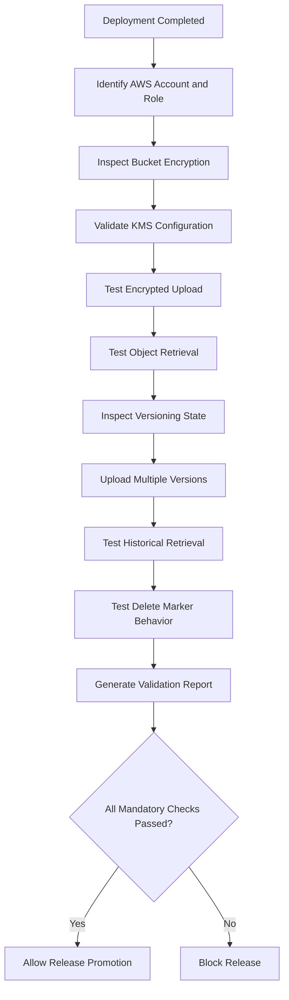
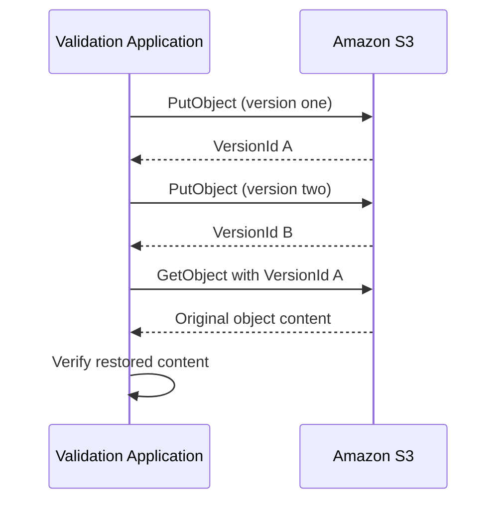

# 03- Validating Encryption and Versioning

## Overview

Encryption and versioning are essential S3 controls for protecting stored data and supporting recovery from accidental or unintended changes.

- **Encryption validation** verifies that objects are protected using the expected encryption algorithm and, where applicable, the correct AWS KMS key.
- **Versioning validation** verifies that object versions are retained and that previous versions can be retrieved when required.

Post-deployment validation must establish both configuration correctness and runtime behavior. A bucket may have default encryption enabled while application uploads use unexpected encryption settings. Similarly, versioning may have been enabled during deployment but subsequently suspended.

The validation process should confirm:

- Default bucket encryption matches the environment requirements.
- The expected KMS key is configured and usable.
- Application uploads produce correctly encrypted objects.
- Application identities can retrieve encrypted objects.
- Bucket versioning is enabled.
- Overwriting an object creates a new version.
- Historical versions can be retrieved.
- Delete-marker behavior matches recovery expectations.
- Validation failures prevent unsafe production promotion.

This document focuses on release validation rather than detailed encryption architecture, KMS policy design, lifecycle management, or replication configuration.

## Validation Architecture

Encryption and versioning validation should combine infrastructure inspection with controlled object operations.



### Validation Layers

| Layer | Validation target | Expected result |
|---|---|---|
| Bucket configuration | Default encryption | Required algorithm configured |
| KMS configuration | Encryption key | Expected key exists and is enabled |
| Application identity | KMS permissions | Required cryptographic operations succeed |
| Object configuration | Uploaded object | Expected encryption metadata |
| Versioning configuration | Bucket versioning state | `Enabled` |
| Version behavior | Object overwrite | New version created |
| Recovery behavior | Previous object version | Historical content retrievable |
| Deletion behavior | Versioned object deletion | Expected delete-marker behavior |

## Establish the Validation Identity

Run validation using the same AWS account, Region, and application role used by the deployed workload.

```bash
aws sts get-caller-identity
```

Example:

```json
{
  "UserId": "AROAEXAMPLE:deployment-validation",
  "Account": "123456789012",
  "Arn": "arn:aws:sts::123456789012:assumed-role/S3ValidationRole/deployment-validation"
}
```

Inspect the configured Region:

```bash
aws configure get region
```

Record the following information:

- AWS account ID.
- Assumed role ARN.
- Bucket name.
- Bucket Region.
- Deployment environment.
- Deployment identifier.
- Validation timestamp.

For CI/CD, use short-lived credentials obtained through an approved OIDC or role-assumption mechanism.

Avoid validating application permissions exclusively with administrator credentials. Administrator permissions can hide missing S3 and KMS permissions.

## Validate Default Bucket Encryption

### Inspect Encryption Configuration

Retrieve the deployed bucket encryption configuration:

```bash
aws s3api get-bucket-encryption \
  --bucket example-application-bucket
```

An SSE-S3 configuration typically returns:

```json
{
  "ServerSideEncryptionConfiguration": {
    "Rules": [
      {
        "ApplyServerSideEncryptionByDefault": {
          "SSEAlgorithm": "AES256"
        },
        "BucketKeyEnabled": false
      }
    ]
  }
}
```

An SSE-KMS configuration typically returns:

```json
{
  "ServerSideEncryptionConfiguration": {
    "Rules": [
      {
        "ApplyServerSideEncryptionByDefault": {
          "SSEAlgorithm": "aws:kms",
          "KMSMasterKeyID": "arn:aws:kms:ap-south-1:123456789012:key/11111111-2222-3333-4444-555555555555"
        },
        "BucketKeyEnabled": true
      }
    ]
  }
}
```

Validate:

- The encryption algorithm matches the deployment requirement.
- The KMS key identifier matches the expected key when SSE-KMS is required.
- The key belongs to the expected account and Region.
- Bucket Key configuration matches the intended design.
- The configuration contains the expected encryption rules.

### Encryption Configuration Reference

| Encryption type | S3 algorithm identifier | Validation focus |
|---|---|---|
| SSE-S3 | `AES256` | Default encryption is configured |
| SSE-KMS | `aws:kms` | Expected KMS key and permissions |
| DSSE-KMS | `aws:kms:dsse` | Dual-layer encryption configuration |
| SSE-C | Customer-provided key | Request-level encryption headers |
| Client-side encryption | Application-managed | Application encryption and key-management controls |

SSE-C and client-side encryption cannot be fully validated by inspecting bucket default encryption. They require request-level or application-level validation.

### Validate the Expected Algorithm

Do not merely check whether an encryption configuration exists.

For example, a production bucket requiring SSE-KMS should fail validation if its default configuration uses SSE-S3.

Similarly, when a specific customer-managed KMS key is required, validate the actual key identifier rather than accepting any KMS key.

## Validate the KMS Key

When SSE-KMS or DSSE-KMS is required, validate the referenced KMS key independently.

### Inspect Key Metadata

```bash
aws kms describe-key \
  --key-id arn:aws:kms:ap-south-1:123456789012:key/11111111-2222-3333-4444-555555555555
```

Verify:

- The key exists.
- The key is enabled.
- The key belongs to the expected Region.
- The key usage supports encryption and decryption.
- The key is not pending deletion.

A KMS key can exist while still being unusable by the application.

### Inspect the Key Policy

```bash
aws kms get-key-policy \
  --key-id arn:aws:kms:ap-south-1:123456789012:key/11111111-2222-3333-4444-555555555555 \
  --policy-name default
```

Verify that the application role and relevant AWS services have the required permissions.

| Operation | Typical KMS permission |
|---|---|
| Upload using SSE-KMS | `kms:GenerateDataKey` |
| Download SSE-KMS object | `kms:Decrypt` |
| Multipart upload using SSE-KMS | May require both `kms:GenerateDataKey` and `kms:Decrypt` |

Exact permission requirements depend on the operation and request path.

KMS authorization is separate from S3 authorization. An application may have `s3:PutObject` but still fail because it cannot use the configured KMS key.

For detailed authorization analysis, refer to the dedicated S3 Security documentation.

## Validate Encryption at Object Level

Bucket default encryption establishes the default applied to new uploads when the request does not specify another supported encryption configuration.

It does not prove that every existing object has the expected encryption settings.

Inspect representative objects individually.

### Inspect Object Metadata

```bash
aws s3api head-object \
  --bucket example-application-bucket \
  --key application/validation/document.pdf
```

For SSE-S3, the response should include:

```json
{
  "ServerSideEncryption": "AES256"
}
```

For SSE-KMS, the response should include fields similar to:

```json
{
  "ServerSideEncryption": "aws:kms",
  "SSEKMSKeyId": "arn:aws:kms:ap-south-1:123456789012:key/11111111-2222-3333-4444-555555555555",
  "BucketKeyEnabled": true
}
```

Validate the returned encryption algorithm and key identifier rather than assuming bucket defaults were applied correctly.

For SSE-C objects, the client must provide the required customer-provided key headers for applicable operations. Ordinary metadata inspection does not expose the customer-provided key.

### Validate Upload Encryption Behavior

Upload a controlled test object without explicitly specifying encryption headers:

```bash
printf "s3-encryption-validation\n" > /tmp/encryption-test.txt

aws s3api put-object \
  --bucket example-application-bucket \
  --key validation/encryption-test.txt \
  --body /tmp/encryption-test.txt
```

Inspect the object:

```bash
aws s3api head-object \
  --bucket example-application-bucket \
  --key validation/encryption-test.txt
```

This verifies the bucket's default encryption behavior for the tested request.

If the application explicitly supplies encryption headers, validate the application's actual upload implementation as well.

### Validate Explicit SSE-KMS Uploads

When the application is expected to specify the encryption key explicitly:

```bash
aws s3api put-object \
  --bucket example-application-bucket \
  --key validation/kms-test.txt \
  --body /tmp/encryption-test.txt \
  --server-side-encryption aws:kms \
  --ssekms-key-id arn:aws:kms:ap-south-1:123456789012:key/11111111-2222-3333-4444-555555555555
```

Inspect the uploaded object:

```bash
aws s3api head-object \
  --bucket example-application-bucket \
  --key validation/kms-test.txt
```

Execute the operation using the intended application identity.

### Validate Encryption in Backend Applications

For Python applications using Boto3:

```python
import boto3

s3 = boto3.client("s3", region_name="ap-south-1")

response = s3.put_object(
    Bucket="example-application-bucket",
    Key="validation/backend-upload.txt",
    Body=b"backend encryption validation",
    ServerSideEncryption="aws:kms",
    SSEKMSKeyId=(
        "arn:aws:kms:ap-south-1:123456789012:"
        "key/11111111-2222-3333-4444-555555555555"
    ),
)

print(response["ETag"])
```

Inspect the resulting object:

```python
metadata = s3.head_object(
    Bucket="example-application-bucket",
    Key="validation/backend-upload.txt",
)

assert metadata["ServerSideEncryption"] == "aws:kms"
assert metadata["SSEKMSKeyId"].endswith(
    "11111111-2222-3333-4444-555555555555"
)
```

In production, obtain the bucket and expected key from environment-specific configuration. Avoid embedding account-specific infrastructure identifiers directly in application source code.

## Validate Bucket Versioning

### Inspect Versioning State

```bash
aws s3api get-bucket-versioning \
  --bucket example-application-bucket
```

Possible responses include:

**Versioning enabled:**

```json
{
  "Status": "Enabled"
}
```

**Versioning suspended:**

```json
{
  "Status": "Suspended"
}
```

**Versioning never enabled:**

```json
{}
```

For workloads that require version recovery, the expected state is:

```json
{
  "Status": "Enabled"
}
```

Do not treat an empty response or `Suspended` as equivalent to `Enabled`.

### Why Versioning Must Be Validated After Deployment

Versioning can be changed independently of application deployment.

A release may deploy successfully while the bucket remains in an unexpected state because:

- The versioning resource was omitted from infrastructure configuration.
- An infrastructure update failed.
- Another deployment or operator suspended versioning.
- The wrong bucket was inspected.
- The validation process targeted the wrong account or Region.

For buckets whose recovery design depends on versioning, treat `Enabled` as a deployment invariant.

## Validate Actual Version Creation

Inspecting the versioning configuration proves that versioning is enabled. It does not prove that object version creation works as expected.

Use a dedicated validation key.

### Upload the First Version

```bash
printf "version-one\n" > /tmp/version-one.txt

aws s3api put-object \
  --bucket example-application-bucket \
  --key validation/version-test.txt \
  --body /tmp/version-one.txt
```

Capture the returned `VersionId`.

### Upload the Second Version

```bash
printf "version-two\n" > /tmp/version-two.txt

aws s3api put-object \
  --bucket example-application-bucket \
  --key validation/version-test.txt \
  --body /tmp/version-two.txt
```

Each successful upload should create a distinct object version.

### List Object Versions

```bash
aws s3api list-object-versions \
  --bucket example-application-bucket \
  --prefix validation/version-test.txt
```

Expected output contains entries under `Versions`, with different version IDs.

Example:

```json
{
  "Versions": [
    {
      "Key": "validation/version-test.txt",
      "VersionId": "version-id-2",
      "IsLatest": true
    },
    {
      "Key": "validation/version-test.txt",
      "VersionId": "version-id-1",
      "IsLatest": false
    }
  ]
}
```

The actual version IDs are generated by S3 and must not be hardcoded.

A version ID of `null` can occur for objects created before versioning was enabled or while versioning was suspended. Do not interpret every historical null version as evidence that the current bucket configuration is disabled.

## Validate Version Retrieval

Versioning is useful only when the required historical data can be retrieved.

Retrieve a specific version:

```bash
aws s3api get-object \
  --bucket example-application-bucket \
  --key validation/version-test.txt \
  --version-id version-id-1 \
  /tmp/version-one-restored.txt
```

Compare the content:

```bash
cmp /tmp/version-one.txt /tmp/version-one-restored.txt
```

For automated validation, capture version IDs from upload responses rather than using literal IDs.

### Version Retrieval Flow



This validates both version creation and historical retrieval.

## Validate Delete Marker Behavior

In a versioned bucket, a normal delete operation typically creates a delete marker rather than permanently deleting previous versions.

### Delete the Current Object

```bash
aws s3api delete-object \
  --bucket example-application-bucket \
  --key validation/version-test.txt
```

Inspect the response for a `DeleteMarker` field and the returned version ID.

### List Versions and Delete Markers

```bash
aws s3api list-object-versions \
  --bucket example-application-bucket \
  --prefix validation/version-test.txt
```

The output should show the delete marker and the retained object versions.

### Retrieve an Older Version

```bash
aws s3api get-object \
  --bucket example-application-bucket \
  --key validation/version-test.txt \
  --version-id version-id-1 \
  /tmp/recovered-version.txt
```

A delete marker does not remove historical versions.

Permanent deletion of a specific version requires its version ID:

```bash
aws s3api delete-object \
  --bucket example-application-bucket \
  --key validation/version-test.txt \
  --version-id version-id-1
```

Use permanent deletion only in a controlled validation environment and only when the test is specifically designed to exercise that behavior.

## Validate MFA Delete Where Required

MFA Delete adds an additional authentication requirement for certain versioning operations.

Inspect the configuration:

```bash
aws s3api get-bucket-versioning \
  --bucket example-application-bucket
```

If configured, the response may include:

```json
{
  "Status": "Enabled",
  "MFADelete": "Enabled"
}
```

MFA Delete is not a default requirement for every production bucket. Enable it only when the data-protection policy requires it and the operational model supports it.

Important considerations:

- MFA Delete configuration has special administrative requirements.
- Enabling or changing it is not a routine application deployment operation.
- Automated workloads should not assume that ordinary role-based credentials can perform MFA-protected operations.
- Validation should inspect the setting without attempting to modify it.

## Validate Encryption and Versioning Together

Encryption and versioning protect different aspects of object safety.

| Scenario | Encryption contribution | Versioning contribution |
|---|---|---|
| Unauthorized data exposure | Protects stored object data at rest | Does not prevent exposure |
| Accidental overwrite | Protects stored data cryptographically | Retains previous versions |
| Accidental deletion | Protects retained data at rest | Supports recovery from previous versions |
| KMS key unavailable | Can prevent decryption | Historical versions may also become inaccessible |
| Malicious object replacement | Does not prevent replacement by itself | Retains earlier versions |
| Permanent version deletion | Does not prevent deletion | Does not guarantee recovery afterward |

Versioning is not a substitute for backups or replication.

If an attacker or authorized operator permanently deletes object versions, versioning alone may not provide recovery. Similarly, if a KMS key is disabled, scheduled for deletion, or otherwise unavailable, retained SSE-KMS objects may become inaccessible.

Recovery design must account for both object retention and encryption-key availability.

## Automate Encryption and Versioning Validation

Use reusable validation scripts to ensure the same checks run consistently across development, staging, and production.

Recommended organization:

```text
validation/
├── check_public_access.py
├── check_encryption.py
├── check_versioning.py
└── release/
    ├── validate_encryption.py
    ├── validate_versioning_behavior.py
    └── validate_recovery.py
```

The release validators should consume environment-specific configuration rather than hardcoded production identifiers.

### Encryption Validation Responsibilities

A validator should:

1. Identify the AWS account and caller identity.
2. Retrieve the bucket's default encryption configuration.
3. Compare the configured algorithm with the expected algorithm.
4. Compare the KMS key identifier when applicable.
5. Verify the KMS key exists and is enabled when the validation role permits inspection.
6. Perform a controlled upload using the application identity.
7. Inspect the resulting object's encryption metadata.
8. Perform a controlled retrieval.
9. Report policy violations separately from operational errors.

### Versioning Validation Responsibilities

A validator should:

1. Retrieve the bucket versioning configuration.
2. Require `Status=Enabled` when the workload depends on versioning.
3. Upload a test object.
4. Upload a second version of the same test key.
5. Verify that distinct version IDs were returned.
6. Retrieve the previous version.
7. Verify the recovered content.
8. Clean up only the test versions created by the validation process.
9. Report unexpected configuration or operation failures.

### Structured Validation Results

Use a consistent result structure across release checks.

```json
{
  "check_id": "S3_ENCRYPTION_VALIDATION",
  "resource": "example-application-bucket",
  "status": "PASS",
  "severity": "HIGH",
  "message": "Default SSE-KMS configuration and test object encryption verified.",
  "environment": "staging",
  "account_id": "123456789012",
  "region": "ap-south-1"
}
```

Recommended statuses:

| Status | Meaning |
|---|---|
| `PASS` | Required configuration and behavior verified |
| `FAIL` | Configuration or behavior violates deployment requirements |
| `ERROR` | Validation could not establish the result |
| `NOT_APPLICABLE` | Check does not apply to this workload |

An access-denied error while inspecting a KMS key is not proof that encryption is misconfigured. It is an inspection failure that must be investigated separately.

Likewise, a failed object retrieval may result from missing S3 permissions, missing KMS permissions, an invalid version ID, or a missing object.

## Python Validation Example

The following example checks bucket default encryption and versioning configuration. It separates configuration inspection from runtime object tests.

```python
from __future__ import annotations

import argparse
import json
import sys
from dataclasses import asdict, dataclass

import boto3
from botocore.config import Config
from botocore.exceptions import BotoCoreError, ClientError


@dataclass
class CheckResult:
    check_id: str
    status: str
    message: str
    resource: str


def create_session(region: str) -> boto3.Session:
    return boto3.Session(region_name=region)


def create_s3_client(session: boto3.Session):
    return session.client(
        "s3",
        config=Config(
            retries={
                "mode": "standard",
                "max_attempts": 5,
            },
            connect_timeout=5,
            read_timeout=20,
        ),
    )


def check_encryption(
    s3,
    bucket: str,
    expected_algorithm: str,
    expected_kms_key: str | None,
) -> CheckResult:
    try:
        response = s3.get_bucket_encryption(Bucket=bucket)
        rules = response["ServerSideEncryptionConfiguration"]["Rules"]

        if not rules:
            return CheckResult(
                check_id="S3_DEFAULT_ENCRYPTION",
                status="FAIL",
                message="No default encryption rules were found.",
                resource=bucket,
            )

        configurations = [
            rule["ApplyServerSideEncryptionByDefault"]
            for rule in rules
        ]

        algorithms = {
            configuration.get("SSEAlgorithm")
            for configuration in configurations
        }

        if algorithms != {expected_algorithm}:
            return CheckResult(
                check_id="S3_DEFAULT_ENCRYPTION",
                status="FAIL",
                message=(
                    f"Expected {expected_algorithm}; "
                    f"found {sorted(str(value) for value in algorithms)}."
                ),
                resource=bucket,
            )

        if expected_kms_key:
            configured_keys = {
                configuration.get("KMSMasterKeyID")
                for configuration in configurations
            }

            if configured_keys != {expected_kms_key}:
                return CheckResult(
                    check_id="S3_DEFAULT_ENCRYPTION",
                    status="FAIL",
                    message="Configured KMS key does not match the expected key.",
                    resource=bucket,
                )

        return CheckResult(
            check_id="S3_DEFAULT_ENCRYPTION",
            status="PASS",
            message="Default encryption configuration matches expectations.",
            resource=bucket,
        )

    except ClientError as exc:
        return CheckResult(
            check_id="S3_DEFAULT_ENCRYPTION",
            status="ERROR",
            message=exc.response["Error"]["Code"],
            resource=bucket,
        )


def check_versioning(s3, bucket: str) -> CheckResult:
    try:
        response = s3.get_bucket_versioning(Bucket=bucket)
        status = response.get("Status")

        if status != "Enabled":
            return CheckResult(
                check_id="S3_VERSIONING",
                status="FAIL",
                message=f"Expected Enabled; found {status or 'Unconfigured'}.",
                resource=bucket,
            )

        return CheckResult(
            check_id="S3_VERSIONING",
            status="PASS",
            message="Bucket versioning is enabled.",
            resource=bucket,
        )

    except ClientError as exc:
        return CheckResult(
            check_id="S3_VERSIONING",
            status="ERROR",
            message=exc.response["Error"]["Code"],
            resource=bucket,
        )


def main() -> int:
    parser = argparse.ArgumentParser(
        description="Validate S3 encryption and versioning configuration."
    )
    parser.add_argument("--bucket", required=True)
    parser.add_argument("--region", required=True)
    parser.add_argument(
        "--expected-algorithm",
        choices=["AES256", "aws:kms", "aws:kms:dsse"],
        default="aws:kms",
    )
    parser.add_argument("--expected-kms-key")
    args = parser.parse_args()

    session = create_session(args.region)
    s3 = create_s3_client(session)

    results = [
        check_encryption(
            s3,
            args.bucket,
            args.expected_algorithm,
            args.expected_kms_key,
        ),
        check_versioning(s3, args.bucket),
    ]

    print(
        json.dumps(
            [asdict(result) for result in results],
            indent=2,
        )
    )

    if any(result.status == "ERROR" for result in results):
        return 2

    if any(result.status == "FAIL" for result in results):
        return 1

    return 0


if __name__ == "__main__":
    try:
        sys.exit(main())
    except (BotoCoreError, ClientError) as exc:
        print(
            json.dumps(
                {
                    "status": "ERROR",
                    "message": str(exc),
                }
            ),
            file=sys.stderr,
        )
        sys.exit(2)
```

Install the dependency:

```bash
pip install boto3
```

Run the validator:

```bash
python validate_s3.py \
  --bucket example-application-bucket \
  --region ap-south-1 \
  --expected-algorithm aws:kms \
  --expected-kms-key arn:aws:kms:ap-south-1:123456789012:key/11111111-2222-3333-4444-555555555555
```

Exit codes:

| Exit code | Meaning |
|---|---|
| `0` | All configuration checks passed |
| `1` | One or more compliance checks failed |
| `2` | Validation could not complete |

This example validates configuration only. Runtime encryption, KMS authorization, version creation, and historical recovery should be implemented as separate integration checks.

## CI/CD Integration

Encryption and versioning validation should run after infrastructure deployment and before production release promotion.

The validation job should:

- Authenticate through OIDC or an approved short-lived role.
- Confirm the expected AWS account.
- Inspect encryption and versioning configuration.
- Validate the KMS key where required.
- Execute controlled runtime tests.
- Publish structured validation results.
- Block release promotion when mandatory checks fail.

### Example GitHub Actions Workflow

```yaml
name: S3 Encryption and Versioning Validation

on:
  workflow_dispatch:

permissions:
  contents: read
  id-token: write

jobs:
  validate:
    runs-on: ubuntu-latest
    environment: staging

    env:
      AWS_REGION: ap-south-1
      S3_BUCKET: example-application-bucket
      EXPECTED_ENCRYPTION: aws:kms
      EXPECTED_KMS_KEY: ${{ vars.S3_KMS_KEY_ARN }}

    steps:
      - name: Checkout repository
        uses: actions/checkout@v4

      - name: Configure AWS credentials
        uses: aws-actions/configure-aws-credentials@v4
        with:
          role-to-assume: ${{ vars.AWS_VALIDATION_ROLE_ARN }}
          aws-region: ${{ env.AWS_REGION }}

      - name: Verify AWS identity
        run: aws sts get-caller-identity

      - name: Validate default encryption
        run: |
          aws s3api get-bucket-encryption \
            --bucket "$S3_BUCKET"

      - name: Validate versioning
        run: |
          aws s3api get-bucket-versioning \
            --bucket "$S3_BUCKET"

      - name: Validate KMS key
        if: env.EXPECTED_ENCRYPTION == 'aws:kms'
        run: |
          aws kms describe-key \
            --key-id "$EXPECTED_KMS_KEY"

      - name: Execute automated configuration checks
        run: |
          python -m pip install boto3
          python validation/validate_s3.py \
            --bucket "$S3_BUCKET" \
            --region "$AWS_REGION" \
            --expected-algorithm "$EXPECTED_ENCRYPTION" \
            --expected-kms-key "$EXPECTED_KMS_KEY"
```

The workflow demonstrates configuration validation. Extend it with runtime integration tests before using it as a complete production release gate.

For production:

- Pin third-party actions to reviewed immutable commit SHAs.
- Restrict OIDC trust to the intended repository and environment.
- Use a dedicated validation role.
- Separate infrastructure deployment permissions from validation permissions.
- Avoid printing credentials or sensitive application data in workflow logs.
- Run destructive versioning tests only against isolated validation keys.

## Monitoring and Operational Verification

Configuration validation is a deployment-time activity. Encryption and versioning also require ongoing operational checks.

### Encryption Monitoring

Monitor:

- Unexpected encryption configuration changes.
- KMS key disablement or scheduled deletion.
- KMS authorization failures.
- Failed uploads and downloads.
- Changes to bucket encryption configuration.
- Objects that do not satisfy the required encryption policy.

CloudTrail can provide evidence of relevant configuration and API activity when the required event logging is enabled.

### Versioning Monitoring

Monitor:

- Unexpected versioning suspension.
- Growth in noncurrent object versions.
- Unexpected delete-marker creation.
- Permanent version deletions.
- Lifecycle actions affecting noncurrent versions.
- Storage growth caused by retained versions.

S3 Inventory can provide object-level reporting, including version-related information when configured appropriately.

### Operational Decision Criteria

| Condition | Recommended response |
|---|---|
| Required encryption missing | Block release and correct bucket or request configuration |
| Wrong KMS key configured | Block release and verify infrastructure configuration |
| KMS key disabled | Investigate key state and recovery implications immediately |
| Versioning suspended | Block release when version recovery is mandatory |
| Previous version cannot be retrieved | Investigate S3 permissions, KMS permissions, and version ID |
| Noncurrent versions growing unexpectedly | Review lifecycle and retention policy |
| Unexpected permanent version deletion | Initiate recovery investigation using available backups or replicas |

Do not automatically delete old versions to reduce costs without checking retention and recovery requirements.

## Troubleshooting Encryption and Versioning

Use a repeatable diagnostic process to distinguish configuration failures from runtime authorization and recovery failures.

### Default Encryption Configuration Missing

**Symptoms**

- `get-bucket-encryption` reports that server-side encryption configuration does not exist.
- Deployment validation fails.

**Possible causes**

- Encryption configuration was not deployed.
- Validation targets the wrong bucket.
- Infrastructure deployment partially failed.
- The validation role lacks permission to inspect the configuration.

**Verification**

```bash
aws sts get-caller-identity

aws s3api get-bucket-encryption \
  --bucket example-application-bucket
```

Determine whether the API returned a missing-configuration response or an authorization error.

**Corrective action**

Apply the expected infrastructure configuration and rerun validation using the intended identity.

### Wrong Encryption Algorithm

**Symptoms**

- Bucket reports `AES256` when the deployment requires SSE-KMS.
- Object metadata differs from the expected algorithm.

**Possible causes**

- Incorrect infrastructure variables.
- An outdated deployment.
- Application upload requests use an unexpected encryption configuration.
- Validation targets a different environment.

**Verification**

Inspect both bucket configuration and actual object metadata.

Correcting bucket defaults does not retroactively change existing objects.

### KMS Access Denied

**Symptoms**

- Upload or download fails for SSE-KMS objects.
- S3 access works for other objects.

**Possible causes**

- Missing `kms:GenerateDataKey`.
- Missing `kms:Decrypt`.
- Key policy does not authorize the application role.
- Application references the wrong KMS key.
- Key is disabled or unavailable.

**Verification**

```bash
aws kms describe-key \
  --key-id arn:aws:kms:ap-south-1:123456789012:key/11111111-2222-3333-4444-555555555555
```

Inspect the key policy and application role permissions.

**Corrective action**

Grant only the required cryptographic permissions and verify an upload and download using the application identity.

### Versioning Not Enabled

**Symptoms**

- `get-bucket-versioning` returns an empty status or `Suspended`.
- Overwrites do not produce the expected historical versions.

**Possible causes**

- Versioning resource missing from deployment.
- Versioning was suspended after deployment.
- Wrong bucket or account is being inspected.

**Verification**

```bash
aws s3api get-bucket-versioning \
  --bucket example-application-bucket
```

**Corrective action**

Enable versioning through the approved infrastructure or operational process, then verify the state again.

Enabling versioning does not reconstruct historical versions that were never retained.

### Previous Version Cannot Be Retrieved

**Symptoms**

- `GetObject` with a version ID fails.
- Current object retrieval works.

**Possible causes**

- Incorrect version ID.
- Version was permanently deleted.
- Application lacks `s3:GetObjectVersion`.
- KMS permissions are missing for the historical object.
- Requested key does not match the version.

**Verification**

```bash
aws s3api list-object-versions \
  --bucket example-application-bucket \
  --prefix validation/version-test.txt
```

Verify the exact key and version ID, then inspect S3 and KMS permissions.

### Unexpected Delete Marker

**Symptoms**

- Object appears missing even though older versions exist.
- `GetObject` without a version ID returns not found.

**Cause**

A delete marker is the current version of the key.

**Verification**

```bash
aws s3api list-object-versions \
  --bucket example-application-bucket \
  --prefix application/
```

**Corrective action**

Retrieve the required historical version by version ID or remove the delete marker through an approved recovery procedure.

Do not permanently delete versions during an incident without confirming retention and recovery requirements.

## Production Validation Checklist

### Encryption

- [ ] Validation runs under the expected AWS account and role.
- [ ] Bucket default encryption configuration exists.
- [ ] Encryption algorithm matches the environment requirement.
- [ ] Expected KMS key identifier is configured when required.
- [ ] KMS key exists and is enabled.
- [ ] KMS key policy permits the intended application operations.
- [ ] Test upload succeeds using the application identity.
- [ ] Uploaded object reports the expected encryption metadata.
- [ ] Test download succeeds.
- [ ] Encryption configuration changes are monitored.

### Versioning

- [ ] Bucket versioning state is `Enabled`.
- [ ] Two uploads create distinct version IDs.
- [ ] Historical versions can be retrieved.
- [ ] Delete-marker behavior is understood.
- [ ] Required application permissions include version operations.
- [ ] Noncurrent-version retention is aligned with recovery requirements.
- [ ] Permanent version deletion is restricted to approved workflows.
- [ ] Versioning configuration changes are monitored.

### Release Readiness

- [ ] Validation checks are automated.
- [ ] Test objects use isolated validation keys.
- [ ] Test cleanup removes only versions created by the validation process.
- [ ] Compliance failures block release promotion.
- [ ] Operational errors are reported separately from compliance failures.
- [ ] Validation evidence is retained.
- [ ] Backup and replication recovery assumptions are tested independently.

## Common Mistakes and Pitfalls

| Mistake | Why it is problematic | Prevention |
|---|---|---|
| Checking only bucket default encryption | Existing objects may have different encryption settings | Inspect representative objects and test uploads |
| Assuming SSE-KMS works because the key exists | The application may lack KMS permissions | Test encryption and decryption with the workload role |
| Treating KMS and S3 permissions as one layer | A request can pass S3 authorization but fail at KMS | Diagnose both services independently |
| Assuming enabling versioning restores old data | Versioning cannot recreate versions that were not retained | Enable versioning before production writes |
| Treating an empty versioning response as enabled | An empty response does not mean versioning is enabled | Require `Status=Enabled` |
| Assuming delete removes all versions | Normal deletion usually creates a delete marker | Inspect version IDs and delete markers |
| Permanently deleting test versions without tracking them | Validation can remove unrelated recovery data | Capture and clean up only test-generated version IDs |
| Ignoring KMS key lifecycle | Retained encrypted objects can become inaccessible if key material becomes unavailable | Protect keys and test recovery dependencies |
| Treating versioning as a complete backup strategy | Versioning does not protect against every permanent deletion or account-level failure | Implement independent backup and recovery controls |
| Testing with administrator credentials | Hides application permission gaps | Validate with the actual workload identity |

## Key Takeaways

- Validate both bucket default encryption and actual object encryption; configuration alone does not prove runtime behavior.
- SSE-KMS requires separate validation of S3 permissions, KMS permissions, key state, and key policy.
- Require `Status=Enabled` when version recovery is part of the production design.
- Test version creation, historical retrieval, and delete-marker behavior using isolated validation objects.
- Versioning supports recovery but does not replace independent backups, replication, or encryption-key protection.