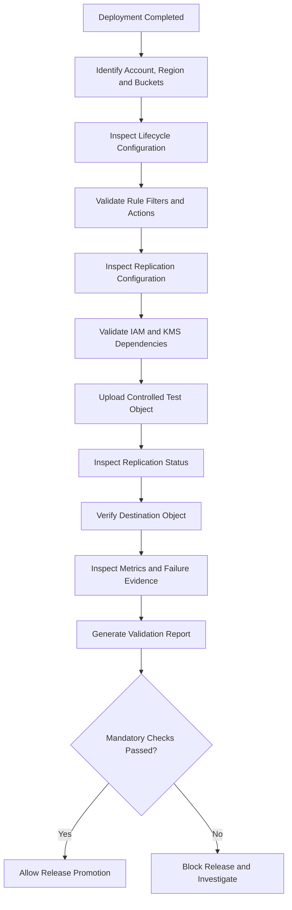
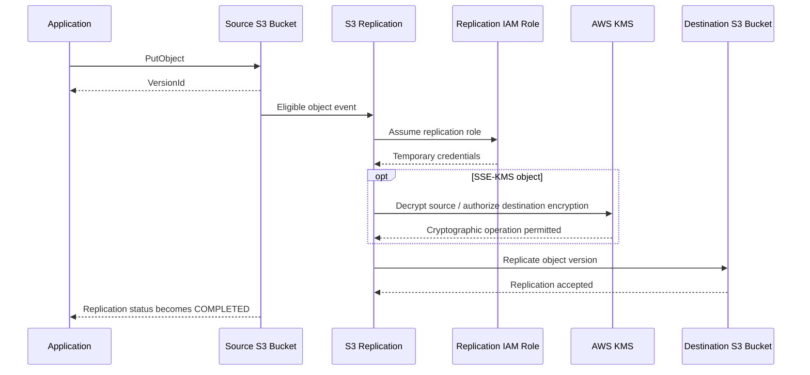

# 04- Lifecycle and Replication Validation

## Overview

Amazon S3 Lifecycle and Replication configurations control how objects are retained, transitioned between storage classes, expired, and copied to other buckets or Regions.

They directly affect storage costs, data availability, recovery objectives, and compliance requirements. A deployment can complete successfully while lifecycle rules are incomplete, replication permissions are incorrect, or destination objects are not being replicated.

Post-deployment validation must establish both configuration correctness and actual runtime behavior.

This document covers:

- Lifecycle configuration inspection and rule validation.
- Storage-class transition configuration.
- Current and noncurrent object expiration.
- Incomplete multipart upload cleanup.
- Replication configuration and IAM dependency validation.
- Replication behavior and object replication status.
- Cross-Region Replication (CRR) and Same-Region Replication (SRR).
- Replication metrics and failure investigation.
- Release acceptance criteria and rollback considerations.

Detailed lifecycle design, storage-class selection, and replication architecture belong in their respective S3 Operations, Concepts, and Advanced Features documents. This document focuses on verifying deployed behavior.

## Validation Architecture

Lifecycle and replication validation should combine infrastructure inspection, controlled object operations, and operational evidence.



### Validation Layers

| Layer | Validation target | Expected result |
|---|---|---|
| Lifecycle configuration | Rules exist | Expected rules are deployed |
| Lifecycle filters | Prefixes, tags, or size filters | Match intended object population |
| Transition actions | Storage-class transitions | Correct target storage classes |
| Expiration actions | Current and noncurrent versions | Retention requirements preserved |
| Multipart cleanup | Incomplete uploads | Cleanup policy configured |
| Replication configuration | Replication rules | Expected destination and scope |
| Replication permissions | IAM and KMS | Required operations authorized |
| Runtime replication | Test object | Destination receives replicated object |
| Replication status | Source object metadata | Expected replication state |
| Monitoring | Metrics and events | Failures and delays observable |

## Establish the Validation Environment

Run validation using an approved deployment or validation identity.

```bash
aws sts get-caller-identity
```

Inspect the configured Region:

```bash
aws configure get region
```

Record:

- AWS account ID.
- Source bucket name and Region.
- Destination bucket name and Region.
- Environment.
- Replication rule identifier.
- Expected lifecycle policy version.
- Deployment identifier.
- Validation timestamp.

For cross-account replication, record the destination account ID as well.

Do not assume that source and destination buckets belong to the same account or Region. Validate each resource using the correct account and Region context.

## Validate Lifecycle Configuration

### Inspect Lifecycle Rules

Retrieve the deployed lifecycle configuration:

```bash
aws s3api get-bucket-lifecycle-configuration \
  --bucket example-application-bucket
```

A configuration may contain transition, expiration, noncurrent-version, and multipart-upload cleanup actions.

Example:

```json
{
  "Rules": [
    {
      "ID": "archive-application-logs",
      "Status": "Enabled",
      "Filter": {
        "Prefix": "logs/"
      },
      "Transitions": [
        {
          "Days": 30,
          "StorageClass": "STANDARD_IA"
        },
        {
          "Days": 90,
          "StorageClass": "GLACIER"
        }
      ],
      "Expiration": {
        "Days": 365
      }
    }
  ]
}
```

Validate:

- Every required rule exists.
- Rule identifiers are unique within the configuration.
- Rules are enabled.
- Filters target the intended objects.
- Transition days and storage classes match the deployment specification.
- Expiration periods match retention requirements.
- Noncurrent-version actions are configured where required.
- Incomplete multipart upload cleanup is configured where required.

A missing lifecycle configuration and an authorization failure are different conditions. Investigate the returned API error before classifying the bucket as noncompliant.

### Validate Rule Filters

Lifecycle rules can apply to:

- All objects.
- A prefix.
- Objects with specific tags.
- Objects matching supported combinations of filters.
- Objects matching size constraints.

A correct transition action with an incorrect filter can affect the wrong data population.

For example:

```json
{
  "ID": "archive-tenant-exports",
  "Status": "Enabled",
  "Filter": {
    "And": {
      "Prefix": "exports/",
      "Tags": [
        {
          "Key": "data-classification",
          "Value": "archive"
        }
      ]
    }
  },
  "Transitions": [
    {
      "Days": 60,
      "StorageClass": "GLACIER"
    }
  ]
}
```

The rule applies only to objects matching both the prefix and tag conditions.

Validation should compare the complete filter structure, not merely search for the presence of a prefix.

### Validate Transition Actions

Inspect transition actions and compare them against the intended policy.

| Action | Validation requirement |
|---|---|
| `Transitions` | Correct target storage class and transition timing |
| `NoncurrentVersionTransitions` | Correct treatment of historical versions |
| `Expiration` | Correct current-object expiration period |
| `NoncurrentVersionExpiration` | Correct historical-version retention |
| `AbortIncompleteMultipartUpload` | Expected cleanup age |

Be aware that lifecycle transitions are asynchronous. A valid configuration does not mean an object transitions immediately after deployment.

Also consider storage-class minimum storage durations, retrieval charges, transition request costs, and restrictions associated with particular storage classes.

### Validate Current Object Expiration

For a versioned bucket, current-object expiration generally creates a delete marker rather than permanently deleting all historical versions.

This distinction is important because a lifecycle rule may make an object disappear from ordinary listings while its historical versions remain stored.

Inspect the versioning configuration:

```bash
aws s3api get-bucket-versioning \
  --bucket example-application-bucket
```

Inspect lifecycle expiration actions:

```bash
aws s3api get-bucket-lifecycle-configuration \
  --bucket example-application-bucket \
  --query 'Rules[].{ID:ID,Expiration:Expiration}'
```

Confirm that expiration behavior matches the retention design.

### Validate Noncurrent Version Expiration

For versioned buckets, historical versions can continue generating storage costs after the current version expires.

Inspect noncurrent-version actions:

```bash
aws s3api get-bucket-lifecycle-configuration \
  --bucket example-application-bucket \
  --query 'Rules[].{ID:ID,Transitions:NoncurrentVersionTransitions,Expiration:NoncurrentVersionExpiration}'
```

Validate:

- The noncurrent retention period is correct.
- Noncurrent transitions target the intended storage classes.
- Newer noncurrent versions are retained where required.
- Retention settings do not conflict with recovery objectives.

Do not introduce aggressive noncurrent-version expiration simply to reduce storage costs. It can remove the versions needed for application recovery or incident investigation.

### Validate Incomplete Multipart Upload Cleanup

Incomplete multipart uploads can consume storage even when an object was never completed.

Inspect the lifecycle configuration:

```bash
aws s3api get-bucket-lifecycle-configuration \
  --bucket example-application-bucket \
  --query 'Rules[].AbortIncompleteMultipartUpload'
```

An example rule action is:

```json
{
  "ID": "cleanup-incomplete-uploads",
  "Status": "Enabled",
  "Filter": {
    "Prefix": ""
  },
  "AbortIncompleteMultipartUpload": {
    "DaysAfterInitiation": 7
  }
}
```

The cleanup period should be aligned with legitimate upload duration and retry behavior.

For example, a large file upload system may need a longer window than a workload that uploads small objects.

Inspect existing multipart uploads:

```bash
aws s3api list-multipart-uploads \
  --bucket example-application-bucket
```

This command provides evidence of outstanding multipart uploads. It does not prove that the lifecycle rule has executed successfully.

### Validate Lifecycle Rule Conflicts

Multiple lifecycle rules may apply to the same object.

Review overlapping filters and actions carefully.

Potential problems include:

- An expiration rule that conflicts with a retention requirement.
- A broad prefix filter that captures unrelated objects.
- A noncurrent-version expiration rule that removes recoverable versions too early.
- A transition rule that increases retrieval costs for frequently accessed data.
- A cleanup period shorter than the maximum supported application upload duration.

S3 evaluates lifecycle rules according to its lifecycle processing semantics. Do not assume that rule order in the JSON configuration represents execution order.

## Validate Lifecycle Behavior

Lifecycle configuration inspection verifies deployment state. Runtime transition and expiration behavior requires separate evidence.

### Controlled Lifecycle Test

Use an isolated test prefix:

```text
validation/lifecycle/
```

Upload a controlled object:

```bash
printf "lifecycle-validation\n" > /tmp/lifecycle-test.txt

aws s3api put-object \
  --bucket example-application-bucket \
  --key validation/lifecycle/lifecycle-test.txt \
  --body /tmp/lifecycle-test.txt
```

Inspect the object:

```bash
aws s3api head-object \
  --bucket example-application-bucket \
  --key validation/lifecycle/lifecycle-test.txt
```

Review the lifecycle rules and verify that the test object matches the intended filter.

Do not modify the object's creation timestamp or claim that a transition has been tested merely because the rule exists.

Lifecycle processing is asynchronous. A newly uploaded object will not immediately transition because a lifecycle rule is configured.

### Validate Existing Object Transitions

For objects that have already reached a configured transition age, inspect storage class:

```bash
aws s3api head-object \
  --bucket example-application-bucket \
  --key logs/2026/application.log \
  --query '{StorageClass:StorageClass,LastModified:LastModified}'
```

A missing `StorageClass` field commonly indicates the `STANDARD` storage class.

Compare the actual object state against its age, lifecycle filters, and transition configuration.

### Validate Expiration Carefully

Expiration testing should use a dedicated test bucket or isolated test objects with a short-lived test lifecycle policy.

Do not shorten production retention policies temporarily to accelerate a release test.

For versioned buckets, inspect both versions and delete markers:

```bash
aws s3api list-object-versions \
  --bucket example-application-bucket \
  --prefix validation/lifecycle/
```

This distinguishes a current delete marker from permanent deletion of historical versions.

## Validate Replication Configuration

S3 replication copies eligible objects from a source bucket to a destination bucket using a configured replication role and rule.

Replication can be used for:

- Cross-Region recovery.
- Same-Region data duplication.
- Cross-account storage isolation.
- Centralized data collection.
- Compliance and data-protection requirements.

Replication validation must cover the rule, destination, permissions, encryption dependencies, and actual object behavior.

### Inspect Replication Configuration

```bash
aws s3api get-bucket-replication \
  --bucket example-source-bucket
```

Example:

```json
{
  "ReplicationConfiguration": {
    "Role": "arn:aws:iam::123456789012:role/S3ReplicationRole",
    "Rules": [
      {
        "ID": "replicate-application-data",
        "Status": "Enabled",
        "Priority": 1,
        "Filter": {
          "Prefix": "application/"
        },
        "DeleteMarkerReplication": {
          "Status": "Disabled"
        },
        "Destination": {
          "Bucket": "arn:aws:s3:::example-destination-bucket",
          "StorageClass": "STANDARD_IA"
        }
      }
    ]
  }
}
```

Validate:

- Replication configuration exists.
- The expected role ARN is configured.
- The rule is enabled.
- The destination bucket ARN is correct.
- The rule filter matches intended objects.
- Rule priority and filter behavior are correct when multiple rules exist.
- Destination storage class matches the design.
- Delete-marker replication behavior matches requirements.
- Replication metrics and RTC configuration are present when required.

A successful `get-bucket-replication` response proves that configuration can be inspected. It does not prove that replication is functioning.

### Validate Source and Destination Versioning

Both source and destination buckets must have versioning enabled for S3 live replication.

Inspect the source:

```bash
aws s3api get-bucket-versioning \
  --bucket example-source-bucket
```

Inspect the destination:

```bash
aws s3api get-bucket-versioning \
  --bucket example-destination-bucket \
  --region ap-south-1
```

For cross-Region replication, specify the destination Region when appropriate.

Both buckets should report:

```json
{
  "Status": "Enabled"
}
```

Versioning suspension on either bucket can invalidate replication requirements.

### Validate the Replication Role

Inspect the replication role:

```bash
aws iam get-role \
  --role-name S3ReplicationRole
```

Inspect attached policies:

```bash
aws iam list-attached-role-policies \
  --role-name S3ReplicationRole
```

Inspect inline policies:

```bash
aws iam list-role-policies \
  --role-name S3ReplicationRole
```

Validate that:

- The role trusts the S3 replication service.
- The source bucket permissions allow replication to read eligible objects and their metadata.
- The role can replicate objects to the destination.
- Required version and delete-marker permissions are present when those operations are configured.
- KMS permissions are present when replicating SSE-KMS objects.
- Destination bucket policy permits the replication role when cross-account access requires it.

A role existing is not sufficient evidence that its policies are correct.

### Validate Destination Bucket Configuration

Inspect the destination bucket's Region:

```bash
aws s3api get-bucket-location \
  --bucket example-destination-bucket
```

Inspect destination encryption:

```bash
aws s3api get-bucket-encryption \
  --bucket example-destination-bucket
```

Inspect destination versioning:

```bash
aws s3api get-bucket-versioning \
  --bucket example-destination-bucket
```

Confirm that destination configuration supports the intended replication workflow.

For SSE-KMS replication, verify the relevant source and destination KMS key permissions and replication configuration. The replication role may need access to decrypt the source object and encrypt the destination object.

Do not treat successful replication of an SSE-S3 test object as proof that SSE-KMS replication is correctly configured.

## Validate Cross-Region and Same-Region Replication

| Validation area | CRR | SRR |
|---|---|---|
| Source bucket versioning | Required | Required |
| Destination bucket versioning | Required | Required |
| Different Regions | Yes | No |
| Cross-account destination | Supported | Supported |
| Replication IAM role | Required | Required |
| KMS permissions | Required when applicable | Required when applicable |
| Network path | AWS-managed service path | AWS-managed service path |
| Recovery objective | Regional data availability | Same-Region data duplication |
| Destination verification | Required | Required |

The presence of a replication rule does not establish that the destination provides application failover.

Application recovery also depends on DNS, service deployment, database recovery, identity permissions, configuration, and operational procedures.

## Validate Runtime Replication

The strongest replication validation is a controlled source upload followed by destination verification.

### Upload a Test Object to the Source

```bash
printf "replication-validation\n" > /tmp/replication-test.txt

aws s3api put-object \
  --bucket example-source-bucket \
  --key validation/replication/replication-test.txt \
  --body /tmp/replication-test.txt
```

Capture the returned source version ID.

### Inspect Source Replication Status

```bash
aws s3api head-object \
  --bucket example-source-bucket \
  --key validation/replication/replication-test.txt
```

For objects subject to replication, the response can contain:

```json
{
  "ReplicationStatus": "PENDING"
}
```

Possible replication statuses include:

| Status | Meaning |
|---|---|
| `PENDING` | Replication is pending |
| `COMPLETED` | Replication completed |
| `FAILED` | Replication failed |
| `REPLICA` | Object is a replica |

Not every object has a replication status. Objects outside the rule's scope or objects created before replication was configured may not have the expected status.

### Verify the Destination Object

```bash
aws s3api head-object \
  --bucket example-destination-bucket \
  --key validation/replication/replication-test.txt \
  --region ap-south-1
```

Verify:

- The object exists.
- The content matches the source.
- The destination object has the expected encryption.
- The destination storage class matches the rule.
- The object is identified as a replica where applicable.

Download and compare content:

```bash
aws s3api get-object \
  --bucket example-destination-bucket \
  --key validation/replication/replication-test.txt \
  --region ap-south-1 \
  /tmp/replication-restored.txt

cmp /tmp/replication-test.txt /tmp/replication-restored.txt
```

Do not assume source and destination ETags are always identical. Multipart uploads and encryption behavior can affect ETag values. Use content checksums or a controlled download-and-compare test when data integrity must be established.

### Replication Runtime Flow



Replication is asynchronous. A source upload can succeed while the destination object is still pending.

## Validate Replication Metrics and RTC

Replication metrics provide operational evidence about replication progress and failures.

When configured, inspect the replication configuration for metrics and Replication Time Control settings.

Example rule fragment:

```json
{
  "ID": "replicate-critical-data",
  "Status": "Enabled",
  "Priority": 1,
  "Filter": {
    "Prefix": "critical/"
  },
  "Destination": {
    "Bucket": "arn:aws:s3:::example-destination-bucket",
    "Metrics": {
      "Status": "Enabled",
      "EventThreshold": {
        "Minutes": 15
      }
    },
    "ReplicationTime": {
      "Status": "Enabled",
      "Time": {
        "Minutes": 15
      }
    }
  }
}
```

Replication Time Control is an additional feature with specific eligibility and cost implications. Confirm feature availability and requirements for the intended replication configuration.

### Monitoring Signals

Monitor:

- Bytes pending replication.
- Operations pending replication.
- Replication latency.
- Operations that failed replication.
- Source objects with `PENDING` or `FAILED` status.
- Destination object arrival time.

Use CloudWatch metrics for the appropriate replication rule and source bucket.

Example metric inspection:

```bash
aws cloudwatch list-metrics \
  --namespace AWS/S3 \
  --metric-name BytesPendingReplication
```

Metric dimensions depend on the replication configuration. Inspect available dimensions before building dashboards or alarms.

### Replication Acceptance Criteria

| Signal | Expected condition |
|---|---|
| Pending bytes | Returns to normal after replication backlog clears |
| Pending operations | No unexplained sustained growth |
| Replication latency | Within the workload's target |
| Failed operations | Zero unexplained failures |
| Source object status | `COMPLETED` for the test object |
| Destination availability | Test object retrievable |
| RTC target | Within the configured commitment when enabled and eligible |

A single successful object replication does not prove sustained replication performance. Production validation should also examine metrics over an appropriate observation window.

## Validate Existing Objects and Batch Replication

Live replication generally applies to eligible objects created after replication is configured. It does not automatically replicate every existing object.

If the deployment requires historical data replication, validate the use of S3 Batch Replication or another approved backfill process.

Validation should establish:

- The historical object population is identified.
- The batch operation includes the intended objects and versions.
- The required permissions are available.
- Failed tasks are visible.
- Completion reports are retained.
- Destination object counts and integrity are checked.

Do not assume that enabling a live replication rule backfills existing objects.

## Automate Lifecycle and Replication Validation

Automated validation should compare actual AWS configuration against environment-specific expected state.

Recommended responsibilities:

| Validator | Responsibility |
|---|---|
| Lifecycle configuration validator | Compare rules, filters, transitions, and expiration |
| Versioning dependency validator | Confirm source and destination versioning |
| Replication configuration validator | Compare role, rules, filters, and destination |
| IAM dependency validator | Inspect replication role and required permissions |
| KMS dependency validator | Verify relevant encryption-key configuration |
| Runtime replication validator | Upload and verify a controlled object |
| Operational metrics validator | Evaluate pending and failed replication signals |

### Structured Validation Results

Use a consistent result format.

```json
{
  "check_id": "S3_REPLICATION_RUNTIME",
  "resource": "example-source-bucket",
  "status": "PASS",
  "message": "Validation object replicated and retrieved from destination.",
  "environment": "staging",
  "source_region": "ap-south-1",
  "destination_region": "ap-southeast-1",
  "destination_bucket": "example-destination-bucket"
}
```

Recommended statuses:

| Status | Meaning |
|---|---|
| `PASS` | Required configuration or behavior verified |
| `FAIL` | Configuration or behavior violates requirements |
| `ERROR` | Validation could not establish the result |
| `PENDING` | Asynchronous operation has not completed |
| `NOT_APPLICABLE` | Check does not apply to this workload |

A replication test still in `PENDING` state should not be reported as a successful runtime test.

## Python Replication Validation Example

The following example uploads a controlled object, waits for replication to complete, and verifies that the destination object can be retrieved.

It assumes that:

- Source and destination buckets already exist.
- Replication is configured.
- The caller can upload and inspect source objects.
- The caller can inspect and retrieve destination objects.
- The source key matches an enabled replication rule.
- The test prefix is reserved for validation.

```python
from __future__ import annotations

import argparse
import hashlib
import sys
import time
from dataclasses import dataclass

import boto3
from botocore.config import Config
from botocore.exceptions import BotoCoreError, ClientError


@dataclass
class ValidationResult:
    status: str
    message: str
    source_version_id: str | None = None


def create_s3_client(region: str):
    return boto3.client(
        "s3",
        region_name=region,
        config=Config(
            retries={
                "mode": "standard",
                "max_attempts": 5,
            },
            connect_timeout=5,
            read_timeout=20,
        ),
    )


def wait_for_replication(
    source_s3,
    bucket: str,
    key: str,
    timeout_seconds: int,
) -> str:
    deadline = time.monotonic() + timeout_seconds

    while time.monotonic() < deadline:
        response = source_s3.head_object(
            Bucket=bucket,
            Key=key,
        )

        status = response.get("ReplicationStatus")

        if status == "COMPLETED":
            return status

        if status == "FAILED":
            raise RuntimeError(
                f"Replication failed for s3://{bucket}/{key}"
            )

        time.sleep(5)

    raise TimeoutError(
        f"Replication did not complete within {timeout_seconds} seconds."
    )


def validate_replication(
    source_bucket: str,
    destination_bucket: str,
    source_region: str,
    destination_region: str,
    key: str,
    timeout_seconds: int,
) -> ValidationResult:
    source_s3 = create_s3_client(source_region)
    destination_s3 = create_s3_client(destination_region)

    payload = (
        f"replication-validation:{time.time_ns()}"
    ).encode("utf-8")

    source_checksum = hashlib.sha256(payload).hexdigest()

    try:
        upload_response = source_s3.put_object(
            Bucket=source_bucket,
            Key=key,
            Body=payload,
            ContentType="text/plain",
            Metadata={
                "validation": "replication",
                "sha256": source_checksum,
            },
        )

        version_id = upload_response.get("VersionId")

        if not version_id:
            raise RuntimeError(
                "Source upload did not return a version ID. "
                "Check source bucket versioning."
            )

        wait_for_replication(
            source_s3=source_s3,
            bucket=source_bucket,
            key=key,
            timeout_seconds=timeout_seconds,
        )

        destination_response = destination_s3.get_object(
            Bucket=destination_bucket,
            Key=key,
        )

        destination_payload = destination_response["Body"].read()
        destination_checksum = hashlib.sha256(
            destination_payload
        ).hexdigest()

        if destination_checksum != source_checksum:
            raise RuntimeError(
                "Source and destination content checksums differ."
            )

        return ValidationResult(
            status="PASS",
            message="Replication completed and destination content verified.",
            source_version_id=version_id,
        )

    except (ClientError, BotoCoreError, RuntimeError, TimeoutError) as exc:
        return ValidationResult(
            status="ERROR",
            message=str(exc),
        )


def main() -> int:
    parser = argparse.ArgumentParser(
        description="Validate S3 runtime replication."
    )
    parser.add_argument("--source-bucket", required=True)
    parser.add_argument("--destination-bucket", required=True)
    parser.add_argument("--source-region", required=True)
    parser.add_argument("--destination-region", required=True)
    parser.add_argument("--key", required=True)
    parser.add_argument("--timeout", type=int, default=300)

    args = parser.parse_args()

    if not args.key.startswith("validation/replication/"):
        parser.error(
            "The test key must be under validation/replication/."
        )

    result = validate_replication(
        source_bucket=args.source_bucket,
        destination_bucket=args.destination_bucket,
        source_region=args.source_region,
        destination_region=args.destination_region,
        key=args.key,
        timeout_seconds=args.timeout,
    )

    print(result)

    return 0 if result.status == "PASS" else 2


if __name__ == "__main__":
    try:
        sys.exit(main())
    except (BotoCoreError, ClientError) as exc:
        print(f"Validation error: {exc}", file=sys.stderr)
        sys.exit(2)
```

Install the dependency:

```bash
pip install boto3
```

Run:

```bash
python validate_replication.py \
  --source-bucket example-source-bucket \
  --destination-bucket example-destination-bucket \
  --source-region ap-south-1 \
  --destination-region ap-southeast-1 \
  --key validation/replication/release-check.txt \
  --timeout 300
```

This example validates a newly uploaded object and its destination content. It does not validate every replication rule, historical object backfill, delete-marker replication, or KMS-specific behavior.

For production use, extend the validator to capture structured JSON results, verify destination encryption and storage class, and clean up only the exact test versions it created.

## CI/CD Integration

Lifecycle and replication validation should execute after infrastructure deployment and before production release promotion.

A release pipeline should:

1. Authenticate using an approved short-lived AWS role.
2. Verify account and Region.
3. Inspect lifecycle configuration.
4. Validate source and destination versioning.
5. Inspect replication rules.
6. Verify replication role and encryption dependencies.
7. Execute controlled replication tests.
8. Evaluate replication metrics where required.
9. Publish validation results.
10. Block promotion when mandatory checks fail.

### Example GitHub Actions Workflow

```yaml
name: S3 Lifecycle and Replication Validation

on:
  workflow_dispatch:

permissions:
  contents: read
  id-token: write

jobs:
  validate:
    runs-on: ubuntu-latest
    environment: staging

    env:
      AWS_REGION: ap-south-1
      SOURCE_BUCKET: example-source-bucket
      DESTINATION_BUCKET: example-destination-bucket
      DESTINATION_REGION: ap-southeast-1

    steps:
      - name: Checkout repository
        uses: actions/checkout@v4

      - name: Configure AWS credentials
        uses: aws-actions/configure-aws-credentials@v4
        with:
          role-to-assume: ${{ vars.AWS_VALIDATION_ROLE_ARN }}
          aws-region: ${{ env.AWS_REGION }}

      - name: Verify AWS identity
        run: aws sts get-caller-identity

      - name: Inspect lifecycle configuration
        run: |
          aws s3api get-bucket-lifecycle-configuration \
            --bucket "$SOURCE_BUCKET"

      - name: Inspect source versioning
        run: |
          aws s3api get-bucket-versioning \
            --bucket "$SOURCE_BUCKET"

      - name: Inspect destination versioning
        run: |
          aws s3api get-bucket-versioning \
            --bucket "$DESTINATION_BUCKET" \
            --region "$DESTINATION_REGION"

      - name: Inspect replication configuration
        run: |
          aws s3api get-bucket-replication \
            --bucket "$SOURCE_BUCKET"

      - name: Execute runtime replication test
        run: |
          python -m pip install boto3
          python validation/validate_replication.py \
            --source-bucket "$SOURCE_BUCKET" \
            --destination-bucket "$DESTINATION_BUCKET" \
            --source-region "$AWS_REGION" \
            --destination-region "$DESTINATION_REGION" \
            --key "validation/replication/${GITHUB_RUN_ID}.txt"
```

This workflow is an execution example. Before using it as a production release gate:

- Add explicit configuration comparison against approved expected values.
- Verify that both buckets belong to the intended accounts.
- Add IAM and KMS dependency checks.
- Add lifecycle filter and action validation.
- Add cleanup for test objects and their versions.
- Pin third-party actions to reviewed immutable commit SHAs.
- Restrict the validation role to the required resources and operations.
- Separate validation permissions from infrastructure deployment permissions.

## Troubleshooting Lifecycle and Replication

Use the following diagnostic flow to distinguish configuration failures, authorization failures, asynchronous processing delays, and data-retention behavior.

### Lifecycle Configuration Missing

**Symptoms**

- `get-bucket-lifecycle-configuration` returns no lifecycle configuration.
- Required transition or expiration behavior is absent.

**Possible causes**

- Lifecycle configuration was not deployed.
- Deployment targeted another bucket.
- An infrastructure update failed.
- Validation identity lacks inspection permissions.

**Verification**

```bash
aws s3api get-bucket-lifecycle-configuration \
  --bucket example-application-bucket
```

**Corrective action**

Inspect deployment state and apply the expected lifecycle configuration through the approved infrastructure workflow.

### Object Did Not Transition

**Symptoms**

- Object remains in `STANDARD`.
- Lifecycle rule exists and is enabled.

**Possible causes**

- Object does not match the rule filter.
- Object has not reached the required age.
- Transition is asynchronous.
- Storage-class restrictions prevent the intended transition.
- Lifecycle configuration was changed after the object was created.

**Verification**

Inspect object metadata:

```bash
aws s3api head-object \
  --bucket example-application-bucket \
  --key logs/2026/application.log
```

Inspect lifecycle configuration:

```bash
aws s3api get-bucket-lifecycle-configuration \
  --bucket example-application-bucket
```

Compare object age, filters, and transition conditions.

**Corrective action**

Correct the filter or transition configuration if necessary. Do not assume that an asynchronous transition failure is equivalent to a missing rule.

### Unexpected Object Expiration

**Symptoms**

- Object is no longer visible in ordinary listings.
- Historical versions may still exist.

**Possible causes**

- Expiration rule matches a broader prefix than intended.
- Tag-based filters were applied incorrectly.
- Current-object expiration created a delete marker.
- Noncurrent-version expiration removed historical data.

**Verification**

```bash
aws s3api list-object-versions \
  --bucket example-application-bucket \
  --prefix application/
```

Inspect lifecycle filters and noncurrent-version actions.

**Corrective action**

Correct the lifecycle policy and assess recovery options using retained versions, backups, or replicas.

### Replication Configuration Missing

**Symptoms**

- `get-bucket-replication` reports no replication configuration.
- Expected rule is absent.

**Possible causes**

- Replication configuration was not deployed.
- Configuration update failed.
- Wrong source bucket or account was inspected.
- Validation role lacks permissions.

**Verification**

```bash
aws s3api get-bucket-replication \
  --bucket example-source-bucket
```

**Corrective action**

Inspect infrastructure state and deployment logs. Apply the intended replication configuration only after confirming the source and destination resources.

### Replication Remains Pending

**Symptoms**

- Source object reports `PENDING`.
- Destination object is not yet available.

**Possible causes**

- Normal asynchronous processing delay.
- Replication role permissions are incomplete.
- Destination bucket policy denies the role.
- KMS permissions are missing.
- Destination configuration is incompatible.
- Replication backlog is increasing.

**Verification**

Inspect source object metadata:

```bash
aws s3api head-object \
  --bucket example-source-bucket \
  --key application/document.pdf
```

Inspect replication configuration:

```bash
aws s3api get-bucket-replication \
  --bucket example-source-bucket
```

Inspect replication metrics and CloudTrail evidence where available.

**Corrective action**

Identify whether the failure is authorization-related, configuration-related, or a processing delay. Correct the relevant dependency and verify with a new controlled upload.

### Replication Failed

**Symptoms**

- Source object reports `FAILED`.
- Destination object is absent or incomplete.

**Possible causes**

- Replication role cannot read the source version.
- Destination bucket policy denies writes.
- KMS decryption or encryption authorization fails.
- Destination key configuration is incorrect.
- Replication rule does not support the object's configuration.

**Verification**

Inspect:

- Source replication status.
- Replication role trust policy.
- Replication role permissions.
- Destination bucket policy.
- Source and destination KMS key policies.
- Relevant CloudTrail events and replication metrics.

**Corrective action**

Fix the failing authorization or configuration dependency. For objects that already failed replication, use the appropriate S3 Batch Replication or approved recovery workflow when applicable. Do not assume that correcting the live rule automatically retries every previously failed object.

### Existing Objects Were Not Replicated

**Symptoms**

- New uploads replicate successfully.
- Objects created before replication configuration remain absent at the destination.

**Cause**

Live replication does not automatically backfill all existing objects.

**Corrective action**

Use S3 Batch Replication or another approved historical data transfer process. Validate the resulting task reports and destination object integrity.

## Rollback Considerations

Lifecycle and replication changes can have delayed or irreversible consequences.

A release rollback must distinguish configuration rollback from data recovery.

### Lifecycle Rollback

If a lifecycle rule is incorrect:

- Disable or correct the affected rule.
- Verify the corrected configuration.
- Determine whether objects have already transitioned or expired.
- Recover data from retained versions, replicas, or backups where necessary.
- Confirm that retention requirements remain satisfied.

Removing an expiration rule does not restore objects already permanently deleted by lifecycle processing.

Changing a transition rule does not necessarily move previously transitioned objects back to their former storage class.

### Replication Rollback

If a replication configuration is incorrect:

- Disable or correct the affected replication rule through the approved deployment process.
- Investigate pending and failed objects.
- Verify destination object integrity.
- Preserve existing replicas unless deletion is explicitly required.
- Confirm whether historical objects require a separate backfill or recovery operation.
- Validate source and destination access independently.

Removing a replication rule does not automatically remove objects already replicated to the destination.

### Rollback Decision Matrix

| Failure | Recommended response |
|---|---|
| Incorrect lifecycle prefix | Correct the rule and inspect affected objects |
| Premature expiration | Stop further expiration and investigate recovery |
| Incorrect transition class | Correct configuration and assess retrieval or transition costs |
| Missing multipart cleanup | Deploy the required cleanup action |
| Incorrect replication destination | Disable or correct the rule and inspect destination data |
| Replication IAM failure | Restore required permissions and retest |
| KMS replication failure | Correct key permissions and validate encrypted replication |
| Replication backlog | Investigate metrics and processing failures before changing rules |

## Production Validation Checklist

### Lifecycle

- [ ] Lifecycle configuration exists.
- [ ] Required rules are enabled.
- [ ] Rule filters match the intended object population.
- [ ] Transition actions use the correct storage classes.
- [ ] Transition periods match workload requirements.
- [ ] Current-object expiration matches retention policy.
- [ ] Noncurrent-version transitions and expiration are correct.
- [ ] Incomplete multipart upload cleanup is configured.
- [ ] Overlapping rules have been reviewed.
- [ ] Lifecycle costs and retrieval implications have been considered.
- [ ] Runtime behavior has been tested using controlled objects or existing eligible objects.

### Replication

- [ ] Source bucket versioning is enabled.
- [ ] Destination bucket versioning is enabled.
- [ ] Replication configuration exists.
- [ ] Expected rules are enabled.
- [ ] Rule filters and priorities are correct.
- [ ] Destination bucket ARN and Region are correct.
- [ ] Replication role trust policy is correct.
- [ ] Replication role permissions are sufficient.
- [ ] Destination bucket policy permits required replication operations.
- [ ] KMS dependencies are validated where applicable.
- [ ] A controlled object has replicated successfully.
- [ ] Destination object content has been verified.
- [ ] Replication metrics and failure signals are monitored.
- [ ] Historical object replication requirements are addressed separately.

### Release Readiness

- [ ] Validation runs under the intended AWS identity.
- [ ] Source and destination account IDs are verified.
- [ ] Test objects use isolated validation prefixes.
- [ ] Test cleanup removes only test-generated versions.
- [ ] Lifecycle and replication failures block release promotion when mandatory.
- [ ] Asynchronous operations are not incorrectly reported as successful.
- [ ] Validation evidence is retained.
- [ ] Rollback procedures account for already-executed lifecycle and replication actions.

## Common Mistakes and Pitfalls

| Mistake | Why it is problematic | Prevention |
|---|---|---|
| Checking only whether lifecycle configuration exists | Rules may have incorrect filters or actions | Compare the complete configuration |
| Assuming lifecycle actions execute immediately | Lifecycle processing is asynchronous | Validate configuration and later object state separately |
| Ignoring noncurrent versions | Historical versions continue consuming storage | Validate noncurrent transitions and expiration |
| Assuming current expiration permanently removes all versions | Versioned buckets may retain historical versions and create delete markers | Inspect version listings |
| Treating multipart cleanup as object expiration | Incomplete uploads are a separate storage concern | Validate `AbortIncompleteMultipartUpload` |
| Assuming a replication rule proves replication works | IAM, KMS, and destination policies may still block replication | Perform an end-to-end test |
| Forgetting destination versioning | Live replication requirements are not satisfied | Validate both buckets |
| Assuming live replication backfills existing objects | Historical objects may remain unreplicated | Use an explicit backfill process |
| Comparing ETags as universal checksums | Multipart and encryption behavior can affect ETags | Verify content checksums |
| Treating `PENDING` as immediate failure | Replication is asynchronous | Evaluate latency and failure metrics |
| Assuming rule removal reverses completed actions | Existing transitions and replicas remain | Plan rollback as a data-recovery operation |
| Ignoring replication costs | Cross-Region transfer, requests, storage, and RTC can increase costs | Include cost analysis in release approval |

## Key Takeaways

- Validate complete lifecycle rules, including filters, transitions, expiration, noncurrent versions, and incomplete multipart cleanup.
- Lifecycle configuration is asynchronous; verify actual object state without assuming immediate execution.
- Replication validation requires source and destination versioning, correct IAM and KMS permissions, and an end-to-end object test.
- Live replication does not automatically backfill historical objects; use an explicit backfill process when required.
- Lifecycle and replication rollback must account for actions already executed and data already transferred or deleted.