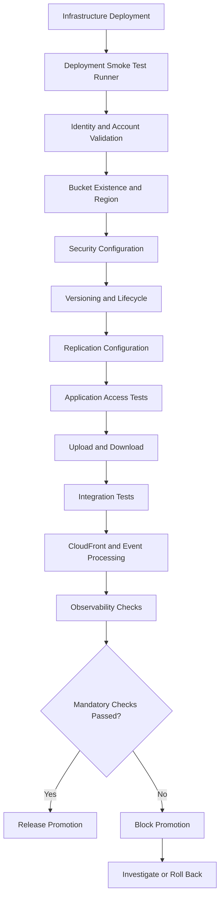
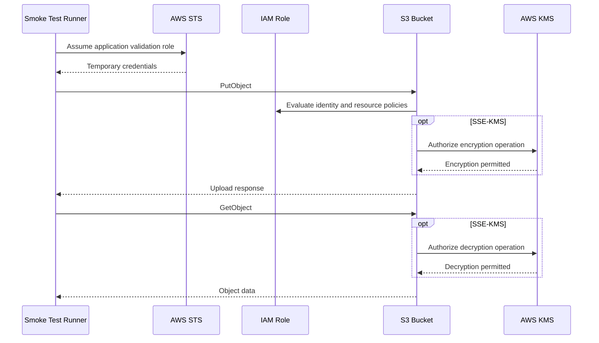
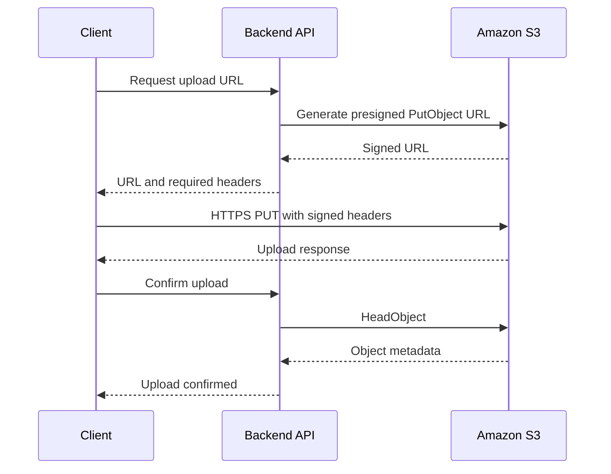
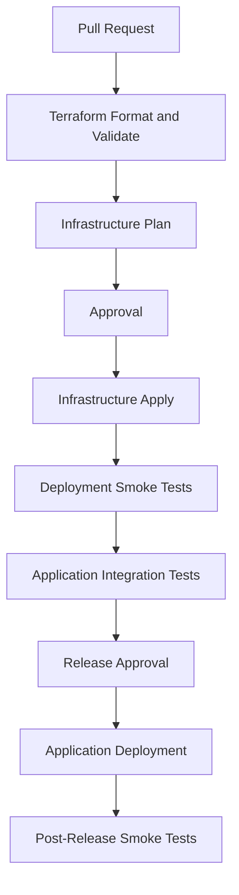
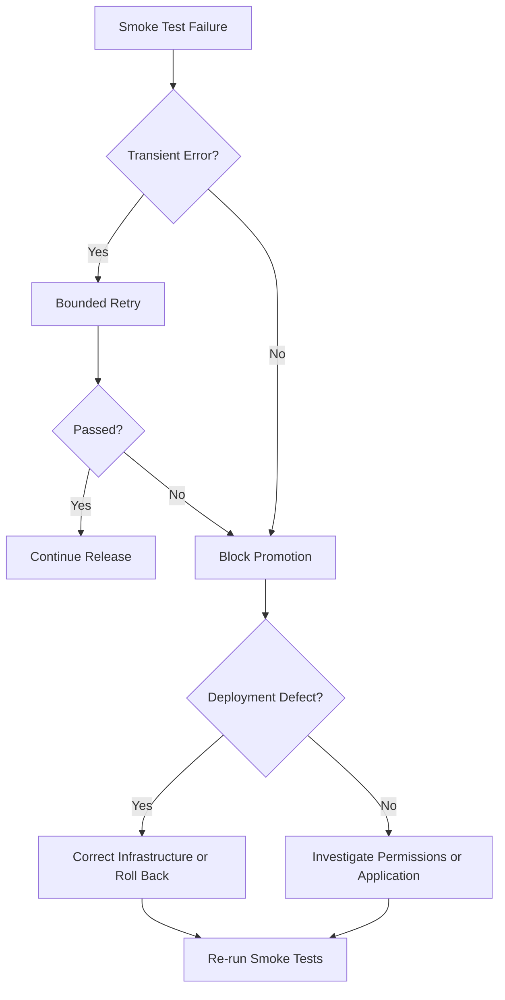

# 05- Infrastructure Deployment Smoke Tests

## Overview

Infrastructure deployment smoke tests verify that an Amazon S3 deployment is operational immediately after provisioning or updating infrastructure.

A successful Terraform apply, CloudFormation stack update, or CDK deployment confirms that AWS accepted the requested infrastructure changes. It does not necessarily prove that the resulting resources behave correctly from an application or operational perspective.

For example:

- A bucket may exist but have versioning disabled.
- Default encryption may be configured with an unexpected KMS key.
- A bucket policy may prevent the application role from uploading objects.
- A CloudFront distribution may exist but return errors when accessing its S3 origin.
- An S3 event notification may be configured but fail to invoke its target.
- A Lambda function may be deployed but unable to access its required resources.

Smoke tests provide a fast, focused validation layer between infrastructure deployment and application release promotion.

This document establishes a practical smoke-testing strategy for S3 infrastructure, including resource discovery, configuration checks, application-level operations, event-driven integrations, security validation, and rollback decisions.

## Smoke Testing Architecture

Smoke tests should validate infrastructure at multiple levels rather than relying on a single successful AWS API response.



### Validation Layers

| Layer | Purpose | Example |
|---|---|---|
| Deployment | Confirm infrastructure resources exist | Bucket and distribution discovery |
| Configuration | Validate deployed settings | Encryption, versioning, public access |
| Authorization | Verify intended identities can perform operations | Application role upload |
| Data plane | Validate actual object operations | Upload, retrieve, delete |
| Integration | Verify dependent services | Lambda invocation, CloudFront delivery |
| Observability | Confirm operational signals exist | Logs, metrics, alarms |
| Recovery | Verify recovery-related dependencies | Version retrieval and replica availability |

A smoke test should be fast, deterministic, and safe to repeat. It should not replace comprehensive infrastructure tests, security assessments, load tests, or disaster-recovery exercises.

## Define Smoke Test Scope

The test suite should be environment-aware.

Development environments may run a broader set of destructive tests against isolated resources. Production smoke tests should use dedicated validation prefixes, restricted identities, and non-destructive operations wherever possible.

### Recommended Test Categories

| Category | Required checks | Production execution |
|---|---|---|
| AWS identity | Account, role, Region | Yes |
| Bucket discovery | Expected bucket exists | Yes |
| Bucket security | Public access block, ownership, encryption | Yes |
| Versioning | Expected state | Yes |
| Lifecycle | Required rules exist | Yes |
| Replication | Required rules and destination | When applicable |
| Application access | Expected role can access resources | Yes |
| Object operations | Controlled upload and retrieval | Yes |
| CloudFront | Distribution and origin behavior | When applicable |
| Event processing | Test event reaches consumer | When applicable |
| Monitoring | Required metrics and alarms exist | Yes |
| Recovery | Version or replica retrieval | According to release policy |

### Define Explicit Acceptance Criteria

Every mandatory smoke test should have an expected result.

For example:

| Check | Expected result | Failure severity |
|---|---|---|
| Bucket existence | Bucket is accessible in expected account | Critical |
| Default encryption | Approved encryption algorithm configured | Critical |
| Public access block | Required settings enabled | Critical |
| Versioning | Enabled when required | Critical |
| Application upload | Successful | Critical |
| Application download | Content matches uploaded content | Critical |
| Lifecycle configuration | Required rules deployed | High |
| Replication configuration | Expected rule deployed | High |
| CloudFront request | Successful response | High |
| CloudWatch alarms | Required alarms exist | Medium |

Do not make every check mandatory for every bucket. A static website bucket, an application upload bucket, and a replication destination have different operational requirements.

## Validate AWS Identity and Deployment Context

Smoke tests must first establish which AWS account and identity they are using.

This prevents accidental validation against the wrong environment.

### Verify Caller Identity

```bash
aws sts get-caller-identity
```

Example response:

```json
{
  "UserId": "AROAEXAMPLE:deployment-validation",
  "Account": "123456789012",
  "Arn": "arn:aws:sts::123456789012:assumed-role/S3ValidationRole/deployment-validation"
}
```

Compare the account ID and assumed role against the environment configuration.

### Verify Region

```bash
aws configure get region
```

For critical deployments, configure the Region explicitly rather than depending on a developer's local AWS configuration.

```bash
export AWS_REGION="ap-south-1"
export EXPECTED_ACCOUNT_ID="123456789012"
export S3_BUCKET="example-application-bucket"
```

### Account Validation

A simple shell check can prevent accidental execution against the wrong account.

```bash
ACTUAL_ACCOUNT_ID=$(
  aws sts get-caller-identity \
    --query Account \
    --output text
)

if [ "$ACTUAL_ACCOUNT_ID" != "$EXPECTED_ACCOUNT_ID" ]; then
  echo "Unexpected AWS account: $ACTUAL_ACCOUNT_ID" >&2
  exit 1
fi
```

Use environment-specific configuration or CI/CD variables for expected account IDs. Do not derive production identity from an untrusted deployment parameter.

## Validate Bucket Provisioning

### Confirm Bucket Existence and Region

Inspect the bucket:

```bash
aws s3api head-bucket \
  --bucket example-application-bucket
```

Inspect its Region:

```bash
aws s3api get-bucket-location \
  --bucket example-application-bucket
```

The `get-bucket-location` response uses `null` for the `us-east-1` Region. Validation logic must normalize this behavior instead of treating it as an invalid Region.

For example:

```bash
LOCATION=$(
  aws s3api get-bucket-location \
    --bucket example-application-bucket \
    --query LocationConstraint \
    --output text
)

if [ "$LOCATION" = "None" ] || [ "$LOCATION" = "null" ]; then
  LOCATION="us-east-1"
fi

echo "Bucket Region: $LOCATION"
```

A failed `head-bucket` request does not always mean that the bucket does not exist. It can also indicate missing permissions or an incorrect endpoint.

### Validate Bucket Ownership and Public Access Controls

Inspect Object Ownership:

```bash
aws s3api get-bucket-ownership-controls \
  --bucket example-application-bucket
```

Inspect bucket-level Block Public Access:

```bash
aws s3api get-public-access-block \
  --bucket example-application-bucket
```

Expected production settings commonly include:

```json
{
  "PublicAccessBlockConfiguration": {
    "BlockPublicAcls": true,
    "IgnorePublicAcls": true,
    "BlockPublicPolicy": true,
    "RestrictPublicBuckets": true
  }
}
```

Validate the actual response against the environment's security requirements.

For workloads using CloudFront with Origin Access Control, the S3 origin should remain private. CloudFront access should be authorized through the intended bucket policy.

### Validate Default Encryption

Inspect encryption:

```bash
aws s3api get-bucket-encryption \
  --bucket example-application-bucket
```

Example SSE-KMS configuration:

```json
{
  "ServerSideEncryptionConfiguration": {
    "Rules": [
      {
        "ApplyServerSideEncryptionByDefault": {
          "SSEAlgorithm": "aws:kms",
          "KMSMasterKeyID": "arn:aws:kms:ap-south-1:123456789012:key/example-key-id"
        },
        "BucketKeyEnabled": true
      }
    ]
  }
}
```

Validate:

- The configured algorithm matches the security baseline.
- The expected KMS key is configured when required.
- Bucket Key settings match the deployment specification.
- The application role has the necessary KMS permissions.
- The KMS key is enabled and usable.

A successful encryption configuration check does not prove that the application identity can encrypt or decrypt objects. Perform a separate runtime operation when SSE-KMS is part of the application workflow.

### Validate Versioning

```bash
aws s3api get-bucket-versioning \
  --bucket example-application-bucket
```

Expected response:

```json
{
  "Status": "Enabled"
}
```

If versioning is required, an absent status or `Suspended` status should fail the corresponding smoke test.

## Validate Lifecycle and Replication Dependencies

Lifecycle and replication validation should use the same acceptance criteria defined in their dedicated validation documents.

### Lifecycle Smoke Test

Inspect the deployed configuration:

```bash
aws s3api get-bucket-lifecycle-configuration \
  --bucket example-application-bucket
```

Check for:

- Required rule identifiers.
- Enabled rule status.
- Correct prefixes and tags.
- Expected transition actions.
- Current-object expiration.
- Noncurrent-version expiration.
- Incomplete multipart upload cleanup.

Do not wait for an actual lifecycle transition during a deployment smoke test. Lifecycle processing is asynchronous and may not occur immediately.

### Replication Smoke Test

Inspect replication configuration:

```bash
aws s3api get-bucket-replication \
  --bucket example-source-bucket
```

Validate:

- Expected destination bucket ARN.
- Enabled replication rules.
- Correct source filters.
- Correct replication role.
- Required source and destination versioning.
- KMS compatibility where applicable.

For a controlled runtime replication test, upload an object under a dedicated validation prefix and verify the destination object.

Replication is asynchronous. Use a bounded polling interval and report `PENDING` separately from `FAILED`.

Do not block every infrastructure release until a long-running replication operation completes unless the release's acceptance policy explicitly requires it.

## Validate Application-Level Access

Infrastructure deployment should be tested using the identity that the application actually uses.

An administrator's successful upload does not prove that an ECS task role, EKS workload identity, EC2 instance profile, Lambda execution role, or CI/CD role has the required access.

### Application Access Model



### Validate Upload and Download

Use a dedicated validation prefix:

```text
validation/smoke-tests/
```

Create a test file:

```bash
printf "s3-infrastructure-smoke-test\n" > /tmp/s3-smoke-test.txt
```

Upload:

```bash
aws s3api put-object \
  --bucket example-application-bucket \
  --key validation/smoke-tests/smoke-test.txt \
  --body /tmp/s3-smoke-test.txt \
  --content-type text/plain
```

Inspect metadata:

```bash
aws s3api head-object \
  --bucket example-application-bucket \
  --key validation/smoke-tests/smoke-test.txt
```

Download:

```bash
aws s3api get-object \
  --bucket example-application-bucket \
  --key validation/smoke-tests/smoke-test.txt \
  /tmp/s3-smoke-test-downloaded.txt
```

Compare content:

```bash
cmp \
  /tmp/s3-smoke-test.txt \
  /tmp/s3-smoke-test-downloaded.txt
```

A successful upload and download confirms that the tested identity can perform those operations for that object and configuration.

It does not prove that every application operation is authorized. Test additional actions only when required by the application contract.

### Validate Deletion

Deletion tests should be isolated from production data.

For a versioned bucket, a normal delete operation creates a delete marker rather than permanently removing historical versions.

A safer production smoke-test strategy is to:

- Upload a uniquely named test object.
- Record its version ID.
- Verify the object.
- Remove only the test object or its exact version according to the approved cleanup policy.

Example:

```bash
aws s3api delete-object \
  --bucket example-application-bucket \
  --key validation/smoke-tests/smoke-test.txt \
  --version-id "$TEST_VERSION_ID"
```

Do not use broad recursive deletion commands against production buckets as part of routine smoke tests.

## Validate Presigned URL Workflows

Applications frequently use presigned URLs to transfer files directly between clients and S3.

A smoke test should verify the complete authorization and HTTP flow, not merely the ability to generate a URL.

### Upload Flow



Validate:

- URL generation succeeds.
- The URL targets the expected bucket and key.
- The expiration period matches policy.
- Required headers are included.
- The client can upload using HTTPS.
- The backend can inspect the resulting object.
- An unauthorized or expired URL is rejected.

Example HTTP upload:

```bash
curl --fail-with-body \
  --request PUT \
  --upload-file /tmp/s3-smoke-test.txt \
  --header "Content-Type: text/plain" \
  "$PRESIGNED_UPLOAD_URL"
```

The request must use the same signed headers and HTTP method used when generating the URL.

Presigned URL testing should not log the full URL because it contains temporary authorization material.

## Validate CloudFront Integration

For private S3 origins, validate both the distribution and its origin access configuration.

### Inspect Distribution State

```bash
aws cloudfront get-distribution \
  --id EXAMPLE_DISTRIBUTION_ID
```

Check:

- Distribution status is `Deployed`.
- Distribution is enabled.
- The expected S3 origin is configured.
- Origin Access Control is attached where required.
- Cache behavior targets the intended origin.
- Viewer protocol policy enforces HTTPS where required.
- The configured alternate domain names and certificate match the deployment.

CloudFront distribution configuration is global. Use the appropriate CloudFront API endpoint and permissions rather than assuming that an S3 bucket Region controls the distribution's API Region.

### Validate OAC Configuration

```bash
aws cloudfront get-origin-access-control \
  --id EXAMPLE_OAC_ID
```

Compare the returned configuration against the deployment specification.

Also inspect the S3 bucket policy to ensure that the intended CloudFront distribution is authorized to read the origin objects.

### Execute an HTTP Smoke Test

```bash
curl --silent \
  --show-error \
  --output /dev/null \
  --write-out '%{http_code}\n' \
  https://cdn.example.com/health.txt
```

Expected result:

```text
200
```

For stronger validation, check:

- Response status.
- Content type.
- Expected content.
- Cache behavior.
- HTTPS certificate validity.
- Redirect behavior.

A CloudFront `403` can indicate an origin permission problem, missing object, or an incorrect origin path. A `502` or `503` requires separate investigation of the distribution and origin response.

Do not treat a successful distribution API response as proof that content delivery works.

## Validate Event-Driven Integrations

S3 deployments often include event notifications that trigger Lambda functions or route events through SNS, SQS, or EventBridge.

The deployment smoke test should establish that the notification configuration exists and that a controlled event reaches the intended consumer.

### Inspect S3 Event Notification Configuration

```bash
aws s3api get-bucket-notification-configuration \
  --bucket example-application-bucket
```

Validate:

- Expected notification destinations exist.
- Event types are correct.
- Prefix and suffix filters are correct.
- Lambda, SNS, or SQS destinations are configured as expected.
- Required resource policies permit invocation or delivery.

### Validate Lambda Configuration

```bash
aws lambda get-function-configuration \
  --function-name s3-image-processor
```

Check:

- Function state is active.
- Runtime and handler match the release.
- Execution role is correct.
- Environment variables are present.
- Timeout and memory configuration match requirements.

Inspect the Lambda resource policy:

```bash
aws lambda get-policy \
  --function-name s3-image-processor
```

The S3 service must be authorized to invoke the function when direct S3 notifications are used.

### Validate Event Delivery

Upload a controlled test object under the configured input prefix:

```bash
aws s3api put-object \
  --bucket example-application-bucket \
  --key incoming/smoke-tests/event-test.txt \
  --body /tmp/s3-smoke-test.txt
```

Inspect the consumer's logs:

```bash
aws logs tail \
  /aws/lambda/s3-image-processor \
  --since 10m
```

Verify that:

- The event was received.
- The expected object key was processed.
- Processing completed successfully.
- Output was written to the expected destination.
- Duplicate delivery does not produce incorrect results.

S3 event notifications provide at-least-once delivery and are not guaranteed to arrive in the same order as object operations. Consumers must be idempotent.

For SQS-based workflows, validate queue depth, message delivery, visibility timeout, retry behavior, and dead-letter queue configuration as appropriate.

## Validate Monitoring and Operational Visibility

A deployed resource is not production-ready if failures cannot be detected.

Smoke tests should verify that required monitoring resources exist and that their configuration is usable.

### Validate CloudWatch Alarms

```bash
aws cloudwatch describe-alarms \
  --alarm-name-prefix s3-
```

Inspect:

- Alarm existence.
- Metric namespace and dimensions.
- Thresholds.
- Evaluation periods.
- Alarm actions.
- Notification targets.

For bucket request metrics, verify that request metrics are enabled where required.

S3 storage metrics and request metrics have different availability and cost characteristics. Do not assume every bucket automatically exposes every operational metric.

### Validate Logging

Check that the relevant log groups exist:

```bash
aws logs describe-log-groups \
  --log-group-name-prefix /aws/lambda/
```

For CloudTrail, verify that the intended trail is configured and logging:

```bash
aws cloudtrail get-trail-status \
  --name example-audit-trail
```

Smoke tests should not generate excessive log volume or expose object contents, presigned URLs, credentials, or sensitive metadata.

### Operational Acceptance Criteria

| Signal | Expected state |
|---|---|
| Required CloudWatch alarms | Present and correctly configured |
| Lambda log group | Present when Lambda is deployed |
| CloudTrail trail | Logging when required |
| Event processing errors | No unexplained failures |
| S3 request failures | Within the defined baseline |
| Replication backlog | Within the defined operational threshold |

## Build a Reusable Smoke Test Runner

A reusable smoke test runner should:

- Read environment configuration.
- Validate the AWS account and identity.
- Inspect bucket configuration.
- Perform controlled data-plane operations.
- Report individual check results.
- Distinguish failed checks from operational errors.
- Return a nonzero exit code when mandatory checks fail.
- Avoid destructive operations outside dedicated validation resources.

The following implementation provides a practical baseline for S3 bucket deployment validation.

### Project Structure

```text
validation/
├── s3_smoke_test.py
└── requirements.txt
```

### Dependencies

`requirements.txt`:

```text
boto3>=1.35,<2.0
```

Use a reviewed dependency lock file in production CI/CD rather than relying on an unconstrained runtime installation.

### Smoke Test Implementation

`s3_smoke_test.py`:

```python
from __future__ import annotations

import argparse
import hashlib
import json
import logging
import sys
import uuid

from dataclasses import asdict, dataclass
from typing import Any

import boto3

from botocore.config import Config
from botocore.exceptions import BotoCoreError, ClientError


logger = logging.getLogger("s3-smoke-test")


@dataclass
class CheckResult:
    name: str
    status: str
    message: str


class SmokeTestRunner:
    def __init__(
        self,
        bucket: str,
        region: str,
        expected_account: str,
        prefix: str,
        require_versioning: bool,
        expected_encryption: str,
    ) -> None:
        self.bucket = bucket
        self.region = region
        self.expected_account = expected_account
        self.prefix = prefix.rstrip("/") + "/"
        self.require_versioning = require_versioning
        self.expected_encryption = expected_encryption

        config = Config(
            retries={
                "mode": "standard",
                "max_attempts": 5,
            },
            connect_timeout=5,
            read_timeout=20,
        )

        self.session = boto3.Session(region_name=region)
        self.s3 = self.session.client("s3", config=config)
        self.sts = self.session.client("sts", config=config)

        self.results: list[CheckResult] = []

    def record(
        self,
        name: str,
        status: str,
        message: str,
    ) -> None:
        self.results.append(
            CheckResult(
                name=name,
                status=status,
                message=message,
            )
        )

        logger.info(
            "%s: %s - %s",
            status,
            name,
            message,
        )

    def check_identity(self) -> bool:
        try:
            identity = self.sts.get_caller_identity()

            actual_account = identity["Account"]

            if actual_account != self.expected_account:
                self.record(
                    "aws_identity",
                    "FAIL",
                    "Unexpected AWS account.",
                )
                return False

            self.record(
                "aws_identity",
                "PASS",
                f"Validated account {actual_account}.",
            )
            return True

        except (ClientError, BotoCoreError) as exc:
            self.record(
                "aws_identity",
                "ERROR",
                str(exc),
            )
            return False

    def check_bucket(self) -> bool:
        try:
            self.s3.head_bucket(Bucket=self.bucket)

            response = self.s3.get_bucket_location(
                Bucket=self.bucket
            )

            actual_region = (
                response.get("LocationConstraint")
                or "us-east-1"
            )

            if actual_region != self.region:
                self.record(
                    "bucket_region",
                    "FAIL",
                    f"Expected {self.region}, got {actual_region}.",
                )
                return False

            self.record(
                "bucket",
                "PASS",
                "Bucket exists and Region matches.",
            )
            return True

        except (ClientError, BotoCoreError) as exc:
            self.record(
                "bucket",
                "ERROR",
                str(exc),
            )
            return False

    def check_public_access_block(self) -> bool:
        try:
            response = self.s3.get_public_access_block(
                Bucket=self.bucket
            )

            configuration = response[
                "PublicAccessBlockConfiguration"
            ]

            required_settings = (
                "BlockPublicAcls",
                "IgnorePublicAcls",
                "BlockPublicPolicy",
                "RestrictPublicBuckets",
            )

            missing = [
                setting
                for setting in required_settings
                if configuration.get(setting) is not True
            ]

            if missing:
                self.record(
                    "public_access_block",
                    "FAIL",
                    f"Required settings are not enabled: {missing}",
                )
                return False

            self.record(
                "public_access_block",
                "PASS",
                "All bucket-level public access block settings enabled.",
            )
            return True

        except (ClientError, BotoCoreError) as exc:
            self.record(
                "public_access_block",
                "ERROR",
                str(exc),
            )
            return False

    def check_encryption(self) -> bool:
        try:
            response = self.s3.get_bucket_encryption()

            rules = response[
                "ServerSideEncryptionConfiguration"
            ]["Rules"]

            algorithms = {
                rule["ApplyServerSideEncryptionByDefault"][
                    "SSEAlgorithm"
                ]
                for rule in rules
            }

            if self.expected_encryption not in algorithms:
                self.record(
                    "encryption",
                    "FAIL",
                    (
                        f"Expected {self.expected_encryption}; "
                        f"configured algorithms: {sorted(algorithms)}"
                    ),
                )
                return False

            self.record(
                "encryption",
                "PASS",
                f"Expected encryption algorithm {self.expected_encryption} found.",
            )
            return True

        except (ClientError, BotoCoreError) as exc:
            self.record(
                "encryption",
                "ERROR",
                str(exc),
            )
            return False

    def check_versioning(self) -> bool:
        try:
            response = self.s3.get_bucket_versioning(
                Bucket=self.bucket
            )

            status = response.get("Status")

            if self.require_versioning and status != "Enabled":
                self.record(
                    "versioning",
                    "FAIL",
                    f"Expected Enabled; received {status or 'Unconfigured'}.",
                )
                return False

            self.record(
                "versioning",
                "PASS",
                f"Versioning state: {status or 'Unconfigured'}.",
            )
            return True

        except (ClientError, BotoCoreError) as exc:
            self.record(
                "versioning",
                "ERROR",
                str(exc),
            )
            return False

    def check_object_operations(self) -> bool:
        key = f"{self.prefix}{uuid.uuid4().hex}.txt"
        payload = b"s3-infrastructure-smoke-test"
        expected_checksum = hashlib.sha256(payload).hexdigest()

        version_id: str | None = None

        try:
            upload = self.s3.put_object(
                Bucket=self.bucket,
                Key=key,
                Body=payload,
                ContentType="text/plain",
                Metadata={
                    "smoke-test": "true",
                    "sha256": expected_checksum,
                },
            )

            version_id = upload.get("VersionId")

            downloaded = self.s3.get_object(
                Bucket=self.bucket,
                Key=key,
            )

            actual_payload = downloaded["Body"].read()
            actual_checksum = hashlib.sha256(
                actual_payload
            ).hexdigest()

            if actual_checksum != expected_checksum:
                raise RuntimeError(
                    "Downloaded object checksum does not match."
                )

            self.record(
                "object_operations",
                "PASS",
                "Upload and download content verified.",
            )

            return True

        except (ClientError, BotoCoreError, RuntimeError) as exc:
            self.record(
                "object_operations",
                "ERROR",
                str(exc),
            )
            return False

        finally:
            try:
                if version_id:
                    self.s3.delete_object(
                        Bucket=self.bucket,
                        Key=key,
                        VersionId=version_id,
                    )
                else:
                    self.s3.delete_object(
                        Bucket=self.bucket,
                        Key=key,
                    )

            except (ClientError, BotoCoreError) as exc:
                self.record(
                    "test_object_cleanup",
                    "ERROR",
                    str(exc),
                )

    def run(self) -> dict[str, Any]:
        identity_valid = self.check_identity()

        if not identity_valid:
            return self.report()

        if not self.check_bucket():
            return self.report()

        self.check_public_access_block()
        self.check_encryption()
        self.check_versioning()
        self.check_object_operations()

        return self.report()

    def report(self) -> dict[str, Any]:
        return {
            "bucket": self.bucket,
            "region": self.region,
            "checks": [
                asdict(result)
                for result in self.results
            ],
            "summary": {
                "passed": sum(
                    result.status == "PASS"
                    for result in self.results
                ),
                "failed": sum(
                    result.status == "FAIL"
                    for result in self.results
                ),
                "errors": sum(
                    result.status == "ERROR"
                    for result in self.results
                ),
            },
        }


def main() -> int:
    parser = argparse.ArgumentParser(
        description="Validate deployed S3 infrastructure."
    )

    parser.add_argument("--bucket", required=True)
    parser.add_argument("--region", required=True)
    parser.add_argument("--expected-account", required=True)
    parser.add_argument(
        "--prefix",
        default="validation/smoke-tests/",
    )
    parser.add_argument(
        "--require-versioning",
        action="store_true",
    )
    parser.add_argument(
        "--expected-encryption",
        choices=["AES256", "aws:kms", "aws:kms:dsse"],
        default="AES256",
    )

    args = parser.parse_args()

    if not args.prefix.startswith("validation/smoke-tests/"):
        parser.error(
            "Prefix must be under validation/smoke-tests/."
        )

    runner = SmokeTestRunner(
        bucket=args.bucket,
        region=args.region,
        expected_account=args.expected_account,
        prefix=args.prefix,
        require_versioning=args.require_versioning,
        expected_encryption=args.expected_encryption,
    )

    report = runner.run()

    print(json.dumps(report, indent=2))

    summary = report["summary"]

    if summary["failed"] or summary["errors"]:
        return 1

    return 0


if __name__ == "__main__":
    logging.basicConfig(
        level=logging.INFO,
        format="%(asctime)s %(levelname)s %(message)s",
    )

    try:
        sys.exit(main())
    except (ClientError, BotoCoreError) as exc:
        logger.exception("Unexpected AWS error: %s", exc)
        sys.exit(2)
```

### Execute the Smoke Test

Install dependencies:

```bash
python -m pip install -r validation/requirements.txt
```

Run:

```bash
python validation/s3_smoke_test.py \
  --bucket example-application-bucket \
  --region ap-south-1 \
  --expected-account 123456789012 \
  --require-versioning \
  --expected-encryption aws:kms
```

The script validates:

- AWS account identity.
- Bucket existence and Region.
- Bucket-level Block Public Access.
- Default encryption algorithm.
- Versioning state.
- Controlled upload and download.

It is a baseline validator, not a complete production compliance engine. Extend it with expected KMS key comparison, lifecycle and replication checks, ownership controls, application-specific access tests, and integration validation.

The validation role also needs permission to inspect the relevant configuration, perform controlled object operations, and delete the exact test object version it creates.

For versioned buckets, the test's cleanup operation removes the created version. Ensure that the validation identity is authorized for that operation.

## Integrate Smoke Tests into CI/CD

Smoke tests should execute after infrastructure deployment and before application promotion.

### Recommended Pipeline



The pipeline should distinguish infrastructure validation from application validation.

Infrastructure smoke tests establish that AWS resources are correctly deployed. Application tests establish that the deployed service can use those resources through its actual runtime identity and configuration.

### GitHub Actions Example

```yaml
name: S3 Infrastructure Smoke Tests

on:
  workflow_dispatch:

permissions:
  contents: read
  id-token: write

jobs:
  smoke-tests:
    runs-on: ubuntu-latest
    environment: staging

    env:
      AWS_REGION: ap-south-1
      EXPECTED_ACCOUNT_ID: "123456789012"
      S3_BUCKET: example-application-bucket

    steps:
      - name: Checkout repository
        uses: actions/checkout@v4

      - name: Configure AWS credentials
        uses: aws-actions/configure-aws-credentials@v4
        with:
          role-to-assume: ${{ vars.AWS_VALIDATION_ROLE_ARN }}
          aws-region: ${{ env.AWS_REGION }}

      - name: Verify AWS identity
        run: |
          ACTUAL_ACCOUNT_ID=$(aws sts get-caller-identity \
            --query Account \
            --output text)

          if [ "$ACTUAL_ACCOUNT_ID" != "$EXPECTED_ACCOUNT_ID" ]; then
            echo "Unexpected AWS account."
            exit 1
          fi

      - name: Set up Python
        uses: actions/setup-python@v5
        with:
          python-version: "3.12"

      - name: Install dependencies
        run: |
          python -m pip install --upgrade pip
          python -m pip install -r validation/requirements.txt

      - name: Run S3 smoke tests
        run: |
          python validation/s3_smoke_test.py \
            --bucket "$S3_BUCKET" \
            --region "$AWS_REGION" \
            --expected-account "$EXPECTED_ACCOUNT_ID" \
            --require-versioning \
            --expected-encryption aws:kms
```

Before production use:

- Pin third-party GitHub Actions to reviewed commit SHAs.
- Use separate validation roles for development, staging, and production.
- Restrict production role trust to approved GitHub repositories and environments.
- Store expected account IDs and resource identifiers in protected environment configuration.
- Publish structured validation results.
- Add explicit lifecycle, replication, CloudFront, and event-processing checks where required.
- Prevent application promotion when mandatory smoke tests fail.

## Failure Handling and Release Decisions

A smoke test failure should block promotion when the failed check represents a release requirement.

However, not every failure should trigger immediate infrastructure destruction.

Distinguish between:

- Deployment configuration defects.
- Missing permissions.
- Temporary AWS service errors.
- Asynchronous processing delays.
- Application-level defects.
- Validation implementation errors.

### Failure Classification

| Classification | Example | Recommended action |
|---|---|---|
| Critical configuration failure | Encryption disabled | Block release |
| Authorization failure | Application role receives `AccessDenied` | Investigate IAM, bucket policy, and KMS |
| Resource discovery failure | Expected bucket missing | Check deployment and account |
| Runtime data failure | Upload or download fails | Investigate S3 permissions and encryption |
| Integration failure | Lambda event not processed | Inspect notification configuration and consumer logs |
| Asynchronous operation | Replication remains pending | Apply bounded wait and inspect metrics |
| Transient service error | Temporary request failure | Retry with bounded backoff |
| Test implementation error | Incorrect expected Region | Correct validation configuration |

### Retry Strategy

Retries should be limited to operations that are safe to repeat.

Use exponential backoff with jitter for transient errors.

Do not blindly retry:

- Invalid credentials.
- Incorrect resource identifiers.
- Explicit authorization failures.
- Invalid encryption configuration.
- Permanent validation mismatches.

For object operations, use unique keys or deterministic idempotency controls so that retries do not create unintended data.

### Rollback Decision



Infrastructure rollback should be based on the deployment tool and resource behavior.

For example:

- Terraform requires reconciliation with the previous desired configuration.
- CloudFormation supports stack updates and rollback behavior, subject to resource and service limitations.
- CDK deployments use CloudFormation underneath and should follow the corresponding stack recovery process.

Do not automatically destroy a production bucket because a smoke test failed. Destruction can cause permanent data loss or interrupt dependent workloads.

## Security and Operational Considerations

### Use a Dedicated Validation Identity

The validation identity should have only the permissions needed to perform its checks.

Typical permissions may include:

| Permission | Purpose |
|---|---|
| `s3:ListBucket` | Inspect bucket-level object access where required |
| `s3:GetBucketLocation` | Validate bucket Region |
| `s3:GetEncryptionConfiguration` | Inspect encryption configuration |
| `s3:GetBucketVersioning` | Inspect versioning |
| `s3:GetLifecycleConfiguration` | Inspect lifecycle rules |
| `s3:GetReplicationConfiguration` | Inspect replication |
| `s3:GetBucketPublicAccessBlock` | Inspect public access controls |
| `s3:PutObject` | Upload controlled test objects |
| `s3:GetObject` | Retrieve test objects |
| `s3:DeleteObjectVersion` | Remove exact test versions |
| `kms:GenerateDataKey` | Support applicable SSE-KMS encryption |
| `kms:Decrypt` | Support applicable SSE-KMS retrieval |

The exact permissions depend on the test suite and resource configuration.

KMS permissions must also be authorized by the applicable KMS key policy or grant. S3 authorization and KMS authorization are separate layers.

### Protect Production Data

Smoke tests should:

- Use unique object keys.
- Restrict operations to a dedicated validation prefix.
- Avoid uploading sensitive or real customer data.
- Avoid changing bucket-wide configuration.
- Avoid broad deletion operations.
- Clean up only resources created by the test.
- Preserve validation logs without exposing secrets.
- Avoid logging presigned URLs or temporary credentials.

### Control Test Costs

Smoke tests can create costs through:

- S3 PUT, GET, and DELETE requests.
- KMS cryptographic requests.
- CloudFront requests and invalidations.
- Lambda invocations.
- CloudWatch log ingestion.
- Cross-Region replication and data transfer.

Keep test payloads small and execution frequency appropriate.

Do not execute expensive integration or recovery tests on every pull request if they are intended for staging or scheduled production validation.

## Common Mistakes and Pitfalls

| Mistake | Why it causes problems | Prevention |
|---|---|---|
| Treating successful Terraform apply as application readiness | Resource creation does not prove runtime access | Execute data-plane tests |
| Running all tests with administrator credentials | Hides missing application permissions | Validate using the intended workload identity |
| Checking only bucket existence | Security and configuration defects remain undetected | Inspect critical bucket settings |
| Ignoring `us-east-1` location behavior | Region comparison can produce false failures | Normalize a null location constraint |
| Assuming lifecycle transitions are immediate | Lifecycle processing is asynchronous | Validate configuration and object state separately |
| Treating replication configuration as proof of replication | IAM, KMS, and destination policies may still fail | Test controlled replication |
| Deleting test objects without recording version IDs | Delete markers or historical versions may remain | Track and clean exact test versions |
| Using broad production test prefixes | Tests may interact with real application objects | Reserve a dedicated validation prefix |
| Logging presigned URLs | Exposes temporary access credentials | Redact authorization-bearing URLs |
| Treating every failure as transient | Permanent authorization defects waste retry time | Classify errors before retrying |
| Automatically destroying infrastructure on failure | Can cause data loss and outages | Use controlled rollback procedures |
| Ignoring CloudFront deployment status | Distribution may not be ready to serve requests | Wait for `Deployed` and perform HTTP tests |
| Testing event configuration without testing delivery | Consumer permissions or runtime behavior may be broken | Upload a controlled event and inspect processing |

## Production Readiness Checklist

### Deployment Context

- [ ] AWS account ID verified.
- [ ] Deployment and validation roles verified.
- [ ] Region and environment configuration verified.
- [ ] Expected bucket names and identifiers verified.

### S3 Infrastructure

- [ ] Bucket exists.
- [ ] Bucket Region is correct.
- [ ] Object Ownership is correct.
- [ ] Public access block settings match the security baseline.
- [ ] Default encryption matches the expected configuration.
- [ ] Versioning is enabled where required.
- [ ] Lifecycle rules are deployed.
- [ ] Replication configuration is deployed where required.

### Application Access

- [ ] Validation uses the intended application identity.
- [ ] Controlled upload succeeds.
- [ ] Controlled download succeeds.
- [ ] Content integrity is verified.
- [ ] Presigned URL workflows work where applicable.
- [ ] Cleanup removes only test-generated resources.

### Integrations

- [ ] CloudFront distribution is deployed.
- [ ] Private S3 origin access is configured.
- [ ] HTTPS delivery succeeds.
- [ ] Event notification configuration is correct.
- [ ] Lambda or other event consumers process test events.
- [ ] Replication behavior is verified where required.

### Observability and Release

- [ ] Required CloudWatch alarms exist.
- [ ] Logging is configured.
- [ ] CloudTrail auditing is enabled where required.
- [ ] Smoke test results are published.
- [ ] Mandatory failures block release promotion.
- [ ] Rollback procedures are documented.
- [ ] Validation role permissions are reviewed.

## Key Takeaways

- Infrastructure deployment success does not prove that S3 resources are operational; validate configuration, authorization, and actual data-plane behavior.
- Run smoke tests using the intended application identity rather than an administrator role.
- Use isolated validation prefixes, unique object keys, and exact version cleanup to prevent production data damage.
- Validate CloudFront, event-driven processing, replication, and monitoring independently when those integrations are part of the deployment.
- Classify failures before retrying or rolling back; never automatically destroy production storage resources because a smoke test failed.