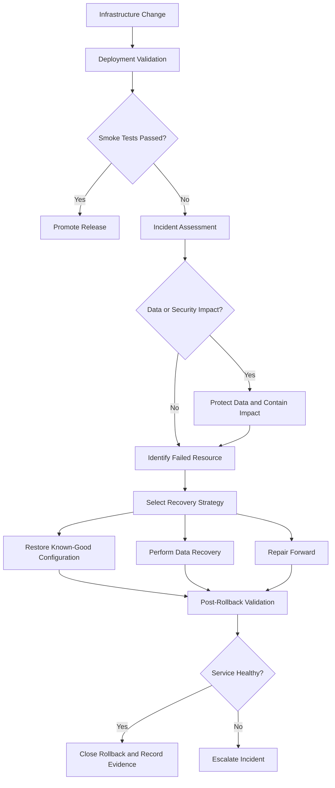
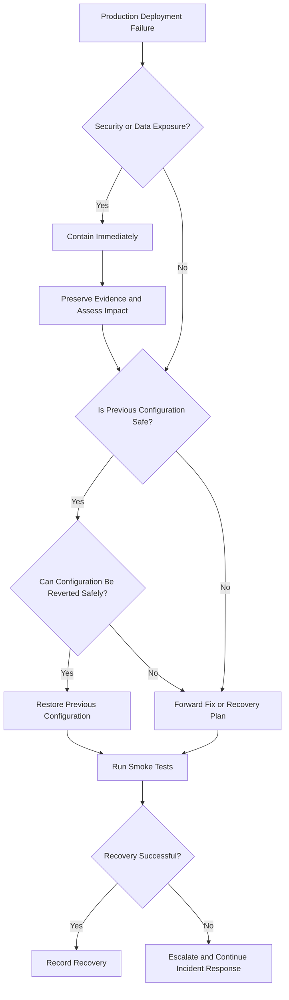
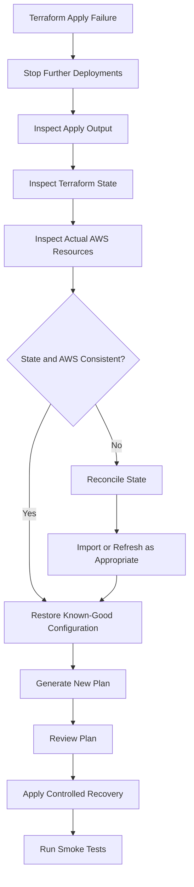

# 06- Infrastructure Change Rollback Strategy

## Overview

Infrastructure change rollback is the controlled process of restoring a previously known-good infrastructure state when a deployment introduces failures, security regressions, configuration defects, or operational instability.

Amazon S3 infrastructure changes require particular care because many resources contain persistent data or have dependencies that cannot be safely reversed by simply restoring an earlier configuration.

Examples include:

- Changing bucket policies and unintentionally blocking application access.
- Replacing a KMS key configuration and preventing access to existing encrypted objects.
- Modifying lifecycle rules and causing unintended object transitions or expiration.
- Updating replication configuration and interrupting cross-Region data protection.
- Changing CloudFront origins or cache behaviors and disrupting content delivery.
- Replacing an S3 event notification configuration and stopping downstream processing.
- Disabling versioning or changing retention-related settings.
- Deleting or recreating a bucket that contains production data.

A reliable rollback strategy must distinguish between **reverting infrastructure configuration**, **recovering application availability**, and **restoring data**. These are separate recovery activities with different constraints.

This document defines a production-oriented rollback strategy for S3 infrastructure managed through Terraform, CloudFormation, CDK, and CI/CD pipelines.

## Rollback Principles

Infrastructure rollback should prioritize data safety, service availability, and predictable recovery.

### Configuration Rollback Is Not Data Rollback

Reverting an infrastructure configuration does not automatically reverse changes that have already affected stored data.

For example, restoring an earlier lifecycle configuration does not necessarily recover objects that have already expired.

| Change | Configuration rollback | Data recovery requirement |
|---|---|---|
| Bucket policy update | Restore previous policy | Usually unnecessary if data remains intact |
| Encryption configuration update | Restore intended default encryption | Existing object encryption is not automatically changed |
| Lifecycle rule update | Restore previous rules | Recover objects already expired or transitioned if possible |
| Replication rule update | Restore previous replication configuration | Reconcile objects that were not replicated |
| Versioning configuration | Restore supported versioning state | Recover affected versions or objects separately |
| CloudFront origin update | Restore previous origin configuration | Usually no S3 data recovery required |
| Event notification update | Restore notification configuration | Reprocess events or objects missed during interruption |
| Bucket deletion | Not generally reversible through configuration | Restore from backup, replicas, or another recovery source |

The rollback plan must identify which changes are reversible and which require an explicit recovery procedure.

### Core Principles

- Preserve existing production data.
- Prefer restoring a known-good configuration over rebuilding resources.
- Avoid destructive operations during incident response.
- Maintain a known-good deployment artifact and configuration revision.
- Validate the rollback using application-level smoke tests.
- Separate infrastructure rollback from data recovery.
- Record every rollback action and its outcome.
- Do not assume that a successful infrastructure update means the service has recovered.

## Rollback Architecture

A production rollback process should connect deployment records, infrastructure state, operational monitoring, and validation.



### Rollback Components

| Component | Responsibility |
|---|---|
| CI/CD pipeline | Controls deployment and rollback execution |
| Infrastructure as Code | Defines desired resource configuration |
| Terraform state or CloudFormation stack | Tracks infrastructure management state |
| Deployment artifacts | Preserve known-good versions of configuration |
| CloudTrail | Provides infrastructure API activity evidence |
| CloudWatch | Provides operational signals and alarms |
| S3 versioning | Supports recovery of eligible object versions |
| Replication or backup | Provides additional recovery options |
| Smoke tests | Validate restored infrastructure behavior |
| Incident runbook | Defines authorized recovery actions |

## Define Rollback Triggers

Rollback decisions should be based on observable failures and predefined acceptance criteria.

Do not initiate a rollback solely because a deployment command returned a nonzero exit code. First determine whether the infrastructure was partially changed and whether the failure is recoverable through a targeted correction.

### Common Rollback Triggers

| Trigger | Example | Recommended response |
|---|---|---|
| Availability failure | Application receives S3 `AccessDenied` after deployment | Restore or correct access configuration |
| Security regression | Public access protection unexpectedly disabled | Immediately contain exposure and restore security controls |
| Encryption failure | Application cannot upload using required KMS key | Restore compatible encryption and permissions |
| Data protection failure | Replication configuration removed | Restore replication and assess missed objects |
| Event processing failure | S3 events no longer reach Lambda | Restore notification configuration and reconcile missed events |
| Content delivery failure | CloudFront returns persistent origin errors | Restore known-good distribution configuration |
| Infrastructure deployment failure | CloudFormation update enters rollback failure state | Inspect stack and resource state before recovery |
| Data integrity failure | Application reads unexpected object versions | Stop affected writes and investigate object history |

### Define Severity

A useful operational classification is:

| Severity | Description | Action |
|---|---|---|
| SEV-1 | Data exposure, data loss risk, or major production outage | Immediate incident response |
| SEV-2 | Significant application degradation or critical integration failure | Prioritized rollback or repair |
| SEV-3 | Limited functionality affected | Controlled remediation |
| SEV-4 | Non-critical configuration deviation | Schedule corrective deployment |

Security incidents and potential data loss require containment before ordinary rollback activities.

## Prepare for Rollback Before Deployment

Rollback is significantly safer when the deployment process preserves the information needed to restore the previous state.

### Maintain Deployment Records

For every infrastructure release, record:

- Deployment identifier.
- Git commit SHA.
- Terraform module and provider versions.
- CloudFormation template or CDK synthesis artifact.
- Target AWS account and Region.
- Resource identifiers.
- Previous known-good configuration.
- New configuration.
- Deployment timestamp.
- Smoke test results.
- Approval and execution identity.

A deployment manifest can provide a consistent record.

```json
{
  "deployment_id": "s3-staging-2026-11-01-001",
  "environment": "staging",
  "account_id": "123456789012",
  "region": "ap-south-1",
  "commit_sha": "abcdef1234567890",
  "tool": "terraform",
  "artifact": "terraform-plan-staging",
  "previous_release": "release-2026-10-30",
  "current_release": "release-2026-11-01",
  "smoke_test_required": true
}
```

This manifest is illustrative. Store actual deployment records in an approved artifact repository or deployment system.

### Preserve Known-Good Artifacts

Keep immutable or versioned copies of:

- Infrastructure source revisions.
- Terraform plans where appropriate.
- CloudFormation templates.
- CDK synthesized templates.
- Lambda deployment packages.
- IAM policies.
- Bucket policies.
- Lifecycle and replication configurations.
- CloudFront configuration.
- Smoke test scripts.

Do not rely exclusively on the current Git branch to represent the previous production state.

### Establish Data Protection

Before a high-risk change, verify the relevant recovery mechanisms.

For S3 workloads, assess:

- Versioning state.
- Replication health.
- Backup coverage.
- Object retention requirements.
- KMS key availability.
- Recovery permissions.
- Recovery point objective (RPO).
- Recovery time objective (RTO).

Versioning and replication are not interchangeable with a complete backup strategy. Replication can propagate unwanted changes, and versioning does not protect against every account-level or operational failure.

## Select the Correct Rollback Strategy

Not every infrastructure failure should be handled by the same mechanism.

### Rollback Strategies

| Strategy | Description | Suitable scenarios |
|---|---|---|
| Configuration revert | Restore the previous resource configuration | Bucket policy, lifecycle, notification configuration |
| Infrastructure rollback | Restore the previous IaC-defined state | Failed Terraform or CloudFormation deployment |
| Forward fix | Deploy a corrected configuration | Small, isolated configuration defects |
| Traffic rollback | Route traffic to a known-good endpoint or release | CloudFront or application deployment issues |
| Data recovery | Restore object data from versions, replicas, or backups | Accidental deletion or data corruption |
| Operational containment | Disable or restrict an affected integration | Security exposure or repeated event failures |

### Decision Framework



## Terraform Rollback Strategy

Terraform manages infrastructure through desired configuration and state. It does not provide a universal transactional rollback mechanism for all AWS resource changes.

A failed `terraform apply` can leave some resources modified while others remain unchanged.

### Understand Terraform Rollback Behavior

Terraform generally:

1. Reads the current state.
2. Refreshes resource information as configured.
3. Calculates the execution plan.
4. Applies resource operations.
5. Updates state as operations complete.

If an operation fails, Terraform reports the failure and may leave successfully applied changes in place.

The next action should be based on actual infrastructure and state inspection, not an assumption that Terraform reverted everything.

### Recommended Recovery Workflow



### Inspect Terraform State

```bash
terraform state list
```

Inspect a specific resource:

```bash
terraform state show aws_s3_bucket.application
```

Review the current configuration and workspace:

```bash
terraform workspace show
terraform version
```

Inspect actual AWS configuration independently:

```bash
aws s3api get-bucket-encryption \
  --bucket example-application-bucket

aws s3api get-bucket-versioning \
  --bucket example-application-bucket

aws s3api get-public-access-block \
  --bucket example-application-bucket
```

Terraform state is not a substitute for inspecting the actual AWS resource during incident recovery.

### Restore a Known-Good Configuration

If the previous configuration is available in Git, restore the intended revision through a controlled change.

```bash
git checkout <known-good-commit> -- infrastructure/s3/
```

Review the changes:

```bash
git diff
```

Initialize and validate:

```bash
terraform init
terraform fmt -check -recursive
terraform validate
```

Generate a new plan:

```bash
terraform plan \
  -var-file="environments/production.tfvars" \
  -out=rollback.tfplan
```

Review the plan before applying:

```bash
terraform show rollback.tfplan
```

Apply only after confirming that the plan restores the intended state without destructive changes.

```bash
terraform apply rollback.tfplan
```

Do not use a stale plan after the infrastructure or state has changed. Generate a new plan when the recovery context changes.

### Handle State Inconsistency

If an AWS resource was created but Terraform did not record it correctly, investigate before modifying state.

Possible recovery actions include:

- Refreshing state through a normal plan.
- Importing an existing resource.
- Correcting the resource address.
- Reconciling remote state.
- Recovering the state file from a protected backend version.

For example:

```bash
terraform import \
  aws_s3_bucket.application \
  example-application-bucket
```

Import only when the resource is genuinely unmanaged at the intended Terraform address.

Do not use `terraform state rm` as a generic rollback mechanism. It removes Terraform's tracking relationship without deleting the AWS resource.

### Avoid Destructive Rollback

Do not assume that reverting an S3 resource declaration will safely restore the previous infrastructure.

For example, removing an `aws_s3_bucket` resource from configuration can cause Terraform to plan bucket deletion.

Use resource protection and lifecycle controls for critical storage resources.

Illustrative configuration:

```hcl
resource "aws_s3_bucket" "application" {
  bucket = var.bucket_name

  lifecycle {
    prevent_destroy = true
  }

  tags = {
    Environment = var.environment
    ManagedBy   = "Terraform"
  }
}
```

`prevent_destroy` protects against certain Terraform-planned destroy operations while the resource remains represented in configuration. It does not protect the bucket from deletion outside Terraform or from every possible state manipulation.

### Terraform Rollback Precautions

- Never overwrite the remote state file manually during an incident.
- Do not apply an old plan against changed infrastructure.
- Do not run `terraform destroy` as a generic recovery action.
- Preserve remote state versions and locking.
- Review replacement and deletion operations carefully.
- Verify actual S3 configuration after recovery.
- Re-run smoke tests using the application identity.

## CloudFormation and CDK Rollback Strategy

CloudFormation manages stack resources and supports automatic rollback for many failed stack operations.

However, rollback can itself fail when a resource cannot return to its previous configuration.

Common causes include:

- A resource was modified outside CloudFormation.
- A resource has a replacement constraint.
- A bucket contains data that prevents deletion.
- A dependent resource cannot be restored.
- An IAM or KMS permission changed during deployment.
- A custom resource fails during rollback.

### Inspect Stack Status

```bash
aws cloudformation describe-stacks \
  --stack-name s3-production
```

Inspect stack events:

```bash
aws cloudformation describe-stack-events \
  --stack-name s3-production
```

Identify failed resources:

```bash
aws cloudformation describe-stack-resources \
  --stack-name s3-production
```

### Understand Stack States

| Stack state | Meaning | Recovery direction |
|---|---|---|
| `UPDATE_COMPLETE` | Update succeeded | Continue validation |
| `UPDATE_IN_PROGRESS` | Update is running | Wait and monitor |
| `UPDATE_FAILED` | Update failed | Inspect rollback status and events |
| `UPDATE_ROLLBACK_IN_PROGRESS` | Automatic rollback running | Allow rollback to complete |
| `UPDATE_ROLLBACK_COMPLETE` | Rollback completed | Validate restored resources |
| `UPDATE_ROLLBACK_FAILED` | Rollback could not complete | Diagnose failed resources and recover stack |
| `ROLLBACK_COMPLETE` | Initial stack creation failed and rolled back | Correct template or parameters before retrying |

Do not treat all stack failure states as equivalent. The next permitted operation depends on the stack state.

### Recover a Failed Update

If automatic rollback completes:

1. Inspect stack events.
2. Identify the resource that caused the update failure.
3. Confirm the actual resource configuration.
4. Compare it with the known-good template.
5. Run a controlled corrective deployment.
6. Validate the restored service.

If the stack enters `UPDATE_ROLLBACK_FAILED`, resolve the underlying resource issue before continuing rollback.

CloudFormation supports continuing a failed rollback:

```bash
aws cloudformation continue-update-rollback \
  --stack-name s3-production
```

If specific resources cannot be rolled back, CloudFormation provides a mechanism to skip resources during rollback continuation.

```bash
aws cloudformation continue-update-rollback \
  --stack-name s3-production \
  --resources-to-skip LogicalResourceId
```

Use resource skipping only as a controlled recovery measure.

A skipped resource can remain inconsistent with the template and must be reconciled in a subsequent deployment. Skipping resources does not repair them.

### CDK Recovery

AWS CDK synthesizes CloudFormation templates and deploys them through CloudFormation.

Therefore, CDK rollback behavior follows CloudFormation stack behavior.

Useful commands:

```bash
cdk synth
cdk diff
cdk deploy S3ProductionStack
```

Before a recovery deployment:

- Check the synthesized template.
- Compare it with the last known-good deployment artifact.
- Inspect CloudFormation stack events.
- Confirm that CDK context and environment configuration are correct.
- Avoid deploying an unintended template generated from a different branch.

Do not assume that running `cdk deploy` again automatically repairs every failed stack state.

## Rollback of S3 Bucket Policies and Access Controls

Bucket policy changes can cause immediate application outages.

An explicit deny or incorrectly scoped principal can block access even when identity-based IAM policies appear correct.

### Typical Failure

An infrastructure deployment changes the bucket policy and removes access for an application role.

The application begins returning:

```text
AccessDenied
```

### Recovery Procedure

Inspect the current policy:

```bash
aws s3api get-bucket-policy \
  --bucket example-application-bucket
```

Compare it with the known-good policy artifact.

Restore the approved policy:

```bash
aws s3api put-bucket-policy \
  --bucket example-application-bucket \
  --policy file://known-good-bucket-policy.json
```

Validate the application using its actual runtime identity.

Also inspect:

- IAM identity policies.
- Permissions boundaries.
- Service control policies.
- VPC endpoint policies.
- Explicit deny statements.
- KMS key policies and grants.

Restoring a bucket policy alone may not resolve an authorization failure caused by another policy layer.

### Security Incident Considerations

If the failure involves public exposure:

1. Restrict access immediately.
2. Preserve CloudTrail and relevant access evidence.
3. Determine the exposure window.
4. Identify affected objects and principals.
5. Review access logs and application activity.
6. Restore the intended security baseline.
7. Validate that public access is blocked.

Do not delay containment while attempting a broad infrastructure rollback.

## Rollback of Encryption and KMS Configuration

Encryption changes can affect both future writes and access to existing objects.

### Important Behavior

Changing default bucket encryption affects subsequent object writes. It does not automatically re-encrypt existing objects.

For SSE-KMS, successful object access depends on the relevant S3 authorization and KMS authorization.

A rollback must preserve access to every KMS key required to decrypt existing objects.

### Recovery Checklist

- Confirm the encryption configuration currently deployed.
- Identify the KMS key used by affected objects.
- Verify that the key is enabled.
- Verify the key policy and required grants.
- Confirm application-role encryption and decryption permissions.
- Restore the previous compatible default encryption configuration if required.
- Test uploads and downloads using the application identity.

Inspect encryption:

```bash
aws s3api get-bucket-encryption \
  --bucket example-application-bucket
```

Inspect a specific object:

```bash
aws s3api head-object \
  --bucket example-application-bucket \
  --key documents/example.pdf
```

Do not disable, schedule deletion of, or remove access to a KMS key merely because a newer key configuration has been deployed.

Existing objects can remain dependent on their original encryption key.

## Rollback of Lifecycle Configuration

Lifecycle configuration changes require special care because some actions are irreversible without a separate recovery mechanism.

Examples:

- An expiration rule removes objects.
- A noncurrent-version expiration rule permanently removes older versions.
- A transition rule moves objects into a different storage class.
- An incomplete multipart upload cleanup rule aborts uploads.

Restoring the previous lifecycle configuration does not necessarily reverse completed actions.

### Recovery Procedure

Inspect the deployed rules:

```bash
aws s3api get-bucket-lifecycle-configuration \
  --bucket example-application-bucket
```

Restore the known-good configuration through the infrastructure deployment process.

Then investigate affected objects.

For versioned buckets, inspect object versions:

```bash
aws s3api list-object-versions \
  --bucket example-application-bucket \
  --prefix documents/
```

If the required object version remains available, restore it through an approved recovery workflow.

If it has been permanently deleted, use another recovery source such as a backup or replica.

### Important Precautions

- Do not assume that disabling lifecycle rules restores expired objects.
- Review noncurrent-version expiration rules before deployment.
- Protect required data with suitable retention and recovery mechanisms.
- Validate lifecycle changes against representative object histories.
- Treat changes to retention-sensitive buckets as high-risk deployments.

## Rollback of Replication Configuration

Replication configuration changes can interrupt cross-Region or same-Region data protection.

Restoring the previous replication rule does not automatically guarantee that every object missed during the interruption has been replicated.

### Recovery Procedure

Inspect the current replication configuration:

```bash
aws s3api get-bucket-replication \
  --bucket example-source-bucket
```

Restore the known-good rule configuration through IaC.

Then verify:

- Source bucket versioning.
- Destination bucket versioning.
- Replication role permissions.
- Destination bucket policy.
- KMS permissions when applicable.
- Rule filters and priority.
- Replication metrics and failure status.

Inspect object replication status:

```bash
aws s3api head-object \
  --bucket example-source-bucket \
  --key documents/example.pdf
```

Check the `ReplicationStatus` field where applicable.

### Reconcile Missed Objects

Depending on the failure and replication configuration, existing objects may require an explicit recovery process.

S3 Batch Replication can be used to replicate eligible existing objects.

Do not assume that restoring a replication rule automatically backfills every object that was missed during an interruption.

Validate destination object availability and integrity before declaring recovery complete.

## Rollback of S3 Event Notifications and Processing Pipelines

Replacing an S3 notification configuration can interrupt event-driven workflows.

For example, an update may remove an existing Lambda notification while adding a new destination.

### Understand Notification Configuration Replacement

The bucket notification configuration is a bucket-level configuration document.

When managing it through the API or infrastructure tools, an update can replace the existing notification configuration rather than modifying only one logical entry.

This can unintentionally remove other integrations.

### Inspect Current Configuration

```bash
aws s3api get-bucket-notification-configuration \
  --bucket example-application-bucket
```

Restore the complete known-good configuration through the owning infrastructure definition.

Then verify:

- Lambda invocation permissions.
- SQS queue policies.
- SNS topic policies.
- Prefix and suffix filters.
- Event types.
- Destination availability.
- Consumer processing health.

### Recover Missed Events

Restoring event notifications does not guarantee that events missed during the outage will be replayed.

A reliable architecture should have an independent reconciliation mechanism.

Examples include:

- Comparing S3 Inventory against application processing records.
- Scanning a controlled prefix for unprocessed objects.
- Re-enqueuing failed records from a durable processing table.
- Using SQS dead-letter queues for failed asynchronous processing.

Consumers must be idempotent because recovery workflows can cause the same object to be processed more than once.

## Rollback of CloudFront and Static Website Deployments

CloudFront changes can cause widespread delivery failures even when the S3 origin remains healthy.

Examples include:

- Incorrect origin domain.
- Invalid origin path.
- Incorrect Origin Access Control association.
- Missing bucket policy permission.
- Incorrect cache behavior.
- Incorrect viewer protocol policy.
- Invalid certificate or alternate domain configuration.

### Restore Previous Distribution Configuration

Inspect the current distribution:

```bash
aws cloudfront get-distribution \
  --id EXAMPLE_DISTRIBUTION_ID
```

Inspect its configuration:

```bash
aws cloudfront get-distribution-config \
  --id EXAMPLE_DISTRIBUTION_ID
```

Restore the known-good distribution configuration through the deployment system.

CloudFront updates require the current ETag when submitting configuration changes.

Wait for the distribution status to return to `Deployed`.

### Validate Content Delivery

```bash
curl --fail-with-body \
  --silent \
  --show-error \
  https://cdn.example.com/health.txt
```

Validate:

- HTTP status.
- Expected content.
- HTTPS certificate.
- Origin access.
- Cache behavior.
- Required redirects.

### Cache Considerations

Restoring a previous CloudFront configuration does not guarantee that every cached response is immediately replaced.

Depending on the deployment, a cache invalidation may be necessary.

```bash
aws cloudfront create-invalidation \
  --distribution-id EXAMPLE_DISTRIBUTION_ID \
  --paths "/index.html" "/health.txt"
```

Avoid unnecessary wildcard invalidations because they can increase cost and reduce cache efficiency.

For static website releases, use versioned or immutable asset filenames and keep previous release assets available when rollback may be required.

## Data Recovery and Rollback Boundaries

Data recovery is distinct from configuration rollback.

S3 offers several mechanisms that can support recovery, but their protection characteristics differ.

| Mechanism | Recovery capability | Important limitation |
|---|---|---|
| Versioning | Retrieve eligible previous object versions | Permanently deleted versions may not be recoverable |
| Cross-Region Replication | Maintain copies in another Region | Replication can propagate unwanted changes |
| Same-Region Replication | Maintain another copy in the same Region | Does not provide independent regional recovery |
| S3 Backup or AWS Backup | Recover protected data according to backup configuration | Recovery depends on backup coverage and retention |
| Object Lock | Protect eligible objects against deletion or alteration | Retention settings must be designed before relying on them |
| S3 Inventory | Identify objects and metadata for reconciliation | Inventory is not itself a data backup |

### Example: Recover an Earlier Object Version

List object versions:

```bash
aws s3api list-object-versions \
  --bucket example-application-bucket \
  --prefix documents/report.pdf
```

Retrieve a specific version:

```bash
aws s3api get-object \
  --bucket example-application-bucket \
  --key documents/report.pdf \
  --version-id VERSION_ID \
  /tmp/report-recovered.pdf
```

Restore it using an approved application or operational workflow.

Do not overwrite the current object without first assessing whether the current version must be preserved for investigation.

### Define Recovery Objectives

For each critical S3 workload, document:

| Objective | Description |
|---|---|
| RPO | Maximum acceptable data loss measured in time |
| RTO | Maximum acceptable time to restore service |
| Recovery source | Version, replica, backup, or alternate storage |
| Recovery identity | IAM role authorized to perform recovery |
| Recovery Region | Region where recovery will occur |
| Validation | Integrity and application-level checks |
| Data reconciliation | Method for identifying missing or inconsistent objects |

A replication configuration alone does not establish a guaranteed RPO or RTO. Those objectives must be supported by the actual architecture, service configuration, monitoring, and tested recovery procedures.

## Automate Rollback Safely

Rollback automation should execute only predefined, reviewed recovery actions.

Avoid scripts that automatically destroy resources or restore entire infrastructure stacks without understanding the failure.

### Example: Terraform Recovery Pipeline

The following workflow illustrates a controlled manual rollback using a selected Git revision.

It assumes:

- The repository contains the Terraform configuration.
- The selected revision is an approved known-good infrastructure revision.
- Remote state and locking are configured.
- Production access is restricted to an approved GitHub environment.
- A human reviews the generated plan before applying it.

```yaml
name: S3 Infrastructure Recovery

on:
  workflow_dispatch:
    inputs:
      recovery_ref:
        description: Approved known-good Git commit
        required: true
        type: string

permissions:
  contents: read
  id-token: write

jobs:
  recovery:
    runs-on: ubuntu-latest
    environment: production-recovery

    steps:
      - name: Checkout recovery revision
        uses: actions/checkout@v4
        with:
          ref: ${{ inputs.recovery_ref }}

      - name: Configure AWS credentials
        uses: aws-actions/configure-aws-credentials@v4
        with:
          role-to-assume: ${{ vars.AWS_TERRAFORM_RECOVERY_ROLE_ARN }}
          aws-region: ap-south-1

      - name: Verify AWS account
        run: |
          ACTUAL_ACCOUNT=$(aws sts get-caller-identity \
            --query Account \
            --output text)

          if [ "$ACTUAL_ACCOUNT" != "${{ vars.AWS_ACCOUNT_ID }}" ]; then
            echo "Unexpected AWS account."
            exit 1
          fi

      - name: Set up Terraform
        uses: hashicorp/setup-terraform@v3
        with:
          terraform_version: "1.10.5"

      - name: Initialize Terraform
        working-directory: infrastructure/s3
        run: terraform init

      - name: Validate configuration
        working-directory: infrastructure/s3
        run: |
          terraform fmt -check -recursive
          terraform validate

      - name: Generate recovery plan
        working-directory: infrastructure/s3
        run: |
          terraform plan \
            -var-file="environments/production.tfvars" \
            -out=recovery.tfplan

      - name: Publish recovery plan
        uses: actions/upload-artifact@v4
        with:
          name: s3-recovery-plan
          path: infrastructure/s3/recovery.tfplan
          retention-days: 7
```

This workflow deliberately does not apply the plan automatically.

The reviewed plan should be applied through a separate approved recovery step or a controlled operator session.

For production use:

- Pin actions to reviewed commit SHAs.
- Pin Terraform and provider versions.
- Validate the selected recovery revision against an approved release record.
- Restrict the recovery role to the required resources.
- Protect Terraform state and plan artifacts.
- Ensure approval is required before production changes.
- Do not expose sensitive plan contents in public logs or artifacts.

A recovery workflow must not bypass the normal infrastructure ownership and state-management model.

## Post-Rollback Validation

A rollback is not complete when Terraform or CloudFormation reports success.

The recovered infrastructure must pass the same critical validation requirements as a normal deployment.

### Validation Checklist

| Area | Validation |
|---|---|
| Identity | Correct account and role |
| Bucket | Exists in expected Region |
| Security | Public access and ownership controls match baseline |
| Encryption | Expected encryption configuration restored |
| KMS | Required keys remain enabled and accessible |
| Versioning | Expected state restored |
| Lifecycle | Approved rules restored |
| Replication | Rules and destination behavior verified |
| Application access | Intended workload identity can perform required operations |
| Data | Required objects are available and integrity checks pass |
| Event processing | Events reach the intended consumers |
| CloudFront | Distribution serves expected content |
| Monitoring | Required logs, metrics, and alarms are operational |

### Run Smoke Tests

Execute the infrastructure smoke test suite after recovery.

For example:

```bash
python validation/s3_smoke_test.py \
  --bucket example-application-bucket \
  --region ap-south-1 \
  --expected-account 123456789012 \
  --require-versioning \
  --expected-encryption aws:kms
```

Also run application-level integration tests and any recovery-specific checks.

A successful configuration validation does not prove that historical data, replication, or event processing has been fully recovered.

## Incident Documentation and Audit Trail

Every production rollback should produce an auditable record.

Record:

- Incident identifier.
- Failed deployment identifier.
- Affected AWS account and resources.
- Initial symptoms.
- Relevant CloudTrail events.
- CloudWatch alarms and application errors.
- Root cause.
- Recovery strategy selected.
- Commands and infrastructure revisions used.
- Data recovery actions.
- Validation results.
- Remaining inconsistencies.
- Follow-up corrective actions.

### Useful AWS Evidence Sources

| Source | Investigation purpose |
|---|---|
| CloudTrail management events | Identify infrastructure API changes |
| CloudTrail data events | Investigate recorded object-level operations when configured |
| CloudWatch metrics | Identify request errors and service degradation |
| CloudWatch Logs | Inspect application and Lambda failures |
| Terraform state history | Recover and compare infrastructure management state |
| CloudFormation events | Identify failed resource operations |
| S3 Inventory | Reconcile object-level state |
| Replication metrics | Identify replication delay and failures |
| Application logs | Identify the user-facing impact |

CloudTrail data events must be configured for the relevant S3 resources if object-level auditing is required. Do not assume that all object operations are automatically recorded by management event history.

## Common Rollback Mistakes

| Mistake | Consequence | Prevention |
|---|---|---|
| Assuming IaC automatically reverses all changes | Partial infrastructure changes remain | Inspect actual AWS resources and state |
| Using an old Terraform state file without reconciliation | State drift or resource mismanagement | Restore state carefully and verify actual resources |
| Running `terraform destroy` during recovery | Potential permanent data loss | Use targeted configuration recovery |
| Removing a bucket from Terraform configuration | Terraform may plan bucket deletion | Use resource protection and review plans |
| Restoring a bucket policy without checking KMS | Object operations can continue failing | Validate both S3 and KMS authorization |
| Disabling a KMS key during rollback | Existing encrypted objects become inaccessible | Preserve key availability |
| Assuming lifecycle rollback restores deleted objects | Data remains unavailable | Use versions or backups |
| Assuming replication automatically backfills missed objects | Destination remains incomplete | Use explicit reconciliation or Batch Replication |
| Replacing event notifications without preserving existing rules | Other integrations stop receiving events | Restore the complete notification configuration |
| Skipping CloudFormation resources without reconciliation | Stack and resource state diverge | Track and repair skipped resources |
| Rolling back CloudFront without checking caches | Users may continue receiving stale content | Validate cache behavior and invalidate selectively |
| Treating successful deployment as recovery completion | Application may remain unavailable | Run post-rollback smoke and integration tests |

## Production Rollback Runbook

Use this sequence during a production infrastructure incident.

### Before Recovery

- [ ] Stop additional deployments.
- [ ] Identify affected resources and dependencies.
- [ ] Confirm the AWS account and Region.
- [ ] Determine whether data exposure or data loss is possible.
- [ ] Preserve relevant logs and deployment artifacts.
- [ ] Identify the last known-good infrastructure revision.
- [ ] Determine whether the failure requires rollback, forward fix, containment, or data recovery.
- [ ] Obtain required incident approval.

### During Recovery

- [ ] Execute the selected recovery procedure.
- [ ] Preserve S3 data and KMS key availability.
- [ ] Avoid broad resource deletion.
- [ ] Inspect actual AWS resource state.
- [ ] Reconcile Terraform or CloudFormation state.
- [ ] Restore affected policies and integrations.
- [ ] Track any incomplete recovery actions.
- [ ] Record commands and deployment revisions.

### After Recovery

- [ ] Verify bucket security configuration.
- [ ] Verify encryption and KMS access.
- [ ] Verify application upload and download.
- [ ] Verify lifecycle and replication configuration.
- [ ] Verify event-driven processing.
- [ ] Verify CloudFront delivery where applicable.
- [ ] Verify monitoring and alarms.
- [ ] Reconcile missed events or replication work.
- [ ] Confirm application availability.
- [ ] Document root cause and corrective actions.
- [ ] Update deployment tests to prevent recurrence.

## Key Takeaways

- Infrastructure rollback, application recovery, and data recovery are separate operations; restoring configuration does not automatically restore affected objects.
- Terraform and CloudFormation can leave partially changed infrastructure, so inspect actual AWS resources and deployment state before executing recovery.
- Protect S3 data and KMS key availability during rollback; destructive actions can make otherwise recoverable data inaccessible or permanently unavailable.
- Replication and event notification recovery require explicit reconciliation because restoring configuration does not guarantee missed work is replayed.
- A rollback is complete only after security, application access, data integrity, integrations, and operational monitoring have been validated.