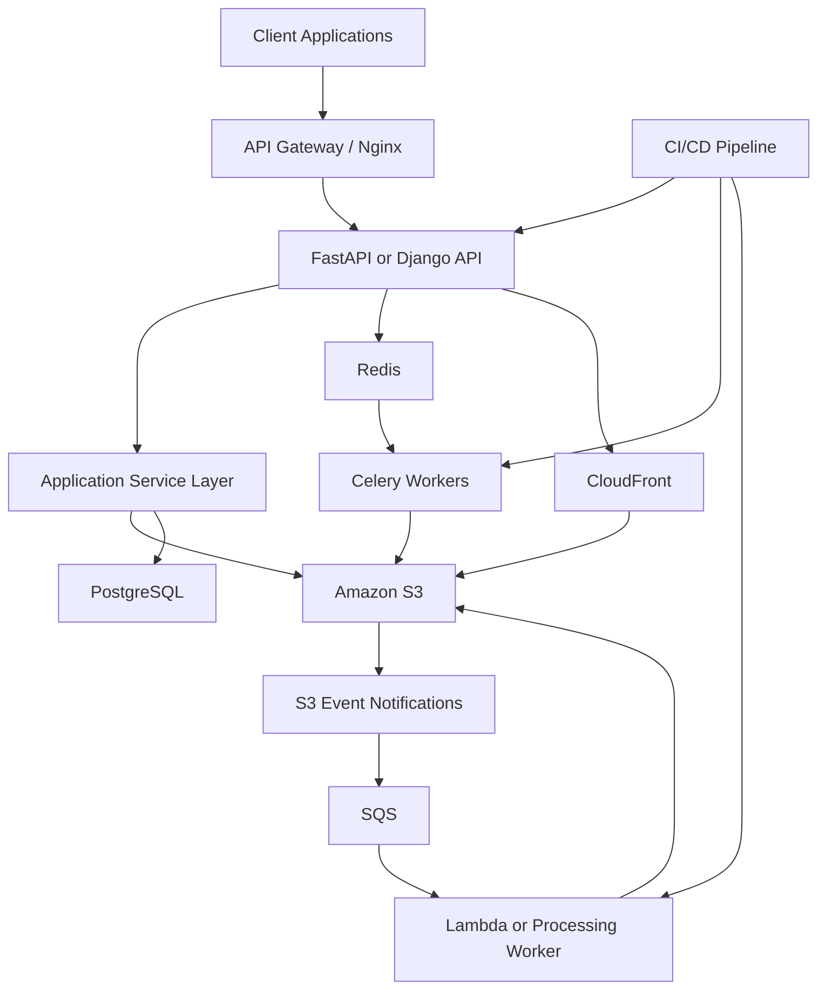
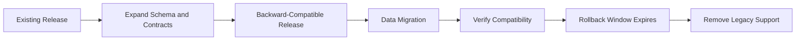
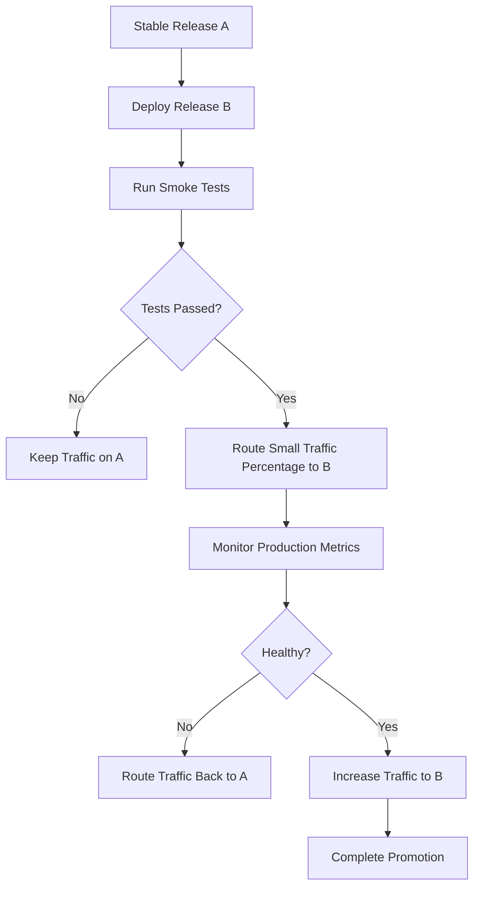
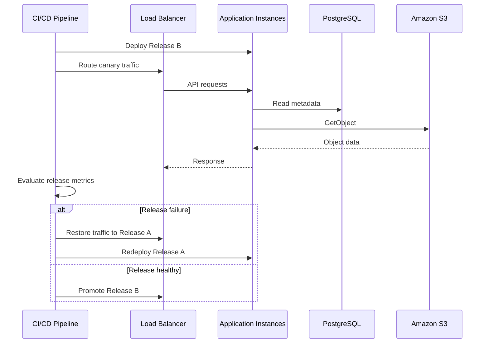
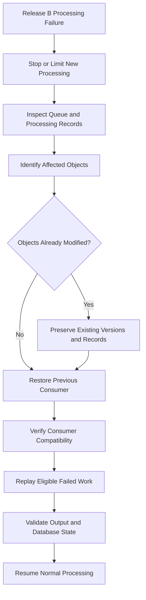
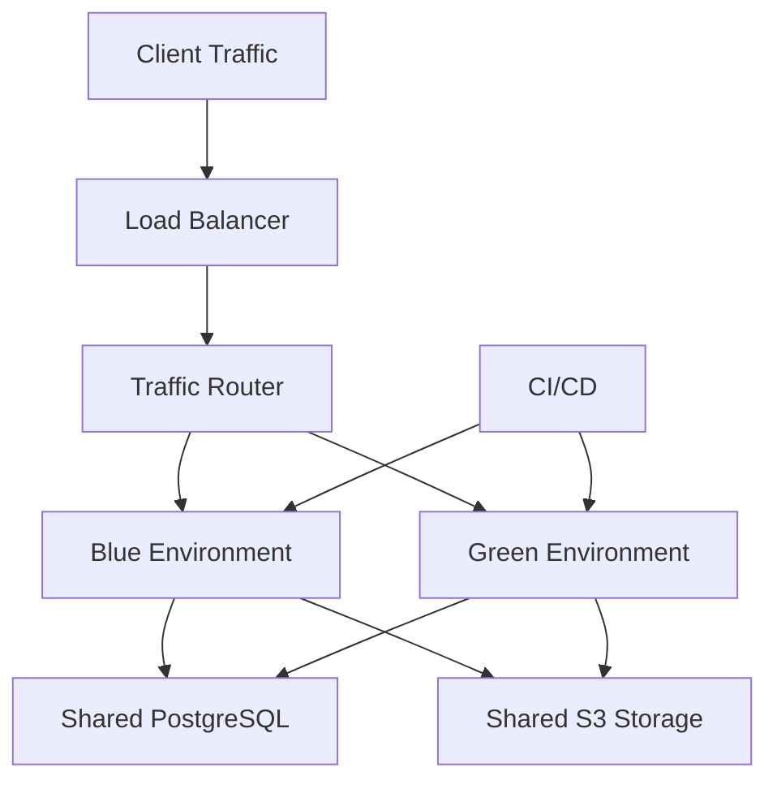

# 07- Application Release Rollback

## Overview

Application release rollback is the controlled process of restoring a previously stable application release when a deployment introduces defects, performance degradation, integration failures, or data integrity problems.

In an Amazon S3-backed application, rollback involves more than redeploying an earlier application binary. Application releases frequently depend on:

- S3 bucket names, prefixes, and object key conventions.
- IAM roles and bucket policies.
- Encryption and KMS configuration.
- Presigned URL generation and validation.
- S3 event notifications and downstream processing.
- Database records containing object references and metadata.
- CloudFront distributions and cached content.
- Background workers, Lambda functions, and asynchronous processing workflows.

An application release can be rolled back successfully while leaving infrastructure or data in an incompatible state.

For example, a new FastAPI release might change how document keys are generated. Rolling back the API without considering objects created by the new release can cause older application code to fail when retrieving those objects.

A production-ready rollback strategy must therefore coordinate application versions, database compatibility, object storage contracts, asynchronous consumers, and traffic routing.

## Application Rollback vs Infrastructure Rollback

Application rollback and infrastructure rollback address different failure domains.

| Area | Application release rollback | Infrastructure rollback |
|---|---|---|
| Primary target | Application code and runtime | AWS resources and configuration |
| Typical mechanism | Redeploy previous application artifact | Restore previous IaC configuration |
| Examples | FastAPI, Django, Celery, Lambda | S3 bucket policy, lifecycle, CloudFront |
| Data impact | Can affect application interpretation of stored data | Can affect object availability and configuration |
| Database impact | May require schema compatibility | Usually indirect |
| Recovery validation | API and application behavior | Resource configuration and AWS service behavior |

A release rollback should not automatically revert infrastructure that remains compatible with the previous application version.

For example, restoring an older application version may be sufficient to recover an API outage. Reverting the S3 bucket encryption configuration or deleting newly created resources would introduce unnecessary risk.

## Application Release Architecture

A typical S3-backed application release contains several independently deployed components.



A release may update several components:

- Backend API containers.
- Celery workers.
- Lambda functions.
- Database schema.
- S3 object metadata conventions.
- Event payload contracts.
- Frontend assets delivered through CloudFront.
- Configuration and environment variables.

Rollback planning must identify which components must move together and which can remain independently deployed.

## Define Release Compatibility

The most important requirement for safe rollback is compatibility between application versions and the data they consume.

### Application and Object Storage Contracts

An S3 object is not simply a file. Applications may depend on its:

- Key.
- Content type.
- Metadata.
- Tags.
- Encryption configuration.
- Version ID.
- Serialization format.
- Associated database record.
- Processing status.

A release that changes any of these contracts can affect older application versions.

Consider a document service that stores object references in PostgreSQL.

Version A:

```json
{
  "document_id": "doc-1001",
  "object_key": "documents/tenant-10/report.pdf",
  "content_type": "application/pdf"
}
```

Version B introduces a new storage layout:

```json
{
  "document_id": "doc-1001",
  "storage": {
    "bucket": "application-documents",
    "key": "v2/tenants/tenant-10/documents/report.pdf",
    "version_id": "example-version-id"
  },
  "content_type": "application/pdf"
}
```

If Version B is deployed and the database records are immediately migrated to the new structure, Version A may no longer understand the records.

A safe rollback strategy requires backward-compatible data transitions.

### Expand-and-Contract Deployment Pattern

Use expand-and-contract when changing database schemas or object storage contracts.

**Expand phase**

- Add new database fields.
- Introduce new object metadata.
- Support old and new object key formats.
- Deploy code that can read both formats.
- Keep existing consumers compatible.

**Migration phase**

- Gradually migrate records or objects.
- Verify the migrated data.
- Monitor old-format usage.
- Preserve rollback compatibility.

**Contract phase**

- Remove old-format support only after the rollback window expires.
- Remove obsolete fields or object references.
- Deploy the final application version.



Do not perform irreversible object key migrations or destructive schema changes in the same deployment that introduces a new application release.

## Release Artifact Management

A rollback is only as reliable as the artifacts available to execute it.

Maintain immutable release artifacts for every production deployment.

### Required Artifacts

| Component | Artifact to preserve |
|---|---|
| FastAPI or Django | Container image digest |
| Celery workers | Worker image digest |
| Lambda | Published function version or deployment package |
| Frontend | Versioned build assets |
| Database | Migration revision |
| Infrastructure | IaC source revision and deployment artifact |
| Configuration | Versioned, non-secret release configuration |
| Event processing | Event schema and consumer version |
| Release metadata | Deployment manifest |

Prefer immutable container references.

```text
registry.example.com/document-api:release-2026-11-01
```

For stronger reproducibility, deploy using the image digest:

```text
registry.example.com/document-api@sha256:EXAMPLE_DIGEST
```

Avoid relying on mutable tags such as `latest` for production rollback.

### Release Manifest

Maintain a deployment manifest containing the component versions.

```json
{
  "release_id": "document-platform-2026-11-01",
  "environment": "production",
  "components": {
    "api": {
      "image": "registry.example.com/document-api@sha256:API_DIGEST"
    },
    "worker": {
      "image": "registry.example.com/document-worker@sha256:WORKER_DIGEST"
    },
    "lambda": {
      "function": "document-processor",
      "version": "42"
    },
    "frontend": {
      "asset_release": "2026-11-01"
    }
  },
  "database_migration": "0042",
  "infrastructure_revision": "abcdef1234567890"
}
```

The values are illustrative. Actual manifests should reference verified artifacts and deployment records.

## Establish Rollback Triggers

Rollback should be triggered by measurable release failures rather than subjective observations.

### Common Failure Indicators

| Category | Indicator | Example |
|---|---|---|
| Availability | Increased HTTP 5xx responses | API cannot retrieve S3 objects |
| Latency | Elevated response time | Slow object metadata retrieval |
| Authorization | Increased S3 `AccessDenied` errors | New application role lacks permissions |
| Data integrity | Checksum or metadata mismatch | Uploaded document cannot be retrieved correctly |
| Processing | Increased worker failures | Celery tasks fail after deployment |
| Event delivery | Processing backlog increases | New event consumer cannot process messages |
| Database | Migration or query failures | New application expects unavailable columns |
| CloudFront | Increased 403 or 5xx responses | New frontend references unavailable assets |
| Resource usage | CPU or memory saturation | New release introduces inefficient file handling |

### Example Release Gates

The following values are illustrative. Establish actual thresholds using workload baselines and service-level objectives.

| Metric | Example rollback trigger |
|---|---|
| API 5xx rate | Above 5% for 5 minutes |
| API p95 latency | More than 2 times baseline for 10 minutes |
| S3 authorization failures | Sustained unexpected increase |
| Worker failure rate | Above 10% for 5 minutes |
| Document processing backlog | Exceeds operational threshold |
| Data integrity failures | Any confirmed production corruption |
| Authentication failures | Significant unexpected increase |

Security incidents and confirmed data corruption should trigger immediate incident response rather than waiting for ordinary metric evaluation windows.

## Choose a Release Rollback Strategy

Different application architectures require different rollback mechanisms.

### Deployment Strategies

| Strategy | How it works | Rollback characteristics |
|---|---|---|
| Rolling deployment | Gradually replaces running instances | Restore previous image and replace affected instances |
| Blue-green deployment | Maintains separate old and new environments | Switch traffic to the previous environment |
| Canary deployment | Sends a small percentage of traffic to the new release | Stop canary and route traffic to the stable release |
| Lambda versioning | Publishes immutable function versions | Restore the previous function version or alias |
| CloudFront asset versioning | Deploys immutable frontend assets | Restore previous entry point and cache behavior |

### Recommended Strategy

For critical backend services, blue-green or canary deployments provide a clearer rollback boundary than replacing every instance at once.

The previous application release should remain available until the new release passes its validation and observation window.



## Rollback Strategy for FastAPI and Django Applications

Backend releases frequently change how application code interacts with S3.

The rollback must restore a compatible application version without unnecessarily modifying stored objects.

### Example Deployment Architecture



### Preserve S3 Service-Layer Compatibility

Keep S3 access behind a stable application service interface.

Example:

```python
from typing import Protocol


class ObjectStorage(Protocol):
    def generate_download_url(
        self,
        object_key: str,
        expires_in: int = 300,
    ) -> str:
        ...

    def get_metadata(
        self,
        object_key: str,
    ) -> dict:
        ...


class DocumentService:
    def __init__(self, storage: ObjectStorage) -> None:
        self.storage = storage

    def get_download_url(self, document: dict) -> str:
        object_key = document["object_key"]

        return self.storage.generate_download_url(
            object_key=object_key,
            expires_in=300,
        )
```

The application service contract should remain stable across releases whenever possible.

Changes to storage implementations should be isolated behind the interface rather than spread across API routes, Django views, and background tasks.

### Application Rollback Checklist

- Restore the previous container image or application artifact.
- Restore compatible environment configuration.
- Confirm the previous application can read current database records.
- Confirm the previous application can retrieve objects created by the new release.
- Verify IAM role permissions.
- Verify KMS access.
- Verify presigned URL generation and required headers.
- Confirm background workers use compatible task payloads.
- Run API and object storage smoke tests.

## Database Migration Compatibility

Database migrations are one of the most common causes of failed application rollbacks.

A new application version may introduce a schema migration that older application code cannot understand.

### Migration Compatibility Rules

Prefer additive changes:

- Add nullable columns before making them mandatory.
- Add new tables without removing old ones.
- Introduce new indexes separately where appropriate.
- Support old and new data representations during transition.
- Delay destructive migrations until the rollback window expires.

### Example: Expand-and-Contract Migration

Suppose a document table changes from a single `object_key` field to a structured storage reference.

An unsafe migration would immediately rename or remove `object_key`.

A safer migration is:

1. Add `storage_bucket` and `storage_key`.
2. Deploy code that reads the new fields when populated and falls back to `object_key`.
3. Backfill the new fields.
4. Deploy code that writes both representations.
5. Verify all records have the new fields.
6. Remove legacy reads in a later release.
7. Remove the old column only after rollback is no longer required.

This approach allows the previous application version to remain usable during the compatibility window.

### Important Limitation

A database rollback is not always equivalent to restoring an older schema.

Rolling back a migration that drops or transforms production data may cause permanent data loss.

Prefer forward-compatible migrations and corrective migrations over destructive reverse migrations.

## S3 Object Contract Compatibility

Application rollback must account for objects created by the failed release.

### Common Breaking Changes

| Change | Rollback risk |
|---|---|
| New object key convention | Old application cannot locate objects |
| New serialization format | Old application cannot parse content |
| Changed metadata names | Old application interprets metadata incorrectly |
| Changed content type | Clients or processors behave differently |
| Changed compression format | Old application cannot decode objects |
| Changed encryption key | Old application may lack KMS permissions |
| Changed event payload | Previous consumer cannot process events |
| Changed database object reference | Old application may retrieve the wrong object |

### Versioned Object Format

One strategy is to encode format versions explicitly.

Example:

```text
documents/
  tenant-10/
    document-1001/
      v1/original.json
      v2/original.json
```

The application can select the appropriate parser based on the stored format version.

Do not use a new object key format without providing compatibility logic for existing records and consumers.

### Preserve Object References

Use stable logical identifiers in PostgreSQL rather than making application behavior depend on constructing object keys from user input.

Example record:

```json
{
  "document_id": "doc-1001",
  "tenant_id": "tenant-10",
  "storage_bucket": "application-documents",
  "storage_key": "documents/tenant-10/01JEXAMPLE",
  "format_version": 2
}
```

The application should resolve the storage reference through a controlled service layer.

## Rollback of Celery Workers and Asynchronous Consumers

A backend application can be rolled back while background workers continue processing tasks produced by the newer release.

This creates a version compatibility problem.

### Example Failure

Release B introduces a new task payload:

```json
{
  "document_id": "doc-1001",
  "processing_mode": "extract-v2",
  "schema_version": 2
}
```

The previous worker release understands only the old task format.

If the API is rolled back but Release B tasks remain in Redis or SQS, the old worker may fail repeatedly.

### Safe Consumer Compatibility

Use versioned task payloads and tolerant consumers.

```python
from typing import Any


def process_document(payload: dict[str, Any]) -> None:
    schema_version = payload.get("schema_version", 1)

    if schema_version == 1:
        process_document_v1(payload)
    elif schema_version == 2:
        process_document_v2(payload)
    else:
        raise ValueError(
            f"Unsupported task schema version: {schema_version}"
        )
```

The previous worker must support every task format that can remain in the queue during the rollback window.

### Worker Rollback Procedure

1. Stop or pause new task production if necessary.
2. Determine whether tasks are still being published.
3. Inspect queue depth and failed task counts.
4. Deploy the compatible worker version.
5. Verify that queued tasks can be processed.
6. Resume producers when compatibility is confirmed.
7. Reprocess failed tasks using idempotent processing logic.

For Celery with Redis, inspect the application's monitoring and task management tooling rather than modifying Redis queue internals during recovery.

For SQS-backed workers, inspect visible messages, in-flight messages, receive counts, and dead-letter queue activity.

Do not purge production queues as a shortcut for resolving incompatible task payloads.

## Lambda Release Rollback

Lambda functions can be deployed independently from backend containers.

Published versions and aliases provide a controlled release mechanism.

### Recommended Versioning Strategy

- Publish a new immutable Lambda version for each release.
- Use an alias such as `production` or `live`.
- Route event sources through the intended alias where supported by the integration.
- Preserve the previous published version.
- Move the alias back when the new release fails.

### Inspect Alias

```bash
aws lambda get-alias \
  --function-name document-processor \
  --name production
```

### Restore Previous Version

```bash
aws lambda update-alias \
  --function-name document-processor \
  --name production \
  --function-version 41
```

The version number is illustrative.

Validate the alias and event source configuration after rollback.

### S3 Event Notification Considerations

When S3 invokes Lambda directly, verify that the notification destination references the intended function and that the function's resource policy allows invocation.

If the notification targets a Lambda alias or another event-routing component, ensure the deployment configuration and invocation permissions match that architecture.

Changing Lambda code does not necessarily require changing the S3 bucket notification configuration.

This separation can make rollback safer because the event routing contract remains stable while the function version changes.

## Rollback of Frontend Assets Delivered Through CloudFront

Frontend releases often depend on assets stored in S3 and delivered through CloudFront.

An application rollback can fail if the previous HTML references assets that have already been deleted or overwritten.

### Use Immutable Asset Names

Prefer content-hashed filenames:

```text
assets/
  app.4f7c8d1a.js
  styles.8b2d3e9f.css
  logo.a91c4d22.svg
```

A new release uploads new assets without overwriting the previous release's immutable files.

The HTML entry point references the appropriate asset versions.

### Release Layout

```text
releases/
  release-a/
    index.html
    assets/
  release-b/
    index.html
    assets/
```

The deployment process can update the active entry point while preserving previous release assets.

### Rollback Procedure

1. Restore the previous HTML entry point.
2. Ensure all referenced assets remain available.
3. Upload or restore the previous release manifest.
4. Invalidate only the affected CloudFront paths when necessary.
5. Verify content delivery through the public distribution endpoint.

Example:

```bash
aws cloudfront create-invalidation \
  --distribution-id EXAMPLE_DISTRIBUTION_ID \
  --paths "/index.html" "/manifest.json"
```

Avoid deleting old frontend assets immediately after deployment.

Maintain them for at least the required rollback and client-cache compatibility period.

## S3 Event Processing and Data Reconciliation

Application rollback does not automatically reverse events already emitted or processed.

S3 event notifications and asynchronous processing workflows require special attention.

### Common Failure Scenarios

- Release B changes event payload interpretation.
- A Lambda function writes output using a new object key convention.
- A Celery worker processes an object twice.
- A consumer writes a database status incompatible with the old API.
- Events accumulate in an SQS queue during the deployment.
- A failed consumer moves messages to a dead-letter queue.

### Recovery Strategy



Use an idempotency key based on the logical object and processing version.

For example:

```text
tenant_id + document_id + object_version_id + processor_version
```

This prevents duplicate processing from producing inconsistent outputs.

Do not assume that rolling back a Lambda or Celery worker reverses its previous S3 writes.

If a failed release generated incorrect output objects, identify and reconcile those outputs separately.

## Blue-Green Deployment for S3-Backed Applications

Blue-green deployment is useful when a previous application release must remain immediately available.

### Architecture



Both environments can share S3 resources when the application contracts remain compatible.

### Deployment Process

1. Keep the current environment serving traffic.
2. Deploy the new application version to the inactive environment.
3. Run deployment smoke tests.
4. Run application integration tests.
5. Route a controlled percentage of traffic to the new environment.
6. Monitor error rates, latency, and S3 request failures.
7. Promote the new environment when healthy.
8. Retain the previous environment during the rollback window.

### Shared Resource Risks

Sharing S3 and PostgreSQL between blue and green environments introduces compatibility requirements.

Both application versions must safely handle:

- The same object key conventions.
- The same metadata structures.
- Compatible database schemas.
- Compatible event payloads.
- Concurrent updates to the same logical records.

Blue-green deployment does not eliminate data compatibility problems.

## Automate Application Rollback

A CI/CD pipeline should separate deployment, validation, promotion, and rollback.

### Example Kubernetes Deployment Rollback

For applications deployed through Kubernetes, maintain immutable container images and deployment history.

Inspect rollout status:

```bash
kubectl rollout status deployment/document-api
```

Inspect rollout history:

```bash
kubectl rollout history deployment/document-api
```

Rollback to the previous revision:

```bash
kubectl rollout undo deployment/document-api
```

Rollback to a specific revision:

```bash
kubectl rollout undo deployment/document-api --to-revision=12
```

Validate:

```bash
kubectl get pods
kubectl get deployment document-api
```

This restores the Kubernetes workload revision. It does not reverse database migrations, S3 writes, event processing, or other external side effects.

### Example GitHub Actions Rollback Workflow

The following example performs a controlled rollback by redeploying an explicitly selected immutable image.

It assumes an existing Kubernetes deployment, a configured cluster access mechanism, and an approved production environment.

```yaml
name: Application Release Rollback

on:
  workflow_dispatch:
    inputs:
      image_digest:
        description: Immutable image digest to restore
        required: true
        type: string

permissions:
  contents: read

jobs:
  rollback:
    runs-on: ubuntu-latest
    environment: production-recovery

    steps:
      - name: Checkout repository
        uses: actions/checkout@v4

      - name: Configure Kubernetes access
        run: |
          echo "${{ secrets.KUBE_CONFIG }}" > kubeconfig
          chmod 600 kubeconfig
          echo "KUBECONFIG=$PWD/kubeconfig" >> "$GITHUB_ENV"

      - name: Validate image reference
        env:
          IMAGE_DIGEST: ${{ inputs.image_digest }}
        run: |
          if ! [[ "$IMAGE_DIGEST" =~ ^sha256:[a-f0-9]{64}$ ]]; then
            echo "Invalid image digest."
            exit 1
          fi

      - name: Restore application image
        env:
          IMAGE_DIGEST: ${{ inputs.image_digest }}
        run: |
          kubectl set image deployment/document-api \
            api="registry.example.com/document-api@$IMAGE_DIGEST"

      - name: Wait for rollout
        run: |
          kubectl rollout status deployment/document-api \
            --timeout=300s

      - name: Verify deployment
        run: |
          kubectl get deployment document-api
          kubectl get pods -l app=document-api
```

The example uses a Kubernetes credential secret as an existing deployment assumption. In production, prefer short-lived workload or deployment credentials where supported, and pin third-party actions to reviewed commit SHAs.

Before using automated rollback:

- Validate that the requested image digest belongs to an approved release.
- Require production approval.
- Confirm database and object storage compatibility.
- Restrict the deployment identity.
- Run post-rollback smoke tests.
- Record the restored release identifier.

## Post-Rollback Validation

A rollback is complete only when the previous release is serving traffic and its dependencies are functioning correctly.

### API Validation

Verify:

- Health endpoints.
- Authentication and authorization.
- Critical API operations.
- S3 upload and download.
- Presigned URL generation.
- Object metadata retrieval.
- Database queries.
- Error rates and latency.

Example:

```bash
curl --fail-with-body \
  https://api.example.com/health
```

### S3 Validation

Verify:

- Application identity can access the expected bucket.
- Existing objects are accessible.
- New uploads use the expected key convention.
- Required encryption configuration remains compatible.
- Object metadata is interpreted correctly.
- Presigned URLs work with required headers.
- No unexpected object deletion occurred.

### Background Processing Validation

Verify:

- Celery workers are healthy.
- Lambda invocations succeed.
- SQS queues are processing messages.
- Dead-letter queues are not accumulating unexpected failures.
- Processing records are consistent.
- Duplicate event delivery does not produce duplicate business effects.

### Frontend Validation

Verify:

- CloudFront serves the expected HTML.
- All referenced assets exist.
- HTTPS works.
- Cache behavior is correct.
- Authentication and API integration work.

## Monitor the Rollback Window

Do not terminate the previous release immediately after deployment.

Retain the previous application artifact and the required deployment configuration for a defined rollback window.

Monitor:

| Metric | Purpose |
|---|---|
| API 5xx rate | Detect application failures |
| API p95 and p99 latency | Detect performance regressions |
| S3 4xx and 5xx responses | Detect storage integration failures |
| KMS errors | Detect encryption authorization issues |
| Celery task failures | Detect background processing problems |
| SQS queue depth | Detect consumer backlogs |
| Lambda errors and duration | Detect event processing failures |
| Database errors | Detect schema and query compatibility issues |
| CloudFront 4xx and 5xx | Detect content delivery failures |

Use CloudWatch, application metrics, distributed tracing, and structured logs to correlate failures with the release identifier.

## Common Application Rollback Mistakes

| Mistake | Consequence | Prevention |
|---|---|---|
| Rolling back code after an incompatible database migration | Previous application cannot operate against the current schema | Use expand-and-contract migrations |
| Overwriting existing S3 objects during migration | Previous release cannot recover the original data | Use versioned or immutable object keys |
| Removing old frontend assets immediately | Previous HTML references missing files | Retain assets through the rollback window |
| Rolling back API but not workers | Incompatible background tasks continue failing | Coordinate API and worker versions |
| Ignoring queued task payloads | Old workers cannot process new messages | Version task schemas and maintain compatibility |
| Reverting infrastructure unnecessarily | Introduces additional failure and data risks | Roll back only the failed application component |
| Deleting objects generated by the failed release without investigation | Removes potentially valid or recoverable data | Identify affected objects and preserve evidence |
| Assuming Lambda rollback reverses S3 writes | Incorrect outputs remain in storage | Reconcile external side effects explicitly |
| Using mutable container tags | Rollback may deploy an unexpected image | Deploy immutable image digests |
| Ending the rollback window too early | Recovery artifacts are unavailable when needed | Define and enforce retention periods |
| Ignoring CloudFront caching | Users continue receiving stale frontend content | Use immutable assets and targeted invalidation |

## Production Application Rollback Runbook

### Before Rollback

- [ ] Identify the failed release and affected components.
- [ ] Confirm the previous known-good release.
- [ ] Preserve application logs and deployment metadata.
- [ ] Determine whether database migrations were applied.
- [ ] Identify objects created or modified by the failed release.
- [ ] Inspect pending Celery, SQS, and Lambda processing.
- [ ] Confirm the previous release can read current data.
- [ ] Check whether infrastructure changes are actually required.
- [ ] Obtain the required incident approval.

### During Rollback

- [ ] Stop or limit new traffic to the failed release.
- [ ] Restore the previous application artifact.
- [ ] Restore compatible environment configuration.
- [ ] Coordinate API and worker versions.
- [ ] Preserve S3 objects and KMS key availability.
- [ ] Avoid destructive database or object migrations.
- [ ] Verify application startup and health checks.
- [ ] Monitor deployment and service errors.

### After Rollback

- [ ] Verify critical API operations.
- [ ] Verify S3 upload and download.
- [ ] Verify existing object compatibility.
- [ ] Verify presigned URLs.
- [ ] Verify database reads and writes.
- [ ] Verify background task processing.
- [ ] Verify Lambda and SQS consumers.
- [ ] Verify CloudFront delivery.
- [ ] Reconcile failed or duplicate processing.
- [ ] Confirm application metrics return to baseline.
- [ ] Record the incident and corrective actions.
- [ ] Add regression tests for the failure.

## Key Takeaways

- Application rollback must account for database schemas, S3 object formats, metadata, and asynchronous task compatibility.
- Prefer immutable release artifacts and blue-green or canary deployments to maintain a reliable previous release.
- Use expand-and-contract migrations so older application versions can continue operating during the rollback window.
- Rolling back application code does not reverse S3 writes, Lambda side effects, queued messages, or database changes; reconcile those independently.
- Complete rollback only after validating API behavior, S3 access, background processing, database compatibility, and CloudFront delivery.