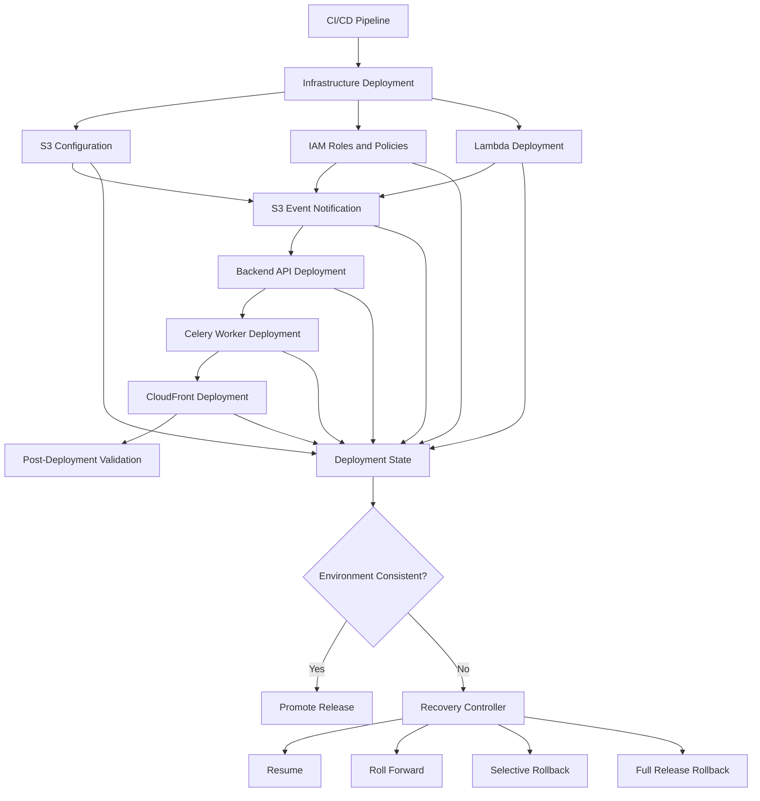
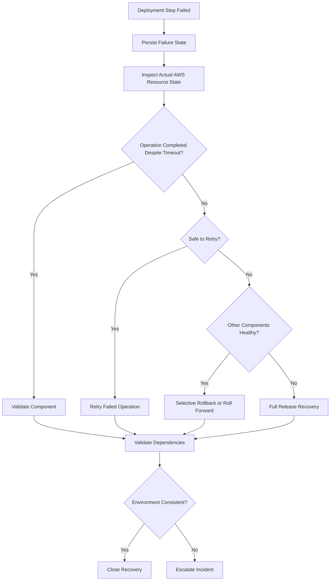
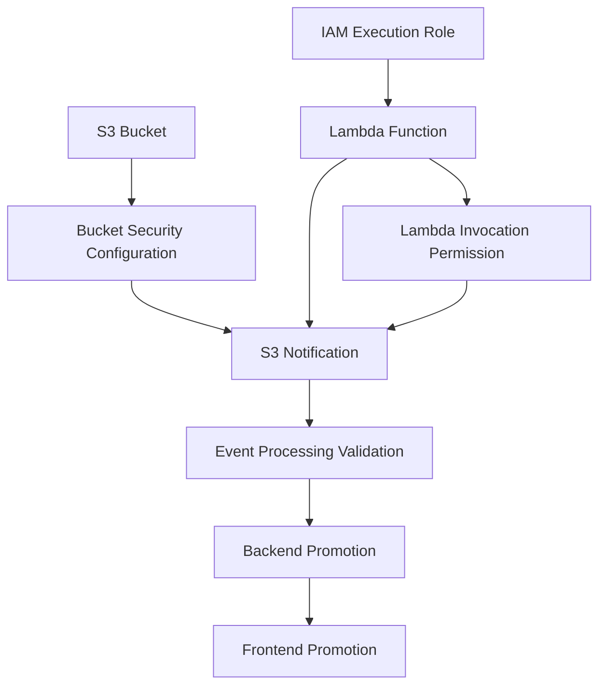

# 08- Handling Partial Deployment Failures

## Overview

A partial deployment failure occurs when a release updates some application or infrastructure components successfully but fails before completing the remaining deployment operations.

Unlike a complete deployment failure, the environment may contain a mixture of old and new application versions, infrastructure configurations, and processing components.

This is particularly important in Amazon S3-backed architectures because a single release can modify multiple independently managed resources:

- S3 bucket configurations, including encryption, versioning, lifecycle, and replication.
- IAM roles, policies, and resource permissions.
- Lambda functions and S3 event notification configurations.
- Backend APIs built with Django or FastAPI.
- Celery workers and asynchronous processing pipelines.
- SQS queues and EventBridge integrations.
- CloudFront distributions and static assets.
- Database schemas and application metadata.

A failed CI/CD pipeline does not mean that all preceding changes were reverted. AWS resource operations have independent execution and failure semantics. Some changes may remain active after the pipeline terminates.

The recovery strategy must establish the actual state of each component, identify compatibility problems, and determine whether to resume, roll forward, or roll back.

## Why Partial Deployment Failures Occur

Production deployments are rarely atomic across multiple AWS services.

Consider a document-processing application with the following deployment sequence:

1. Update the S3 bucket configuration.
2. Deploy a new Lambda processor.
3. Update the Lambda execution role.
4. Configure S3 event notifications.
5. Deploy the backend API.
6. Update Celery workers.
7. Publish frontend assets through CloudFront.
8. Execute post-deployment validation.

If the Lambda deployment fails after the bucket configuration succeeds, the environment is already partially modified.

The API and workers may also be running different application versions if the deployment pipeline continues independently or terminates during a rolling deployment.

### Common Failure Categories

| Failure category | Example | Potential impact |
|---|---|---|
| Infrastructure provisioning | Terraform creates a bucket but fails to create an IAM policy | Partially provisioned infrastructure |
| Configuration deployment | Bucket policy updates but application role permissions remain outdated | Application authorization failures |
| Lambda deployment | Function package succeeds but configuration update fails | Incomplete processing release |
| Event integration | Lambda deploys but S3 notification configuration fails | Uploaded objects are not processed |
| Application deployment | API deploys but Celery workers remain outdated | Incompatible task payloads |
| Database migration | Migration succeeds but application deployment fails | Schema and application incompatibility |
| Frontend deployment | Assets upload but CloudFront update fails | Inconsistent frontend release |
| CI/CD execution | Runner terminates after submitting an AWS API request | Unknown deployment outcome |

## Partial Deployment Failure Architecture

A deployment pipeline should track each component independently rather than treating the release as one indivisible operation.



The deployment controller must know:

- Which operations completed.
- Which operations failed.
- Which operations have an unknown outcome.
- Which resources are currently serving production traffic.
- Which components depend on other components.
- Whether the partially deployed release remains compatible.

A single pipeline exit code cannot provide this information.

## Establish a Deployment State Model

Maintain component-level deployment state that can be inspected independently of the CI/CD runner.

### Component States

| State | Meaning |
|---|---|
| `PENDING` | Deployment has not started |
| `IN_PROGRESS` | Deployment operation is executing |
| `SUCCEEDED` | Component deployment completed |
| `FAILED` | Deployment operation failed |
| `UNKNOWN` | Outcome cannot be determined |
| `ROLLBACK_PENDING` | Recovery has been initiated |
| `ROLLED_BACK` | Previous component version has been restored |
| `SKIPPED` | Component was intentionally excluded |

`UNKNOWN` is especially important when a CI/CD runner terminates after submitting an AWS API request but before receiving its response.

For example, a Lambda version publication request may have succeeded even though the pipeline timed out waiting for the response.

The recovery process must inspect the actual Lambda versions before attempting another publication or rollback.

### Deployment Manifest

A deployment manifest records the intended release and the state of each component.

```json
{
  "deployment_id": "s3-platform-2026-11-01-001",
  "environment": "production",
  "release": "2026.11.01",
  "status": "PARTIAL_FAILURE",
  "components": {
    "s3_configuration": {
      "status": "SUCCEEDED",
      "revision": "infra-42"
    },
    "iam_configuration": {
      "status": "SUCCEEDED",
      "revision": "iam-18"
    },
    "lambda_processor": {
      "status": "FAILED",
      "version": "43"
    },
    "api": {
      "status": "SUCCEEDED",
      "image_digest": "sha256:API_DIGEST"
    },
    "celery_worker": {
      "status": "PENDING"
    },
    "cloudfront": {
      "status": "PENDING"
    }
  }
}
```

This is an illustrative manifest. A production implementation should persist deployment state in a durable system and validate all state transitions.

### Deployment State Storage

| Storage | Suitable use case | Considerations |
|---|---|---|
| PostgreSQL | Deployment orchestration and audit history | Transactional updates and relational queries |
| DynamoDB | Distributed deployment state | Conditional writes and scalable access |
| S3 | Immutable deployment manifests and artifacts | Object storage does not provide general transactional coordination |
| CI/CD platform | Pipeline execution history | May not provide sufficient cross-pipeline recovery state |

For distributed recovery controllers, DynamoDB conditional writes can prevent multiple recovery processes from claiming the same deployment simultaneously.

Example:

```python
import boto3
from botocore.exceptions import ClientError

dynamodb = boto3.resource("dynamodb")
table = dynamodb.Table("deployment-state")


def claim_recovery(deployment_id: str, owner: str) -> bool:
    try:
        table.update_item(
            Key={"deployment_id": deployment_id},
            UpdateExpression="SET recovery_owner = :owner",
            ConditionExpression=(
                "attribute_not_exists(recovery_owner)"
            ),
            ExpressionAttributeValues={
                ":owner": owner,
            },
        )
        return True

    except ClientError as exc:
        error_code = exc.response["Error"]["Code"]

        if error_code == "ConditionalCheckFailedException":
            return False

        raise
```

This simplified example does not implement lease expiration. A production implementation should include:

- Lease ownership.
- Lease expiration.
- Conditional lease renewal.
- Recovery operation identifiers.
- Audit history.
- Protection against stale recovery workers.

A permanent owner attribute without an expiration mechanism would prevent subsequent recovery attempts.

## Identify the Actual Deployment State

The first recovery action is state discovery, not redeployment.

A failed pipeline may have already modified AWS resources. Reapplying the entire release without inspection can introduce additional changes or overwrite useful state.

### Recovery Discovery Procedure

1. Identify the failed deployment and release identifier.
2. Retrieve pipeline execution logs.
3. Identify the last confirmed successful operation.
4. Inspect the actual state of every affected AWS resource.
5. Compare deployed configurations with the intended release.
6. Identify application versions currently serving traffic.
7. Inspect pending background tasks and event processing.
8. Determine whether production traffic is affected.
9. Select an appropriate recovery strategy.

### Component Inventory

| Component | Expected release | Actual release | Status |
|---|---|---|---|
| S3 configuration | infra-42 | infra-42 | Complete |
| IAM policy | iam-18 | iam-18 | Complete |
| Lambda processor | 43 | 42 | Failed |
| Backend API | 2026.11.01 | 2026.11.01 | Complete |
| Celery worker | 2026.11.01 | 2026.10.15 | Pending |
| CloudFront assets | 2026.11.01 | 2026.10.15 | Pending |

This inventory exposes version mismatches that may not appear in the final pipeline error.

## Select the Appropriate Recovery Strategy

Not every partial deployment requires a complete rollback.

The correct strategy depends on the actual resource state, application compatibility, and production impact.

### Resume Deployment

Resume deployment when:

- Successfully deployed components are healthy.
- Existing components remain compatible.
- The failed operation is safe to retry.
- The intended release remains valid.
- No data integrity issue has been introduced.

Example:

The S3 bucket configuration and API deployment succeed, but the CloudFront asset upload fails due to a temporary network interruption.

If the API remains healthy and the assets can be deployed independently, resuming from the failed step is generally safer than rolling back the entire release.

### Roll Forward

Roll forward when:

- The failed release contains a correctable defect.
- Previously deployed components remain compatible with the corrected release.
- Reverting would introduce additional risk.
- The corrected deployment can be validated.

Example:

A Lambda package is missing a dependency. Publish a corrected package and update the intended Lambda alias without unnecessarily reverting the S3 infrastructure or backend API.

### Selective Rollback

Use selective rollback when:

- A particular component is unhealthy.
- Other deployed components are functioning correctly.
- The affected component can be restored independently.
- The previous component version remains compatible with the current infrastructure and data.

Example:

A new Lambda processor generates incorrect output keys, while the API and S3 infrastructure remain healthy.

Restore the previous Lambda version while preserving the infrastructure changes.

### Full Release Rollback

Consider a full release rollback when:

- Multiple components are incompatible.
- The release causes widespread production failures.
- Selective recovery cannot restore a consistent environment.
- The previous release remains compatible with the current infrastructure and data state.

A full rollback must still be component-aware. It must not blindly reverse irreversible database migrations or delete S3 objects.

### Strategy Comparison

| Strategy | Appropriate condition | Main risk |
|---|---|---|
| Resume | Transient failure and valid deployment | Repeating a non-idempotent operation |
| Roll forward | Correctable release defect | Introducing another incompatible change |
| Selective rollback | Isolated component failure | Version incompatibility |
| Full rollback | Widespread release failure | Reverting dependencies or data incorrectly |

## Handling Partial Terraform Deployments

Terraform can modify multiple AWS resources during a single apply operation.

If an apply fails, some resources may already have been created or updated.

Terraform records successfully completed resource operations in state, but a failed apply does not imply that every infrastructure change was reverted.

### Inspect Terraform State

List tracked resources:

```bash
terraform state list
```

Inspect a specific resource:

```bash
terraform state show aws_s3_bucket.documents
```

Inspect the planned changes:

```bash
terraform plan
```

Review the actual infrastructure and Terraform state before making additional changes.

### Example Partial Failure

A Terraform configuration provisions:

- S3 bucket.
- Bucket versioning.
- Default encryption.
- IAM role.
- Lambda function.
- S3 notification configuration.

Suppose the bucket, versioning, and encryption are successfully created, but the Lambda notification configuration fails.

The infrastructure is partially deployed.

A safe recovery process is:

1. Inspect Terraform state.
2. Verify the actual S3 bucket configuration.
3. Inspect the Lambda function and invocation permissions.
4. Identify the notification configuration failure.
5. Correct the dependency or permission issue.
6. Generate a new Terraform plan.
7. Review the planned changes.
8. Apply the corrected configuration.
9. Verify the complete integration.

Example:

```bash
terraform fmt -check
terraform validate

terraform plan \
  -out=recovery.tfplan

terraform show recovery.tfplan

terraform apply recovery.tfplan
```

Do not assume that rerunning `terraform apply` is always harmless. Review the plan and confirm that the desired state remains correct.

### Terraform State Recovery

If the pipeline terminates while an apply is running, inspect the backend state before retrying.

Recovery considerations:

- Verify that the previous Terraform operation has terminated.
- Check whether state locking is still active.
- Inspect backend logs where available.
- Confirm that the state snapshot is current.
- Identify resources created outside recorded state.
- Reconcile actual infrastructure with Terraform state.

Never manually delete a state lock or modify state files as an initial recovery action.

Use `terraform force-unlock` only after confirming that the lock belongs to a terminated operation and no other Terraform process is active.

### Import Resources Created Outside Terraform State

If an AWS resource was created but is not tracked by Terraform, import it after verifying that it belongs to the intended environment.

Example:

```bash
terraform import \
  aws_s3_bucket.documents \
  example-production-documents
```

Then inspect the resulting plan:

```bash
terraform plan
```

The imported resource configuration must be reconciled with the actual resource settings before applying further changes.

### Terraform Recovery Pitfalls

| Mistake | Impact | Prevention |
|---|---|---|
| Rerunning apply without inspecting state | Unexpected additional changes | Review state and plan first |
| Deleting resources manually | Terraform drift and state inconsistency | Reconcile through IaC |
| Force-unlocking an active operation | Concurrent state modification | Verify operation ownership |
| Removing state entries to bypass errors | Terraform loses resource tracking | Use import or controlled state operations |
| Destroying partial infrastructure | Data loss or service outage | Use resource-specific recovery |

## Handling Partial CloudFormation Deployments

CloudFormation manages resources through stack operations.

A stack update can enter states such as:

- `UPDATE_IN_PROGRESS`
- `UPDATE_COMPLETE`
- `UPDATE_FAILED`
- `UPDATE_ROLLBACK_IN_PROGRESS`
- `UPDATE_ROLLBACK_COMPLETE`
- `UPDATE_ROLLBACK_FAILED`

The recovery procedure depends on the actual stack state.

### Inspect Stack Status

```bash
aws cloudformation describe-stacks \
  --stack-name s3-production
```

Inspect stack events:

```bash
aws cloudformation describe-stack-events \
  --stack-name s3-production
```

Find the first meaningful resource failure rather than treating the final stack status as the root cause.

### Recover a Failed Update

When CloudFormation successfully completes an automatic rollback, inspect the resulting stack configuration before attempting another deployment.

If rollback itself fails, investigate the resource that prevented rollback.

Possible causes include:

- A bucket policy was changed outside CloudFormation.
- A resource was deleted manually.
- A dependent resource no longer exists.
- A custom resource failed during rollback.
- A retained S3 bucket conflicts with a replacement operation.

Do not manually delete an S3 bucket simply because CloudFormation reports a rollback failure.

### Continue a Failed Rollback

Where supported by the stack state, use the CloudFormation recovery operation:

```bash
aws cloudformation continue-update-rollback \
  --stack-name s3-production
```

If a resource must be skipped, identify the exact logical resource and understand that the resulting resource configuration may be inconsistent with the template.

Example syntax:

```bash
aws cloudformation continue-update-rollback \
  --stack-name s3-production \
  --resources-to-skip LambdaProcessor
```

Resource skipping has strict eligibility and stack-state requirements. A skipped resource must be reconciled with the template afterward.

Use this operation only as a controlled recovery measure, not as a routine deployment shortcut.

## Handling Partial S3 Configuration Deployments

S3 infrastructure contains multiple independently managed configurations.

A deployment may update some successfully while leaving others unchanged.

### Common Partial Configuration States

| Configuration | Possible partial failure |
|---|---|
| Versioning | Bucket created but versioning not enabled |
| Encryption | Default encryption updated but KMS permissions missing |
| Bucket policy | New policy applied but application role not updated |
| Lifecycle | New lifecycle rules applied but validation fails |
| Replication | Replication role created but destination configuration incomplete |
| Event notifications | Lambda deployed but notification configuration missing |
| CloudFront origin | S3 origin updated but OAC policy is incomplete |

### Inspect Bucket Configuration

Check versioning:

```bash
aws s3api get-bucket-versioning \
  --bucket example-production-documents
```

Check encryption:

```bash
aws s3api get-bucket-encryption \
  --bucket example-production-documents
```

Check lifecycle:

```bash
aws s3api get-bucket-lifecycle-configuration \
  --bucket example-production-documents
```

Check replication:

```bash
aws s3api get-bucket-replication \
  --bucket example-production-documents
```

Check event notifications:

```bash
aws s3api get-bucket-notification-configuration \
  --bucket example-production-documents
```

Some commands return errors when the corresponding configuration is absent. Distinguish an expected missing configuration from an authorization or service failure.

### Preserve Existing Object Data

During infrastructure recovery:

- Do not delete the bucket to restart provisioning.
- Do not suspend versioning without understanding its implications.
- Do not overwrite lifecycle configuration with an incomplete rule set.
- Do not replace bucket policies without preserving required access.
- Do not remove KMS permissions before checking dependent applications.
- Do not delete object versions during a configuration rollback.

Recover S3 infrastructure independently from application data unless a specific data correction is required.

## Handling Partial Lambda and Event Notification Deployments

An event-driven S3 workflow can be partially deployed even when the Lambda function itself exists.

For example:

1. Lambda version 43 is published.
2. Function configuration is updated.
3. S3 notification configuration fails.
4. The bucket notification still references an older configuration or does not contain the intended event rule.
5. New objects are uploaded but are not processed as expected.

### Inspect Lambda Configuration

```bash
aws lambda get-function \
  --function-name document-processor
```

Inspect the production alias:

```bash
aws lambda get-alias \
  --function-name document-processor \
  --name production
```

Inspect S3 notifications:

```bash
aws s3api get-bucket-notification-configuration \
  --bucket example-production-documents
```

Inspect Lambda resource permissions:

```bash
aws lambda get-policy \
  --function-name document-processor
```

### Recovery Procedure

1. Identify the published Lambda version.
2. Inspect the production alias.
3. Verify the function configuration.
4. Verify the Lambda resource policy.
5. Inspect the S3 notification destination.
6. Confirm that event filters match the intended input objects.
7. Upload a controlled test object.
8. Verify that the intended function receives the event.
9. Verify that the expected output object is generated.

S3 event notifications are delivered at least once and can arrive out of order. Consumers must handle duplicate events and idempotent processing.

### Avoid Recursive Invocation

If the Lambda function writes processed objects into the same bucket, use separate input and output prefixes or separate buckets.

Example:

```text
documents/
├── incoming/
├── processed/
└── failed/
```

Configure the notification to match only `incoming/`.

Otherwise, the function may trigger itself repeatedly when it writes output objects.

## Handling Partial Backend and Worker Deployments

A backend deployment may update API containers but fail before updating Celery workers.

This can create incompatible task producers and consumers.

### Example

The new API publishes:

```json
{
  "document_id": "doc-1001",
  "schema_version": 2,
  "processing_mode": "extract-v2"
}
```

The old worker expects:

```json
{
  "document_id": "doc-1001"
}
```

The worker may reject the new task payload or process it incorrectly.

### Recovery Procedure

1. Determine which API version is serving traffic.
2. Determine which worker version is running.
3. Inspect task schema compatibility.
4. Inspect queue depth and failed task counts.
5. Stop incompatible task production if necessary.
6. Deploy a compatible worker or restore a compatible API.
7. Process eligible queued tasks.
8. Verify task completion and application state.

Do not purge Redis or SQS queues to eliminate incompatible messages.

Preserve failed tasks for inspection and controlled replay.

## Handling Partial CloudFront Deployments

CloudFront configuration changes and S3 asset uploads are separate operations.

A deployment can upload new assets successfully but fail while updating the distribution.

Alternatively, the distribution update can succeed while the corresponding assets are missing.

### Inspect Distribution Status

```bash
aws cloudfront get-distribution \
  --id EXAMPLE_DISTRIBUTION_ID
```

Inspect the distribution configuration:

```bash
aws cloudfront get-distribution-config \
  --id EXAMPLE_DISTRIBUTION_ID
```

Check whether the distribution is still deploying before attempting another configuration update.

### Verify S3 Assets

```bash
aws s3 ls \
  s3://example-production-frontend/releases/2026-11-01/ \
  --recursive
```

### Recovery Strategy

- Preserve existing release assets.
- Identify the currently active frontend entry point.
- Confirm that all referenced assets exist.
- Restore the previous entry point if necessary.
- Apply targeted CloudFront invalidations.
- Verify content delivery through the distribution domain.

Avoid deleting previous release directories during a partial deployment.

Immutable, versioned asset paths make recovery safer because previous releases remain available while the active entry point changes.

## Automated Partial Deployment Recovery

A deployment controller should distinguish deployment execution from recovery execution.

A robust workflow should:

1. Execute deployment steps independently.
2. Persist each component's result.
3. Stop dependent operations after a critical failure.
4. Inspect actual AWS resource states.
5. Determine whether retry, roll-forward, or rollback is appropriate.
6. Execute the selected recovery operation.
7. Validate the resulting environment.
8. Mark the deployment complete only after required checks pass.

### Recovery Decision Flow



### Idempotent Deployment Operations

A deployment operation should be safe to retry whenever practical.

Examples include:

- Updating a Lambda alias to a specific published version.
- Applying a Terraform configuration after reviewing the plan.
- Uploading immutable, content-addressed frontend assets.
- Applying a complete desired bucket configuration.
- Executing a database migration with a tracked migration identifier.

Avoid retrying operations that can create duplicate business effects without an idempotency mechanism.

### Example Python Recovery Controller

The following example illustrates a component-level deployment controller. Deployment and verification functions are supplied by the application-specific deployment implementation.

```python
from dataclasses import dataclass
from enum import StrEnum
from typing import Callable


class DeploymentStatus(StrEnum):
    PENDING = "PENDING"
    IN_PROGRESS = "IN_PROGRESS"
    SUCCEEDED = "SUCCEEDED"
    FAILED = "FAILED"
    UNKNOWN = "UNKNOWN"


@dataclass
class DeploymentStep:
    name: str
    deploy: Callable[[], None]
    verify: Callable[[], bool]
    required: bool = True
    status: DeploymentStatus = DeploymentStatus.PENDING
    error: str | None = None


def execute_step(step: DeploymentStep) -> None:
    step.status = DeploymentStatus.IN_PROGRESS

    try:
        step.deploy()

        if not step.verify():
            raise RuntimeError(
                f"Post-deployment validation failed: {step.name}"
            )

        step.status = DeploymentStatus.SUCCEEDED

    except Exception as exc:
        step.status = DeploymentStatus.FAILED
        step.error = str(exc)
        raise


def execute_release(steps: list[DeploymentStep]) -> bool:
    for step in steps:
        try:
            execute_step(step)

        except Exception:
            if step.required:
                return False

    return all(
        step.status == DeploymentStatus.SUCCEEDED
        or not step.required
        for step in steps
    )
```

This is an execution example, not a complete distributed deployment orchestrator.

A production implementation should additionally provide:

- Durable deployment state.
- Dependency-aware execution.
- Concurrency control.
- Lease management.
- Retry classification and backoff.
- Timeout handling.
- Recovery ownership.
- Structured audit events.
- Explicit rollback operations.
- Manual approval for destructive recovery actions.

Do not classify every exception as transient. Authorization failures, invalid configuration, and resource conflicts generally require correction before retrying.

## Dependency-Aware Deployment Ordering

A deployment should explicitly model component dependencies.

For an S3 event-processing application, a reasonable sequence is:

1. Create or update required infrastructure.
2. Configure IAM permissions.
3. Deploy the Lambda function.
4. Configure Lambda invocation permissions.
5. Configure S3 event notifications.
6. Deploy the backend API.
7. Deploy compatible workers.
8. Deploy frontend assets.
9. Run integration and smoke tests.
10. Promote the release.

The exact ordering depends on the architecture.

For example, Lambda invocation permissions must exist before configuring an S3 notification destination that requires the function to authorize S3 invocation.

### Dependency Graph



Infrastructure and application dependencies should be represented in IaC and deployment orchestration rather than relying on undocumented timing assumptions.

## Observability and Failure Detection

Partial deployment recovery requires visibility into deployment operations and application behavior.

### Deployment Metrics

| Metric | Purpose |
|---|---|
| Deployment completion rate | Measures successful releases |
| Partial deployment count | Identifies incomplete releases |
| Recovery duration | Measures time to restore a consistent environment |
| Failed component count | Identifies frequently failing deployment stages |
| Rollback frequency | Identifies release stability problems |
| Deployment drift | Detects divergence between desired and actual state |

### Application Metrics

Monitor:

- API 4xx and 5xx rates.
- Request latency.
- S3 `AccessDenied` and service errors.
- KMS authorization failures.
- Lambda invocation errors and duration.
- SQS queue depth and message age.
- Celery task failure rate.
- CloudFront 4xx and 5xx responses.
- Database migration and query failures.

### Structured Deployment Logs

Use a common deployment identifier across the pipeline and application components.

Example:

```json
{
  "timestamp": "2026-11-01T12:30:00Z",
  "deployment_id": "s3-platform-2026-11-01-001",
  "component": "lambda_processor",
  "operation": "publish_version",
  "status": "FAILED",
  "error_code": "InvalidParameterValueException",
  "environment": "production"
}
```

This allows engineers to correlate infrastructure changes, deployment operations, and runtime failures.

## Security During Partial Recovery

A partially deployed environment can have temporary permission inconsistencies.

For example:

- A new IAM policy is applied but the old role is still active.
- A bucket policy removes access required by an existing worker.
- A new KMS key is configured while older application instances still depend on the previous key.
- A deployment identity receives broader permissions than intended to bypass a failed operation.

Recovery must preserve least privilege.

### Security Controls

- Use short-lived deployment credentials.
- Separate deployment and application execution roles.
- Restrict recovery actions to approved environments.
- Preserve CloudTrail audit records.
- Validate bucket policies and KMS permissions independently.
- Avoid temporary public access to unblock deployment.
- Do not disable Block Public Access as a recovery shortcut.
- Record all manual AWS console changes.
- Reconcile manual changes into IaC after recovery.

## Cost and Data Integrity Considerations

Partial deployments can leave resources and data that remain after the pipeline fails.

Examples include:

- Duplicate Lambda versions.
- Unused S3 buckets.
- Incomplete multipart uploads.
- Temporary frontend release directories.
- Orphaned log groups.
- Unused CloudFront resources.
- Failed processing outputs.

Cleanup should be a separate, controlled activity.

Before deleting anything:

1. Identify the resource owner.
2. Confirm whether the resource belongs to the failed deployment.
3. Check whether another active release depends on it.
4. Inspect S3 object versions and retention requirements.
5. Confirm that the resource is not required for rollback.
6. Obtain approval where deletion is destructive.
7. Record the cleanup operation.

Never automatically empty a production S3 bucket as part of generic deployment failure recovery.

## Production Recovery Checklist

### Detection and Assessment

- [ ] Identify the failed deployment and release identifier.
- [ ] Preserve deployment logs and error details.
- [ ] Identify the last successfully completed operation.
- [ ] Inspect actual AWS resource states.
- [ ] Identify components running different release versions.
- [ ] Check application and infrastructure dependencies.
- [ ] Determine whether production traffic is affected.
- [ ] Assess potential data integrity impact.

### Recovery Execution

- [ ] Select resume, roll-forward, selective rollback, or full rollback.
- [ ] Confirm the recovery operation is safe to retry.
- [ ] Verify Terraform or CloudFormation state.
- [ ] Validate S3 configuration before changing it.
- [ ] Restore compatible application and worker versions.
- [ ] Verify Lambda versions and event notification configuration.
- [ ] Preserve queued messages and existing objects.
- [ ] Avoid unnecessary destructive infrastructure changes.
- [ ] Record manual recovery operations.

### Post-Recovery Validation

- [ ] Verify API health and critical endpoints.
- [ ] Verify S3 upload and download operations.
- [ ] Verify encryption and authorization.
- [ ] Verify Lambda event processing.
- [ ] Verify Celery and SQS consumers.
- [ ] Verify database compatibility.
- [ ] Verify CloudFront content delivery.
- [ ] Check application and infrastructure metrics.
- [ ] Confirm the environment matches the intended release.
- [ ] Document the incident and preventive actions.

## Common Mistakes and Production Pitfalls

| Mistake | Why it is dangerous | Recommended approach |
|---|---|---|
| Rerunning the complete pipeline immediately | Repeats successful operations and may introduce additional changes | Inspect component state first |
| Assuming failed pipeline means failed deployment | AWS resources may have been updated before the timeout | Verify actual resource state |
| Deleting partially created S3 resources | Can cause data loss and dependency failures | Use selective, state-aware recovery |
| Ignoring component version mismatches | APIs and workers may use incompatible contracts | Track versions independently |
| Retrying every failure automatically | Permanent configuration errors continue failing | Classify transient and permanent failures |
| Skipping Terraform state inspection | Can cause drift and resource conflicts | Reconcile state before applying |
| Ignoring CloudFormation rollback status | Stack may remain in a failed state | Inspect stack events and recovery status |
| Replacing bucket policies wholesale | Existing application access may be removed | Apply complete, reviewed policy changes |
| Replaying events without idempotency | Duplicate business effects may occur | Use idempotent consumers |
| Cleaning up failed deployment resources automatically | May delete resources required by active releases | Require ownership and dependency validation |

## Key Takeaways

- Partial deployment failures are not atomic failures; inspect the actual state of every affected component before recovery.
- Choose between resume, roll-forward, selective rollback, and full rollback based on dependency compatibility and production impact.
- Terraform and CloudFormation failures require state-aware recovery; never assume AWS resources were automatically reverted.
- S3 data, queued events, database changes, and application side effects must be preserved and reconciled independently.
- Use durable deployment manifests, component-level validation, idempotent operations, and structured observability to make recovery predictable.