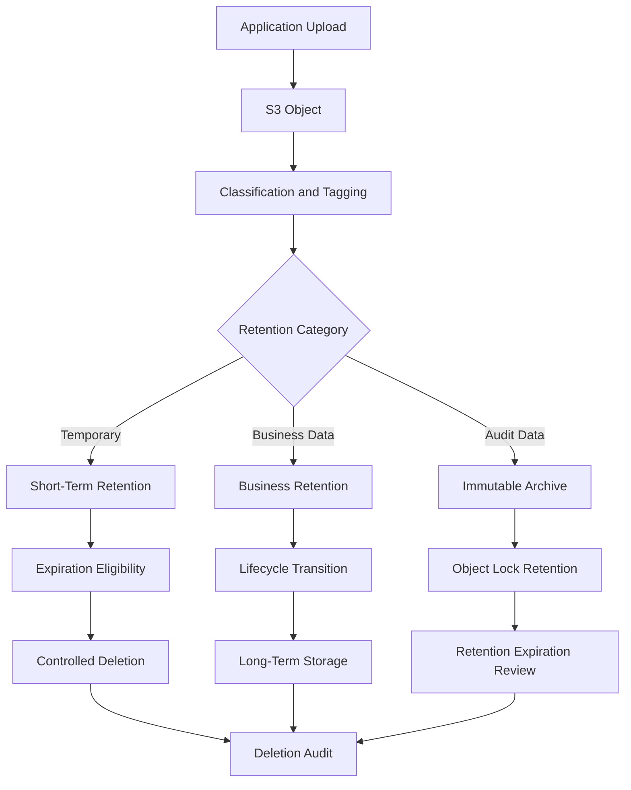
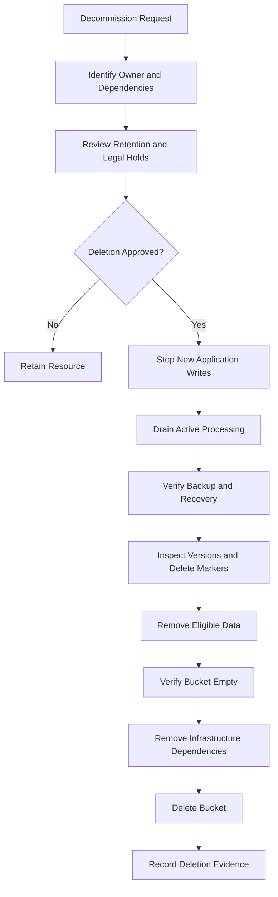
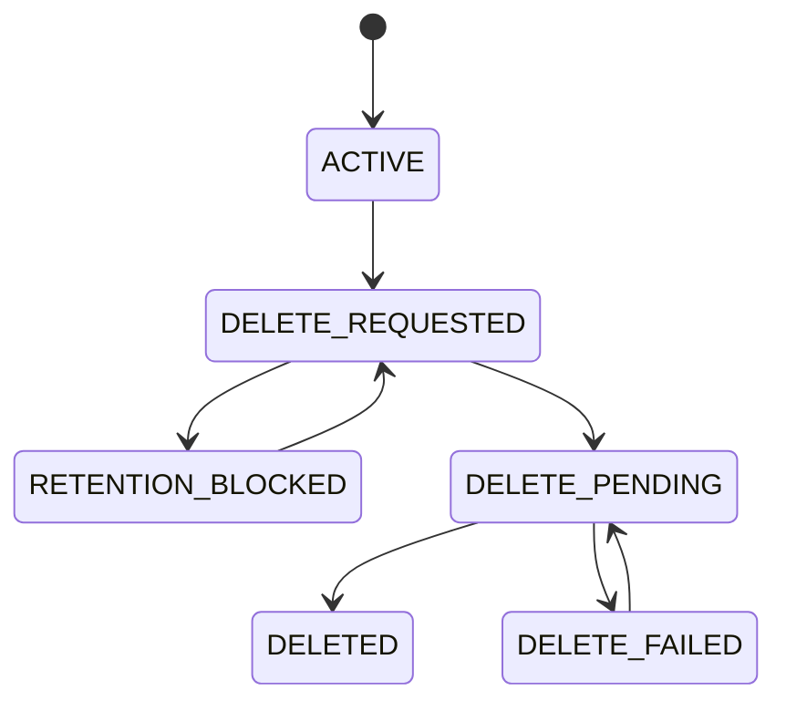

# 09- Safe Resource Deletion and Retention

## Overview

Safe resource deletion is a controlled infrastructure operation that removes AWS resources and stored data without compromising application availability, data integrity, compliance obligations, or disaster recovery capabilities.

In Amazon S3 environments, deletion requires particular care because buckets, object versions, lifecycle configurations, replication relationships, and encryption dependencies have different deletion semantics.

Deleting an S3 bucket is not equivalent to deleting an application deployment. A bucket may contain:

- Current object versions.
- Noncurrent object versions.
- Delete markers.
- Incomplete multipart uploads.
- Replicated objects.
- Application-generated documents and media.
- Audit records and backup data.
- Objects protected by retention policies or legal holds.

Removing the bucket or its contents without understanding these dependencies can cause irreversible data loss.

A production deletion process should establish ownership, retention requirements, dependencies, recovery options, and approval before executing destructive operations.

This document covers safe deletion and retention of S3 resources during application releases, infrastructure changes, environment decommissioning, and disaster recovery operations.

## Resource Deletion Principles

### Distinguish Application Rollback from Resource Deletion

An application rollback restores a previous application version. It should not automatically delete infrastructure or stored data.

For example, rolling back a document-processing application may require restoring a previous Lambda version and backend image. The S3 bucket containing uploaded documents should normally remain unchanged.

Use separate operational workflows for:

- Application rollback.
- Infrastructure rollback.
- Temporary resource cleanup.
- Permanent resource decommissioning.
- Data retention and deletion.
- Compliance-driven destruction.

### Classify Resources Before Deletion

Every resource should have an ownership classification and a defined retention policy.

| Resource category | Examples | Typical deletion approach |
|---|---|---|
| Application infrastructure | Lambda functions, API resources | Remove after dependency validation |
| Persistent storage | S3 buckets, databases | Retain or decommission through an approved process |
| Temporary deployment resources | Temporary build artifacts, test objects | Automated cleanup with strict ownership checks |
| Release artifacts | Versioned frontend assets, Lambda packages | Retain for the rollback window |
| Audit resources | CloudTrail logs, deployment records | Retain according to security and compliance requirements |
| Backup resources | Replicas, backup buckets | Retain according to recovery policy |
| Encryption resources | KMS keys | Retain until all dependent data and recovery requirements are resolved |

The deletion policy must distinguish resources that can be recreated from resources that contain unique or regulated data.

## S3 Object Deletion Semantics

S3 deletion behavior depends on whether bucket versioning is enabled.

### Unversioned Buckets

In an unversioned bucket, deleting an object removes the object.

```bash
aws s3api delete-object \
  --bucket example-production-documents \
  --key documents/report.pdf
```

The object is no longer available through its key after successful deletion.

Recovery requires an independent copy, backup, or other recovery mechanism.

### Versioned Buckets

In a versioned bucket, a normal delete operation generally creates a delete marker rather than permanently removing existing object versions.

```bash
aws s3api delete-object \
  --bucket example-production-documents \
  --key documents/report.pdf
```

The current key appears deleted, but previous versions remain stored.

Inspect object versions:

```bash
aws s3api list-object-versions \
  --bucket example-production-documents \
  --prefix documents/report.pdf
```

A permanent deletion requires specifying the exact version ID:

```bash
aws s3api delete-object \
  --bucket example-production-documents \
  --key documents/report.pdf \
  --version-id VERSION_ID
```

This permanently removes the specified version, subject to applicable retention controls.

### Delete Markers

A delete marker is a special version that makes the object appear deleted in ordinary key-based requests.

It does not remove previous versions.

A versioned bucket can therefore contain:

- Current data versions.
- Noncurrent data versions.
- Current delete markers.
- Noncurrent delete markers.

This distinction is important when estimating storage costs and performing permanent deletion.

### Object Deletion Comparison

| Operation | Unversioned bucket | Versioned bucket |
|---|---|---|
| Delete without version ID | Removes the object | Creates a delete marker |
| Delete with version ID | Not applicable in the same way | Permanently deletes the specified version |
| Retrieve older data | Requires backup | Possible if an earlier version exists |
| Empty bucket | Deletes current objects | Requires handling versions and delete markers |
| Permanent destruction | Object deletion | Removal of all retained versions and markers |

## Object Lock and Retention Protection

S3 Object Lock protects object versions against deletion or modification for a configured retention period or through a legal hold.

It is designed for workloads requiring strong data-retention controls, including regulated records, audit archives, and immutable backups.

### Retention Modes

| Mode | Behavior | Operational implication |
|---|---|---|
| Governance | Authorized principals with the required bypass permission can bypass retention | Suitable when controlled administrative exceptions are required |
| Compliance | Protected versions cannot be overwritten or deleted before retention expires | Suitable for strict immutability requirements |

A legal hold can protect an object version independently of its configured retention period.

Removing a legal hold requires explicit authorization and should follow the organization's legal and compliance process.

### Inspect Object Lock Configuration

```bash
aws s3api get-object-lock-configuration \
  --bucket example-production-archive
```

Inspect an object's retention:

```bash
aws s3api get-object-retention \
  --bucket example-production-archive \
  --key audit/2026/record.json \
  --version-id VERSION_ID
```

Inspect its legal hold:

```bash
aws s3api get-object-legal-hold \
  --bucket example-production-archive \
  --key audit/2026/record.json \
  --version-id VERSION_ID
```

### Important Considerations

- Object Lock requires a bucket configured for Object Lock.
- Compliance-mode retention cannot be bypassed to delete a protected version before its retention expires.
- Governance-mode bypass requires the appropriate permission and explicit use of the bypass mechanism.
- Legal holds must be evaluated separately from retention dates.
- Replication and lifecycle behavior must be designed with retention requirements in mind.

Do not treat Object Lock as a general backup mechanism. It protects object versions against deletion but does not independently guarantee application availability or regional recovery.

## Retention Policy Design

A retention policy defines how long data must remain available and what happens after the retention period expires.

Retention should be based on business, legal, security, and recovery requirements rather than arbitrary storage-cost targets.

### Define Retention by Data Classification

| Data category | Example | Retention considerations |
|---|---|---|
| Temporary uploads | Unconfirmed user uploads | Short cleanup window |
| Application documents | Customer-submitted files | Business and contractual requirements |
| Generated reports | Monthly reports | Reporting and audit requirements |
| Processing intermediates | Temporary converted files | Processing completion and retry requirements |
| Security audit records | Access and deployment logs | Security and compliance requirements |
| Backups | Recovery copies | RPO, RTO, and backup policy |
| Legal records | Regulated documents | Applicable retention obligations and legal holds |

The exact retention period must be established by the organization. Do not assume that one retention period is appropriate for every object category.

### Retention Architecture



### Use Object Tags for Retention Classification

Object tags can help identify data categories and support lifecycle policies.

Example:

```bash
aws s3api put-object-tagging \
  --bucket example-production-documents \
  --key documents/report.pdf \
  --tagging 'TagSet=[
    {Key=DataClass,Value=Business},
    {Key=RetentionCategory,Value=Standard}
  ]'
```

Tags should be controlled by trusted application or infrastructure components. Do not rely exclusively on user-supplied tags to determine whether data can be permanently deleted.

## Lifecycle-Based Retention and Expiration

S3 Lifecycle policies automate transitions and expiration based on object age, tags, prefixes, and other supported filters.

They are useful for applying consistent retention rules at scale.

### Example Lifecycle Configuration

The following configuration transitions eligible objects to S3 Glacier Flexible Retrieval after 90 days and expires current objects after 365 days.

```json
{
  "Rules": [
    {
      "ID": "business-document-retention",
      "Status": "Enabled",
      "Filter": {
        "Tag": {
          "Key": "RetentionCategory",
          "Value": "Standard"
        }
      },
      "Transitions": [
        {
          "Days": 90,
          "StorageClass": "GLACIER"
        }
      ],
      "Expiration": {
        "Days": 365
      },
      "NoncurrentVersionExpiration": {
        "NoncurrentDays": 180
      },
      "AbortIncompleteMultipartUpload": {
        "DaysAfterInitiation": 7
      }
    }
  ]
}
```

Apply the configuration:

```bash
aws s3api put-bucket-lifecycle-configuration \
  --bucket example-production-documents \
  --lifecycle-configuration file://lifecycle.json
```

Inspect it:

```bash
aws s3api get-bucket-lifecycle-configuration \
  --bucket example-production-documents
```

### Versioned Bucket Considerations

In a versioned bucket, current-object expiration generally creates a delete marker. It does not automatically permanently delete all previous versions.

Use separate lifecycle actions for:

- Current object expiration.
- Noncurrent version expiration.
- Expired delete marker cleanup.
- Incomplete multipart upload abortion.

Example expired delete marker cleanup:

```json
{
  "ID": "remove-expired-delete-markers",
  "Status": "Enabled",
  "Filter": {
    "Prefix": "temporary/"
  },
  "Expiration": {
    "ExpiredObjectDeleteMarker": true
  }
}
```

This rule is intended to remove eligible expired delete markers where no object versions remain.

Lifecycle execution is asynchronous. Do not assume that an object disappears immediately when it becomes eligible for expiration.

### Lifecycle Limitations

- Lifecycle actions are not an immediate deletion API.
- Object retention and legal holds can prevent deletion.
- Versioned objects require explicit noncurrent-version management.
- Storage-class transitions can introduce retrieval charges and minimum-duration considerations.
- Lifecycle rules should be tested against representative object prefixes and tags.
- Existing objects and newly uploaded objects may be affected differently depending on rule eligibility and configuration.

Detailed lifecycle configuration and operational behavior should remain in the dedicated lifecycle documentation.

## Safe Bucket Decommissioning

Deleting a production bucket is a destructive operation.

A bucket must be empty before it can normally be deleted. For versioned buckets, removing only current objects is insufficient.

A safe decommissioning process must account for all object versions, delete markers, retention protections, and dependent services.

### Pre-Deletion Assessment

Before deleting a bucket, verify:

- The bucket owner and owning AWS account.
- The bucket Region.
- Application and infrastructure dependencies.
- Active upload and download traffic.
- S3 event notification dependencies.
- CloudFront origins and distributions.
- Replication configuration.
- Lifecycle policies.
- Object Lock configuration.
- Object versions and delete markers.
- Incomplete multipart uploads.
- Backup and recovery requirements.
- Legal and compliance retention requirements.
- Cross-account access and application integrations.

### Inspect Bucket Configuration

```bash
aws s3api get-bucket-location \
  --bucket example-production-documents

aws s3api get-bucket-versioning \
  --bucket example-production-documents

aws s3api get-bucket-encryption \
  --bucket example-production-documents

aws s3api get-bucket-lifecycle-configuration \
  --bucket example-production-documents

aws s3api get-bucket-replication \
  --bucket example-production-documents

aws s3api get-bucket-notification-configuration \
  --bucket example-production-documents
```

Some configuration inspection commands return an error when a configuration is absent. Record whether the configuration is absent or whether the inspection failed for another reason.

### Decommissioning Workflow



### Stop New Writes Before Deletion

Deleting objects while applications continue writing creates race conditions.

Before removing data:

- Disable or redirect application uploads.
- Stop scheduled ingestion jobs.
- Pause dependent workers where necessary.
- Disable or update event-driven producers.
- Drain in-flight processing.
- Confirm that no active service requires the bucket.

The application should be prevented from recreating objects during the cleanup process.

### Inspect Object Versions

List versions:

```bash
aws s3api list-object-versions \
  --bucket example-production-documents
```

For large buckets, use paginated API operations or an appropriate batch deletion process.

Do not assume a single response contains every version.

### Inspect Incomplete Multipart Uploads

```bash
aws s3api list-multipart-uploads \
  --bucket example-production-documents
```

Incomplete multipart uploads can continue consuming storage until they are completed or aborted.

Abort a specific upload:

```bash
aws s3api abort-multipart-upload \
  --bucket example-production-documents \
  --key documents/large-file.zip \
  --upload-id UPLOAD_ID
```

### Empty an Unversioned Bucket

For a bucket confirmed to be unversioned and approved for complete deletion:

```bash
aws s3 rm s3://example-temporary-test-bucket \
  --recursive
```

Verify that the bucket is empty:

```bash
aws s3api list-objects-v2 \
  --bucket example-temporary-test-bucket
```

Delete the bucket:

```bash
aws s3api delete-bucket \
  --bucket example-temporary-test-bucket \
  --region ap-south-1
```

Do not use this procedure for a versioned bucket without first accounting for versions and delete markers.

### Empty a Versioned Bucket

A versioned bucket requires permanent deletion of eligible object versions and delete markers.

The following Python example uses Boto3 paginators and batch deletion. It deliberately refuses to run unless an explicit destructive-operation confirmation is supplied.

It does not bypass Object Lock, governance retention, legal holds, or other deletion protections.

```python
import os
import sys

import boto3
from botocore.exceptions import BotoCoreError, ClientError


def delete_all_versions(bucket_name: str, region: str) -> None:
    s3 = boto3.client("s3", region_name=region)

    paginator = s3.get_paginator("list_object_versions")

    for page in paginator.paginate(Bucket=bucket_name):
        objects = []

        for version in page.get("Versions", []):
            objects.append({
                "Key": version["Key"],
                "VersionId": version["VersionId"],
            })

        for marker in page.get("DeleteMarkers", []):
            objects.append({
                "Key": marker["Key"],
                "VersionId": marker["VersionId"],
            })

        for start in range(0, len(objects), 1000):
            batch = objects[start:start + 1000]

            if not batch:
                continue

            response = s3.delete_objects(
                Bucket=bucket_name,
                Delete={
                    "Objects": batch,
                    "Quiet": False,
                },
            )

            errors = response.get("Errors", [])

            if errors:
                raise RuntimeError(
                    f"Deletion failed for {len(errors)} objects: {errors}"
                )


def main() -> int:
    bucket = os.environ["S3_BUCKET"]
    region = os.environ["AWS_REGION"]

    confirmation = os.environ.get("CONFIRM_BUCKET_DELETION")

    expected = f"DELETE:{bucket}"

    if confirmation != expected:
        print(
            f"Refusing deletion. Set CONFIRM_BUCKET_DELETION={expected}"
        )
        return 2

    try:
        delete_all_versions(bucket, region)
        print("Eligible object versions and delete markers processed.")
        return 0

    except (BotoCoreError, ClientError, RuntimeError) as exc:
        print(f"Deletion failed: {exc}", file=sys.stderr)
        return 1


if __name__ == "__main__":
    raise SystemExit(main())
```

This script is intentionally not a complete production decommissioning controller.

Before execution:

- Confirm that all objects are approved for permanent deletion.
- Verify that Object Lock and legal holds do not apply.
- Confirm that replication and backup requirements have been satisfied.
- Ensure that no new objects can be written.
- Use a dedicated deletion role with narrowly scoped permissions.
- Run a separate inventory and approval process.
- Preserve a deletion manifest for audit purposes.

The S3 `DeleteObjects` API can return per-object errors even when the overall request succeeds. The example checks these errors rather than assuming that a successful API response means every object was deleted.

After processing, run a separate verification pass. The paginator used during deletion should not be treated as proof that the bucket is empty, particularly if concurrent writes or permission restrictions are possible.

### Verify Bucket Emptiness

For a versioned bucket, inspect both versions and delete markers:

```bash
aws s3api list-object-versions \
  --bucket example-production-documents
```

Inspect incomplete multipart uploads:

```bash
aws s3api list-multipart-uploads \
  --bucket example-production-documents
```

Confirm that no remaining protected versions or incomplete uploads prevent deletion.

Then delete the bucket:

```bash
aws s3api delete-bucket \
  --bucket example-production-documents \
  --region ap-south-1
```

## Infrastructure-as-Code Deletion Protection

Infrastructure-as-code tools should protect persistent resources from accidental destruction.

### Terraform Lifecycle Protection

Use `prevent_destroy` for critical storage resources.

```hcl
resource "aws_s3_bucket" "documents" {
  bucket = var.bucket_name

  lifecycle {
    prevent_destroy = true
  }

  tags = {
    Environment = var.environment
    DataClass   = "Business"
    ManagedBy   = "Terraform"
  }
}
```

When Terraform plans to destroy this resource while the protection remains in configuration, the plan is rejected.

Important limitations:

- `prevent_destroy` is a Terraform configuration safeguard, not an AWS-side deletion lock.
- Removing the resource configuration can also remove the protection from Terraform's evaluation.
- It does not prevent out-of-band deletion through the AWS console or API.
- It does not protect individual object versions from deletion.

Use AWS-side controls, IAM restrictions, organizational policies, and operational approval in addition to Terraform lifecycle protection.

### S3 Bucket Deletion Protection Through IAM

Restrict bucket deletion permissions to a dedicated decommissioning role.

Example policy statement:

```json
{
  "Version": "2012-10-17",
  "Statement": [
    {
      "Sid": "DenyBucketDeletion",
      "Effect": "Deny",
      "Action": [
        "s3:DeleteBucket"
      ],
      "Resource": "arn:aws:s3:::example-production-documents"
    }
  ]
}
```

An explicit deny overrides an allow from another identity-based or resource-based policy, subject to the applicable AWS authorization and policy evaluation rules.

A controlled decommissioning process must use an authorized role and must account for any organizational policies or other explicit denies.

### CloudFormation Retention Policies

CloudFormation supports resource retention behavior when a stack is deleted or a resource is replaced.

Example:

```yaml
Resources:
  DocumentsBucket:
    Type: AWS::S3::Bucket
    DeletionPolicy: Retain
    UpdateReplacePolicy: Retain
    Properties:
      VersioningConfiguration:
        Status: Enabled
```

`DeletionPolicy: Retain` preserves the bucket when the stack is deleted.

`UpdateReplacePolicy: Retain` preserves the old physical resource when an update requires replacement.

Retained resources become independent of the stack lifecycle and require explicit ownership and cleanup procedures.

Do not assume that retaining a bucket automatically retains all related application dependencies or provides a complete backup.

## Deleting Related S3 Infrastructure Safely

An S3 bucket rarely exists in isolation.

A production application may depend on:

- Lambda functions.
- S3 event notifications.
- SQS queues.
- SNS topics.
- EventBridge rules.
- CloudFront distributions.
- KMS keys.
- IAM roles.
- Replication destinations.
- CloudTrail and logging destinations.
- Terraform or CloudFormation resources.

Remove dependencies in a deliberate order.

### Dependency-Aware Deletion Order

| Component | Deletion consideration |
|---|---|
| Application upload producers | Stop new writes first |
| Processing workers | Drain or stop processing |
| Event notifications | Remove or redirect after consumers are ready |
| Lambda permissions | Remove after notification dependencies |
| CloudFront distribution | Disable and wait for deployment before deletion |
| Replication configuration | Review source and destination dependencies |
| IAM roles | Remove only after dependent services are gone |
| KMS keys | Retain while encrypted data or recovery copies depend on them |
| S3 bucket | Delete only after data and dependencies are resolved |
| Deployment state | Preserve audit and recovery evidence |

The correct order varies by architecture. For example, an S3 bucket used as a CloudFront origin must remain available until the distribution no longer depends on it.

### CloudFront Decommissioning

A CloudFront distribution must be disabled before it can be deleted.

A controlled process should:

1. Identify active DNS records and consumers.
2. Update traffic routing if required.
3. Disable the distribution.
4. Wait for the distribution status to become `Deployed`.
5. Delete the distribution using its current configuration ETag.
6. Remove related DNS and certificate resources only when no longer required.

Do not delete the S3 origin before the distribution is safely decommissioned.

## KMS Key Retention and Deletion

S3 objects encrypted with SSE-KMS depend on the availability of the relevant KMS key for decryption.

Disabling or scheduling deletion of a KMS key can make retained data inaccessible.

Before key deletion:

- Identify all S3 buckets and objects using the key.
- Identify backups and replicated copies.
- Review historical object versions.
- Inspect application and recovery dependencies.
- Verify whether objects have been re-encrypted.
- Confirm that retention obligations have been satisfied.
- Confirm that the key is not required by another AWS service.

Inspect key metadata:

```bash
aws kms describe-key \
  --key-id KEY_ID
```

List aliases:

```bash
aws kms list-aliases
```

Schedule deletion only after the organization's key-decommissioning approval.

```bash
aws kms schedule-key-deletion \
  --key-id KEY_ID \
  --pending-window-in-days 30
```

KMS key deletion has a waiting period and is not an immediate reversible operation. Cancel a scheduled deletion if the key is still required and the key remains eligible for cancellation.

Do not delete a KMS key merely because the associated application release has been rolled back.

## Backup and Recovery Before Permanent Deletion

A deletion decision must consider whether the data is recoverable.

Versioning, replication, backup copies, and Object Lock solve different problems.

| Capability | Primary purpose | Important limitation |
|---|---|---|
| Versioning | Recover previous object versions | Does not protect against deletion of every version |
| Cross-Region Replication | Maintain a separate regional copy | Replication is not a complete backup strategy |
| Same-Region Replication | Maintain a separate bucket copy in the same Region | Shares regional failure exposure |
| Object Lock | Prevent deletion of protected versions | Does not guarantee service availability |
| Backup process | Preserve recoverable data | Requires tested restore procedures |
| Lifecycle retention | Automate storage transitions and expiration | Does not replace backup verification |

Before deleting production data, validate that the selected recovery mechanism satisfies the required recovery point objective and recovery time objective.

For critical datasets, perform a controlled restore test rather than relying only on the existence of a replica.

Detailed replication, backup, and disaster recovery procedures belong in their respective documentation sections.

## Retention-Aware Application Design

Retention requirements should be enforced by application architecture as well as infrastructure configuration.

A backend service should not expose unrestricted object deletion directly to clients.

### Example Document Deletion Workflow

A FastAPI or Django application can maintain document metadata in PostgreSQL and object data in S3.

A deletion request should:

1. Authenticate the requester.
2. Verify tenant and document ownership.
3. Check business retention and legal restrictions.
4. Mark the document as pending deletion.
5. Execute the approved S3 deletion operation.
6. Record the resulting object version or deletion status.
7. Preserve an audit record.
8. Reconcile incomplete deletion operations.

For asynchronous deletion, use a durable job queue such as Celery or SQS.

Example state model:



A retention block must not be bypassed by retrying the same deletion request.

### Example PostgreSQL Metadata

```sql
CREATE TABLE stored_documents (
    id UUID PRIMARY KEY,
    tenant_id UUID NOT NULL,
    bucket_name TEXT NOT NULL,
    object_key TEXT NOT NULL,
    object_version_id TEXT,
    status TEXT NOT NULL,
    retention_until TIMESTAMPTZ,
    legal_hold BOOLEAN NOT NULL DEFAULT FALSE,
    deletion_requested_at TIMESTAMPTZ,
    deleted_at TIMESTAMPTZ,
    created_at TIMESTAMPTZ NOT NULL DEFAULT NOW()
);
```

The database record provides application-level ownership and lifecycle tracking. It does not replace S3 retention enforcement.

For versioned objects, persist the relevant version ID when the application needs to retrieve or permanently delete a specific version.

### Idempotent Deletion Jobs

A deletion worker should be designed to handle retries safely.

Recommended behavior:

- Use a stable deletion job identifier.
- Check the document state before performing destructive operations.
- Validate retention restrictions.
- Use exact object keys and version IDs.
- Record successful deletion operations.
- Handle already-deleted objects without duplicating business effects.
- Reconcile S3 and database state after timeouts.

A network timeout does not prove that an S3 deletion failed. Inspect the object or version state before retrying.

## Auditing and Evidence

Permanent deletion should produce an auditable record.

Capture:

- Requester identity.
- Approver identity.
- Deployment or change identifier.
- AWS account and Region.
- Bucket name.
- Object key and version ID, where applicable.
- Data classification.
- Retention validation result.
- Backup or recovery validation result.
- Deletion timestamp.
- Deletion operation outcome.
- Related CloudTrail event identifiers where available.

Avoid placing sensitive object contents or unnecessary personal information in deletion logs.

For bulk deletion, preserve an immutable deletion manifest containing the intended resource identifiers and operation results.

CloudTrail and other audit mechanisms should be configured and retained independently of the resources being deleted.

## Common Mistakes and Production Pitfalls

| Mistake | Why it is dangerous | Prevention |
|---|---|---|
| Using `aws s3 rm --recursive` on a versioned bucket | Previous versions and delete markers may remain | Inspect and process versions explicitly |
| Assuming a delete marker permanently removes data | Historical versions remain stored | Inspect `list-object-versions` |
| Deleting a bucket during application rollback | Persistent business data may be destroyed | Separate application rollback from data decommissioning |
| Ignoring Object Lock | Deletion may fail or violate retention obligations | Inspect retention and legal holds first |
| Removing KMS keys too early | Encrypted retained objects may become inaccessible | Validate every key dependency |
| Deleting replicas before validating recovery | Disaster recovery capability may be lost | Test restore and obtain approval |
| Treating lifecycle expiration as immediate | Data may remain while asynchronous lifecycle processing runs | Verify actual object and version state |
| Removing Terraform state protection casually | Critical resources become easier to destroy accidentally | Use controlled configuration changes and approvals |
| Deleting resources while applications are writing | New objects may appear during cleanup | Stop producers and drain active processing |
| Assuming an empty current-object listing means an empty bucket | Versions, delete markers, and multipart uploads may remain | Inspect all relevant resource states |

## Production Safe Deletion Checklist

### Ownership and Approval

- [ ] Confirm AWS account, Region, and resource ownership.
- [ ] Confirm the resource is no longer required by active applications.
- [ ] Obtain the required change approval.
- [ ] Record the deletion reason and change identifier.
- [ ] Identify dependent services and infrastructure.

### Data and Retention

- [ ] Identify current objects and historical versions.
- [ ] Inspect delete markers.
- [ ] Check Object Lock retention.
- [ ] Check legal holds.
- [ ] Validate business and compliance retention requirements.
- [ ] Identify replication and backup dependencies.
- [ ] Confirm recovery requirements have been satisfied.
- [ ] Preserve required audit records.

### Execution

- [ ] Stop new writes and ingestion.
- [ ] Drain active processing.
- [ ] Inspect incomplete multipart uploads.
- [ ] Generate and review the deletion manifest.
- [ ] Use a dedicated, least-privilege deletion identity.
- [ ] Execute the approved deletion procedure.
- [ ] Check per-object errors and partial failures.
- [ ] Preserve operation logs and evidence.

### Post-Deletion Verification

- [ ] Confirm all approved object versions were processed.
- [ ] Confirm no unintended objects were removed.
- [ ] Verify incomplete multipart uploads are handled.
- [ ] Verify bucket deletion, if requested.
- [ ] Remove obsolete IAM and service dependencies.
- [ ] Confirm retained resources have an assigned owner.
- [ ] Update infrastructure state and documentation.
- [ ] Record the final deletion outcome.

## Key Takeaways

- S3 deletion semantics depend on versioning, delete markers, Object Lock, and retention configuration; deleting a key does not always permanently remove its data.
- Treat bucket decommissioning as a controlled workflow involving ownership, dependencies, approvals, backups, and verification.
- Use lifecycle policies for automated retention, but explicitly manage noncurrent versions, expired delete markers, and incomplete multipart uploads.
- Protect persistent resources through Terraform, CloudFormation, IAM, and organizational controls rather than relying on a single deletion safeguard.
- Preserve KMS keys, replicas, backups, and audit evidence until all retention and recovery dependencies have been resolved.