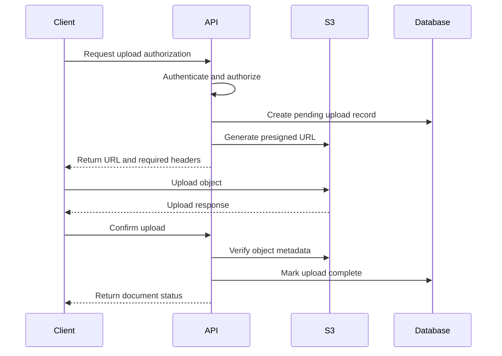
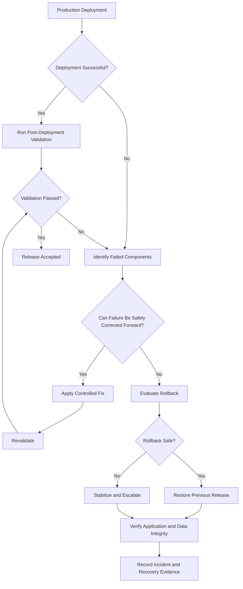

# 10- Production Deployment Checklist

## Overview

A production deployment of an Amazon S3-based system requires more than successfully creating a bucket or uploading an object. It must establish that infrastructure, application integrations, security controls, data-retention policies, observability, and recovery mechanisms operate correctly together.

S3 deployments commonly involve multiple components:

- S3 buckets, object ownership, versioning, and encryption.
- IAM roles, bucket policies, and KMS permissions.
- Lambda functions and event-driven processing.
- SQS, SNS, and EventBridge integrations.
- CloudFront distributions and private origins.
- Backend services using Boto3, Django, FastAPI, or other frameworks.
- Lifecycle policies, replication, and backup configurations.
- Terraform, CloudFormation, CDK, and CI/CD pipelines.

A deployment can partially succeed. For example, Terraform may create a bucket and IAM role while Lambda notification configuration fails because the destination permission is missing. The infrastructure deployment may therefore be incomplete even though some resources exist.

A production deployment checklist provides a repeatable release gate that validates prerequisites, infrastructure, security, application behavior, operational readiness, and rollback capability.

This document provides a practical checklist for deploying and validating S3-based production systems.

## Deployment Readiness Model

A production release should pass multiple independent validation stages.

| Stage | Primary concern | Expected result |
|---|---|---|
| Pre-deployment | Configuration, ownership, dependencies | Deployment is authorized and prepared |
| Infrastructure | Buckets, IAM, encryption, networking | Required resources exist |
| Security | Permissions, public access, encryption | Security controls meet policy |
| Application | Upload, download, metadata, deletion | Application workflows operate correctly |
| Integration | Events, queues, Lambda, CloudFront | Dependent services communicate correctly |
| Operations | Monitoring, logging, cost, retention | Production support capabilities are available |
| Recovery | Rollback, backup, replication | Recovery procedures are understood and tested |
| Release acceptance | End-to-end verification | Deployment is approved for production traffic |

## Pre-Deployment Checklist

### Account and Environment Validation

Verify that the deployment targets the intended AWS account and Region.

```bash
aws sts get-caller-identity

aws configure get region

aws s3api get-bucket-location \
  --bucket example-production-documents
```

The bucket location response is `null` for `us-east-1`. Interpret this correctly rather than treating it as a missing Region.

Validate:

- [ ] AWS account ID matches the production account.
- [ ] Deployment Region is explicitly configured.
- [ ] AWS credentials use an approved IAM role or federation mechanism.
- [ ] No long-lived access keys are embedded in source code or CI/CD workflows.
- [ ] Environment-specific configuration is loaded correctly.
- [ ] Production resource names are unique and follow organizational conventions.
- [ ] Resource ownership and cost-allocation tags are defined.
- [ ] Required AWS service quotas and permissions are available.
- [ ] Deployment approvals have been obtained.

For CI/CD, prefer GitHub Actions OIDC federation or another approved identity federation mechanism that provides temporary credentials.

### Configuration and Secrets Validation

Validate environment-specific configuration before applying infrastructure changes.

Example:

```bash
export AWS_REGION="ap-south-1"
export ENVIRONMENT="production"
export S3_BUCKET="example-production-documents"
export AWS_DEFAULT_REGION="$AWS_REGION"
```

Application configuration should be separated from deployment credentials.

Example `.env.example`:

```dotenv
APP_ENV=production
AWS_REGION=ap-south-1
S3_BUCKET=example-production-documents
S3_KMS_KEY_ID=arn:aws:kms:ap-south-1:123456789012:key/example-key-id
S3_UPLOAD_MAX_BYTES=10485760
```

Do not commit real credentials or sensitive production configuration to the repository.

Validate:

- [ ] Required environment variables are defined.
- [ ] Bucket names and KMS identifiers match the target environment.
- [ ] Application configuration does not reference development resources.
- [ ] Secrets are stored in an approved secrets-management system.
- [ ] Configuration changes have been reviewed.
- [ ] No production credentials are present in build artifacts or container images.

### Dependency and Change Review

Identify the resources affected by the release.

Review dependencies such as:

- S3 buckets and their existing objects.
- IAM roles and policies.
- KMS keys and grants.
- Lambda functions and execution roles.
- S3 event notifications.
- SQS queues and SNS topics.
- EventBridge rules.
- CloudFront origins and distributions.
- DNS records.
- Databases and application metadata.
- Terraform state or CloudFormation stacks.

Validate:

- [ ] The deployment does not unintentionally replace persistent buckets.
- [ ] Existing application versions remain compatible with the new infrastructure.
- [ ] Database migrations are backward-compatible where required.
- [ ] Event consumers can handle the new event or object format.
- [ ] Existing object keys and metadata remain compatible.
- [ ] Destructive infrastructure changes are separately reviewed.
- [ ] Rollback dependencies have been identified.

## Infrastructure Deployment Checklist

### S3 Bucket Configuration

Verify the bucket configuration before deploying application components.

```bash
aws s3api head-bucket \
  --bucket example-production-documents
```

Inspect versioning:

```bash
aws s3api get-bucket-versioning \
  --bucket example-production-documents
```

Inspect encryption:

```bash
aws s3api get-bucket-encryption \
  --bucket example-production-documents
```

Inspect ownership controls:

```bash
aws s3api get-bucket-ownership-controls \
  --bucket example-production-documents
```

Inspect public access protection:

```bash
aws s3api get-public-access-block \
  --bucket example-production-documents
```

Checklist:

- [ ] Bucket exists in the intended account and Region.
- [ ] Bucket naming follows organizational conventions.
- [ ] Versioning is enabled where recovery requirements demand it.
- [ ] Default encryption is configured.
- [ ] Object Ownership is configured appropriately, normally with bucket-owner-enforced ownership.
- [ ] Block Public Access settings match the intended architecture.
- [ ] Bucket policy has been reviewed.
- [ ] Required tags are applied.
- [ ] Lifecycle configuration is present where required.
- [ ] Replication is configured where required.
- [ ] Access logging or equivalent audit visibility is available where required.
- [ ] Object Lock is configured when immutable retention is required.

Do not assume that the presence of a bucket proves that all its security and operational controls are correct.

### Encryption Validation

Confirm that the expected encryption configuration is active.

For SSE-S3:

```bash
aws s3api get-bucket-encryption \
  --bucket example-production-documents
```

For SSE-KMS, validate:

- [ ] The expected KMS key is configured.
- [ ] The key is enabled.
- [ ] The application role can use the key for the required operations.
- [ ] The KMS key policy permits the intended access.
- [ ] Cross-account KMS permissions are configured where applicable.
- [ ] Historical objects have the expected encryption state.
- [ ] Replication encryption requirements are satisfied.

Upload a controlled test object:

```bash
printf 'production-validation' > validation.txt

aws s3api put-object \
  --bucket example-production-documents \
  --key deployment-validation/validation.txt \
  --body validation.txt \
  --server-side-encryption aws:kms \
  --ssekms-key-id "$S3_KMS_KEY_ID"
```

Inspect the object:

```bash
aws s3api head-object \
  --bucket example-production-documents \
  --key deployment-validation/validation.txt
```

Validate the returned encryption metadata and expected KMS key identifier.

A successful S3 upload does not independently prove that every application identity has the required KMS permissions. Validate the actual runtime identity and relevant KMS operations.

### IAM and Bucket Policy Validation

Review permissions for each workload separately.

| Component | Typical permissions |
|---|---|
| Backend upload service | `s3:PutObject` |
| Backend download service | `s3:GetObject` |
| Metadata service | `s3:GetObject`, `s3:GetObjectTagging` where needed |
| Deletion worker | `s3:DeleteObject` and version-specific deletion permissions where required |
| Lambda processor | Read input objects and write output objects |
| Deployment role | Required infrastructure-management permissions |
| Replication role | Permissions required by the replication configuration |

Checklist:

- [ ] Application roles follow least privilege.
- [ ] Bucket policies restrict unintended access.
- [ ] Explicit denies are reviewed.
- [ ] Public access is disabled unless explicitly required.
- [ ] Cross-account access is intentional and documented.
- [ ] KMS permissions are validated independently from S3 permissions.
- [ ] CI/CD roles cannot perform unrelated production operations.
- [ ] Human administrative access is controlled and audited.

Test using the actual application role wherever possible. A successful command executed with an administrator's credentials does not prove that the application can access S3.

## Infrastructure-as-Code Validation

### Terraform

Run validation before applying production infrastructure changes.

```bash
terraform fmt -check -recursive

terraform init -backend=true

terraform validate

terraform plan \
  -var-file="environments/production.tfvars" \
  -out=production.tfplan
```

Review the plan:

```bash
terraform show production.tfplan
```

Checklist:

- [ ] Provider versions are constrained.
- [ ] Backend configuration targets the correct state.
- [ ] State locking is configured.
- [ ] Production variables are reviewed.
- [ ] Resource replacements are explicitly understood.
- [ ] Persistent S3 resources have deletion safeguards.
- [ ] IAM policies are reviewed.
- [ ] Encryption and lifecycle resources are included.
- [ ] Replication dependencies are ordered correctly.
- [ ] Plan output is reviewed before approval.
- [ ] The approved plan is the plan applied to production.

Apply the approved plan:

```bash
terraform apply production.tfplan
```

Avoid generating a new plan after approval and applying it without review. The new plan may contain changes that were not part of the approved deployment.

### CloudFormation

Validate templates:

```bash
aws cloudformation validate-template \
  --template-body file://template.yaml
```

Create a change set before applying production changes:

```bash
aws cloudformation create-change-set \
  --stack-name production-s3-stack \
  --change-set-name production-release \
  --template-body file://template.yaml \
  --capabilities CAPABILITY_IAM
```

Review the change set:

```bash
aws cloudformation describe-change-set \
  --stack-name production-s3-stack \
  --change-set-name production-release
```

Checklist:

- [ ] Template validation succeeds.
- [ ] Change set has been reviewed.
- [ ] Resource replacements are understood.
- [ ] Retention and deletion policies are correct.
- [ ] Stack dependencies are valid.
- [ ] Rollback behavior is understood.
- [ ] Required IAM capabilities are explicitly acknowledged.

### AWS CDK

For CDK deployments:

```bash
cdk synth

cdk diff ProductionS3Stack

cdk deploy ProductionS3Stack
```

Checklist:

- [ ] CDK dependencies are pinned.
- [ ] The target account and Region are explicit.
- [ ] Bootstrap resources are available.
- [ ] Synthesized CloudFormation templates are reviewed.
- [ ] IAM permissions are scoped.
- [ ] Production differences are reviewed before deployment.
- [ ] Stack outputs are captured for verification.

## Application Deployment Checklist

### Backend Configuration

For Django, Django REST Framework, FastAPI, or Flask applications, keep S3 operations in a reusable service layer rather than embedding all AWS operations inside route handlers.

Validate:

- [ ] AWS SDK client configuration is correct.
- [ ] Application credentials come from the intended runtime identity.
- [ ] Bucket and Region settings are environment-specific.
- [ ] Connection and retry configuration is appropriate.
- [ ] Upload size limits are enforced.
- [ ] Content types are validated.
- [ ] Object keys are generated by trusted application logic.
- [ ] User-controlled paths cannot escape the intended key namespace.
- [ ] Application authorization is enforced independently of S3 permissions.
- [ ] Exceptions are translated into appropriate API responses.
- [ ] Sensitive information is excluded from logs.

### Upload Validation

Test the complete upload flow.

Example:

```bash
curl -X POST \
  https://api.example.com/documents \
  -H "Authorization: Bearer ACCESS_TOKEN" \
  -F "file=@sample.pdf"
```

Validate:

- [ ] The API accepts supported file types.
- [ ] Invalid file types are rejected.
- [ ] Oversized uploads are rejected.
- [ ] Object keys are generated safely.
- [ ] Tenant ownership is enforced.
- [ ] Object metadata is correct.
- [ ] Encryption is applied.
- [ ] Upload failures produce actionable error responses.
- [ ] Duplicate requests do not create unintended business records.

For large uploads, validate multipart upload behavior and incomplete-upload cleanup.

### Presigned URL Validation

If clients upload directly to S3, verify the presigned URL workflow.



Checklist:

- [ ] URL expiration is appropriately short.
- [ ] The generated object key is server-controlled.
- [ ] Required headers match the signed request.
- [ ] Upload size and content-type constraints are enforced through the chosen design.
- [ ] The bucket remains private.
- [ ] The client cannot choose arbitrary object keys.
- [ ] Upload completion is verified server-side.
- [ ] Pending uploads can be reconciled.
- [ ] URLs and query-string credentials are not logged.

A presigned URL is a temporary bearer capability. Anyone possessing it can exercise the permissions encoded in that URL until it expires or becomes invalid.

### Download Validation

Test authorized download behavior.

```bash
curl -X GET \
  https://api.example.com/documents/DOCUMENT_ID/download \
  -H "Authorization: Bearer ACCESS_TOKEN"
```

Checklist:

- [ ] Document ownership is validated.
- [ ] Unauthorized requests are rejected.
- [ ] Missing objects are handled correctly.
- [ ] Download responses have correct content headers.
- [ ] Large downloads do not unnecessarily consume backend memory.
- [ ] Presigned download URLs expire as expected.
- [ ] Private object access is preserved.

### Deletion Validation

Test application-level deletion separately from permanent version deletion.

Checklist:

- [ ] Deletion requires authorization.
- [ ] Retention rules are checked.
- [ ] Legal holds are respected.
- [ ] Database and S3 states remain consistent.
- [ ] Versioning behavior is understood.
- [ ] Delete markers are handled correctly.
- [ ] Permanent version deletion requires explicit authorization.
- [ ] Deletion events are auditable.
- [ ] Failed deletion operations can be retried safely.

## Integration Validation Checklist

### Lambda and S3 Events

Validate event-driven workflows after deployment.

Checklist:

- [ ] S3 notification configuration exists.
- [ ] Lambda resource permissions allow invocation.
- [ ] Event filters match the intended prefixes and suffixes.
- [ ] Input and output prefixes prevent recursive invocation.
- [ ] Lambda execution role has least-privilege S3 permissions.
- [ ] Function timeout and memory are appropriate.
- [ ] Retry behavior is understood.
- [ ] Failed processing can be recovered.
- [ ] Duplicate events are handled idempotently.
- [ ] CloudWatch logs and metrics are available.

S3 event notifications are delivered at least once and are not guaranteed to arrive in the order of object operations. Consumers must not assume exactly-once or ordered processing.

### SQS and SNS

For queue-based processing:

- [ ] Queue policies permit the intended producer.
- [ ] Visibility timeout is appropriate for processing duration.
- [ ] Dead-letter queue configuration is correct.
- [ ] Message retention is sufficient for recovery.
- [ ] Consumers handle duplicate messages.
- [ ] Failed messages can be inspected and replayed safely.
- [ ] Queue age and message count are monitored.

For SNS integrations:

- [ ] Topic policies are correct.
- [ ] Subscriptions are confirmed where applicable.
- [ ] Delivery failures are observable.
- [ ] Downstream consumers handle retries and duplicates.

### EventBridge

Validate:

- [ ] EventBridge integration is enabled where required.
- [ ] Event patterns match expected S3 events.
- [ ] Target permissions are configured.
- [ ] Retry policies and dead-letter destinations are appropriate.
- [ ] Event payloads are compatible with consumers.
- [ ] Failed target delivery is observable.

### CloudFront

For private S3 origins using Origin Access Control:

- [ ] Origin points to the correct S3 bucket.
- [ ] Origin Access Control is configured.
- [ ] Bucket policy permits the intended CloudFront distribution.
- [ ] S3 Block Public Access remains enabled.
- [ ] HTTPS is enforced.
- [ ] Cache policies are correct.
- [ ] Error responses are configured appropriately.
- [ ] Deployment status is `Deployed`.
- [ ] DNS and certificate configuration are valid.
- [ ] Cache invalidation or immutable asset versioning is implemented.

Do not make the S3 bucket public merely to simplify CloudFront access.

### KMS

Validate:

- [ ] KMS key is enabled.
- [ ] Key policy permits intended principals.
- [ ] IAM permissions include required cryptographic operations.
- [ ] S3 and KMS permissions are both available.
- [ ] Cross-account key access is configured where required.
- [ ] Replication encryption permissions are valid.
- [ ] Key retention and recovery requirements are documented.

## Operational Readiness Checklist

### Monitoring and Logging

Production deployment should include observability for both S3 and dependent application services.

Validate:

- [ ] Application logs include correlation or request identifiers.
- [ ] Lambda logs are available in CloudWatch.
- [ ] Relevant CloudTrail data events are configured where required.
- [ ] S3 request metrics are enabled where useful.
- [ ] Storage metrics are available.
- [ ] Replication metrics are monitored where applicable.
- [ ] SQS queue depth and message age are monitored.
- [ ] Failed processing is observable.
- [ ] Alerts have owners and escalation paths.
- [ ] Sensitive data and credentials are excluded from logs.

Useful operational indicators include:

| Indicator | Operational concern |
|---|---|
| Upload failure rate | Application or S3 access failures |
| Download failure rate | Authorization, object availability, or application errors |
| S3 request latency | Request performance |
| 4xx and 5xx responses | Client errors and service-side failures |
| Lambda errors and throttles | Processing reliability |
| SQS oldest-message age | Consumer backlog |
| Replication pending operations | Cross-bucket recovery readiness |
| Storage growth | Capacity and cost trends |
| Incomplete multipart uploads | Unnecessary storage consumption |

CloudWatch S3 request metrics require appropriate configuration and may incur additional charges. Select metrics based on operational requirements.

### Lifecycle and Retention

Validate:

- [ ] Lifecycle rules match intended prefixes or tags.
- [ ] Current-object expiration is understood.
- [ ] Noncurrent-version expiration is configured where required.
- [ ] Expired delete-marker cleanup is reviewed.
- [ ] Incomplete multipart upload cleanup is enabled where appropriate.
- [ ] Storage transitions match access patterns.
- [ ] Retention requirements are documented.
- [ ] Object Lock configuration is correct where required.
- [ ] Lifecycle changes have been reviewed for existing data.

Lifecycle processing is asynchronous. A successful configuration deployment does not prove that eligible objects have already transitioned or expired.

### Cost and Storage Management

Validate:

- [ ] Storage class selection matches access patterns.
- [ ] Expected request volume is estimated.
- [ ] Data transfer costs are considered.
- [ ] CloudFront caching reduces unnecessary origin requests where appropriate.
- [ ] Retrieval charges are understood.
- [ ] Incomplete multipart uploads are controlled.
- [ ] Noncurrent versions are included in storage estimates.
- [ ] Replication storage and transfer costs are included.
- [ ] Monitoring and inventory costs are considered.
- [ ] Cost-allocation tags are applied.

## Replication and Disaster Recovery Checklist

If the deployment uses replication, validate the complete source-to-destination configuration.

Inspect replication:

```bash
aws s3api get-bucket-replication \
  --bucket example-production-documents
```

Validate:

- [ ] Source bucket versioning is enabled.
- [ ] Destination bucket versioning is enabled.
- [ ] Replication role permissions are correct.
- [ ] Destination bucket policy permits replication.
- [ ] KMS permissions are correct when using SSE-KMS.
- [ ] Replication rules match intended prefixes or tags.
- [ ] Existing-object replication requirements are addressed separately.
- [ ] Replication status can be inspected.
- [ ] Failed replication operations are observable.
- [ ] Recovery procedures are documented.
- [ ] Destination access is independently tested.

Replication is not a substitute for backup. Replication can propagate unwanted changes or deletions depending on configuration and operation semantics.

### Recovery Readiness

Validate:

- [ ] RPO is defined.
- [ ] RTO is defined.
- [ ] Recovery bucket ownership is documented.
- [ ] Recovery credentials and permissions are available.
- [ ] Restore procedures have been tested.
- [ ] Application configuration can target the recovery bucket.
- [ ] KMS dependencies are available in the recovery environment.
- [ ] DNS and application failover dependencies are understood.
- [ ] Regional recovery assumptions have been tested.

Do not claim that regional failover is automatic merely because cross-Region replication exists.

## Release Validation and Smoke Tests

Run a controlled end-to-end test after deployment.

### Basic S3 Smoke Test

```bash
TEST_FILE="validation.txt"
TEST_KEY="deployment-validation/validation.txt"

printf 'production-smoke-test' > "$TEST_FILE"

aws s3api put-object \
  --bucket example-production-documents \
  --key "$TEST_KEY" \
  --body "$TEST_FILE"

aws s3api head-object \
  --bucket example-production-documents \
  --key "$TEST_KEY"

aws s3api get-object \
  --bucket example-production-documents \
  --key "$TEST_KEY" \
  downloaded-validation.txt

cmp "$TEST_FILE" downloaded-validation.txt
```

This verifies a basic upload, metadata retrieval, download, and local content comparison using the current AWS identity.

For SSE-KMS buckets, explicitly validate the expected encryption metadata and KMS key configuration.

### Application Smoke Test

Validate:

- [ ] Authenticated upload succeeds.
- [ ] Uploaded content can be retrieved.
- [ ] Object metadata is correct.
- [ ] Presigned upload works if enabled.
- [ ] Presigned download works if enabled.
- [ ] Unauthorized access is rejected.
- [ ] Invalid file types are rejected.
- [ ] Oversized files are rejected.
- [ ] Event-driven processing completes.
- [ ] Generated outputs are available.
- [ ] CloudFront serves expected content.
- [ ] Application deletion behavior matches retention policy.

### Cleanup of Validation Objects

Remove only the known test objects created by the release validation process.

```bash
aws s3api delete-object \
  --bucket example-production-documents \
  --key deployment-validation/validation.txt
```

For versioned buckets, this normally creates a delete marker. If permanent removal is required, identify and delete the exact test object version through an explicitly approved cleanup process.

Never use recursive deletion against a production prefix merely to remove a small number of test objects.

## Automated Production Validation

The following Python example performs a basic read/write smoke test against an explicitly configured bucket.

It validates the expected encryption algorithm and compares downloaded content. It does not replace the broader security, lifecycle, replication, or application-level checks described above.

```python
import os
import uuid

import boto3
from botocore.exceptions import BotoCoreError, ClientError


def validate_s3() -> None:
    bucket = os.environ["S3_BUCKET"]
    region = os.environ["AWS_REGION"]

    expected_encryption = os.environ.get(
        "EXPECTED_ENCRYPTION",
        "AES256",
    )

    kms_key_id = os.environ.get("S3_KMS_KEY_ID")

    s3 = boto3.client("s3", region_name=region)

    key = f"deployment-validation/{uuid.uuid4()}.txt"
    content = b"production-validation"

    put_args = {
        "Bucket": bucket,
        "Key": key,
        "Body": content,
    }

    if expected_encryption == "aws:kms":
        if not kms_key_id:
            raise ValueError(
                "S3_KMS_KEY_ID is required for SSE-KMS validation"
            )

        put_args["ServerSideEncryption"] = "aws:kms"
        put_args["SSEKMSKeyId"] = kms_key_id

    elif expected_encryption == "AES256":
        put_args["ServerSideEncryption"] = "AES256"

    else:
        raise ValueError(
            f"Unsupported validation encryption: {expected_encryption}"
        )

    try:
        s3.put_object(**put_args)

        metadata = s3.head_object(
            Bucket=bucket,
            Key=key,
        )

        actual_encryption = metadata.get("ServerSideEncryption")

        if actual_encryption != expected_encryption:
            raise RuntimeError(
                f"Unexpected encryption: {actual_encryption}"
            )

        if expected_encryption == "aws:kms":
            actual_key = metadata.get("SSEKMSKeyId")

            if not actual_key:
                raise RuntimeError("SSE-KMS key metadata is missing")

        response = s3.get_object(
            Bucket=bucket,
            Key=key,
        )

        downloaded = response["Body"].read()

        if downloaded != content:
            raise RuntimeError("Downloaded content does not match")

        print("S3 upload, metadata, encryption, and download checks passed.")

    finally:
        try:
            s3.delete_object(
                Bucket=bucket,
                Key=key,
            )
        except (BotoCoreError, ClientError) as cleanup_error:
            print(f"Validation cleanup failed: {cleanup_error}")


if __name__ == "__main__":
    validate_s3()
```

Run:

```bash
export AWS_REGION="ap-south-1"
export S3_BUCKET="example-production-documents"
export EXPECTED_ENCRYPTION="aws:kms"
export S3_KMS_KEY_ID="arn:aws:kms:ap-south-1:123456789012:key/example-key-id"

python validate_s3.py
```

The script requires permissions for the relevant S3 operations and, for SSE-KMS, the necessary KMS permissions.

For a versioned bucket, cleanup through `delete_object` creates a delete marker. A dedicated test-data cleanup process should remove the exact test version if permanent cleanup is required.

## CI/CD Production Release Gate

A production pipeline should separate validation from deployment and require approval before applying infrastructure changes.

Example GitHub Actions workflow:

```yaml
name: S3 Production Deployment

on:
  workflow_dispatch:

permissions:
  contents: read
  id-token: write

jobs:
  validate:
    runs-on: ubuntu-latest

    steps:
      - name: Checkout repository
        uses: actions/checkout@v4

      - name: Configure Python
        uses: actions/setup-python@v5
        with:
          python-version: "3.12"

      - name: Install dependencies
        run: |
          python -m pip install --upgrade pip
          pip install boto3

      - name: Validate deployment configuration
        run: |
          python -m compileall -q scripts
          test -f scripts/validate_s3.py

  deploy:
    needs: validate
    runs-on: ubuntu-latest
    environment: production

    steps:
      - name: Checkout repository
        uses: actions/checkout@v4

      - name: Configure AWS credentials
        uses: aws-actions/configure-aws-credentials@v4
        with:
          role-to-assume: ${{ vars.AWS_DEPLOYMENT_ROLE_ARN }}
          aws-region: ${{ vars.AWS_REGION }}

      - name: Verify AWS identity
        run: aws sts get-caller-identity

      - name: Deploy infrastructure
        run: |
          terraform init
          terraform validate
          terraform plan \
            -var-file="environments/production.tfvars" \
            -out=production.tfplan
          terraform apply -auto-approve production.tfplan

      - name: Validate S3 deployment
        env:
          AWS_REGION: ${{ vars.AWS_REGION }}
          S3_BUCKET: ${{ vars.S3_BUCKET }}
          EXPECTED_ENCRYPTION: aws:kms
          S3_KMS_KEY_ID: ${{ vars.S3_KMS_KEY_ID }}
        run: |
          python scripts/validate_s3.py
```

This is a pipeline skeleton, not a complete production approval system. A production implementation should additionally:

- Pin third-party actions to reviewed commit SHAs.
- Separate infrastructure planning from approval and application.
- Persist and approve the exact plan artifact.
- Restrict the production GitHub environment to authorized reviewers.
- Scope the OIDC trust policy to the intended repository, branch, or environment.
- Use separate validation and deployment identities where practical.
- Add infrastructure security scanning and policy checks.
- Preserve deployment artifacts and audit evidence.
- Implement application deployment and post-deployment smoke tests.
- Define failure handling and rollback procedures.

Do not assume that `terraform plan` executed inside a deployment job is an independently approved production plan.

## Rollback and Recovery Readiness

Before production deployment, identify which components can be rolled back independently.

| Component | Recovery approach | Important limitation |
|---|---|---|
| Backend application | Redeploy previous release | Database and object changes may remain |
| Lambda function | Restore previous published version or alias | External side effects are not reversed |
| CloudFront | Restore previous configuration or asset release | Distribution deployment takes time |
| Terraform infrastructure | Apply reviewed corrective configuration | State and data changes require separate handling |
| CloudFormation | Use stack rollback or recovery procedures | Failed rollback may require manual intervention |
| S3 object data | Restore an eligible version or backup | Deleted versions may be unrecoverable |
| Replication | Repair configuration and reconcile missing objects | Restoring a rule does not backfill every missed object automatically |

Checklist:

- [ ] Previous application artifacts are available.
- [ ] Previous Lambda versions are available where required.
- [ ] Infrastructure state and deployment artifacts are preserved.
- [ ] Database migration rollback or forward-fix strategy is documented.
- [ ] S3 versioning and backup recovery have been validated.
- [ ] CloudFront rollback strategy is documented.
- [ ] Event consumers can process messages produced by the previous release.
- [ ] KMS keys required by previous releases remain available.
- [ ] Rollback permissions are available.
- [ ] Recovery ownership and escalation contacts are defined.

### Deployment Failure Decision Flow



Rollback decisions must account for persistent data changes. Reverting application code does not automatically reverse object uploads, delete operations, replication changes, or database mutations.

## Production Release Acceptance

A release should be accepted only when mandatory validation gates pass.

| Gate | Acceptance criteria |
|---|---|
| Identity | Correct AWS account, Region, and deployment identity |
| Infrastructure | All required resources exist and match approved configuration |
| Security | Access controls and encryption meet policy |
| Application | Critical upload, download, and metadata workflows pass |
| Integrations | Required event and delivery integrations work |
| Observability | Logs, metrics, and alerts are available |
| Retention | Lifecycle and data-retention requirements are satisfied |
| Recovery | Rollback and recovery dependencies are available |
| Cost | Expected storage, requests, and transfer costs are understood |
| Approval | Required release owners have accepted the deployment |

Use explicit release statuses:

- **PASS**: Validation completed successfully.
- **FAIL**: A mandatory requirement failed.
- **BLOCKED**: Validation could not be completed because of an external dependency.
- **NOT APPLICABLE**: The control does not apply to the deployed architecture.

Do not classify an untested requirement as PASS.

## Common Production Deployment Mistakes

| Mistake | Impact | Prevention |
|---|---|---|
| Testing with administrator credentials only | Application may fail under its actual IAM role | Test using runtime identities |
| Assuming bucket creation means deployment success | Security and integration configuration may be incomplete | Validate each required resource |
| Deploying event notifications before destination permissions | Notification configuration may fail | Establish dependencies and deployment order |
| Ignoring versioned object behavior | Cleanup and rollback may behave unexpectedly | Validate versioning and delete markers |
| Treating replication as automatic failover | Recovery may exceed RTO or be incomplete | Test the full recovery workflow |
| Applying an unreviewed Terraform plan | Unintended resource replacement or deletion | Approve and apply the exact plan |
| Making S3 public to simplify CloudFront | Unnecessary exposure of stored data | Use private origins with OAC |
| Ignoring KMS permissions | Encrypted object access fails at runtime | Validate S3 and KMS authorization independently |
| Logging presigned URLs | Temporary access credentials may be exposed | Redact query strings and sensitive headers |
| Skipping post-deployment tests | Partial deployment failures remain undetected | Use automated smoke tests and release gates |
| Deleting validation objects without version awareness | Test versions and delete markers remain | Use controlled version-aware cleanup |
| Assuming successful infrastructure deployment proves application readiness | Runtime dependencies may still be broken | Perform end-to-end application validation |

## Key Takeaways

- Production S3 deployment requires independent validation of infrastructure, security, application workflows, integrations, observability, and recovery.
- Validate resources using the actual application and deployment identities rather than relying exclusively on administrator access.
- Treat versioning, encryption, lifecycle, replication, and retention as production release requirements whenever the workload depends on them.
- Use CI/CD approval gates, reviewed infrastructure plans, automated smoke tests, and explicit rollback procedures to control production changes.
- A successful infrastructure deployment is not sufficient for release acceptance; verify complete application behavior and data integrity before routing production traffic.