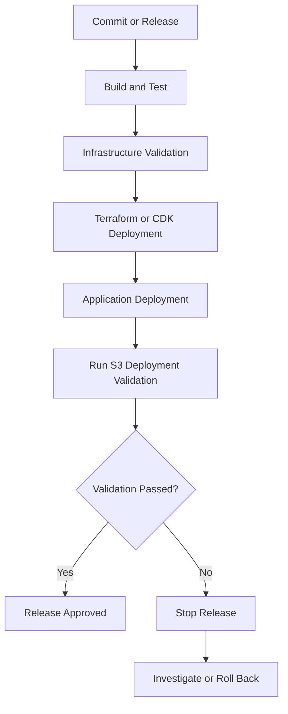

# README

## Overview

This directory contains scripts for validating an Amazon S3 deployment after infrastructure provisioning or application release.

The validation workflow checks whether deployed buckets satisfy selected configuration requirements and whether an optional application endpoint responds with the expected HTTP status. It is intended for post-deployment verification in development, staging, and production environments.

The scripts use Boto3 and the AWS SDK credential provider chain. They do not require hardcoded AWS credentials.

## Directory Structure

```text
scripts/
├── README.md
├── validate_bucket.py
├── validate_encryption.py
├── validate_lifecycle.py
├── validate_replication.py
└── validate_deployment.py
```

Each script focuses on a distinct validation responsibility:

| Script | Responsibility |
|---|---|
| `validate_bucket.py` | Validates bucket-level configuration, including public access, encryption, versioning, and required tags. |
| `validate_encryption.py` | Validates default server-side encryption and optional KMS key requirements. |
| `validate_lifecycle.py` | Validates lifecycle rule configuration and selected lifecycle actions. |
| `validate_replication.py` | Validates replication rules, destination configuration, and selected replication features. |
| `validate_deployment.py` | Performs consolidated post-deployment checks across S3 buckets and an optional HTTP endpoint. |

## Validation Scope

`validate_deployment.py` provides a consolidated deployment check.

### S3 bucket checks

For each supplied bucket, it can validate:

- Bucket accessibility through `HeadBucket`.
- Default server-side encryption algorithm.
- Optional expected KMS key identifier.
- Versioning status.
- All four bucket-level Block Public Access settings.
- Existence of at least one enabled lifecycle rule when required.
- Existence of enabled replication rules when required.
- Optional expected replication role ARN.
- Optional expected replication destination bucket.

### Application endpoint check

When `--website-url` is supplied, the script performs an HTTP GET request and checks the response status.

The endpoint check supports:

- Configurable expected HTTP status.
- Configurable request timeout.
- Bounded retries with exponential backoff.
- HTTP error and connection failure reporting.

The endpoint check verifies HTTP reachability and response status. It does not validate page content, application functionality, CloudFront cache correctness, TLS configuration details, or backend dependencies.

## Prerequisites

- Python 3.10 or later.
- An AWS account containing the target S3 resources.
- AWS CLI configured with an appropriate profile or another supported credential provider.
- IAM permissions to inspect the selected bucket configurations.
- Network access to the AWS S3 API and, when configured, the application endpoint.

Install the dependency:

```bash
python -m pip install boto3
```

Verify AWS identity:

```bash
aws sts get-caller-identity
```

Verify the target bucket is accessible:

```bash
aws s3api head-bucket \
    --bucket my-production-bucket
```

## AWS Permissions

The validation identity should receive read-only permissions for the resources being inspected.

A baseline policy for the S3 checks includes:

| IAM action | Purpose |
|---|---|
| `s3:ListBucket` | Supports bucket-level access inspection. |
| `s3:GetEncryptionConfiguration` | Reads default encryption configuration. |
| `s3:GetBucketVersioning` | Reads versioning configuration. |
| `s3:GetBucketPublicAccessBlock` | Reads bucket-level public access settings. |
| `s3:GetLifecycleConfiguration` | Reads lifecycle configuration. |
| `s3:GetReplicationConfiguration` | Reads replication configuration. |

The exact permissions required for `HeadBucket` depend on the caller's access and bucket ownership context. In particular, do not assume that a successful or failed `HeadBucket` response independently proves every permission or ownership condition.

For cross-account buckets, configure the necessary resource policies and identity permissions.

Avoid granting write, delete, or configuration-management permissions to a validation-only identity.

## Configuration

The validator uses the standard Boto3 credential provider chain.

Supported credential sources include:

- IAM roles attached to EC2 instances.
- ECS task roles.
- EKS workload identity configurations.
- AWS IAM Identity Center sessions.
- Environment-based credentials.
- AWS CLI profiles.

For local development, select a profile:

```powershell
$env:AWS_PROFILE = "development"
$env:AWS_REGION = "ap-south-1"
```

For Linux or macOS:

```bash
export AWS_PROFILE=development
export AWS_REGION=ap-south-1
```

Do not place AWS access keys directly in the Python source code or commit credentials to the repository.

## Running Deployment Validation

### Validate a single bucket

```bash
python validate_deployment.py \
    --bucket my-production-bucket \
    --region ap-south-1
```

The default configuration expects:

- Default encryption using SSE-S3 (`AES256`).
- Versioning enabled.
- All four bucket-level Block Public Access settings enabled.

### Validate multiple buckets

```bash
python validate_deployment.py \
    --bucket application-assets-prod \
    --bucket application-documents-prod \
    --bucket application-backups-prod \
    --region ap-south-1
```

Each bucket is validated independently. A failure inspecting one bucket does not prevent the script from attempting validation of the remaining buckets.

### Validate SSE-KMS encryption

```bash
python validate_deployment.py \
    --bucket application-documents-prod \
    --region ap-south-1 \
    --encryption aws:kms \
    --kms-key-id arn:aws:kms:ap-south-1:123456789012:key/example-key-id
```

The KMS key identifier comparison checks the configured identifier returned by S3. It does not verify that the KMS key is enabled, that the validation identity can use it, or that the key policy permits the application's workload.

### Skip versioning validation

```bash
python validate_deployment.py \
    --bucket application-assets-prod \
    --skip-versioning-check
```

Use this option only when the deployment architecture intentionally does not require versioning.

### Skip bucket-level public access validation

```bash
python validate_deployment.py \
    --bucket application-assets-prod \
    --skip-public-access-check
```

This skips the bucket-level Block Public Access check. It does not establish that the bucket is secure or intentionally public.

### Require lifecycle configuration

```bash
python validate_deployment.py \
    --bucket application-backups-prod \
    --require-lifecycle
```

The check requires at least one enabled lifecycle rule. It does not verify that every required transition, expiration, or retention action is configured correctly.

### Require replication

```bash
python validate_deployment.py \
    --bucket application-backups-prod \
    --require-replication
```

Require a specific destination and replication role:

```bash
python validate_deployment.py \
    --bucket application-backups-prod \
    --require-replication \
    --replication-destination application-backups-dr \
    --replication-role-arn arn:aws:iam::123456789012:role/s3-replication-role
```

These checks inspect the source bucket's replication configuration. They do not prove that objects are successfully replicating or that the destination bucket is recoverable.

### Run an application endpoint smoke test

```bash
python validate_deployment.py \
    --bucket application-assets-prod \
    --website-url https://example.com \
    --expected-http-status 200 \
    --timeout 10 \
    --retries 3
```

The endpoint check sends an HTTP GET request. Ensure the supplied URL is an appropriate non-destructive endpoint for the deployed application.

### JSON output

```bash
python validate_deployment.py \
    --bucket application-assets-prod \
    --region ap-south-1 \
    --json
```

JSON output is useful for CI/CD pipelines, artifact collection, and downstream reporting.

### Verbose logging

```bash
python validate_deployment.py \
    --bucket application-assets-prod \
    --region ap-south-1 \
    --verbose
```

Verbose mode enables debug-level application logging. Avoid enabling it indiscriminately in environments where diagnostic output may expose operational details.

## Exit Codes

The script uses CI-friendly exit codes.

| Exit code | Meaning | Pipeline behavior |
|---|---|---|
| `0` | All executed validation checks passed. | Continue deployment pipeline. |
| `1` | One or more validation findings failed. | Fail the validation stage. |
| `2` | Validation could not complete reliably because of an inspection, configuration, or execution error. | Fail the validation stage and investigate. |

A failed check is different from an inspection error:

- **Validation failure:** The resource was inspected, but its configuration did not satisfy the expected requirement.
- **Inspection error:** The script could not reliably inspect the resource, for example because of missing permissions or an AWS API failure.

Treat both conditions as deployment failures in production pipelines.

## CI/CD Integration

Run deployment validation after infrastructure provisioning and application deployment.



Example GitHub Actions step:

```yaml
- name: Install validation dependencies
  run: |
    python -m pip install --upgrade pip
    python -m pip install boto3

- name: Validate S3 deployment
  run: |
    python 06-Deployment/05-Amazon-S3/09-Release-Validation-and-Rollback/scripts/validate_deployment.py \
      --bucket "${{ vars.S3_BUCKET_NAME }}" \
      --region "${{ vars.AWS_REGION }}" \
      --json
```

The workflow must authenticate to AWS before running the script. Prefer GitHub Actions OIDC federation with a narrowly scoped IAM role rather than long-lived access keys.

Store non-secret deployment configuration in repository or environment variables. Configure production approval gates independently of the validation script.

## Interpreting Results

Example successful output:

```text
[PASS] bucket_access | Bucket application-assets-prod is accessible.
[PASS] encryption_rule_0_algorithm | Default encryption uses AES256.
[PASS] versioning_enabled | Bucket versioning is enabled.
[PASS] public_access_block | All four Block Public Access settings are enabled.
```

Example failed output:

```text
[PASS] bucket_access | Bucket application-assets-prod is accessible.
[FAIL] versioning_enabled | Bucket versioning is not enabled. Current status: Not configured.
[PASS] public_access_block | All four Block Public Access settings are enabled.
```

A failed validation should trigger investigation before the release is approved.

Do not automatically modify bucket configuration from the validation script. Configuration remediation should happen through the approved infrastructure-as-code workflow to preserve change control and prevent drift.

## Operational Limitations

The consolidated validator performs configuration checks. It is not a complete security audit, deployment health assessment, or disaster recovery test.

| Area | What is checked | What is not established |
|---|---|---|
| Bucket access | Bucket inspection request succeeds. | Complete effective access permissions or application access. |
| Encryption | Default encryption configuration. | Encryption status of every existing object or KMS key usability. |
| Versioning | Bucket versioning status. | Object version recovery or MFA Delete requirements. |
| Public access | Four bucket-level Block Public Access settings. | Account-level settings, access points, IAM policies, ACLs, or all possible public exposure paths. |
| Lifecycle | At least one enabled rule when required. | Correctness of every lifecycle action or actual object transition and expiration. |
| Replication | Enabled rules and selected role/destination configuration. | Destination readiness, replication lag, object replication status, or recovery objectives. |
| Website | HTTP response status. | Content correctness, authentication flows, application dependencies, or full end-to-end functionality. |

For production release approval, combine these checks with:

- Infrastructure-as-code validation and policy checks.
- Application-level integration tests.
- CloudFront and DNS verification where applicable.
- KMS key and IAM permission validation.
- Replication monitoring and recovery tests.
- CloudWatch alarms and deployment health metrics.
- A documented rollback procedure.

## Rollback Considerations

Validation failure should stop release promotion until the cause is understood.

Use the following decision process:

1. Identify the failed check and affected bucket.
2. Determine whether the issue is a configuration mismatch, permission problem, or service/API failure.
3. Compare deployed configuration with the approved Terraform, CloudFormation, or CDK definition.
4. Correct the infrastructure through the normal deployment workflow.
5. Re-run validation and application smoke tests.
6. If the release cannot be safely corrected, execute the documented rollback procedure.

Do not assume that reverting application code automatically reverts S3 infrastructure changes.

S3 configuration and data changes may have different rollback characteristics:

- Bucket policy and configuration changes can generally be reverted through infrastructure-as-code.
- Versioning changes require careful consideration of existing object versions and delete markers.
- Lifecycle actions may already have transitioned or expired objects.
- Replication changes may affect objects differently depending on when they were created and the replication configuration.
- Object deletion may be irreversible when versioning and recovery controls are unavailable.

Protect production data and validate recovery procedures before executing destructive remediation.

## Troubleshooting

| Problem | Likely cause | Recommended action |
|---|---|---|
| `AccessDenied` | Missing IAM or bucket policy permission. | Inspect the caller identity, IAM policy, bucket policy, and applicable explicit denies. |
| `NoSuchBucket` | Incorrect bucket name or resource identifier. | Verify the bucket name and owning account. |
| Encryption check fails | Default encryption does not match the expected algorithm. | Inspect `get-bucket-encryption` and reconcile infrastructure configuration. |
| KMS key mismatch | Configured key identifier differs from the expected identifier. | Verify the key ARN or ID and deployment configuration. |
| Versioning check fails | Versioning is suspended or not enabled. | Inspect `get-bucket-versioning` and confirm the intended recovery policy. |
| Public access check fails | One or more bucket-level settings are missing or disabled. | Inspect and correct the bucket-level Block Public Access configuration. |
| Lifecycle check fails | No enabled lifecycle rule exists. | Inspect lifecycle configuration and verify the intended retention policy. |
| Replication check fails | No enabled rule or expected role/destination mismatch. | Inspect replication configuration, role ARN, and destination bucket ARN. |
| Website smoke test fails | DNS, TLS, network, endpoint, or application issue. | Inspect the endpoint response and relevant CloudFront or application logs. |

Useful AWS CLI inspection commands:

```bash
aws s3api get-bucket-encryption \
    --bucket my-production-bucket

aws s3api get-bucket-versioning \
    --bucket my-production-bucket

aws s3api get-public-access-block \
    --bucket my-production-bucket

aws s3api get-bucket-lifecycle-configuration \
    --bucket my-production-bucket

aws s3api get-bucket-replication \
    --bucket my-production-bucket
```

Some commands return an error when the corresponding configuration is absent. Interpret those responses as configuration state, not automatically as an AWS service outage.

## Best Practices

- Run validation after infrastructure deployment and before production release approval.
- Validate every bucket that belongs to the release, not only the primary application bucket.
- Use a dedicated read-only IAM role for validation.
- Prefer OIDC-based short-lived credentials in CI/CD.
- Keep expected configuration in version-controlled infrastructure definitions or controlled pipeline variables.
- Use JSON output when integrating with automated reporting.
- Treat inspection errors as failures rather than silently skipping checks.
- Keep validation separate from remediation.
- Do not assume a successful configuration check proves object-level behavior.
- Test rollback and recovery procedures independently of deployment validation.
- Avoid running destructive recovery operations as part of routine smoke tests.
- Record validation output as a deployment artifact for audit and incident investigation.

## Key Takeaways

- `validate_deployment.py` consolidates selected S3 configuration checks and an optional HTTP smoke test.
- A successful validation confirms only the checks explicitly executed; it does not prove complete security, application health, or disaster recovery readiness.
- Use read-only IAM permissions and short-lived credentials for validation pipelines.
- Treat failed checks and inspection errors as release-blocking conditions.
- Perform infrastructure remediation through controlled IaC workflows and maintain separate, tested rollback procedures.