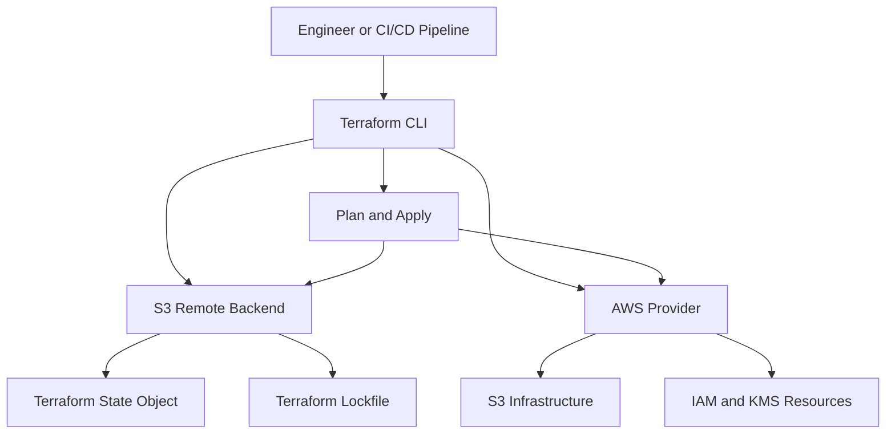
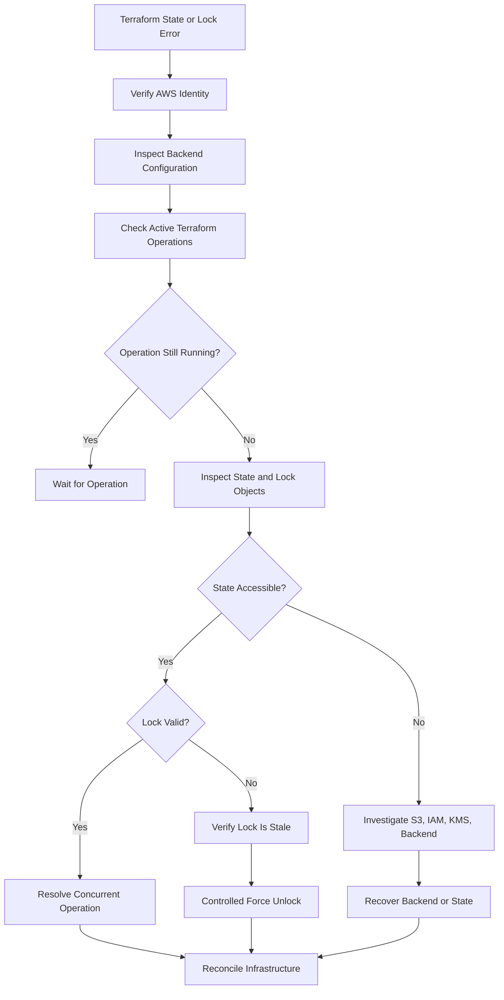
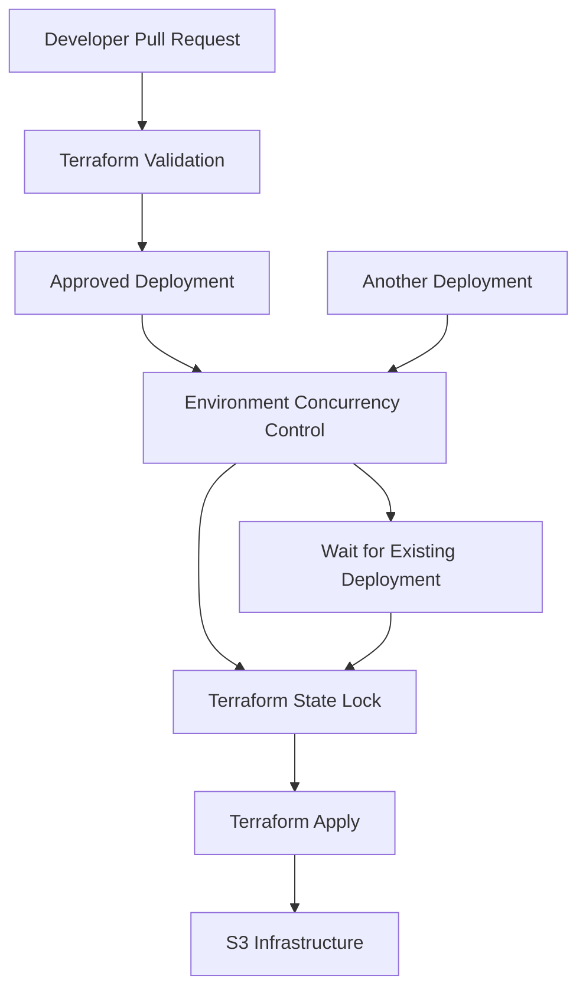

# 01- Terraform State and Lock Errors

## Overview

Terraform state and locking errors can interrupt Amazon S3 infrastructure deployments and leave infrastructure in a partially reconciled state.

Terraform state maintains the mapping between configuration and real AWS resources. State locking prevents concurrent Terraform operations from modifying the same state simultaneously.

These mechanisms are particularly important when Terraform manages production S3 infrastructure, including:

- S3 buckets and bucket policies.
- Versioning and lifecycle configurations.
- Encryption and AWS KMS integrations.
- Replication configurations.
- IAM roles and policies.
- CloudFront origins and related infrastructure.

A Terraform failure does not necessarily mean that the AWS operation failed. Infrastructure changes may have completed even when Terraform could not persist state or release its lock.

The objective of troubleshooting is to establish:

- Whether another Terraform operation is still running.
- Whether the remote state is accessible and consistent.
- Whether AWS resources changed before the failure.
- Whether the problem originates in Terraform, S3, IAM, KMS, or CI/CD.
- Whether recovery can proceed without creating, replacing, or deleting existing infrastructure.

## Terraform State Fundamentals

### What Terraform State Contains

Terraform state maintains the relationship between Terraform resource addresses and the corresponding infrastructure resources.

Consider:

```hcl
resource "aws_s3_bucket" "application_assets" {
  bucket = "company-production-assets"
}
```

Terraform tracks this resource using:

```text
aws_s3_bucket.application_assets
```

The state contains resource identities, attributes, dependencies, and metadata required to manage infrastructure.

Terraform uses state to:

- Identify existing managed resources.
- Compare configured resources with actual infrastructure.
- Calculate changes during planning.
- Track resource dependencies.
- Manage resource instances and module relationships.
- Determine whether resources require creation, modification, replacement, or deletion.

### Why State Is Critical for S3

Consider a production bucket containing customer documents.

If Terraform loses the state mapping for that bucket, it may treat the existing bucket as unmanaged infrastructure. A subsequent deployment could attempt to create an existing resource or propose unexpected changes.

Losing Terraform state does not automatically delete the S3 bucket. It makes Terraform's understanding of the infrastructure unreliable.

Never recreate or import production resources blindly after a state failure.

## Remote State Architecture

For shared environments, use a remote backend rather than individual developers' local state files.

A common architecture uses:

- Amazon S3 for remote state storage.
- S3 versioning for historical state recovery.
- Server-side encryption.
- IAM policies for access control.
- Native S3 lockfiles for state locking.



| Component | Responsibility |
|---|---|
| Terraform configuration | Defines desired infrastructure. |
| S3 backend | Stores remote Terraform state. |
| S3 lockfile | Coordinates operations against the state. |
| AWS provider | Communicates with AWS services to manage resources. |
| IAM | Controls access to the backend and managed infrastructure. |
| Terraform CLI | Coordinates planning, state operations, and deployment. |

The backend and AWS provider are separate authentication and authorization paths. Successful access to the state bucket does not establish that the execution role can manage the infrastructure.

## S3 Backend Configuration

### Native S3 Lockfile Configuration

For new configurations, use native S3 state locking where supported by the Terraform version.

```hcl
terraform {
  required_version = ">= 1.10.0"

  required_providers {
    aws = {
      source  = "hashicorp/aws"
      version = "~> 6.0"
    }
  }

  backend "s3" {
    bucket       = "company-terraform-state"
    key          = "amazon-s3/production/terraform.tfstate"
    region       = "ap-south-1"
    encrypt      = true
    use_lockfile = true
  }
}
```

The provider configuration is separate:

```hcl
provider "aws" {
  region = var.aws_region
}
```

Use temporary credentials from the AWS credential provider chain. Do not embed access keys in Terraform configuration.

### State Bucket Requirements

Provision the state bucket separately from the infrastructure whose state it stores.

A production state bucket should have:

- Versioning enabled.
- Server-side encryption.
- Block Public Access enabled.
- Restricted IAM permissions.
- Appropriate retention controls.
- CloudTrail auditing and monitoring.
- Protection against accidental deletion.

The state bucket is part of the infrastructure control plane. Its availability and recoverability directly affect the ability to manage dependent infrastructure.

### How Native S3 Locking Works

With `use_lockfile = true`, Terraform creates a lock object associated with the state key.

For example:

```text
amazon-s3/production/terraform.tfstate
amazon-s3/production/terraform.tfstate.tflock
```

Terraform acquires the lock before performing operations that require state coordination.

The lock prevents another Terraform operation from simultaneously modifying the same state.

Typical permissions include:

| Permission | Purpose |
|---|---|
| `s3:GetObject` | Read state and lock objects. |
| `s3:PutObject` | Write state and create lock objects. |
| `s3:DeleteObject` | Remove lock objects when releasing locks. |
| `s3:ListBucket` | Support applicable backend bucket operations. |

Scope object permissions to the required state and lockfile paths.

If the state bucket uses SSE-KMS, the execution role also needs the relevant KMS permissions.

### Legacy DynamoDB Locking

Older S3 backend configurations use DynamoDB for state locking.

```hcl
terraform {
  backend "s3" {
    bucket         = "company-terraform-state"
    key            = "amazon-s3/production/terraform.tfstate"
    region         = "ap-south-1"
    encrypt        = true
    dynamodb_table = "terraform-state-locks"
  }
}
```

DynamoDB-based locking is deprecated in newer Terraform backend guidance. Prefer native S3 lockfiles for new configurations and plan controlled migrations for existing deployments.

Do not change locking mechanisms while Terraform operations are active.

## Standard Diagnostic Workflow

Use a consistent diagnostic sequence before modifying state or removing locks.



### Initial Diagnostic Commands

Verify the active AWS identity:

```bash
aws sts get-caller-identity
```

Check the Terraform version:

```bash
terraform version
```

Inspect the current workspace:

```bash
terraform workspace show
```

Inspect state addresses:

```bash
terraform state list
```

Verify that the backend configuration points to the intended:

- AWS account.
- State bucket.
- Region.
- State key.
- Workspace.

Do not start another `terraform apply` until the existing operation and state status are understood.

## Error: Error Acquiring the State Lock

### Symptoms

Terraform reports an error similar to:

```text
Error acquiring the state lock

Lock Info:
  ID:        8f2d...
  Operation: OperationTypeApply
  Who:       runner@github-actions
  Version:   1.x.x
  Created:   2026-10-31 12:00:00 UTC
  Path:      company-terraform-state/amazon-s3/production/terraform.tfstate
```

The exact error depends on the backend and locking mechanism.

### Likely Causes

- Another engineer is executing `terraform apply`.
- A GitHub Actions workflow is still running.
- A previous deployment was interrupted.
- A Terraform process crashed before releasing its lock.
- Multiple CI/CD jobs target the same state.
- A stale lock remains after an unsuccessful operation.

### Isolation and Verification

For native S3 locking, inspect the lock object:

```bash
aws s3api head-object \
  --bucket company-terraform-state \
  --key amazon-s3/production/terraform.tfstate.tflock
```

Inspect the state object:

```bash
aws s3api head-object \
  --bucket company-terraform-state \
  --key amazon-s3/production/terraform.tfstate
```

For legacy DynamoDB locking, inspect the lock table:

```bash
aws dynamodb describe-table \
  --table-name terraform-state-locks
```

Investigate:

- Active local Terraform processes.
- Running CI/CD workflows.
- Deployment logs.
- Lock creation timestamps.
- Lock operation metadata.
- Whether the original process is still changing AWS resources.

### Root-Cause Determination

An old lock is not automatically a stale lock.

A valid Terraform operation may hold the lock for an extended period while creating or updating infrastructure.

Before removing a lock, confirm that:

1. The original Terraform process has stopped.
2. No CI/CD deployment is still running.
3. No AWS infrastructure operation is still in progress.
4. The lock belongs to the expected state key.
5. The lock identifier matches the failed operation.

### Corrective Action

If another valid operation is running, wait for it to complete.

If the lock is confirmed stale, use Terraform's force-unlock command with the exact lock ID:

```bash
terraform force-unlock 8f2d...
```

For an automated recovery procedure:

```bash
terraform force-unlock -force 8f2d...
```

Use `-force` only after independently verifying that the lock is stale.

Do not delete the `.tflock` object manually as the first troubleshooting action. Use Terraform's locking workflow to release locks.

### Prevention

- Serialize deployments targeting the same state.
- Configure CI/CD concurrency controls.
- Avoid simultaneous local and automated applies.
- Use consistent backend configuration.
- Monitor unusually long-running deployment jobs.
- Document stale-lock recovery procedures.

Example GitHub Actions configuration:

```yaml
concurrency:
  group: terraform-production-amazon-s3
  cancel-in-progress: false
```

Disabling cancellation prevents a new workflow from terminating an active deployment simply because another workflow was triggered.

## Error: AccessDenied When Reading or Writing State

### Symptoms

Terraform reports:

```text
Error loading state:
AccessDenied: Access Denied
```

Or:

```text
Failed to save state:
AccessDenied
```

### Likely Causes

- The execution role lacks S3 permissions.
- The bucket policy denies the caller.
- The wrong AWS account is active.
- The backend points to an incorrect bucket or key.
- An S3 VPC endpoint policy blocks access.
- SSE-KMS permissions are missing.
- A KMS key policy denies the execution role.
- An explicit deny exists in an IAM or resource policy.

### Isolation and Verification

Verify the active identity:

```bash
aws sts get-caller-identity
```

Inspect the backend bucket:

```bash
aws s3api head-bucket \
  --bucket company-terraform-state
```

Check state-object access:

```bash
aws s3api head-object \
  --bucket company-terraform-state \
  --key amazon-s3/production/terraform.tfstate
```

Inspect bucket encryption:

```bash
aws s3api get-bucket-encryption \
  --bucket company-terraform-state
```

Inspect the bucket policy:

```bash
aws s3api get-bucket-policy \
  --bucket company-terraform-state
```

If SSE-KMS is configured, inspect the key:

```bash
aws kms describe-key \
  --key-id arn:aws:kms:ap-south-1:123456789012:key/example-key-id
```

### Distinguishing S3 and KMS Authorization Failures

| Evidence | Likely issue |
|---|---|
| `s3:GetObject` denied | S3 identity or resource policy. |
| `s3:PutObject` denied | S3 write permission or bucket policy. |
| KMS `AccessDeniedException` | KMS identity policy, key policy, or grant. |
| State access works with another encryption configuration but fails with SSE-KMS | Investigate KMS authorization and key configuration. |
| Caller identity is unexpected | Credential or role-assumption configuration. |

S3 authorization and KMS authorization are separate permission checks. A role may have permission to access an S3 object but still be unable to decrypt or encrypt it.

### Corrective Action

An illustrative IAM policy for a native S3 lockfile backend is:

```json
{
  "Version": "2012-10-17",
  "Statement": [
    {
      "Sid": "ListTerraformStatePrefix",
      "Effect": "Allow",
      "Action": [
        "s3:ListBucket"
      ],
      "Resource": "arn:aws:s3:::company-terraform-state",
      "Condition": {
        "StringLike": {
          "s3:prefix": [
            "amazon-s3/production/terraform.tfstate",
            "amazon-s3/production/terraform.tfstate.tflock"
          ]
        }
      }
    },
    {
      "Sid": "ManageTerraformState",
      "Effect": "Allow",
      "Action": [
        "s3:GetObject",
        "s3:PutObject"
      ],
      "Resource": "arn:aws:s3:::company-terraform-state/amazon-s3/production/terraform.tfstate"
    },
    {
      "Sid": "ManageTerraformLock",
      "Effect": "Allow",
      "Action": [
        "s3:GetObject",
        "s3:PutObject",
        "s3:DeleteObject"
      ],
      "Resource": "arn:aws:s3:::company-terraform-state/amazon-s3/production/terraform.tfstate.tflock"
    }
  ]
}
```

Adapt this policy to the exact backend operations, workspace layout, and organizational security requirements.

For SSE-KMS, grant the required KMS permissions and ensure that the key policy permits the execution role.

### Prevention

- Separate backend permissions from infrastructure-management permissions.
- Use dedicated CI/CD roles.
- Restrict state access to environment-specific prefixes.
- Audit backend bucket policy changes.
- Avoid broad `s3:*` permissions.
- Test backend access before production deployment.

## Error: NoSuchBucket or Backend Bucket Not Found

### Symptoms

Terraform reports:

```text
Error initializing backend:
NoSuchBucket: The specified bucket does not exist
```

### Likely Causes

- Incorrect backend bucket name.
- State bucket was deleted.
- Wrong AWS account or credential context.
- Incorrect Region configuration.
- Backend initialization references an old environment.
- Bucket creation did not complete before Terraform initialization.

### Isolation and Verification

Verify the AWS identity:

```bash
aws sts get-caller-identity
```

Check the bucket:

```bash
aws s3api head-bucket \
  --bucket company-terraform-state
```

Inspect its Region:

```bash
aws s3api get-bucket-location \
  --bucket company-terraform-state
```

Compare the output with the backend configuration:

```hcl
backend "s3" {
  bucket       = "company-terraform-state"
  key          = "amazon-s3/production/terraform.tfstate"
  region       = "ap-south-1"
  encrypt      = true
  use_lockfile = true
}
```

### Root-Cause Determination

Distinguish between:

- A genuinely missing bucket.
- An incorrect AWS account.
- An access-denied response.
- A Region mismatch.
- A stale backend configuration.

An unsuccessful `HeadBucket` request does not always establish that the bucket is absent. AWS may return limited error information when the caller lacks permission.

### Corrective Action

Correct the backend bucket, Region, account, or credential configuration.

If the backend bucket is genuinely missing, investigate before recreating it:

- Was the bucket intentionally decommissioned?
- Are historical state versions available?
- Was the state migrated to another bucket?
- Does another account own the bucket?
- Was the backend migration partially completed?

Recover the backend and state before attempting normal infrastructure deployment.

## Error: State Snapshot Created by a Newer Terraform Version

### Symptoms

Terraform reports that the state snapshot was created by a newer Terraform version.

### Likely Causes

- A developer uses an older local Terraform binary.
- CI/CD uses a different Terraform version.
- A newer Terraform release updated state metadata.
- Deployment environments do not pin Terraform versions.

### Isolation and Verification

Check the installed version:

```bash
terraform version
```

Inspect the repository's version constraints:

```hcl
terraform {
  required_version = ">= 1.10.0"
}
```

Compare versions used by:

- Local development.
- Pull-request validation.
- Staging deployment.
- Production deployment.

### Corrective Action

Use a Terraform version compatible with the state snapshot.

Example GitHub Actions configuration:

```yaml
- name: Setup Terraform
  uses: hashicorp/setup-terraform@v3
  with:
    terraform_version: "1.10.5"
```

The example version is illustrative. Select and pin a version approved by the project.

Do not manually edit the state file's version metadata to bypass compatibility checks.

### Prevention

- Pin Terraform versions.
- Keep local and CI/CD toolchains consistent.
- Upgrade Terraform through a controlled change.
- Validate state compatibility before production rollout.

## Error: State Lock Cannot Be Released

### Symptoms

Terraform completes or fails an operation but reports:

```text
Error releasing the state lock
```

Or:

```text
Failed to delete lock object
```

### Likely Causes

- Missing `s3:DeleteObject` permission on the lockfile.
- Network connectivity failure.
- Backend bucket policy changed during deployment.
- AWS credentials expired before lock release.
- Lock object was modified externally.
- KMS or backend configuration problems.

### Isolation and Verification

For native S3 locking, inspect the lock object:

```bash
aws s3api head-object \
  --bucket company-terraform-state \
  --key amazon-s3/production/terraform.tfstate.tflock
```

Verify the caller:

```bash
aws sts get-caller-identity
```

Review the Terraform output and deployment logs to determine whether the infrastructure operation completed before lock release failed.

### Root-Cause Determination

A lock-release failure does not necessarily mean that the infrastructure operation failed.

Terraform may have successfully changed AWS resources and persisted state but failed to remove the lock object.

### Corrective Action

Before retrying:

1. Inspect lock metadata.
2. Determine whether the original operation completed.
3. Inspect the latest state object.
4. Confirm that no deployment remains active.
5. Correct the backend permission or connectivity issue.
6. Release a confirmed stale lock through Terraform.

Do not immediately rerun `terraform apply`.

## Error: Resource Already Exists but Is Not in State

### Symptoms

Terraform reports:

```text
Error: creating S3 Bucket:
BucketAlreadyOwnedByYou
```

The AWS resource exists, but Terraform attempts to create it.

### Likely Causes

- State was lost or replaced.
- The resource was created manually.
- Another Terraform state manages the resource.
- A previous deployment partially completed.
- A resource address changed during refactoring.
- The wrong workspace or backend key is active.

### Isolation and Verification

Inspect the bucket:

```bash
aws s3api head-bucket \
  --bucket company-production-assets
```

Check the current state:

```bash
terraform state list
```

Inspect the intended resource address:

```bash
terraform state show aws_s3_bucket.application_assets
```

Determine whether another Terraform state or deployment process owns the bucket.

### Corrective Action: Import Existing Infrastructure

If the bucket should be managed by the current Terraform configuration:

```bash
terraform import \
  aws_s3_bucket.application_assets \
  company-production-assets
```

Alternatively, use an import block:

```hcl
import {
  to = aws_s3_bucket.application_assets
  id = "company-production-assets"
}
```

Then inspect the plan:

```bash
terraform plan
```

Importing the bucket does not necessarily import every associated configuration resource. Depending on the AWS provider version and resource model, versioning, encryption, lifecycle, bucket policies, and other configurations may require separate state management.

### Prevention

- Avoid manual infrastructure changes outside Terraform.
- Keep resource ownership explicit.
- Use stable resource addresses.
- Review state migrations during module refactoring.
- Import existing resources before attempting to create them.

## Error: State File Is Missing or Corrupted

### Symptoms

Terraform reports:

```text
Failed to load state
```

Or:

```text
Failed to decode state
```

Other symptoms include:

- Unexpectedly empty state.
- Missing resources from `terraform state list`.
- State object unavailable.
- JSON decoding errors.
- State object containing unexpected data.

### Likely Causes

- State object was overwritten.
- State migration was interrupted.
- Manual state editing introduced invalid content.
- Backend configuration changed.
- A deployment used the wrong state key.
- A previous recovery operation restored an incorrect version.

### Isolation and Verification

Inspect the state object:

```bash
aws s3api head-object \
  --bucket company-terraform-state \
  --key amazon-s3/production/terraform.tfstate
```

List available versions:

```bash
aws s3api list-object-versions \
  --bucket company-terraform-state \
  --prefix amazon-s3/production/terraform.tfstate
```

Inspect the Terraform state:

```bash
terraform state list
```

Check whether the expected resources still exist in AWS:

```bash
aws s3api head-bucket \
  --bucket company-production-assets
```

A missing or corrupted state file does not mean that AWS infrastructure has been deleted.

### Recovery Using S3 Versioning

If the state bucket has versioning enabled, previous state object versions may be available.

Download a specific version for inspection:

```bash
aws s3api get-object \
  --bucket company-terraform-state \
  --key amazon-s3/production/terraform.tfstate \
  --version-id "EXAMPLE_VERSION_ID" \
  recovered.tfstate
```

Inspect the recovered file before restoring it.

A controlled restoration procedure should:

1. Stop all Terraform deployments targeting the state.
2. Back up the current state object and record its version ID.
3. Identify a known-good historical state version.
4. Verify that the recovered state corresponds to actual AWS resources.
5. Restore through a controlled state-recovery procedure.
6. Run `terraform plan` and inspect every proposed change.
7. Resume deployment only after reconciliation.

Do not restore an old state version without checking for infrastructure changes made after that version was created.

### State Security

Terraform state may contain sensitive information, including:

- Resource configuration details.
- Generated credentials.
- Database connection information.
- Infrastructure identifiers.
- Sensitive provider attributes.
- Application configuration values.

Marking an output as `sensitive` does not guarantee that the underlying value is absent from state.

Treat state as sensitive infrastructure data. Restrict access, encrypt it, audit access, and avoid exposing it in CI/CD logs.

## Error: Concurrent Terraform Deployments

### Symptoms

- Multiple CI/CD workflows target the same environment.
- Terraform reports lock acquisition failures.
- Deployment plans become stale.
- One deployment succeeds while another fails.
- State changes occur in an unexpected sequence.

### Likely Causes

- Missing CI/CD concurrency controls.
- Multiple repositories manage the same resources.
- Different workspaces manage overlapping resources.
- Engineers execute local applies during pipeline deployment.
- Deployment pipelines use inconsistent state keys.

### Recommended Architecture

Use one authoritative Terraform state per independently managed infrastructure boundary.



CI/CD concurrency controls and Terraform state locking solve related but different problems.

| Mechanism | Responsibility |
|---|---|
| CI/CD concurrency | Controls workflow execution within the pipeline. |
| Terraform state locking | Prevents concurrent operations against the same state. |
| Resource ownership | Prevents multiple states from independently managing the same infrastructure. |

Use all three where appropriate.

## Backend Migration Errors

### Symptoms

Terraform reports errors during backend initialization or migration:

```text
Backend configuration changed
```

Or:

```text
Error migrating state
```

### Likely Causes

- Backend bucket changed.
- State key changed.
- Region changed.
- Workspace configuration changed.
- Locking mechanism changed.
- Existing state could not be copied.
- Destination backend permissions are insufficient.

### Safe Migration Procedure

Before migration:

- Stop all Terraform operations.
- Back up the current state.
- Verify source and destination backend permissions.
- Confirm the destination bucket exists.
- Confirm encryption and versioning requirements.
- Review workspace and state-key mappings.

For a controlled backend configuration change:

```bash
terraform init -migrate-state
```

For reinitializing backend configuration without automatically migrating state:

```bash
terraform init -reconfigure
```

These commands have different purposes.

| Command | Behavior |
|---|---|
| `terraform init -migrate-state` | Attempts to migrate existing state to the newly configured backend. |
| `terraform init -reconfigure` | Reinitializes the backend using the new configuration without automatically migrating existing state. |

Do not use `-reconfigure` as a substitute for state migration.

After migration:

```bash
terraform state list
terraform plan
```

Confirm that the new backend contains the expected state and that the plan does not propose unexpected resource recreation.

## Operational Command Reference

### Inspect Backend and Workspace

```bash
terraform version
terraform init
terraform workspace show
terraform state list
```

### Inspect State

```bash
terraform state pull
terraform state list
terraform state show aws_s3_bucket.application_assets
```

`terraform state pull` outputs state data, which may contain sensitive values. Do not print it into shared CI logs or terminals with persistent session recording.

### Validate Configuration

```bash
terraform fmt -check -recursive
terraform validate
```

### Inspect Planned Changes

```bash
terraform plan -out=tfplan
terraform show tfplan
```

Review plans carefully when they involve:

- Bucket replacement.
- Bucket policy changes.
- Encryption changes.
- Lifecycle configuration.
- Replication configuration.
- Resource deletion.

### Apply an Approved Plan

```bash
terraform apply tfplan
```

### Inspect Remote State Versions

```bash
aws s3api list-object-versions \
  --bucket company-terraform-state \
  --prefix amazon-s3/production/terraform.tfstate
```

### Inspect Native Lockfile

```bash
aws s3api head-object \
  --bucket company-terraform-state \
  --key amazon-s3/production/terraform.tfstate.tflock
```

### Inspect State Bucket Versioning

```bash
aws s3api get-bucket-versioning \
  --bucket company-terraform-state
```

## Production Prevention Checklist

### Backend Configuration

- [ ] Remote state is configured for shared environments.
- [ ] State bucket is provisioned separately.
- [ ] State bucket versioning is enabled.
- [ ] Encryption is enforced.
- [ ] Public access is blocked.
- [ ] State and lockfile permissions are restricted.
- [ ] Environment-specific state keys are used.
- [ ] Terraform and provider versions are controlled.

### Locking and Concurrency

- [ ] Native S3 lockfile usage is configured where supported.
- [ ] CI/CD concurrency controls are enabled.
- [ ] Deployment cancellation behavior is reviewed.
- [ ] Local and automated applies are coordinated.
- [ ] Stale-lock recovery is documented.
- [ ] Force-unlock requires verification and authorization.

### State Recovery

- [ ] State object versions are retained.
- [ ] State backups are available.
- [ ] Recovery procedures are documented.
- [ ] State restoration is tested.
- [ ] Recovered state is compared against actual infrastructure.
- [ ] Unexpected resource replacement is reviewed before applying.

### Deployment Safety

- [ ] Terraform plans are reviewed.
- [ ] Production changes require approval.
- [ ] Resource ownership is unambiguous.
- [ ] Manual infrastructure changes are controlled.
- [ ] State migrations are performed during controlled maintenance windows.
- [ ] Deployment logs and recovery evidence are retained.

## Common Mistakes

| Mistake | Why it is dangerous | Correct approach |
|---|---|---|
| Deleting a lock object manually | May interfere with an active Terraform operation. | Verify the lock and use `terraform force-unlock` when appropriate. |
| Running multiple applies against one state | Can cause conflicting infrastructure operations. | Use CI/CD concurrency and backend locking. |
| Using local state in production | Creates state-sharing and recovery risks. | Use a secured remote backend. |
| Recreating a missing state bucket immediately | May hide a state migration or recovery problem. | Investigate account, bucket, and historical state first. |
| Applying after state recovery without reviewing the plan | May replace or destroy existing infrastructure. | Reconcile recovered state with actual resources. |
| Granting broad S3 permissions | Exposes infrastructure state unnecessarily. | Scope access to exact state and lockfile paths. |
| Ignoring KMS permissions | S3 access alone may not permit encrypted state operations. | Validate S3 and KMS authorization independently. |
| Running different Terraform versions | Can create state compatibility problems. | Pin a consistent toolchain. |
| Using `-reconfigure` to migrate state | Can leave Terraform pointed at a backend without the expected state. | Use the appropriate migration procedure. |
| Treating an old lock as stale | A valid deployment may still be running. | Verify the process and deployment history first. |

## Key Takeaways

- Terraform state is the authoritative mapping between Terraform resource addresses and managed AWS infrastructure; protect it as critical production data.
- Use a secured S3 remote backend with versioning, encryption, least-privilege IAM, and native S3 lockfiles for new deployments.
- Investigate active Terraform processes and lock metadata before force-unlocking; never remove locks blindly.
- Recover missing or corrupted state by reconciling historical state with actual AWS resources before applying changes.
- Prevent state incidents through consistent Terraform versions, controlled backend migrations, explicit resource ownership, and serialized CI/CD deployments.