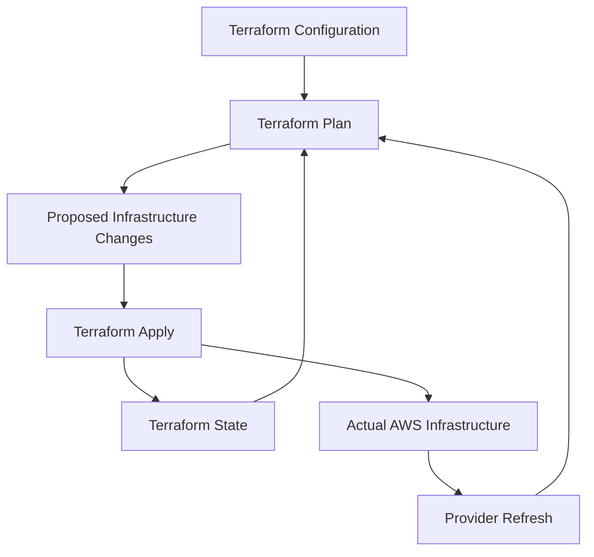
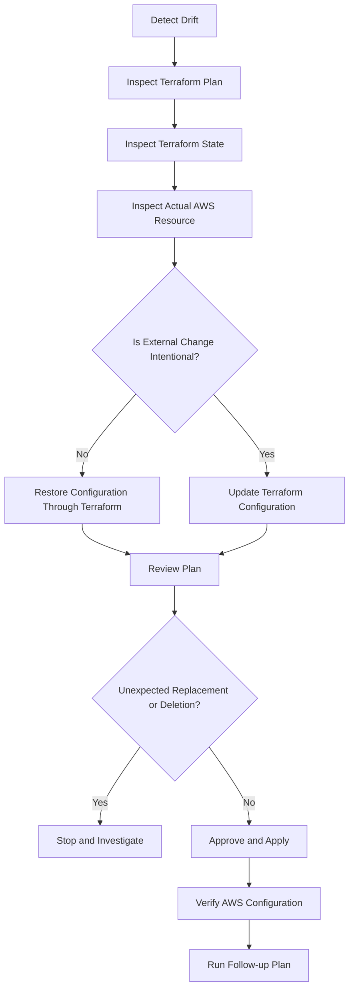

# 02- Terraform Resource Drift and Conflicts

## Overview

Terraform resource drift occurs when the actual AWS infrastructure differs from the configuration or state Terraform uses to manage it.

Resource conflicts occur when Terraform attempts to create, update, import, or delete an AWS resource that already exists, is managed elsewhere, or cannot be modified because of its current configuration.

These problems are common in Amazon S3 deployments because buckets and their associated configurations are frequently modified by multiple systems:

- Terraform and other infrastructure-as-code tools.
- AWS Console operations.
- AWS CLI commands and SDK scripts.
- Application deployment pipelines.
- Security automation.
- AWS Organizations policies and centralized governance.

For example, an engineer may manually disable an S3 lifecycle rule through the AWS Console while Terraform still declares it as enabled. Another deployment may then attempt to restore the configured lifecycle policy.

The central troubleshooting principle is to distinguish between three different states:

1. **Configuration:** What Terraform declares should exist.
2. **Terraform state:** What Terraform currently believes it manages.
3. **Actual infrastructure:** What AWS currently contains.

A safe recovery process identifies which representation is incorrect before changing infrastructure.

## Understanding Terraform Resource Drift

### What Is Resource Drift?

Drift occurs when an AWS resource changes outside Terraform's normal management workflow.

Example configuration:

```hcl
resource "aws_s3_bucket_versioning" "assets" {
  bucket = aws_s3_bucket.assets.id

  versioning_configuration {
    status = "Enabled"
  }
}
```

Suppose an administrator disables versioning manually:

```bash
aws s3api put-bucket-versioning \
  --bucket company-production-assets \
  --versioning-configuration Status=Suspended
```

Terraform configuration still declares versioning as enabled, but the actual bucket configuration has changed.

The next refresh or plan may identify the difference and propose restoring the configured value.

### Why Drift Matters

Drift can cause:

- Unexpected infrastructure changes.
- Security configuration regressions.
- Accidental bucket replacement.
- Unexpected deletion of resources.
- Inconsistent environments.
- Deployment failures.
- Compliance violations.

For S3, drift can affect particularly sensitive configurations:

| Resource | Potential impact |
|---|---|
| Bucket policy | Unexpected public or restricted access. |
| Versioning | Changes to object recovery behavior. |
| Encryption | Different encryption configuration than intended. |
| Lifecycle rules | Premature object expiration or storage-cost increases. |
| Replication | Missing or incorrect cross-Region replication. |
| Public access block | Unintended public exposure. |
| Object Ownership | Unexpected ACL and ownership behavior. |
| CORS configuration | Browser-based uploads or downloads fail. |
| Notification configuration | Event processing stops or changes unexpectedly. |

## Terraform's Three Sources of Infrastructure Information

Understanding the relationship between configuration, state, and actual AWS resources is essential.



| Source | Description | Typical problem |
|---|---|---|
| Configuration | Desired infrastructure definition. | Incorrect or outdated `.tf` files. |
| State | Terraform's recorded resource mapping and attributes. | Missing, stale, or incorrectly mapped resources. |
| AWS infrastructure | Actual deployed resources and configuration. | Manual changes, external automation, or service-side changes. |

Terraform refreshes managed resources during planning and compares observed values with the desired configuration.

Provider behavior matters: not every AWS attribute is refreshed or managed in exactly the same way. Some attributes are computed, some are configurable, and some changes require resource replacement.

Do not assume that every difference represents actionable drift.

## Common Causes of S3 Resource Drift

### Manual AWS Console Changes

An administrator modifies an S3 bucket policy or lifecycle configuration directly.

Terraform configuration remains unchanged.

**Recommended approach:** Make the corresponding change in Terraform and deploy it through the normal review process, or deliberately revert the manual change.

### AWS CLI or SDK Automation

A maintenance script changes bucket configuration outside Terraform.

Example:

```bash
aws s3api put-bucket-encryption \
  --bucket company-production-assets \
  --server-side-encryption-configuration file://encryption.json
```

If Terraform manages the same encryption configuration, the external change may create drift.

**Recommended approach:** Establish a single authoritative owner for each infrastructure resource or configuration boundary.

### Multiple Infrastructure Management Systems

The same S3 bucket is managed by Terraform and CloudFormation, or by multiple Terraform states.

This creates competing ownership.

Possible consequences include:

- Conflicting configuration updates.
- Unexpected resource deletion.
- Repeated drift.
- Deployment failures.
- Inconsistent resource metadata.

**Recommended approach:** Assign one authoritative management system to each resource and document ownership boundaries.

### Provider Version Changes

An AWS provider upgrade may change:

- Attribute normalization.
- Resource schema behavior.
- Default values.
- Import behavior.
- Handling of computed fields.
- Resource replacement decisions.

A plan may show differences even though no administrator intentionally modified AWS.

**Recommended approach:** Review provider upgrade notes and inspect the exact plan before applying.

### AWS Service-Side Changes

AWS services can normalize or expose configuration differently from the values supplied through an API.

Provider versions may also differ in how they read and represent these values.

**Recommended approach:** Determine whether the difference is a real infrastructure change or a provider representation issue.

## Detecting Terraform Drift

### Run a Normal Terraform Plan

The first diagnostic step is:

```bash
terraform plan
```

Terraform refreshes managed resources and compares their observed attributes against configuration.

A plan may report:

```text
~ resource "aws_s3_bucket_versioning" "assets" {
    bucket = "company-production-assets"

  ~ versioning_configuration {
      ~ status = "Suspended" -> "Enabled"
    }
}
```

This indicates that Terraform intends to restore versioning to the configured value.

Do not apply the plan until the change is understood.

### Generate a Detailed Plan

```bash
terraform plan -out=tfplan
```

Inspect the saved plan:

```bash
terraform show tfplan
```

This provides a reviewable representation of the proposed infrastructure changes.

### Inspect Current State

```bash
terraform state list
```

Inspect a particular resource:

```bash
terraform state show aws_s3_bucket_versioning.assets
```

Compare the state representation with the AWS resource configuration.

### Inspect Actual S3 Configuration

Check bucket versioning:

```bash
aws s3api get-bucket-versioning \
  --bucket company-production-assets
```

Check bucket encryption:

```bash
aws s3api get-bucket-encryption \
  --bucket company-production-assets
```

Check lifecycle configuration:

```bash
aws s3api get-bucket-lifecycle-configuration \
  --bucket company-production-assets
```

Check bucket policy:

```bash
aws s3api get-bucket-policy \
  --bucket company-production-assets
```

Check public access block:

```bash
aws s3api get-public-access-block \
  --bucket company-production-assets
```

Check replication:

```bash
aws s3api get-bucket-replication \
  --bucket company-production-assets
```

These commands inspect different configuration surfaces. A successful response for one does not establish that the entire bucket configuration matches Terraform.

## Terraform Drift Detection Modes

### Normal Refresh During Planning

By default, Terraform refreshes managed resources during planning.

```bash
terraform plan
```

This is the standard workflow for identifying differences between configuration, state, and infrastructure.

### Refresh-Only Plan

Use refresh-only mode when the objective is to inspect and reconcile state with remote infrastructure without proposing changes to the infrastructure itself.

```bash
terraform plan -refresh-only
```

If the refreshed state should be recorded:

```bash
terraform apply -refresh-only
```

This updates Terraform state to reflect observed remote attributes.

It does not make AWS infrastructure match the configuration.

Use this approach only when the external change is intentional and should become the accepted observed state.

### Refresh-Only Versus Normal Apply

| Operation | Purpose | Changes AWS infrastructure? |
|---|---|---|
| `terraform plan` | Compare configuration, state, and remote infrastructure. | No |
| `terraform plan -refresh-only` | Preview state updates from remote infrastructure. | No |
| `terraform apply -refresh-only` | Persist refreshed remote attributes into state. | No |
| `terraform apply` | Apply approved infrastructure changes. | Yes, when required |

A refresh-only apply is not a drift-remediation operation. It records what exists rather than restoring what configuration declares.

## Troubleshooting: Terraform Plans Unexpected S3 Changes

### Symptoms

Terraform proposes modifications that were not expected.

Examples:

```text
~ aws_s3_bucket_lifecycle_configuration.assets
```

```text
~ aws_s3_bucket_public_access_block.assets
```

```text
-/+ aws_s3_bucket.some_bucket
```

The last example indicates resource replacement, which deserves particular attention.

### Likely Causes

- Manual AWS configuration changes.
- Incorrect Terraform configuration.
- Provider version changes.
- Missing state attributes.
- Resource ownership conflicts.
- Incorrect workspace or backend.
- Configuration normalization differences.

### Isolation and Verification

Inspect the plan:

```bash
terraform plan
```

Inspect the resource:

```bash
terraform state show aws_s3_bucket.assets
```

Inspect the AWS resource:

```bash
aws s3api get-bucket-versioning \
  --bucket company-production-assets
```

Verify the current workspace:

```bash
terraform workspace show
```

Verify the AWS account:

```bash
aws sts get-caller-identity
```

### Root-Cause Determination

Classify the difference:

| Observation | Interpretation |
|---|---|
| Configuration differs from AWS and state | Likely real drift or incorrect configuration. |
| Configuration matches AWS but state differs | Investigate refresh behavior and state consistency. |
| Configuration and state match but plan still proposes changes | Investigate provider behavior, computed fields, defaults, and normalization. |
| Resource address is unexpected | Investigate workspace, module refactoring, or state ownership. |
| Plan proposes replacement | Inspect ForceNew attributes and resource identity changes. |

### Corrective Action

Choose the correction based on the intended source of truth.

**If Terraform configuration is correct:** Apply the reviewed plan to restore the desired infrastructure.

**If the manual change is intentional:** Update Terraform configuration to represent the accepted infrastructure.

**If only state is outdated:** Use a refresh-only operation after confirming that the remote configuration is correct.

**If provider behavior is responsible:** Review provider versions, schemas, and upgrade notes before changing infrastructure.

## Troubleshooting: Resource Already Exists

### Symptoms

Terraform attempts to create an S3 resource but AWS reports that it already exists.

Example:

```text
Error: creating S3 Bucket:
BucketAlreadyOwnedByYou
```

### Likely Causes

- Resource exists but is not in Terraform state.
- State was lost or replaced.
- Resource is managed by another Terraform state.
- A previous deployment partially completed.
- Terraform resource address changed.
- Wrong workspace or backend is active.

### Isolation and Verification

Check the resource:

```bash
aws s3api head-bucket \
  --bucket company-production-assets
```

Inspect Terraform state:

```bash
terraform state list
```

Inspect the expected address:

```bash
terraform state show aws_s3_bucket.assets
```

Confirm that another Terraform configuration is not managing the same bucket.

### Corrective Action: Import Existing Resources

If the resource should be managed by the current Terraform configuration:

```bash
terraform import \
  aws_s3_bucket.assets \
  company-production-assets
```

For newer Terraform workflows, an import block can be used:

```hcl
import {
  to = aws_s3_bucket.assets
  id = "company-production-assets"
}
```

After importing:

```bash
terraform plan
```

Importing an S3 bucket does not automatically import every related configuration resource.

Depending on the AWS provider version and resource model, separate resources may be required for:

- Bucket versioning.
- Bucket encryption.
- Lifecycle configuration.
- Bucket policy.
- Public access block.
- Replication configuration.
- CORS configuration.
- Logging configuration.

Import each independently managed resource using its documented import identifier.

### Prevention

- Maintain one authoritative Terraform state owner.
- Document manually created infrastructure.
- Use import workflows for existing resources.
- Avoid creating resources manually when Terraform already manages them.
- Verify backend and workspace before deployment.

## Troubleshooting: Resource Already Managed by Another State

### Symptoms

Two Terraform configurations attempt to manage the same S3 bucket.

One configuration updates the bucket while another proposes changes or attempts to recreate it.

### Likely Causes

- Duplicate resource declarations.
- State migration was incomplete.
- Infrastructure was copied between repositories.
- Multiple teams manage overlapping resource boundaries.
- A resource was imported without removing its previous ownership.

### Isolation and Verification

Inspect the current state:

```bash
terraform state list
```

Inspect the resource:

```bash
terraform state show aws_s3_bucket.assets
```

Review other Terraform repositories and backend configurations that may manage the same resource.

Terraform does not provide a universal cross-state ownership lock. Separate states can independently attempt to manage the same AWS resource.

### Corrective Action

Choose one authoritative state.

If ownership is being transferred, use a controlled state migration or ownership-transfer procedure.

The general sequence is:

1. Stop deployments from both configurations.
2. Back up both states.
3. Confirm the destination configuration is complete.
4. Remove the resource mapping from the old state without destroying the AWS resource.
5. Import the resource into the destination state.
6. Review the destination plan.
7. Resume deployment only after confirming ownership.

Example state removal:

```bash
terraform state rm aws_s3_bucket.assets
```

`terraform state rm` removes the resource mapping from Terraform state. It does not delete the AWS resource.

Never run `terraform destroy` against a state that still owns resources being transferred.

## Troubleshooting: Unexpected Resource Replacement

### Symptoms

Terraform proposes destroying and recreating an existing S3 resource.

Example:

```text
-/+ resource "aws_s3_bucket" "assets" {
    # forces replacement
}
```

For production buckets, replacement can be extremely disruptive.

Potential consequences include:

- Object data loss.
- Bucket-name conflicts.
- Application downtime.
- Broken CloudFront origins.
- Replication interruption.
- Failed deployment pipelines.

### Likely Causes

- Changing a ForceNew attribute.
- Incorrect resource identity.
- Provider schema changes.
- Resource configuration refactoring.
- Incorrect import identifier.
- Terraform state referencing the wrong resource.

### Isolation and Verification

Generate a plan:

```bash
terraform plan
```

Inspect the resource:

```bash
terraform state show aws_s3_bucket.assets
```

Inspect the actual bucket:

```bash
aws s3api head-bucket \
  --bucket company-production-assets
```

Review the plan's replacement reason and identify which attribute requires replacement.

### Corrective Action

Do not apply a replacement plan until its impact is understood.

For an unintended replacement:

- Correct the resource configuration.
- Correct the state mapping if necessary.
- Verify provider compatibility.
- Re-run the plan.
- Confirm that Terraform proposes an in-place update or no change.

For resources that must be replaced, use a deliberate migration strategy with a new bucket, data migration, application cutover, and rollback plan.

### Lifecycle Protection

For critical S3 buckets:

```hcl
resource "aws_s3_bucket" "assets" {
  bucket = var.bucket_name

  lifecycle {
    prevent_destroy = true
  }
}
```

`prevent_destroy` blocks Terraform plans that would destroy the resource while the lifecycle rule remains in configuration.

It does not protect against:

- Manual AWS deletion.
- Changes made outside Terraform.
- Deletion through another state or management system.
- Removal of the lifecycle rule followed by destruction.

Use it as one layer of protection rather than a complete data-protection mechanism.

## Troubleshooting: S3 Lifecycle Configuration Drift

### Symptoms

Terraform repeatedly proposes lifecycle configuration changes.

Example:

```text
~ aws_s3_bucket_lifecycle_configuration.assets
```

### Likely Causes

- Lifecycle rules changed manually.
- Rule identifiers changed.
- Filters differ between configuration and AWS.
- Multiple management systems update the same lifecycle configuration.
- Provider version changed lifecycle configuration handling.
- A rule was removed or replaced.

### Isolation and Verification

Inspect the live configuration:

```bash
aws s3api get-bucket-lifecycle-configuration \
  --bucket company-production-assets
```

Inspect Terraform configuration and state:

```bash
terraform state show \
  aws_s3_bucket_lifecycle_configuration.assets
```

Generate a plan:

```bash
terraform plan
```

### Corrective Action

Determine whether the live lifecycle policy or Terraform configuration is authoritative.

If the Terraform configuration is correct, restore the intended rules through Terraform.

If the manual configuration is intentional, update the Terraform definition.

Review rules for:

- Prefix or tag filters.
- Current object transitions.
- Noncurrent version transitions.
- Expiration.
- Incomplete multipart upload cleanup.
- Rule status.
- Overlapping rule behavior.

Lifecycle changes can affect large object populations. Validate the intended result before applying changes.

## Troubleshooting: Bucket Policy Drift

### Symptoms

Terraform proposes replacing or modifying an S3 bucket policy unexpectedly.

Applications may also experience new `AccessDenied` errors.

### Likely Causes

- Manual policy changes.
- Security automation modifying the policy.
- Policy JSON formatting or normalization differences.
- Conflicting policy ownership.
- Incorrect principal or resource ARN.
- Provider configuration differences.

### Isolation and Verification

Inspect the live policy:

```bash
aws s3api get-bucket-policy \
  --bucket company-production-assets
```

Inspect Terraform state:

```bash
terraform state show aws_s3_bucket_policy.assets
```

Generate a plan:

```bash
terraform plan
```

### Corrective Action

Compare policy statements semantically rather than relying only on JSON formatting.

Review:

- Principal.
- Action.
- Resource.
- Conditions.
- Explicit deny statements.
- Cross-account access.
- TLS enforcement.
- Required service principals.

Do not replace a production bucket policy without checking the effect on application roles, CloudFront, replication, logging, and cross-account integrations.

## Troubleshooting: Resource Configuration Conflicts

### Symptoms

Terraform reports that an S3 configuration is already managed or that multiple configuration declarations conflict.

Possible affected resources include:

- Bucket lifecycle configuration.
- Bucket CORS configuration.
- Bucket encryption configuration.
- Bucket notification configuration.
- Bucket replication configuration.
- Bucket policy.

### Likely Causes

- Multiple Terraform resources manage the same configuration surface.
- Inline configuration and standalone resources are mixed.
- Multiple modules manage the same bucket settings.
- A second Terraform state manages an overlapping resource.

### Example: Conflicting Lifecycle Ownership

Avoid declaring the same lifecycle configuration through multiple resources or module interfaces.

Use a single authoritative lifecycle configuration resource:

```hcl
resource "aws_s3_bucket_lifecycle_configuration" "assets" {
  bucket = aws_s3_bucket.assets.id

  rule {
    id     = "expire-temporary-uploads"
    status = "Enabled"

    filter {
      prefix = "temporary/"
    }

    expiration {
      days = 30
    }
  }
}
```

### Isolation and Verification

Inspect:

```bash
terraform state list
terraform plan
```

Review all modules and resource declarations referencing the bucket.

### Corrective Action

- Choose one resource owner for each configuration surface.
- Remove duplicate declarations from the desired configuration.
- Migrate state mappings carefully.
- Verify the resulting plan before applying.

Do not assume that separate Terraform resources can safely manage independent fragments of an AWS API configuration when the API replaces the entire configuration document.

## Troubleshooting: Bucket Versioning Drift

### Symptoms

Terraform proposes enabling or suspending versioning unexpectedly.

### Isolation and Verification

Inspect actual versioning:

```bash
aws s3api get-bucket-versioning \
  --bucket company-production-assets
```

Inspect Terraform state:

```bash
terraform state show \
  aws_s3_bucket_versioning.assets
```

### Important S3 Behavior

S3 versioning supports:

- `Enabled`
- `Suspended`

Once versioning has been enabled for a bucket, it cannot return to the never-versioned state.

Suspending versioning does not remove existing object versions.

A Terraform change that suspends versioning may therefore have consequences for object recovery and retention.

### Corrective Action

Confirm the intended versioning state and restore it through the authoritative Terraform configuration.

Do not suspend production versioning merely to eliminate a Terraform plan difference.

## Troubleshooting: Provider Version or Schema Changes

### Symptoms

After upgrading the AWS provider, Terraform reports unexpected differences across several S3 resources.

### Likely Causes

- Resource schema changes.
- Changed default values.
- Attribute normalization changes.
- Resource deprecations.
- Import behavior changes.
- Provider bug fixes.

### Isolation and Verification

Inspect provider constraints:

```hcl
terraform {
  required_providers {
    aws = {
      source  = "hashicorp/aws"
      version = "~> 6.0"
    }
  }
}
```

Inspect the installed provider:

```bash
terraform providers
```

Inspect the dependency lock file:

```text
.terraform.lock.hcl
```

Generate a plan before applying:

```bash
terraform plan
```

### Corrective Action

- Review the provider changelog.
- Test the upgrade in a non-production environment.
- Review resource replacement behavior.
- Update configuration where required.
- Pin the reviewed provider version.
- Apply only after the plan has been approved.

Do not automatically accept a large plan simply because it follows a provider upgrade.

## Safe Drift Remediation Workflow

The correct remediation depends on which representation is authoritative.



### Remediation Decision Table

| Situation | Correct action |
|---|---|
| Manual change was accidental | Restore the declared configuration through Terraform. |
| Manual change was approved | Update Terraform configuration to match the approved design. |
| State is stale but infrastructure is correct | Use refresh-only reconciliation. |
| Resource exists outside the current state | Import it after confirming ownership. |
| Resource is managed by another state | Perform a controlled ownership transfer. |
| Provider upgrade causes differences | Investigate schema changes and validate the plan. |
| Resource replacement is unexpected | Stop deployment and investigate replacement attributes. |
| Resource is genuinely obsolete | Follow an approved decommissioning and data-retention process. |

## Drift Detection in CI/CD

Drift detection should be part of regular infrastructure operations rather than something discovered only during deployment.

A scheduled pipeline can run Terraform plans and report differences.

Example GitHub Actions workflow:

```yaml
name: Terraform Drift Detection

on:
  schedule:
    - cron: "30 2 * * *"
  workflow_dispatch:

permissions:
  contents: read
  id-token: write

jobs:
  drift-detection:
    runs-on: ubuntu-latest

    concurrency:
      group: terraform-production-drift
      cancel-in-progress: false

    steps:
      - name: Checkout
        uses: actions/checkout@v4

      - name: Configure AWS Credentials
        uses: aws-actions/configure-aws-credentials@v4
        with:
          role-to-assume: ${{ secrets.AWS_TERRAFORM_ROLE_ARN }}
          aws-region: ap-south-1

      - name: Setup Terraform
        uses: hashicorp/setup-terraform@v3
        with:
          terraform_version: "1.10.5"

      - name: Initialize
        run: terraform init -input=false

      - name: Validate
        run: terraform validate

      - name: Detect Drift
        run: terraform plan -detailed-exitcode -input=false
```

The example uses GitHub Actions secrets for the role ARN as a configuration value; it does not require long-lived AWS access keys.

For `terraform plan -detailed-exitcode`:

| Exit code | Meaning |
|---|---|
| `0` | Successful plan with no changes. |
| `1` | Error. |
| `2` | Successful plan with changes. |

A production drift workflow should handle exit code `2` as a reportable condition rather than treating every nonzero exit code as an infrastructure failure.

Do not automatically apply a scheduled drift plan. Drift detection and drift remediation should be separate controlled processes.

## Preventing Resource Conflicts

### Establish Resource Ownership

Define ownership at the infrastructure boundary.

Example:

| Resource | Owner |
|---|---|
| Production S3 bucket | Terraform state: `storage-production` |
| Bucket encryption | Same authoritative bucket module |
| Bucket lifecycle | Same authoritative bucket module |
| CloudFront distribution | Terraform state: `cdn-production` |
| Application objects | Application service using IAM permissions |

The application may write objects without managing the bucket's infrastructure configuration.

This separation prevents application deployment scripts from becoming competing infrastructure managers.

### Use Reusable Terraform Modules

A shared module can provide a consistent interface for bucket creation.

Example:

```hcl
module "application_assets" {
  source = "../../modules/s3-bucket"

  bucket_name = "company-production-assets"

  enable_versioning = true

  tags = {
    Environment = "production"
    Application = "assets"
    ManagedBy   = "terraform"
  }
}
```

The module should have a clearly defined responsibility.

Avoid creating multiple modules that independently manage the same bucket configuration.

### Keep Provider Versions Controlled

Commit `.terraform.lock.hcl` and review provider upgrades.

Use the same approved provider versions across local development and CI/CD.

### Protect Critical Resources

Example:

```hcl
resource "aws_s3_bucket" "assets" {
  bucket = var.bucket_name

  lifecycle {
    prevent_destroy = true
  }

  tags = var.tags
}
```

For production data, combine Terraform lifecycle protection with S3 versioning, access controls, recovery procedures, and appropriate organizational safeguards.

## Operational Verification Checklist

After resolving drift or a resource conflict, verify the following.

### Terraform Verification

```bash
terraform plan
terraform state list
```

Expected result:

- Correct resource addresses.
- No unexplained resource replacement.
- No unexpected resource deletion.
- No repeated drift.
- Correct workspace and backend.

### S3 Verification

Versioning:

```bash
aws s3api get-bucket-versioning \
  --bucket company-production-assets
```

Encryption:

```bash
aws s3api get-bucket-encryption \
  --bucket company-production-assets
```

Lifecycle:

```bash
aws s3api get-bucket-lifecycle-configuration \
  --bucket company-production-assets
```

Public access block:

```bash
aws s3api get-public-access-block \
  --bucket company-production-assets
```

Replication:

```bash
aws s3api get-bucket-replication \
  --bucket company-production-assets
```

Run only the checks relevant to the resources managed by the deployment.

### Application Verification

For backend applications using S3:

- Confirm upload operations succeed.
- Confirm download operations succeed.
- Confirm expected encryption behavior.
- Confirm required object metadata is preserved.
- Confirm application IAM permissions remain valid.
- Confirm CloudFront or event-driven integrations continue working.

An infrastructure plan can succeed while an application integration remains broken. Include application-level smoke tests for important S3 workloads.

## Common Mistakes

| Mistake | Why it causes problems | Recommended approach |
|---|---|---|
| Applying every drift plan immediately | May overwrite an intentional security or operational change. | Inspect the source and impact of each difference. |
| Using refresh-only apply to fix infrastructure | Updates state but does not restore desired infrastructure. | Use normal Terraform apply for actual remediation. |
| Importing a resource without checking ownership | Can create multiple Terraform managers. | Establish a single authoritative state first. |
| Ignoring replacement markers | May destroy or replace production resources. | Inspect every replacement reason. |
| Managing the same bucket from multiple states | Creates competing ownership and repeated drift. | Define explicit resource boundaries. |
| Mixing inline and standalone configuration ownership | Can produce conflicting Terraform resources. | Use one authoritative resource per configuration surface. |
| Upgrading providers without reviewing plans | Can introduce unexpected resource changes. | Test upgrades and inspect provider changelogs. |
| Treating application object writes as infrastructure ownership | Couples application deployment with bucket administration. | Separate data-plane permissions from infrastructure management. |
| Automatically applying scheduled drift plans | Can overwrite intentional changes without review. | Report drift and require controlled remediation. |
| Assuming `prevent_destroy` prevents every deletion | It protects only Terraform operations where the lifecycle rule remains active. | Combine it with AWS-side controls and recovery procedures. |

## Key Takeaways

- Terraform drift is a difference between desired configuration, recorded state, and actual AWS infrastructure; identify which representation is incorrect before remediation.
- Use normal plans to identify infrastructure changes and refresh-only operations only when the observed remote configuration should be recorded in state.
- Import existing S3 resources only after confirming ownership, and avoid managing the same resource from multiple Terraform states.
- Treat S3 bucket replacement, lifecycle changes, encryption changes, and bucket policy modifications as high-impact production operations.
- Prevent recurring conflicts through explicit resource ownership, controlled provider upgrades, scheduled drift detection, and reviewed infrastructure deployments.