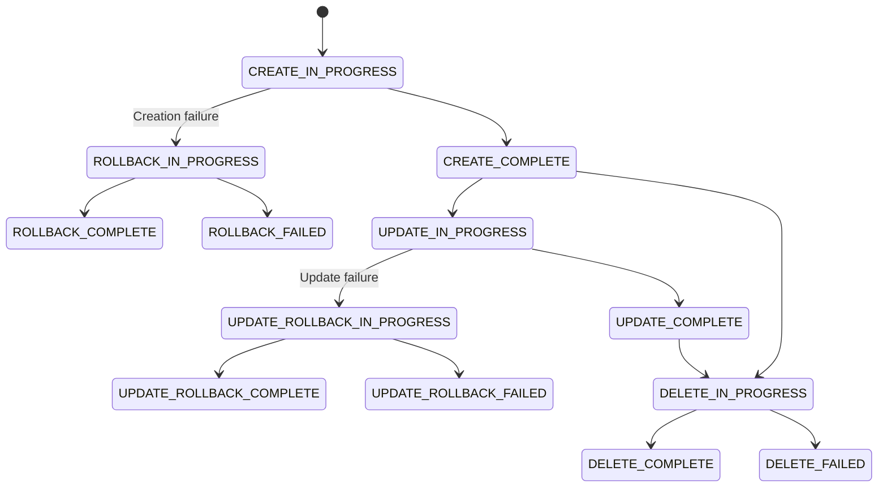
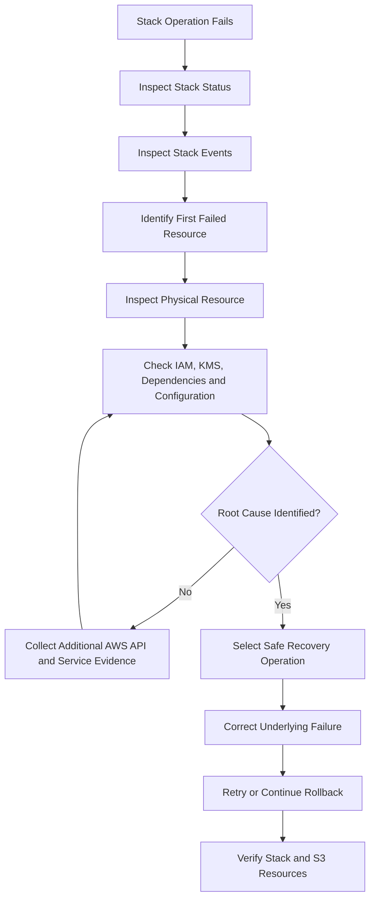
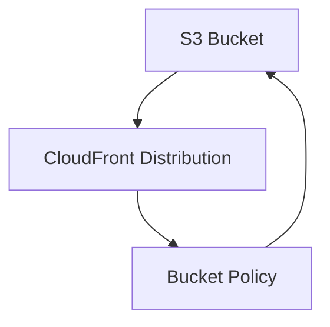

# 03- CloudFormation Stack Failures

## Overview

AWS CloudFormation provisions and manages AWS infrastructure through declarative templates. In an Amazon S3 deployment, a stack may contain buckets, bucket policies, encryption settings, versioning, lifecycle configurations, replication rules, IAM roles, Lambda functions, event notifications, and CloudFront distributions.

A CloudFormation deployment failure occurs when a resource operation or stack-level operation cannot complete successfully. Depending on the operation and failure type, CloudFormation may initiate rollback, restore previously deployed resource configurations, or leave the stack in a state requiring manual recovery.

S3 deployments require particular care because:

- Bucket names are globally unique within an AWS partition.
- Existing buckets may contain production data that must not be deleted.
- Some resource changes require replacement rather than in-place modification.
- Bucket policies and KMS permissions can affect dependent services.
- S3 event notifications require valid destination resources and permissions.
- Manual infrastructure changes can create drift between CloudFormation and actual AWS resources.

The troubleshooting objective is to identify the first meaningful failure, determine its root cause, select a safe recovery operation, and verify that the stack and deployed resources are consistent.

## CloudFormation Stack States

CloudFormation stack status describes the current lifecycle operation. It does not necessarily identify the resource that caused the failure.

### Important Stack Statuses

| Status | Meaning | Operational implication |
|---|---|---|
| `CREATE_IN_PROGRESS` | Initial stack creation is running. | Monitor resource events. |
| `CREATE_COMPLETE` | Stack creation succeeded. | Verify deployed resources. |
| `CREATE_FAILED` | Stack creation failed. | Inspect the failed resource and events. |
| `ROLLBACK_IN_PROGRESS` | CloudFormation is reversing a failed creation. | Avoid modifying resources during rollback. |
| `ROLLBACK_COMPLETE` | Failed creation was rolled back. | Delete the failed stack before recreating it. |
| `UPDATE_IN_PROGRESS` | Stack update is running. | Monitor resource changes. |
| `UPDATE_COMPLETE` | Stack update succeeded. | Perform post-deployment verification. |
| `UPDATE_FAILED` | Stack update failed. | Determine whether rollback is running or has failed. |
| `UPDATE_ROLLBACK_IN_PROGRESS` | CloudFormation is reversing a failed update. | Wait for rollback or investigate a blocked resource. |
| `UPDATE_ROLLBACK_COMPLETE` | Failed update was rolled back. | Stack is generally available for another update. |
| `UPDATE_ROLLBACK_FAILED` | Rollback itself failed. | Recovery intervention is required. |
| `DELETE_IN_PROGRESS` | Stack deletion is running. | Monitor resource deletion. |
| `DELETE_FAILED` | Stack deletion failed. | Identify resources preventing deletion. |

### Stack Lifecycle



A stack may have a failed resource even when other resources were created successfully. Always inspect resource-level events before choosing a recovery operation.

## Initial Diagnostic Workflow

Preserve deployment evidence before attempting recovery. Avoid starting another deployment while the current stack operation is still running.

### Inspect Stack Status

```bash
aws cloudformation describe-stacks \
  --stack-name s3-production \
  --region ap-south-1
```

Inspect the status and status reason:

```bash
aws cloudformation describe-stacks \
  --stack-name s3-production \
  --query 'Stacks[0].[StackStatus,StackStatusReason]' \
  --output table
```

### Inspect Stack Events

```bash
aws cloudformation describe-stack-events \
  --stack-name s3-production \
  --region ap-south-1
```

Events are returned in reverse chronological order. Identify the earliest relevant resource failure, not merely the latest event.

For example:

```text
LogicalResourceId: AssetsBucket
ResourceType: AWS::S3::Bucket
ResourceStatus: CREATE_FAILED
ResourceStatusReason: BucketAlreadyExists
```

Subsequent failures may be rollback consequences rather than independent root causes.

### Inspect Stack Resources

```bash
aws cloudformation describe-stack-resources \
  --stack-name s3-production \
  --region ap-south-1
```

Inspect the following fields:

| Field | Purpose |
|---|---|
| `LogicalResourceId` | Identifies the resource in the template. |
| `PhysicalResourceId` | Identifies the actual AWS resource. |
| `ResourceType` | Identifies the CloudFormation resource type. |
| `ResourceStatus` | Shows the resource's current operation status. |
| `ResourceStatusReason` | Provides the service error or failure explanation. |

### Diagnostic Sequence



## Bucket Creation Failures

### Bucket Name Already Exists

**Symptoms**

CloudFormation fails while creating an S3 bucket:

```text
ResourceStatus: CREATE_FAILED

ResourceType: AWS::S3::Bucket

ResourceStatusReason:
BucketAlreadyExists
```

Another possible error is:

```text
BucketAlreadyOwnedByYou
```

**Likely causes**

- Another AWS account owns the requested bucket name.
- The bucket already exists in the current account.
- A previous deployment created the bucket but failed later.
- Another CloudFormation stack already manages the bucket.
- A reusable template hardcodes the same bucket name across environments.

**Isolation and verification**

Inspect the template:

```yaml
Resources:
  AssetsBucket:
    Type: AWS::S3::Bucket
    Properties:
      BucketName: company-production-assets
```

Check the bucket:

```bash
aws s3api head-bucket \
  --bucket company-production-assets
```

A failed `HeadBucket` request does not conclusively establish that a bucket is absent. Authorization failures and other responses may not distinguish a missing bucket from a bucket that exists but is inaccessible.

Inspect the stack's resource mapping:

```bash
aws cloudformation describe-stack-resources \
  --stack-name s3-production
```

**Root-cause determination**

| Evidence | Likely cause |
|---|---|
| Bucket exists in the same account and belongs to another stack | Duplicate infrastructure ownership. |
| Bucket exists in the same account but is unmanaged | Existing resource requires an explicit management strategy. |
| Bucket name belongs to another account | Global naming collision. |
| Bucket was created during an earlier failed deployment | Partial deployment or rollback behavior. |

**Corrective action**

For new deployments, use environment-specific bucket names:

```yaml
Parameters:
  Environment:
    Type: String
    AllowedValues:
      - dev
      - staging
      - production

Resources:
  AssetsBucket:
    Type: AWS::S3::Bucket
    Properties:
      BucketName: !Sub company-${Environment}-assets-${AWS::AccountId}
```

For an existing bucket, choose an explicit ownership strategy:

- Import the existing bucket into CloudFormation when supported and appropriate.
- Reference the bucket without attempting to create it.
- Migrate infrastructure ownership through a controlled process.
- Choose another name when a separate bucket is required.

Never delete an existing production bucket merely to resolve a naming conflict.

**Prevention**

- Use environment-specific naming conventions.
- Include account identifiers where appropriate.
- Check resource ownership before deployment.
- Avoid hardcoded globally shared names in reusable templates.
- Test deployment in an isolated account.

## IAM Authorization Failures

### AccessDenied During Deployment

**Symptoms**

CloudFormation fails to create or modify an S3 resource:

```text
CREATE_FAILED

Status Reason:
Access Denied
```

Affected resources may include:

- `AWS::S3::Bucket`
- `AWS::S3::BucketPolicy`
- `AWS::S3::BucketVersioning`
- `AWS::S3::BucketLifecycleConfiguration`
- `AWS::S3::BucketEncryption`
- `AWS::S3::BucketReplication`

**Likely causes**

- The CloudFormation execution role lacks required permissions.
- The deployment identity cannot pass the execution role.
- An explicit deny exists in an IAM or resource policy.
- An AWS Organizations service control policy blocks the operation.
- A permission boundary restricts the deployment role.
- A KMS key policy does not authorize the required operation.
- A resource policy references an invalid principal.

**Isolation and verification**

Inspect the stack execution role:

```bash
aws cloudformation describe-stacks \
  --stack-name s3-production \
  --query 'Stacks[0].RoleARN' \
  --output text
```

Inspect the current caller:

```bash
aws sts get-caller-identity
```

Inspect the role's attached policies:

```bash
aws iam list-attached-role-policies \
  --role-name CloudFormationExecutionRole
```

Inspect inline policies:

```bash
aws iam list-role-policies \
  --role-name CloudFormationExecutionRole
```

Review the failed resource event and identify the exact operation that was denied.

**Distinguishing authorization layers**

S3 and KMS authorization are separate checks.

| Failure layer | Permissions to investigate |
|---|---|
| S3 bucket management | Required S3 bucket configuration actions. |
| S3 object operations | `s3:GetObject`, `s3:PutObject`, and other relevant object actions. |
| KMS encryption | `kms:GenerateDataKey` and applicable key permissions. |
| KMS decryption | `kms:Decrypt`. |
| Role delegation | `iam:PassRole`. |
| CloudFormation execution | Required permissions for resources managed by the stack. |

A deployment role may have permission to configure an S3 bucket but lack permission to use the customer-managed KMS key referenced by that bucket.

**Corrective action**

Grant the CloudFormation execution role the minimum permissions required by the template.

For KMS-backed S3 encryption, verify:

- IAM permissions on the execution role.
- KMS key policy.
- Required KMS grants.
- Key state.
- Key Region.
- Cross-account key access, if applicable.

Do not resolve an authorization failure by permanently granting unrestricted administrator access to a production execution role.

**Prevention**

- Use a dedicated CloudFormation execution role.
- Apply least-privilege permissions.
- Validate KMS access before deployment.
- Review organization-level policy restrictions.
- Test with the same role used by CI/CD.

## Bucket Configuration Failures

### Symptoms

The bucket is created, but a dependent configuration resource fails.

Examples include:

```text
AWS::S3::BucketPolicy
AWS::S3::BucketVersioning
AWS::S3::BucketLifecycleConfiguration
AWS::S3::BucketNotification
AWS::S3::BucketReplication
```

### Likely Causes

- A referenced bucket does not exist.
- A resource references an incorrect bucket name.
- A required IAM role is missing.
- A KMS key is inaccessible.
- A resource dependency is not correctly modeled.
- Multiple resources attempt to manage overlapping configuration.
- A dependent service is not ready.

### Isolation and Verification

Inspect stack events:

```bash
aws cloudformation describe-stack-events \
  --stack-name s3-production
```

Inspect the bucket:

```bash
aws s3api head-bucket \
  --bucket company-production-assets
```

Inspect versioning:

```bash
aws s3api get-bucket-versioning \
  --bucket company-production-assets
```

Inspect encryption:

```bash
aws s3api get-bucket-encryption \
  --bucket company-production-assets
```

### Corrective Action: Model Dependencies

CloudFormation normally derives dependencies from references such as `!Ref` and `!GetAtt`.

Use `DependsOn` when an ordering dependency is not already expressed through a resource reference.

Example:

```yaml
Resources:
  AssetsBucket:
    Type: AWS::S3::Bucket

  AssetsBucketPolicy:
    Type: AWS::S3::BucketPolicy
    Properties:
      Bucket: !Ref AssetsBucket
      PolicyDocument:
        Version: "2012-10-17"
        Statement:
          - Sid: DenyInsecureTransport
            Effect: Deny
            Principal: "*"
            Action: "s3:*"
            Resource:
              - !GetAtt AssetsBucket.Arn
              - !Sub "${AssetsBucket.Arn}/*"
            Condition:
              Bool:
                aws:SecureTransport: "false"
```

The `!Ref` already establishes a dependency on the bucket. An additional `DependsOn` would generally be unnecessary in this example.

Avoid adding dependencies indiscriminately. They do not correct invalid resource relationships or circular dependencies.

### Common Configuration Ownership Problem

Some S3 configurations are represented by separate CloudFormation resource types. Avoid defining overlapping ownership for the same configuration through multiple resources or stack-management mechanisms.

For example, ensure that one deployment boundary owns the bucket notification configuration rather than allowing independent stacks to overwrite the same notification configuration unexpectedly.

### Prevention

- Use intrinsic references instead of duplicated physical names.
- Model only necessary dependencies.
- Review configuration ownership.
- Validate templates before deployment.
- Test bucket configuration resources in isolation.

## Circular Dependency Failures

### Symptoms

CloudFormation reports an error similar to:

```text
Circular dependency between resources:
AssetsBucket, AssetsBucketPolicy, Distribution
```

### Likely Causes

- The bucket references a CloudFront distribution.
- The distribution references the bucket.
- The bucket policy references the distribution.
- IAM and resource policies create a dependency cycle.
- S3 notification configuration depends on a Lambda function that also depends on the bucket.

### Isolation and Verification

Inspect:

- `Ref`
- `Fn::GetAtt`
- `Fn::Sub`
- `DependsOn`

Build a dependency graph for the affected resources.



### Corrective Action

Break the dependency cycle by changing resource ownership or deployment boundaries.

Possible approaches:

- Separate bucket creation from notification configuration.
- Separate infrastructure into multiple stacks.
- Use a deterministic identifier where the architecture permits it.
- Create resources in a controlled sequence.
- Use a custom resource only when its lifecycle and cleanup behavior are explicitly designed.

For private CloudFront origins, use Origin Access Control and a bucket policy that grants the distribution access without making the bucket public.

Do not make the bucket public as a shortcut for a dependency problem.

### Prevention

- Keep resource dependency graphs simple.
- Avoid unnecessary cross-stack references.
- Separate independently managed infrastructure boundaries.
- Test stack creation and deletion paths.
- Review circular references during template review.

## CloudFormation Rollback Failures

### Symptoms

The stack enters:

```text
UPDATE_ROLLBACK_FAILED
```

or:

```text
ROLLBACK_FAILED
```

This indicates that CloudFormation could not complete its recovery operation.

### Likely Causes

- A resource cannot be restored to its previous configuration.
- A bucket was manually deleted or modified.
- A resource is protected against deletion.
- IAM permissions were revoked during deployment.
- A KMS key is disabled or inaccessible.
- An S3 bucket contains objects that prevent deletion.
- A dependent resource no longer exists.
- A custom resource failed during rollback.

### Isolation and Verification

Inspect stack status:

```bash
aws cloudformation describe-stacks \
  --stack-name s3-production
```

Inspect failed events:

```bash
aws cloudformation describe-stack-events \
  --stack-name s3-production
```

Identify resources with statuses such as:

```text
UPDATE_FAILED
DELETE_FAILED
UPDATE_ROLLBACK_FAILED
```

Inspect the corresponding AWS resource directly.

For a bucket:

```bash
aws s3api head-bucket \
  --bucket company-production-assets
```

For versioning:

```bash
aws s3api get-bucket-versioning \
  --bucket company-production-assets
```

### Root-Cause Determination

| Evidence | Likely cause |
|---|---|
| `AccessDenied` during rollback | Execution-role permissions are insufficient or changed. |
| Resource deletion blocked | Retention policy, deletion protection, or non-empty bucket. |
| Resource no longer exists | Manual deletion or external infrastructure change. |
| KMS operation fails | Key permissions or key state prevent recovery. |
| Custom resource fails | Provider-side rollback or cleanup failure. |

### Corrective Action

Restore the conditions required for rollback:

- Restore missing execution-role permissions.
- Re-enable or restore access to the required KMS key.
- Recreate a missing dependency when appropriate.
- Correct the resource configuration preventing rollback.
- Restore access to external services used by custom resources.

Then continue rollback:

```bash
aws cloudformation continue-update-rollback \
  --stack-name s3-production
```

Monitor the operation:

```bash
aws cloudformation describe-stacks \
  --stack-name s3-production \
  --query 'Stacks[0].StackStatus' \
  --output text
```

### Skipping Resources During Rollback

CloudFormation supports skipping resources when continuing a failed update rollback.

Example:

```bash
aws cloudformation continue-update-rollback \
  --stack-name s3-production \
  --resources-to-skip AssetsBucketPolicy
```

Use this only after understanding the consequences.

Skipping a resource can leave actual infrastructure inconsistent with the template and stack state. The resource may require explicit reconciliation after rollback.

After rollback completes:

1. Inspect the skipped resource.
2. Compare actual AWS configuration with the template.
3. Correct the configuration.
4. Run a new stack update.
5. Verify that CloudFormation and AWS are consistent.

Do not skip a production bucket or data-bearing resource merely to force the stack into a completed status.

### Prevention

- Preserve execution-role permissions throughout deployment.
- Avoid manual changes during stack operations.
- Protect production buckets against accidental deletion.
- Test rollback paths in staging.
- Verify custom resource rollback behavior.
- Maintain KMS and S3 dependency recovery procedures.

## Non-Empty Bucket Prevents Stack Deletion

### Symptoms

Stack deletion fails with an error similar to:

```text
The bucket you tried to delete is not empty
```

### Likely Causes

An S3 bucket may contain:

- Current objects.
- Historical object versions.
- Delete markers.
- Incomplete multipart uploads.

A versioned bucket may remain non-empty even after current objects have been deleted.

### Isolation and Verification

List current objects:

```bash
aws s3api list-objects-v2 \
  --bucket company-production-assets
```

List versions and delete markers:

```bash
aws s3api list-object-versions \
  --bucket company-production-assets
```

List incomplete multipart uploads:

```bash
aws s3api list-multipart-uploads \
  --bucket company-production-assets
```

### Root-Cause Determination

- Current objects appear in `list-objects-v2`: current object data remains.
- `Versions` or `DeleteMarkers` appear in `list-object-versions`: historical versions or markers remain.
- Multipart uploads appear in `list-multipart-uploads`: incomplete uploads remain.

### Corrective Action

For disposable development buckets, delete objects and versions only after confirming that the data is safe to remove.

For production buckets:

- Confirm retention requirements.
- Verify backup and recovery requirements.
- Obtain deletion approval.
- Preserve required object versions.
- Follow the organization's data-retention procedure.

Do not automatically empty production buckets as part of stack deletion.

### Prevention

Use explicit retention policies:

```yaml
Resources:
  AssetsBucket:
    Type: AWS::S3::Bucket
    DeletionPolicy: Retain
    UpdateReplacePolicy: Retain
    Properties:
      VersioningConfiguration:
        Status: Enabled
```

`DeletionPolicy: Retain` prevents CloudFormation from deleting the bucket when the stack is deleted.

`UpdateReplacePolicy: Retain` retains the old physical bucket when a replacement occurs.

These policies do not prevent manual deletion or guarantee data recovery.

## S3 Event Notification Deployment Failures

### Symptoms

CloudFormation fails while creating or updating an S3 bucket notification configuration.

The event may indicate an invalid destination or missing invocation permission.

### Likely Causes

- Lambda function does not exist.
- Lambda permission does not allow S3 invocation.
- Destination ARN is incorrect.
- Destination is in an incompatible Region.
- S3 cannot validate the destination.
- Queue or topic policy does not permit S3 publishing.
- Bucket notification configuration has conflicting ownership.

### Isolation and Verification

Inspect notification configuration:

```bash
aws s3api get-bucket-notification-configuration \
  --bucket company-production-assets
```

Inspect Lambda permissions:

```bash
aws lambda get-policy \
  --function-name image-processor
```

Inspect stack events:

```bash
aws cloudformation describe-stack-events \
  --stack-name s3-processing
```

### Corrective Action

Define the Lambda invocation permission:

```yaml
Resources:
  ImageProcessorPermission:
    Type: AWS::Lambda::Permission
    Properties:
      Action: lambda:InvokeFunction
      FunctionName: !Ref ImageProcessor
      Principal: s3.amazonaws.com
      SourceArn: !GetAtt AssetsBucket.Arn
      SourceAccount: !Ref AWS::AccountId
```

Configure the notification:

```yaml
  AssetsBucket:
    Type: AWS::S3::Bucket
    DependsOn:
      - ImageProcessorPermission
    Properties:
      NotificationConfiguration:
        LambdaConfigurations:
          - Event: s3:ObjectCreated:*
            Function: !GetAtt ImageProcessor.Arn
            Filter:
              S3Key:
                Rules:
                  - Name: prefix
                    Value: incoming/
```

This example demonstrates the dependency between the S3 notification configuration and Lambda invocation permission.

The complete template must also account for the dependency graph. If the Lambda function itself depends on the bucket, a direct reference can create a circular dependency. Separate bucket creation and notification configuration when necessary.

### Prevention

- Create destination resources before configuring notifications.
- Grant the S3 service principal permission to invoke Lambda.
- Restrict permission with the bucket ARN and source account.
- Use separate input and output prefixes to avoid recursive processing.
- Test notification delivery after deployment.
- Monitor Lambda errors and downstream queue depth.

## CloudFormation Template Validation Failures

### Symptoms

Deployment fails before resource creation or CloudFormation rejects a resource definition.

Examples:

```text
Template format error
```

```text
Unrecognized resource types
```

```text
Properties validation failed
```

### Likely Causes

- Invalid YAML or JSON.
- Incorrect property names.
- Unsupported resource properties.
- Incorrect intrinsic function syntax.
- Invalid parameter references.
- Incorrect resource types.
- Invalid ARN or Region values.

### Isolation and Verification

Validate the template:

```bash
aws cloudformation validate-template \
  --template-body file://s3-template.yaml
```

This checks basic template validity but does not guarantee that every resource property, permission, dependency, or deployment operation will succeed.

Use additional validation tools:

```bash
cfn-lint s3-template.yaml
```

### Corrective Action

Review the affected resource schema and correct:

- Resource type.
- Property names.
- Required properties.
- Property value types.
- Intrinsic function usage.
- Resource dependencies.

For example, bucket versioning belongs under `VersioningConfiguration`:

```yaml
Resources:
  AssetsBucket:
    Type: AWS::S3::Bucket
    Properties:
      VersioningConfiguration:
        Status: Enabled
```

Do not confuse CloudFormation resource properties with AWS CLI parameter names.

### Prevention

Add template validation to pull-request workflows:

```bash
cfn-lint templates/s3-template.yaml

aws cloudformation validate-template \
  --template-body file://templates/s3-template.yaml
```

For production templates, also validate policy compliance, resource dependencies, and deployment behavior in an isolated AWS environment.

## Stack Deletion Failures

### Symptoms

CloudFormation enters:

```text
DELETE_FAILED
```

The stack remains after a deletion attempt.

### Likely Causes

- S3 bucket contains objects or versions.
- `DeletionPolicy: Retain` preserves a resource.
- IAM permissions prevent deletion.
- A dependent resource cannot be removed.
- A custom resource fails its delete operation.
- A resource is protected against deletion.

### Isolation and Verification

Inspect stack events:

```bash
aws cloudformation describe-stack-events \
  --stack-name s3-production
```

Inspect resource mappings:

```bash
aws cloudformation describe-stack-resources \
  --stack-name s3-production
```

Inspect bucket contents and versions if the bucket is involved.

### Corrective Action

Choose the recovery path based on the failed resource:

- Empty a disposable bucket when deletion is approved.
- Retain production data when required.
- Restore missing permissions.
- Correct dependent resource failures.
- Fix custom resource deletion behavior.

Retry stack deletion only after correcting the underlying cause.

If a resource must be retained, document its ownership and manage it independently of the deleted stack.

### Prevention

- Define deletion policies explicitly.
- Separate production data buckets from short-lived application stacks.
- Test stack deletion in development.
- Document retained resource ownership.
- Include safe cleanup procedures in deployment runbooks.

## CloudFormation Drift

### Symptoms

Actual AWS resources differ from the configuration declared in the CloudFormation template.

Examples:

- Bucket encryption was modified manually.
- Lifecycle rules were removed.
- Public access block settings changed.
- Bucket policies were updated outside CloudFormation.

### Likely Causes

- AWS Console changes.
- AWS CLI or SDK scripts.
- Another infrastructure management system.
- External security automation.
- Manual emergency remediation.

### Isolation and Verification

Start drift detection:

```bash
aws cloudformation detect-stack-drift \
  --stack-name s3-production
```

The command returns a drift detection ID.

Inspect progress:

```bash
aws cloudformation describe-stack-drift-detection-status \
  --stack-drift-detection-id DETECTION_ID
```

Inspect resource-level drift:

```bash
aws cloudformation describe-stack-resource-drifts \
  --stack-name s3-production
```

### Root-Cause Determination

CloudFormation drift detection supports only resources and properties for which drift detection is available.

An `IN_SYNC` result does not guarantee that every possible aspect of the deployed infrastructure matches the template.

### Corrective Action

If the manual change is accidental, update the stack to restore the declared configuration.

If the change is intentional, update the template to reflect the accepted infrastructure.

For an existing resource that needs to become CloudFormation-managed, consider resource import where supported.

### Prevention

- Use CloudFormation as the authoritative resource manager.
- Restrict manual infrastructure changes.
- Schedule drift detection.
- Review drift before production releases.
- Maintain an emergency-change reconciliation process.

## Importing Existing S3 Buckets

### When Import Is Appropriate

Resource import is useful when an existing bucket must become managed by CloudFormation without recreating it.

Typical scenarios include:

- A bucket was created manually.
- Infrastructure stacks are being consolidated.
- A resource was previously managed by another tool.
- Infrastructure management is migrating to CloudFormation.

### Import Requirements

Before importing:

- Confirm that the resource type supports CloudFormation import.
- Identify the correct physical resource identifier.
- Ensure the template accurately describes the existing resource.
- Verify that another stack does not already own the resource.
- Review resource-specific import requirements.

### Import Workflow

Prepare a template containing the existing bucket resource.

Create an import change set:

```bash
aws cloudformation create-change-set \
  --stack-name s3-production \
  --change-set-name import-assets-bucket \
  --change-set-type IMPORT \
  --template-body file://s3-template.yaml \
  --resources-to-import file://resources-to-import.json
```

Example import mapping:

```json
[
  {
    "ResourceType": "AWS::S3::Bucket",
    "LogicalResourceId": "AssetsBucket",
    "ResourceIdentifier": {
      "BucketName": "company-production-assets"
    }
  }
]
```

Inspect the change set:

```bash
aws cloudformation describe-change-set \
  --stack-name s3-production \
  --change-set-name import-assets-bucket
```

Execute it:

```bash
aws cloudformation execute-change-set \
  --stack-name s3-production \
  --change-set-name import-assets-bucket
```

Verify the imported resource:

```bash
aws cloudformation describe-stack-resources \
  --stack-name s3-production
```

Importing the bucket does not automatically import every independently managed S3 configuration resource. Review ownership and import requirements for each resource type.

## Production Recovery Strategy

CloudFormation recovery must preserve data, resource identity, and stack consistency.

### Recovery Decision Matrix

| Stack condition | Recommended action |
|---|---|
| `CREATE_FAILED` | Inspect events, correct the cause, and recover or remove the failed stack as appropriate. |
| `ROLLBACK_COMPLETE` | Correct the template or permissions, then delete and recreate the failed creation stack when necessary. |
| `UPDATE_FAILED` | Determine whether rollback is running or requires intervention. |
| `UPDATE_ROLLBACK_COMPLETE` | Verify restored resources, correct the deployment cause, and retry. |
| `UPDATE_ROLLBACK_FAILED` | Correct the rollback blocker and use `continue-update-rollback`. |
| `DELETE_FAILED` | Identify the resource preventing deletion and correct the underlying issue. |
| `UPDATE_COMPLETE` with drift | Reconcile the template and actual infrastructure. |

### Safe Recovery Sequence

1. Stop competing deployment pipelines.
2. Record the stack status and failed resource events.
3. Identify affected physical resources.
4. Confirm that data-bearing S3 buckets are protected.
5. Inspect IAM, KMS, and resource dependencies.
6. Correct the underlying failure.
7. Resume rollback or retry the stack operation.
8. Verify resource configuration and stack status.
9. Run application smoke tests.
10. Record the incident and update deployment validation.

### Protect Production Data

Use explicit retention policies for critical buckets:

```yaml
Resources:
  ProductionAssetsBucket:
    Type: AWS::S3::Bucket
    DeletionPolicy: Retain
    UpdateReplacePolicy: Retain
    Properties:
      BucketName: company-production-assets
      VersioningConfiguration:
        Status: Enabled
```

These policies help prevent CloudFormation from deleting the bucket during stack deletion or replacement.

They do not replace:

- S3 versioning.
- Replication.
- Backup and recovery procedures.
- IAM restrictions.
- Data-retention controls.
- Independent disaster recovery validation.

## Deployment Validation

A reliable deployment pipeline validates templates before attempting production changes.

### Pre-Deployment Validation

```bash
cfn-lint templates/s3-template.yaml
```

```bash
aws cloudformation validate-template \
  --template-body file://templates/s3-template.yaml
```

Check the deployment identity:

```bash
aws sts get-caller-identity
```

Confirm the intended Region:

```bash
aws configure get region
```

Inspect the target stack:

```bash
aws cloudformation describe-stacks \
  --stack-name s3-production
```

### Review Change Sets

Use change sets to inspect proposed changes before executing a stack update.

```bash
aws cloudformation create-change-set \
  --stack-name s3-production \
  --change-set-name update-assets-infrastructure \
  --change-set-type UPDATE \
  --template-body file://s3-template.yaml
```

Inspect the proposed changes:

```bash
aws cloudformation describe-change-set \
  --stack-name s3-production \
  --change-set-name update-assets-infrastructure
```

Execute only after reviewing resource actions, replacements, and deletions:

```bash
aws cloudformation execute-change-set \
  --stack-name s3-production \
  --change-set-name update-assets-infrastructure
```

A change set is not a guarantee that deployment will succeed. Runtime permissions, service constraints, quotas, and resource dependencies can still cause failures.

### Post-Deployment Verification

Verify stack status:

```bash
aws cloudformation describe-stacks \
  --stack-name s3-production \
  --query 'Stacks[0].StackStatus' \
  --output text
```

Verify bucket encryption:

```bash
aws s3api get-bucket-encryption \
  --bucket company-production-assets
```

Verify versioning:

```bash
aws s3api get-bucket-versioning \
  --bucket company-production-assets
```

Verify public access block:

```bash
aws s3api get-public-access-block \
  --bucket company-production-assets
```

Verify application behavior:

- Upload an authorized test object.
- Retrieve its metadata.
- Download the object.
- Confirm encryption and access behavior.
- Verify expected event notifications.
- Confirm CloudFront delivery when applicable.

## Monitoring and Operational Readiness

### CloudFormation Events

Stack events provide resource-level deployment history. Retain deployment logs and operation results as part of the release audit trail.

### CloudTrail

CloudTrail helps identify API activity associated with failed deployment operations.

Use it to investigate:

- Who initiated a configuration change.
- Which IAM identity performed an operation.
- Whether a manual S3 change occurred.
- Which API action was denied.
- Whether deployment activity came from the expected CI/CD role.

### Deployment Indicators

| Indicator | Operational value |
|---|---|
| Stack creation failures | Identifies unreliable initial deployments. |
| Stack update failures | Detects release instability. |
| Rollback failures | Highlights recovery weaknesses. |
| Deployment duration | Identifies slow or blocked provisioning. |
| Drift findings | Identifies unmanaged infrastructure changes. |
| Failed resource operations | Helps isolate recurring service or permission problems. |

### Production Readiness Checklist

- [ ] CloudFormation execution role uses least-privilege permissions.
- [ ] Templates pass syntax and resource-schema validation.
- [ ] S3 bucket names are unique and environment-specific.
- [ ] Production buckets have deliberate deletion and replacement policies.
- [ ] Encryption and KMS permissions are validated.
- [ ] Resource dependencies are free of cycles.
- [ ] Bucket notifications have valid destination permissions.
- [ ] Change sets are reviewed before production execution.
- [ ] Rollback procedures are tested in a non-production environment.
- [ ] Drift detection is part of infrastructure operations.
- [ ] Post-deployment S3 and application smoke tests are available.
- [ ] Data-retention and recovery requirements are documented.

## Common Mistakes

| Mistake | Why it causes problems | Recommended approach |
|---|---|---|
| Reading only the final stack event | The last event may be a rollback consequence rather than the root failure. | Inspect the earliest relevant failed resource event. |
| Deleting a failed production stack immediately | Can destroy resources or complicate recovery. | Identify retained and data-bearing resources first. |
| Granting administrator access to fix `AccessDenied` | Expands the deployment security boundary unnecessarily. | Identify the denied operation and correct the required policy. |
| Ignoring KMS permissions | S3 and KMS authorization are separate. | Validate both permission layers. |
| Hardcoding bucket names in reusable templates | Creates global naming collisions. | Use environment-specific naming conventions. |
| Configuring notifications before destinations are ready | S3 may reject invalid or unauthorized destinations. | Model dependencies and permissions correctly. |
| Using `DependsOn` to solve every ordering issue | Does not fix circular dependencies or invalid architecture. | Review the complete dependency graph. |
| Skipping rollback resources without reconciliation | Leaves infrastructure inconsistent with CloudFormation state. | Reconcile skipped resources after rollback. |
| Assuming `ROLLBACK_COMPLETE` means the stack is reusable | Failed creation stacks generally require deletion before recreation. | Follow the recovery workflow for the current stack status. |
| Assuming drift detection checks every property | Unsupported properties may not be evaluated. | Supplement drift detection with direct AWS verification. |
| Allowing stack deletion to remove production data | Non-empty buckets and retained versions require deliberate handling. | Define retention policies and safe teardown procedures. |
| Treating a successful change set as deployment validation | Runtime failures can still occur during execution. | Monitor stack events and verify deployed behavior. |

## Key Takeaways

- CloudFormation stack status identifies the operation state, but resource events reveal the failed resource and likely root cause.
- S3 deployment failures commonly involve bucket-name conflicts, IAM or KMS authorization, configuration dependencies, and existing object data.
- `UPDATE_ROLLBACK_FAILED` requires correcting the rollback blocker before continuing recovery; skipped resources must be reconciled.
- Protect production buckets with deliberate retention policies, reviewed change sets, and tested recovery procedures.
- Validate templates before deployment and verify actual S3 configuration and application behavior after every production release.