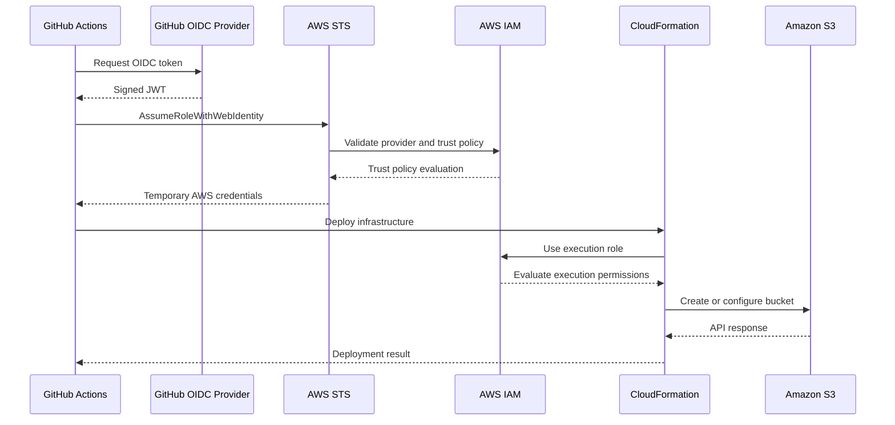
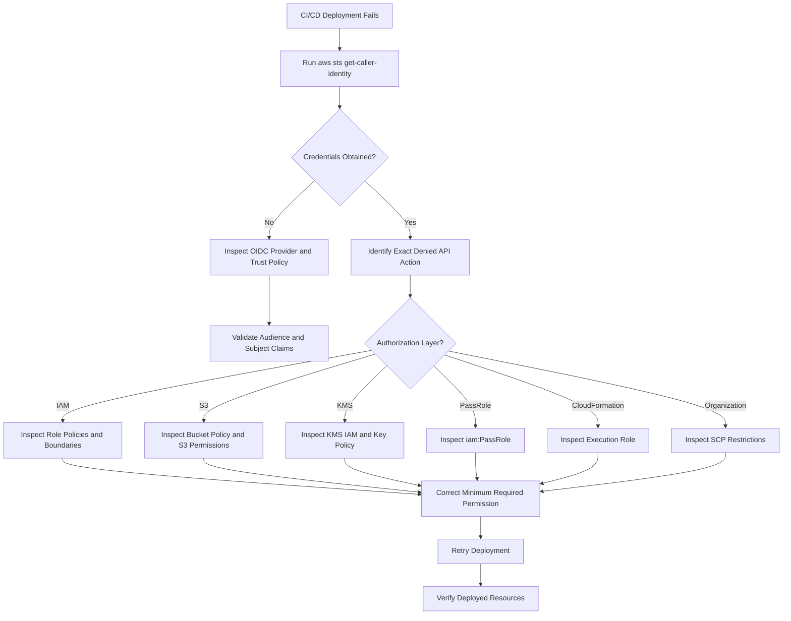
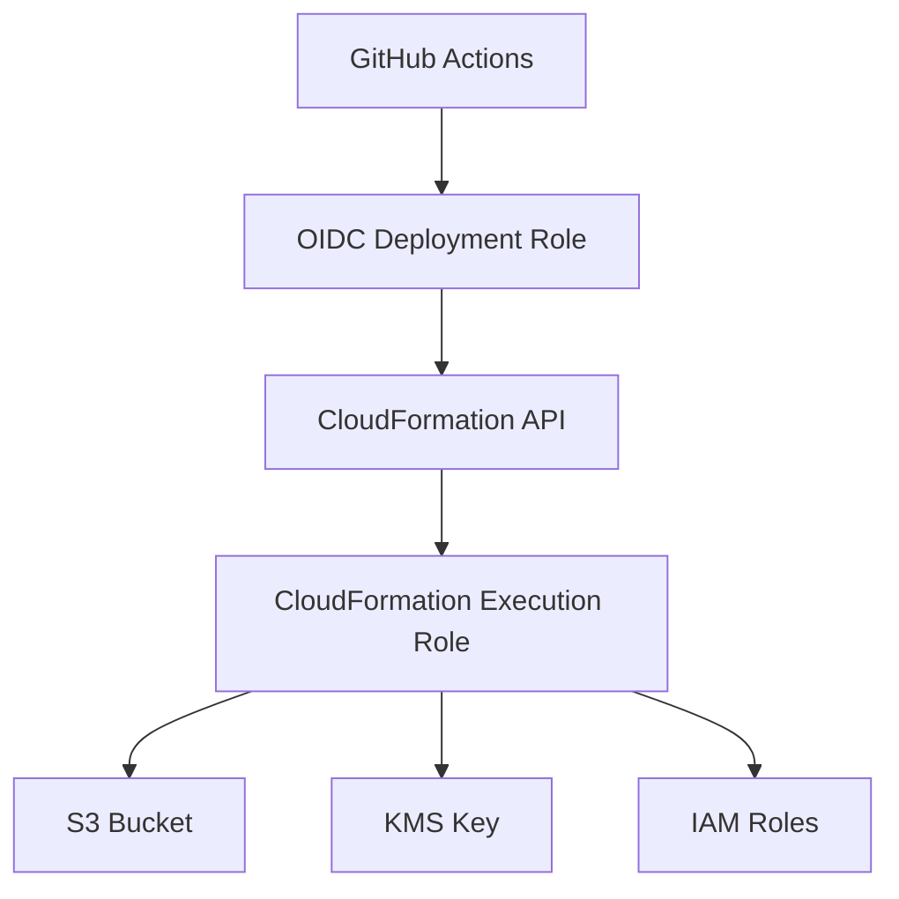
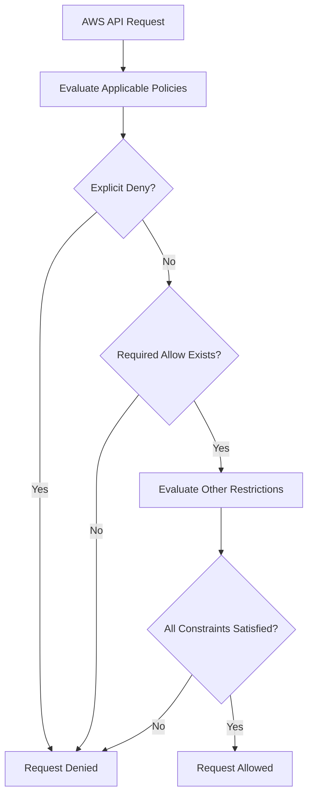

# 04- IAM and OIDC Pipeline Permission Errors

## Overview

IAM and OpenID Connect (OIDC) permission failures are common causes of Amazon S3 infrastructure deployment and CI/CD pipeline failures. They occur when a deployment workflow cannot authenticate with AWS, assume the intended IAM role, or perform the AWS API operations required to provision and configure resources.

Modern CI/CD pipelines should use OIDC federation to obtain temporary AWS credentials instead of storing long-lived access keys. However, successful authentication does not guarantee deployment authorization. A pipeline may successfully assume its deployment role and still fail when Terraform, CloudFormation, or AWS CDK attempts to create an S3 bucket, configure encryption, update a bucket policy, or pass an execution role to another AWS service.

The main authorization boundaries are:

- External identity provider authentication.
- IAM OIDC provider configuration.
- IAM role trust policy evaluation.
- STS temporary credential issuance.
- IAM identity-based permissions.
- Resource-based policies.
- CloudFormation execution-role permissions.
- KMS key authorization.
- AWS Organizations service control policies and permission boundaries.

The troubleshooting objective is to identify the exact failing authorization layer, establish the root cause, and correct the minimum required permission without weakening the deployment security model.

## OIDC Authentication Architecture

### How OIDC Federation Works

OpenID Connect allows an external identity provider to establish a trusted relationship with AWS IAM.

For GitHub Actions, the workflow requests a signed OIDC token from GitHub. AWS Security Token Service (STS) validates the token against the configured IAM OIDC provider and the target role's trust policy.

If validation succeeds, STS returns temporary AWS credentials to the workflow.



### Authentication and Authorization Boundaries

| Layer | Responsibility | Typical failure |
|---|---|---|
| External identity provider | Issues OIDC token | Token unavailable or invalid |
| IAM OIDC provider | Establishes trust with external issuer | Provider missing or misconfigured |
| IAM role trust policy | Determines who can assume the role | `AssumeRoleWithWebIdentity` denied |
| AWS STS | Exchanges token for temporary credentials | Invalid audience or subject |
| IAM role permissions | Authorizes AWS API operations | `AccessDenied` |
| CloudFormation execution role | Authorizes infrastructure provisioning | Resource creation denied |
| S3 bucket policy | Controls access to bucket resources | S3 authorization failure |
| KMS key policy | Controls cryptographic key usage | KMS authorization failure |
| AWS Organizations SCP | Restricts account permissions | Explicit organization-level deny |

A trust policy determines who can assume an IAM role. The role's permissions policies determine which AWS operations the assumed identity can perform.

These are separate responsibilities and must be investigated independently.

## Initial Diagnostic Workflow

### Identify the Failure Stage

Start with the exact error returned by the pipeline.

Common errors include:

```text
Not authorized to perform sts:AssumeRoleWithWebIdentity
```

```text
AccessDenied
```

```text
User is not authorized to perform iam:PassRole
```

```text
AccessDeniedException:
User is not authorized to perform s3:PutBucketPolicy
```

```text
AccessDeniedException:
User is not authorized to perform kms:GenerateDataKey
```

Do not treat these errors as interchangeable. The denied operation usually identifies the authorization boundary that needs investigation.

### Verify the Active AWS Identity

After configuring AWS credentials in the pipeline, execute:

```bash
aws sts get-caller-identity
```

Expected response structure:

```json
{
  "UserId": "AROAXXXXXXXXXXXXX:GitHubActions",
  "Account": "123456789012",
  "Arn": "arn:aws:sts::123456789012:assumed-role/GitHubS3DeploymentRole/GitHubActions"
}
```

Verify:

- AWS account ID is correct.
- Assumed role is the expected deployment role.
- Credentials belong to the intended CI/CD session.
- Deployment targets the correct account and environment.

If this command fails, investigate OIDC authentication and role assumption before examining S3 permissions.

### Map the Denied Operation to Its Authorization Layer

| Denied operation | Investigation area |
|---|---|
| `sts:AssumeRoleWithWebIdentity` | OIDC provider and trust policy |
| `s3:CreateBucket` | Deployment role permissions |
| `s3:PutBucketPolicy` | IAM permissions and bucket policy |
| `s3:PutEncryptionConfiguration` | S3 configuration permissions |
| `iam:PassRole` | Role delegation permissions |
| `kms:GenerateDataKey` | KMS IAM permissions and key policy |
| `cloudformation:CreateStack` | Deployment role permissions |
| `lambda:CreateFunction` | Lambda deployment permissions |

### Diagnostic Flow



## OIDC Provider Configuration Failures

### Symptoms

The pipeline cannot assume the intended IAM role.

Typical error:

```text
Not authorized to perform sts:AssumeRoleWithWebIdentity
```

### Likely Causes

- IAM OIDC provider does not exist.
- Provider URL is incorrect.
- Token audience does not match the provider configuration.
- IAM role references the wrong provider ARN.
- Provider client ID list does not contain the expected audience.
- External token issuer does not match the configured identity provider.

### Inspect Configured OIDC Providers

```bash
aws iam list-open-id-connect-providers
```

For GitHub Actions, the issuer is:

```text
https://token.actions.githubusercontent.com
```

Inspect the provider:

```bash
aws iam get-open-id-connect-provider \
  --open-id-connect-provider-arn \
  arn:aws:iam::123456789012:oidc-provider/token.actions.githubusercontent.com
```

Check:

- Provider URL.
- Client ID list.
- Thumbprint configuration, where applicable.

GitHub Actions normally uses the following audience:

```text
sts.amazonaws.com
```

### Verify the Provider ARN

The provider ARN must belong to the AWS account containing the deployment role.

Example:

```text
arn:aws:iam::123456789012:oidc-provider/token.actions.githubusercontent.com
```

The provider URL and ARN must correspond to the actual configured provider.

### Corrective Action

If the provider does not exist, create it:

```bash
aws iam create-open-id-connect-provider \
  --url https://token.actions.githubusercontent.com \
  --client-id-list sts.amazonaws.com
```

Provider thumbprint configuration may also be required depending on the API and provider configuration. Follow current AWS IAM requirements rather than copying an outdated thumbprint.

If the provider already exists, inspect and correct its configuration instead of creating duplicates.

### Prevention

- Use the exact issuer URL.
- Configure the expected audience.
- Maintain provider configuration through infrastructure as code.
- Validate the provider ARN before deploying IAM roles.
- Avoid creating duplicate providers for the same issuer in an account.

## IAM Trust Policy Failures

### Symptoms

The OIDC provider exists, but the workflow cannot assume the target role.

Example:

```text
AccessDenied:
Not authorized to perform sts:AssumeRoleWithWebIdentity
```

### Why Trust Policies Matter

An IAM role trust policy specifies which identities are permitted to assume the role.

For GitHub Actions, the policy should restrict:

- OIDC provider.
- Token audience.
- Repository identity.
- Branch, tag, or GitHub environment.

### Example Trust Policy

```json
{
  "Version": "2012-10-17",
  "Statement": [
    {
      "Effect": "Allow",
      "Principal": {
        "Federated": "arn:aws:iam::123456789012:oidc-provider/token.actions.githubusercontent.com"
      },
      "Action": "sts:AssumeRoleWithWebIdentity",
      "Condition": {
        "StringEquals": {
          "token.actions.githubusercontent.com:aud": "sts.amazonaws.com",
          "token.actions.githubusercontent.com:sub": "repo:company/s3-infrastructure:ref:refs/heads/main"
        }
      }
    }
  ]
}
```

Replace the account ID, organization, repository, and branch with the actual deployment identity.

### Subject Claim Mismatch

The `sub` claim identifies the workflow's repository context.

Common GitHub subject formats include:

| Workflow context | Subject claim |
|---|---|
| Branch | `repo:ORG/REPO:ref:refs/heads/BRANCH` |
| Tag | `repo:ORG/REPO:ref:refs/tags/TAG` |
| Pull request | `repo:ORG/REPO:pull_request` |
| GitHub environment | `repo:ORG/REPO:environment:ENVIRONMENT` |

A workflow configured with a GitHub environment uses an environment-based subject.

For example:

```text
repo:company/s3-infrastructure:environment:production
```

A trust policy expecting:

```text
repo:company/s3-infrastructure:ref:refs/heads/main
```

will not match that environment-based subject.

### Corrective Action

Inspect the workflow trigger and environment configuration.

Example:

```yaml
name: Deploy S3 Infrastructure

on:
  push:
    branches:
      - main

permissions:
  id-token: write
  contents: read

jobs:
  deploy:
    runs-on: ubuntu-latest
    environment: production

    steps:
      - name: Checkout
        uses: actions/checkout@v4

      - name: Configure AWS credentials
        uses: aws-actions/configure-aws-credentials@v4
        with:
          role-to-assume: arn:aws:iam::123456789012:role/GitHubS3DeploymentRole
          aws-region: ap-south-1

      - name: Verify AWS identity
        run: aws sts get-caller-identity
```

The trust policy must match the subject claim generated for the configured GitHub environment.

### Avoid Broad Trust Policies

Avoid unnecessarily broad conditions:

```json
{
  "StringLike": {
    "token.actions.githubusercontent.com:sub": "repo:company/*"
  }
}
```

This may permit unintended repositories to assume the deployment role.

Prefer explicit repository and environment restrictions.

### Prevention

- Match the trust policy to the actual workflow context.
- Restrict production access to approved repositories and environments.
- Use GitHub environment protection rules.
- Avoid broad wildcard subject conditions.
- Review trust policies whenever repository or workflow configuration changes.

## Invalid Audience Errors

### Symptoms

The pipeline reports an invalid audience or a mismatch between the OIDC token and IAM provider configuration.

### Likely Causes

- Workflow requests a token with an unexpected audience.
- IAM provider does not include the required client ID.
- Role trust policy expects another `aud` value.
- A custom audience was configured in the credential action but not in IAM.

### Isolation and Verification

Inspect the IAM provider:

```bash
aws iam get-open-id-connect-provider \
  --open-id-connect-provider-arn \
  arn:aws:iam::123456789012:oidc-provider/token.actions.githubusercontent.com
```

Review:

```text
ClientIDList
```

Inspect the credential configuration:

```yaml
- name: Configure AWS credentials
  uses: aws-actions/configure-aws-credentials@v4
  with:
    role-to-assume: arn:aws:iam::123456789012:role/GitHubS3DeploymentRole
    aws-region: ap-south-1
```

The default audience for this AWS integration is normally:

```text
sts.amazonaws.com
```

### Corrective Action

Ensure that:

- The IAM provider accepts the requested audience.
- The role trust policy checks the same audience.
- The workflow requests the expected audience.

Example trust policy condition:

```json
"StringEquals": {
  "token.actions.githubusercontent.com:aud": "sts.amazonaws.com"
}
```

### Prevention

Keep audience configuration consistent across the provider, trust policy, and workflow.

## Missing `id-token: write` Permission

### Symptoms

The workflow cannot request an OIDC token.

The credential action may report that it cannot obtain the GitHub Actions OIDC token.

### Likely Causes

- Workflow does not grant `id-token: write`.
- Job-level permissions override workflow-level permissions.
- Repository or organization settings restrict workflow permissions.
- The workflow runs in a context that does not support the expected token permissions.

### Corrective Action

Add explicit permissions:

```yaml
permissions:
  id-token: write
  contents: read
```

If the deployment job defines its own permissions, include the required permissions there:

```yaml
jobs:
  deploy:
    runs-on: ubuntu-latest

    permissions:
      id-token: write
      contents: read

    steps:
      - name: Checkout
        uses: actions/checkout@v4
```

GitHub Actions permissions can be overridden at job level. Inspect the effective job configuration rather than assuming workflow-level settings are sufficient.

### Prevention

- Declare minimal permissions explicitly.
- Grant `id-token: write` only to jobs requiring AWS federation.
- Avoid unnecessary repository write permissions.
- Review organization-level workflow restrictions.

## `iam:PassRole` Permission Failures

### Symptoms

The pipeline successfully assumes its deployment role but fails while creating or updating an AWS service resource.

Example:

```text
User is not authorized to perform:
iam:PassRole
```

### Why `iam:PassRole` Exists

Some AWS services require an IAM role to perform operations on behalf of the service.

Examples include:

- Lambda execution roles.
- S3 replication roles.
- CloudFormation execution roles.
- ECS task roles.
- Glue service roles.

The deployment identity may be allowed to create a resource, but AWS must also verify that it is allowed to pass the selected IAM role to the destination service.

### Isolation and Verification

Identify the role ARN referenced by the failed resource.

Example CloudFormation resource:

```yaml
Resources:
  ImageProcessor:
    Type: AWS::Lambda::Function
    Properties:
      Role: !GetAtt ImageProcessorExecutionRole.Arn
```

The deployment role may require `iam:PassRole` for the referenced execution role.

### Corrective Action

Use a narrowly scoped policy:

```json
{
  "Version": "2012-10-17",
  "Statement": [
    {
      "Sid": "PassImageProcessorRole",
      "Effect": "Allow",
      "Action": "iam:PassRole",
      "Resource": "arn:aws:iam::123456789012:role/S3ImageProcessorExecutionRole",
      "Condition": {
        "StringEquals": {
          "iam:PassedToService": "lambda.amazonaws.com"
        }
      }
    }
  ]
}
```

For a CloudFormation execution role, the destination service is:

```text
cloudformation.amazonaws.com
```

Use the service principal appropriate to the role being passed.

Do not grant unrestricted `iam:PassRole` permissions across the account.

### Prevention

- Scope `iam:PassRole` to specific role ARNs.
- Restrict the destination service using `iam:PassedToService`.
- Separate deployment roles from runtime execution roles.
- Review role delegation whenever a new AWS service is introduced.

## S3 Permission Failures

### Symptoms

OIDC authentication succeeds, but infrastructure deployment fails during S3 resource creation or configuration.

Examples:

```text
AccessDenied: s3:CreateBucket
```

```text
AccessDenied: s3:PutBucketPolicy
```

```text
AccessDenied: s3:PutEncryptionConfiguration
```

### Likely Causes

- Deployment role lacks the required S3 action.
- Resource ARN is incorrect.
- Bucket-level and object-level permissions are confused.
- Explicit deny exists in a bucket policy.
- AWS Organizations SCP blocks the operation.
- Permission boundary restricts the action.

### Identify the Required Permission

| Operation | Example IAM action |
|---|---|
| Create bucket | `s3:CreateBucket` |
| Configure bucket policy | `s3:PutBucketPolicy` |
| Read bucket policy | `s3:GetBucketPolicy` |
| Configure versioning | `s3:PutBucketVersioning` |
| Configure encryption | `s3:PutEncryptionConfiguration` |
| Configure lifecycle | `s3:PutLifecycleConfiguration` |
| Configure notifications | `s3:PutBucketNotification` |
| Upload object | `s3:PutObject` |
| Read object | `s3:GetObject` |
| Delete object | `s3:DeleteObject` |

Bucket-level and object-level actions require different resource ARNs.

### Example S3 Deployment Policy

For a deployment role managing an existing bucket:

```json
{
  "Version": "2012-10-17",
  "Statement": [
    {
      "Sid": "ManageAssetsBucketConfiguration",
      "Effect": "Allow",
      "Action": [
        "s3:GetBucketLocation",
        "s3:GetBucketPolicy",
        "s3:PutBucketPolicy",
        "s3:GetBucketVersioning",
        "s3:PutBucketVersioning",
        "s3:GetEncryptionConfiguration",
        "s3:PutEncryptionConfiguration",
        "s3:GetLifecycleConfiguration",
        "s3:PutLifecycleConfiguration"
      ],
      "Resource": "arn:aws:s3:::company-production-assets"
    },
    {
      "Sid": "ManageAssetsObjects",
      "Effect": "Allow",
      "Action": [
        "s3:GetObject",
        "s3:PutObject",
        "s3:DeleteObject"
      ],
      "Resource": "arn:aws:s3:::company-production-assets/*"
    }
  ]
}
```

This is an illustrative policy for a particular bucket-management workload, not a universal CloudFormation deployment policy.

Creating a bucket with a specific name may require permissions that cannot be restricted to the ARN of a bucket that does not yet exist. Validate resource scoping against the IAM requirements of each operation.

### Corrective Action

1. Identify the exact denied action.
2. Determine whether it is a bucket-level or object-level operation.
3. Verify the resource ARN.
4. Inspect identity policies and bucket policies.
5. Check explicit denies and organization restrictions.
6. Add only the required permission.

## KMS Permission Failures

### Symptoms

S3 deployment or object operations fail with errors such as:

```text
AccessDeniedException:
not authorized to perform kms:GenerateDataKey
```

```text
AccessDeniedException:
not authorized to perform kms:Decrypt
```

### Why KMS Requires Separate Authorization

An S3 operation using SSE-KMS can require authorization at two layers:

1. S3 authorizes access to the bucket or object.
2. AWS KMS authorizes the cryptographic operation.

An IAM policy granting `s3:PutObject` does not automatically grant permission to use a customer-managed KMS key.

### Identify Required KMS Permissions

| Operation | Common KMS permission |
|---|---|
| Encrypt object data using SSE-KMS | `kms:GenerateDataKey` |
| Decrypt object data | `kms:Decrypt` |
| Multipart SSE-KMS upload | `kms:GenerateDataKey` and applicable decrypt permissions |
| Read encrypted object | `kms:Decrypt` |

Exact permissions depend on the operation, encryption configuration, and key policy.

### Isolation and Verification

Inspect bucket encryption:

```bash
aws s3api get-bucket-encryption \
  --bucket company-production-assets
```

Inspect the KMS key:

```bash
aws kms describe-key \
  --key-id arn:aws:kms:ap-south-1:123456789012:key/KEY-ID
```

Inspect its key policy:

```bash
aws kms get-key-policy \
  --key-id KEY-ID \
  --policy-name default
```

### Corrective Action

Example IAM permissions:

```json
{
  "Version": "2012-10-17",
  "Statement": [
    {
      "Sid": "UseAssetsEncryptionKey",
      "Effect": "Allow",
      "Action": [
        "kms:GenerateDataKey",
        "kms:Decrypt"
      ],
      "Resource": "arn:aws:kms:ap-south-1:123456789012:key/KEY-ID"
    }
  ]
}
```

The KMS key policy must also permit the principal or enable IAM policies to grant the required access.

For cross-account encryption, verify both:

- IAM permissions in the caller's account.
- Key policy permissions in the account owning the KMS key.

### Prevention

- Validate KMS permissions before deployment.
- Use the intended key ARN and Region.
- Review key policies and grants.
- Separate deployment and runtime encryption permissions.
- Avoid wildcard access to all KMS keys.

## CloudFormation Execution Role Permission Failures

### Symptoms

The CI/CD workflow successfully assumes its OIDC role and starts a CloudFormation deployment, but CloudFormation fails while creating an S3 bucket or related resources.

### Why This Happens

CloudFormation can use a dedicated execution role to provision resources.

There are two distinct IAM identities:

- **CI/CD deployment role:** Initiates the CloudFormation operation.
- **CloudFormation execution role:** Performs resource provisioning.

Permissions granted to the deployment role do not automatically become permissions of the execution role.

### Example Architecture



### Isolation and Verification

Inspect the stack execution role:

```bash
aws cloudformation describe-stacks \
  --stack-name s3-production \
  --query 'Stacks[0].RoleARN' \
  --output text
```

Verify the pipeline identity:

```bash
aws sts get-caller-identity
```

If a CloudFormation execution role is configured, inspect its attached and inline policies separately.

### Corrective Action

The deployment role needs permission to use CloudFormation and, where applicable, pass the execution role.

The execution role needs the permissions required to provision the resources in the template.

Example deployment-role permissions:

```json
{
  "Version": "2012-10-17",
  "Statement": [
    {
      "Effect": "Allow",
      "Action": [
        "cloudformation:CreateStack",
        "cloudformation:UpdateStack",
        "cloudformation:DescribeStacks",
        "cloudformation:DescribeStackEvents",
        "cloudformation:CreateChangeSet",
        "cloudformation:DescribeChangeSet",
        "cloudformation:ExecuteChangeSet"
      ],
      "Resource": "*"
    },
    {
      "Effect": "Allow",
      "Action": "iam:PassRole",
      "Resource": "arn:aws:iam::123456789012:role/CloudFormationExecutionRole",
      "Condition": {
        "StringEquals": {
          "iam:PassedToService": "cloudformation.amazonaws.com"
        }
      }
    }
  ]
}
```

The CloudFormation execution role requires a separate resource-specific policy.

For production, scope CloudFormation permissions to the intended stacks and execution role wherever supported by the relevant API actions.

### Prevention

- Use a dedicated CloudFormation execution role.
- Separate deployment and provisioning permissions.
- Restrict role passing.
- Review both roles during permission investigations.
- Ensure execution-role permissions remain available during rollback.

## Terraform Pipeline Permission Failures

### Symptoms

Terraform initializes successfully but fails during planning or applying.

Examples:

```text
Error: creating S3 Bucket:
AccessDenied
```

```text
Error: retrieving AWS account details:
InvalidClientTokenId
```

```text
Error: AccessDenied when calling AssumeRoleWithWebIdentity
```

### Likely Causes

- OIDC role assumption failed.
- Terraform provider uses an unexpected credential source.
- Deployment role lacks resource permissions.
- Remote state backend permissions are missing.
- KMS permissions are missing for encrypted state.
- Terraform is using a different role than the intended CI/CD identity.

### Isolation and Verification

Check the AWS identity before Terraform:

```bash
aws sts get-caller-identity
```

Inspect the provider configuration:

```hcl
provider "aws" {
  region = var.aws_region
}
```

Prefer the standard AWS credential chain rather than hardcoding credentials in provider configuration.

Inspect the backend configuration and verify that the deployment identity can access:

- State bucket.
- State object prefix.
- State lockfile, when enabled.
- KMS key, if state encryption uses a customer-managed key.

### Corrective Action

Ensure the workflow configures credentials before Terraform commands:

```yaml
- name: Configure AWS credentials
  uses: aws-actions/configure-aws-credentials@v4
  with:
    role-to-assume: arn:aws:iam::123456789012:role/GitHubS3DeploymentRole
    aws-region: ap-south-1

- name: Verify identity
  run: aws sts get-caller-identity

- name: Terraform initialization
  run: terraform init

- name: Terraform validation
  run: terraform validate

- name: Terraform plan
  run: terraform plan
```

Do not assume Terraform resource permissions and backend permissions are identical.

### Prevention

- Validate identity before Terraform execution.
- Keep backend and provider permissions explicit.
- Use short-lived credentials.
- Avoid access keys in GitHub secrets.
- Use separate deployment roles for different environments.
- Keep remote state permissions narrowly scoped.

## GitHub Actions OIDC Deployment Configuration

### Recommended Workflow

A production-oriented workflow should use explicit permissions and short-lived credentials.

```yaml
name: Deploy S3 Infrastructure

on:
  push:
    branches:
      - main

permissions:
  contents: read

jobs:
  deploy:
    runs-on: ubuntu-latest
    environment: production

    permissions:
      id-token: write
      contents: read

    steps:
      - name: Checkout repository
        uses: actions/checkout@v4

      - name: Configure AWS credentials
        uses: aws-actions/configure-aws-credentials@v4
        with:
          role-to-assume: arn:aws:iam::123456789012:role/GitHubS3DeploymentRole
          aws-region: ap-south-1

      - name: Verify AWS identity
        run: aws sts get-caller-identity

      - name: Validate CloudFormation template
        run: |
          aws cloudformation validate-template \
            --template-body file://templates/s3-template.yaml

      - name: Deploy infrastructure
        run: |
          aws cloudformation deploy \
            --template-file templates/s3-template.yaml \
            --stack-name s3-production \
            --capabilities CAPABILITY_NAMED_IAM
```

The example assumes the template requires named IAM capabilities. Include only the capabilities actually required by the template.

For production, separate validation, change-set review, approval, and deployment into distinct pipeline stages.

### Security Considerations

- Pin third-party actions to reviewed commit SHAs in high-assurance pipelines.
- Restrict the deployment role trust policy to the intended repository and environment.
- Use GitHub environment approval rules for production.
- Avoid exposing OIDC tokens or temporary credentials in logs.
- Never print credential environment variables.
- Do not grant `id-token: write` to unrelated jobs.

## AWS Organizations SCP and Permission Boundary Restrictions

### Symptoms

The IAM role policy explicitly allows an action, but AWS still returns:

```text
AccessDenied
```

### Likely Causes

- Service control policy explicitly denies the action.
- Permission boundary does not allow the action.
- Session policy restricts the assumed role.
- Resource policy imposes an additional restriction.
- An explicit deny exists in another applicable policy.

### Isolation and Verification

Inspect the role:

```bash
aws iam get-role \
  --role-name GitHubS3DeploymentRole
```

Review:

- `PermissionsBoundary`
- Attached policies.
- Inline policies.
- Trust policy.

For organization-managed accounts, ask the AWS Organizations administrator to inspect applicable SCPs.

An IAM administrator in a member account may not have permission to inspect or modify organization-level policies.

### Policy Evaluation Principle

An explicit deny overrides an allow.



### Corrective Action

Identify the policy imposing the restriction and request a targeted policy change through the appropriate account or organization administrator.

Do not attempt to bypass organization controls by creating another IAM role with broader permissions.

### Prevention

- Include organization policy restrictions in deployment design.
- Validate permission boundaries before rollout.
- Maintain a documented deployment-role permission model.
- Coordinate infrastructure changes with the AWS organization owner.

## Presigned URL and Application Runtime Permission Errors

### Symptoms

Infrastructure deployment succeeds, but application operations against S3 fail.

Examples:

```text
AccessDenied
```

```text
SignatureDoesNotMatch
```

```text
AccessDeniedException:
kms:Decrypt
```

### Likely Causes

- Runtime role lacks S3 permissions.
- Application uses the deployment role instead of its runtime role.
- Presigned URL is signed with credentials that cannot access the object.
- URL has expired.
- Request method or headers differ from the signed request.
- KMS permissions are missing.
- Bucket policy restricts the request.

### Distinguish Deployment and Runtime Identities

A deployment pipeline and a running FastAPI or Django service should normally use different IAM roles.

| Identity | Responsibility |
|---|---|
| GitHub OIDC deployment role | Provision infrastructure and deploy releases |
| CloudFormation execution role | Create and update AWS resources |
| ECS task role | Access S3 from an ECS application |
| EKS workload role | Access S3 from a Kubernetes workload |
| Lambda execution role | Access S3 from a Lambda function |

### Corrective Action

Grant the application runtime role only the permissions required by its workload.

Example:

```json
{
  "Version": "2012-10-17",
  "Statement": [
    {
      "Sid": "ReadAndWriteApplicationObjects",
      "Effect": "Allow",
      "Action": [
        "s3:GetObject",
        "s3:PutObject"
      ],
      "Resource": "arn:aws:s3:::company-production-assets/uploads/*"
    },
    {
      "Sid": "ListApplicationPrefix",
      "Effect": "Allow",
      "Action": "s3:ListBucket",
      "Resource": "arn:aws:s3:::company-production-assets",
      "Condition": {
        "StringLike": {
          "s3:prefix": [
            "uploads/*",
            "uploads"
          ]
        }
      }
    }
  ]
}
```

If SSE-KMS is used, add the required KMS permissions and verify the key policy.

### Prevention

- Separate deployment and runtime roles.
- Use workload identity for applications.
- Avoid sharing CI/CD credentials with application containers.
- Validate presigned URL method, headers, expiration, and signing identity.
- Test S3 access using the actual runtime role.

## Diagnostic Commands Reference

| Objective | Command |
|---|---|
| Verify active AWS identity | `aws sts get-caller-identity` |
| List OIDC providers | `aws iam list-open-id-connect-providers` |
| Inspect OIDC provider | `aws iam get-open-id-connect-provider --open-id-connect-provider-arn ARN` |
| Inspect IAM role | `aws iam get-role --role-name ROLE_NAME` |
| List attached policies | `aws iam list-attached-role-policies --role-name ROLE_NAME` |
| List inline policies | `aws iam list-role-policies --role-name ROLE_NAME` |
| Read inline policy | `aws iam get-role-policy --role-name ROLE_NAME --policy-name POLICY_NAME` |
| Inspect stack execution role | `aws cloudformation describe-stacks --stack-name STACK_NAME --query 'Stacks[0].RoleARN'` |
| Inspect stack failures | `aws cloudformation describe-stack-events --stack-name STACK_NAME` |
| Inspect bucket policy | `aws s3api get-bucket-policy --bucket BUCKET_NAME` |
| Inspect bucket encryption | `aws s3api get-bucket-encryption --bucket BUCKET_NAME` |
| Inspect KMS key | `aws kms describe-key --key-id KEY_ID` |
| Inspect KMS key policy | `aws kms get-key-policy --key-id KEY_ID --policy-name default` |

Run diagnostic commands using an identity authorized to inspect the corresponding resources. A diagnostic command returning `AccessDenied` may indicate insufficient inspection permissions rather than the absence of the resource.

## Regression Testing

Permission changes should be tested before being promoted to production.

### OIDC Validation

- [ ] OIDC provider exists.
- [ ] Provider issuer is correct.
- [ ] Audience matches `sts.amazonaws.com`.
- [ ] Trust policy references the correct provider.
- [ ] Subject matches the repository and workflow environment.
- [ ] Workflow has `id-token: write`.
- [ ] Unauthorized branches and repositories cannot assume the role.

### IAM Validation

- [ ] Deployment role has required CloudFormation or Terraform permissions.
- [ ] CloudFormation execution role has required resource permissions.
- [ ] `iam:PassRole` is scoped to approved role ARNs.
- [ ] Runtime roles are separate from deployment roles.
- [ ] Permission boundaries and SCP restrictions are understood.
- [ ] Unnecessary administrator permissions are absent.

### S3 and KMS Validation

- [ ] Bucket configuration permissions are sufficient.
- [ ] Bucket and object resource ARNs are correctly scoped.
- [ ] Bucket policies do not unintentionally deny deployment operations.
- [ ] KMS key policies permit required encryption operations.
- [ ] Cross-account access is explicitly configured where needed.
- [ ] Runtime application access is tested independently.

### Pipeline Validation

- [ ] AWS identity is verified before deployment.
- [ ] Credentials are temporary.
- [ ] Deployment role is restricted to the intended environment.
- [ ] Production deployment requires appropriate approval.
- [ ] Deployment failures preserve useful diagnostic logs.
- [ ] Credentials and OIDC tokens are not written to logs.

## Common Mistakes

| Mistake | Why it fails | Correct approach |
|---|---|---|
| Assuming OIDC trust policy grants S3 access | Trust policies only control role assumption | Configure separate role permissions |
| Granting permissions only to the CI/CD role | CloudFormation may use another execution role | Inspect and configure both identities |
| Ignoring the `sub` claim | Repository or environment does not match | Match the actual token subject |
| Omitting `id-token: write` | GitHub cannot request the OIDC token | Grant permission to the deployment job |
| Using broad repository wildcards | Unintended repositories may assume the role | Restrict repository and environment claims |
| Granting unrestricted `iam:PassRole` | Deployment can delegate excessive privileges | Restrict role ARNs and destination services |
| Adding `s3:*` to fix every error | Hides the real permission gap and increases risk | Identify the denied API action |
| Ignoring KMS key policies | IAM allow alone may not authorize key usage | Validate IAM and key policy together |
| Assuming IAM allow overrides SCP restrictions | Organization-level explicit denies still apply | Inspect applicable organization policies |
| Sharing deployment credentials with applications | Expands the impact of credential compromise | Use separate workload roles |
| Printing environment variables during debugging | Can expose temporary credentials | Use safe identity and diagnostic commands |
| Treating successful role assumption as deployment success | Subsequent resource operations may still be denied | Validate each authorization layer |

## Key Takeaways

- OIDC authentication, IAM role trust, AWS API authorization, and resource-level permissions are separate security layers.
- Successful `sts:AssumeRoleWithWebIdentity` does not guarantee that Terraform or CloudFormation can provision S3 resources.
- Diagnose `iam:PassRole`, S3, KMS, CloudFormation execution-role, permission-boundary, and SCP failures independently.
- Use short-lived credentials, narrowly scoped trust policies, separate deployment and runtime roles, and least-privilege permissions.
- Verify the actual AWS identity and test the complete deployment workflow before promoting permission changes to production.