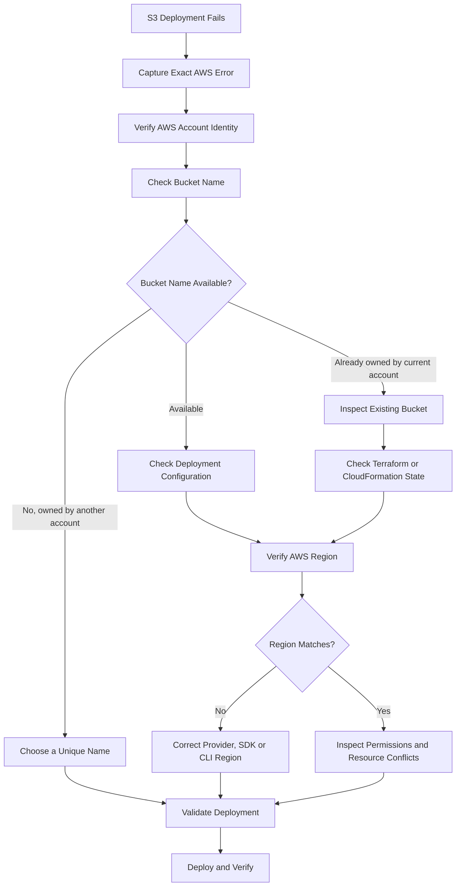
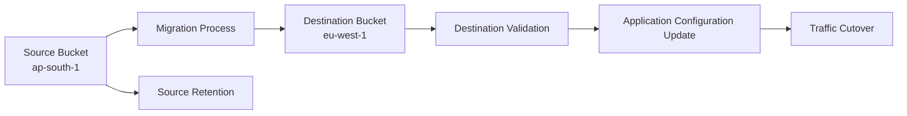

# 05- S3 Bucket Name and Region Conflicts

## Overview

Amazon S3 bucket naming and Region configuration errors are common causes of infrastructure deployment failures. They frequently occur when provisioning buckets through Terraform, CloudFormation, AWS CDK, or CI/CD pipelines.

Unlike many AWS resources, general-purpose S3 bucket names are globally unique within an AWS partition. A bucket name cannot be reused by another account while it remains allocated. A deployment can therefore fail even when the IAM role has sufficient permissions and the infrastructure template is valid.

Region mismatches introduce another category of failures. An application, SDK, CLI command, or infrastructure provider may target a Region different from the bucket's actual Region. This can result in redirects, authorization errors, signature mismatches, or failed resource configuration operations.

This document provides a diagnostic workflow for:

- Globally conflicting bucket names.
- Buckets already owned by the deployment account.
- Incorrect AWS Regions.
- Terraform and CloudFormation resource conflicts.
- Environment-specific naming collisions.
- Cross-account bucket ownership confusion.
- Incorrect endpoint and SDK configuration.
- Bucket recreation and deletion-related conflicts.

## S3 Bucket Naming and Region Behavior

### Global Bucket Name Uniqueness

General-purpose S3 bucket names are globally unique within an AWS partition.

For example, the following name can belong to only one account at a time:

```text
company-production-assets
```

If another AWS account already owns this name, creating a bucket with the same name fails.

Typical error:

```text
BucketAlreadyExists
```

This is different from:

```text
BucketAlreadyOwnedByYou
```

The distinction is important because the corrective action differs.

| Error | Meaning | Typical response |
|---|---|---|
| `BucketAlreadyExists` | Another account owns the bucket name | Choose another name or investigate an existing shared resource |
| `BucketAlreadyOwnedByYou` | The current account already owns the bucket | Inspect and manage the existing bucket |
| `NoSuchBucket` | The requested bucket does not exist or is not accessible through the attempted operation | Verify name, account, Region, and permissions |
| `IllegalLocationConstraintException` | Bucket creation request has an inconsistent Region configuration | Correct the creation Region and location constraint |
| `PermanentRedirect` | Request is directed to an incorrect endpoint | Use the bucket's actual Region endpoint |
| `AuthorizationHeaderMalformed` | Request signing or Region information is inconsistent | Correct the signing Region and credentials |

### Bucket Names Are Not Region-Specific

A general-purpose bucket name is globally unique, not independently unique in each Region.

You cannot create:

```text
company-assets
```

in `ap-south-1` and create another bucket with the same name in `eu-west-1`.

If the application requires separate buckets in multiple Regions, use distinct names:

```text
company-assets-ap-south-1
company-assets-eu-west-1
```

This is especially important for:

- Multi-Region deployments.
- Disaster recovery environments.
- Development, staging, and production accounts.
- Cross-account storage architectures.
- Terraform workspaces and reusable infrastructure modules.

### Bucket Name and ARN Structure

A bucket ARN follows this format:

```text
arn:aws:s3:::bucket-name
```

An object ARN follows this format:

```text
arn:aws:s3:::bucket-name/object-key
```

For example:

```text
arn:aws:s3:::company-production-assets
arn:aws:s3:::company-production-assets/uploads/*
```

The bucket ARN does not contain the Region or account ID.

This is an important distinction when configuring IAM policies and bucket policies. A bucket's ownership and Region must be determined separately.

### Bucket Region and Endpoint

Every bucket belongs to a specific AWS Region.

For example:

```text
Bucket: company-production-assets
Region: ap-south-1
```

A request should use the correct regional endpoint and signing Region.

The AWS SDK normally discovers and applies the appropriate endpoint when configured with the correct Region. Manually constructing endpoints or using an incorrect Region can cause request failures.

## Diagnostic Workflow

Use a consistent diagnostic process before changing infrastructure.



### Verify the AWS Account

Always confirm the active identity before diagnosing bucket ownership.

```bash
aws sts get-caller-identity
```

Example:

```json
{
  "UserId": "AROAXXXXXXXXXXXXX:DeploymentSession",
  "Account": "123456789012",
  "Arn": "arn:aws:sts::123456789012:assumed-role/S3DeploymentRole/DeploymentSession"
}
```

Verify:

- The account ID is the intended deployment account.
- The assumed role is correct.
- The pipeline is not using credentials from another environment.
- The deployment target matches the intended AWS account.

A bucket that appears to be missing may simply belong to another account.

### Verify the Bucket Name

Inspect the bucket name configured in the deployment files.

Terraform:

```hcl
resource "aws_s3_bucket" "assets" {
  bucket = var.bucket_name
}
```

CloudFormation:

```yaml
Resources:
  AssetsBucket:
    Type: AWS::S3::Bucket
    Properties:
      BucketName: company-production-assets
```

Check for:

- Incorrect environment suffixes.
- Missing account or application identifiers.
- Hardcoded names reused across environments.
- Differences between local, staging, and production configuration.
- Existing resources created outside infrastructure as code.

### Check Whether the Bucket Already Exists

Use:

```bash
aws s3api head-bucket \
  --bucket company-production-assets
```

Interpret the result carefully.

- A successful response indicates that the request can access the bucket.
- A `404` response may indicate that the bucket does not exist.
- A `403` response may indicate insufficient permissions or that the bucket exists but is not accessible to the caller.
- Other errors must be interpreted using the response details and caller identity.

`HeadBucket` is not a reliable way to prove that a bucket name is globally available. A failed request does not conclusively establish that the bucket is absent.

If the bucket is already owned by the current account, inspect it using:

```bash
aws s3api list-buckets \
  --query 'Buckets[].Name' \
  --output table
```

Then inspect its Region:

```bash
aws s3api get-bucket-location \
  --bucket company-production-assets
```

A `null` location constraint in the API response represents `us-east-1`.

## BucketAlreadyExists

### Symptoms

Terraform, CloudFormation, CDK, or an application deployment fails with:

```text
BucketAlreadyExists
```

Example Terraform error:

```text
Error: creating S3 Bucket:
BucketAlreadyExists:
The requested bucket name is not available.
```

### Likely Causes

- Another AWS account owns the requested name.
- A previous project already allocated the name.
- Different teams independently selected the same global name.
- An environment suffix was omitted.
- A hardcoded bucket name is reused across multiple accounts.

### Isolation and Verification

Verify the active account:

```bash
aws sts get-caller-identity
```

Inspect the configured name:

```bash
grep -R "bucket" terraform/
```

For a known candidate bucket, attempt an authorized inspection:

```bash
aws s3api head-bucket \
  --bucket company-production-assets
```

Do not interpret an authorization failure as proof that the bucket name is available.

If the name is already owned by another account, the deployment account cannot create another general-purpose bucket with that name.

### Corrective Action

Choose a globally unique name.

For example:

```text
company-assets-production-123456789012-ap-south-1
```

The account ID and Region make accidental collisions less likely and make ownership easier to identify.

A practical naming convention:

```text
<organization>-<application>-<environment>-<account-id>-<region>
```

Examples:

```text
acme-api-dev-123456789012-ap-south-1
acme-api-staging-123456789012-ap-south-1
acme-api-production-123456789012-ap-south-1
```

Keep names within S3's bucket naming constraints and avoid personally identifiable information or sensitive business data in resource names.

### Prevention

- Use centrally defined naming conventions.
- Generate environment-specific names.
- Include account identifiers where appropriate.
- Avoid hardcoded bucket names in reusable modules.
- Check resource ownership before provisioning existing infrastructure.
- Keep bucket names stable after production deployment.

## BucketAlreadyOwnedByYou

### Symptoms

Deployment fails with:

```text
BucketAlreadyOwnedByYou
```

This means the current AWS account already owns the requested bucket name.

It commonly occurs when a pipeline attempts to create a bucket that was previously created manually or by another deployment process.

### Likely Causes

- The bucket already exists in the account.
- Terraform state does not contain the existing bucket.
- A previous CloudFormation stack created the bucket.
- A manual deployment created the resource.
- A deployment was partially completed.
- Multiple infrastructure tools attempt to manage the same bucket.

### Isolation and Verification

Verify the account:

```bash
aws sts get-caller-identity
```

Check bucket existence:

```bash
aws s3api head-bucket \
  --bucket company-production-assets
```

Inspect the bucket Region:

```bash
aws s3api get-bucket-location \
  --bucket company-production-assets
```

Inspect existing CloudFormation stacks:

```bash
aws cloudformation list-stacks \
  --stack-status-filter CREATE_COMPLETE UPDATE_COMPLETE
```

Inspect Terraform state:

```bash
terraform state list
```

A resource absent from Terraform state is not necessarily absent from AWS.

### Corrective Action

Choose the appropriate ownership strategy.

| Situation | Corrective action |
|---|---|
| Existing bucket should be managed by Terraform | Import it into Terraform state |
| Existing bucket belongs to CloudFormation | Update the owning stack |
| Bucket is intentionally shared | Reference it as an existing resource |
| Bucket is obsolete and approved for removal | Follow a controlled deletion procedure |
| Another infrastructure tool owns it | Avoid competing ownership |

### Terraform Import

For an existing bucket that Terraform should manage:

```bash
terraform import \
  aws_s3_bucket.assets \
  company-production-assets
```

After importing, inspect the state:

```bash
terraform state show aws_s3_bucket.assets
```

Review the configuration and plan:

```bash
terraform plan
```

Importing the bucket does not automatically import every separately managed S3 configuration resource. Versioning, lifecycle, encryption, logging, policies, and other configurations may require their own Terraform resource imports.

Do not apply a plan until the configuration accurately represents the existing resource and its intended ownership.

### Reference an Existing Bucket

If another team owns the bucket, do not create a duplicate resource.

Terraform can reference an existing bucket:

```hcl
data "aws_s3_bucket" "shared_assets" {
  bucket = var.shared_bucket_name
}
```

Use its attributes where needed:

```hcl
output "shared_bucket_arn" {
  value = data.aws_s3_bucket.shared_assets.arn
}
```

This avoids creating a second infrastructure owner for the same bucket.

## Incorrect Region Configuration

### Symptoms

Deployment or application requests fail with errors such as:

```text
IllegalLocationConstraintException
```

```text
PermanentRedirect
```

```text
AuthorizationHeaderMalformed
```

```text
The authorization header is malformed;
the region is wrong.
```

### Likely Causes

- Terraform provider uses the wrong Region.
- AWS CLI default Region is incorrect.
- Boto3 client uses another Region.
- Bucket creation request contains an inconsistent location constraint.
- CloudFormation deployment targets a different Region.
- A manually constructed S3 endpoint is incorrect.
- Application environment variables override the intended Region.

### Isolation and Verification

Inspect the active AWS CLI Region:

```bash
aws configure get region
```

Check the environment:

```bash
echo "$AWS_REGION"
echo "$AWS_DEFAULT_REGION"
```

Verify the actual bucket Region:

```bash
aws s3api get-bucket-location \
  --bucket company-production-assets
```

For `us-east-1`, the API can return:

```json
{
  "LocationConstraint": null
}
```

For another Region, it returns its Region identifier.

Example:

```json
{
  "LocationConstraint": "ap-south-1"
}
```

### Corrective Action

Set the correct Region explicitly.

AWS CLI:

```bash
aws s3api get-bucket-location \
  --bucket company-production-assets \
  --region ap-south-1
```

Terraform:

```hcl
provider "aws" {
  region = var.aws_region
}
```

Environment configuration:

```hcl
variable "aws_region" {
  description = "AWS Region for the deployment"
  type        = string
  default     = "ap-south-1"
}
```

CloudFormation deployment:

```bash
aws cloudformation deploy \
  --template-file s3-template.yaml \
  --stack-name s3-production \
  --region ap-south-1
```

The Region used for a CloudFormation stack and the Region used for its S3 resources must be intentionally configured. A bucket cannot be moved to another Region by updating a Region property.

### Prevention

- Define the Region once per environment.
- Pass it consistently to AWS CLI, Terraform, SDKs, and deployment workflows.
- Avoid manually constructing S3 endpoints.
- Verify bucket Region before running destructive or configuration-changing operations.
- Keep account and Region selection explicit in CI/CD.

## IllegalLocationConstraintException

### Symptoms

Bucket creation fails with:

```text
IllegalLocationConstraintException
```

This frequently occurs when the bucket creation endpoint and the requested bucket location do not match.

### Example of Incorrect Configuration

A request is sent to one Region while specifying a different Region in the location constraint.

For example, the deployment targets `us-east-1` but requests:

```json
{
  "LocationConstraint": "ap-south-1"
}
```

### Corrective Action

Create the bucket through its intended regional endpoint.

For `ap-south-1`:

```bash
aws s3api create-bucket \
  --bucket company-assets-production-123456789012-ap-south-1 \
  --region ap-south-1 \
  --create-bucket-configuration LocationConstraint=ap-south-1
```

For `us-east-1`, omit the location constraint:

```bash
aws s3api create-bucket \
  --bucket company-assets-production-123456789012-us-east-1 \
  --region us-east-1
```

### Prevention

Keep the following values consistent:

- Deployment Region.
- S3 bucket creation endpoint.
- `LocationConstraint`.
- Terraform provider Region.
- SDK client Region.

## PermanentRedirect and Endpoint Mismatches

### Symptoms

An application or AWS CLI request returns:

```text
PermanentRedirect
```

or an error indicating that the request must use another endpoint.

### Likely Causes

- Client is configured with the wrong Region.
- Application uses an outdated endpoint.
- Bucket was created in another Region.
- Custom endpoint configuration overrides SDK defaults.
- A proxy or service configuration rewrites the destination.

### Isolation and Verification

Determine the actual bucket Region:

```bash
aws s3api get-bucket-location \
  --bucket company-production-assets
```

Inspect the application configuration.

Python with Boto3:

```python
import boto3

session = boto3.Session()

s3 = session.client(
    "s3",
    region_name="ap-south-1",
)

response = s3.get_bucket_location(
    Bucket="company-production-assets"
)

print(response["LocationConstraint"])
```

The example uses an explicit Region for the client. In production, derive it from environment-specific configuration rather than embedding it in application code.

### Corrective Action

Configure the SDK client for the bucket's actual Region.

```python
import os
import boto3

region = os.environ["AWS_REGION"]

s3_client = boto3.client(
    "s3",
    region_name=region,
)
```

If a service accesses buckets in multiple Regions, use a Region-aware client strategy rather than assuming all buckets belong to the application's deployment Region.

### Prevention

- Prefer SDK-managed endpoint resolution.
- Avoid hardcoded regional endpoint URLs.
- Keep bucket Region metadata available to multi-Region applications.
- Test requests against the actual deployed bucket.
- Validate Region configuration during application startup where practical.

## Terraform Bucket Name and Region Conflicts

### Symptoms

Terraform fails while creating or managing an S3 bucket.

Common causes include:

- Globally conflicting bucket names.
- Existing bucket not tracked in state.
- Multiple Terraform states managing the same resource.
- Incorrect provider Region.
- Configuration attempting to recreate an existing bucket.
- Resource replacement caused by changing an immutable attribute.

### Isolation and Verification

Inspect provider configuration:

```hcl
provider "aws" {
  region = var.aws_region
}
```

Inspect the bucket resource:

```hcl
resource "aws_s3_bucket" "assets" {
  bucket = var.bucket_name

  lifecycle {
    prevent_destroy = true
  }

  tags = {
    Environment = var.environment
    ManagedBy   = "Terraform"
  }
}
```

Check Terraform state:

```bash
terraform state list
```

Inspect the bucket:

```bash
terraform state show aws_s3_bucket.assets
```

Generate a plan:

```bash
terraform plan
```

Pay particular attention to:

```text
-/+ destroy and then create replacement
```

A bucket replacement can have serious data-loss and service-availability implications.

### Corrective Action

If the bucket exists but is not in state:

```bash
terraform import \
  aws_s3_bucket.assets \
  company-production-assets
```

If the bucket belongs to another state or tool, establish a single ownership strategy before making changes.

If a Region change is required, create a new bucket in the target Region and migrate the data. Do not attempt to move an existing bucket by changing the provider Region.

### Multi-Environment Configuration

Use separate environment-specific values.

`terraform.tfvars`:

```hcl
environment = "production"
aws_region  = "ap-south-1"

bucket_name = "acme-api-production-123456789012-ap-south-1"
```

A development environment should use a different bucket name and preferably a separate AWS account or appropriately isolated deployment boundary.

### Prevention

- Use separate Terraform state for independent environments.
- Avoid multiple state files managing the same bucket.
- Enable resource protection for production buckets.
- Review replacement actions before applying.
- Import existing resources rather than recreating them.
- Keep Region and bucket naming configuration explicit.

## CloudFormation Bucket Name Conflicts

### Symptoms

CloudFormation stack creation or update fails with:

```text
BucketAlreadyExists
```

```text
BucketAlreadyOwnedByYou
```

The stack may enter a rollback state after the failed resource creation.

### Isolation and Verification

Inspect stack events:

```bash
aws cloudformation describe-stack-events \
  --stack-name s3-production
```

Inspect the stack resources:

```bash
aws cloudformation describe-stack-resources \
  --stack-name s3-production
```

Identify:

- Logical resource ID.
- Physical bucket name.
- Resource type.
- Failure reason.
- Whether the bucket was created by another stack.

### Corrective Action

For a globally conflicting name, update the template to use a unique bucket name.

For an existing bucket already owned by the account, choose between:

- Importing the bucket into the intended CloudFormation stack, where resource import is supported.
- Referencing it from another stack.
- Continuing to manage it through its existing stack.

Do not create a second CloudFormation resource for a bucket already managed by another stack.

### Cross-Stack Reference

For a bucket owned by another stack, export its name:

```yaml
Outputs:
  AssetsBucketName:
    Description: Existing assets bucket name
    Value: !Ref AssetsBucket
    Export:
      Name: SharedAssetsBucketName
```

Consume it in another stack:

```yaml
Resources:
  ApplicationConfiguration:
    Type: AWS::SSM::Parameter
    Properties:
      Name: /production/application/assets-bucket
      Type: String
      Value:
        Fn::ImportValue: SharedAssetsBucketName
```

This example references the bucket name without creating another bucket.

### Prevention

- Use stable naming conventions.
- Keep bucket ownership clear across stacks.
- Use cross-stack references for shared infrastructure.
- Review stack events before retrying failed deployments.
- Avoid changing physical bucket names on established production resources.

## Bucket Region Changes and Data Migration

### Important Behavior

An existing S3 bucket cannot be moved to another Region by changing its Region configuration.

A Region migration requires a new destination bucket and a controlled data migration.

### Recommended Migration Architecture



### Migration Procedure

1. Create a destination bucket in the target Region.
2. Configure encryption, versioning, access controls, and lifecycle requirements.
3. Copy the required objects and metadata.
4. Validate object counts, sizes, checksums where available, and application-level integrity.
5. Synchronize changes made during the migration window.
6. Update application configuration to use the destination bucket.
7. Verify uploads, downloads, and background processing.
8. Retain the source bucket until rollback and retention requirements are satisfied.

### Copying Objects

For a simple migration:

```bash
aws s3 sync \
  s3://company-assets-source \
  s3://company-assets-destination \
  --source-region ap-south-1 \
  --region eu-west-1
```

For large or versioned datasets, evaluate S3 Batch Operations, replication, or a dedicated migration process.

A normal `aws s3 sync` operation does not reproduce every historical object version, delete marker, bucket configuration, or replication setting.

### Validation

Compare object listings and expected counts:

```bash
aws s3 ls \
  s3://company-assets-source \
  --recursive
```

```bash
aws s3 ls \
  s3://company-assets-destination \
  --recursive
```

For stronger verification, use S3 Inventory, object metadata, and application-level checksums. Do not assume ETags are always MD5 checksums, particularly for multipart uploads and encrypted objects.

### Production Considerations

- Plan for ongoing writes during migration.
- Define a cutover and rollback strategy.
- Validate encryption key availability in the destination Region.
- Recreate bucket policies and notification configurations.
- Reconfigure CloudFront origins or application endpoints where necessary.
- Account for data transfer and request charges.
- Preserve required versions and retention controls.

## Multi-Account and Multi-Region Naming Strategy

### Recommended Naming Convention

A useful naming pattern is:

```text
<organization>-<application>-<environment>-<account-id>-<region>
```

Examples:

```text
acme-media-dev-111111111111-ap-south-1
acme-media-staging-222222222222-ap-south-1
acme-media-production-333333333333-ap-south-1
acme-media-production-333333333333-eu-west-1
```

### Why Include Account and Region?

Including account and Region identifiers provides:

- Reduced global naming collisions.
- Easier resource ownership identification.
- Clear environment separation.
- Better operational visibility.
- More predictable infrastructure automation.

### Configuration Example

Terraform variables:

```hcl
variable "organization" {
  type        = string
  description = "Organization identifier"
}

variable "application" {
  type        = string
  description = "Application identifier"
}

variable "environment" {
  type        = string
  description = "Deployment environment"
}

variable "aws_account_id" {
  type        = string
  description = "Target AWS account ID"
}

variable "aws_region" {
  type        = string
  description = "Target AWS Region"
}

locals {
  bucket_name = lower(
    "${var.organization}-${var.application}-${var.environment}-${var.aws_account_id}-${var.aws_region}"
  )
}
```

Use validation rules and a naming review to ensure generated names satisfy S3 naming constraints and organizational conventions.

Do not blindly truncate names or silently remove characters. If a naming convention can exceed the bucket name length limit, define a deterministic shortening strategy that preserves uniqueness.

## CI/CD Region and Account Mismatch

### Symptoms

A deployment works locally but fails in GitHub Actions or another CI/CD environment.

Alternatively, the pipeline succeeds but creates resources in the wrong account or Region.

### Likely Causes

- Workflow assumes a different IAM role.
- `AWS_REGION` is missing or overridden.
- Terraform provider uses a different Region.
- AWS CLI configuration differs between local and pipeline environments.
- Environment-specific variables are not loaded.
- Multiple providers target different accounts.

### Isolation and Verification

Add an identity check before deployment:

```yaml
- name: Verify AWS deployment target
  run: |
    aws sts get-caller-identity
    aws configure get region
```

Set the Region explicitly:

```yaml
env:
  AWS_REGION: ap-south-1
  AWS_DEFAULT_REGION: ap-south-1
```

For Terraform, pass environment-specific variables:

```bash
terraform plan \
  -var-file=environments/production.tfvars
```

### Corrective Action

Keep account and Region values explicit in the deployment environment.

Example environment configuration:

```hcl
environment = "production"
aws_region  = "ap-south-1"
account_id  = "123456789012"

bucket_name = "acme-api-production-123456789012-ap-south-1"
```

Before applying, compare the active identity with the expected account ID.

A pipeline should fail early if the identity does not match the deployment target.

### Prevention

- Use separate roles for development, staging, and production.
- Use protected GitHub environments.
- Verify account identity before deployment.
- Pass Region explicitly to infrastructure tools.
- Avoid relying on a developer's local AWS CLI configuration.
- Keep bucket names and environment settings in version-controlled, non-secret configuration.

## Production Recovery and Safe Remediation

### Recovery Decision Matrix

| Failure | Recommended action | Avoid |
|---|---|---|
| `BucketAlreadyExists` | Select another globally unique name | Repeatedly retrying the same name |
| `BucketAlreadyOwnedByYou` | Inspect and import or reference the existing bucket | Creating another resource owner |
| `PermanentRedirect` | Correct the request Region | Changing bucket ownership |
| `IllegalLocationConstraintException` | Align endpoint and location constraint | Recreating unrelated infrastructure |
| Terraform resource conflict | Inspect state and import ownership correctly | Removing state entries without investigation |
| CloudFormation resource conflict | Inspect stack ownership and events | Deleting the bucket to force deployment |
| Region migration required | Create destination and migrate data | Attempting to move the existing bucket |

### Safe Recovery Sequence

1. Stop repeated deployment attempts.
2. Capture the complete error and deployment logs.
3. Verify the AWS account and active role.
4. Identify the bucket name and intended Region.
5. Determine whether the bucket exists and who owns it.
6. Inspect Terraform state or CloudFormation stack ownership.
7. Decide whether to create, import, reference, or migrate.
8. Review the infrastructure plan or change set.
9. Apply the smallest corrective change.
10. Verify the bucket and application behavior.

### Protect Existing Production Data

Never delete an existing bucket merely to resolve a naming conflict.

Before any deletion:

- Confirm account and Region.
- Confirm bucket ownership.
- Inspect current objects and versions.
- Review retention and legal requirements.
- Check lifecycle and replication configuration.
- Confirm application dependencies.
- Obtain the required production approval.
- Verify backup and recovery arrangements.

Versioned buckets may contain historical object versions and delete markers even when the current object listing appears empty.

A bucket deletion workflow must account for version history and retention requirements.

## Deployment Verification Checklist

### Bucket Identity

- [ ] Bucket name follows the organization naming convention.
- [ ] Bucket name is globally available or already owned by the intended account.
- [ ] AWS account ID matches the deployment target.
- [ ] Bucket Region matches the intended environment.
- [ ] No competing Terraform or CloudFormation resource owner exists.

### Infrastructure Configuration

- [ ] Terraform provider Region is correct.
- [ ] CloudFormation stack Region is correct.
- [ ] SDK clients use the intended Region.
- [ ] Bucket creation location constraint is consistent.
- [ ] Existing resources are imported or referenced correctly.
- [ ] Production bucket replacement is explicitly reviewed.

### Application Configuration

- [ ] `AWS_REGION` is set correctly.
- [ ] Bucket name comes from environment configuration.
- [ ] Multi-Region applications use Region-aware clients.
- [ ] Presigned URLs target the correct bucket and Region.
- [ ] CloudFront and application origins reference the intended bucket.

### Operational Safety

- [ ] Existing production data is protected.
- [ ] Migration and rollback plans are documented.
- [ ] Cross-account ownership is understood.
- [ ] Bucket policies and encryption configuration are verified.
- [ ] Deployment logs retain the original AWS error details.

## Common Mistakes

| Mistake | Why it fails | Better approach |
|---|---|---|
| Assuming bucket names are unique per account | General-purpose bucket names are globally unique within a partition | Use globally unique naming conventions |
| Assuming a failed `HeadBucket` means the name is available | Authorization failures can hide an existing bucket | Interpret status and permissions carefully |
| Reusing one bucket name across Regions | A bucket name cannot be independently allocated in multiple Regions | Use distinct Region-specific names |
| Recreating an existing bucket | The resource may already be owned by the account or another stack | Inspect and import or reference it |
| Changing Terraform provider Region to move a bucket | S3 buckets cannot be moved by changing provider configuration | Create a destination bucket and migrate data |
| Using different Regions in CLI and SDK | Requests can be sent to incorrect endpoints | Centralize Region configuration |
| Ignoring Terraform state | Existing infrastructure may be recreated or conflicted | Inspect state and import resources |
| Deleting a bucket to resolve deployment errors | Can cause irreversible data loss | Resolve naming and ownership without destructive changes |
| Assuming `aws s3 sync` copies all versions | Normal synchronization does not reproduce complete version history | Use a version-aware migration strategy |
| Hardcoding bucket names in reusable modules | Environments and accounts collide | Derive names from explicit environment inputs |

## Key Takeaways

- General-purpose S3 bucket names are globally unique within an AWS partition; use account- and Region-aware naming conventions to avoid collisions.
- `BucketAlreadyExists` and `BucketAlreadyOwnedByYou` represent different ownership conditions and require different recovery actions.
- S3 bucket Region is fixed at creation; moving data to another Region requires a destination bucket and a controlled migration.
- Diagnose account identity, bucket ownership, infrastructure state, and Region configuration before changing or deleting resources.
- Protect existing production buckets through clear infrastructure ownership, reviewed plans, data migration procedures, and safe recovery workflows.