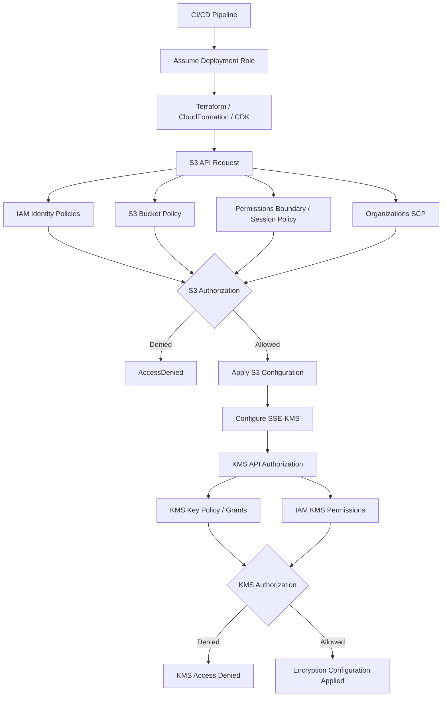
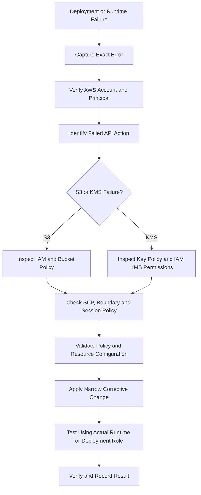

# 06- Bucket Policy and Encryption Deployment Failures

## Overview

S3 bucket policy and encryption deployment failures commonly occur when provisioning or updating infrastructure through Terraform, CloudFormation, AWS CDK, or CI/CD pipelines.

These failures are not always caused by incorrect S3 configuration. Authorization involves multiple independent layers, including IAM identity policies, bucket policies, AWS Organizations service control policies (SCPs), permissions boundaries, session policies, S3 Block Public Access, Object Ownership, and AWS KMS key policies.

Encryption introduces additional dependencies. A deployment may successfully configure a bucket but fail when configuring its KMS key. Alternatively, infrastructure deployment may succeed while application uploads or downloads fail because the runtime role lacks the required KMS permissions.

The primary troubleshooting objective is to identify the failing authorization or configuration layer before changing permissions.

This document covers:

- Bucket policy creation and update failures.
- Invalid principals and cross-account access.
- Block Public Access and Object Ownership conflicts.
- SSE-KMS configuration failures.
- KMS key policy and permission errors.
- Terraform and CloudFormation deployment failures.
- CI/CD authorization problems.
- Runtime encryption verification and regression testing.

## Authorization and Encryption Architecture

### Authorization Layers

An S3 operation can be affected by several authorization mechanisms.

| Layer | Responsibility | Typical failure |
|---|---|---|
| IAM identity policy | Grants permissions to the deployment or runtime role | `AccessDenied` |
| S3 bucket policy | Defines resource-based access and restrictions | `AccessDenied` during bucket operations |
| S3 Block Public Access | Prevents public access configurations | Public policy or ACL rejected |
| Object Ownership | Controls ownership and ACL behavior | ACL-related configuration failure |
| Permissions boundary | Limits the maximum permissions of an IAM principal | Required action remains denied |
| Session policy | Restricts permissions of an assumed role session | Deployment action denied |
| Organizations SCP | Restricts permissions within an organization | Organization-level explicit deny |
| KMS key policy | Controls access to the encryption key | `KMS.AccessDeniedException` |
| KMS grants | Delegates selected KMS permissions | Encryption or decryption failure |

An IAM allow statement does not override an applicable explicit deny.

Authorization must be evaluated in the context of the principal, resource, requested action, applicable policy types, and AWS service-specific rules.

### Deployment Request Flow



### Separate S3 and KMS Authorization

S3 authorization and KMS authorization are separate checks.

For example, an application role may have `s3:GetObject` permission on a bucket but still fail to retrieve an SSE-KMS-encrypted object because it lacks the required KMS permissions.

Similarly, a role may have KMS permissions but lack `s3:GetObject`.

| Operation | S3 permission | KMS permission when using SSE-KMS |
|---|---|---|
| Upload object | `s3:PutObject` | `kms:GenerateDataKey` |
| Download object | `s3:GetObject` | `kms:Decrypt` |
| Multipart upload | Relevant multipart S3 permissions | Typically `kms:GenerateDataKey` and `kms:Decrypt` |
| Copy encrypted object | Source read and destination write permissions | Required source decrypt and destination encryption permissions |
| Configure bucket encryption | `s3:PutEncryptionConfiguration` | Relevant KMS authorization for the key operations performed by the deployment workflow |

The exact permissions depend on the operation, key ownership, encryption configuration, and whether the request is cross-account.

## Diagnostic Workflow

Use a repeatable diagnostic process instead of immediately modifying policies.



### Verify the AWS Identity

Always identify the principal performing the failed operation.

```bash
aws sts get-caller-identity
```

Example:

```json
{
  "UserId": "AROAXXXXXXXXXXXXX:DeploymentSession",
  "Account": "123456789012",
  "Arn": "arn:aws:sts::123456789012:assumed-role/S3DeploymentRole/DeploymentSession"
}
```

Verify:

- The account ID is correct.
- The assumed role is expected.
- The deployment is targeting the intended environment.
- The pipeline is not using credentials from another account.
- The failing operation is performed by the expected principal.

For CloudFormation deployments, distinguish the CI/CD role from the CloudFormation execution role when one is configured. The execution role may be the principal that actually creates or updates the S3 and KMS resources.

### Identify the Failed API Action

The error message should identify the failed action whenever possible.

Examples:

```text
s3:PutBucketPolicy
s3:PutEncryptionConfiguration
kms:PutKeyPolicy
kms:GenerateDataKey
kms:Decrypt
```

The action determines which policy and resource configuration must be inspected.

Do not assume every `AccessDenied` response originates from the bucket policy.

### Inspect the Existing Configuration

For a bucket policy:

```bash
aws s3api get-bucket-policy \
  --bucket company-production-assets
```

For public access settings:

```bash
aws s3api get-public-access-block \
  --bucket company-production-assets
```

For ownership controls:

```bash
aws s3api get-bucket-ownership-controls \
  --bucket company-production-assets
```

For encryption:

```bash
aws s3api get-bucket-encryption \
  --bucket company-production-assets
```

For a KMS key:

```bash
aws kms describe-key \
  --key-id KEY-ID \
  --region ap-south-1
```

For the KMS key policy:

```bash
aws kms get-key-policy \
  --key-id KEY-ID \
  --policy-name default \
  --region ap-south-1
```

A failed inspection command does not prove that the configuration is absent. The caller may lack the permissions required to inspect it.

## Bucket Policy Deployment Failures

### Symptoms

Bucket policy deployment fails with errors such as:

```text
AccessDenied
```

```text
MalformedPolicy
```

```text
Invalid principal in policy
```

Terraform may report:

```text
Error: putting S3 Bucket Policy:
AccessDenied: Access Denied
```

CloudFormation may report a failed `AWS::S3::BucketPolicy` resource.

### Likely Causes

- Deployment role lacks `s3:PutBucketPolicy`.
- Existing bucket policy contains an explicit deny.
- Policy references an invalid IAM principal.
- Deployment targets the wrong AWS account.
- An SCP or permissions boundary restricts the operation.
- The bucket is owned by another account.
- Policy JSON or condition values are malformed.
- Block Public Access prevents the intended public policy.
- The deployment role can access the bucket but cannot modify its policy.

### Isolation and Verification

Verify the deployment identity:

```bash
aws sts get-caller-identity
```

Inspect the existing policy:

```bash
aws s3api get-bucket-policy \
  --bucket company-production-assets
```

Inspect the bucket policy status:

```bash
aws s3api get-bucket-policy-status \
  --bucket company-production-assets
```

Check whether the deployment identity is authorized for:

```text
s3:GetBucketPolicy
s3:PutBucketPolicy
```

Both actions apply to the bucket ARN:

```text
arn:aws:s3:::company-production-assets
```

They do not apply to the object's ARN.

### Corrective Action

A narrowly scoped identity policy can grant bucket policy management:

```json
{
  "Version": "2012-10-17",
  "Statement": [
    {
      "Sid": "ManageApplicationBucketPolicy",
      "Effect": "Allow",
      "Action": [
        "s3:GetBucketPolicy",
        "s3:PutBucketPolicy"
      ],
      "Resource": "arn:aws:s3:::company-production-assets"
    }
  ]
}
```

This policy does not override applicable explicit denies or other restrictions.

Before updating a production bucket policy:

1. Retrieve the current policy.
2. Identify existing security and integration statements.
3. Determine which principal and action are failing.
4. Check applicable identity and organization policies.
5. Validate the proposed policy.
6. Apply the smallest required change.
7. Retrieve the policy again and verify the result.

Avoid replacing an existing bucket policy without reviewing its current statements. Existing statements may enforce cross-account access, service integrations, or security restrictions.

## Invalid Principal in Bucket Policy

### Symptoms

Policy deployment fails with:

```text
Invalid principal in policy
```

### Likely Causes

- IAM role or user does not exist.
- Principal account ID is incorrect.
- Principal ARN contains a typo.
- A referenced role was deleted and recreated.
- Deployment runs before the referenced IAM role exists.
- Cross-account principal configuration is incorrect.

### Isolation and Verification

Inspect the principal ARN in the policy.

Example:

```json
{
  "Principal": {
    "AWS": "arn:aws:iam::222222222222:role/ApplicationRole"
  }
}
```

Verify the role in the principal account:

```bash
aws iam get-role \
  --role-name ApplicationRole
```

Verify the active account:

```bash
aws sts get-caller-identity
```

The role inspection must run with credentials authorized to access the principal account.

### Corrective Action

Ensure the referenced principal exists and that its ARN identifies the intended role.

For cross-account access, configure both sides:

- The bucket policy must authorize the external principal.
- The external principal's identity policy must allow the required S3 actions.
- KMS authorization must also be configured when SSE-KMS is involved.

In infrastructure deployments, define resource dependencies so that referenced IAM roles exist before policies are applied.

Avoid wildcard principals as a workaround for invalid principal errors.

## Block Public Access Conflicts

### Symptoms

A deployment attempts to configure a public bucket policy or ACL and fails, or the expected public access remains blocked.

Typical errors include:

```text
AccessDenied
```

### Likely Causes

- Account-level Block Public Access is enabled.
- Bucket-level Block Public Access is enabled.
- Proposed bucket policy allows public access.
- ACL-based public access conflicts with Object Ownership.
- Deployment assumes a bucket policy can override Block Public Access.

### Isolation and Verification

Inspect bucket-level settings:

```bash
aws s3api get-public-access-block \
  --bucket company-production-assets
```

Inspect account-level settings:

```bash
aws s3control get-public-access-block \
  --account-id 123456789012
```

Account-level inspection requires the relevant S3 Control permissions.

Inspect Object Ownership:

```bash
aws s3api get-bucket-ownership-controls \
  --bucket company-production-assets
```

### Corrective Action

For private application buckets, retain Block Public Access and use IAM, bucket policies, presigned URLs, or CloudFront Origin Access Control for controlled access.

Terraform:

```hcl
resource "aws_s3_bucket_public_access_block" "assets" {
  bucket = aws_s3_bucket.assets.id

  block_public_acls       = true
  ignore_public_acls      = true
  block_public_policy     = true
  restrict_public_buckets = true
}
```

For a private CloudFront origin, authorize the CloudFront distribution through an appropriate bucket policy rather than making the bucket public.

Do not disable Block Public Access merely to make deployment succeed. First determine whether public access is actually required and whether an approved exception exists.

## Object Ownership and ACL Deployment Conflicts

### Symptoms

Deployment fails while configuring ACLs or uploading objects.

Typical errors include:

```text
AccessControlListNotSupported
```

```text
AccessDenied
```

### Likely Causes

- Bucket uses `BucketOwnerEnforced`.
- Deployment attempts to apply object ACLs.
- Application assumes the uploading account owns the object.
- Legacy infrastructure still configures ACLs.
- Third-party uploader sends ACL headers incompatible with the bucket configuration.

### Isolation and Verification

Inspect ownership controls:

```bash
aws s3api get-bucket-ownership-controls \
  --bucket company-production-assets
```

A common modern configuration is:

```json
{
  "OwnershipControls": {
    "Rules": [
      {
        "ObjectOwnership": "BucketOwnerEnforced"
      }
    ]
  }
}
```

### Corrective Action

For most new application buckets, prefer `BucketOwnerEnforced` and policy-based access.

Terraform:

```hcl
resource "aws_s3_bucket_ownership_controls" "assets" {
  bucket = aws_s3_bucket.assets.id

  rule {
    object_ownership = "BucketOwnerEnforced"
  }
}
```

Remove unnecessary ACL configuration from:

- Terraform resources.
- CloudFormation templates.
- SDK upload requests.
- Presigned URL request parameters.
- Third-party upload clients.

If an integration requires ACLs, assess whether the ownership model supports it before changing production settings.

## Encryption Deployment Failures

### Encryption Configuration Overview

S3 supports several server-side encryption approaches.

| Encryption mode | Key management | Typical use |
|---|---|---|
| SSE-S3 | S3-managed encryption keys | Standard server-side encryption |
| SSE-KMS | AWS KMS keys | Centralized key administration and audit requirements |
| SSE-C | Customer-provided encryption keys | Specialized workloads requiring customer-managed key material |

For most production backend systems, SSE-S3 or SSE-KMS is appropriate.

SSE-KMS is useful when the architecture requires explicit key administration, key policies, cross-account key access, or KMS audit capabilities.

This document focuses on deployment and configuration failures rather than detailed encryption architecture.

### Symptoms

Common errors include:

```text
AccessDenied
```

```text
KMS.AccessDeniedException
```

```text
InvalidArgument
```

```text
The specified KMS key does not exist
```

A deployment may fail while configuring default bucket encryption, or it may succeed while subsequent uploads and downloads fail.

### Likely Causes

- Deployment role lacks required S3 encryption configuration permissions.
- KMS key does not exist in the target Region.
- KMS key is disabled or pending deletion.
- KMS key policy does not authorize the deployment or application role.
- IAM identity policy lacks required KMS actions.
- Cross-account key authorization is incomplete.
- Terraform or CloudFormation references the wrong key ARN.
- Key belongs to another Region.
- Key policy and IAM policy do not provide the required authorization path.

### Isolation and Verification

Inspect bucket encryption:

```bash
aws s3api get-bucket-encryption \
  --bucket company-production-assets
```

Inspect the KMS key:

```bash
aws kms describe-key \
  --key-id arn:aws:kms:ap-south-1:123456789012:key/KEY-ID \
  --region ap-south-1
```

Inspect the key policy:

```bash
aws kms get-key-policy \
  --key-id arn:aws:kms:ap-south-1:123456789012:key/KEY-ID \
  --policy-name default \
  --region ap-south-1
```

Verify:

- Key ARN is correct.
- Key belongs to the intended account.
- Key is in the same Region as the bucket.
- Key is enabled.
- Key policy authorizes the required principal or delegates authorization appropriately.
- Caller has the required IAM permissions.

### Corrective Action

Identify the principal performing the failed operation.

Typical principals include:

- CI/CD deployment role.
- CloudFormation execution role.
- Application runtime role.
- Lambda execution role.
- Cross-account service role.

Grant only the permissions required by each principal.

For example, an application that uploads and downloads SSE-KMS-encrypted objects may require:

```json
{
  "Version": "2012-10-17",
  "Statement": [
    {
      "Sid": "UseApplicationEncryptionKey",
      "Effect": "Allow",
      "Action": [
        "kms:GenerateDataKey",
        "kms:Decrypt"
      ],
      "Resource": "arn:aws:kms:ap-south-1:123456789012:key/KEY-ID"
    }
  ]
}
```

The exact permission set depends on the operations performed. Key administration permissions should not be granted to ordinary application roles.

## KMS Key Policy Deployment Failures

### Symptoms

Terraform or CloudFormation fails while creating or updating a KMS key policy.

Possible errors:

```text
AccessDeniedException
```

```text
MalformedPolicyDocumentException
```

```text
InvalidArnException
```

A deployment may also succeed but leave the application unable to use the key.

### Likely Causes

- Key policy contains an invalid principal.
- Policy references an IAM role that does not exist.
- Key policy does not authorize the deployment principal.
- Key policy removes required administrative access.
- Cross-account key access is incomplete.
- Policy document contains invalid JSON or unsupported statements.
- Deployment role lacks `kms:PutKeyPolicy`.

### Isolation and Verification

Inspect the key:

```bash
aws kms describe-key \
  --key-id KEY-ID \
  --region ap-south-1
```

Retrieve the key policy:

```bash
aws kms get-key-policy \
  --key-id KEY-ID \
  --policy-name default \
  --region ap-south-1
```

Check the deployment identity and key policy separately.

An identity policy granting `kms:PutKeyPolicy` is not sufficient if an applicable explicit deny prevents the operation.

### Corrective Action

Preserve a valid administrative path when modifying a key policy.

Example same-account policy:

```json
{
  "Version": "2012-10-17",
  "Statement": [
    {
      "Sid": "AllowKeyAdministration",
      "Effect": "Allow",
      "Principal": {
        "AWS": "arn:aws:iam::123456789012:role/KMSDeploymentRole"
      },
      "Action": [
        "kms:DescribeKey",
        "kms:GetKeyPolicy",
        "kms:PutKeyPolicy",
        "kms:EnableKey",
        "kms:DisableKey"
      ],
      "Resource": "*"
    },
    {
      "Sid": "AllowApplicationKeyUsage",
      "Effect": "Allow",
      "Principal": {
        "AWS": "arn:aws:iam::123456789012:role/ApplicationRuntimeRole"
      },
      "Action": [
        "kms:GenerateDataKey",
        "kms:Decrypt"
      ],
      "Resource": "*"
    }
  ]
}
```

Adapt administrative and usage permissions to the actual architecture. Separate key administrators from key users wherever practical.

Do not replace a production key policy with a minimal policy that accidentally removes the only administrative principal.

### Prevention

- Keep key administration and key usage roles separate.
- Validate principal ARNs before deployment.
- Review key policy changes independently.
- Maintain an authorized recovery path.
- Test encryption and decryption using the actual runtime role.
- Protect production keys from accidental deletion or disabling.

## KMS Key Region and Account Mismatches

### Symptoms

S3 encryption configuration fails because the referenced key cannot be used, even though the key exists.

### Likely Causes

- Key ARN points to another Region.
- Key belongs to another account.
- Terraform provider targets the wrong account.
- Alias resolves differently in another account.
- Application configuration contains an outdated key ARN.

### Isolation and Verification

Inspect the key ARN:

```text
arn:aws:kms:ap-south-1:123456789012:key/KEY-ID
```

The ARN identifies the partition, service, Region, account, and key identifier.

Inspect the key:

```bash
aws kms describe-key \
  --key-id arn:aws:kms:ap-south-1:123456789012:key/KEY-ID \
  --region ap-south-1
```

Compare the returned account and Region with the bucket deployment target.

### Corrective Action

Use a key in the bucket's Region.

For a multi-Region storage architecture, configure appropriate regional keys and replication encryption behavior. Do not assume a normal KMS key can be used directly across Regions.

When using multi-Region KMS keys, verify the relevant regional replica key and authorization configuration.

## Terraform Bucket Policy and Encryption Failures

### Symptoms

Terraform fails while applying one or more of these resources:

- `aws_s3_bucket_policy`
- `aws_s3_bucket_server_side_encryption_configuration`
- `aws_s3_bucket_public_access_block`
- `aws_s3_bucket_ownership_controls`
- `aws_kms_key`
- `aws_kms_key_policy`
- `aws_kms_alias`

### Likely Causes

- IAM deployment role lacks required permissions.
- KMS key policy is incomplete.
- Bucket policy references an invalid principal.
- Bucket and KMS key are configured in different Regions.
- Terraform resource dependencies are missing.
- Multiple Terraform states manage the same configuration.
- Existing configuration differs from Terraform state.
- Policy update removes permissions required by subsequent resources.

### Example: Private Encrypted Bucket

The following configuration demonstrates a private S3 bucket with versioning, SSE-KMS, Block Public Access, and enforced bucket ownership.

```hcl
terraform {
  required_version = ">= 1.5.0"

  required_providers {
    aws = {
      source  = "hashicorp/aws"
      version = "~> 6.0"
    }
  }
}

provider "aws" {
  region = var.aws_region
}

variable "aws_region" {
  type    = string
  default = "ap-south-1"
}

variable "bucket_name" {
  type = string
}

variable "environment" {
  type = string
}

resource "aws_kms_key" "assets" {
  description             = "S3 encryption key for application assets"
  enable_key_rotation     = true
  deletion_window_in_days = 30

  tags = {
    Environment = var.environment
    ManagedBy   = "Terraform"
  }
}

resource "aws_s3_bucket" "assets" {
  bucket = var.bucket_name

  lifecycle {
    prevent_destroy = true
  }

  tags = {
    Environment = var.environment
    ManagedBy   = "Terraform"
  }
}

resource "aws_s3_bucket_versioning" "assets" {
  bucket = aws_s3_bucket.assets.id

  versioning_configuration {
    status = "Enabled"
  }
}

resource "aws_s3_bucket_server_side_encryption_configuration" "assets" {
  bucket = aws_s3_bucket.assets.id

  rule {
    apply_server_side_encryption_by_default {
      sse_algorithm     = "aws:kms"
      kms_master_key_id = aws_kms_key.assets.arn
    }

    bucket_key_enabled = true
  }
}

resource "aws_s3_bucket_public_access_block" "assets" {
  bucket = aws_s3_bucket.assets.id

  block_public_acls       = true
  ignore_public_acls      = true
  block_public_policy     = true
  restrict_public_buckets = true
}

resource "aws_s3_bucket_ownership_controls" "assets" {
  bucket = aws_s3_bucket.assets.id

  rule {
    object_ownership = "BucketOwnerEnforced"
  }
}

output "bucket_name" {
  value = aws_s3_bucket.assets.bucket
}

output "bucket_arn" {
  value = aws_s3_bucket.assets.arn
}

output "kms_key_arn" {
  value = aws_kms_key.assets.arn
}
```

This example establishes default bucket encryption. It does not define a complete production authorization model. The KMS key policy and application IAM permissions must be designed for the deployment and runtime principals.

### Validate Before Applying

```bash
terraform fmt -check
terraform init
terraform validate
terraform plan
```

Review the plan for:

- Bucket replacement.
- KMS key replacement.
- Key policy changes.
- Unexpected public access configuration changes.
- Removal of versioning or encryption.
- Changes to resource ownership.

Apply only after reviewing the plan:

```bash
terraform apply
```

### Verify the Result

```bash
aws s3api get-bucket-encryption \
  --bucket company-production-assets
```

```bash
aws s3api get-public-access-block \
  --bucket company-production-assets
```

```bash
aws s3api get-bucket-ownership-controls \
  --bucket company-production-assets
```

Verify the KMS key:

```bash
aws kms describe-key \
  --key-id KEY-ID \
  --region ap-south-1
```

### Terraform State Considerations

If the bucket or encryption configuration already exists, inspect the state before importing or applying changes.

```bash
terraform state list
```

```bash
terraform state show aws_s3_bucket.assets
```

Import existing resources where appropriate instead of creating competing resource ownership.

Some S3 configurations are managed through separate Terraform resources. Importing the bucket alone does not automatically import its encryption, ownership, public-access, or policy resources.

## CloudFormation Bucket Policy and Encryption Failures

### Symptoms

CloudFormation deployment fails with errors associated with:

```text
AWS::S3::Bucket
AWS::S3::BucketPolicy
AWS::KMS::Key
```

The stack may enter:

```text
ROLLBACK_IN_PROGRESS
ROLLBACK_COMPLETE
UPDATE_ROLLBACK_FAILED
```

### Isolation and Verification

Inspect stack events:

```bash
aws cloudformation describe-stack-events \
  --stack-name s3-production \
  --region ap-south-1
```

Inspect stack resources:

```bash
aws cloudformation describe-stack-resources \
  --stack-name s3-production \
  --region ap-south-1
```

Find the first resource failure rather than focusing only on the final stack status.

A failed bucket policy resource may be caused by an invalid principal, while a failed encryption configuration may be caused by an inaccessible KMS key.

### Example: Bucket Encryption Configuration

```yaml
AWSTemplateFormatVersion: "2010-09-09"

Description: Private S3 bucket with KMS encryption

Parameters:
  BucketName:
    Type: String

  KmsKeyArn:
    Type: String

Resources:
  AssetsBucket:
    Type: AWS::S3::Bucket
    Properties:
      BucketName: !Ref BucketName

      VersioningConfiguration:
        Status: Enabled

      BucketEncryption:
        ServerSideEncryptionConfiguration:
          - ServerSideEncryptionByDefault:
              SSEAlgorithm: aws:kms
              KMSMasterKeyID: !Ref KmsKeyArn
            BucketKeyEnabled: true

      PublicAccessBlockConfiguration:
        BlockPublicAcls: true
        IgnorePublicAcls: true
        BlockPublicPolicy: true
        RestrictPublicBuckets: true

      OwnershipControls:
        Rules:
          - ObjectOwnership: BucketOwnerEnforced

Outputs:
  BucketName:
    Value: !Ref AssetsBucket

  BucketArn:
    Value: !GetAtt AssetsBucket.Arn
```

The KMS key must exist in the same Region as the bucket and must be usable by the principals performing the relevant operations.

### Example: Bucket Policy Resource

```yaml
  AssetsBucketPolicy:
    Type: AWS::S3::BucketPolicy
    Properties:
      Bucket: !Ref AssetsBucket
      PolicyDocument:
        Version: "2012-10-17"
        Statement:
          - Sid: AllowApplicationRead
            Effect: Allow
            Principal:
              AWS: arn:aws:iam::123456789012:role/ApplicationRuntimeRole
            Action:
              - s3:GetObject
            Resource: !Sub "${AssetsBucket.Arn}/application/*"
```

The example grants access to a specific application role and prefix. The role must also have appropriate identity-based permissions, and KMS authorization must be configured for encrypted objects.

### Deployment and Recovery

Validate the template:

```bash
aws cloudformation validate-template \
  --template-body file://s3-template.yaml \
  --region ap-south-1
```

Deploy:

```bash
aws cloudformation deploy \
  --template-file s3-template.yaml \
  --stack-name s3-production \
  --parameter-overrides \
    BucketName=company-production-assets \
    KmsKeyArn=arn:aws:kms:ap-south-1:123456789012:key/KEY-ID \
  --region ap-south-1
```

If the stack fails, inspect the first failed resource and its event reason.

Do not delete a stack automatically when it contains a production bucket or KMS key. Review retention policies, deletion protection, and existing data before attempting recovery.

## GitHub Actions and OIDC Deployment Failures

### Symptoms

The pipeline successfully assumes an AWS role but fails when applying S3 bucket policy or encryption configuration.

Typical errors:

```text
AccessDenied
```

```text
User is not authorized to perform:
s3:PutBucketPolicy
```

```text
User is not authorized to perform:
kms:PutKeyPolicy
```

### Likely Causes

- Deployment role lacks S3 policy-management permissions.
- Deployment role lacks KMS administration permissions.
- Trust policy allows authentication but identity policy lacks the required action.
- Workflow assumes the wrong deployment role.
- CloudFormation execution role lacks permissions.
- SCP or permissions boundary blocks the action.
- Pipeline uses a different account or Region.

OIDC authentication and AWS resource authorization are separate concerns. Successfully obtaining temporary AWS credentials does not mean the role has permission to deploy the requested infrastructure.

### Isolation and Verification

Check the assumed identity:

```yaml
- name: Verify AWS identity
  run: aws sts get-caller-identity
```

Inspect attached role policies:

```bash
aws iam list-attached-role-policies \
  --role-name S3DeploymentRole
```

Inspect inline policies:

```bash
aws iam list-role-policies \
  --role-name S3DeploymentRole
```

Inspect an inline policy:

```bash
aws iam get-role-policy \
  --role-name S3DeploymentRole \
  --policy-name S3DeploymentPermissions
```

### Corrective Action

Grant the deployment role the exact actions required by the deployment process.

Typical infrastructure deployment actions may include:

```text
s3:CreateBucket
s3:PutBucketPolicy
s3:PutEncryptionConfiguration
s3:PutBucketVersioning
s3:PutPublicAccessBlock
s3:PutBucketOwnershipControls
kms:DescribeKey
kms:CreateKey
kms:PutKeyPolicy
kms:EnableKeyRotation
```

Not every deployment requires all these actions. Scope permissions to the resources and operations actually managed by the pipeline.

For CloudFormation deployments using an execution role, distinguish between:

- CI/CD role permissions to invoke CloudFormation and pass the execution role.
- CloudFormation execution role permissions to provision and configure resources.

### Prevention

- Keep OIDC trust and IAM permissions as separate review items.
- Verify the active role before deployment.
- Separate deployment roles from runtime roles.
- Use short-lived credentials.
- Scope KMS administration to infrastructure deployment identities.
- Avoid broad `s3:*` or `kms:*` permissions for application roles.

## Diagnosing SSE-KMS Runtime Failures

### Symptoms

The bucket deployment succeeds, but application operations fail.

Examples:

```text
An error occurred (AccessDenied) when calling the GetObject operation
```

```text
KMS.AccessDeniedException
```

```text
Access denied when using the specified KMS key
```

A common production scenario is that uploads work through one service but downloads fail through another.

### Likely Causes

- Upload role has KMS permissions but download role does not.
- Lambda execution role lacks `kms:Decrypt`.
- KMS key policy does not authorize the application role.
- Cross-account key access is incomplete.
- Object was encrypted with a different key than expected.
- Key is disabled or scheduled for deletion.
- Bucket policy or IAM policy denies the S3 operation.

### Isolation and Verification

Inspect object encryption metadata:

```bash
aws s3api head-object \
  --bucket company-production-assets \
  --key application/report.pdf
```

Review:

```json
{
  "ServerSideEncryption": "aws:kms",
  "SSEKMSKeyId": "arn:aws:kms:ap-south-1:123456789012:key/KEY-ID"
}
```

Test access using credentials for the actual application role.

Inspect the KMS key:

```bash
aws kms describe-key \
  --key-id KEY-ID \
  --region ap-south-1
```

Inspect its policy:

```bash
aws kms get-key-policy \
  --key-id KEY-ID \
  --policy-name default \
  --region ap-south-1
```

### Root-Cause Determination

| Evidence | Likely failure |
|---|---|
| S3 operation denied before object access | S3 identity or resource policy |
| S3 object access allowed but KMS operation denied | KMS IAM policy or key policy |
| Upload works but download fails | Missing decrypt permission or restrictive key policy |
| Same role works with one object but not another | Objects may use different encryption keys or policies |
| Cross-account role fails | Missing authorization on one or both account sides |
| Operations fail after a key change | Key disabled, policy changed, or key reference incorrect |

CloudTrail can provide supporting evidence for relevant S3 and KMS API operations. Use the event identity, action, resource, and error details to identify the principal and denied operation.

### Corrective Action

Grant the actual runtime principal the necessary S3 and KMS permissions.

Example:

```json
{
  "Version": "2012-10-17",
  "Statement": [
    {
      "Sid": "ReadApplicationObjects",
      "Effect": "Allow",
      "Action": [
        "s3:GetObject"
      ],
      "Resource": "arn:aws:s3:::company-production-assets/application/*"
    },
    {
      "Sid": "DecryptApplicationObjects",
      "Effect": "Allow",
      "Action": [
        "kms:Decrypt"
      ],
      "Resource": "arn:aws:kms:ap-south-1:123456789012:key/KEY-ID"
    }
  ]
}
```

For upload and download workflows, add the relevant S3 and KMS permissions based on the actual operations.

Do not grant KMS key administration permissions to an application role merely to resolve an object access failure.

## Cross-Account Bucket Policy and KMS Failures

### Symptoms

An application in one AWS account cannot access an SSE-KMS-encrypted bucket in another account.

S3 access may work for unencrypted objects but fail for encrypted objects.

### Likely Causes

- Bucket policy does not trust the external role.
- External role identity policy lacks S3 permissions.
- KMS key policy does not authorize the external account or role.
- External role identity policy lacks KMS permissions.
- KMS key belongs to the wrong account or Region.
- Deployment role is confused with the application runtime role.

### Authorization Requirements

For cross-account SSE-KMS access, configure both S3 and KMS authorization.

| Account | Required configuration |
|---|---|
| Bucket-owning account | Bucket policy allowing the external role |
| Application account | IAM identity policy allowing S3 access |
| Key-owning account | KMS key policy or grant authorizing the external role |
| Application account | IAM identity policy allowing required KMS operations |

Example bucket policy:

```json
{
  "Version": "2012-10-17",
  "Statement": [
    {
      "Sid": "AllowExternalApplicationRead",
      "Effect": "Allow",
      "Principal": {
        "AWS": "arn:aws:iam::222222222222:role/ApplicationRuntimeRole"
      },
      "Action": [
        "s3:GetObject"
      ],
      "Resource": "arn:aws:s3:::centralized-assets/application/*"
    }
  ]
}
```

Example KMS key policy statement in the key-owning account:

```json
{
  "Sid": "AllowExternalApplicationDecrypt",
  "Effect": "Allow",
  "Principal": {
    "AWS": "arn:aws:iam::222222222222:role/ApplicationRuntimeRole"
  },
  "Action": [
    "kms:Decrypt"
  ],
  "Resource": "*"
}
```

The external role must also have an identity policy allowing the relevant S3 and KMS operations.

For cross-account uploads, consider the destination object ownership behavior and required KMS permissions. A read-only policy is not sufficient for upload workflows.

## Policy Validation and Diagnostic Tools

### Validate JSON Before Deployment

Use a JSON parser:

```bash
python -m json.tool bucket-policy.json
```

For IAM policy validation, use IAM Access Analyzer where available.

Example:

```bash
aws accessanalyzer validate-policy \
  --policy-document file://bucket-policy.json \
  --policy-type RESOURCE_POLICY
```

For an IAM identity policy:

```bash
aws accessanalyzer validate-policy \
  --policy-document file://deployment-policy.json \
  --policy-type IDENTITY_POLICY
```

Policy validation can identify syntax and security findings, but it does not prove that every deployment operation will be authorized.

### IAM Policy Simulation

Use the IAM policy simulator as a diagnostic aid:

```bash
aws iam simulate-principal-policy \
  --policy-source-arn arn:aws:iam::123456789012:role/S3DeploymentRole \
  --action-names s3:PutBucketPolicy \
  --resource-arns arn:aws:s3:::company-production-assets
```

For KMS:

```bash
aws iam simulate-principal-policy \
  --policy-source-arn arn:aws:iam::123456789012:role/ApplicationRuntimeRole \
  --action-names kms:Decrypt \
  --resource-arns arn:aws:kms:ap-south-1:123456789012:key/KEY-ID
```

The simulator does not reproduce every aspect of live authorization, including all resource-policy, organization, service, and cross-account conditions. Treat its result as diagnostic evidence rather than definitive proof.

### CloudTrail Investigation

When an operation fails, inspect relevant CloudTrail events.

Useful event names include:

```text
PutBucketPolicy
PutEncryptionConfiguration
PutKeyPolicy
GenerateDataKey
Decrypt
PutObject
GetObject
```

Review:

- Event source.
- Event name.
- AWS account.
- Principal ARN.
- Resource identifiers.
- Error code.
- Error message.

CloudTrail event availability depends on event type and logging configuration. S3 object-level data events must be configured where required; they are not automatically equivalent to management event history.

## Deployment Regression Testing

A successful infrastructure deployment is not enough. Verify that intended runtime principals can perform the operations required by the application.

### Bucket Configuration Tests

Verify encryption:

```bash
aws s3api get-bucket-encryption \
  --bucket company-production-assets
```

Verify Block Public Access:

```bash
aws s3api get-public-access-block \
  --bucket company-production-assets
```

Verify bucket policy:

```bash
aws s3api get-bucket-policy \
  --bucket company-production-assets
```

Verify Object Ownership:

```bash
aws s3api get-bucket-ownership-controls \
  --bucket company-production-assets
```

### Runtime Encryption Test

Run the following test using the actual application role:

```bash
printf "S3 encryption verification\n" > verification.txt

aws s3api put-object \
  --bucket company-production-assets \
  --key deployment-verification/verification.txt \
  --body verification.txt \
  --region ap-south-1
```

Download the object:

```bash
aws s3api get-object \
  --bucket company-production-assets \
  --key deployment-verification/verification.txt \
  downloaded-verification.txt \
  --region ap-south-1
```

Inspect encryption metadata:

```bash
aws s3api head-object \
  --bucket company-production-assets \
  --key deployment-verification/verification.txt \
  --region ap-south-1
```

Verify that:

- Upload succeeds.
- Download succeeds.
- Encryption metadata matches the expected configuration.
- The object uses the intended KMS key when SSE-KMS is required.
- The application role cannot access unrelated prefixes.
- Unauthorized principals remain denied.

Remove the test object through an approved cleanup process. In a versioned bucket, account for the resulting delete marker and retained versions.

## Prevention and Production Best Practices

### Infrastructure Design

- Keep bucket policies and KMS key policies in version control.
- Separate bucket administration from application data access.
- Use reusable Terraform modules with explicit policy inputs.
- Define CloudFormation dependencies for referenced IAM and KMS resources.
- Keep production bucket and key changes behind approval gates.
- Avoid multiple infrastructure tools managing the same policy or encryption configuration.

### IAM and Policy Management

- Grant deployment roles only the S3 and KMS actions required for infrastructure changes.
- Use separate runtime roles for Django, FastAPI, Lambda, and worker services.
- Scope object permissions to application prefixes.
- Review explicit denies before adding new allows.
- Validate principal ARNs and account IDs.
- Treat SCPs and permissions boundaries as part of deployment authorization.

### Encryption Management

- Prefer SSE-S3 or SSE-KMS based on security and compliance requirements.
- Use a KMS key in the bucket's Region.
- Enable key rotation where appropriate.
- Separate KMS key administrators from key users.
- Test encryption and decryption using actual runtime credentials.
- Protect key policies and avoid removing administrative access.
- Account for KMS permissions in cross-account architectures.

### CI/CD Reliability

- Verify AWS identity before deployment.
- Use short-lived OIDC credentials.
- Keep deployment and runtime roles separate.
- Validate policy documents before applying them.
- Review Terraform plans and CloudFormation change sets.
- Preserve deployment logs and CloudTrail evidence.
- Test both infrastructure configuration and application data access.

### Production Readiness Checklist

**Bucket policy**

- [ ] Deployment role has required bucket policy permissions.
- [ ] Bucket policy references valid principals.
- [ ] Existing explicit denies have been reviewed.
- [ ] Cross-account access is configured on both sides.
- [ ] Block Public Access remains enabled unless an approved exception exists.
- [ ] Object Ownership is compatible with application upload behavior.

**Encryption**

- [ ] Bucket encryption configuration is present.
- [ ] KMS key belongs to the intended account and Region.
- [ ] KMS key is enabled.
- [ ] Key policy authorizes required principals.
- [ ] Application roles have necessary KMS permissions.
- [ ] Cross-account encryption access is tested.
- [ ] Key deletion and policy changes are protected.

**Deployment**

- [ ] AWS account and role are verified.
- [ ] Terraform state or CloudFormation ownership is understood.
- [ ] Policy documents pass validation.
- [ ] Deployment changes have been reviewed.
- [ ] Runtime upload and download tests pass.
- [ ] Unauthorized access tests fail as expected.
- [ ] Logs and audit events are available for investigation.

## Common Mistakes

| Mistake | Why it fails | Better approach |
|---|---|---|
| Adding `s3:*` to resolve `AccessDenied` | Actual denial may come from an SCP, bucket policy, or boundary | Identify the denied action and authorization layer |
| Treating S3 and KMS permissions as interchangeable | S3 access and KMS cryptographic operations are separate checks | Configure both authorization layers |
| Granting KMS administration to application roles | Application access does not require control over key policies | Separate key administration from key usage |
| Disabling Block Public Access to fix policy deployment | It may expose data or weaken account security | Inspect the intended access model |
| Using an invalid principal ARN | AWS cannot resolve the referenced principal | Verify account, role name, and deployment order |
| Replacing an existing key policy blindly | The change may remove administrative access | Preserve a valid administration path |
| Assuming OIDC authentication grants deployment access | OIDC only establishes temporary credentials | Configure identity permissions separately |
| Testing encryption with an administrator role | Administrator access may hide runtime permission gaps | Test with the actual application role |
| Assuming `GetBucketEncryption` proves object access works | Bucket configuration does not prove KMS authorization for every principal | Perform real upload and download tests |
| Ignoring cross-account KMS authorization | Bucket policy alone is insufficient for SSE-KMS access | Configure both account-side IAM and key authorization |
| Treating policy simulation as definitive | The simulator does not model every live authorization condition | Combine simulation with controlled runtime tests |
| Removing a KMS key to recover a deployment | Key deletion can make encrypted data permanently inaccessible | Preserve keys and use controlled key recovery procedures |

## Key Takeaways

- Diagnose the exact denied action and principal before modifying bucket or KMS policies; an IAM allow cannot override an applicable explicit deny.
- S3 bucket authorization and KMS encryption authorization are independent layers, and both must permit the requested operation.
- Keep deployment, application runtime, and KMS administration roles separate, with narrowly scoped permissions.
- Validate bucket policies, Block Public Access, Object Ownership, KMS key policies, account IDs, and Regions before applying infrastructure changes.
- Verify production behavior using the actual application role with upload, download, encryption metadata, and unauthorized-access tests.