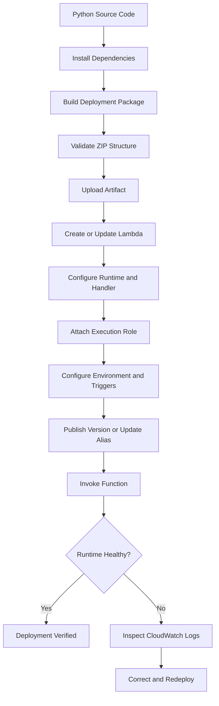
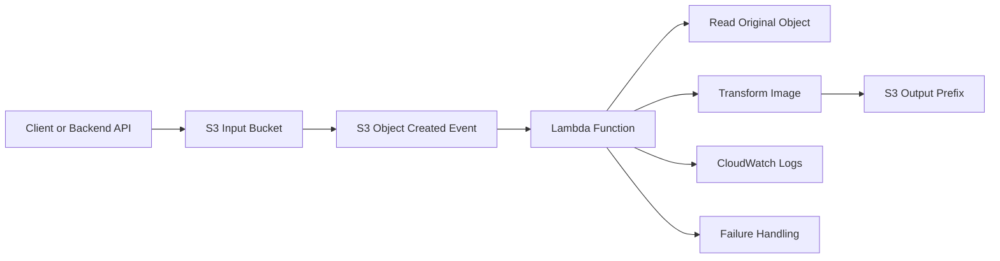
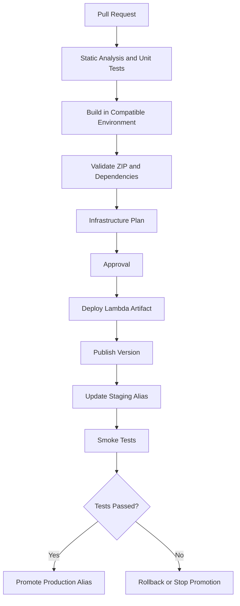

# 07- Lambda Packaging and Deployment Errors

## Overview

AWS Lambda packaging and deployment failures commonly occur when deploying Python functions, especially when the function depends on third-party libraries, native extensions, shared code, or external configuration.

A Lambda deployment package must satisfy several requirements:

- Compatible Python runtime and operating system.
- Correct package structure and handler configuration.
- Compatible CPU architecture.
- Correct dependency versions and native library binaries.
- Valid deployment artifact format and size.
- Appropriate IAM permissions.
- Correct environment variables and resource configuration.
- Valid integration configuration for S3 events and other triggers.

A function can deploy successfully but fail during initialization or execution. Deployment success therefore does not prove that the runtime environment is healthy.

This document provides a diagnostic workflow for packaging, uploading, configuring, and operating Python Lambda functions used in S3-based architectures.

It covers:

- Invalid deployment ZIP structures.
- Missing Python dependencies.
- Native dependency and architecture incompatibilities.
- Runtime and handler configuration errors.
- Deployment package size and storage constraints.
- Lambda execution role and S3 permission failures.
- Terraform and CloudFormation deployment failures.
- S3 event notification integration failures.
- Function initialization, timeout, and memory issues.
- Deployment verification and rollback.

## Lambda Deployment Architecture

### Deployment Components

A Lambda deployment involves several independent components.

| Component | Responsibility | Common failure |
|---|---|---|
| Source code | Implements function behavior | Syntax or import errors |
| Dependencies | Provides external libraries | `ModuleNotFoundError` |
| Deployment package | Contains code and dependencies | Incorrect ZIP structure |
| Runtime | Executes code using a supported Python version | Runtime mismatch |
| Handler | Identifies the entry point | Handler not found |
| Architecture | Determines CPU instruction set | Native binary incompatibility |
| Execution role | Grants access to AWS services | `AccessDenied` |
| Environment variables | Supplies runtime configuration | Missing configuration |
| Event source | Invokes the function | Incorrect event configuration |
| Infrastructure deployment | Creates and updates resources | IAM or resource dependency errors |

### Deployment Lifecycle



### S3-Triggered Lambda Architecture

A typical S3 image-processing deployment has the following flow:



Use separate input and output prefixes or buckets. If the function writes transformed objects into the same event-triggering prefix, it can invoke itself repeatedly.

For workloads requiring buffering, controlled concurrency, or more resilient retry handling, use SQS between S3 and Lambda.

## Packaging and Deployment Diagnostic Workflow

Use this sequence whenever a Lambda deployment or execution fails.

1. Identify whether the failure occurs during packaging, deployment, initialization, or invocation.
2. Verify the Python runtime and architecture.
3. Inspect the ZIP structure.
4. Verify dependencies and native binaries.
5. Confirm the configured handler.
6. Check deployment permissions and execution-role permissions separately.
7. Inspect Lambda configuration and CloudWatch logs.
8. Test the function using a representative event.
9. Verify S3 permissions and event notification behavior.
10. Roll out the corrected artifact using a controlled deployment process.

### Identify the Failure Stage

| Stage | Observable evidence | Primary investigation |
|---|---|---|
| Build | Dependency installation fails | Python environment and package compatibility |
| Packaging | ZIP is empty or incorrectly structured | Archive contents and build directory |
| Upload | Artifact rejected | Package size and deployment permissions |
| Configuration | Runtime or handler update fails | Lambda configuration and IAM |
| Initialization | `Runtime.ImportModuleError` | Dependencies and handler imports |
| Invocation | Function raises an exception | Application logic and event payload |
| S3 access | `AccessDenied` | Execution role and bucket policy |
| Event delivery | Function is not invoked | S3 notification configuration |
| Performance | Timeout or memory exhaustion | Resource allocation and processing strategy |

## Invalid Deployment ZIP Structure

### Symptoms

The Lambda deployment succeeds, but invocation fails with:

```text
Runtime.ImportModuleError
```

```text
Unable to import module 'lambda_function'
```

```text
No module named 'app'
```

### Likely Causes

- Source files are nested inside an unexpected directory.
- Handler configuration references the wrong module.
- ZIP contains the project root instead of its contents.
- Dependencies are installed in a directory that is not included in the ZIP.
- Build scripts package the wrong directory.
- The deployment artifact is stale.

### Expected ZIP Structure

For a function configured with:

```text
Handler: lambda_function.lambda_handler
```

The ZIP must contain:

```text
lambda_function.py
PIL/
Pillow-*.dist-info/
```

The handler module must be importable from the root of the deployment package or from an appropriately configured layer.

An incorrect structure looks like:

```text
deployment.zip
└── package/
    ├── lambda_function.py
    └── PIL/
```

The extra `package/` directory prevents the configured root-level handler from being imported.

### Isolation and Verification

Inspect the archive:

```bash
unzip -l deployment.zip
```

Extract it into a temporary directory:

```bash
mkdir -p /tmp/lambda-check
unzip deployment.zip -d /tmp/lambda-check
find /tmp/lambda-check -maxdepth 3 -type f
```

Verify the handler file:

```bash
test -f /tmp/lambda-check/lambda_function.py
```

### Corrective Action

Build the ZIP from the contents of the deployment directory:

```bash
cd build

zip -r ../deployment.zip .
```

Do not package the parent directory itself.

### Prevention

- Keep source code and build output in separate directories.
- Build artifacts from a clean workspace.
- Validate the ZIP structure in CI/CD.
- Use an explicit handler configuration.
- Inspect the final artifact rather than assuming the build command succeeded.

## Missing Python Dependencies

### Symptoms

Lambda initialization fails:

```text
Runtime.ImportModuleError: Unable to import module
```

```text
ModuleNotFoundError: No module named 'boto3'
```

```text
ModuleNotFoundError: No module named 'PIL'
```

### Likely Causes

- Dependencies were not included in the deployment package.
- Dependencies were installed into the local virtual environment but not the build directory.
- The build process used the wrong requirements file.
- A package was installed as a development dependency but omitted from production.
- A dependency is provided by a Lambda layer that is not attached to the function.
- The deployment package contains an incompatible package version.

### Isolation and Verification

Inspect the ZIP:

```bash
unzip -l deployment.zip | grep -E 'boto3|PIL|requests'
```

Inspect the dependency file:

```bash
cat requirements.txt
```

Check locally installed versions:

```bash
python -m pip show boto3
python -m pip show Pillow
```

Local installation does not prove that the dependency exists in the Lambda deployment artifact.

### Corrective Action

Install dependencies into the deployment directory.

Example project structure:

```text
lambda-project/
├── lambda_function.py
├── requirements.txt
├── build/
└── scripts/
    └── package.sh
```

Example `requirements.txt`:

```text
Pillow==11.3.0
```

Example packaging script:

```bash
#!/usr/bin/env bash

set -euo pipefail

PROJECT_DIR="$(cd "$(dirname "${BASH_SOURCE[0]}")/.." && pwd)"
BUILD_DIR="${PROJECT_DIR}/build"
OUTPUT_ZIP="${PROJECT_DIR}/deployment.zip"

rm -rf "${BUILD_DIR}" "${OUTPUT_ZIP}"
mkdir -p "${BUILD_DIR}"

python -m pip install \
  --requirement "${PROJECT_DIR}/requirements.txt" \
  --target "${BUILD_DIR}"

cp "${PROJECT_DIR}/lambda_function.py" "${BUILD_DIR}/"

cd "${BUILD_DIR}"
zip -qr "${OUTPUT_ZIP}" .

unzip -t "${OUTPUT_ZIP}"
```

Execute:

```bash
chmod +x scripts/package.sh
./scripts/package.sh
```

The package now contains application code and its third-party dependencies.

### Important Boto3 Consideration

AWS Lambda Python runtimes commonly include AWS SDK components, but relying on the runtime-provided SDK version can make behavior dependent on the runtime environment.

For production systems that require a controlled SDK version, package the required SDK dependencies or use an appropriately maintained layer.

Avoid packaging an incomplete set of SDK dependencies that conflicts with runtime-provided packages.

## Native Dependency and Architecture Incompatibilities

### Symptoms

The function fails during initialization with errors such as:

```text
Unable to import module
```

```text
ImportError: cannot open shared object file
```

```text
wrong ELF class
```

```text
Exec format error
```

These errors commonly occur with packages containing native extensions, including:

- Pillow
- NumPy
- pandas
- cryptography
- lxml
- psycopg
- Other packages using compiled C or C++ libraries

### Likely Causes

- Dependencies were built on Windows or macOS.
- Dependencies were built for an incompatible Linux distribution.
- Deployment package architecture differs from Lambda architecture.
- Native libraries require system libraries unavailable in the Lambda runtime.
- Package installation selected an incompatible wheel.
- A locally compiled binary uses unsupported runtime libraries.

### Lambda Architecture

| Architecture | Description | Common use |
|---|---|---|
| `x86_64` | 64-bit Intel/AMD architecture | Broad compatibility |
| `arm64` | AWS Graviton architecture | Potentially better price-performance |

A native dependency compiled for `x86_64` cannot automatically run in an `arm64` Lambda environment.

### Isolation and Verification

Inspect the Lambda configuration:

```bash
aws lambda get-function-configuration \
  --function-name s3-image-processor \
  --region ap-south-1
```

Check:

```json
{
  "Runtime": "python3.12",
  "Architectures": [
    "arm64"
  ]
}
```

Inspect the local package:

```bash
file build/PIL/_imaging*.so
```

Inspect available binary dependencies where supported:

```bash
ldd build/PIL/_imaging*.so
```

A missing library or incompatible binary architecture indicates that the dependency must be rebuilt for the target environment.

### Corrective Action: Build for the Lambda Runtime

For native dependencies, build in a compatible Linux environment.

One approach is to use the AWS Lambda Python base image.

```dockerfile
FROM public.ecr.aws/lambda/python:3.12

COPY requirements.txt ${LAMBDA_TASK_ROOT}/

RUN pip install \
    --no-cache-dir \
    --requirement ${LAMBDA_TASK_ROOT}/requirements.txt

COPY lambda_function.py ${LAMBDA_TASK_ROOT}/

CMD ["lambda_function.lambda_handler"]
```

Build an image for the target architecture.

For an x86-64 deployment:

```bash
docker buildx build \
  --platform linux/amd64 \
  --load \
  -t s3-image-processor:latest .
```

For an ARM64 deployment:

```bash
docker buildx build \
  --platform linux/arm64 \
  --load \
  -t s3-image-processor:latest .
```

For ZIP deployments, use a compatible build environment and install packages with the appropriate platform and Python version.

Example:

```bash
python -m pip install \
  --platform manylinux2014_x86_64 \
  --implementation cp \
  --python-version 3.12 \
  --only-binary=:all: \
  --target build/ \
  -r requirements.txt
```

This approach is appropriate only when compatible wheels exist for the target runtime. Packages requiring unavailable native libraries may need compilation in a compatible container or a Lambda layer.

### Prevention

- Standardize the Lambda runtime and architecture.
- Build native dependencies in Linux containers.
- Pin dependency versions.
- Test imports in an environment compatible with Lambda.
- Avoid building production artifacts directly from a developer's Windows or macOS environment.
- Verify shared-library dependencies before deployment.

## Python Runtime and Handler Configuration Errors

### Symptoms

The deployment succeeds but Lambda reports:

```text
Runtime.InvalidEntrypoint
```

```text
Runtime.ImportModuleError
```

```text
Handler 'lambda_handler' missing on module
```

### Likely Causes

- Configured runtime differs from the build environment.
- Handler references an incorrect module.
- Function name is misspelled.
- Source file is nested in an unexpected directory.
- Lambda runtime is no longer supported.
- Function code uses syntax unavailable in the configured Python version.

### Handler Configuration

A Python handler has this format:

```text
module_name.function_name
```

Example:

```python
def lambda_handler(event, context):
    return {
        "statusCode": 200,
        "body": "Lambda execution successful"
    }
```

Configuration:

```text
Runtime: python3.12
Handler: lambda_function.lambda_handler
```

The module is `lambda_function.py`, and the function is `lambda_handler`.

### Isolation and Verification

Inspect the function configuration:

```bash
aws lambda get-function-configuration \
  --function-name s3-image-processor \
  --region ap-south-1
```

Inspect:

- Runtime.
- Handler.
- Architecture.
- Package type.
- Timeout.
- Memory size.
- Environment variables.

### Corrective Action

Update the function configuration:

```bash
aws lambda update-function-configuration \
  --function-name s3-image-processor \
  --runtime python3.12 \
  --handler lambda_function.lambda_handler \
  --region ap-south-1
```

The runtime must be supported and compatible with the deployed package.

For container-image functions, the entry point and command are configured through the image configuration rather than the ZIP handler alone.

## Deployment Package Size and Storage Errors

### Symptoms

Deployment fails with errors indicating that the package is too large or cannot be uploaded.

### Likely Causes

- ZIP package exceeds the applicable Lambda deployment package limits.
- Dependencies include unnecessary files.
- Large libraries are packaged unnecessarily.
- Build directory contains virtual environments, tests, caches, or documentation.
- Function code and layers collectively exceed applicable uncompressed limits.
- Deployment uses direct API upload instead of S3-backed deployment for a larger package.

### Deployment Constraints

Lambda deployment limits depend on package type and deployment method.

| Constraint | ZIP deployment | Container-image deployment |
|---|---|---|
| Package format | ZIP | OCI-compatible container image |
| Direct upload | Subject to direct API upload limit | Image is stored in ECR |
| Larger artifacts | Can use S3-backed deployment | Stored in ECR |
| Dependency management | ZIP or Lambda layers | Container image |
| Operating environment | Lambda managed runtime | Lambda-compatible base image or custom image |

For ZIP deployments, the commonly documented limits are:

- 50 MB compressed for direct upload through the Lambda API or SDK.
- 250 MB uncompressed for the combined deployment package and attached layers.
- 10 GB maximum uncompressed container image size.

Verify current limits and deployment constraints before designing a large deployment pipeline.

### Isolation and Verification

Check artifact size:

```bash
ls -lh deployment.zip
```

Inspect uncompressed size:

```bash
du -sh build/
```

Find large dependencies:

```bash
du -ah build/ | sort -hr | head -20
```

### Corrective Action

Remove unnecessary files:

```text
__pycache__/
.pytest_cache/
tests/
docs/
*.pyc
*.log
```

Avoid packaging:

- Local virtual environments.
- Development tooling.
- Unused dependencies.
- Test fixtures.
- Documentation.
- Local application caches.

For larger packages, upload the ZIP to S3 and use an S3 object reference when updating the Lambda function.

Example:

```bash
aws lambda update-function-code \
  --function-name s3-image-processor \
  --s3-bucket company-deployment-artifacts \
  --s3-key lambda/s3-image-processor/deployment.zip \
  --region ap-south-1
```

For very large dependencies or applications requiring system packages, consider a Lambda container image.

### When to Use Lambda Layers

Lambda layers are useful for sharing dependencies across multiple functions.

However:

- Layers contribute to the combined uncompressed deployment size.
- Layer contents must be compatible with the runtime and architecture.
- Layer versions are immutable.
- Function configuration must reference the intended layer version.

Use a layer when multiple functions share a stable dependency set. Avoid creating a separate layer for every small dependency.

## IAM Permission and Deployment Failures

Lambda deployment requires different permissions from Lambda execution.

### Deployment Role vs Execution Role

| Role | Responsibility | Example permissions |
|---|---|---|
| CI/CD deployment role | Creates and updates Lambda resources | `lambda:CreateFunction`, `lambda:UpdateFunctionCode` |
| Lambda execution role | Executes application code | `s3:GetObject`, `s3:PutObject`, CloudWatch Logs permissions |
| CloudFormation execution role | Provisions resources for a stack | Lambda, IAM, S3, and related infrastructure permissions |
| Event source service role or permission | Allows the configured service to invoke Lambda | Service-specific invocation authorization |

A deployment role that can update Lambda code does not automatically grant the function permission to access S3.

Likewise, an execution role with S3 permissions cannot automatically deploy or update the function.

### Symptoms

Deployment errors:

```text
AccessDeniedException
```

```text
User is not authorized to perform:
lambda:UpdateFunctionCode
```

Runtime errors:

```text
AccessDenied
```

```text
is not authorized to perform: s3:GetObject
```

### Isolation and Verification

Verify the active deployment identity:

```bash
aws sts get-caller-identity
```

Inspect the function role:

```bash
aws lambda get-function-configuration \
  --function-name s3-image-processor \
  --query 'Role' \
  --output text
```

Inspect the role:

```bash
aws iam get-role \
  --role-name S3ImageProcessorExecutionRole
```

Inspect attached policies:

```bash
aws iam list-attached-role-policies \
  --role-name S3ImageProcessorExecutionRole
```

### Corrective Action

A typical S3 image processor needs permission to read source objects and write transformed objects.

Example identity policy:

```json
{
  "Version": "2012-10-17",
  "Statement": [
    {
      "Sid": "ReadOriginalImages",
      "Effect": "Allow",
      "Action": [
        "s3:GetObject"
      ],
      "Resource": "arn:aws:s3:::company-image-assets/input/*"
    },
    {
      "Sid": "WriteProcessedImages",
      "Effect": "Allow",
      "Action": [
        "s3:PutObject"
      ],
      "Resource": "arn:aws:s3:::company-image-assets/processed/*"
    }
  ]
}
```

If the objects use SSE-KMS, add the required KMS permissions and ensure the KMS key policy authorizes the execution role.

The Lambda execution role also needs CloudWatch Logs permissions, commonly through the AWS-managed `AWSLambdaBasicExecutionRole` policy or an equivalent narrowly scoped custom policy.

Do not grant `s3:*` to the function simply because one object operation fails.

## S3 Event Notification Deployment Failures

### Symptoms

The Lambda function is deployed, but S3 uploads do not trigger it.

Alternatively, the S3 notification configuration fails during deployment.

### Likely Causes

- Lambda resource policy does not allow S3 invocation.
- Notification references the wrong function ARN.
- Bucket and Lambda are in different Regions.
- S3 notification configuration contains invalid filters.
- Event notification is configured before the Lambda permission exists.
- The deployment role cannot update bucket notification configuration.
- Another infrastructure deployment overwrites the bucket notification configuration.
- Input and output prefixes overlap, causing recursive invocation.

### Isolation and Verification

Inspect the notification configuration:

```bash
aws s3api get-bucket-notification-configuration \
  --bucket company-image-assets
```

Inspect Lambda resource-based permissions:

```bash
aws lambda get-policy \
  --function-name s3-image-processor \
  --region ap-south-1
```

Inspect the function:

```bash
aws lambda get-function-configuration \
  --function-name s3-image-processor \
  --region ap-south-1
```

### Corrective Action

Grant the S3 bucket permission to invoke the Lambda function.

```bash
aws lambda add-permission \
  --function-name s3-image-processor \
  --statement-id AllowS3Invocation \
  --action lambda:InvokeFunction \
  --principal s3.amazonaws.com \
  --source-arn arn:aws:s3:::company-image-assets \
  --source-account 123456789012 \
  --region ap-south-1
```

Configure the bucket notification with a distinct input prefix:

```json
{
  "LambdaFunctionConfigurations": [
    {
      "Id": "ImageProcessingTrigger",
      "LambdaFunctionArn": "arn:aws:lambda:ap-south-1:123456789012:function:s3-image-processor",
      "Events": [
        "s3:ObjectCreated:*"
      ],
      "Filter": {
        "Key": {
          "FilterRules": [
            {
              "Name": "prefix",
              "Value": "input/"
            }
          ]
        }
      }
    }
  ]
}
```

Apply the configuration:

```bash
aws s3api put-bucket-notification-configuration \
  --bucket company-image-assets \
  --notification-configuration file://notification.json
```

This operation replaces the bucket's existing notification configuration. Retrieve and review the current configuration before applying changes, especially when multiple applications share a bucket.

### Prevent Recursive Invocation

Use separate prefixes:

```text
input/
processed/
```

Configure the event notification to match only `input/`.

Do not allow the function's output writes to match the same event filter.

### Event Delivery Considerations

S3 event notifications are delivered at least once. Processing must therefore be idempotent.

A Lambda function may receive duplicate notifications or process events in an order different from object creation order.

Use object version IDs, event identifiers, or another reliable processing identity to prevent duplicate side effects.

For high-volume processing, consider:

```text
S3 -> SQS -> Lambda
```

This provides buffering and more control over retries and processing concurrency.

## Lambda Initialization Failures

### Symptoms

CloudWatch logs contain:

```text
INIT_REPORT
```

```text
Runtime.ImportModuleError
```

```text
Unable to import module
```

```text
Runtime exited with error
```

The function may fail before the handler executes.

### Likely Causes

- Missing dependency.
- Incorrect handler.
- Native binary incompatibility.
- Invalid module-level initialization.
- Missing environment variable.
- Import-time network request.
- Initialization code accesses AWS resources without required permissions.

### Isolation and Verification

Inspect recent logs:

```bash
aws logs describe-log-groups \
  --log-group-name-prefix /aws/lambda/s3-image-processor \
  --region ap-south-1
```

Retrieve recent log streams:

```bash
aws logs describe-log-streams \
  --log-group-name /aws/lambda/s3-image-processor \
  --order-by LastEventTime \
  --descending \
  --limit 5 \
  --region ap-south-1
```

Retrieve log events:

```bash
aws logs get-log-events \
  --log-group-name /aws/lambda/s3-image-processor \
  --log-stream-name LOG_STREAM_NAME \
  --region ap-south-1
```

### Corrective Action

Keep module-level initialization lightweight.

Avoid performing unnecessary network calls, database connections, or S3 operations during import.

Example:

```python
import json
import logging
import os

import boto3

logger = logging.getLogger()
logger.setLevel(logging.INFO)

BUCKET_NAME = os.environ["BUCKET_NAME"]

s3_client = boto3.client("s3")


def lambda_handler(event, context):
    logger.info(
        "Processing invocation",
        extra={
            "request_id": context.aws_request_id,
            "record_count": len(event.get("Records", [])),
        },
    )

    return {
        "statusCode": 200,
        "body": json.dumps({"message": "Processed"}),
    }
```

Creating reusable SDK clients outside the handler can reduce repeated initialization overhead. Avoid using module-level initialization for operations that depend on request-specific data.

## Lambda Timeout and Memory Failures

### Symptoms

CloudWatch logs show:

```text
Task timed out after 30.00 seconds
```

Or:

```text
Runtime exited with error: signal: killed
```

Image-processing functions may fail when handling large files or high-resolution images.

### Likely Causes

- Lambda timeout is too low.
- Memory allocation is insufficient.
- Function downloads an entire object into memory.
- Image processing creates multiple large in-memory copies.
- S3 network operations are slow.
- Function processes multiple records sequentially.
- External API calls block execution.
- Function concurrency exceeds downstream capacity.

### Isolation and Verification

Inspect configuration:

```bash
aws lambda get-function-configuration \
  --function-name s3-image-processor \
  --region ap-south-1
```

Inspect CloudWatch metrics:

- Duration.
- Errors.
- Throttles.
- Concurrent executions.
- Iterator age when using stream-based event sources.
- Dead-letter or asynchronous failure indicators where configured.

Use Lambda logs to inspect:

```text
REPORT RequestId:
Duration:
Billed Duration:
Memory Size:
Max Memory Used:
```

### Corrective Action

Increase timeout and memory according to measured workload requirements.

```bash
aws lambda update-function-configuration \
  --function-name s3-image-processor \
  --timeout 120 \
  --memory-size 2048 \
  --region ap-south-1
```

For large objects:

- Avoid unnecessary copies.
- Process data in chunks where supported.
- Use temporary storage under `/tmp` when appropriate.
- Validate file size before processing.
- Consider container images for complex native dependencies.
- Use SQS buffering when processing volume is variable.
- Move workloads exceeding Lambda's execution limits to an appropriate compute service.

Lambda's `/tmp` storage is configurable within service limits. It is ephemeral and must not be treated as durable storage.

## Terraform Lambda Deployment Failures

### Symptoms

Terraform fails while creating or updating:

- `aws_lambda_function`
- `aws_lambda_permission`
- `aws_lambda_layer_version`
- `aws_s3_bucket_notification`
- `aws_iam_role`
- `aws_iam_role_policy`

### Likely Causes

- Deployment ZIP does not exist.
- Artifact path is incorrect.
- ZIP hash is not updated.
- Execution role is missing.
- IAM role propagation delays affect immediate deployment.
- Lambda permission is missing.
- Bucket notification references an invalid function.
- Function and bucket Regions differ.
- Runtime, handler, and architecture are inconsistent.

### Example Terraform Configuration

```hcl
variable "aws_region" {
  type    = string
  default = "ap-south-1"
}

variable "bucket_name" {
  type = string
}

variable "function_name" {
  type    = string
  default = "s3-image-processor"
}

provider "aws" {
  region = var.aws_region
}

data "archive_file" "lambda_package" {
  type        = "zip"
  source_dir  = "${path.module}/build"
  output_path = "${path.module}/deployment.zip"
}

resource "aws_iam_role" "lambda_execution" {
  name = "${var.function_name}-execution-role"

  assume_role_policy = jsonencode({
    Version = "2012-10-17"
    Statement = [
      {
        Effect = "Allow"
        Principal = {
          Service = "lambda.amazonaws.com"
        }
        Action = "sts:AssumeRole"
      }
    ]
  })
}

resource "aws_iam_role_policy_attachment" "lambda_logs" {
  role       = aws_iam_role.lambda_execution.name
  policy_arn = "arn:aws:iam::aws:policy/service-role/AWSLambdaBasicExecutionRole"
}

resource "aws_iam_role_policy" "s3_access" {
  name = "${var.function_name}-s3-access"
  role = aws_iam_role.lambda_execution.id

  policy = jsonencode({
    Version = "2012-10-17"
    Statement = [
      {
        Effect = "Allow"
        Action = [
          "s3:GetObject"
        ]
        Resource = "arn:aws:s3:::${var.bucket_name}/input/*"
      },
      {
        Effect = "Allow"
        Action = [
          "s3:PutObject"
        ]
        Resource = "arn:aws:s3:::${var.bucket_name}/processed/*"
      }
    ]
  })
}

resource "aws_lambda_function" "image_processor" {
  function_name = var.function_name
  role          = aws_iam_role.lambda_execution.arn

  filename         = data.archive_file.lambda_package.output_path
  source_code_hash = data.archive_file.lambda_package.output_base64sha256

  runtime       = "python3.12"
  handler       = "lambda_function.lambda_handler"
  architectures = ["x86_64"]

  timeout     = 120
  memory_size = 2048

  environment {
    variables = {
      BUCKET_NAME = var.bucket_name
    }
  }

  depends_on = [
    aws_iam_role_policy_attachment.lambda_logs,
    aws_iam_role_policy.s3_access
  ]
}

resource "aws_lambda_permission" "allow_s3" {
  statement_id  = "AllowS3Invocation"
  action        = "lambda:InvokeFunction"
  function_name = aws_lambda_function.image_processor.function_name
  principal     = "s3.amazonaws.com"
  source_arn    = "arn:aws:s3:::${var.bucket_name}"
}

resource "aws_s3_bucket_notification" "image_events" {
  bucket = var.bucket_name

  lambda_function {
    lambda_function_arn = aws_lambda_function.image_processor.arn
    events              = ["s3:ObjectCreated:*"]
    filter_prefix       = "input/"
  }

  depends_on = [
    aws_lambda_permission.allow_s3
  ]
}
```

This example assumes:

- The S3 bucket already exists.
- `build/` contains a valid deployment package.
- The bucket and Lambda are in the same Region.
- The execution role is managed by this Terraform configuration.
- The bucket notification configuration is managed by this Terraform state.

If the bucket uses SSE-KMS, add the required KMS permissions and key policy configuration.

### Build and Deploy

Prepare the package before Terraform evaluates the archive:

```bash
./scripts/package.sh
```

Validate infrastructure:

```bash
terraform fmt -check
terraform init
terraform validate
terraform plan
```

Apply:

```bash
terraform apply
```

### Verify the Deployment

```bash
aws lambda get-function \
  --function-name s3-image-processor \
  --region ap-south-1
```

```bash
aws lambda get-function-configuration \
  --function-name s3-image-processor \
  --region ap-south-1
```

Inspect the bucket notification:

```bash
aws s3api get-bucket-notification-configuration \
  --bucket company-image-assets
```

### Terraform Failure Recovery

If the function code changes but Terraform does not detect the change:

- Confirm the ZIP artifact was rebuilt.
- Confirm `source_code_hash` references the actual artifact.
- Inspect the generated ZIP timestamp and contents.
- Verify the build step runs before `terraform plan`.

Do not manually update the Lambda function through the AWS Console while Terraform manages the same resource unless the drift is intentional and will be reconciled.

## CloudFormation Lambda Deployment Failures

### Symptoms

CloudFormation reports failures involving:

```text
AWS::Lambda::Function
AWS::Lambda::Permission
AWS::S3::Bucket
```

The stack may enter rollback after the function or event notification fails.

### Isolation and Verification

Inspect events:

```bash
aws cloudformation describe-stack-events \
  --stack-name s3-image-processing \
  --region ap-south-1
```

Inspect resources:

```bash
aws cloudformation describe-stack-resources \
  --stack-name s3-image-processing \
  --region ap-south-1
```

Identify the first failed resource and inspect its event reason.

### Likely Causes

- Invalid deployment package reference.
- Missing execution role.
- Incorrect handler.
- Invalid runtime.
- Function permission missing.
- Bucket notification dependency failure.
- Invalid environment variable configuration.
- Incorrect package artifact path or S3 object version.

### Corrective Action

Use explicit resource dependencies when a bucket notification depends on Lambda invocation permission.

Example:

```yaml
Resources:
  ImageProcessorPermission:
    Type: AWS::Lambda::Permission
    Properties:
      FunctionName: !GetAtt ImageProcessor.Arn
      Action: lambda:InvokeFunction
      Principal: s3.amazonaws.com
      SourceAccount: !Ref AWS::AccountId
      SourceArn: !Sub arn:aws:s3:::${BucketName}

  ImageBucket:
    Type: AWS::S3::Bucket
    DependsOn:
      - ImageProcessorPermission
    Properties:
      BucketName: !Ref BucketName
      NotificationConfiguration:
        LambdaConfigurations:
          - Event: s3:ObjectCreated:*
            Function: !GetAtt ImageProcessor.Arn
            Filter:
              S3Key:
                Rules:
                  - Name: prefix
                    Value: input/
```

The complete stack must also define the Lambda function, execution role, bucket name parameter, and deployment artifact.

When a stack fails, do not immediately delete and recreate production resources. Inspect rollback status and determine whether the failure is caused by a resource dependency, package, IAM, or configuration problem.

## Lambda Function Deployment and Versioning

### Why Versions and Aliases Matter

Updating `$LATEST` directly can make production deployment behavior difficult to control.

Lambda versions provide immutable snapshots of function code and configuration. Aliases provide stable identifiers that can point to versions.

A typical deployment model is:

```text
Development
    |
    v
Publish Lambda Version
    |
    v
Update Staging Alias
    |
    v
Run Smoke Tests
    |
    v
Promote Production Alias
```

### Deployment Benefits

- Controlled promotion between environments.
- Rollback to a previous version.
- Stable integration references.
- Support for weighted traffic shifting with aliases.
- Reduced risk of deploying unverified code directly to production.

### Isolation and Verification

List versions:

```bash
aws lambda list-versions-by-function \
  --function-name s3-image-processor \
  --region ap-south-1
```

Inspect aliases:

```bash
aws lambda list-aliases \
  --function-name s3-image-processor \
  --region ap-south-1
```

Inspect a specific alias:

```bash
aws lambda get-alias \
  --function-name s3-image-processor \
  --name production \
  --region ap-south-1
```

### Corrective Action

If a newly published version fails, update the production alias to the previously validated version.

```bash
aws lambda update-alias \
  --function-name s3-image-processor \
  --name production \
  --function-version 12 \
  --region ap-south-1
```

The example assumes version `12` is the known-good version.

When using aliases for S3 notifications, ensure the Lambda permission and event notification reference the intended qualified or unqualified function ARN consistently.

## Testing Lambda Packages Before Deployment

### Local Import Validation

Test imports using the same Python version used by Lambda.

```bash
python -c "import lambda_function"
```

For dependency validation:

```bash
python -c "from PIL import Image"
```

This validates local imports but does not prove native compatibility with the Lambda execution environment.

### ZIP Validation

```bash
unzip -t deployment.zip
```

Check for the handler:

```bash
unzip -l deployment.zip | grep lambda_function.py
```

### Lambda Invocation Test

Create a test event:

```json
{
  "Records": [
    {
      "eventSource": "aws:s3",
      "eventName": "ObjectCreated:Put",
      "s3": {
        "bucket": {
          "name": "company-image-assets"
        },
        "object": {
          "key": "input/sample.jpg"
        }
      }
    }
  ]
}
```

Save it as:

```text
s3-event.json
```

Invoke the function:

```bash
aws lambda invoke \
  --function-name s3-image-processor \
  --payload fileb://s3-event.json \
  response.json \
  --region ap-south-1
```

Inspect the response:

```bash
cat response.json
```

A successful Lambda invocation only confirms that the invocation request was accepted and executed. Application-level failures may still appear in the response payload or logs.

### End-to-End S3 Verification

Upload a sample object:

```bash
aws s3 cp sample.jpg \
  s3://company-image-assets/input/sample.jpg \
  --region ap-south-1
```

Inspect Lambda logs:

```bash
aws logs tail \
  /aws/lambda/s3-image-processor \
  --since 10m \
  --follow \
  --region ap-south-1
```

Verify output:

```bash
aws s3 ls \
  s3://company-image-assets/processed/ \
  --recursive
```

Verify the actual output object rather than relying only on Lambda invocation metrics.

## CI/CD Packaging and Deployment

### Recommended Pipeline

A reliable pipeline should separate dependency installation, packaging, validation, deployment, and verification.



### GitHub Actions Example

The following workflow builds and validates a ZIP package. It assumes that the deployment environment and AWS OIDC role are configured separately.

```yaml
name: Build and Deploy Lambda

on:
  push:
    branches:
      - main

permissions:
  contents: read
  id-token: write

jobs:
  build:
    runs-on: ubuntu-latest

    steps:
      - name: Checkout
        uses: actions/checkout@v4

      - name: Configure Python
        uses: actions/setup-python@v5
        with:
          python-version: "3.12"

      - name: Build package
        run: |
          chmod +x scripts/package.sh
          ./scripts/package.sh

      - name: Validate package
        run: |
          unzip -t deployment.zip
          unzip -l deployment.zip
          test -f build/lambda_function.py

      - name: Upload artifact
        uses: actions/upload-artifact@v4
        with:
          name: lambda-deployment
          path: deployment.zip
          if-no-files-found: error

  deploy:
    needs: build
    runs-on: ubuntu-latest
    environment: production

    steps:
      - name: Checkout
        uses: actions/checkout@v4

      - name: Download artifact
        uses: actions/download-artifact@v4
        with:
          name: lambda-deployment

      - name: Configure AWS credentials
        uses: aws-actions/configure-aws-credentials@v4
        with:
          role-to-assume: ${{ vars.AWS_DEPLOYMENT_ROLE_ARN }}
          aws-region: ap-south-1

      - name: Verify AWS identity
        run: aws sts get-caller-identity

      - name: Deploy Lambda code
        run: |
          aws lambda update-function-code \
            --function-name s3-image-processor \
            --zip-file fileb://deployment.zip \
            --region ap-south-1

      - name: Wait for update
        run: |
          aws lambda wait function-updated \
            --function-name s3-image-processor \
            --region ap-south-1

      - name: Verify function configuration
        run: |
          aws lambda get-function-configuration \
            --function-name s3-image-processor \
            --region ap-south-1
```

For a high-assurance production pipeline:

- Pin third-party GitHub Actions to reviewed commit SHAs.
- Restrict the OIDC trust policy to the intended repository and branch or environment.
- Separate infrastructure deployment from application deployment where appropriate.
- Publish immutable Lambda versions.
- Promote aliases after verification.
- Preserve previous deployment artifacts.
- Use environment approval gates.
- Avoid hardcoded AWS access keys.

This example updates function code directly. A version-and-alias promotion workflow is preferable when controlled production rollout and rollback are required.

## Observability and Runtime Investigation

### CloudWatch Logs

Lambda sends execution logs to CloudWatch Logs when the execution role has the required permissions.

Typical log group:

```text
/aws/lambda/s3-image-processor
```

Follow logs:

```bash
aws logs tail \
  /aws/lambda/s3-image-processor \
  --since 30m \
  --follow \
  --region ap-south-1
```

### Important Metrics

| Metric | What it indicates | Investigation |
|---|---|---|
| Invocations | Function execution volume | Trigger activity |
| Errors | Failed executions | Application and dependency errors |
| Duration | Execution time | Processing performance |
| Throttles | Invocation capacity pressure | Concurrency limits |
| ConcurrentExecutions | Active executions | Workload volume |
| DeadLetterErrors | Failure delivery problems where configured | Failure destination configuration |
| AsyncEventsDropped | Asynchronous events that could not be processed | Retry and event retention behavior |

For S3-triggered functions, also monitor:

- Number of input objects.
- Number of successfully processed objects.
- Number of failed transformations.
- Processing latency.
- Duplicate event processing.
- Output object count.
- SQS queue depth and age when SQS is used.

### Structured Logging

Use structured logs that identify the object and invocation without exposing sensitive data.

Example:

```python
import json
import logging

logger = logging.getLogger()
logger.setLevel(logging.INFO)


def log_processing_result(
    request_id: str,
    bucket: str,
    key: str,
    status: str,
) -> None:
    logger.info(
        json.dumps(
            {
                "request_id": request_id,
                "bucket": bucket,
                "object_key": key,
                "status": status,
            }
        )
    )
```

Avoid logging presigned URLs, credentials, sensitive object contents, or customer data.

## Common Mistakes and Production Pitfalls

| Mistake | Why it fails | Prevention |
|---|---|---|
| Packaging from a Windows virtual environment | Native dependencies may be incompatible with Lambda | Build in a compatible Linux environment |
| Zipping the parent directory | Handler module becomes nested | ZIP the contents of the build directory |
| Installing dependencies locally only | Dependencies are missing from the artifact | Install into the deployment package |
| Ignoring architecture | Native binaries cannot execute | Align build and Lambda architecture |
| Using an incorrect handler | Lambda cannot locate the entry point | Validate module and function names |
| Packaging development dependencies | Artifact becomes unnecessarily large | Maintain production dependency lists |
| Assuming deployment success means runtime success | Initialization may still fail | Invoke and inspect logs after deployment |
| Giving Lambda broad S3 access | Increases impact of compromised functions | Restrict bucket and prefix permissions |
| Reusing deployment role as execution role | Couples infrastructure administration to runtime access | Use separate IAM roles |
| Triggering on input and output objects | Causes recursive invocation | Use separate prefixes or buckets |
| Ignoring duplicate S3 events | Duplicate processing can create inconsistent output | Make processing idempotent |
| Updating `$LATEST` without a rollback plan | Failed releases are harder to recover | Use published versions and aliases |
| Ignoring `/tmp` limits | Large processing jobs can fail | Measure temporary storage requirements |
| Increasing timeout without investigating | Does not resolve memory or dependency problems | Diagnose resource consumption first |
| Overwriting bucket notifications | Other integrations may stop receiving events | Manage the complete notification configuration |

## Production Readiness Checklist

### Packaging

- [ ] Python runtime is supported and matches the build environment.
- [ ] Handler module and function names are correct.
- [ ] ZIP contains files at the expected root.
- [ ] Required dependencies are included.
- [ ] Native dependencies are compatible with the Lambda operating system.
- [ ] CPU architecture matches the deployment package.
- [ ] Package and layer sizes are within applicable limits.
- [ ] Build artifacts are reproducible.

### Infrastructure and IAM

- [ ] Deployment role has only required deployment permissions.
- [ ] Execution role has only required runtime permissions.
- [ ] S3 permissions are scoped to required prefixes.
- [ ] KMS permissions are configured when SSE-KMS is used.
- [ ] Lambda invocation permissions are configured.
- [ ] Bucket and Lambda Regions are compatible.
- [ ] Terraform or CloudFormation resource dependencies are explicit.
- [ ] Existing S3 notification configuration is preserved.

### Runtime and Reliability

- [ ] Environment variables are validated.
- [ ] Function initialization is lightweight.
- [ ] Timeout and memory are based on measured workloads.
- [ ] Duplicate event processing is safe.
- [ ] Input and output prefixes cannot trigger recursive processing.
- [ ] Failure handling and retry behavior are defined.
- [ ] CloudWatch logs and metrics are available.
- [ ] Deployment rollback is documented.
- [ ] End-to-end S3 processing has been tested.

## Key Takeaways

- Lambda packaging failures are frequently caused by incorrect ZIP structure, missing dependencies, incompatible native binaries, or mismatched runtime and architecture.
- Build native Python dependencies in a Lambda-compatible Linux environment and validate the final artifact before deployment.
- Separate deployment permissions from execution permissions; the Lambda execution role must independently authorize S3 and any required KMS operations.
- S3 event notifications require correct Lambda invocation permissions, compatible Regions, and explicit protection against recursive and duplicate processing.
- Production deployments should use reproducible artifacts, automated verification, structured monitoring, published versions, and controlled rollback procedures.