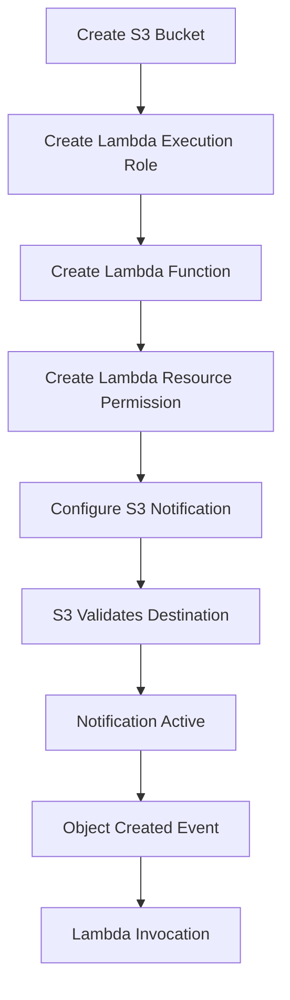
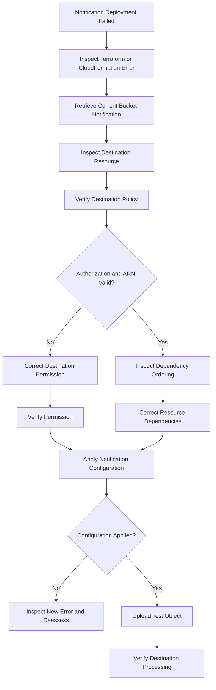

# 08- S3 Notification Dependency Conflicts

## Overview

Amazon S3 event notifications connect object storage operations to downstream services such as AWS Lambda, Amazon SQS, Amazon SNS, and Amazon EventBridge. These integrations introduce dependencies between the S3 bucket, destination resources, resource-based permissions, and infrastructure deployment order.

A notification deployment can fail even when the bucket and destination resources already exist. S3 validates destination configuration when notification settings are applied. If the destination is invalid, unavailable, or does not authorize S3, the configuration update can fail.

Common deployment failures include:

- Lambda permission is missing when the notification is configured.
- SQS queue or SNS topic policies do not authorize S3.
- Terraform creates resources in an incorrect dependency order.
- CloudFormation encounters circular dependencies.
- Multiple infrastructure stacks overwrite the same bucket notification configuration.
- A deployment references an incorrect Lambda alias, ARN, account, or Region.
- A notification update unintentionally removes previously configured destinations.

The central engineering principle is to treat S3 notification configuration as a shared, dependency-sensitive bucket resource rather than an isolated application setting.

## S3 Notification Dependency Model

### Components and Responsibilities

| Component | Responsibility | Dependency |
|---|---|---|
| S3 bucket | Produces object events | Must exist |
| Lambda function | Processes matching events | Must exist before notification configuration |
| Lambda resource policy | Authorizes S3 invocation | Must authorize the source bucket |
| SQS queue | Receives event messages | Must exist and authorize S3 |
| SNS topic | Receives event messages | Must exist and authorize S3 |
| EventBridge | Routes supported S3 events | EventBridge delivery must be enabled |
| Bucket notification configuration | Connects events to destinations | Requires valid destination configuration |
| Deployment identity | Creates and updates infrastructure | Requires permissions for managed resources |

### Lambda Notification Dependency Flow



The critical dependency is between the Lambda resource-based permission and the S3 notification configuration.

Two separate authorization mechanisms are involved:

- **Lambda execution role:** Determines what the function can access after invocation.
- **Lambda resource-based policy:** Determines which principals, including S3, can invoke the function.

Granting the Lambda execution role `s3:GetObject` does not authorize S3 to invoke the function.

## Lambda Permission and Notification Validation Conflicts

### Symptoms

A common deployment error is:

```text
Unable to validate the following destination configurations
```

Other symptoms include:

- Lambda deployment succeeds, but notification configuration fails.
- The bucket exists, but no notification is configured.
- The Lambda permission exists but does not authorize the expected bucket.
- A previously working notification stops functioning after infrastructure changes.

### Likely Causes

| Cause | Why validation fails |
|---|---|
| Missing Lambda permission | S3 cannot invoke the function |
| Incorrect source bucket ARN | Permission does not authorize the actual bucket |
| Incorrect source account | Permission is restricted to another account |
| Region mismatch | Destination is incompatible with the bucket's Region |
| Incorrect function ARN | Notification references a different function or alias |
| Permission propagation delay | Newly created permission may not yet be visible to validation |
| Invalid destination configuration | Function or notification properties are incorrect |
| Competing infrastructure ownership | Another deployment modifies the notification configuration |

### Isolation and Verification

Inspect the current bucket notification configuration:

```bash
aws s3api get-bucket-notification-configuration \
  --bucket company-image-assets \
  --region ap-south-1
```

Inspect the Lambda resource policy:

```bash
aws lambda get-policy \
  --function-name s3-image-processor \
  --region ap-south-1
```

Inspect the Lambda configuration:

```bash
aws lambda get-function-configuration \
  --function-name s3-image-processor \
  --region ap-south-1
```

Retrieve the function ARN:

```bash
aws lambda get-function \
  --function-name s3-image-processor \
  --query 'Configuration.FunctionArn' \
  --output text \
  --region ap-south-1
```

Compare:

- Lambda function ARN configured in the notification.
- Function or alias referenced by the permission.
- Source bucket ARN in the permission.
- AWS account ID in the permission.
- Bucket and Lambda Regions.

The source bucket ARN must use bucket-level ARN syntax:

```text
arn:aws:s3:::company-image-assets
```

It must not contain an object key or `/*` suffix.

### Corrective Action

Create the Lambda permission before configuring the notification:

```bash
aws lambda add-permission \
  --function-name s3-image-processor \
  --statement-id AllowS3Invocation \
  --action lambda:InvokeFunction \
  --principal s3.amazonaws.com \
  --source-arn arn:aws:s3:::company-image-assets \
  --source-account 123456789012 \
  --region ap-south-1
```

Inspect the resulting policy:

```bash
aws lambda get-policy \
  --function-name s3-image-processor \
  --region ap-south-1
```

The expected policy statement should authorize the S3 service principal to invoke the intended function, with conditions restricting access to the expected bucket and account.

After verifying the permission, configure the notification:

```json
{
  "LambdaFunctionConfigurations": [
    {
      "Id": "ImageProcessingNotification",
      "LambdaFunctionArn": "arn:aws:lambda:ap-south-1:123456789012:function:s3-image-processor",
      "Events": [
        "s3:ObjectCreated:*"
      ],
      "Filter": {
        "Key": {
          "FilterRules": [
            {
              "Name": "prefix",
              "Value": "input/"
            }
          ]
        }
      }
    }
  ]
}
```

Apply the configuration:

```bash
aws s3api put-bucket-notification-configuration \
  --bucket company-image-assets \
  --notification-configuration file://notification.json \
  --region ap-south-1
```

**Important:** `put-bucket-notification-configuration` replaces the complete bucket notification configuration. Retrieve and preserve existing Lambda, SQS, SNS, and EventBridge settings before submitting an update.

## Terraform Dependency Conflicts

### Symptoms

Terraform may report:

```text
Error: putting S3 Bucket Notification Configuration
```

Or:

```text
InvalidArgument: Unable to validate the following destination configurations
```

A different failure may indicate:

```text
Error: Cycle: aws_lambda_function..., aws_s3_bucket_notification...
```

### Likely Causes

- Notification resource is created before Lambda permission.
- Lambda permission references a function that does not yet exist.
- Terraform cannot infer the required resource ordering.
- A circular dependency exists between resources.
- Multiple `aws_s3_bucket_notification` resources manage the same bucket.
- Separate Terraform states attempt to manage the same notification configuration.

### Correct Dependency Graph

The intended dependency sequence is:

```text
S3 Bucket
    |
    +-----------------------------+
    |                             |
    v                             v
Lambda Execution Role       Lambda Function
                                  |
                                  v
                         Lambda Resource Policy
                                  |
                                  v
                       S3 Bucket Notification
```

The bucket must exist before notification configuration. The function must exist before its permission can be created. The permission must exist before the notification is applied.

### Corrective Action: Explicit `depends_on`

```hcl
resource "aws_lambda_permission" "allow_s3" {
  statement_id  = "AllowS3Invocation"
  action        = "lambda:InvokeFunction"
  function_name = aws_lambda_function.image_processor.function_name
  principal     = "s3.amazonaws.com"

  source_arn     = aws_s3_bucket.images.arn
  source_account = data.aws_caller_identity.current.account_id
}

resource "aws_s3_bucket_notification" "image_events" {
  bucket = aws_s3_bucket.images.id

  lambda_function {
    lambda_function_arn = aws_lambda_function.image_processor.arn
    events              = ["s3:ObjectCreated:*"]
    filter_prefix       = "input/"
  }

  depends_on = [
    aws_lambda_permission.allow_s3
  ]
}
```

Terraform infers dependencies from resource references. The explicit `depends_on` communicates that notification configuration must wait for the permission resource.

### Complete Terraform Example

The following example demonstrates the dependency ordering for a Lambda-backed S3 notification.

```hcl
terraform {
  required_version = ">= 1.6.0, < 2.0.0"

  required_providers {
    aws = {
      source  = "hashicorp/aws"
      version = "~> 6.0"
    }
  }
}

provider "aws" {
  region = var.aws_region
}

variable "aws_region" {
  type    = string
  default = "ap-south-1"
}

variable "bucket_name" {
  type = string
}

variable "function_name" {
  type    = string
  default = "s3-image-processor"
}

data "aws_caller_identity" "current" {}

resource "aws_s3_bucket" "images" {
  bucket = var.bucket_name
}

resource "aws_iam_role" "lambda_execution" {
  name = "${var.function_name}-execution"

  assume_role_policy = jsonencode({
    Version = "2012-10-17"
    Statement = [
      {
        Effect = "Allow"
        Principal = {
          Service = "lambda.amazonaws.com"
        }
        Action = "sts:AssumeRole"
      }
    ]
  })
}

resource "aws_iam_role_policy_attachment" "lambda_logs" {
  role       = aws_iam_role.lambda_execution.name
  policy_arn = "arn:aws:iam::aws:policy/service-role/AWSLambdaBasicExecutionRole"
}

resource "aws_lambda_function" "image_processor" {
  function_name = var.function_name
  role          = aws_iam_role.lambda_execution.arn

  filename         = "${path.module}/deployment.zip"
  source_code_hash = filebase64sha256("${path.module}/deployment.zip"

  runtime       = "python3.12"
  handler       = "lambda_function.lambda_handler"
  architectures = ["x86_64"]

  timeout     = 60
  memory_size = 1024

  environment {
    variables = {
      BUCKET_NAME = aws_s3_bucket.images.bucket
    }
  }

  depends_on = [
    aws_iam_role_policy_attachment.lambda_logs
  ]
}

resource "aws_lambda_permission" "allow_s3" {
  statement_id  = "AllowS3Invocation"
  action        = "lambda:InvokeFunction"
  function_name = aws_lambda_function.image_processor.function_name
  principal     = "s3.amazonaws.com"

  source_arn     = aws_s3_bucket.images.arn
  source_account = data.aws_caller_identity.current.account_id
}

resource "aws_s3_bucket_notification" "image_events" {
  bucket = aws_s3_bucket.images.id

  lambda_function {
    lambda_function_arn = aws_lambda_function.image_processor.arn
    events              = ["s3:ObjectCreated:*"]
    filter_prefix       = "input/"
  }

  depends_on = [
    aws_lambda_permission.allow_s3
  ]
}
```

This example assumes:

- `deployment.zip` exists and contains `lambda_function.lambda_handler`.
- The bucket name is globally available.
- The deployment identity can create the required S3, IAM, and Lambda resources.
- The bucket and Lambda function are in the same Region.
- The Lambda package is compatible with the selected runtime and architecture.

The example focuses on notification dependencies. A production bucket should also have encryption, public-access blocking, ownership, versioning, and other required controls configured explicitly.

### Validate Before Deployment

```bash
terraform fmt -check
terraform init
terraform validate
terraform plan
```

Apply:

```bash
terraform apply
```

Verify the permission:

```bash
aws lambda get-policy \
  --function-name s3-image-processor \
  --region ap-south-1
```

Verify the notification:

```bash
aws s3api get-bucket-notification-configuration \
  --bucket company-image-assets \
  --region ap-south-1
```

### Multiple Notification Resources

A common Terraform anti-pattern is defining separate notification resources for different destinations on the same bucket.

For example:

```hcl
resource "aws_s3_bucket_notification" "lambda_events" {
  bucket = aws_s3_bucket.images.id

  lambda_function {
    lambda_function_arn = aws_lambda_function.processor.arn
    events              = ["s3:ObjectCreated:*"]
  }
}
```

Another module independently defines:

```hcl
resource "aws_s3_bucket_notification" "sqs_events" {
  bucket = aws_s3_bucket.images.id

  queue {
    queue_arn = aws_sqs_queue.processing.arn
    events    = ["s3:ObjectCreated:*"]
  }
}
```

Both resources attempt to manage the same bucket-level notification configuration. One apply can overwrite the configuration managed by the other.

**Corrective action:** Use one authoritative notification resource for all destinations.

```hcl
resource "aws_s3_bucket_notification" "all_events" {
  bucket = aws_s3_bucket.images.id

  lambda_function {
    lambda_function_arn = aws_lambda_function.processor.arn
    events              = ["s3:ObjectCreated:*"]
    filter_prefix       = "input/"
  }

  queue {
    queue_arn     = aws_sqs_queue.processing.arn
    events        = ["s3:ObjectCreated:*"]
    filter_prefix = "documents/"
  }

  depends_on = [
    aws_lambda_permission.allow_s3,
    aws_sqs_queue_policy.allow_s3
  ]
}
```

Keep all destinations for a bucket under the same infrastructure ownership boundary.

## CloudFormation Circular Dependency Conflicts

### Symptoms

CloudFormation may report:

```text
Circular dependency between resources
```

The stack may also fail while creating or updating the S3 bucket notification configuration.

### Why the Dependency Cycle Occurs

A circular dependency can occur when:

1. The bucket resource includes notification configuration referencing a Lambda function.
2. Lambda permission references the bucket ARN.
3. CloudFormation establishes an implicit dependency between the bucket and its notification destination.
4. The resulting resource graph cannot be ordered.

The exact dependency graph depends on the template structure and resource references.

### Isolation and Verification

Inspect stack events:

```bash
aws cloudformation describe-stack-events \
  --stack-name s3-image-processing \
  --region ap-south-1
```

Retrieve the deployed template:

```bash
aws cloudformation get-template \
  --stack-name s3-image-processing \
  --template-stage Original \
  --region ap-south-1
```

Review:

- `DependsOn`.
- `Ref`.
- `GetAtt`.
- Bucket notification properties.
- Lambda permission source ARN.
- Cross-stack exports and imports.

Identify the first resource failure rather than treating the final stack rollback message as the root cause.

### Corrective Action: Separate Notification Deployment

A practical approach is to separate bucket creation, Lambda deployment, and notification activation into distinct deployment stages.

```text
Storage Stack
    |
    v
Lambda Stack
    |
    v
Notification Stack
```

The notification stack receives the bucket name and Lambda ARN as parameters or stack outputs.

This allows the bucket and Lambda function to exist before notification configuration is applied.

### CloudFormation Resource Ordering

For a Lambda permission managed in the same stack as a notification configuration, make the notification resource depend on the permission where the template structure permits it.

For example, a notification configuration managed by a custom resource can explicitly depend on the permission:

```yaml
AllowS3Invocation:
  Type: AWS::Lambda::Permission
  Properties:
    FunctionName: !GetAtt ImageProcessor.Arn
    Action: lambda:InvokeFunction
    Principal: s3.amazonaws.com
    SourceAccount: !Ref AWS::AccountId
    SourceArn: !Sub arn:aws:s3:::${BucketName}

NotificationConfiguration:
  Type: Custom::S3NotificationConfiguration
  DependsOn:
    - AllowS3Invocation
  Properties:
    ServiceToken: !GetAtt NotificationManager.Arn
    BucketName: !Ref BucketName
    LambdaFunctionArn: !GetAtt ImageProcessor.Arn
```

`Custom::S3NotificationConfiguration` is an illustrative custom resource type. It requires a separately implemented Lambda provider that handles create, update, and delete operations and manages the bucket notification configuration.

Do not copy this fragment as a standalone CloudFormation solution.

For production deployments, prefer a design with explicit ownership of the bucket notification configuration. Custom resources introduce additional lifecycle, retry, permission, and rollback responsibilities.

## SQS and SNS Destination Policy Conflicts

S3 notifications can target SQS queues and SNS topics. These destinations require resource-based policies that authorize S3 to send messages or publish events.

### SQS Symptoms

Typical symptoms include:

```text
Unable to validate the following destination configurations
```

Other evidence:

- Queue exists, but notification configuration fails.
- Notification configuration succeeds, but no messages arrive.
- Queue policy contains a different bucket ARN.
- Encrypted queue delivery fails.

### Likely Causes

- Queue policy does not authorize `s3.amazonaws.com`.
- Queue policy uses an incorrect source bucket ARN.
- Source account restriction is incorrect.
- Queue and bucket are in incompatible Regions.
- Queue uses a customer-managed KMS key without the necessary permissions.
- Notification references the wrong queue ARN.

### Isolation and Verification

Inspect the queue policy:

```bash
aws sqs get-queue-attributes \
  --queue-url QUEUE_URL \
  --attribute-names Policy \
  --region ap-south-1
```

Verify:

- S3 service principal.
- `sqs:SendMessage` action.
- Queue ARN in the policy resource.
- Source bucket ARN.
- Source account.
- Encryption configuration, if applicable.

### Corrective Action: SQS Queue Policy

```json
{
  "Version": "2012-10-17",
  "Statement": [
    {
      "Sid": "AllowS3SendMessage",
      "Effect": "Allow",
      "Principal": {
        "Service": "s3.amazonaws.com"
      },
      "Action": "sqs:SendMessage",
      "Resource": "arn:aws:sqs:ap-south-1:123456789012:image-processing-queue",
      "Condition": {
        "ArnEquals": {
          "aws:SourceArn": "arn:aws:s3:::company-image-assets"
        },
        "StringEquals": {
          "aws:SourceAccount": "123456789012"
        }
      }
    }
  ]
}
```

Apply the policy using the queue's `set-queue-attributes` API or an infrastructure resource.

For encrypted queues, validate the KMS key configuration and the permissions required for the S3-to-SQS integration separately from the queue policy.

### SNS Symptoms

S3 cannot validate the SNS destination, or messages are not delivered.

### Likely Causes

- Topic policy does not authorize S3 publishing.
- Topic ARN is incorrect.
- Topic and bucket are in incompatible Regions.
- KMS key configuration prevents the integration.
- Notification references an incorrect topic.

### Isolation and Verification

Inspect topic attributes:

```bash
aws sns get-topic-attributes \
  --topic-arn arn:aws:sns:ap-south-1:123456789012:image-processing-events \
  --region ap-south-1
```

Check the topic policy and encryption configuration.

### Corrective Action: SNS Topic Policy

```json
{
  "Version": "2012-10-17",
  "Statement": [
    {
      "Sid": "AllowS3Publish",
      "Effect": "Allow",
      "Principal": {
        "Service": "s3.amazonaws.com"
      },
      "Action": "SNS:Publish",
      "Resource": "arn:aws:sns:ap-south-1:123456789012:image-processing-events",
      "Condition": {
        "ArnEquals": {
          "aws:SourceArn": "arn:aws:s3:::company-image-assets"
        },
        "StringEquals": {
          "aws:SourceAccount": "123456789012"
        }
      }
    }
  ]
}
```

Verify the topic policy before applying the S3 notification configuration.

### Destination Comparison

| Destination | Authorization mechanism | Required authorization |
|---|---|---|
| Lambda | Lambda resource-based policy | `lambda:InvokeFunction` |
| SQS | Queue resource policy | `sqs:SendMessage` |
| SNS | Topic resource policy | `SNS:Publish` |
| EventBridge | EventBridge integration and target permissions | Enable S3 event delivery and authorize rule targets |

Validate destination-specific Region, account, and encryption restrictions before deployment.

## Lambda Alias and Qualified ARN Conflicts

### Symptoms

- Permission exists, but notification validation fails.
- Notification invokes the unqualified function instead of the production alias.
- Policy inspection shows permission attached to an unexpected function or alias.
- New Lambda versions are published, but event processing still uses an older version.

### Likely Causes

- Permission references an unqualified function ARN.
- Notification references a qualified alias ARN.
- Permission and notification target different aliases.
- Alias was replaced or renamed.
- Deployment updates the function version but not the intended alias.

### Isolation and Verification

List aliases:

```bash
aws lambda list-aliases \
  --function-name s3-image-processor \
  --region ap-south-1
```

Inspect the production alias:

```bash
aws lambda get-alias \
  --function-name s3-image-processor \
  --name production \
  --region ap-south-1
```

Inspect the resource policy for the exact function or qualified alias used by the notification.

### Corrective Action

If the notification targets the production alias, create the permission for that alias:

```bash
aws lambda add-permission \
  --function-name s3-image-processor \
  --qualifier production \
  --statement-id AllowS3ProductionInvocation \
  --action lambda:InvokeFunction \
  --principal s3.amazonaws.com \
  --source-arn arn:aws:s3:::company-image-assets \
  --source-account 123456789012 \
  --region ap-south-1
```

The notification must reference the qualified ARN:

```text
arn:aws:lambda:ap-south-1:123456789012:function:s3-image-processor:production
```

Validate the exact permission target. Do not assume that a permission attached to an unqualified function automatically authorizes every alias configuration.

## Region and Account Dependency Conflicts

### Symptoms

- Notification destination validation fails.
- Destination exists but is rejected by S3.
- Development works, but production deployment fails.
- Cross-account notification deployment fails despite a valid destination ARN.

### Likely Causes

- Bucket and Lambda function are in different Regions.
- Bucket and SQS or SNS destination are in different Regions.
- Notification references a destination in another AWS account.
- Destination resource policy does not authorize the source bucket.
- Deployment variables point to resources in another environment.

### Isolation and Verification

Inspect the bucket location:

```bash
aws s3api get-bucket-location \
  --bucket company-image-assets
```

Inspect the Lambda function:

```bash
aws lambda get-function \
  --function-name s3-image-processor \
  --region ap-south-1
```

Inspect the active deployment identity:

```bash
aws sts get-caller-identity
```

Compare account and Region components of each resource ARN.

### Corrective Action

Use environment-specific configuration:

```hcl
variable "aws_region" {
  type = string
}

variable "bucket_name" {
  type = string
}

variable "lambda_function_arn" {
  type = string
}
```

Avoid hardcoding development ARNs or account IDs in production notification configuration.

For cross-account integrations, verify that the destination type supports the intended account arrangement and that all required resource policies are configured.

## Notification Configuration Overwrites

### Symptoms

- A Lambda notification disappears after an SQS deployment.
- SQS notifications stop after a Terraform apply.
- The AWS Console shows fewer destinations than expected.
- One application's deployment unexpectedly affects another application.

### Root Cause

S3 notification settings are maintained as a bucket-level configuration.

An update to the notification configuration can replace the existing configuration. This creates ownership conflicts when several applications or deployment systems manage the same bucket.

Common causes include:

- Multiple Terraform states managing the same bucket notifications.
- Manual CLI updates while Terraform manages the configuration.
- CloudFormation replacing settings managed by another stack.
- Deployment scripts submitting only one destination.

### Isolation and Verification

Retrieve the full configuration:

```bash
aws s3api get-bucket-notification-configuration \
  --bucket company-image-assets \
  --region ap-south-1
```

Compare the current configuration with the intended infrastructure definition.

Identify which deployment last modified the bucket configuration.

### Corrective Action

Establish one authoritative owner for each bucket notification configuration.

| Ownership model | Recommendation |
|---|---|
| One Terraform resource manages all destinations | Preferred for Terraform-managed infrastructure |
| Dedicated infrastructure stack manages notifications | Useful for shared buckets |
| Multiple independent Terraform states manage one bucket | Avoid |
| Manual updates alongside IaC ownership | Avoid without controlled reconciliation |

If several applications need the same event stream, consider enabling EventBridge delivery and centralizing routing through rules and targets.

This reduces direct notification ownership conflicts but introduces EventBridge rule, target permission, monitoring, and retry responsibilities.

## Deployment Race Conditions and Permission Propagation

### Symptoms

- Lambda permission creation succeeds, but notification validation immediately fails.
- Re-running the deployment succeeds without configuration changes.
- Failures occur intermittently in CI/CD.
- The same Terraform plan behaves differently across environments.

### Likely Causes

- Resource policy changes are not immediately visible to all validation paths.
- Multiple deployment jobs modify the same bucket.
- Infrastructure is deployed concurrently.
- Notification configuration is applied before destination readiness.
- Deployment scripts do not wait for resource updates to complete.

### Isolation and Verification

Inspect deployment logs and resource creation timestamps.

Check the Lambda policy:

```bash
aws lambda get-policy \
  --function-name s3-image-processor \
  --region ap-south-1
```

Check the bucket notification configuration:

```bash
aws s3api get-bucket-notification-configuration \
  --bucket company-image-assets \
  --region ap-south-1
```

Determine whether the permission was absent or incorrect when the notification update was attempted.

### Corrective Action

- Enforce explicit resource dependencies.
- Prevent concurrent deployments against shared bucket configuration.
- Separate destination provisioning from notification activation when necessary.
- Use bounded retries for transient validation failures.
- Re-read destination policies before retrying.
- Do not retry permanent configuration errors without changing the configuration.

Retries should be used only after confirming that the destination configuration is valid and the remaining failure is transient.

## EventBridge Integration Conflicts

### Integration Model

S3 can deliver supported event types to EventBridge after EventBridge notifications are enabled on the bucket.

EventBridge is useful when several applications need the same event stream or when event filtering and routing should be managed independently from direct S3 notification destinations.

### Symptoms

- Objects are created, but EventBridge rules do not match.
- The rule exists, but its target is not invoked.
- Events appear in EventBridge but fail at the target.
- Direct Lambda notification works while EventBridge routing fails.

### Isolation and Verification

Inspect the bucket notification configuration:

```bash
aws s3api get-bucket-notification-configuration \
  --bucket company-image-assets \
  --region ap-south-1
```

Inspect the EventBridge rule:

```bash
aws events describe-rule \
  --name s3-object-created-rule \
  --region ap-south-1
```

Inspect targets:

```bash
aws events list-targets-by-rule \
  --rule s3-object-created-rule \
  --region ap-south-1
```

### Likely Causes

- EventBridge delivery is not enabled for the bucket.
- Event pattern does not match the actual event structure.
- Target permission is missing.
- Rule is disabled.
- Target ARN references the wrong environment.
- Event processing fails after successful delivery.

### Corrective Action

Enable EventBridge delivery:

```bash
aws s3api put-bucket-notification-configuration \
  --bucket company-image-assets \
  --notification-configuration '{"EventBridgeConfiguration":{}}' \
  --region ap-south-1
```

**Important:** This command replaces the complete notification configuration. Preserve existing destinations before applying it.

Configure the EventBridge rule and target separately. Verify target permissions and inspect EventBridge metrics and target execution logs.

## Deployment Recovery Procedure

When notification deployment fails, recover the configuration in a controlled sequence.

### Recovery Workflow



### Step-by-Step Recovery

1. Stop concurrent deployments affecting the bucket.
2. Capture the current notification configuration.
3. Inspect the first failed resource and original deployment error.
4. Verify destination ARN, Region, account, and resource policy.
5. Correct the destination permission.
6. Correct Terraform or CloudFormation dependency ordering.
7. Reapply the complete intended notification configuration.
8. Verify the configuration through the S3 API.
9. Upload a test object matching the configured filters.
10. Verify event delivery and downstream processing.

### Preserve Existing Configuration

Capture the current notification configuration:

```bash
aws s3api get-bucket-notification-configuration \
  --bucket company-image-assets \
  --region ap-south-1 \
  > current-notifications.json
```

Review the file before preparing an update.

Preserve all existing Lambda, SQS, SNS, and EventBridge destinations. Do not use a simplified notification document to overwrite a shared production bucket configuration.

## Operational Verification and Testing

A successful infrastructure deployment does not prove that the event-processing workflow works end to end.

Test both configuration and runtime behavior.

### Configuration Verification

| Check | Verification |
|---|---|
| Bucket exists | `aws s3api head-bucket` |
| Lambda exists | `aws lambda get-function` |
| Lambda permission exists | `aws lambda get-policy` |
| Bucket notification exists | `aws s3api get-bucket-notification-configuration` |
| SQS policy is correct | `aws sqs get-queue-attributes` |
| SNS policy is correct | `aws sns get-topic-attributes` |
| EventBridge rule is enabled | `aws events describe-rule` |
| EventBridge target exists | `aws events list-targets-by-rule` |

### End-to-End Test

Upload an object matching the configured prefix:

```bash
aws s3 cp sample.jpg \
  s3://company-image-assets/input/sample.jpg \
  --region ap-south-1
```

Inspect Lambda logs:

```bash
aws logs tail \
  /aws/lambda/s3-image-processor \
  --since 10m \
  --follow \
  --region ap-south-1
```

For SQS, use a controlled consumer to receive and inspect test messages.

For SNS, verify topic subscriptions and message delivery.

For EventBridge, inspect rule metrics and target execution results.

### Negative Tests

Verify that:

- Objects outside the configured prefix do not trigger the intended processor.
- Unsupported event types are not processed.
- Output objects do not recursively trigger the function.
- Duplicate events do not create duplicate business effects.
- Unauthorized principals cannot invoke the function.
- Existing notification destinations remain configured after deployment.

### Idempotency and Duplicate Events

S3 event notifications are delivered at least once. Consumers must tolerate duplicate events.

For object-processing workloads, a processing identity can include:

```text
bucket + object key + version ID + processing version
```

Persist processing state in a durable store such as DynamoDB or PostgreSQL when duplicate side effects must be prevented across concurrent invocations.

Do not assume event delivery order. If processing depends on object versions, use the version ID in the event to retrieve the intended object version rather than blindly reading the latest object at the key.

## Prevention and Production Best Practices

### Infrastructure Ownership

- Manage a bucket's complete notification configuration from one authoritative infrastructure resource.
- Avoid multiple Terraform states managing the same notification configuration.
- Keep notification ownership separate from unrelated application deployments when appropriate.
- Document cross-stack dependencies.
- Serialize deployments that modify shared bucket configuration.

### Authorization

- Scope Lambda permissions to the intended bucket ARN and source account.
- Use destination resource policies for SQS and SNS.
- Avoid broad service-principal permissions without source restrictions.
- Keep execution-role permissions separate from invocation permissions.
- Review KMS authorization separately when encrypted destinations are involved.

### Deployment Reliability

- Create destination resources before configuring notifications.
- Model resource dependencies explicitly.
- Verify destination policies before applying notification configuration.
- Use bounded retries only for genuinely transient failures.
- Test notification configuration after deployment.
- Preserve the previous configuration for recovery.
- Use environment-specific resource ARNs and account IDs.

### Event Processing

- Design consumers for at-least-once delivery.
- Implement idempotent processing.
- Separate input and output prefixes.
- Use SQS buffering when independent retry, backpressure, or dead-letter handling is required.
- Monitor failed processing and queue age.
- Define a recovery procedure for permanently failed events.

## Production Readiness Checklist

### Destination Configuration

- [ ] S3 bucket and destination use compatible Regions.
- [ ] Destination ARN references the correct environment.
- [ ] Lambda resource policy authorizes the source bucket.
- [ ] SQS queue policy authorizes S3 when SQS is used.
- [ ] SNS topic policy authorizes S3 when SNS is used.
- [ ] KMS permissions are validated for encrypted integrations.
- [ ] Source account restrictions are correct.

### Infrastructure Dependencies

- [ ] Lambda function exists before permission creation.
- [ ] Lambda permission exists before notification configuration.
- [ ] Terraform has one authoritative notification resource per bucket.
- [ ] CloudFormation dependencies do not create cycles.
- [ ] Shared bucket notification configuration is preserved.
- [ ] Concurrent deployments cannot overwrite notification settings.

### Runtime and Recovery

- [ ] Event filters match intended object prefixes and event types.
- [ ] Duplicate event processing is safe.
- [ ] Recursive invocation is prevented.
- [ ] End-to-end event delivery has been tested.
- [ ] Failed events can be investigated and recovered.
- [ ] Monitoring and alerting cover delivery and processing failures.
- [ ] Previous notification configuration can be restored.

## Key Takeaways

- S3 notification deployment failures commonly result from missing destination permissions, invalid ARNs, Region mismatches, or incorrect infrastructure dependency ordering.
- Lambda invocation permission is separate from its execution role; SQS and SNS require their own destination resource policies.
- Terraform should manage each bucket's complete notification configuration through one authoritative resource, with dependencies on destination permissions.
- CloudFormation circular dependencies can be avoided by separating bucket creation, destination provisioning, and notification activation into controlled deployment stages.
- Production notification workflows must preserve existing configuration, verify actual event delivery, and tolerate duplicate and out-of-order events.