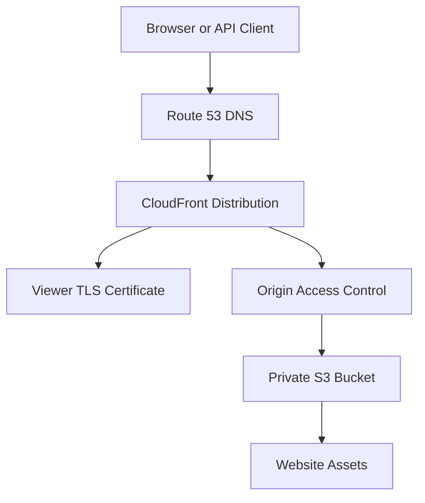
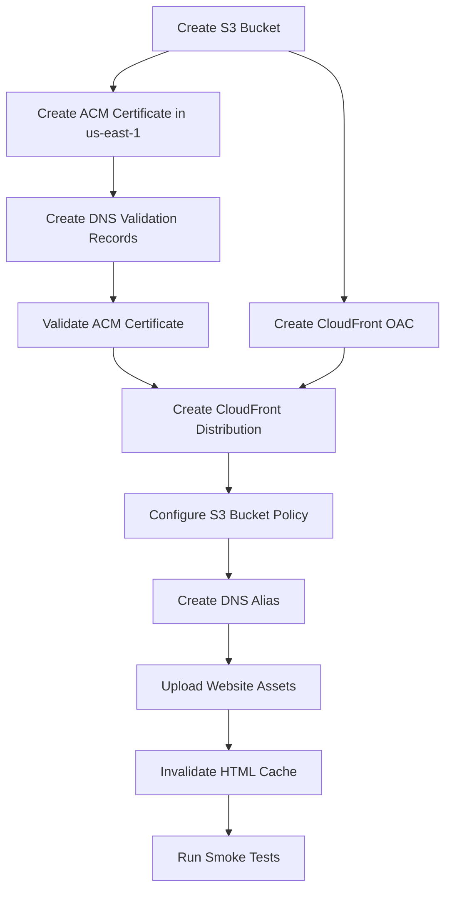
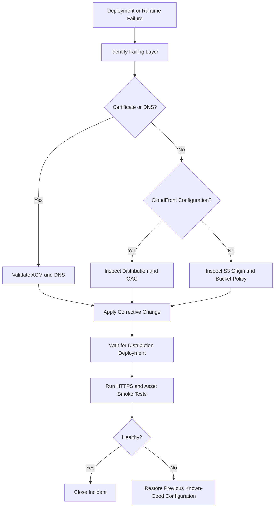

# 09- CloudFront Deployment and Certificate Errors

## Overview

Amazon CloudFront is commonly deployed in front of Amazon S3 to distribute static websites, images, documents, and application assets through a globally distributed content delivery network.

A production deployment involves several independently configured components:

- S3 bucket and origin configuration.
- CloudFront distribution and cache behaviors.
- Origin Access Control (OAC).
- AWS Certificate Manager (ACM) viewer certificates.
- DNS records and custom domain configuration.
- Cache policies and origin request policies.
- IAM permissions and S3 bucket policies.
- Infrastructure provisioning and application deployment pipelines.

Failures across these components can prevent users from accessing content even when the S3 bucket and objects are available.

Common failure categories include:

| Failure category | Typical symptom |
|---|---|
| Distribution deployment | CloudFront distribution creation or update fails |
| Certificate configuration | `InvalidViewerCertificate` |
| Domain association | `CNAMEAlreadyExists` |
| Origin authorization | `403 AccessDenied` |
| Origin connectivity | `502 Bad Gateway` or `504 Gateway Timeout` |
| DNS configuration | Custom domain resolves incorrectly |
| Cache configuration | Stale content or unexpected cache behavior |
| Infrastructure dependencies | Terraform or CloudFormation deployment failures |
| CI/CD permissions | Deployment or invalidation operations fail |

The most effective troubleshooting approach is to isolate the request path instead of changing multiple AWS resources simultaneously.

## CloudFront Deployment Architecture

### Private S3 Origin Architecture

For production static websites, a common architecture uses a private S3 bucket accessed through CloudFront Origin Access Control.

OAC allows CloudFront to authenticate requests to S3 without making the bucket publicly accessible.



### Component Responsibilities

| Component | Responsibility | Common failure |
|---|---|---|
| Route 53 | Resolves application domain | Incorrect alias record |
| ACM | Provides viewer TLS certificate | Certificate validation failure |
| CloudFront | Distributes content globally | Distribution deployment failure |
| OAC | Authenticates CloudFront origin requests | Incorrect origin access configuration |
| S3 | Stores website assets | Missing object or denied access |
| Bucket policy | Authorizes CloudFront access | Incorrect distribution ARN |
| Cache policy | Controls caching behavior | Stale or incorrectly cached content |

### Separate Viewer and Origin Security

CloudFront viewer certificates and S3 origin access solve different problems.

- ACM viewer certificates secure browser-to-CloudFront connections.
- OAC and S3 bucket policies secure CloudFront-to-S3 access.
- A valid viewer certificate does not authorize CloudFront to read S3 objects.
- A correct S3 bucket policy does not resolve an invalid viewer certificate.

Diagnose these layers independently.

## CloudFront Distribution Deployment Failures

### Symptoms and Observable Evidence

Typical symptoms include:

```text
DistributionNotDeployed
```

```text
InvalidArgument
```

```text
CNAMEAlreadyExists
```

```text
InvalidViewerCertificate
```

Other observable behavior:

- Terraform creates the distribution, but deployment remains in progress.
- CloudFormation reports a distribution resource failure.
- Distribution configuration updates take longer than expected.
- The distribution is deployed, but the custom domain does not work.
- A new origin configuration is not reflected in production.

### Likely Causes

| Cause | Explanation |
|---|---|
| Invalid origin domain | Distribution references an incorrect S3 origin |
| Invalid certificate | Certificate does not satisfy CloudFront requirements |
| Incorrect aliases | Custom domain conflicts with another distribution |
| Missing permissions | Deployment identity cannot manage required resources |
| Incorrect OAC | Origin authentication configuration is invalid |
| Resource dependency conflict | Distribution references resources that are not ready |
| Invalid cache policy | Distribution references an incorrect policy identifier |
| Configuration propagation | Distribution update is still deploying |

### Isolation and Verification

List distributions:

```bash
aws cloudfront list-distributions \
  --query 'DistributionList.Items[].{Id:Id,Domain:DomainName,Status:Status,Enabled:Enabled}' \
  --output table
```

Inspect a distribution:

```bash
aws cloudfront get-distribution \
  --id E123456789EXAMPLE
```

Inspect its configuration:

```bash
aws cloudfront get-distribution-config \
  --id E123456789EXAMPLE
```

Check:

- Distribution status.
- Enabled state.
- Origin domain.
- Origin access control ID.
- Viewer certificate ARN.
- Alternate domain names.
- Default root object.
- Cache behavior.
- Origin request policy.
- Response headers policy.

A distribution with status `InProgress` is still being deployed. A successful configuration API response does not mean that the updated configuration is already active globally.

### Corrective Action

Wait for distribution deployment:

```bash
aws cloudfront wait distribution-deployed \
  --id E123456789EXAMPLE
```

Reinspect the distribution:

```bash
aws cloudfront get-distribution \
  --id E123456789EXAMPLE \
  --query 'Distribution.{Status:Status,Domain:DomainName,Enabled:DistributionConfig.Enabled}'
```

Perform application-level validation only after the distribution reports that it is deployed.

## ACM Certificate Region and Validation Errors

### Why Certificate Configuration Fails

CloudFront requires its ACM viewer certificate to be provisioned in **US East (N. Virginia), `us-east-1`**.

This requirement is independent of the Region where the S3 bucket and application infrastructure are deployed.

For example, an S3 bucket may be in `ap-south-1`, while the ACM certificate used by CloudFront must be in `us-east-1`.

### Common Certificate Errors

| Error or symptom | Likely cause |
|---|---|
| `InvalidViewerCertificate` | Certificate is invalid, incompatible, or unavailable |
| Certificate not found | ARN references another Region or account |
| Certificate validation pending | Domain ownership validation is incomplete |
| Certificate expired | Certificate is no longer valid |
| Domain mismatch | Certificate does not cover the requested hostname |
| Unsupported certificate configuration | Certificate does not satisfy CloudFront requirements |

### Isolation and Verification

Inspect certificates in `us-east-1`:

```bash
aws acm list-certificates \
  --region us-east-1 \
  --certificate-statuses ISSUED
```

Inspect a specific certificate:

```bash
aws acm describe-certificate \
  --certificate-arn arn:aws:acm:us-east-1:123456789012:certificate/EXAMPLE-ID \
  --region us-east-1
```

Check:

- Certificate status is `ISSUED`.
- Certificate belongs to the intended AWS account.
- Certificate is in `us-east-1`.
- Certificate domain names cover the configured CloudFront aliases.
- Certificate is not expired or otherwise invalid.
- Required DNS validation records exist.

### Corrective Action

Request a certificate in `us-east-1`:

```bash
aws acm request-certificate \
  --domain-name example.com \
  --subject-alternative-names '*.example.com' \
  --validation-method DNS \
  --region us-east-1
```

Retrieve certificate details:

```bash
aws acm describe-certificate \
  --certificate-arn CERTIFICATE_ARN \
  --region us-east-1
```

Retrieve DNS validation records:

```bash
aws acm describe-certificate \
  --certificate-arn CERTIFICATE_ARN \
  --region us-east-1 \
  --query 'Certificate.DomainValidationOptions[].ResourceRecord'
```

Create the required DNS validation records in the authoritative DNS provider.

Wait until the certificate reaches:

```text
ISSUED
```

Then reference its ARN in the CloudFront distribution.

### Terraform Provider Configuration

Use a separate provider configuration for ACM.

```hcl
provider "aws" {
  region = var.aws_region
}

provider "aws" {
  alias  = "us_east_1"
  region = "us-east-1"
}
```

Request the certificate through the aliased provider:

```hcl
resource "aws_acm_certificate" "cloudfront" {
  provider          = aws.us_east_1
  domain_name       = var.domain_name
  validation_method = "DNS"

  subject_alternative_names = [
    "*.${var.domain_name}"
  ]

  lifecycle {
    create_before_destroy = true
  }
}
```

Create DNS validation records from the certificate's domain validation options. The DNS zone may require a separate provider configuration if it is managed in another AWS account.

Wait for certificate validation:

```hcl
resource "aws_acm_certificate_validation" "cloudfront" {
  provider        = aws.us_east_1
  certificate_arn = aws_acm_certificate.cloudfront.arn

  validation_record_fqdns = [
    for record in aws_route53_record.validation :
    record.fqdn
  ]
}
```

Associate the validated certificate with the distribution:

```hcl
viewer_certificate {
  acm_certificate_arn      = aws_acm_certificate_validation.cloudfront.certificate_arn
  ssl_support_method       = "sni-only"
  minimum_protocol_version = "TLSv1.2_2021"
}
```

### Production Considerations

- Do not request a new certificate on every deployment.
- Keep DNS validation records intact.
- Use DNS validation for automated renewal.
- Avoid replacing a working certificate unnecessarily.
- Monitor certificate expiration and renewal status.
- Ensure the certificate covers every configured alternate domain name.

## InvalidViewerCertificate Errors

### Symptoms

CloudFront distribution creation or update fails with:

```text
InvalidViewerCertificate
```

### Likely Causes

- ACM certificate is not in `us-east-1`.
- Certificate is not `ISSUED`.
- Certificate ARN belongs to another account.
- Certificate does not cover the requested domain.
- Certificate is incompatible with the requested CloudFront configuration.
- Distribution references an incorrect certificate ARN.
- Certificate has been deleted or replaced.

### Isolation and Verification

Retrieve the configured certificate ARN:

```bash
aws cloudfront get-distribution-config \
  --id E123456789EXAMPLE \
  --query 'DistributionConfig.ViewerCertificate'
```

Inspect the certificate:

```bash
aws acm describe-certificate \
  --certificate-arn CERTIFICATE_ARN \
  --region us-east-1
```

Compare the certificate's domain names with the distribution aliases.

### Corrective Action

1. Issue or locate the correct certificate in `us-east-1`.
2. Complete DNS validation.
3. Confirm certificate status is `ISSUED`.
4. Verify the certificate covers all configured aliases.
5. Update the distribution to use the correct certificate ARN.
6. Wait for distribution deployment.

Do not attempt to fix an ACM Region mismatch by changing the S3 bucket Region. CloudFront viewer certificate placement is independent of the origin bucket's Region.

## CNAMEAlreadyExists Errors

### Symptoms

CloudFront returns:

```text
CNAMEAlreadyExists
```

This occurs when attempting to associate a custom domain with a distribution that is not permitted to use that alternate domain name because it is already associated elsewhere.

### Likely Causes

- Another CloudFront distribution already owns the alternate domain name.
- A previous distribution was not fully removed.
- A migration attempts to attach the same hostname to two distributions.
- Multiple environments use the same hostname.
- A stale distribution configuration remains active.

### Isolation and Verification

List distributions and their aliases:

```bash
aws cloudfront list-distributions \
  --query 'DistributionList.Items[].{Id:Id,Domain:DomainName,Aliases:Aliases.Items}' \
  --output json
```

Identify the distribution currently associated with the hostname.

Inspect its configuration:

```bash
aws cloudfront get-distribution-config \
  --id EXISTING_DISTRIBUTION_ID
```

### Corrective Action

Use a controlled domain migration:

1. Identify the current distribution.
2. Confirm the replacement distribution is ready.
3. Plan the hostname transfer.
4. Remove or transfer the alternate domain name from the old distribution using the supported CloudFront domain migration procedure.
5. Associate the hostname with the intended distribution.
6. Verify DNS and HTTPS after deployment.

CloudFront supports specific domain migration mechanisms, including domain association transfer workflows. Use the supported process rather than assuming that deleting a DNS record releases the alternate domain name.

Do not disable or delete the existing production distribution until the replacement path has been validated.

## CloudFront 403 AccessDenied Errors

### Symptoms and Observable Evidence

The distribution is deployed, but requests return:

```text
403 Forbidden
```

or:

```xml
<Error>
  <Code>AccessDenied</Code>
  <Message>Access Denied</Message>
</Error>
```

A `403` may originate from CloudFront or S3. The response alone does not establish which layer rejected the request.

### Likely Causes

| Cause | Explanation |
|---|---|
| Missing S3 bucket permission | CloudFront is not authorized to read objects |
| Incorrect OAC | Distribution uses an incorrect or missing origin access control |
| Wrong bucket policy | Policy references another distribution |
| Object does not exist | S3 may return an authorization-style response depending on permissions |
| Incorrect origin path | CloudFront requests an unexpected S3 key |
| Missing default root object | Root request does not resolve to the expected entry point |
| Incorrect object ownership | Object ownership or ACL configuration prevents expected access |
| KMS authorization failure | CloudFront cannot access the encrypted object |
| Signed URL or cookie failure | Viewer authorization requirements are not satisfied |

### Isolation and Verification

First, test direct S3 access using an authorized AWS identity:

```bash
aws s3api head-object \
  --bucket company-static-assets \
  --key index.html \
  --region ap-south-1
```

If this succeeds, verify CloudFront's ability to access the origin.

Inspect the distribution origin:

```bash
aws cloudfront get-distribution-config \
  --id E123456789EXAMPLE \
  --query 'DistributionConfig.Origins.Items'
```

Inspect OAC configuration:

```bash
aws cloudfront list-origin-access-controls
```

Inspect the S3 bucket policy:

```bash
aws s3api get-bucket-policy \
  --bucket company-static-assets \
  --region ap-south-1
```

Compare the distribution ARN, bucket ARN, and origin access control configuration.

### Corrective Action: OAC Bucket Policy

A private S3 origin should authorize the intended CloudFront distribution.

Example bucket policy:

```json
{
  "Version": "2012-10-17",
  "Statement": [
    {
      "Sid": "AllowCloudFrontReadOnly",
      "Effect": "Allow",
      "Principal": {
        "Service": "cloudfront.amazonaws.com"
      },
      "Action": "s3:GetObject",
      "Resource": "arn:aws:s3:::company-static-assets/*",
      "Condition": {
        "StringEquals": {
          "AWS:SourceArn": "arn:aws:cloudfront::123456789012:distribution/E123456789EXAMPLE"
        }
      }
    }
  ]
}
```

This policy grants read access to the specified distribution, not public access to the bucket.

The deployment identity must have permission to update the bucket policy.

### Terraform OAC Configuration

```hcl
resource "aws_cloudfront_origin_access_control" "s3" {
  name                              = "static-site-oac"
  description                       = "Private S3 origin access"
  origin_access_control_origin_type = "s3"
  signing_behavior                  = "always"
  signing_protocol                  = "sigv4"
}
```

Configure the S3 origin:

```hcl
origin {
  domain_name              = aws_s3_bucket.site.bucket_regional_domain_name
  origin_id                = "s3-static-site"
  origin_access_control_id = aws_cloudfront_origin_access_control.s3.id
}
```

The origin should use the S3 REST endpoint rather than the S3 static website endpoint when using OAC.

### Important Distinction: S3 Website Endpoint

OAC is designed for supported S3 origins and does not work with an S3 static website endpoint.

An S3 website endpoint behaves as a custom origin and has different access and security characteristics.

For a private S3 origin, prefer:

- S3 REST origin endpoint.
- OAC with SigV4 signing.
- Private bucket.
- Restricted bucket policy.
- CloudFront default root object configuration.

Do not configure a private OAC-based architecture using the website endpoint.

### SSE-KMS Considerations

If objects use SSE-KMS, investigate the KMS authorization layer separately.

A valid S3 bucket policy does not automatically provide the required KMS permissions.

For CloudFront access to SSE-KMS encrypted objects, verify that the KMS key policy and relevant authorization configuration permit the required CloudFront access pattern. Do not assume that adding `s3:GetObject` alone resolves a KMS denial.

## CloudFront 502 and 504 Errors

### Symptoms

CloudFront returns:

```text
502 Bad Gateway
```

or:

```text
504 Gateway Timeout
```

### Likely Causes

| Status | Possible cause |
|---|---|
| 502 | Invalid origin response |
| 502 | Origin TLS or connection failure |
| 502 | Incorrect custom origin configuration |
| 502 | Origin DNS or connection problem |
| 504 | Origin response timeout |
| 504 | Slow backend or overloaded origin |
| 504 | Network connectivity problem |

For an S3 REST origin, investigate the origin domain, object access, and S3 response. For API or custom origins, also inspect the origin application, load balancer, network path, and TLS configuration.

### Isolation and Verification

Inspect distribution origins:

```bash
aws cloudfront get-distribution-config \
  --id E123456789EXAMPLE \
  --query 'DistributionConfig.Origins.Items'
```

Test an API origin independently where direct access is permitted:

```bash
curl -v https://api.example.com/health
```

Inspect:

- Origin DNS resolution.
- Origin TLS certificate.
- Origin protocol policy.
- Backend application logs.
- Load balancer target health.
- Application response latency.
- CloudFront origin latency metrics.

### Corrective Action

- Correct the origin domain name.
- Verify the origin protocol policy.
- Validate TLS certificates on custom origins.
- Increase origin response timeout only when justified.
- Improve backend response times.
- Verify origin availability and networking.
- Confirm the origin is not rejecting CloudFront requests.

Increasing timeouts does not fix an origin that is unavailable or returning invalid responses.

## DNS and Custom Domain Errors

### Symptoms

- CloudFront's default domain works, but the custom domain does not.
- Browser reports a certificate hostname mismatch.
- DNS resolves to an unexpected endpoint.
- Custom domain returns an old website.
- HTTP works but HTTPS fails.

### Likely Causes

- Route 53 alias points to the wrong distribution.
- CNAME points to an old CloudFront distribution.
- Distribution does not include the hostname in its aliases.
- ACM certificate does not cover the hostname.
- DNS record is created in the wrong hosted zone.
- DNS changes have not propagated.
- An external DNS provider still contains conflicting records.

### Isolation and Verification

Inspect distribution aliases:

```bash
aws cloudfront get-distribution-config \
  --id E123456789EXAMPLE \
  --query 'DistributionConfig.Aliases'
```

Inspect the distribution domain:

```bash
aws cloudfront get-distribution \
  --id E123456789EXAMPLE \
  --query 'Distribution.DomainName'
```

Inspect DNS:

```bash
dig example.com
```

Check certificate presentation:

```bash
curl -Iv https://example.com
```

Inspect the certificate hostname and validity:

```bash
openssl s_client \
  -connect example.com:443 \
  -servername example.com
```

### Corrective Action

For Route 53, configure an alias record targeting the correct CloudFront distribution.

Example Terraform:

```hcl
resource "aws_route53_record" "site" {
  zone_id = var.hosted_zone_id
  name    = var.domain_name
  type    = "A"

  alias {
    name                   = aws_cloudfront_distribution.site.domain_name
    zone_id                = aws_cloudfront_distribution.site.hosted_zone_id
    evaluate_target_health = false
  }
}
```

For IPv6, configure an `AAAA` alias record as well when IPv6 is enabled on the distribution.

Ensure the CloudFront distribution has:

- The correct alternate domain name.
- A valid ACM certificate.
- The correct viewer certificate configuration.
- A deployed distribution state.

DNS configuration alone cannot make a hostname valid for a CloudFront distribution.

## Default Root Object and 404 Errors

### Symptoms

- `https://example.com/` returns an error.
- `/index.html` works, but `/` does not.
- Refreshing a frontend route returns `403` or `404`.
- Static website navigation works only when opened from the homepage.

### Likely Causes

- Default root object is missing.
- `index.html` is not uploaded.
- CloudFront origin path is incorrect.
- Application uses client-side routing without fallback behavior.
- Error responses are cached.
- The requested object key does not exist.

### Isolation and Verification

Check the default root object:

```bash
aws cloudfront get-distribution-config \
  --id E123456789EXAMPLE \
  --query 'DistributionConfig.DefaultRootObject'
```

Check the S3 object:

```bash
aws s3api head-object \
  --bucket company-static-assets \
  --key index.html \
  --region ap-south-1
```

### Corrective Action

Configure the default root object:

```hcl
default_root_object = "index.html"
```

For single-page applications, configure a deliberate fallback strategy.

A CloudFront custom error response can map selected origin errors to an application entry point, but it must be designed carefully.

Mapping every `403` or `404` to `index.html` can hide genuine missing assets and authorization failures.

Use appropriate error caching TTLs and test both valid frontend routes and genuinely missing assets.

## Stale Content and Cache Invalidation Errors

### Symptoms

- New assets are uploaded, but users still see the old version.
- HTML references files that are not yet available.
- CloudFront serves an outdated JavaScript bundle.
- Deployment appears successful, but the browser displays an older application.

### Likely Causes

- Cached objects have not expired.
- Cache policy has a long TTL.
- Deployment does not invalidate changed objects.
- Browser cache is serving old content.
- Asset names are reused instead of versioned.
- Invalidation targets the wrong distribution or path.

### Isolation and Verification

Inspect response headers:

```bash
curl -I https://example.com/index.html
```

Look for:

- `Age`
- `Cache-Control`
- `ETag`
- `Last-Modified`
- `X-Cache`
- `Via`

Inspect invalidations:

```bash
aws cloudfront list-invalidations \
  --distribution-id E123456789EXAMPLE
```

### Corrective Action

Invalidate changed paths:

```bash
aws cloudfront create-invalidation \
  --distribution-id E123456789EXAMPLE \
  --paths "/index.html" "/manifest.json"
```

For modern frontend deployments, prefer content-hashed asset names:

```text
assets/app.8f3a1c.js
assets/styles.72bc91.css
```

Use different caching strategies for HTML and immutable assets.

| Asset | Recommended strategy |
|---|---|
| `index.html` | Short TTL or frequent revalidation |
| Hashed JavaScript | Long TTL and immutable caching |
| Hashed CSS | Long TTL and immutable caching |
| Manifest | Short TTL |
| Images with stable names | TTL based on update frequency |
| API responses | Explicit API-specific cache policy |

Example response headers for content-hashed assets:

```http
Cache-Control: public, max-age=31536000, immutable
```

For HTML:

```http
Cache-Control: no-cache
```

This allows caches to revalidate the HTML document instead of indefinitely serving an outdated asset manifest.

## Terraform CloudFront Dependency Conflicts

### Symptoms

Terraform reports errors during distribution creation or update:

```text
InvalidViewerCertificate
```

```text
InvalidArgument
```

```text
Error creating CloudFront Distribution
```

Other symptoms:

- Certificate validation is still pending.
- Distribution references an invalid OAC.
- Bucket policy references an incorrect distribution ARN.
- Distribution update is blocked by another infrastructure deployment.

### Likely Causes

- ACM certificate is created in the wrong Region.
- Certificate validation is incomplete.
- Distribution is deployed before required dependencies.
- S3 bucket policy is inconsistent with the distribution.
- OAC and origin configuration do not match.
- Multiple Terraform states manage the same distribution.
- Provider alias is missing from the certificate resource.

### Correct Dependency Sequence



### Corrective Action

Use explicit provider aliases and dependencies.

Example distribution resource:

```hcl
resource "aws_cloudfront_distribution" "site" {
  enabled = true
  aliases = [var.domain_name]

  origin {
    domain_name              = aws_s3_bucket.site.bucket_regional_domain_name
    origin_id                = "private-s3-origin"
    origin_access_control_id = aws_cloudfront_origin_access_control.s3.id
  }

  default_root_object = "index.html"

  default_cache_behavior {
    target_origin_id        = "private-s3-origin"
    viewer_protocol_policy = "redirect-to-https"

    allowed_methods = ["GET", "HEAD"]
    cached_methods  = ["GET", "HEAD"]

    cache_policy_id = data.aws_cloudfront_cache_policy.caching_optimized.id
  }

  viewer_certificate {
    acm_certificate_arn      = aws_acm_certificate_validation.cloudfront.certificate_arn
    ssl_support_method       = "sni-only"
    minimum_protocol_version = "TLSv1.2_2021"
  }

  restrictions {
    geo_restriction {
      restriction_type = "none"
    }
  }

  depends_on = [
    aws_acm_certificate_validation.cloudfront
  ]
}
```

The S3 bucket policy should reference the resulting distribution ARN.

Avoid a circular dependency where the distribution depends on a bucket policy that itself requires the distribution ARN. A common approach is to create the distribution first and then apply the policy referencing its ARN, or use a separately managed policy stage where appropriate.

### Terraform State and Drift

Inspect planned changes:

```bash
terraform plan
```

Check distribution state:

```bash
terraform state show aws_cloudfront_distribution.site
```

If a distribution was created outside Terraform, import it before attempting to manage it:

```bash
terraform import \
  aws_cloudfront_distribution.site \
  E123456789EXAMPLE
```

Do not remove resources from Terraform state merely to bypass a failed update. First determine whether the real AWS resource should be imported, reconciled, or deliberately replaced.

## CloudFormation Deployment and Rollback Errors

### Symptoms

- CloudFormation stack enters `ROLLBACK_IN_PROGRESS`.
- Distribution creation fails.
- Stack update is rolled back.
- Certificate resource fails validation.
- Distribution deletion remains blocked.

### Isolation and Verification

Inspect stack events:

```bash
aws cloudformation describe-stack-events \
  --stack-name static-site-production \
  --region ap-south-1
```

Inspect stack resources:

```bash
aws cloudformation describe-stack-resources \
  --stack-name static-site-production \
  --region ap-south-1
```

Identify the first failed resource and its detailed status reason.

### Likely Causes

- Certificate is not issued.
- Certificate Region is incorrect.
- Distribution alias conflicts with another distribution.
- Invalid OAC reference.
- Incorrect S3 bucket policy.
- IAM deployment permissions are insufficient.
- Resource replacement is blocked by an existing association.

### Corrective Action

- Resolve the original failed resource.
- Check whether the stack has completed rollback.
- Update the template with the corrected configuration.
- Use a change set for high-risk production changes.
- Avoid manually deleting resources that remain under CloudFormation ownership.
- Reconcile drift before retrying deployment.

CloudFront distribution changes may take time to deploy even after CloudFormation has successfully submitted the update.

## CI/CD and IAM Deployment Failures

### Symptoms

- GitHub Actions cannot deploy the distribution.
- AWS credentials are configured, but CloudFront operations fail.
- S3 asset upload succeeds while distribution invalidation fails.
- Terraform can read resources but cannot update them.

### Likely Causes

- OIDC trust policy does not authorize the GitHub repository or branch.
- Deployment role lacks CloudFront permissions.
- Deployment role lacks ACM permissions.
- Deployment role lacks Route 53 permissions.
- Certificate and distribution operations use different provider Regions.
- CI/CD deploys with credentials for the wrong AWS account.
- Deployment workflow uses long-lived credentials unnecessarily.

### Isolation and Verification

Inspect the active identity:

```bash
aws sts get-caller-identity
```

Review the IAM role trust policy and permission policy.

For OIDC-based deployment, verify:

- GitHub Actions OIDC provider exists.
- Role trust policy uses the correct audience.
- Subject condition matches the repository and approved branch or environment.
- Workflow has `id-token: write`.
- Deployment role is restricted to required actions and resources.

### Corrective Action

Use short-lived credentials through GitHub Actions OIDC.

Example workflow configuration:

```yaml
name: Deploy Static Website

on:
  push:
    branches:
      - main

permissions:
  contents: read
  id-token: write

jobs:
  deploy:
    runs-on: ubuntu-latest

    steps:
      - name: Checkout
        uses: actions/checkout@v4

      - name: Configure AWS credentials
        uses: aws-actions/configure-aws-credentials@v4
        with:
          role-to-assume: ${{ secrets.AWS_DEPLOYMENT_ROLE_ARN }}
          aws-region: ap-south-1

      - name: Verify AWS identity
        run: aws sts get-caller-identity

      - name: Upload website
        run: |
          aws s3 sync ./dist s3://${{ vars.S3_BUCKET }} \
            --delete

      - name: Invalidate CloudFront
        run: |
          aws cloudfront create-invalidation \
            --distribution-id "${{ vars.CLOUDFRONT_DISTRIBUTION_ID }}" \
            --paths "/index.html"
```

The workflow is illustrative. Production pipelines should pin third-party actions to reviewed commit SHAs, restrict deployment roles, and use environment approval gates where appropriate.

Keep the deployment role's permissions separate from the runtime permissions of the website or application.

## Production Deployment Verification

A successful Terraform apply or CloudFormation update is not sufficient to establish that a website is available.

Verify each layer independently.

### S3 Verification

Check the bucket:

```bash
aws s3api head-bucket \
  --bucket company-static-assets
```

Check the entry point:

```bash
aws s3api head-object \
  --bucket company-static-assets \
  --key index.html \
  --region ap-south-1
```

### OAC Verification

Inspect the origin access control:

```bash
aws cloudfront list-origin-access-controls
```

Confirm:

- OAC exists.
- Origin uses the expected OAC.
- Signing behavior is `always`.
- Signing protocol is SigV4.
- Bucket policy references the intended distribution.

### Distribution Verification

```bash
aws cloudfront get-distribution \
  --id E123456789EXAMPLE \
  --query 'Distribution.{Status:Status,Enabled:DistributionConfig.Enabled,Domain:DomainName}'
```

Wait for deployment:

```bash
aws cloudfront wait distribution-deployed \
  --id E123456789EXAMPLE
```

### HTTP Smoke Tests

Test the CloudFront hostname:

```bash
curl -I https://d123456789example.cloudfront.net/
```

Test the custom domain:

```bash
curl -Iv https://example.com/
```

Test an asset:

```bash
curl -I https://example.com/assets/app.8f3a1c.js
```

Verify:

- HTTPS succeeds.
- Certificate hostname matches.
- Root page returns the expected status.
- Assets are available.
- Cache headers are correct.
- CloudFront is serving the expected deployment version.

### Negative Security Tests

A private S3 origin should not expose its objects directly to unauthenticated users.

Test direct access:

```bash
curl -I https://company-static-assets.s3.ap-south-1.amazonaws.com/index.html
```

The expected result is an authorization failure when the object is not otherwise publicly accessible.

A successful CloudFront request combined with denied direct S3 access is a useful validation of the intended private-origin access pattern.

## Monitoring and Operational Diagnostics

### CloudFront Metrics

Monitor relevant distribution metrics:

| Metric | Operational significance |
|---|---|
| Requests | Traffic volume |
| BytesDownloaded | Viewer download volume |
| BytesUploaded | Viewer upload volume |
| 4xxErrorRate | Client and authorization errors |
| 5xxErrorRate | Origin and CloudFront server errors |
| OriginLatency | Origin response performance |
| CacheHitRate | Cache effectiveness |

CloudFront standard metrics are available through CloudWatch. Additional metrics and detailed logging options may require explicit configuration.

### Logging

Enable CloudFront logging when request-level diagnosis is required.

Use:

- Standard access logs for request analysis.
- Real-time logs when lower-latency visibility is required.
- CloudWatch metrics for aggregate error monitoring.
- CloudTrail for supported AWS control-plane API auditing.

CloudFront access logs and CloudTrail serve different purposes. CloudTrail records supported AWS API activity; it is not a substitute for viewer request logs.

### Useful Operational Commands

Inspect distribution status:

```bash
aws cloudfront list-distributions
```

Inspect invalidations:

```bash
aws cloudfront list-invalidations \
  --distribution-id E123456789EXAMPLE
```

Inspect ACM certificate status:

```bash
aws acm describe-certificate \
  --certificate-arn CERTIFICATE_ARN \
  --region us-east-1
```

Inspect S3 bucket policy:

```bash
aws s3api get-bucket-policy \
  --bucket company-static-assets
```

Inspect OAC configuration:

```bash
aws cloudfront get-origin-access-control \
  --id OAC_ID
```

## Safe Recovery and Rollback

CloudFront changes can take time to propagate globally. A production recovery plan must account for this deployment behavior.

### Recovery Workflow



### Rollback Recommendations

- Preserve the previous distribution configuration.
- Keep the previous website release available.
- Use content-hashed assets to avoid overwriting immutable files.
- Upload new assets before publishing HTML that references them.
- Invalidate HTML after deployment.
- Avoid replacing certificates unnecessarily.
- Retain the previous distribution during domain migration until the new path is verified.
- Do not make the S3 bucket public as an emergency workaround for OAC failures.

### Partial Deployment Recovery

If S3 assets were uploaded but the CloudFront update failed:

1. Keep the current distribution active.
2. Verify that the existing application still works.
3. Inspect the failed CloudFront change.
4. Correct the distribution or certificate configuration.
5. Retry the infrastructure update.
6. Publish the new HTML entry point only after the required assets are available.

If the distribution update succeeded but DNS failed:

1. Verify the CloudFront hostname directly.
2. Validate the certificate and aliases.
3. Correct the DNS record.
4. Verify resolution from multiple resolvers.
5. Avoid recreating the distribution unless its configuration is actually invalid.

## Common Mistakes and Production Pitfalls

| Mistake | Why it causes problems | Prevention |
|---|---|---|
| Creating ACM certificate in the bucket Region | CloudFront cannot use that viewer certificate | Create certificate in `us-east-1` |
| Using S3 website endpoint with OAC | OAC does not support the website endpoint | Use the S3 REST endpoint |
| Making the bucket public to fix 403 errors | Introduces unnecessary public exposure | Correct OAC and bucket policy |
| Forgetting distribution aliases | Custom domain cannot be served correctly | Configure alternate domain names |
| Certificate does not cover the hostname | TLS validation fails | Validate SANs and wildcard coverage |
| Updating HTML before assets exist | Users receive broken asset references | Upload assets before publishing HTML |
| Reusing filenames for changed assets | Stale cache content may remain | Use content-hashed filenames |
| Invalidating every path on every deployment | Increases invalidation usage and operational cost | Invalidate only mutable paths |
| Creating multiple distributions for one hostname | Causes alias conflicts | Use controlled domain migration |
| Ignoring deployment status | Smoke tests may target an old configuration | Wait for distribution deployment |
| Using long-lived CI credentials | Increases credential exposure risk | Use OIDC and temporary credentials |
| Removing old infrastructure too early | Makes rollback difficult | Retain a known-good recovery path |

## Production Readiness Checklist

### Certificate and DNS

- [ ] ACM viewer certificate is in `us-east-1`.
- [ ] Certificate status is `ISSUED`.
- [ ] Certificate covers every configured hostname.
- [ ] DNS validation records are present.
- [ ] CloudFront alternate domain names are correct.
- [ ] Route 53 or external DNS points to the intended distribution.
- [ ] HTTPS hostname validation succeeds.

### Distribution and Origin

- [ ] Distribution is enabled and deployed.
- [ ] Origin uses the correct S3 REST endpoint.
- [ ] OAC is configured with SigV4 signing.
- [ ] S3 bucket remains private.
- [ ] Bucket policy restricts access to the intended distribution.
- [ ] Default root object is configured.
- [ ] Cache policy and origin request policy are appropriate.
- [ ] IPv6 and DNS records are consistent where enabled.

### Deployment and Operations

- [ ] Terraform or CloudFormation dependencies are correct.
- [ ] Deployment identity uses least privilege.
- [ ] CI/CD uses short-lived credentials.
- [ ] Asset publishing order is safe.
- [ ] Cache invalidation is controlled.
- [ ] CloudFront metrics and logs are available.
- [ ] Rollback procedure is documented.
- [ ] Smoke tests cover HTTPS, root page, and static assets.
- [ ] Direct S3 access is denied where private-origin access is intended.

## Key Takeaways

- CloudFront viewer certificates must be issued in ACM `us-east-1`, regardless of the S3 bucket's Region.
- Use OAC with an S3 REST origin and a distribution-scoped bucket policy to keep production S3 origins private.
- Diagnose `403`, `502`, and `504` responses by separating DNS, viewer TLS, CloudFront configuration, origin authorization, and backend availability.
- Terraform and CloudFormation deployments must account for certificate validation, resource dependencies, distribution propagation, and alternate-domain ownership.
- Reliable releases require content-hashed assets, deliberate cache policies, controlled invalidations, end-to-end smoke tests, and a recoverable previous deployment.