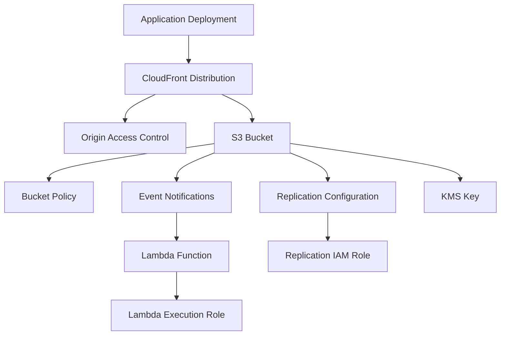
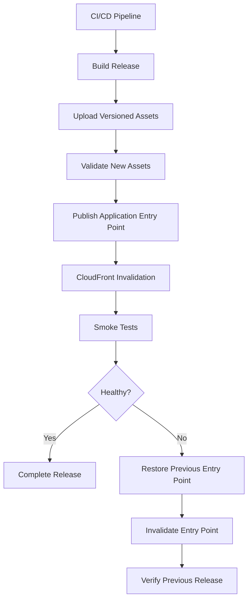
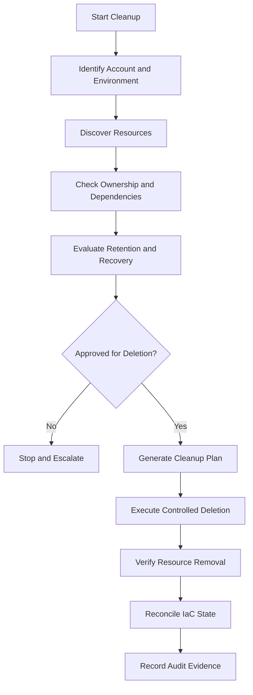

# 10- Rollback and Resource Cleanup Failures

## Overview

Amazon S3 deployments involve resources with different ownership models, deletion semantics, dependencies, and recovery characteristics. A failed deployment or incomplete cleanup can leave infrastructure partially provisioned, production resources unavailable, unexpected AWS charges accumulating, or Terraform and CloudFormation state inconsistent with the actual environment.

Rollback and cleanup failures are particularly risky when deployments manage:

- S3 buckets containing production data.
- Versioned objects and delete markers.
- Bucket policies, encryption, and lifecycle configurations.
- Replication rules and IAM roles.
- Event notifications and Lambda permissions.
- CloudFront distributions and origin access controls.
- KMS keys and grants.
- Terraform state and CloudFormation stacks.
- CI/CD deployment resources and temporary infrastructure.

The central operational principle is to distinguish **application rollback**, **infrastructure rollback**, and **data recovery**. They are separate operations.

| Recovery operation | Purpose | Example |
|---|---|---|
| Application rollback | Restore a previous application release | Redeploy an earlier website build |
| Infrastructure rollback | Restore a previous resource configuration | Revert a bucket policy or distribution configuration |
| Data recovery | Restore deleted or overwritten objects | Recover a previous S3 object version |
| Resource cleanup | Remove resources that are no longer required | Delete an empty temporary bucket |
| State reconciliation | Align IaC state with actual AWS resources | Import an existing bucket into Terraform |

A successful infrastructure rollback does not necessarily restore deleted S3 data. Likewise, deleting an application deployment does not automatically remove its S3 objects, versions, or dependent AWS resources.

## Failure Categories

| Failure category | Observable symptom | Primary investigation area |
|---|---|---|
| Non-empty bucket deletion | `BucketNotEmpty` | Object versions and delete markers |
| Versioned object cleanup | Bucket remains non-empty | Version IDs and delete markers |
| Object Lock retention | `AccessDenied` during deletion | Retention and legal hold |
| CloudFormation rollback | Stack enters rollback failure state | Stack events and resource dependencies |
| Terraform destroy | Resource deletion fails | State, dependencies, and AWS resource state |
| IAM cleanup | `DeleteConflict` or `AccessDenied` | Attached policies, roles, and permissions |
| KMS cleanup | Key deletion is blocked or delayed | Key state, grants, and dependencies |
| Replication cleanup | Configuration cannot be removed safely | Replication rules and IAM dependencies |
| CloudFront cleanup | Distribution deletion fails | Distribution deployment and enabled state |
| CI/CD cleanup | Pipeline cannot destroy resources | OIDC trust and deployment permissions |
| Partial cleanup | Some resources remain | Resource inventory and dependency graph |

## Establish a Safe Rollback and Cleanup Strategy

### Understand Resource Dependencies

S3 infrastructure is not an isolated resource. A bucket may be referenced by CloudFront, Lambda, replication, event notifications, IAM policies, logging configurations, and application deployments.

Deleting resources in the wrong order can produce dependency failures or leave the environment partially operational.

Example dependency graph:



This is a conceptual dependency graph. Actual deletion dependencies depend on the configured AWS resources and IaC implementation.

### Identify Resource Ownership

Before deleting anything, establish which system manages the resource.

| Ownership model | Cleanup responsibility |
|---|---|
| Terraform | Terraform configuration and state |
| CloudFormation | CloudFormation stack |
| CDK | CDK-generated CloudFormation stack |
| Manual AWS Console or CLI | Controlled manual cleanup |
| CI/CD-created temporary resources | Deployment pipeline or dedicated cleanup workflow |
| Shared infrastructure | Owning platform or infrastructure team |

Do not manually delete a resource managed by Terraform or CloudFormation unless the operation is part of a deliberate state-reconciliation procedure.

### Pre-Cleanup Inventory

Inspect the AWS account and Region before cleanup.

```bash
aws sts get-caller-identity
```

```bash
aws s3api list-buckets \
  --query 'Buckets[].Name' \
  --output table
```

Inspect CloudFormation stacks:

```bash
aws cloudformation list-stacks \
  --stack-status-filter \
    CREATE_COMPLETE \
    UPDATE_COMPLETE \
    ROLLBACK_COMPLETE \
  --query 'StackSummaries[].{Name:StackName,Status:StackStatus}' \
  --output table
```

Inspect CloudFront distributions:

```bash
aws cloudfront list-distributions \
  --query 'DistributionList.Items[].{Id:Id,Domain:DomainName,Enabled:DistributionConfig.Enabled,Status:Status}' \
  --output table
```

Inspect Terraform state:

```bash
terraform state list
```

Record:

- AWS account ID.
- Deployment Region.
- Environment name.
- Bucket names and data classification.
- IaC state ownership.
- Resource dependencies.
- Retention and recovery requirements.
- Replication configuration.
- CloudFront associations.
- KMS key dependencies.
- Whether the environment contains production data.

## S3 BucketNotEmpty Errors

### Symptoms and Observable Evidence

Bucket deletion fails:

```text
An error occurred (BucketNotEmpty) when calling the DeleteBucket operation:
The bucket you tried to delete is not empty.
```

A bucket may appear empty in the AWS Console or through a normal object listing but still contain:

- Object versions.
- Delete markers.
- Incomplete multipart uploads.
- Objects stored under unexpected prefixes.

An incomplete multipart upload is not an ordinary completed object, but it can still require explicit cleanup before the bucket can be removed.

### Likely Causes

| Cause | Explanation |
|---|---|
| Current objects remain | Objects have not been deleted |
| Previous versions remain | Versioning preserves historical objects |
| Delete markers remain | Logical deletion does not remove all versions |
| Incomplete multipart uploads | Upload sessions have not been completed or aborted |
| Incorrect bucket Region | Cleanup commands target the wrong endpoint or resource |
| Incomplete recursive deletion | The cleanup operation did not process all objects |

### Isolation and Verification

List current objects:

```bash
aws s3api list-objects-v2 \
  --bucket company-temp-assets \
  --query 'Contents[].Key' \
  --output json
```

List object versions and delete markers:

```bash
aws s3api list-object-versions \
  --bucket company-temp-assets \
  --output json
```

Inspect incomplete multipart uploads:

```bash
aws s3api list-multipart-uploads \
  --bucket company-temp-assets
```

An empty `list-objects-v2` response does not prove that a versioned bucket is empty.

### Corrective Action for a Non-Versioned Bucket

For a disposable, non-versioned bucket whose contents have been explicitly approved for deletion:

```bash
aws s3 rm s3://company-temp-assets \
  --recursive
```

Verify the bucket is empty:

```bash
aws s3api list-objects-v2 \
  --bucket company-temp-assets
```

Delete the bucket:

```bash
aws s3api delete-bucket \
  --bucket company-temp-assets \
  --region ap-south-1
```

Do not use recursive deletion against a production bucket without confirming the deletion scope and retention requirements.

### Corrective Action for a Versioned Bucket

A versioned bucket requires removal of both object versions and delete markers.

List all versions:

```bash
aws s3api list-object-versions \
  --bucket company-temp-assets \
  --output json
```

A version-aware deletion request contains both the key and version ID:

```json
{
  "Objects": [
    {
      "Key": "uploads/document.pdf",
      "VersionId": "VERSION_ID"
    }
  ],
  "Quiet": false
}
```

Execute a specific approved deletion:

```bash
aws s3api delete-objects \
  --bucket company-temp-assets \
  --delete file://delete-batch.json
```

The deletion manifest must contain the exact version IDs returned by S3.

For large buckets, process versions in controlled batches and account for S3 API pagination and the `DeleteObjects` request limit of 1,000 objects per request.

Do not assume that `aws s3 rm --recursive` permanently removes every historical version.

### Prevention

- Define explicit bucket-retention policies.
- Enable version-aware cleanup procedures.
- Configure lifecycle rules for noncurrent versions where appropriate.
- Track incomplete multipart uploads.
- Separate disposable test buckets from production data buckets.
- Require approval before destructive cleanup.

## Versioned Object and Delete Marker Cleanup Failures

### Symptoms

- Bucket deletion fails even after recursive object deletion.
- Object listing appears empty.
- Historical object versions remain.
- Deleting an object creates another delete marker instead of removing historical data.

### Why This Happens

In a versioning-enabled bucket, an ordinary delete operation generally creates a delete marker.

For example:

```text
uploads/report.pdf
    Version A
    Version B
    Delete Marker
```

The current object appears deleted, but the previous versions remain stored.

A bucket cannot be deleted while object versions and delete markers remain.

### Isolation and Verification

Inspect versions:

```bash
aws s3api list-object-versions \
  --bucket company-temp-assets \
  --prefix uploads/
```

Inspect only delete markers:

```bash
aws s3api list-object-versions \
  --bucket company-temp-assets \
  --query 'DeleteMarkers[].{Key:Key,VersionId:VersionId,IsLatest:IsLatest}'
```

Inspect only object versions:

```bash
aws s3api list-object-versions \
  --bucket company-temp-assets \
  --query 'Versions[].{Key:Key,VersionId:VersionId,IsLatest:IsLatest,Size:Size}'
```

### Corrective Action

Delete specific versions and delete markers using their exact version IDs.

For automated cleanup, use a paginated script rather than assuming one `list-object-versions` call returns every version.

Example Python implementation:

```python
import boto3
from botocore.exceptions import ClientError

BUCKET_NAME = "company-temp-assets"
REGION = "ap-south-1"

s3 = boto3.client("s3", region_name=REGION)


def delete_all_versions(bucket_name: str) -> None:
    paginator = s3.get_paginator("list_object_versions")

    for page in paginator.paginate(Bucket=bucket_name):
        objects = []

        for version in page.get("Versions", []):
            objects.append(
                {
                    "Key": version["Key"],
                    "VersionId": version["VersionId"],
                }
            )

        for marker in page.get("DeleteMarkers", []):
            objects.append(
                {
                    "Key": marker["Key"],
                    "VersionId": marker["VersionId"],
                }
            )

        for start in range(0, len(objects), 1000):
            batch = objects[start:start + 1000]

            response = s3.delete_objects(
                Bucket=bucket_name,
                Delete={
                    "Objects": batch,
                    "Quiet": False,
                },
            )

            errors = response.get("Errors", [])

            if errors:
                raise RuntimeError(
                    f"Version deletion failed: {errors}"
                )


if __name__ == "__main__":
    try:
        delete_all_versions(BUCKET_NAME)
        print("Version and delete-marker cleanup completed.")

    except (ClientError, RuntimeError) as exc:
        raise SystemExit(f"Cleanup failed: {exc}")
```

This script permanently deletes all listed versions and delete markers. It must only be used after an explicit retention and deletion approval.

It does not automatically remove incomplete multipart uploads or handle Object Lock restrictions.

### Prevention

- Treat versioned bucket deletion as a separate operational procedure.
- Require a reviewed deletion manifest for important buckets.
- Verify object retention and legal hold before deletion.
- Keep recovery requirements separate from infrastructure teardown.
- Log every deletion batch and its result.

## Incomplete Multipart Upload Cleanup Failures

### Symptoms

- Bucket cleanup remains incomplete.
- Multipart upload listings contain old upload IDs.
- Storage charges continue after completed objects are removed.
- An upload cannot be completed or aborted.

### Likely Causes

- Application terminated before completing the upload.
- Network interruption occurred during multipart transfer.
- Cleanup process lacks `s3:AbortMultipartUpload`.
- Upload ID belongs to another application workflow.
- Concurrent upload activity is still running.

### Isolation and Verification

List active multipart uploads:

```bash
aws s3api list-multipart-uploads \
  --bucket company-temp-assets \
  --output json
```

Inspect an upload:

```bash
aws s3api list-parts \
  --bucket company-temp-assets \
  --key uploads/large-video.mp4 \
  --upload-id UPLOAD_ID
```

### Corrective Action

Abort a specific upload:

```bash
aws s3api abort-multipart-upload \
  --bucket company-temp-assets \
  --key uploads/large-video.mp4 \
  --upload-id UPLOAD_ID
```

For large-scale cleanup, paginate through multipart uploads and abort only sessions that have been verified as abandoned.

### Prevention

Configure an S3 lifecycle rule to abort incomplete multipart uploads after an appropriate number of days.

Example lifecycle configuration:

```json
{
  "Rules": [
    {
      "ID": "AbortIncompleteMultipartUploads",
      "Status": "Enabled",
      "Filter": {
        "Prefix": ""
      },
      "AbortIncompleteMultipartUpload": {
        "DaysAfterInitiation": 7
      }
    }
  ]
}
```

The lifecycle rule is a safety net, not a replacement for application-level multipart upload cleanup.

## Object Lock and Retention Restrictions

### Symptoms

Deletion fails with authorization or retention-related errors even when the IAM identity appears to have sufficient S3 permissions.

### Likely Causes

- Object retention period has not expired.
- Object has a legal hold.
- Governance retention requires an authorized bypass.
- Compliance retention prevents deletion.
- The bucket has Object Lock enabled.

### Isolation and Verification

Inspect Object Lock configuration:

```bash
aws s3api get-object-lock-configuration \
  --bucket company-archive
```

Inspect object retention:

```bash
aws s3api get-object-retention \
  --bucket company-archive \
  --key records/contract.pdf \
  --version-id VERSION_ID
```

Inspect legal hold:

```bash
aws s3api get-object-legal-hold \
  --bucket company-archive \
  --key records/contract.pdf \
  --version-id VERSION_ID
```

### Corrective Action

Do not attempt to bypass retention controls merely to complete infrastructure cleanup.

For governance mode, a separately authorized operation may use the governance retention bypass where organizational policy permits it.

Compliance mode cannot be bypassed before the retention period expires.

Legal holds must be removed only through an approved legal or records-management process.

### Prevention

- Keep archival buckets separate from disposable application buckets.
- Document retention and legal-hold ownership.
- Include Object Lock checks in deletion runbooks.
- Require compliance approval for destructive operations.

## AccessDenied During Resource Cleanup

### Symptoms

Deletion commands fail with:

```text
An error occurred (AccessDenied)
```

The deployment role can inspect resources but cannot remove them.

### Likely Causes

| Cause | Explanation |
|---|---|
| Missing IAM action | Role lacks required delete permission |
| Explicit deny | An identity or resource policy denies the operation |
| Permissions boundary | Role permissions are restricted |
| Service control policy | Organization-level policy blocks deletion |
| Bucket policy | Resource policy denies the operation |
| Object Lock | Retention prevents deletion |
| KMS restrictions | Required encryption-related operation is not authorized |
| MFA Delete | Version deletion requires additional authorization |

### Isolation and Verification

Verify the active identity:

```bash
aws sts get-caller-identity
```

Inspect the bucket policy:

```bash
aws s3api get-bucket-policy \
  --bucket company-temp-assets
```

Inspect public-access configuration:

```bash
aws s3api get-public-access-block \
  --bucket company-temp-assets
```

Review the deployment role's identity policy, permissions boundary, and relevant organization-level restrictions.

Use IAM policy simulation where applicable:

```bash
aws iam simulate-principal-policy \
  --policy-source-arn arn:aws:iam::123456789012:role/S3DeploymentRole \
  --action-names \
    s3:DeleteBucket \
    s3:DeleteObject \
    s3:DeleteObjectVersion \
  --resource-arns \
    arn:aws:s3:::company-temp-assets \
    arn:aws:s3:::company-temp-assets/*
```

Policy simulation is useful but does not fully reproduce every service-specific authorization condition, resource policy, organization policy, or runtime constraint.

### Corrective Action

Grant only the required deletion permissions to an authorized cleanup role.

Typical actions may include:

| Action | Purpose |
|---|---|
| `s3:ListBucket` | Inspect bucket contents |
| `s3:ListBucketVersions` | Inspect versions and delete markers |
| `s3:ListBucketMultipartUploads` | Inspect incomplete multipart uploads |
| `s3:ListMultipartUploadParts` | Inspect multipart upload parts |
| `s3:DeleteObject` | Delete current objects or create delete markers |
| `s3:DeleteObjectVersion` | Permanently delete a specific version |
| `s3:AbortMultipartUpload` | Abort incomplete multipart uploads |
| `s3:DeleteBucket` | Delete an empty bucket |

Do not grant unrestricted `s3:*` to a deployment role merely to make cleanup succeed.

For production cleanup, use a dedicated role with a controlled approval process and an explicit resource scope.

### Prevention

- Separate deployment permissions from application runtime permissions.
- Test cleanup permissions in a non-production environment.
- Include organization-level restrictions in deployment planning.
- Keep destructive permissions out of normal application roles.
- Audit cleanup activity through CloudTrail.

## Terraform Destroy and State Errors

### Symptoms

Terraform destroy fails with errors such as:

```text
Error deleting S3 Bucket: BucketNotEmpty
```

```text
Error acquiring the state lock
```

```text
Resource already exists
```

```text
Error: Invalid index
```

Other symptoms:

- Terraform reports that a resource does not exist.
- AWS resources remain after `terraform destroy`.
- State references resources that were manually deleted.
- A resource is recreated unexpectedly.
- A bucket deletion fails because it contains protected data.

### Likely Causes

- Bucket contains object versions or delete markers.
- Resource dependencies are incomplete.
- Terraform state is stale.
- Another process holds the state lock.
- Resource was deleted manually.
- Multiple Terraform states manage the same bucket configuration.
- `prevent_destroy` blocks deletion.
- Provider configuration targets the wrong account or Region.

### Isolation and Verification

Confirm account identity:

```bash
aws sts get-caller-identity
```

Inspect Terraform workspace:

```bash
terraform workspace show
```

Inspect managed resources:

```bash
terraform state list
```

Inspect a specific resource:

```bash
terraform state show aws_s3_bucket.assets
```

Review the destroy plan:

```bash
terraform plan -destroy
```

Do not run `terraform destroy` until the plan has been reviewed and the resource inventory has been verified.

### Resource Protection

A production bucket should normally have an explicit deletion safeguard.

```hcl
resource "aws_s3_bucket" "production" {
  bucket = var.bucket_name

  lifecycle {
    prevent_destroy = true
  }
}
```

`prevent_destroy` prevents Terraform from planning destruction while the resource remains configured with that lifecycle rule.

It does not prevent deletion through the AWS Console, CLI, another Terraform state, or another authorized principal.

### Corrective Action: State Lock

If Terraform reports a state lock:

1. Identify the process or deployment holding the lock.
2. Verify whether the operation is still running.
3. Check the remote state backend and locking mechanism.
4. Wait for legitimate operations to finish.
5. Use force-unlock only after confirming the lock is stale.

```bash
terraform force-unlock LOCK_ID
```

Never force-unlock a state while another active Terraform process is using it.

### Corrective Action: Resource Missing From AWS

If Terraform state references a resource that has already been deleted manually, refresh the state and inspect the resulting plan.

```bash
terraform plan -refresh-only
```

Apply a refresh-only plan only after reviewing the detected changes:

```bash
terraform apply -refresh-only
```

If the resource still exists but is not tracked by the intended state, import it rather than recreating it.

```bash
terraform import \
  aws_s3_bucket.assets \
  company-static-assets
```

### Corrective Action: Bucket Not Empty

Terraform's S3 bucket resource cannot delete a bucket that still contains objects or versions unless the configuration and provider resource support an explicit force-destroy workflow.

For a disposable bucket, a supported provider configuration may use:

```hcl
resource "aws_s3_bucket" "temporary" {
  bucket        = var.bucket_name
  force_destroy = true
}
```

This setting is destructive. It can permanently delete objects and versions managed by the bucket.

Do not use `force_destroy` as a default for production or archival buckets.

### Prevention

- Keep production buckets protected with `prevent_destroy`.
- Use separate state files for independent environments.
- Avoid multiple Terraform states managing the same bucket notification configuration.
- Require destroy-plan review.
- Use remote state with locking.
- Test teardown procedures before production deployment.
- Keep data-retention decisions outside routine infrastructure destruction.

## CloudFormation Stack Deletion and Rollback Failures

### Symptoms

CloudFormation reports:

```text
DELETE_FAILED
```

```text
UPDATE_ROLLBACK_FAILED
```

```text
ROLLBACK_FAILED
```

A stack remains in a failed state and cannot be updated or deleted normally.

### Likely Causes

- S3 bucket is not empty.
- Resource deletion is blocked by Object Lock.
- IAM permissions are insufficient.
- Resource dependencies prevent deletion.
- A custom resource failed during cleanup.
- A KMS key cannot be deleted.
- A resource was modified outside CloudFormation.
- A nested stack failed to delete.

### Isolation and Verification

Inspect stack status:

```bash
aws cloudformation describe-stacks \
  --stack-name s3-production-stack \
  --query 'Stacks[0].{Status:StackStatus,Reason:StackStatusReason}'
```

Inspect recent stack events:

```bash
aws cloudformation describe-stack-events \
  --stack-name s3-production-stack \
  --max-items 30
```

Inspect resources:

```bash
aws cloudformation list-stack-resources \
  --stack-name s3-production-stack
```

Identify the first resource that failed, not merely the final stack status.

### Corrective Action: DELETE_FAILED

For a failed stack deletion:

1. Identify the resource that failed to delete.
2. Inspect its service-specific dependencies.
3. Correct the underlying problem.
4. Retry stack deletion.

```bash
aws cloudformation delete-stack \
  --stack-name s3-production-stack
```

For an S3 bucket, verify that objects, versions, delete markers, and retention restrictions have been handled before retrying.

### Corrective Action: UPDATE_ROLLBACK_FAILED

A stack in `UPDATE_ROLLBACK_FAILED` may require rollback recovery.

```bash
aws cloudformation continue-update-rollback \
  --stack-name s3-production-stack
```

If specific resources must be skipped because they cannot be rolled back, CloudFormation supports `--resources-to-skip` for applicable rollback recovery operations.

Use this only after understanding the resulting infrastructure drift. Skipped resources must be reconciled with the template before subsequent deployments.

### Stack Retention

CloudFormation supports retaining resources during stack deletion using the appropriate resource retention configuration or deletion policies.

For example:

```yaml
Resources:
  AssetsBucket:
    Type: AWS::S3::Bucket
    DeletionPolicy: Retain
    UpdateReplacePolicy: Retain
    Properties:
      VersioningConfiguration:
        Status: Enabled
```

This protects the bucket from automatic deletion during stack deletion or replacement.

However, retained resources become independently managed infrastructure after the stack is removed. Maintain an ownership record and an explicit cleanup procedure.

### Prevention

- Use `DeletionPolicy: Retain` for important data buckets.
- Use change sets for high-risk stack changes.
- Test custom resource deletion handlers.
- Avoid embedding irreversible data deletion in stack cleanup.
- Monitor stack events during deployment and rollback.
- Reconcile retained resources before future deployments.

## IAM Role and Policy Cleanup Failures

### Symptoms

IAM role deletion fails:

```text
DeleteConflict
```

or:

```text
Cannot delete entity, must detach all policies first.
```

### Likely Causes

- Managed policies remain attached.
- Inline policies remain.
- Instance profiles still reference the role.
- Lambda functions still use the role.
- Replication configuration still references the role.
- Another resource depends on the role.

### Isolation and Verification

List attached managed policies:

```bash
aws iam list-attached-role-policies \
  --role-name S3ReplicationRole
```

List inline policies:

```bash
aws iam list-role-policies \
  --role-name S3ReplicationRole
```

Inspect instance profiles:

```bash
aws iam list-instance-profiles-for-role \
  --role-name S3ReplicationRole
```

### Corrective Action

Detach an attached managed policy:

```bash
aws iam detach-role-policy \
  --role-name S3ReplicationRole \
  --policy-arn arn:aws:iam::123456789012:policy/S3ReplicationPolicy
```

Delete an inline policy:

```bash
aws iam delete-role-policy \
  --role-name S3ReplicationRole \
  --policy-name ReplicationInlinePolicy
```

Remove the role from an instance profile when applicable, then delete the instance profile.

Delete the role only after all dependencies have been removed.

### Prevention

- Model IAM dependencies explicitly in IaC.
- Avoid sharing one role across unrelated services.
- Use dedicated roles for replication, Lambda, and CI/CD.
- Remove service references before deleting roles.
- Keep role cleanup within the owning infrastructure stack.

## KMS Key Deletion and Dependency Failures

### Symptoms

- KMS key deletion is blocked.
- Encrypted object cleanup fails.
- Infrastructure deletion completes but KMS keys remain.
- CloudFormation cannot remove a key.
- A key enters `PendingDeletion`.

### Likely Causes

- Key is still referenced by encrypted resources.
- Key policy blocks the cleanup identity.
- KMS grants or service integrations remain.
- Key deletion is subject to a mandatory waiting period.
- Replication or application components still depend on the key.
- The key is AWS-managed rather than customer-managed.

### Isolation and Verification

Inspect key metadata:

```bash
aws kms describe-key \
  --key-id KEY_ID \
  --region ap-south-1
```

List grants:

```bash
aws kms list-grants \
  --key-id KEY_ID \
  --region ap-south-1
```

Inspect aliases:

```bash
aws kms list-aliases \
  --region ap-south-1
```

### Corrective Action

Before scheduling deletion:

1. Identify all resources using the key.
2. Verify whether objects must remain readable.
3. Confirm that replication and backup workflows no longer depend on it.
4. Check key policy and grant dependencies.
5. Schedule deletion only after approval.

Example:

```bash
aws kms schedule-key-deletion \
  --key-id KEY_ID \
  --pending-window-in-days 30 \
  --region ap-south-1
```

KMS key deletion has a mandatory waiting period within the supported range. The key becomes pending deletion and cannot perform cryptographic operations during that state.

A pending deletion can be cancelled before the scheduled deletion completes:

```bash
aws kms cancel-key-deletion \
  --key-id KEY_ID \
  --region ap-south-1
```

Deleting a KMS key can make encrypted data permanently unrecoverable. Removing the key is not equivalent to deleting the encrypted objects.

### Prevention

- Separate production encryption keys from temporary environment keys.
- Maintain key ownership and dependency inventories.
- Retain keys for as long as protected data must remain accessible.
- Treat key deletion as a security and data-retention operation.
- Do not schedule KMS deletion automatically during routine application teardown.

## Replication Configuration Cleanup Failures

### Symptoms

- Replication configuration cannot be removed.
- Replication role remains after bucket cleanup.
- Destination bucket continues receiving objects.
- IaC deletion fails due to dependencies.

### Likely Causes

- Replication configuration is still enabled.
- IAM role remains referenced.
- Destination bucket has independent retention requirements.
- Replication metrics or related configurations remain.
- Source and destination buckets are managed by separate stacks.

### Isolation and Verification

Inspect replication configuration:

```bash
aws s3api get-bucket-replication \
  --bucket company-source-bucket
```

Inspect replication role:

```bash
aws iam get-role \
  --role-name S3ReplicationRole
```

### Corrective Action

Remove replication configuration from the source bucket:

```bash
aws s3api delete-bucket-replication \
  --bucket company-source-bucket
```

Then verify that the configuration is absent:

```bash
aws s3api get-bucket-replication \
  --bucket company-source-bucket
```

A missing replication configuration may result in a `ReplicationConfigurationNotFoundError`, which indicates there is no configuration to retrieve.

Only remove the replication IAM role after confirming that no other replication rule or bucket uses it.

Do not delete destination data as an automatic consequence of removing replication.

### Prevention

- Keep source and destination lifecycle ownership explicit.
- Separate replication configuration from bucket data-retention policy.
- Verify destination recovery requirements before teardown.
- Avoid shared replication roles without an ownership model.

## CloudFront and Origin Cleanup Failures

### Symptoms

CloudFront distribution deletion fails because the distribution is enabled or still deploying.

### Likely Causes

- Distribution remains enabled.
- Distribution update is still in progress.
- ETag is stale.
- Origin resources are deleted before the distribution.
- Alternate domain name associations remain.
- Distribution is managed by another IaC stack.

### Isolation and Verification

Inspect distribution status:

```bash
aws cloudfront get-distribution \
  --id E123456789EXAMPLE
```

Retrieve its configuration and ETag:

```bash
aws cloudfront get-distribution-config \
  --id E123456789EXAMPLE
```

### Corrective Action

A CloudFront distribution must be disabled before it can be deleted.

The safe workflow is:

1. Retrieve the current distribution configuration and ETag.
2. Set `Enabled` to `false`.
3. Update the distribution using the current ETag.
4. Wait for the distribution to finish deploying.
5. Retrieve the latest configuration and ETag.
6. Delete the distribution.

Example update:

```bash
aws cloudfront get-distribution-config \
  --id E123456789EXAMPLE \
  > distribution-config.json
```

Edit the configuration so that:

```json
{
  "Enabled": false
}
```

The complete distribution configuration must be preserved. Do not submit a partial configuration.

Update:

```bash
aws cloudfront update-distribution \
  --id E123456789EXAMPLE \
  --if-match CURRENT_ETAG \
  --distribution-config file://distribution-config.json
```

Wait for deployment:

```bash
aws cloudfront wait distribution-deployed \
  --id E123456789EXAMPLE
```

Retrieve the latest ETag and delete:

```bash
aws cloudfront get-distribution-config \
  --id E123456789EXAMPLE
```

```bash
aws cloudfront delete-distribution \
  --id E123456789EXAMPLE \
  --if-match CURRENT_ETAG
```

The ETag must correspond to the latest distribution configuration.

### Prevention

- Remove CloudFront before deleting its S3 origin.
- Preserve the distribution configuration during disablement.
- Wait for distribution deployment before deletion.
- Keep DNS changes and distribution deletion as separate controlled steps.
- Verify alternate domain ownership before transferring hostnames.

## Partial Cleanup and Orphaned Resources

### Symptoms

- Terraform reports successful destruction, but AWS charges continue.
- S3 buckets remain after CloudFormation deletion.
- IAM roles remain after application removal.
- CloudWatch log groups accumulate.
- Old Lambda functions and event rules remain.
- KMS keys remain in the account.

### Likely Causes

- Resources were created outside the IaC stack.
- Retention policies intentionally preserved resources.
- Resources belong to another stack or state.
- Cleanup scripts omitted dependent resources.
- A deployment failed after creating resources but before recording ownership.
- Shared infrastructure was intentionally retained.

### Isolation and Verification

Create an inventory by service and ownership.

For S3:

```bash
aws s3api list-buckets \
  --query 'Buckets[].Name' \
  --output table
```

For Lambda:

```bash
aws lambda list-functions \
  --query 'Functions[].{Name:FunctionName,Role:Role}' \
  --output table
```

For IAM roles:

```bash
aws iam list-roles \
  --query 'Roles[].RoleName' \
  --output table
```

For CloudWatch log groups:

```bash
aws logs describe-log-groups \
  --query 'logGroups[].logGroupName' \
  --output table
```

For customer-managed KMS keys:

```bash
aws kms list-keys \
  --region ap-south-1
```

Do not delete resources based only on naming patterns. Confirm ownership and dependency information first.

### Corrective Action

For each orphaned resource:

1. Identify its owner.
2. Inspect tags and creation metadata where available.
3. Check whether another resource references it.
4. Determine whether retention is intentional.
5. Import it into the appropriate IaC state or remove it through the owning system.
6. Record the cleanup result.

Recommended ownership tags:

```hcl
tags = {
  Environment = var.environment
  Project     = "s3-platform"
  ManagedBy   = "terraform"
  Owner       = "backend-platform"
}
```

Tags improve inventory and cost attribution but are not a complete dependency or ownership system.

## Safe Rollback for S3 Application Deployments

### Symptoms

A release fails after new application assets or backend components have been deployed.

Examples:

- New frontend references missing S3 assets.
- Lambda deployment is incompatible with the previous event configuration.
- A new bucket policy blocks the existing application.
- New lifecycle configuration affects data unexpectedly.
- A failed deployment leaves a partially updated infrastructure stack.

### Recommended Deployment Model

Separate application releases from persistent data infrastructure.



### Release Directory Structure

Use versioned release prefixes:

```text
s3://company-static-assets/
    releases/
        release-2026-10-01/
        release-2026-10-15/
        release-2026-10-31/
    index.html
```

For a static application, immutable assets can remain under versioned or content-hashed paths while the root HTML entry point references the selected release.

### Corrective Action

If the new release is broken:

1. Identify the previous known-good release.
2. Restore its HTML entry point or release pointer.
3. Invalidate the relevant CloudFront paths.
4. Verify the application.
5. Preserve failed-release assets for investigation until retention policy permits cleanup.

Do not delete the previous release immediately after publishing a new one.

### Backend and Database Coordination

For Django, FastAPI, and microservice deployments, infrastructure rollback may not reverse database schema changes.

Use backward-compatible migration strategies:

- Expand the schema before deploying code that uses new fields.
- Deploy compatible application versions.
- Migrate data separately.
- Remove obsolete schema only after the rollback window closes.

Treat S3 object formats and metadata schemas similarly. A new application release should not make older stored objects unreadable without a migration or compatibility plan.

## Automated Cleanup Design

### Cleanup Workflow

A controlled cleanup process should separate discovery, approval, deletion, and verification.



### Python Cleanup Guard

A cleanup script should validate the target account and require an explicit confirmation before destructive operations.

```python
import boto3
import sys

EXPECTED_ACCOUNT_ID = "123456789012"
EXPECTED_BUCKET = "company-temp-assets"
EXPECTED_REGION = "ap-south-1"

session = boto3.Session(region_name=EXPECTED_REGION)
sts = session.client("sts")
s3 = session.client("s3")


def validate_target() -> None:
    identity = sts.get_caller_identity()
    account_id = identity["Account"]

    if account_id != EXPECTED_ACCOUNT_ID:
        raise RuntimeError(
            f"Unexpected AWS account: {account_id}"
        )

    bucket = s3.head_bucket(Bucket=EXPECTED_BUCKET)

    print(f"Validated target bucket: {EXPECTED_BUCKET}")
    print(f"Account: {account_id}")
    print(f"Region: {EXPECTED_REGION}")


def main() -> None:
    validate_target()

    confirmation = input(
        f"Type DELETE {EXPECTED_BUCKET} to continue: "
    )

    if confirmation != f"DELETE {EXPECTED_BUCKET}":
        print("Cleanup cancelled.")
        return

    print(
        "Target validated. Execute the separately reviewed "
        "cleanup procedure."
    )


if __name__ == "__main__":
    try:
        main()
    except Exception as exc:
        print(f"Cleanup validation failed: {exc}", file=sys.stderr)
        raise SystemExit(1)
```

This example intentionally validates the target and confirmation without deleting resources. The actual deletion implementation should be added only for a defined bucket-retention and version-cleanup policy.

### Production Cleanup Requirements

A production cleanup workflow should:

- Validate AWS account and Region.
- Confirm environment and resource ownership.
- Generate a deletion manifest.
- Exclude protected buckets and keys.
- Check Object Lock and retention.
- Detect active multipart uploads.
- Handle version listings with pagination.
- Record each deletion request and result.
- Retry transient failures with bounded backoff.
- Stop on authorization or retention failures.
- Verify final resource state.
- Preserve audit records.

Avoid building a generic script that recursively deletes every bucket in an account.

## CI/CD Rollback and Cleanup Failures

### Symptoms

- GitHub Actions deployment succeeds but cleanup fails.
- OIDC role can deploy but cannot destroy resources.
- A workflow terminates while Terraform is applying changes.
- A temporary environment remains after a pull request is closed.
- A cleanup job runs with production credentials accidentally.

### Likely Causes

- Deployment and cleanup permissions differ.
- OIDC trust policy excludes the cleanup workflow context.
- Workflow cancellation leaves partially provisioned resources.
- Temporary environment ownership is not recorded.
- Concurrent workflows modify the same Terraform state.
- Cleanup jobs run against the wrong workspace.

### Isolation and Verification

Verify the workflow identity:

```bash
aws sts get-caller-identity
```

Inspect:

- GitHub repository and branch conditions.
- OIDC subject claims.
- Environment protection rules.
- Terraform workspace.
- Remote state key.
- Deployment role permissions.
- Resource tags and ownership.

### Corrective Action

Use separate roles for deployment and destructive cleanup where practical.

A cleanup workflow should require:

- Explicit environment selection.
- Protected environment approval.
- Account ID validation.
- A reviewed Terraform destroy plan.
- Restricted resource scope.
- Audit logging.

For ephemeral environments, assign a unique environment identifier and tag every resource with it.

Example:

```yaml
env:
  ENVIRONMENT: preview
  PROJECT: s3-backend
```

Avoid using a generic cleanup workflow that accepts an unrestricted bucket name or AWS account identifier from an untrusted pull request.

### Prevention

- Serialize operations against shared Terraform state.
- Use separate states for ephemeral environments.
- Restrict cleanup to resources owned by the workflow.
- Require approval for production destruction.
- Keep cleanup logs and deployment identifiers.
- Make cleanup jobs idempotent where possible.

## Operational Monitoring and Audit Evidence

Rollback and cleanup should be observable operations, not untracked command sequences.

### Useful Signals

| Signal | Why it matters |
|---|---|
| Failed CloudFormation resources | Identifies incomplete stack rollback |
| Terraform apply or destroy failures | Identifies state or resource conflicts |
| Remaining S3 object versions | Identifies incomplete bucket cleanup |
| Incomplete multipart uploads | Identifies abandoned upload sessions |
| KMS keys pending deletion | Identifies scheduled cryptographic resource removal |
| Orphaned IAM roles | Identifies incomplete service cleanup |
| CloudFront distributions still enabled | Identifies incomplete distribution removal |
| Unexpected resource charges | Identifies resources left behind |

### Audit Sources

Use the following sources for operational investigation:

- CloudTrail management events for supported resource-management API calls.
- CloudTrail data events when S3 object-level audit coverage is required and configured.
- CloudFormation stack events.
- Terraform execution logs.
- CI/CD workflow logs.
- CloudWatch application and Lambda logs.
- AWS Cost Explorer and billing data for unexpected resource charges.

Do not assume that every S3 object-level operation is automatically available in CloudTrail management event history. Configure the required data-event logging when object-level audit evidence is needed.

### Cleanup Audit Record

Maintain an operational record containing:

```json
{
  "operation": "s3-resource-cleanup",
  "environment": "development",
  "account_id": "123456789012",
  "region": "ap-south-1",
  "bucket": "company-temp-assets",
  "initiated_by": "deployment-pipeline",
  "approval_reference": "CHANGE-12345",
  "result": "completed",
  "verification": {
    "object_versions_remaining": false,
    "delete_markers_remaining": false,
    "multipart_uploads_remaining": false,
    "bucket_exists": false
  }
}
```

This is an example audit structure, not a claim that a cleanup operation has been executed.

## Recovery and Cleanup Testing

Cleanup procedures should be tested in a disposable AWS environment before being used in production.

### Test Scenarios

| Scenario | Expected behavior |
|---|---|
| Non-versioned bucket with objects | Cleanup removes approved objects before bucket deletion |
| Versioned bucket with historical versions | Cleanup handles versions and delete markers |
| Incomplete multipart upload | Cleanup detects and aborts approved abandoned sessions |
| Object Lock retention active | Cleanup stops and reports retention restriction |
| Missing IAM permission | Cleanup reports authorization failure |
| Stale Terraform state | State is reconciled without deleting unrelated resources |
| CloudFormation rollback failure | Failed resource is identified and recovered |
| CloudFront distribution enabled | Cleanup disables and waits before deletion |
| KMS key in use | Cleanup preserves the key |
| Interrupted cleanup | Re-running the workflow safely handles already-removed resources |

### Testing Recommendations

- Use dedicated disposable buckets.
- Include versioning-enabled test buckets.
- Create sample delete markers and historical versions.
- Test multipart upload interruption.
- Test IAM-denied operations.
- Verify cleanup pagination.
- Test repeated cleanup execution.
- Confirm retained resources are not deleted.
- Validate audit output.
- Never use production data to test destructive cleanup automation.

## Production Readiness Checklist

### Before Rollback

- [ ] Identify the failed deployment and affected resources.
- [ ] Confirm the AWS account, Region, and environment.
- [ ] Identify the owning IaC state or CloudFormation stack.
- [ ] Preserve the previous known-good application release.
- [ ] Check whether data or schema migrations occurred.
- [ ] Verify that rollback will not destroy persistent data.
- [ ] Record the current resource configuration.

### Before Cleanup

- [ ] Confirm resource ownership.
- [ ] Review Terraform destroy or CloudFormation deletion plans.
- [ ] Identify object versions and delete markers.
- [ ] Check incomplete multipart uploads.
- [ ] Check Object Lock retention and legal holds.
- [ ] Verify replication and backup dependencies.
- [ ] Identify KMS keys and encryption dependencies.
- [ ] Confirm CloudFront and Lambda dependencies.
- [ ] Obtain approval for irreversible deletion.

### After Cleanup

- [ ] Verify intended resources are removed.
- [ ] Confirm protected resources remain.
- [ ] Reconcile Terraform or CloudFormation state.
- [ ] Verify no orphaned dependencies remain.
- [ ] Review CloudTrail and deployment logs.
- [ ] Check unexpected ongoing AWS charges.
- [ ] Record the cleanup outcome.
- [ ] Confirm recovery requirements are still satisfied.

## Key Takeaways

- Infrastructure rollback, application rollback, data recovery, and resource cleanup are separate operations with different failure modes.
- Versioned S3 buckets require explicit handling of object versions and delete markers; ordinary recursive deletion is not sufficient for permanent cleanup.
- Terraform and CloudFormation resources should be removed through their owning IaC systems, with state reconciliation when manual changes have occurred.
- Object Lock, KMS dependencies, replication, and CloudFront can prevent or complicate deletion; verify retention and dependencies before destructive operations.
- Production cleanup must be account-scoped, approval-controlled, auditable, repeatable, and tested against disposable environments.