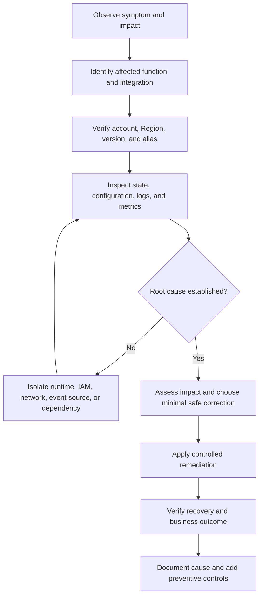

# 01- Troubleshooting Methodology

## Overview

Troubleshooting AWS Lambda requires a systematic approach to identifying failures across the function runtime, invocation mechanism, event source, IAM permissions, networking, downstream dependencies, and deployment configuration.

A Lambda function can report errors even when the invocation API succeeds. Similarly, a function may execute successfully while the overall business operation fails because a database transaction was not committed, a downstream service rejected a request, or an event was processed more than once.

The objective is to identify the actual failure domain, establish a verifiable root cause, apply the smallest safe correction, and prevent recurrence.

This methodology provides a common diagnostic process for Lambda-backed REST APIs, asynchronous workers, scheduled jobs, event-driven microservices, and production serverless applications.

## Troubleshooting Principles

### Start with the observed symptom

Avoid assuming that the Lambda function itself is responsible for every failure involving a Lambda-based system.

For example, an API request returning HTTP 502 could result from:

- An unhandled exception inside the handler.
- An API Gateway integration configuration error.
- A malformed response from the function.
- A timeout between the client, API Gateway, and Lambda.
- A downstream dependency failure.
- An invocation permission or resource configuration problem.

Begin with the observable symptom, identify the component that reported it, and then trace the request through the system.

### Separate symptoms from root causes

| Symptom | Possible root causes |
|---|---|
| `Task timed out` | Slow downstream requests, inefficient code, connection establishment delays, insufficient timeout, or resource contention |
| `TooManyRequestsException` | Concurrency limits, account capacity constraints, or invocation throttling |
| `AccessDeniedException` | Missing execution-role permissions, resource policy restrictions, permission boundaries, or organizational controls |
| `Runtime.ImportModuleError` | Incorrect package structure, missing dependency, incompatible native library, or incorrect handler configuration |
| Messages repeatedly reappear in SQS | Processing failures, visibility timeout mismatch, or unsuccessful acknowledgment |
| High API latency | Cold starts, initialization overhead, downstream latency, throttling, or inefficient application code |
| No CloudWatch logs | Missing log permissions, incorrect log group or Region, no invocation, or delayed log delivery |
| Duplicate business records | At-least-once delivery, retries, missing idempotency, or non-atomic persistence |

These symptoms are evidence, not definitive diagnoses. Verify the underlying cause before changing configuration.

## Standard Diagnostic Workflow

Use the same diagnostic sequence across Lambda failure domains.



### Establish the failure window

Record the following before investigating:

- First observed failure and most recent failure.
- Affected AWS account and Region.
- Function name, version, and alias.
- Invocation source and request or correlation ID.
- Error rate, request volume, and business impact.
- Recent deployments, configuration changes, IAM changes, or infrastructure changes.
- Whether failures affect all requests or only specific inputs.

A deployment that occurred shortly before the first failure is a useful lead, but temporal correlation alone does not establish causation.

### Confirm the target environment

**Operation: Read-only.**

```bash
export AWS_PROFILE=dev
export AWS_REGION=ap-south-1
export FUNCTION_NAME=orders-processor

aws sts get-caller-identity \
  --profile "$AWS_PROFILE" \
  --region "$AWS_REGION"
```

Inspect the function configuration:

```bash
aws lambda get-function-configuration \
  --function-name "$FUNCTION_NAME" \
  --profile "$AWS_PROFILE" \
  --region "$AWS_REGION" \
  --query '{
    Name:FunctionName,
    Version:Version,
    State:State,
    LastUpdateStatus:LastUpdateStatus,
    Runtime:Runtime,
    Handler:Handler,
    Memory:MemorySize,
    Timeout:Timeout,
    Role:Role,
    LastModified:LastModified
  }' \
  --output json
```

For alias-based production deployments, inspect the alias separately:

```bash
aws lambda get-alias \
  --function-name "$FUNCTION_NAME" \
  --name prod \
  --profile "$AWS_PROFILE" \
  --region "$AWS_REGION"
```

Confirm that the alias points to the intended version. Do not assume that inspecting the unqualified function configuration reveals the exact version serving production traffic.

### Inspect recent logs

**Operation: Read-only.**

```bash
aws logs tail "/aws/lambda/$FUNCTION_NAME" \
  --since 30m \
  --format short \
  --profile "$AWS_PROFILE" \
  --region "$AWS_REGION"
```

Look for:

- `START`, `END`, and `REPORT` records.
- Python tracebacks and initialization errors.
- Timeout messages.
- Memory utilization.
- Request and correlation IDs.
- Downstream HTTP or database errors.
- Repeated attempts for the same business event.

A missing log entry does not prove that the function was never invoked. The issue may involve permissions, a different log group, an alias-specific log group arrangement, the wrong Region, or a failure before application logging initialized.

## Classify the Failure Domain

### Lambda runtime and application code

Investigate when logs show Python exceptions, handler errors, import failures, malformed events, or application-specific failures.

Check:

- Handler module and function name.
- Deployment package structure.
- Dependency versions and native library compatibility.
- Input validation and event schema assumptions.
- Exceptions swallowed or incorrectly transformed by application code.
- Initialization logic executed outside the handler.

For Python functions, a handler such as `app.handler` requires an importable `app` module containing a callable named `handler`.

### Invocation and integration

Investigate when the caller receives an unexpected response or the function does not appear to execute.

Check:

- Invocation type: synchronous, asynchronous, or event source mapping.
- API Gateway integration configuration and response format.
- Function URL authentication and resource policy.
- Lambda resource-based permissions.
- Event source mapping state.
- Caller-side timeouts and retry behavior.

Do not apply synchronous invocation assumptions to asynchronous events or queue-based processing.

### IAM and security

Investigate when AWS API calls fail with authorization errors or an event source cannot invoke the function.

Distinguish between:

- The Lambda execution role, which authorizes actions performed by function code.
- The Lambda resource-based policy, which controls who or what can invoke the function.
- The identity policy of a direct caller.
- The permissions of a deployment role.
- Service-specific permissions and organizational controls.

Inspect the execution role:

```bash
aws lambda get-function-configuration \
  --function-name "$FUNCTION_NAME" \
  --profile "$AWS_PROFILE" \
  --region "$AWS_REGION" \
  --query Role \
  --output text
```

Inspect the function resource policy:

```bash
aws lambda get-policy \
  --function-name "$FUNCTION_NAME" \
  --profile "$AWS_PROFILE" \
  --region "$AWS_REGION"
```

An absent resource policy is not automatically an error. Direct invocation by an authorized same-account principal may rely on identity-based permissions, while service integrations often require a resource-based permission.

### Networking and downstream dependencies

Investigate when the handler starts but cannot reach a database, internal API, or external service.

Check:

- VPC subnet and security group configuration.
- Route tables and network ACLs.
- DNS resolution.
- NAT gateway or VPC endpoint configuration where applicable.
- Database connection limits.
- TLS negotiation and certificate validation.
- Downstream latency and throttling.
- Connection reuse and connection timeout behavior.

A Lambda function attached to a VPC does not automatically receive public internet access. Private subnet routing and outbound connectivity must be configured deliberately.

### Event delivery and processing

Investigate when messages are delayed, duplicated, repeatedly retried, or apparently lost.

Check:

- Event source mapping state and configuration.
- Queue visibility timeout and message retention.
- Batch size and maximum batching window.
- Retry policy and source-specific delivery semantics.
- Partial batch response configuration.
- Dead-letter queues or failure destinations.
- Stream retention and checkpoint behavior.
- Idempotency and durable business state.

An event source mapping is not equivalent to a direct asynchronous invocation. Polling, acknowledgment, retry, ordering, and checkpoint behavior depend on the source service.

## Use Logs, Metrics, and Traces Together

No single observability signal is sufficient for every failure.

| Signal | Best use | Limitation |
|---|---|---|
| CloudWatch Logs | Exceptions, execution details, and application context | Requires useful logging and correct permissions |
| CloudWatch Metrics | Error rates, duration, throttling, and concurrency trends | Aggregated metrics may not explain individual requests |
| AWS X-Ray or supported tracing integrations | Latency breakdown and dependency relationships | Sampling and instrumentation gaps can hide details |
| Application metrics | Business-level outcomes such as failed orders | Must be implemented and emitted consistently |
| CloudTrail | Auditing AWS API activity and relevant configuration changes | Does not replace application execution logs |

Correlate timestamps, request IDs, trace IDs, and business identifiers where available. Avoid logging credentials, access tokens, secret values, or sensitive request payloads.

### Inspect invocation and error metrics

**Operation: Read-only.**

```bash
START_TIME=$(date -u -d '30 minutes ago' +%Y-%m-%dT%H:%M:%SZ)
END_TIME=$(date -u +%Y-%m-%dT%H:%M:%SZ)

for METRIC in Invocations Errors Throttles; do
  echo "=== $METRIC ==="

  aws cloudwatch get-metric-statistics \
    --namespace AWS/Lambda \
    --metric-name "$METRIC" \
    --dimensions Name=FunctionName,Value="$FUNCTION_NAME" \
    --start-time "$START_TIME" \
    --end-time "$END_TIME" \
    --period 60 \
    --statistics Sum \
    --profile "$AWS_PROFILE" \
    --region "$AWS_REGION" \
    --output table
done
```

The commands use GNU `date`, as commonly available in Linux environments. On systems with a different `date` implementation, calculate the timestamps using an equivalent UTC-aware method.

Interpret metrics together:

- `Invocations` measures invocation attempts recorded by Lambda, not successful business operations.
- `Errors` indicates function execution errors for the selected metric dimensions.
- `Throttles` indicates invocation attempts rejected by Lambda throttling controls.
- `Duration` helps identify execution latency but does not represent every part of end-to-end request latency.
- `ConcurrentExecutions` helps assess active execution capacity.

Metric dimensions matter. For example, function-level and alias-qualified metrics may differ in how they are attributed. Check the relevant dimensions before drawing conclusions.

## Prioritize Production Incidents

During an incident, restore safe service operation before attempting broad optimization.

### Assess impact

Determine:

- Which endpoints, tenants, event types, or business workflows are affected.
- Whether data is missing, duplicated, delayed, or inconsistent.
- Whether the failure is increasing in scope.
- Whether retries are amplifying load.
- Whether downstream systems are degraded.
- Whether security or data exposure is involved.

### Choose a controlled mitigation

Potential mitigations include:

- Rolling back an alias to a known-good version.
- Disabling a problematic event source mapping temporarily.
- Reducing concurrency to protect an overloaded downstream dependency.
- Pausing producers or limiting intake when backpressure is required.
- Restoring a previously valid configuration.
- Increasing a timeout only after confirming that the workload can safely complete within the revised limit.

These actions have different consequences. Disabling a mapping can increase queue backlog or allow stream records to age toward retention limits. Reducing concurrency can increase latency and retries. A rollback cannot automatically reverse external side effects or database migrations.

### Verify business recovery

Do not stop at confirming that the Lambda error rate decreased.

Verify:

- Representative requests succeed end to end.
- Business records are persisted correctly.
- Queued messages are progressing.
- Retry and dead-letter volumes are understood.
- Downstream systems have recovered.
- Error rates and latency return to acceptable levels.
- No security or data-integrity issue remains unresolved.

## Common Troubleshooting Mistakes

| Mistake | Consequence | Better approach |
|---|---|---|
| Changing memory, timeout, IAM, and networking simultaneously | Makes causal diagnosis difficult | Change one controlled variable at a time where practical |
| Assuming every 5xx response originates in Lambda | Wastes investigation effort | Trace the request across the integration boundary |
| Retrying every failure immediately | Can amplify overload or duplicate side effects | Classify transient, permanent, and ambiguous failures |
| Treating a successful invocation submission as successful processing | Hides asynchronous execution failures | Monitor completion, retries, and failure destinations |
| Using only application logs | Misses throttling, queue backlog, and configuration changes | Correlate logs, metrics, traces, and audit events |
| Increasing concurrency without checking database capacity | Can exhaust connections or overload dependencies | Model concurrency against downstream capacity |
| Assuming exactly-once processing | Can create duplicate business operations | Use idempotency and durable state transitions |
| Making unverified production changes during an incident | Can widen the outage | Record the change, assess blast radius, and verify recovery |

## Incident Investigation Checklist

Use this checklist for a repeatable first-pass investigation.

- [ ] Confirm the account, Region, function, alias, and deployment version.
- [ ] Record the incident time window and affected business operations.
- [ ] Identify the invocation mechanism and the component reporting the failure.
- [ ] Inspect function state, update status, and relevant configuration.
- [ ] Review logs and metrics for the same time window.
- [ ] Check recent code, IAM, networking, and infrastructure changes.
- [ ] Verify downstream dependency health and capacity.
- [ ] Inspect event source state, retries, queue backlog, or stream lag where applicable.
- [ ] Identify the root cause using observable evidence.
- [ ] Apply the smallest safe remediation and document its impact.
- [ ] Verify technical recovery and business correctness.
- [ ] Add regression tests, alerts, runbook updates, or preventive controls.

## Key Takeaways

- Diagnose Lambda failures by tracing the complete request or event path instead of assuming the function is always the source.
- Verify account, Region, version, alias, configuration, logs, and metrics before making production changes.
- Distinguish runtime errors, invocation permissions, execution-role permissions, networking failures, and event delivery issues.
- Restore service with controlled mitigations, then verify business outcomes, retries, and data integrity.
- Convert confirmed root causes into automated tests, actionable alerts, and preventive operational controls.