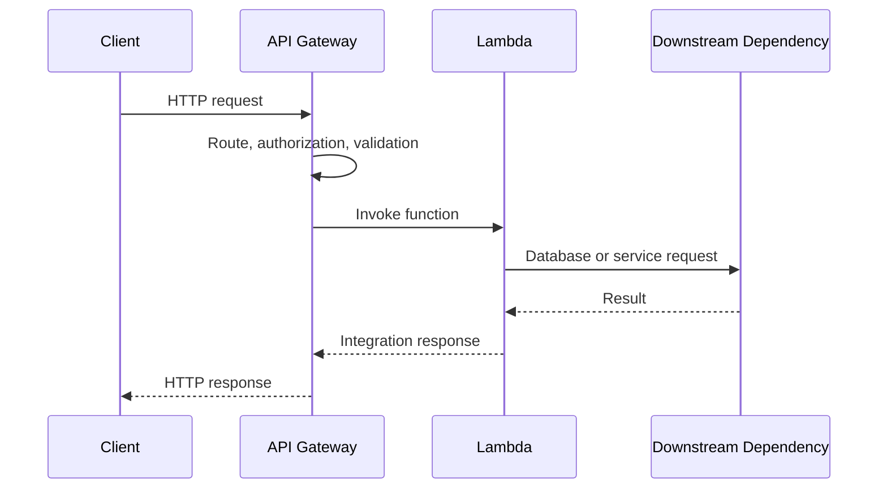
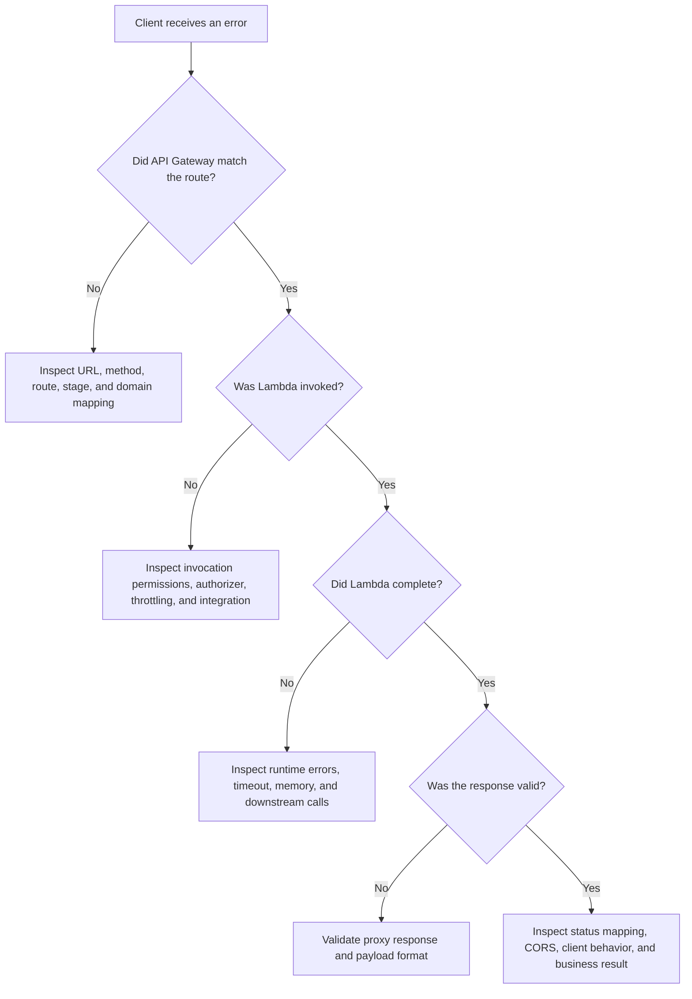

# 03- API Gateway Integration Issues

## Overview

API Gateway and AWS Lambda commonly form the entry point for serverless REST APIs, HTTP APIs, and backend microservices. Integration failures can occur at the API layer, during Lambda invocation, inside the handler, or while communicating with downstream services.

An HTTP error does not necessarily identify the failing component. For example, an HTTP 502 may indicate an integration failure or malformed Lambda proxy response, while an HTTP 504 may indicate an integration timeout. Authentication failures, throttling, deployment configuration, and application exceptions can produce different symptoms.

This document provides a structured method for diagnosing API Gateway–Lambda integration problems, verifying root causes, and applying production-safe corrections.

## Understand the Request Flow

A typical request passes through multiple independent components.



Failures can occur at any stage:

- **Client:** Incorrect URL, expired token, DNS failure, or client timeout.
- **API Gateway:** Missing route, authorization failure, throttling, invalid request configuration, or integration timeout.
- **Lambda invocation:** Missing invocation permission, concurrency throttling, or function state problems.
- **Lambda runtime:** Handler exception, initialization failure, or execution timeout.
- **Application response:** Incorrect proxy response structure, invalid serialization, or incompatible response format.
- **Downstream dependency:** Database timeout, external API failure, DNS problem, or exhausted connection capacity.

The first task is to determine which component generated the error and whether Lambda actually executed.

## Establish a Diagnostic Baseline

### Define the environment

The following commands use AWS CLI v2 and Bash.

```bash
export AWS_PROFILE=dev
export AWS_REGION=ap-south-1
export API_ID=replace-with-api-id
export STAGE=prod
export FUNCTION_NAME=orders-api
```

Replace the placeholders with actual resource identifiers.

### Verify the AWS account

**Operation: Read-only.**

```bash
aws sts get-caller-identity \
  --profile "$AWS_PROFILE" \
  --region "$AWS_REGION"
```

Confirm the account and Region before investigating or changing production resources.

### Inspect the Lambda configuration

**Operation: Read-only.**

```bash
aws lambda get-function-configuration \
  --function-name "$FUNCTION_NAME" \
  --profile "$AWS_PROFILE" \
  --region "$AWS_REGION" \
  --query '{
    Name:FunctionName,
    State:State,
    UpdateStatus:LastUpdateStatus,
    Runtime:Runtime,
    Handler:Handler,
    Timeout:Timeout,
    Memory:MemorySize,
    LastModified:LastModified
  }' \
  --output json
```

If the API invokes a qualified function ARN or alias, inspect the corresponding version or alias as well. Do not assume that the unqualified function configuration represents the version serving production traffic.

### Identify the API type

API Gateway supports REST APIs and HTTP APIs, which differ in configuration and observability.

| Area | REST API | HTTP API |
|---|---|---|
| Common use | Feature-rich API management and advanced request processing | Lower-overhead HTTP API integrations |
| Integration configuration | Supports REST API integration types and mapping templates | Uses HTTP API integration configuration |
| Access logging | Supported | Supported |
| Execution logging | REST APIs support API Gateway execution logging | Logging capabilities and configuration differ |
| Stage configuration | Supports REST API stage features | Supports HTTP API stage features |
| Troubleshooting | Inspect resources, methods, integrations, deployments, and stage settings | Inspect routes, integrations, authorizers, stages, and access logs |

Use commands and configuration fields appropriate to the actual API type.

## Diagnose HTTP 500, 502, and 504 Errors

### HTTP 500 — Internal Server Error

**Possible causes**

- An application exception is mapped to an HTTP 500 response.
- API Gateway encounters an internal configuration or processing error.
- A downstream failure is translated into a server error.
- An integration or mapping configuration is incorrect.

**Isolation strategy**

1. Inspect the client response body and headers.
2. Check API Gateway access logs.
3. Search Lambda logs around the request timestamp.
4. Determine whether the function ran and whether it returned or raised an error.
5. Check downstream dependency health.

**Root cause verification**

Correlate the request with API Gateway logs and Lambda request IDs where available. A generic HTTP 500 alone does not establish that the handler raised an exception.

**Corrective action**

Fix the specific application or integration failure. Return deliberate error responses for expected business conditions and reserve server errors for unexpected failures.

### HTTP 502 — Bad Gateway

**Possible causes**

- Lambda raised an unhandled exception.
- Lambda returned a malformed response for the configured proxy integration.
- API Gateway could not complete the integration successfully.
- A Lambda invocation or runtime failure occurred.
- A downstream error propagated through the handler.

The exact meaning depends on the integration type. A 502 should not automatically be attributed to a Python exception.

**Isolation strategy**

Inspect Lambda logs:

```bash
aws logs tail "/aws/lambda/$FUNCTION_NAME" \
  --since 30m \
  --format short \
  --profile "$AWS_PROFILE" \
  --region "$AWS_REGION"
```

Check for:

- Python tracebacks.
- `Runtime.ImportModuleError`.
- `Task timed out`.
- Initialization failures.
- Serialization errors.
- Unexpected response types.

If no corresponding Lambda invocation exists, investigate API Gateway routing, invocation permissions, throttling, and integration configuration.

**Corrective action**

Correct the actual failure. If the problem is a malformed proxy response, validate the response contract. If Lambda did not execute, investigate the invocation boundary instead of rewriting handler logic.

### HTTP 504 — Gateway Timeout

**Possible causes**

- Lambda execution takes longer than the integration permits.
- A downstream request hangs or responds too slowly.
- Database connection establishment is slow.
- The client or an intermediary has a shorter timeout than the backend.
- An API Gateway integration timeout is reached.

**Isolation strategy**

Compare:

- API Gateway request duration.
- Lambda `Duration` and timeout configuration.
- Downstream latency.
- Client-side timeout.
- API Gateway integration timeout settings.

**Root cause verification**

Determine whether Lambda reached its own timeout or whether the API Gateway request expired first. A gateway timeout does not necessarily mean Lambda stopped processing; the function or downstream operation may still complete.

**Corrective action**

- Configure explicit downstream connection and read timeouts.
- Optimize slow SQL queries and external requests.
- Reduce unnecessary work on the synchronous path.
- Use asynchronous processing for operations that cannot reliably finish within the API latency budget.
- Align timeouts while respecting the limits of each integration and client.

Do not blindly increase the Lambda timeout. It may have no effect if API Gateway or the client times out earlier.

## Lambda Proxy Response Errors

### Understand the response contract

For a Lambda proxy integration, API Gateway expects a response with the required fields for the integration format. A common response shape is:

```json
{
  "statusCode": 200,
  "headers": {
    "content-type": "application/json"
  },
  "body": "{\"status\":\"ok\"}",
  "isBase64Encoded": false
}
```

The `body` is a string, not a nested JSON object.

### Common mistakes

| Mistake | Consequence | Correction |
|---|---|---|
| Returning a Python dictionary directly as `body` | Invalid proxy response | Serialize the body with `json.dumps()` |
| Returning a missing or invalid status code | Integration response failure | Return the documented response shape |
| Returning a non-serializable object | Serialization error | Convert dates, decimals, and custom objects to supported representations |
| Using an incorrect `isBase64Encoded` value | Binary payload is interpreted incorrectly | Set the field according to the actual body encoding |
| Returning an unsupported header value | Response processing problems | Normalize header names and values |
| Returning an exception object as the response body | Serialization or response-format error | Convert the error into a deliberate HTTP response |

### Correct Python implementation

```python
import json
import logging

logger = logging.getLogger()
logger.setLevel(logging.INFO)


def json_response(status_code: int, payload: dict) -> dict:
    return {
        "statusCode": status_code,
        "headers": {
            "content-type": "application/json",
        },
        "body": json.dumps(payload),
        "isBase64Encoded": False,
    }


def handler(event, context):
    try:
        order_id = event.get("pathParameters", {}).get("order_id")

        if not order_id:
            return json_response(
                400,
                {"error": "order_id is required"},
            )

        return json_response(
            200,
            {"order_id": order_id, "status": "accepted"},
        )

    except Exception:
        logger.exception(
            "Unexpected request processing failure",
            extra={"request_id": context.aws_request_id},
        )
        return json_response(
            500,
            {"error": "Internal server error"},
        )
```

This example demonstrates response formatting and generic error handling. A production handler should also validate the event structure, enforce authorization at the correct layer, and avoid exposing internal exception details.

For HTTP APIs, verify the configured payload format version and integration behavior. REST API proxy integrations, HTTP API payload formats, and non-proxy integrations are not interchangeable.

## Routes, Methods, and Stage Deployment Problems

### Symptom: HTTP 403 or 404 for an apparently valid endpoint

**Possible causes**

- The route or method does not exist.
- The requested stage is incorrect.
- The API deployment does not contain the latest changes.
- A custom domain mapping points to another API or stage.
- Authorization or resource policy rejects the request.
- The client uses an incorrect path or HTTP method.

### REST API inspection

**Operation: Read-only.**

List resources:

```bash
aws apigateway get-resources \
  --rest-api-id "$API_ID" \
  --profile "$AWS_PROFILE" \
  --region "$AWS_REGION" \
  --output table
```

Inspect stages:

```bash
aws apigateway get-stages \
  --rest-api-id "$API_ID" \
  --profile "$AWS_PROFILE" \
  --region "$AWS_REGION" \
  --output json
```

Confirm that the expected resource and method exist and that the relevant deployment is associated with the stage.

### HTTP API inspection

**Operation: Read-only.**

```bash
aws apigatewayv2 get-routes \
  --api-id "$API_ID" \
  --profile "$AWS_PROFILE" \
  --region "$AWS_REGION" \
  --output table
```

Inspect integrations:

```bash
aws apigatewayv2 get-integrations \
  --api-id "$API_ID" \
  --profile "$AWS_PROFILE" \
  --region "$AWS_REGION" \
  --output json
```

Inspect stages:

```bash
aws apigatewayv2 get-stages \
  --api-id "$API_ID" \
  --profile "$AWS_PROFILE" \
  --region "$AWS_REGION" \
  --output json
```

### Corrective action

- Correct the route, method, or stage configuration.
- Verify custom domain API mappings.
- Deploy the intended configuration when required by the API type and deployment workflow.
- Test the exact public URL rather than only an internal integration.

For infrastructure managed by CloudFormation, AWS SAM, or another IaC tool, update the source configuration and redeploy through the established pipeline rather than making untracked manual changes.

## Lambda Invocation Permission Failures

### Symptom

API Gateway returns an authorization or integration error, and Lambda does not execute.

A Lambda resource-based policy commonly authorizes API Gateway to invoke a function. The execution role is separate: it authorizes the function code to access downstream AWS services.

### Inspect the Lambda resource policy

**Operation: Read-only.**

```bash
aws lambda get-policy \
  --function-name "$FUNCTION_NAME" \
  --profile "$AWS_PROFILE" \
  --region "$AWS_REGION"
```

Check whether the policy contains a statement allowing the expected API Gateway principal and source ARN.

### Understand the source ARN

A REST API invocation permission commonly restricts the source to an API, stage, method, and resource path. An HTTP API also requires a source ARN matching the relevant API and route or stage pattern.

A source ARN that references the wrong API ID, stage, method, or path can prevent invocation.

### Corrective action

Add or update the permission through the IaC definition when possible. If using the CLI, construct the exact source ARN for the intended API and scope.

Do not grant unrestricted invocation to arbitrary principals simply to eliminate a 403. Use least privilege and verify the resource policy after the change.

Also check:

- Cross-account invocation requirements.
- Lambda alias or version qualifiers.
- API Gateway authorizer configuration.
- IAM authorization requirements for the client.
- Resource policies and organizational restrictions.

## Authentication and Authorization Problems

### Common symptoms

- HTTP 401 for a missing or invalid credential.
- HTTP 403 for a rejected authorization decision.
- A route works without authorization but fails when protected.
- A token is valid but rejected by an authorizer.
- An IAM-authorized request fails signing or permission checks.

The exact status code and error body depend on the API type, authorizer, and configuration.

### Diagnostic checklist

- Confirm the configured authorization type.
- Verify token issuer, audience, expiration, and required claims for JWT-based authorization.
- Inspect authorizer identity sources and cache settings.
- Verify IAM SigV4 signing when using IAM authorization.
- Check resource policies, API resource policies, and organizational controls.
- Confirm that the intended route actually uses the expected authorizer.

### Common production mistakes

- Caching authorizer results longer than the authorization model permits.
- Confusing API Gateway authorization with the Lambda execution role.
- Treating CORS as an authentication mechanism.
- Logging bearer tokens or full authorization headers.
- Granting broad invocation permissions to compensate for a misconfigured authorizer.

Fix the authorization boundary that rejected the request. Do not weaken security controls as a diagnostic shortcut.

## CORS Errors

### Symptoms

- Browser requests fail even though the API works from `curl`.
- Preflight `OPTIONS` requests return 4xx or 5xx.
- Browser developer tools report missing `Access-Control-Allow-Origin`.
- Successful responses work, but error responses are blocked by the browser.

CORS is enforced by browsers. A failed browser request does not necessarily mean the Lambda function failed.

### Diagnostic approach

1. Inspect the browser network panel.
2. Check the preflight `OPTIONS` request.
3. Verify allowed origins, methods, and headers.
4. Confirm that credentials are configured consistently with the allowed origin.
5. Check whether CORS is configured in API Gateway, the Lambda response, or both.

### Corrective action

Use the CORS configuration appropriate to the API type. Avoid configuring conflicting behavior across API Gateway and Lambda.

For credentialed browser requests, do not use `Access-Control-Allow-Origin: *`. Return an explicitly permitted origin and configure credential handling deliberately.

Ensure expected error responses also contain the required CORS headers when the integration design requires Lambda to supply them.

## Throttling and Rate-Limit Errors

### Symptoms

- HTTP 429 responses.
- Sudden increase in API request failures.
- Lambda throttles increase during traffic spikes.
- Latency rises while a downstream database becomes overloaded.

### Possible causes

- API Gateway stage or route throttling.
- Account or API-level quotas.
- Lambda reserved concurrency.
- Account-level Lambda concurrency exhaustion.
- Downstream database or service limits.
- Retry storms from clients.

### Diagnostic approach

Inspect Lambda concurrency:

```bash
aws lambda get-function-concurrency \
  --function-name "$FUNCTION_NAME" \
  --profile "$AWS_PROFILE" \
  --region "$AWS_REGION"
```

Inspect account settings:

```bash
aws lambda get-account-settings \
  --profile "$AWS_PROFILE" \
  --region "$AWS_REGION" \
  --output json
```

Inspect API Gateway throttling configuration through the API type's appropriate stage and route configuration.

### Corrective action

- Identify the component enforcing the limit.
- Apply rate limits and backpressure appropriate to the service.
- Protect downstream systems with concurrency controls.
- Use bounded retries with exponential backoff and jitter in clients where appropriate.
- Avoid retrying non-idempotent operations without a safe deduplication strategy.

Do not assume that increasing Lambda concurrency will solve API throttling. The limit may exist at API Gateway or downstream.

## VPC and Downstream Integration Failures

### Symptoms

- The API route matches and Lambda executes, but requests time out.
- Database queries fail only in one environment.
- External API calls fail after VPC attachment.
- Latency rises after a deployment that changed networking configuration.

### Diagnostic approach

Inspect Lambda VPC configuration:

```bash
aws lambda get-function-configuration \
  --function-name "$FUNCTION_NAME" \
  --profile "$AWS_PROFILE" \
  --region "$AWS_REGION" \
  --query VpcConfig \
  --output json
```

Check:

- Subnet selection and route tables.
- Security group egress and destination ingress.
- NAT gateway or VPC endpoint configuration.
- DNS resolution and private hosted zones.
- Database health and connection capacity.
- TLS configuration and connection timeouts.

A VPC-attached Lambda does not automatically have public internet access. Private subnet routing and outbound connectivity must be configured explicitly.

### Corrective action

Fix the specific route, security group, DNS, endpoint, or database issue. Avoid opening broad ingress or egress rules as a permanent workaround.

For database-backed APIs, reuse connections where safe, bound connection pools, and consider RDS Proxy when appropriate. Account for Lambda concurrency when estimating aggregate database connections.

## Request and Response Payload Problems

### Symptoms

- Requests fail only for large payloads.
- The handler cannot parse the body.
- Binary uploads are corrupted.
- Requests are rejected before Lambda runs.

### Possible causes

- API Gateway payload limits.
- Incorrect base64 handling.
- Incorrect `Content-Type`.
- Invalid JSON.
- Mapping template behavior.
- Oversized headers or request bodies.
- The wrong payload format version.

### Diagnostic approach

Inspect:

- The exact request sent by the client.
- API Gateway access logs and any available validation errors.
- Lambda event structure.
- Integration payload format configuration.
- Whether the body is plain text, JSON, or base64-encoded binary data.

### Corrective action

- Validate payload size before processing.
- Parse JSON explicitly and return a suitable client error for malformed input.
- Configure binary media handling where applicable.
- Upload large files directly to Amazon S3 using presigned URLs rather than passing them through a synchronous API integration.
- Avoid logging entire request bodies when they may contain sensitive data.

API Gateway, Lambda, and the client can impose different payload or timeout constraints. Verify the limits for the specific service and integration instead of assuming one universal limit.

## API Gateway Logging and Request Correlation

### Enable useful access logging

Access logs help establish what API Gateway observed, even when Lambda logs are absent.

Include fields appropriate to the API type, such as:

- Request ID.
- HTTP method and route or resource path.
- Status code.
- Integration status and latency where supported.
- Authorizer outcome where appropriate.
- Source IP when justified by the security and privacy requirements.

Do not log authorization headers, access tokens, secret query parameters, or sensitive request bodies.

### Correlate API and Lambda requests

Lambda exposes the invocation request ID through `context.aws_request_id`. Log it alongside an application correlation ID when available.

```python
import logging

logger = logging.getLogger()
logger.setLevel(logging.INFO)


def handler(event, context):
    request_context = event.get("requestContext", {})
    request_id = context.aws_request_id

    logger.info(
        "API request received",
        extra={
            "lambda_request_id": request_id,
            "api_request_id": request_context.get("requestId"),
            "route_key": request_context.get("routeKey"),
        },
    )

    return {
        "statusCode": 200,
        "headers": {"content-type": "application/json"},
        "body": '{"status":"ok"}',
        "isBase64Encoded": False,
    }
```

Event fields vary between REST API, HTTP API, and other integrations. Treat the event as an integration-specific contract and handle optional fields safely.

## Production Diagnostic Decision Tree



Use this decision tree as a starting point, then verify the diagnosis with logs, metrics, and configuration state.

## Safe Remediation and Verification

Before changing production settings:

1. Record the current configuration and the failing request characteristics.
2. Identify whether the failure is in routing, authorization, invocation, execution, response formatting, or a dependency.
3. Make the smallest change that addresses the verified cause.
4. Use the existing IaC and deployment workflow whenever possible.
5. Test representative success and failure paths.
6. Verify response codes, latency, Lambda error rate, throttles, and downstream health.
7. Confirm that the fix did not weaken authorization or cause duplicate business operations.

For an alias-based deployment, a rollback may restore the previous code version, but it will not automatically reverse database migrations or external side effects.

## Common Mistakes

| Mistake | Why it fails | Better approach |
|---|---|---|
| Assuming every 502 means a Lambda exception | Integration or response-format errors can also cause 502 | Confirm whether Lambda ran and inspect the response contract |
| Increasing Lambda timeout to fix every 504 | API Gateway or the client may time out first | Compare all timeout boundaries |
| Fixing 403 errors by granting broad permissions | Weakens the security boundary and may hide the real misconfiguration | Identify the rejecting principal, policy, or authorizer |
| Testing only with `curl` | Browser CORS enforcement is not reproduced | Test preflight and browser behavior |
| Returning dictionaries directly as proxy response bodies | Can violate the expected integration response schema | Serialize response bodies explicitly |
| Changing the console without updating IaC | Creates configuration drift | Apply durable changes through the deployment pipeline |
| Logging full request and authorization headers | Can expose credentials and personal data | Log safe identifiers and sanitized metadata |
| Retrying timed-out writes blindly | The original operation may already have completed | Use idempotency keys and verify business state |

## Key Takeaways

- Diagnose API Gateway errors by separating routing, authorization, Lambda invocation, handler execution, response formatting, and downstream failures.
- HTTP 500, 502, and 504 are symptoms, not definitive root-cause diagnoses.
- Verify the API type, route, stage, integration, function qualifier, resource policy, and response contract before changing production configuration.
- Compare API Gateway, Lambda, client, and downstream timeouts; a gateway timeout does not prove that backend processing stopped.
- Use structured access logs, correlated Lambda logs, least-privilege permissions, and end-to-end verification to resolve issues safely.