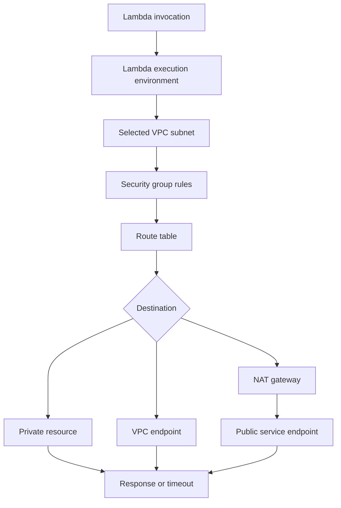
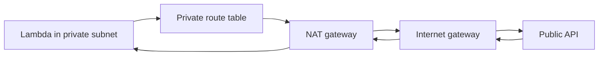
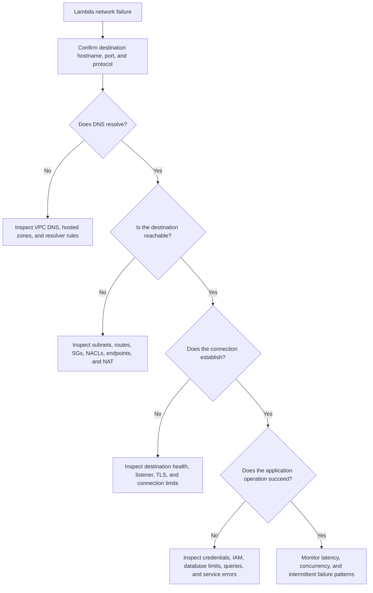

# 04- VPC Networking and Connectivity Issues

## Overview

AWS Lambda networking failures are frequently caused by incorrect subnet routing, security group rules, DNS configuration, missing VPC endpoints, or misunderstanding how Lambda reaches private and public resources.

A function can initialize successfully and execute application code while still being unable to connect to PostgreSQL, Redis, an internal HTTP service, or a public API. These failures often appear as connection timeouts, DNS resolution errors, TLS failures, or intermittent latency.

The most effective troubleshooting approach is to follow the network path from the Lambda execution environment to the destination, validating each boundary independently.

This document covers:

- Lambda VPC attachment and network interface behavior.
- Subnet selection, route tables, and security groups.
- Internet and AWS service connectivity.
- DNS resolution and VPC endpoints.
- Database, Redis, and internal service connectivity.
- Connection exhaustion, latency, and intermittent failures.
- Diagnostic commands, root-cause verification, and production-safe remediation.

## Understand Lambda Networking

### Lambda without VPC attachment

A Lambda function that is not attached to a customer VPC runs in a Lambda-managed networking environment. It can access supported public endpoints without requiring the function owner to configure VPC subnets or NAT gateways.

This does not grant automatic access to private resources inside a customer VPC.

### Lambda attached to a VPC

When a function is configured for VPC access, Lambda uses the selected subnets and security groups to provide network connectivity to resources reachable through that VPC's networking configuration.

Typical destinations include:

- Amazon RDS and Aurora.
- ElastiCache for Redis or Valkey.
- Internal services running on EC2 or ECS.
- Private APIs and services exposed through VPC networking.
- AWS services accessed through appropriate VPC endpoints or other network paths.

VPC attachment does not automatically provide internet access. Public outbound connectivity requires suitable routing and network infrastructure.

### Request path



The exact path depends on the destination, subnet configuration, routing, DNS, security controls, and endpoint type.

## Establish the Diagnostic Baseline

Before changing networking resources, identify the affected function, Region, destination, and failure pattern.

### Set diagnostic variables

The following commands use AWS CLI v2 and Bash.

```bash
export AWS_PROFILE=dev
export AWS_REGION=ap-south-1
export FUNCTION_NAME=orders-api
```

Replace the values with the actual environment. Verify the account before running operational commands.

**Operation: Read-only.**

```bash
aws sts get-caller-identity \
  --profile "$AWS_PROFILE" \
  --region "$AWS_REGION"
```

### Inspect the function's VPC configuration

**Operation: Read-only.**

```bash
aws lambda get-function-configuration \
  --function-name "$FUNCTION_NAME" \
  --profile "$AWS_PROFILE" \
  --region "$AWS_REGION" \
  --query '{
    FunctionName:FunctionName,
    State:State,
    LastUpdateStatus:LastUpdateStatus,
    VpcConfig:VpcConfig,
    Timeout:Timeout,
    MemorySize:MemorySize
  }' \
  --output json
```

Record:

- VPC ID.
- Subnet IDs.
- Security group IDs.
- Function timeout.
- Function state and update status.

A function with no VPC configuration is not using the customer VPC networking path for its outbound connections.

### Inspect the destination

For a database or internal service, identify:

- Hostname or IP address.
- Destination port.
- Expected DNS name and record type.
- Whether the destination is private or public.
- Destination security groups or network firewall controls.
- Whether connectivity works from another resource in the same VPC.

For example, PostgreSQL commonly uses TCP port `5432`, while Redis or Valkey commonly uses TCP port `6379`. Actual ports depend on the deployment configuration.

## Troubleshoot Subnet and Routing Problems

### Symptoms

- Connections time out without an application-level error.
- A function can access one private resource but not another.
- Public HTTP requests fail after VPC attachment.
- Connectivity differs between deployments or subnet selections.

### Possible causes

- Incorrect subnet selection.
- Missing or incorrect route-table entries.
- A private subnet without a valid NAT route.
- An unavailable or incorrectly configured NAT gateway.
- Missing routes to peered VPCs or a transit gateway.
- Overlapping CIDR ranges or incorrect return routing.
- Network ACL rules blocking traffic or ephemeral return ports.

### Inspect subnet configuration

**Operation: Read-only.**

```bash
export SUBNET_ID=subnet-xxxxxxxx
```

```bash
aws ec2 describe-subnets \
  --subnet-ids "$SUBNET_ID" \
  --profile "$AWS_PROFILE" \
  --region "$AWS_REGION" \
  --query 'Subnets[].{
    SubnetId:SubnetId,
    VpcId:VpcId,
    AvailabilityZone:AvailabilityZone,
    CidrBlock:CidrBlock,
    MapPublicIpOnLaunch:MapPublicIpOnLaunch
  }' \
  --output table
```

The `MapPublicIpOnLaunch` setting does not make Lambda execution environments directly internet-accessible.

### Find the effective route table

**Operation: Read-only.**

```bash
aws ec2 describe-route-tables \
  --filters "Name=association.subnet-id,Values=$SUBNET_ID" \
  --profile "$AWS_PROFILE" \
  --region "$AWS_REGION" \
  --output json
```

If no explicitly associated route table is returned, inspect the VPC's main route table.

```bash
export VPC_ID=vpc-xxxxxxxx
```

```bash
aws ec2 describe-route-tables \
  --filters \
    "Name=vpc-id,Values=$VPC_ID" \
    "Name=association.main,Values=true" \
  --profile "$AWS_PROFILE" \
  --region "$AWS_REGION" \
  --output json
```

Check routes for:

- The local VPC CIDR.
- NAT gateway routes for IPv4 outbound connectivity.
- Internet gateway routes where applicable.
- VPC peering or transit gateway routes.
- Routes to centralized network appliances.
- Return paths from the destination network.

### Corrective action

Correct the route table or subnet selection only after confirming the intended network architecture.

For highly available production systems, deploy the required network components across appropriate Availability Zones and avoid depending on a single network path when the workload's availability requirements demand redundancy.

Do not assume that selecting multiple subnets automatically creates internet connectivity or guarantees that every destination is reachable.

## Public Internet Connectivity Failures

### Symptoms

- Requests to public REST APIs time out.
- Package or external service downloads fail from the function.
- Public hostname resolution works, but TCP connections fail.
- The function worked before VPC attachment and fails afterward.

### Root cause

A Lambda function attached to private subnets does not automatically receive outbound internet access. A typical IPv4 design uses private subnets whose default route points to a NAT gateway in a public subnet.



The NAT gateway must itself have an appropriate route to an internet gateway. The private subnet's default route should point to the NAT gateway, not directly to the internet gateway.

### Inspect NAT gateways

**Operation: Read-only.**

```bash
aws ec2 describe-nat-gateways \
  --filter \
    "Name=vpc-id,Values=$VPC_ID" \
    "Name=state,Values=available" \
  --profile "$AWS_PROFILE" \
  --region "$AWS_REGION" \
  --query 'NatGateways[].{
    NatGatewayId:NatGatewayId,
    SubnetId:SubnetId,
    State:State,
    Addresses:NatGatewayAddresses
  }' \
  --output json
```

Verify:

- The NAT gateway is available.
- The NAT gateway is in the intended VPC.
- Its subnet has a route to an internet gateway.
- The Lambda subnet's route table points to the correct NAT gateway.
- Network ACLs and destination-side controls allow the traffic.
- The destination supports the required protocol and TLS configuration.

### Corrective action

Choose the appropriate connectivity model:

| Requirement | Typical solution |
|---|---|
| Lambda must reach a public IPv4 API | NAT gateway or another explicitly designed outbound path |
| Lambda must access a private database | VPC-local or routed private connectivity |
| Lambda must access an AWS service privately | Suitable VPC endpoint where supported |
| Lambda must access another VPC | VPC peering, transit gateway, or another supported private network design |
| Lambda needs access to a public API but does not require private resources | Consider whether VPC attachment is necessary at all |

NAT gateways incur ongoing and data-processing charges. Avoid creating redundant NAT infrastructure without evaluating availability requirements and cost implications.

## Security Group Failures

### Symptoms

- TCP connections time out.
- One destination port works while another fails.
- Lambda can reach a service from EC2 but not from the function.
- A database connection fails despite correct credentials.

Security groups are stateful virtual firewalls. For a typical Lambda-to-database connection, the Lambda security group must allow outbound traffic to the destination port, and the database security group must allow inbound traffic from the Lambda security group.

### Inspect Lambda security groups

**Operation: Read-only.**

```bash
aws ec2 describe-security-groups \
  --group-ids sg-xxxxxxxx \
  --profile "$AWS_PROFILE" \
  --region "$AWS_REGION" \
  --output json
```

Inspect:

- Outbound rules on the Lambda security group.
- Inbound rules on the destination security group.
- Destination port and protocol.
- Security group IDs attached to the actual Lambda configuration.
- Any additional network firewall controls.

### Example: PostgreSQL connectivity

A typical least-privilege design is:

- Lambda security group: outbound TCP `5432` to the database security group.
- Database security group: inbound TCP `5432` from the Lambda security group.

Security group references are generally preferable to broad CIDR-based rules when both resources are in a compatible network configuration.

### Common mistake: opening the database to the world

A rule permitting PostgreSQL traffic from `0.0.0.0/0` exposes the port to any IPv4 source that can reach the destination.

Use a narrowly scoped security group rule instead. Verify the actual rule and its source before concluding that the issue is resolved.

### Corrective action

Modify security group rules through the established IaC workflow. After applying the change, verify the effective rules and test the actual connection from the Lambda execution path.

Do not permanently allow all outbound traffic or broad inbound CIDRs merely to make a connectivity test succeed.

## DNS Resolution Problems

### Symptoms

- Errors such as `Name or service not known`.
- Python raises `socket.gaierror`.
- A database hostname works from a developer machine but not from Lambda.
- A private service hostname resolves to an unexpected address.

### Possible causes

- Incorrect hostname.
- VPC DNS resolution settings.
- Missing private hosted-zone association.
- Incorrect Route 53 record.
- Resolver rules or conditional forwarding problems.
- A private DNS name resolving differently across environments.
- A hostname resolving to an address that is not reachable from the selected subnets.

### Inspect VPC DNS settings

**Operation: Read-only.**

```bash
aws ec2 describe-vpcs \
  --vpc-ids "$VPC_ID" \
  --profile "$AWS_PROFILE" \
  --region "$AWS_REGION" \
  --query 'Vpcs[].{
    VpcId:VpcId,
    CidrBlock:CidrBlock,
    EnableDnsSupport:EnableDnsSupport,
    EnableDnsHostnames:EnableDnsHostnames
  }' \
  --output json
```

Inspect relevant private hosted zones and their VPC associations where Route 53 private DNS is involved.

### Diagnose DNS in the runtime

A temporary diagnostic handler can resolve a hostname using Python's standard library.

```python
import logging
import socket

logger = logging.getLogger()
logger.setLevel(logging.INFO)


def handler(event, context):
    hostname = event["hostname"]

    try:
        addresses = sorted({
            result[4][0]
            for result in socket.getaddrinfo(
                hostname,
                None,
                type=socket.SOCK_STREAM,
            )
        })

        logger.info(
            "DNS resolution succeeded",
            extra={"hostname": hostname, "addresses": addresses},
        )

        return {
            "statusCode": 200,
            "body": {"hostname": hostname, "addresses": addresses},
        }

    except socket.gaierror:
        logger.exception(
            "DNS resolution failed",
            extra={"hostname": hostname},
        )
        raise
```

This is a diagnostic illustration, not a general-purpose API response handler. Standard Lambda proxy integrations require the appropriate response format, including a serialized string body. Do not expose internal DNS information through a public endpoint.

### Corrective action

- Correct the hostname or DNS record.
- Verify private hosted-zone associations.
- Check Route 53 Resolver rules and forwarding paths.
- Confirm the resolved address is reachable from the function's VPC.
- Avoid hardcoding IP addresses for managed services whose addresses can change.

## VPC Endpoint and AWS Service Connectivity Problems

### Symptoms

- Lambda cannot access an AWS service from a private subnet.
- S3, DynamoDB, Secrets Manager, or another AWS API request times out.
- DNS resolves, but connections fail.
- Requests fail with an AWS authorization error despite successful network connectivity.

Network connectivity and IAM authorization are separate failure domains. A reachable endpoint does not guarantee that the function is authorized to use it.

### Choose the correct endpoint type

| Endpoint type | Typical use |
|---|---|
| Gateway endpoint | Private routing to supported services such as Amazon S3 and DynamoDB |
| Interface endpoint | Private connectivity to supported AWS services through endpoint network interfaces |
| Public service endpoint through NAT | Access to a public AWS endpoint when a private endpoint is not configured or appropriate |

Endpoint availability and supported services vary by Region and service. Verify the required endpoint type for the target service.

### Inspect VPC endpoints

**Operation: Read-only.**

```bash
aws ec2 describe-vpc-endpoints \
  --filters "Name=vpc-id,Values=$VPC_ID" \
  --profile "$AWS_PROFILE" \
  --region "$AWS_REGION" \
  --output json
```

For an interface endpoint, verify:

- Endpoint state.
- Subnet and network interface placement.
- Security group inbound rules for HTTPS where applicable.
- Private DNS settings.
- Endpoint policy.
- Routing and DNS resolution.

For a gateway endpoint, inspect route-table associations and the endpoint policy.

### Distinguish network errors from authorization errors

Typical indicators include:

| Symptom | Likely area to investigate |
|---|---|
| Connection timeout | Routing, security groups, NACLs, endpoint reachability, or destination availability |
| DNS resolution failure | DNS configuration, hosted zones, resolver rules, or hostname |
| TLS certificate error | Hostname mismatch, trust configuration, or TLS interception |
| HTTP 403 from an AWS service | IAM policy, resource policy, endpoint policy, or organization-level restriction |
| `AccessDeniedException` | Authorization evaluation and service-specific permissions |

### Corrective action

Configure the appropriate endpoint and security rules, then verify the IAM permissions separately. Do not grant broad permissions to resolve a TCP timeout.

## Database Connectivity Failures

### Symptoms

- PostgreSQL or MySQL connection timeouts.
- Authentication failures after connectivity succeeds.
- `too many connections` errors.
- Intermittent failures under concurrent traffic.
- Requests become slower as Lambda scales out.

### Separate the failure types

| Error pattern | Likely cause |
|---|---|
| Connection timeout | Routing, security groups, network ACLs, or unreachable endpoint |
| DNS resolution error | Hostname or resolver configuration |
| Connection refused | Service not listening, wrong port, or explicit rejection |
| Authentication failure | Credentials, database user, authentication configuration, or secret rotation |
| Connection limit exceeded | Too many concurrent or leaked database connections |
| TLS verification error | Incorrect certificate validation or hostname configuration |
| Query timeout | Slow query, locks, database overload, or insufficient statement timeout |

### Check database connection capacity

Lambda can scale horizontally, which means a spike in request concurrency can create a corresponding spike in database connections if each execution environment opens its own connection.

A rough upper-bound model is:

\[
\text{Potential connections}
\approx
\text{Concurrent execution environments}
\times
\text{Connections per environment}
\]

This is an approximation, not a guarantee: actual connection usage depends on initialization, reuse, workload behavior, and driver pooling.

### Production recommendations

- Reuse database connections where safe within an execution environment.
- Configure bounded connection pools.
- Set connection, read, and statement timeouts.
- Avoid opening a new connection for every request without a deliberate reason.
- Use RDS Proxy where it suits the workload and database engine.
- Limit Lambda concurrency when downstream capacity is constrained.
- Monitor database connection count, CPU, query latency, and lock contention.

### Python connection example

The following PostgreSQL example uses `psycopg` 3. The dependency must be included in the deployment package or a compatible layer.

```python
import os

import psycopg
from psycopg.rows import dict_row

_connection = None


def get_connection():
    global _connection

    if _connection is not None and not _connection.closed:
        try:
            with _connection.cursor() as cursor:
                cursor.execute("SELECT 1")
            return _connection
        except psycopg.Error:
            _connection.close()
            _connection = None

    _connection = psycopg.connect(
        host=os.environ["DB_HOST"],
        port=int(os.environ.get("DB_PORT", "5432")),
        dbname=os.environ["DB_NAME"],
        user=os.environ["DB_USER"],
        password=os.environ["DB_PASSWORD"],
        connect_timeout=5,
        sslmode="verify-full",
        sslrootcert=os.environ["DB_CA_CERT_PATH"],
        row_factory=dict_row,
    )

    return _connection


def handler(event, context):
    connection = get_connection()

    with connection.cursor() as cursor:
        cursor.execute("SELECT current_timestamp AS server_time")
        result = cursor.fetchone()

    return {
        "statusCode": 200,
        "headers": {"content-type": "application/json"},
        "body": str(result["server_time"]),
        "isBase64Encoded": False,
    }
```

Important limitations:

- The example demonstrates connection reuse, not a complete application data-access layer.
- `DB_CA_CERT_PATH` must point to a valid CA certificate available in the deployment environment.
- Production code should serialize timestamps and other values into a defined JSON response schema.
- Connection reuse is an optimization, not a guarantee that a connection remains valid between invocations.
- Transactions must be committed or rolled back deliberately.
- Credentials should be retrieved using an appropriate secret-management design rather than embedded in source code.

If the connection is stale, reconnect safely. Do not assume a reused connection is healthy merely because it exists.

## Redis and Internal Service Connectivity

### Redis or Valkey

For a private cache:

- Verify that Lambda and the cache have compatible network connectivity.
- Confirm the cache security group permits traffic from the Lambda security group.
- Validate the actual port, TLS settings, authentication, and endpoint hostname.
- Use bounded connection and socket timeouts.
- Reuse clients where appropriate.
- Avoid creating a new client and connection for every request without measuring the effect.

A successful TCP connection does not prove that authentication or application-level commands will succeed.

### Internal HTTP services

For an internal service running on ECS, EC2, or another private network:

1. Resolve the service hostname from the Lambda execution path.
2. Verify routes between the Lambda subnet and destination network.
3. Check security group and network firewall rules.
4. Verify TLS and hostname validation.
5. Check application health and response latency.

Service discovery names, private DNS records, load balancers, and endpoint configurations can differ between development and production. Confirm the destination that the function actually resolves.

## Intermittent Failures and Latency Spikes

### Symptoms

- The first request fails, but later requests succeed.
- Failures occur only during traffic spikes.
- Database connections periodically time out.
- Latency rises after idle periods.
- Failures occur only in certain Availability Zones or subnets.

### Possible causes

- Stale pooled connections.
- DNS changes or resolver behavior.
- Database failover or connection resets.
- Uneven subnet or Availability Zone configuration.
- NAT gateway capacity or availability issues.
- Connection pool exhaustion.
- Downstream throttling.
- Long-running requests consuming available concurrency.
- Aggressive retry behavior.

### Diagnostic strategy

Compare failures by:

- Timestamp and Lambda request ID.
- Function version or alias.
- Selected subnet and destination.
- Resolved hostname and address.
- Connection establishment time.
- Downstream response time.
- Lambda concurrency and duration.
- Database connection count and health.
- NAT gateway and VPC flow telemetry where available.

Avoid logging sensitive payloads or credentials while collecting diagnostic evidence.

### Corrective action

- Bound retries and use exponential backoff with jitter where appropriate.
- Set explicit connection and read timeouts.
- Recycle broken pooled connections.
- Reduce excessive connection creation.
- Verify multi-AZ routing and destination availability.
- Apply concurrency limits where the downstream service requires protection.

Do not treat retrying as a substitute for identifying a persistent network or capacity problem.

## Diagnose with VPC Flow Logs

VPC Flow Logs can help determine whether traffic was accepted or rejected at supported network interfaces and observation points. They are not packet captures and do not reveal application payloads.

Use them alongside Lambda logs, application metrics, route inspection, and destination-side telemetry.

### Recommended fields

Where available, capture fields useful for diagnosing:

- Source and destination addresses.
- Source and destination ports.
- Protocol.
- Traffic action.
- Interface identifier.
- Flow start and end times.
- TCP flags or other supported diagnostic fields.

### Interpret the evidence carefully

| Observation | Possible interpretation |
|---|---|
| `REJECT` | A security group or network ACL rule may have rejected traffic |
| `ACCEPT` with application timeout | Traffic was accepted at the observed point, but the destination may still be unhealthy or a later network boundary may fail |
| No matching flow | Traffic may not have reached the observed interface, logging may be incomplete, or the flow may not be represented as expected |
| Repeated connection attempts | Application retry behavior, connection-pool churn, or an unreachable destination |

Flow Logs have delivery delays and filtering limitations. Absence of a record is not definitive proof that no traffic was attempted.

## Production Diagnostic Workflow

Use the following sequence to isolate the failure before changing resources.



### Standard incident sequence

1. **Symptom:** Capture the exception, timeout, failed hostname, port, and request timestamp.
2. **Possible causes:** List plausible DNS, routing, firewall, TLS, authorization, and capacity failures.
3. **Isolation strategy:** Test the layers in order rather than changing multiple network resources simultaneously.
4. **Diagnostic commands:** Inspect Lambda VPC configuration, route tables, security groups, endpoints, and destination health.
5. **Root cause verification:** Reproduce the failing operation from the actual Lambda execution path and verify the network or application evidence.
6. **Corrective action:** Change only the affected resource or application setting.
7. **Prevention:** Add monitoring, infrastructure validation, timeout configuration, and regression tests.

## Security and Cost Considerations

### Security

- Use least-privilege security group rules.
- Keep databases and caches private unless public exposure is explicitly required.
- Use TLS with certificate validation.
- Store secrets in Secrets Manager or another appropriate secret-management system.
- Restrict VPC endpoint policies where supported.
- Review network changes through IaC and change control.
- Avoid logging credentials, tokens, database connection strings, or sensitive query results.

### Cost

Networking resources can continue generating charges even when the Lambda function is idle.

Evaluate:

- NAT gateway hourly and data-processing charges.
- Interface VPC endpoint hourly and data-processing charges.
- VPC Flow Logs ingestion and storage.
- Cross-AZ traffic and data transfer.
- RDS Proxy or other connection-management costs.
- Lambda duration caused by network latency and retries.

Use the AWS Pricing Calculator and current service pricing for the deployment Region. Clean up diagnostic resources and temporary logging configurations when they are no longer needed.

## Common Mistakes

| Mistake | Why it fails | Better approach |
|---|---|---|
| Assuming VPC attachment provides internet access | Private subnet routing may not provide an outbound path | Configure and verify the intended NAT or endpoint architecture |
| Adding an internet gateway route to a private subnet and expecting Lambda to use it | The route alone does not make the Lambda execution environment publicly reachable | Use an appropriate private-subnet egress design |
| Opening all database ports to all sources | Creates unnecessary exposure and may not fix routing problems | Restrict ingress to the required source and port |
| Assuming DNS resolution proves connectivity | DNS returns an address but does not establish a TCP or TLS session | Test resolution, connection establishment, TLS, and the application operation separately |
| Creating connections for every invocation without limits | Can exhaust database connection capacity as Lambda scales | Reuse connections safely and bound concurrency and pooling |
| Increasing Lambda timeout to fix every network failure | A longer timeout does not repair routing, DNS, or firewall problems | Identify the failing network boundary |
| Assuming `ACCEPT` in Flow Logs proves application success | Flow Logs do not establish application-level correctness | Correlate flow telemetry with application and destination logs |
| Hardcoding managed-service IP addresses | Addresses can change during failover or infrastructure updates | Use supported DNS endpoints |
| Applying broad security rules as a temporary fix and forgetting to revert them | Leaves a persistent security weakness | Use narrow, reviewed changes and verify the final effective policy |

## Key Takeaways

- Diagnose Lambda networking from DNS resolution through routing, security controls, transport connectivity, TLS, and application behavior.
- VPC attachment does not automatically provide public internet access; verify NAT gateways, route tables, endpoints, and DNS configuration.
- Use least-privilege security groups and inspect the actual Lambda subnet and destination configuration before changing network rules.
- Protect databases and caches from Lambda concurrency spikes with connection reuse, bounded pools, explicit timeouts, and appropriate concurrency controls.
- Combine Lambda logs, VPC Flow Logs, network configuration inspection, and destination telemetry to verify root causes rather than guessing.