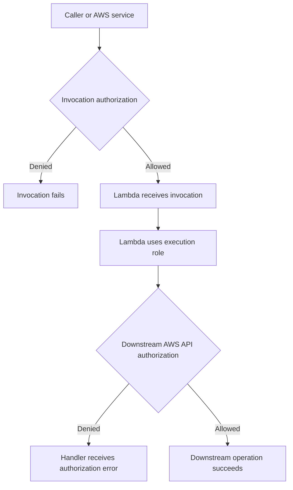
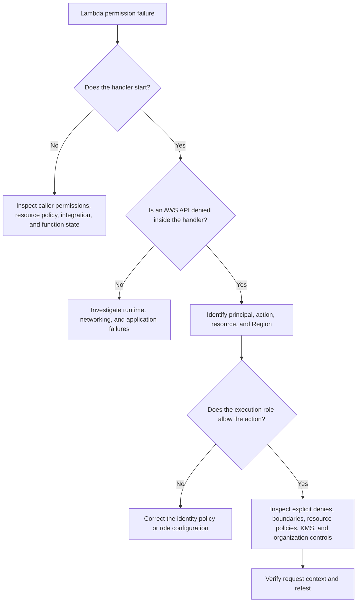

# 05- IAM and Permission Errors

## Overview

AWS Lambda authorization failures occur when an identity, service, or resource lacks the permissions required to perform an operation. These failures can affect function invocation, access to AWS services, event source processing, deployment, logging, and encryption.

A single Lambda request can cross several authorization boundaries. For example, API Gateway may be authorized to invoke a Lambda function, while the function's execution role independently determines whether the handler can read from DynamoDB or retrieve a secret from AWS Secrets Manager.

The most effective troubleshooting approach is to identify **which principal is performing which action against which resource**, then inspect every relevant authorization layer.

This document covers:

- Execution roles and trust policy failures.
- Identity-based and resource-based policy errors.
- Direct invocation and event source mapping permissions.
- API Gateway, S3, SNS, EventBridge, SQS, and DynamoDB Streams integrations.
- Cross-account access, KMS, secrets, and CloudWatch Logs permissions.
- Deployment and CI/CD authorization failures.
- AWS CLI diagnostics, policy simulation, and safe remediation.

## Understand Lambda Authorization Boundaries

Lambda security involves several independent permission relationships.

| Authorization boundary | Responsibility | Typical failure |
|---|---|---|
| Execution-role trust policy | Allows Lambda to assume the execution role | Role assumption or function configuration failure |
| Execution-role permissions | Authorizes AWS API calls made by the running function | `AccessDeniedException` inside the handler |
| Lambda resource-based policy | Allows specified principals or services to invoke the function | Invocation denied by API Gateway or an event source |
| Caller identity policy | Authorizes a user or role to invoke Lambda or manage its configuration | `AccessDeniedException` from the caller's AWS API request |
| Event source mapping permissions | Allow Lambda to poll or read records from supported event sources | Mapping errors, stalled processing, or missing records |
| KMS key policy and grants | Control use of customer-managed encryption keys | Decryption or encrypted-resource access failures |
| Organization-level controls | Enforce applicable organizational restrictions | Access denied despite an apparent identity-policy allow |

These policies are not interchangeable. Granting `lambda:InvokeFunction` to the execution role does not automatically authorize API Gateway to invoke the function. Similarly, granting `dynamodb:GetItem` to a deployment role does not grant that permission to the function's execution role.

### Authorization flow



The exact authorization path depends on the integration. Direct invocation, service-to-function invocation, and event source mappings use different permission models.

## Establish the Diagnostic Baseline

Before modifying IAM policies, identify the account, Region, function, execution role, and failing operation.

### Configure diagnostic variables

The following commands use AWS CLI v2 and Bash.

```bash
export AWS_PROFILE=dev
export AWS_REGION=ap-south-1
export FUNCTION_NAME=orders-api
```

Replace these values with the actual environment.

**Operation: Read-only.**

```bash
aws sts get-caller-identity \
  --profile "$AWS_PROFILE" \
  --region "$AWS_REGION"
```

Verify the account ID and caller ARN. An incorrect profile or account is a common cause of confusing permission failures.

### Inspect the function configuration

**Operation: Read-only.**

```bash
aws lambda get-function-configuration \
  --function-name "$FUNCTION_NAME" \
  --profile "$AWS_PROFILE" \
  --region "$AWS_REGION" \
  --query '{
    FunctionName:FunctionName,
    State:State,
    LastUpdateStatus:LastUpdateStatus,
    Role:Role,
    KMSKeyArn:KMSKeyArn,
    LoggingConfig:LoggingConfig
  }' \
  --output json
```

Record the execution-role ARN, function state, logging configuration, and encryption configuration.

### Identify the failing operation

Collect the following information:

- Exact AWS error code and message.
- Timestamp and affected request or event.
- Principal ARN, if available.
- Attempted action, such as `dynamodb:GetItem`.
- Target resource ARN.
- Source and destination account IDs.
- Whether the handler started executing.
- Relevant application logs, CloudTrail events, and service logs.

A failure before the handler starts often points to invocation authorization, integration configuration, or function configuration. A downstream `AccessDeniedException` generally requires investigation of the execution role and the target service's authorization controls.

## Execution Role and Trust Policy Errors

### Understand the execution role

Lambda assumes an IAM role to obtain temporary credentials for AWS API calls made by the running function.

An execution role has two distinct policy concerns:

- **Trust policy:** Determines which principal can assume the role.
- **Permissions policies:** Determine what the assumed role can do.

A role may contain the correct DynamoDB permissions but still fail if its trust policy does not allow Lambda to assume it.

### Typical symptoms

- Function creation or configuration fails because the role cannot be assumed.
- The handler executes but AWS SDK calls return authorization errors.
- CloudWatch Logs are missing because the role lacks logging permissions.
- The function references an unexpected role ARN.

### Inspect the role

Use the role name associated with the function's execution-role ARN.

**Operation: Read-only.**

```bash
export ROLE_NAME=lambda-orders-execution-role
```

```bash
aws iam get-role \
  --role-name "$ROLE_NAME" \
  --profile "$AWS_PROFILE" \
  --query 'Role.{
    RoleName:RoleName,
    Arn:Arn,
    TrustPolicy:AssumeRolePolicyDocument
  }' \
  --output json
```

Inspect attached managed policies.

```bash
aws iam list-attached-role-policies \
  --role-name "$ROLE_NAME" \
  --profile "$AWS_PROFILE" \
  --output table
```

Inspect inline policies.

```bash
aws iam list-role-policies \
  --role-name "$ROLE_NAME" \
  --profile "$AWS_PROFILE" \
  --output table
```

Retrieve an inline policy document when needed.

```bash
export POLICY_NAME=OrdersTableAccess
```

```bash
aws iam get-role-policy \
  --role-name "$ROLE_NAME" \
  --policy-name "$POLICY_NAME" \
  --profile "$AWS_PROFILE" \
  --output json
```

### Verify the trust policy

A conventional Lambda execution role trusts the Lambda service principal:

```json
{
  "Version": "2012-10-17",
  "Statement": [
    {
      "Effect": "Allow",
      "Principal": {
        "Service": "lambda.amazonaws.com"
      },
      "Action": "sts:AssumeRole"
    }
  ]
}
```

The trust relationship must match the intended use case. Avoid adding arbitrary principals or broad trust relationships to bypass a role-assumption failure.

### Corrective action

1. Confirm that the function references the intended role.
2. Verify that the trust policy allows the Lambda service to assume it.
3. Confirm that the role contains the permissions required by the application.
4. Check whether infrastructure automation is overwriting the role or policy.
5. Investigate permissions boundaries and organization-level restrictions if an otherwise valid permission is denied.

Use temporary role credentials rather than embedding long-lived AWS access keys in source code or environment variables.

## Missing Permissions for AWS API Calls

### Symptoms

The handler starts, but an AWS SDK operation fails with an authorization error.

Examples include:

- `dynamodb:GetItem` denied.
- `s3:GetObject` denied.
- `secretsmanager:GetSecretValue` denied.
- `sqs:SendMessage` denied.
- `kms:Decrypt` denied.

### Diagnose the exact action

Identify the actual API operation and target resource. Do not infer required permissions from the service name alone.

For example, a function that reads items from a specific DynamoDB table might use this policy:

```json
{
  "Version": "2012-10-17",
  "Statement": [
    {
      "Sid": "ReadOrders",
      "Effect": "Allow",
      "Action": [
        "dynamodb:GetItem",
        "dynamodb:Query"
      ],
      "Resource": "arn:aws:dynamodb:ap-south-1:123456789012:table/Orders"
    }
  ]
}
```

This policy deliberately excludes write, delete, and table-administration permissions. Queries against secondary indexes may require the corresponding index ARN as an additional resource.

### Why broad policies are dangerous

The following is not an appropriate general troubleshooting fix:

```json
{
  "Effect": "Allow",
  "Action": "*",
  "Resource": "*"
}
```

It grants excessive access and increases the impact of a compromised function, vulnerable dependency, or application-level exploit.

### Corrective action

1. Identify the denied action and resource.
2. Verify the execution role actually used by the deployed function.
3. Inspect identity-based policies and attached managed policies.
4. Check explicit denies, permissions boundaries, session policies, and organization-level controls.
5. Add a narrowly scoped allow statement if the operation is legitimate.
6. Retry the original operation and verify that unrelated access remains restricted.

## Lambda Invocation Permission Errors

Invocation authorization is separate from the permissions used by the handler.

The caller may need permission to invoke Lambda, and the function may also need a resource-based policy allowing the relevant principal or service to invoke it.

### Common invocation patterns

| Invocation path | Permissions to investigate |
|---|---|
| IAM-authenticated application invoking Lambda directly | Caller identity policy and applicable function resource policy |
| API Gateway invoking Lambda | Lambda resource-based policy and integration configuration |
| S3 event notification | Lambda resource-based policy allowing the intended S3 bucket |
| SNS invoking Lambda | Lambda resource-based policy allowing the intended topic |
| EventBridge rule invoking Lambda | Lambda resource-based policy allowing the intended rule |
| SQS event source mapping | Execution-role permissions to poll and process the queue |
| DynamoDB Streams event source mapping | Execution-role permissions to read stream records and support processing |

The final two integrations generally use event source mappings, so their permissions differ from direct service-to-function invocation.

### Inspect the resource-based policy

**Operation: Read-only.**

```bash
aws lambda get-policy \
  --function-name "$FUNCTION_NAME" \
  --profile "$AWS_PROFILE" \
  --region "$AWS_REGION" \
  --output json
```

If no resource-based policy exists, the command may return a policy-not-found error. That is not automatically a defect: some direct invocation scenarios rely on caller identity permissions.

### Inspect the caller's permission

For direct invocation, verify that the caller's identity policy permits the relevant Lambda action on the correct function ARN.

A caller may invoke a function version or alias rather than the unqualified function. Confirm the actual ARN used by the caller.

**Operation: Read-only.**

```bash
aws lambda get-alias \
  --function-name "$FUNCTION_NAME" \
  --name live \
  --profile "$AWS_PROFILE" \
  --region "$AWS_REGION"
```

### Corrective action

For integrations requiring a resource-based permission, grant invocation access to the intended principal or service and constrain it to the appropriate source resource.

Avoid public or unrestricted invocation permissions unless the function is deliberately designed for public access and its authentication and authorization model supports that exposure.

## API Gateway Invocation Failures

### Symptoms

- API Gateway returns `500` or `502`.
- The Lambda handler never starts.
- API Gateway logs show an invocation or permission failure.
- Direct Lambda invocation succeeds, but requests through the API fail.

### Diagnostic sequence

1. Confirm the API integration targets the intended function, version, or alias.
2. Inspect the Lambda resource-based policy.
3. Verify the integration URI and deployed API stage.
4. Confirm the permission's source ARN matches the actual API, stage, method, and route scope.
5. Correlate API Gateway logs with Lambda logs using the request timestamp and request identifiers.

A permission may be valid for one stage or method but not another when the source ARN is restrictive.

### Common mistake

Granting permission to an unqualified function when the integration targets an alias, or authorizing one stage while invoking another, can produce confusing failures.

Use the actual integration target and required permission scope. Avoid broad wildcard source ARNs when a narrower scope is practical.

For additional API Gateway diagnostics, see `03- API Gateway Integration Issues.md` in this troubleshooting folder.

## S3, SNS, and EventBridge Invocation Failures

These services commonly invoke Lambda through service-to-function permissions.

### Symptoms

- Events are created but the function is not invoked.
- A service reports that it cannot invoke the target function.
- One bucket or topic works while another does not.
- An integration works in one account or Region but fails in another.

### Inspect the Lambda resource policy

```bash
aws lambda get-policy \
  --function-name "$FUNCTION_NAME" \
  --profile "$AWS_PROFILE" \
  --region "$AWS_REGION"
```

Verify that the policy allows the correct service principal and constrains the permission to the intended source.

### S3-specific checks

Confirm:

- The bucket notification references the intended Lambda ARN.
- The bucket and function satisfy the integration's Region requirements.
- The Lambda permission references the correct bucket ARN and account.
- The notification does not create an unintended recursive invocation loop.

**Operation: Read-only.**

```bash
export BUCKET_NAME=orders-upload-bucket
```

```bash
aws s3api get-bucket-notification-configuration \
  --bucket "$BUCKET_NAME" \
  --profile "$AWS_PROFILE" \
  --region "$AWS_REGION"
```

### EventBridge-specific checks

Inspect the rule and its targets.

```bash
export RULE_NAME=orders-created
```

```bash
aws events list-targets-by-rule \
  --rule "$RULE_NAME" \
  --profile "$AWS_PROFILE" \
  --region "$AWS_REGION"
```

Verify the target ARN and Lambda invocation permission. Also inspect target delivery errors, retries, dead-letter configuration, and service-specific metrics.

A correctly configured target does not guarantee successful delivery.

## SQS and DynamoDB Streams Permission Errors

SQS and DynamoDB Streams commonly use Lambda event source mappings. Lambda polls or reads records from the source using permissions associated with the function's execution role.

### SQS permissions

A typical SQS event source mapping needs permissions to receive and delete messages and inspect queue attributes.

Common failures include:

- Missing `sqs:ReceiveMessage`.
- Missing `sqs:DeleteMessage`.
- Missing `sqs:GetQueueAttributes`.
- Incorrect queue ARN or Region.
- Missing KMS permissions for an encrypted queue.
- Queue policy restrictions or cross-account configuration errors.

### DynamoDB Streams permissions

A stream-processing function commonly needs permissions to describe the stream, retrieve shards, obtain shard iterators, and read records.

Relevant actions can include:

- `dynamodb:DescribeStream`
- `dynamodb:GetRecords`
- `dynamodb:GetShardIterator`
- `dynamodb:ListStreams`

Confirm the precise permissions required by the mapping and its configuration.

### Inspect event source mappings

**Operation: Read-only.**

```bash
aws lambda list-event-source-mappings \
  --function-name "$FUNCTION_NAME" \
  --profile "$AWS_PROFILE" \
  --region "$AWS_REGION" \
  --output json
```

Inspect mapping state, source ARN, last processing result, and available error information.

### Corrective action

- Verify the execution role's source-reading permissions.
- Confirm the source ARN and function qualifier.
- Inspect queue or stream resource policies when applicable.
- Check KMS permissions for encrypted sources.
- Review mapping state, retries, and batch-processing failures.

Do not confuse a resource-based permission to invoke Lambda with the execution-role permissions needed to poll a queue or stream.

## Secrets Manager and Systems Manager Parameter Store Errors

### Symptoms

- `AccessDeniedException` from `GetSecretValue`.
- Access denied when retrieving an SSM parameter.
- Decryption failures for values encrypted with a customer-managed KMS key.
- The function works in development but fails in production.

### Identify the missing permission

For Secrets Manager, the function may need `secretsmanager:GetSecretValue` on the specific secret ARN.

For Systems Manager Parameter Store, it may need `ssm:GetParameter` or another appropriate read action on the intended parameter resource.

If a customer-managed KMS key is involved, the function may also need the relevant KMS permission, and the key policy must authorize its use.

### Example: narrowly scoped secret access

```json
{
  "Version": "2012-10-17",
  "Statement": [
    {
      "Sid": "ReadOrdersDatabaseSecret",
      "Effect": "Allow",
      "Action": "secretsmanager:GetSecretValue",
      "Resource": "arn:aws:secretsmanager:ap-south-1:123456789012:secret:prod/orders/database-AbCdEf"
    }
  ]
}
```

Use the actual secret ARN. Secrets Manager ARNs commonly include a generated suffix.

### Diagnostic checks

- Verify the secret or parameter exists in the configured Region.
- Confirm the execution role attached to the deployed function.
- Check the exact secret or parameter ARN.
- Inspect any configured resource policy.
- Check the KMS key policy and state when customer-managed encryption is involved.
- Confirm the function is not using credentials from an unintended profile or environment.

Do not resolve secret-access errors by granting wildcard access to every secret or KMS key.

## KMS Permission Errors

Customer-managed KMS keys introduce an additional authorization boundary.

A caller may have an identity-based allow for a KMS action and still be denied because the key policy, a grant, or another applicable control does not permit the operation.

### Typical symptoms

- `AccessDeniedException` or a KMS-specific error.
- Encrypted application data cannot be decrypted.
- Deployment or configuration operations fail when a customer-managed key is involved.
- A deployment role can upload an artifact but cannot use the required key.

### Diagnostic checks

**Operation: Read-only.**

```bash
export KMS_KEY_ID=12345678-1234-1234-1234-123456789012
```

```bash
aws kms describe-key \
  --key-id "$KMS_KEY_ID" \
  --profile "$AWS_PROFILE" \
  --region "$AWS_REGION"
```

Inspect the key policy.

```bash
aws kms get-key-policy \
  --key-id "$KMS_KEY_ID" \
  --policy-name default \
  --profile "$AWS_PROFILE" \
  --region "$AWS_REGION"
```

Check:

- The key is enabled and in the correct Region.
- The principal performing the operation is authorized.
- The key policy permits the intended use.
- Relevant grants and encryption context conditions are correct.
- The specific service operation requires the KMS action being denied.

### Corrective action

Update the key policy or relevant identity policy only after determining which principal needs which action. Preserve key-administration boundaries and avoid granting general key-administration permissions to application execution roles.

KMS requirements differ by service and operation. Do not assume that every encrypted resource requires the same combination of `kms:Decrypt`, `kms:Encrypt`, or `kms:GenerateDataKey`.

## CloudWatch Logs Permission Errors

### Symptoms

- The function executes, but logs do not appear.
- The function reports access denied while creating a log group or writing log events.
- A new function fails to emit logs while an older function works.

### Typical permissions

A conventional Lambda logging role commonly needs:

- `logs:CreateLogGroup`
- `logs:CreateLogStream`
- `logs:PutLogEvents`

The AWS-managed `AWSLambdaBasicExecutionRole` policy is a common baseline. Review its effective permissions and use an appropriately scoped alternative when stricter controls are required.

### Diagnostic checks

**Operation: Read-only.**

```bash
export LOG_GROUP="/aws/lambda/$FUNCTION_NAME"
```

```bash
aws logs describe-log-groups \
  --log-group-name-prefix "$LOG_GROUP" \
  --profile "$AWS_PROFILE" \
  --region "$AWS_REGION" \
  --output table
```

A missing log group does not prove the role is misconfigured. The function may not have been invoked, logging may use another configuration, or log delivery may still be pending.

### Corrective action

- Confirm the function was invoked.
- Confirm the configured logging destination.
- Verify the execution role's logging permissions.
- Inspect CloudWatch Logs delivery and encryption configuration.
- Check whether the deployed function uses a different role or alias than expected.

Custom logging destinations and Lambda extensions may require separate permissions and configuration.

## Cross-Account Access Failures

Cross-account access often requires coordinated authorization on both sides of an account boundary.

### Direct cross-account invocation

For a principal in Account A to invoke a function in Account B, the configuration commonly requires:

1. An identity-based policy in Account A permitting invocation.
2. A resource-based policy on the function in Account B allowing the intended principal.
3. The correct function ARN, Region, and qualifier.
4. Compliance with applicable organization-level controls.

A permission on only one side may be insufficient.

### Cross-account access to downstream resources

For a function in Account A accessing a resource in Account B, verify the target service's cross-account authorization model. Depending on the service, access may require a resource policy, role assumption, or both.

For example, reading a cross-account S3 object can involve the function's identity policy, bucket policy, object ownership or access configuration, and KMS permissions if the object uses a customer-managed key.

### Diagnostic checklist

- Verify the source and destination account IDs.
- Confirm the principal ARN and target resource ARN.
- Inspect the caller's identity policy.
- Inspect the target resource policy.
- Check role trust policies if `sts:AssumeRole` is used.
- Verify the Region and resource qualifier.
- Inspect KMS and organization-level controls where applicable.

Avoid using a wildcard principal as a shortcut for cross-account access.

## IAM Policy Evaluation and Explicit Denies

An IAM `Allow` statement does not override an applicable explicit `Deny`.

A request can remain denied because of:

- An explicit deny in an identity or resource policy.
- A permissions boundary.
- A session policy.
- A service control policy or another applicable organization-level control.
- A resource policy that does not permit the principal.
- A KMS key policy or service-specific authorization rule.

The exact evaluation behavior depends on the principal type, resource, service, and policy mechanism.

### Use the IAM policy simulator

The simulator can help evaluate supported identity-based policies for a principal and action.

**Operation: Read-only simulation.**

```bash
aws iam simulate-principal-policy \
  --policy-source-arn "arn:aws:iam::123456789012:role/lambda-orders-execution-role" \
  --action-names dynamodb:GetItem \
  --resource-arns "arn:aws:dynamodb:ap-south-1:123456789012:table/Orders" \
  --profile "$AWS_PROFILE" \
  --output json
```

Review `EvalDecision` and any matched statements or missing context.

Limitations:

- Simulation is not a replacement for a real service request.
- Not every resource policy, organization-level control, service-specific condition, or cross-account scenario is fully represented.
- An allowed simulation result does not prove the complete runtime request will succeed.

### Corrective action

Inspect all applicable policy layers and the actual request context. If the simulator identifies an explicit deny, find the controlling policy instead of adding another allow statement.

## Deployment and CI/CD Permission Errors

A deployment role and a Lambda execution role have different responsibilities.

The deployment role manages infrastructure and releases. The execution role is assumed by Lambda when the function runs.

### Common deployment failures

- `iam:PassRole` denied when associating an execution role with a function.
- `lambda:UpdateFunctionCode` denied during deployment.
- `lambda:UpdateFunctionConfiguration` denied during configuration updates.
- ECR access failures when deploying a container image.
- S3 artifact access denied during package deployment.
- KMS errors involving encrypted artifacts.
- Permission failures when creating or updating event source mappings.

### Understand `iam:PassRole`

The deployment principal generally needs `iam:PassRole` to pass an execution role to Lambda during relevant create or update operations.

Scope this permission to approved roles and, where appropriate, constrain it with `iam:PassedToService`.

Example policy statement:

```json
{
  "Version": "2012-10-17",
  "Statement": [
    {
      "Sid": "PassApprovedLambdaRole",
      "Effect": "Allow",
      "Action": "iam:PassRole",
      "Resource": "arn:aws:iam::123456789012:role/lambda-orders-execution-role",
      "Condition": {
        "StringEquals": {
          "iam:PassedToService": "lambda.amazonaws.com"
        }
      }
    }
  ]
}
```

This statement does not grant permission to create or update Lambda functions by itself. The deployment role also needs the relevant Lambda actions.

### Corrective action

- Separate deployment and runtime roles.
- Scope deployment permissions to required functions, roles, and artifacts.
- Restrict `iam:PassRole` to approved execution roles.
- Use short-lived credentials or an appropriately configured CI/CD role-assumption mechanism.
- Review deployment permissions separately from application permissions.
- Verify the principal used by GitHub Actions or another deployment system.

Avoid granting unrestricted IAM administration to CI/CD roles unless it is a deliberate, controlled platform requirement.

## Diagnose Authorization Failures with CloudTrail

CloudTrail records many AWS API management events and, when configured, supported data events. It helps establish which principal attempted an action and provides context for investigating the failure.

### Useful evidence

Inspect fields such as:

- `eventSource` and `eventName`.
- `userIdentity`.
- `awsRegion`.
- `requestParameters`.
- `errorCode` and `errorMessage`.
- Affected resources and timestamps.

Not all data-plane events are recorded by default. Some services require explicit data-event configuration, which may incur additional charges.

### Example investigation

If the handler reports `AccessDeniedException` from DynamoDB:

1. Identify the API action and table.
2. Confirm the Lambda execution role.
3. Search CloudTrail for the corresponding request and time.
4. Verify the principal ARN matches the expected role session.
5. Review identity policies, resource policies where relevant, permissions boundaries, and organization-level controls.
6. Apply the smallest justified policy change and reproduce the request.

Do not rely on CloudTrail alone. A missing event may reflect logging configuration, event-type coverage, delivery delay, or an incorrect search window.

## Diagnostic Decision Tree



## Production Remediation Checklist

Before changing an IAM policy:

- [ ] Confirm the AWS account, Region, and active CLI profile.
- [ ] Identify the exact principal and attempted action.
- [ ] Identify the target resource and ARN.
- [ ] Determine whether the failure occurs before or after handler execution.
- [ ] Inspect the execution role and trust policy.
- [ ] Inspect relevant identity-based and resource-based policies.
- [ ] Check explicit denies, permissions boundaries, session policies, and organization-level controls.
- [ ] Check KMS permissions and key policies where encryption is involved.
- [ ] Verify service-specific invocation or event source mapping requirements.
- [ ] Apply changes through the established IaC or review process.
- [ ] Reproduce the original operation and verify the result.
- [ ] Confirm unrelated permissions remain restricted.

## Common Mistakes

| Mistake | Why it fails | Better approach |
|---|---|---|
| Adding invocation permission to the execution role for API Gateway | Invocation is governed by the integration's authorization model, commonly including a Lambda resource policy | Inspect the actual caller and integration permissions |
| Adding `lambda:InvokeFunction` when DynamoDB access fails | Invocation permission does not authorize downstream DynamoDB actions | Grant the required DynamoDB action to the execution role |
| Granting `Action: "*"` and `Resource: "*"` | Expands the impact of a compromised function and obscures the actual missing permission | Use least-privilege actions and resource scopes |
| Editing the trust policy to fix a downstream `AccessDeniedException` | Trust policy controls role assumption, not the actions of an already assumed role | Inspect the denied action and identity permissions |
| Ignoring explicit denies | An additional allow cannot override an applicable explicit deny | Identify and remediate the controlling deny when authorized |
| Granting access to a secret but ignoring its customer-managed KMS key | Secret access and encryption-key authorization are separate concerns | Inspect key policies, grants, and required KMS actions |
| Assuming an SQS mapping requires the queue to invoke Lambda directly | Lambda commonly polls SQS through an event source mapping | Inspect source-reading permissions and mapping state |
| Giving CI/CD the same permissions as the runtime role | Deployment and application execution have different responsibilities | Separate deployment and execution roles |
| Treating IAM simulation as final proof | Simulation may not capture every resource policy, service-specific rule, or organization control | Verify the actual request and applicable policy layers |

## Key Takeaways

- Identify the principal, action, resource, and authorization boundary before changing a policy.
- Distinguish execution-role permissions from resource-based invocation permissions and event source mapping permissions.
- Check trust policies, explicit denies, permissions boundaries, organization controls, and KMS policies when an apparent allow still fails.
- Separate deployment permissions from runtime permissions, and scope `iam:PassRole` to approved execution roles.
- Combine CloudTrail, IAM policy simulation, CLI inspection, and reproducible runtime tests to verify the root cause and remediation.