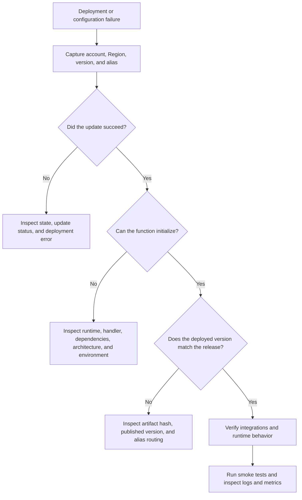
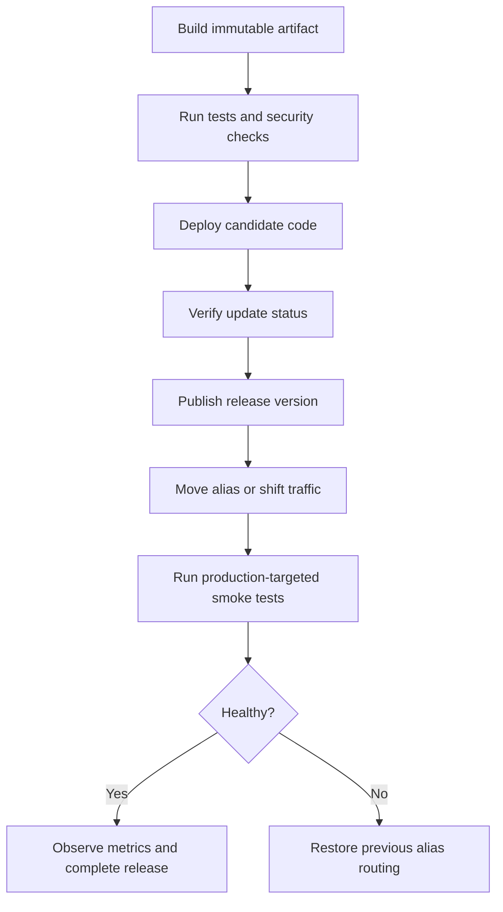

# 06- Deployment and Configuration Issues

## Overview

AWS Lambda deployment and configuration failures occur when the deployed artifact, runtime settings, function configuration, version, alias, or infrastructure state differs from what the application expects.

A deployment can report success while the application remains unavailable because the function points to an incorrect alias, environment variables are missing, dependencies are incompatible, or an integration still targets an older version. Configuration updates can also temporarily affect invocation behavior while Lambda applies changes.

The most reliable troubleshooting approach is to separate **artifact problems, configuration problems, deployment-state problems, and traffic-routing problems** rather than treating every failure as an application-code defect.

This document covers:

- ZIP package and container image deployment failures.
- Runtime, handler, dependency, and architecture mismatches.
- Environment variables, memory, timeout, ephemeral storage, and VPC configuration.
- Function versions, aliases, and deployment consistency.
- Infrastructure as Code and CI/CD failures.
- Configuration drift, rollback, verification, and prevention.

## Establish the Diagnostic Baseline

Before modifying a function, identify the AWS account, Region, deployed artifact, function version, and configuration currently receiving traffic.

### Configure diagnostic variables

The examples use AWS CLI v2 and Bash.

```bash
export AWS_PROFILE=dev
export AWS_REGION=ap-south-1
export FUNCTION_NAME=orders-api
```

Replace these placeholders with the actual deployment environment.

**Operation: Read-only.**

```bash
aws sts get-caller-identity \
  --profile "$AWS_PROFILE" \
  --region "$AWS_REGION"
```

Confirm that the account and caller are correct before inspecting or changing resources.

### Inspect the function state

**Operation: Read-only.**

```bash
aws lambda get-function-configuration \
  --function-name "$FUNCTION_NAME" \
  --profile "$AWS_PROFILE" \
  --region "$AWS_REGION" \
  --query '{
    FunctionName:FunctionName,
    State:State,
    StateReason:StateReason,
    LastUpdateStatus:LastUpdateStatus,
    LastUpdateStatusReason:LastUpdateStatusReason,
    Runtime:Runtime,
    Handler:Handler,
    PackageType:PackageType,
    Architectures:Architectures,
    MemorySize:MemorySize,
    Timeout:Timeout,
    EphemeralStorage:EphemeralStorage,
    LastModified:LastModified,
    Version:Version,
    CodeSha256:CodeSha256
  }' \
  --output json
```

Pay particular attention to:

- `State`: whether the function is active, pending, failed, or otherwise unavailable.
- `LastUpdateStatus`: whether the most recent configuration or code update succeeded.
- `Runtime` and `Handler`: whether the runtime and entry point match the artifact.
- `PackageType` and `Architectures`: whether the deployment type and CPU architecture match the build.
- `CodeSha256` and `LastModified`: whether the deployed code matches the expected release.

Some fields are absent or have different relevance depending on the deployment type.

### Capture the current deployment target

If production traffic uses an alias, inspect the alias before changing anything.

**Operation: Read-only.**

```bash
export ALIAS_NAME=live
```

```bash
aws lambda get-alias \
  --function-name "$FUNCTION_NAME" \
  --name "$ALIAS_NAME" \
  --profile "$AWS_PROFILE" \
  --region "$AWS_REGION" \
  --output json
```

Record the primary version and any additional routing configuration. Updating `$LATEST` does not automatically move an alias to the new version.

## Follow a Consistent Diagnostic Workflow



Use the following sequence for every incident:

1. **Symptom:** Capture the deployment error or runtime failure.
2. **Possible causes:** Identify likely artifact, configuration, IAM, or routing issues.
3. **Isolation strategy:** Compare the deployed state with the intended release.
4. **Diagnostic commands:** Inspect function configuration, code metadata, aliases, and logs.
5. **Root cause verification:** Reproduce the failure or verify the specific mismatch.
6. **Corrective action:** Apply the smallest change needed to restore the intended state.
7. **Prevention:** Add build validation, deployment verification, and configuration checks.

## ZIP Deployment Package Problems

### Symptoms

- `Runtime.ImportModuleError`.
- `Unable to import module`.
- `No module named ...`.
- `HandlerNotFound` or a missing handler module.
- The deployment succeeds, but the first invocation fails.
- A dependency works locally but fails in Lambda.

### Common causes

- Incorrect ZIP directory structure.
- Handler module or function name mismatch.
- Dependencies installed outside the package root.
- Native dependencies compiled for the wrong operating system or architecture.
- Incompatible Python versions.
- Missing runtime dependencies.
- Case-sensitive filename differences.
- Deployment of an old ZIP artifact.

### Verify the package structure

For a Python function configured with handler `app.handler`, the ZIP root should contain `app.py` with a callable named `handler`.

A suitable package might look like this:

```text
deployment.zip
    app.py
    orders/
        __init__.py
        service.py
    psycopg/
        __init__.py
        ...
```

The ZIP should not unintentionally contain an extra top-level project directory:

```text
deployment.zip
    orders-project/
        app.py
        orders/
        ...
```

In the second example, Lambda may not find `app.py` at the expected import location.

### Inspect the local artifact

**Operation: Local inspection; no AWS resources modified.**

```bash
unzip -l deployment.zip
```

Verify that:

- The handler module is at the expected package location.
- Required dependencies are included.
- There is no unexpected extra directory level.
- The package was built for the configured Python runtime and architecture.

### Verify the handler configuration

**Operation: Read-only.**

```bash
aws lambda get-function-configuration \
  --function-name "$FUNCTION_NAME" \
  --profile "$AWS_PROFILE" \
  --region "$AWS_REGION" \
  --query '{Runtime:Runtime,Handler:Handler,Architectures:Architectures}' \
  --output json
```

If the configured handler is `app.handler`, Lambda imports `app` and looks for the `handler` callable.

A valid Python example is:

```python
import json
import logging

logger = logging.getLogger()
logger.setLevel(logging.INFO)


def handler(event, context):
    logger.info(
        "Request received",
        extra={"aws_request_id": context.aws_request_id},
    )

    return {
        "statusCode": 200,
        "headers": {"content-type": "application/json"},
        "body": json.dumps({"status": "ok"}),
    }
```

### Corrective action

- Build the ZIP with the handler module at the correct location.
- Install dependencies into the deployment root or use a compatible layer.
- Match the handler setting to the actual module and callable.
- Build native dependencies for a compatible Lambda environment and architecture.
- Rebuild and deploy the artifact through the established release process.

Do not fix import errors by randomly changing the handler setting without checking the package structure.

## Python Runtime and Dependency Compatibility

### Symptoms

- Imports fail only in Lambda.
- A package works on Windows or macOS but fails in Lambda.
- Native extensions report shared-library or binary incompatibility errors.
- A previously working deployment fails after changing the Python runtime.

### Likely causes

- Incompatible Python version.
- Dependencies built for the wrong operating system.
- Incorrect CPU architecture.
- Native extension ABI incompatibility.
- Missing shared libraries.
- Runtime lifecycle changes or unsupported runtime selection.

### Verify runtime and architecture

**Operation: Read-only.**

```bash
aws lambda get-function-configuration \
  --function-name "$FUNCTION_NAME" \
  --profile "$AWS_PROFILE" \
  --region "$AWS_REGION" \
  --query '{
    Runtime:Runtime,
    Architectures:Architectures,
    PackageType:PackageType,
    Layers:Layers
  }' \
  --output json
```

The deployment environment must be compatible with the configured runtime and architecture. Python packages containing native extensions often need to be built for a compatible Linux environment.

### Inspect the build environment

For reproducible deployments:

- Pin dependency versions where appropriate.
- Use a controlled build image compatible with Lambda.
- Build for the target architecture, such as `x86_64` or `arm64`.
- Test imports in an environment representative of the deployed runtime.
- Include all required shared libraries.
- Avoid copying virtual-environment directories from a developer machine directly into the ZIP.

A dependency lock file improves reproducibility, but it does not guarantee binary compatibility.

### Corrective action

Rebuild the artifact for the configured Lambda runtime and architecture. If the runtime itself is the problem, plan and test a runtime migration rather than changing the production runtime without compatibility checks.

Review AWS runtime support and deprecation notices before selecting or upgrading a runtime.

## Container Image Deployment Failures

Lambda container image deployments use Amazon ECR and have different packaging and compatibility requirements from ZIP deployments.

### Symptoms

- Function creation or update fails while resolving the image.
- Lambda cannot access the image.
- The image starts but the runtime fails.
- The container exits or reports a handler or runtime error.

### Common causes

- Incorrect ECR repository URI or image tag.
- Image not pushed to the expected account or Region.
- Missing ECR permissions or cross-account repository access.
- Incompatible image architecture.
- Invalid Lambda container image configuration.
- Incorrect `ENTRYPOINT`, `CMD`, or runtime interface setup.
- Attempting to change a function's package type from ZIP to image or vice versa.

A Lambda function's package type is selected when the function is created; it cannot be changed from ZIP to image by updating the existing function.

### Verify the deployed package type

**Operation: Read-only.**

```bash
aws lambda get-function-configuration \
  --function-name "$FUNCTION_NAME" \
  --profile "$AWS_PROFILE" \
  --region "$AWS_REGION" \
  --query '{
    PackageType:PackageType,
    Architectures:Architectures,
    State:State,
    LastUpdateStatus:LastUpdateStatus
  }' \
  --output json
```

### Inspect the image configuration

**Operation: Read-only.**

```bash
aws lambda get-function \
  --function-name "$FUNCTION_NAME" \
  --profile "$AWS_PROFILE" \
  --region "$AWS_REGION" \
  --query 'Code.ImageUri' \
  --output text
```

Check the URI, repository, account, Region, and tag or digest against the release manifest.

### Corrective action

- Push the intended image to ECR.
- Verify that the image architecture matches the function configuration.
- Confirm the image meets Lambda container image requirements.
- Verify ECR access and repository policies, especially for cross-account deployments.
- Check startup logs and the container runtime configuration.
- Deploy an immutable image digest where appropriate for release reproducibility.

For production, prefer immutable release references over relying on a mutable tag such as `latest`.

## Function State and Update Status Failures

Lambda can temporarily reject or delay operations while a function is being created or updated.

### Important states

| Field | Meaning | Diagnostic response |
|---|---|---|
| `State` | Overall function state | Investigate the state reason if the function is not active |
| `LastUpdateStatus` | Result of the latest code or configuration update | Inspect the update status reason if the update failed |
| `LastModified` | Last modification timestamp | Compare it with the intended deployment |
| `CodeSha256` | Code package hash for supported code configurations | Compare with the expected artifact hash |
| `Version` | Version represented by the configuration response | Confirm whether the response refers to `$LATEST` or a published version |

### Symptoms

- Deployment commands fail with resource-conflict errors.
- An update appears incomplete.
- The function remains unavailable after a deployment.
- A pipeline attempts a second update before the previous one finishes.

### Corrective action

1. Inspect the function state and update status.
2. Wait for the current update to finish if it is still in progress.
3. Read the detailed failure reason.
4. Retry only after confirming that the previous operation has completed or failed.
5. Ensure the deployment pipeline serializes updates to the same function.

Blindly retrying conflicting updates can obscure the original failure and make deployment state harder to reason about.

## Environment Variable and Configuration Errors

### Symptoms

- The handler raises `KeyError` for a missing environment variable.
- The application connects to the wrong database or API.
- Development configuration is deployed to production.
- A configuration update causes an unexpected startup failure.
- The function cannot decrypt environment variables encrypted with a customer-managed KMS key.

### Inspect the environment variable names

**Operation: Read-only.**

The following command prints environment variable names without printing their values.

```bash
aws lambda get-function-configuration \
  --function-name "$FUNCTION_NAME" \
  --profile "$AWS_PROFILE" \
  --region "$AWS_REGION" \
  --query '{
    Variables:keys(Environment.Variables),
    KMSKeyArn:KMSKeyArn,
    LastUpdateStatus:LastUpdateStatus
  }' \
  --output json
```

This query helps verify whether expected names exist without exposing configuration values in terminal output.

### Validate required configuration in Python

```python
import os


def load_config() -> dict[str, str]:
    required = ("DB_HOST", "DB_NAME", "DB_USER", "DB_PASSWORD")

    missing = [
        name
        for name in required
        if not os.environ.get(name)
    ]

    if missing:
        raise RuntimeError(
            f"Missing required configuration variables: {', '.join(missing)}"
        )

    return {
        name: os.environ[name]
        for name in required
    }
```

This validation can be performed during initialization when failing fast is appropriate. Ensure logs never include secret values.

### Corrective action

- Verify the names and expected presence of required variables.
- Check environment-specific configuration sources.
- Confirm the intended function or alias receives the deployment.
- Verify KMS key configuration and permissions where customer-managed encryption is used.
- Retrieve sensitive values from an appropriate secret-management service when required.
- Avoid printing environment values during diagnosis.

Lambda environment variables are configuration, not a substitute for a complete secret-management strategy.

## Memory, Timeout, and Ephemeral Storage Misconfiguration

### Symptoms

- The function times out after deployment.
- Large files fail during processing.
- Temporary file writes fail.
- Memory usage increases or the runtime terminates unexpectedly.
- A new dependency or workload increases initialization time.

### Inspect resource settings

**Operation: Read-only.**

```bash
aws lambda get-function-configuration \
  --function-name "$FUNCTION_NAME" \
  --profile "$AWS_PROFILE" \
  --region "$AWS_REGION" \
  --query '{
    MemorySize:MemorySize,
    Timeout:Timeout,
    EphemeralStorage:EphemeralStorage,
    Architectures:Architectures
  }' \
  --output json
```

### Interpret the symptoms

| Symptom | Likely area |
|---|---|
| `Task timed out` | Timeout setting, slow dependencies, downstream latency, or inefficient code |
| `Runtime exited` with memory-related evidence | Memory exhaustion or process termination |
| `No space left on device` | Insufficient ephemeral storage or excessive temporary-file accumulation |
| Latency rises after adding dependencies | Initialization overhead or increased package loading |
| Function works for small files but fails for large files | Memory, timeout, payload, or temporary-storage limits |

### Corrective action

- Measure duration and memory usage before changing settings.
- Increase memory when measurements show insufficient capacity; CPU allocation also increases with configured memory.
- Increase timeout only when the workload legitimately needs more execution time and the upstream timeout budget supports it.
- Configure ephemeral storage for the actual temporary-data requirement.
- Stream large files where appropriate instead of loading everything into memory.
- Review the timeout limits of API Gateway, load balancers, and downstream systems.

A longer timeout does not fix an unreachable service, and more memory does not correct a missing dependency.

## VPC and Networking Configuration Drift

### Symptoms

- The function worked before a configuration update but cannot reach a database afterward.
- A production deployment uses unexpected subnets or security groups.
- Public API requests fail after enabling VPC access.
- The function initializes but downstream requests time out.

### Inspect the current VPC configuration

**Operation: Read-only.**

```bash
aws lambda get-function-configuration \
  --function-name "$FUNCTION_NAME" \
  --profile "$AWS_PROFILE" \
  --region "$AWS_REGION" \
  --query 'VpcConfig.{
    VpcId:VpcId,
    SubnetIds:SubnetIds,
    SecurityGroupIds:SecurityGroupIds,
    Ipv6AllowedForDualStack:Ipv6AllowedForDualStack
  }' \
  --output json
```

Compare these values with the intended infrastructure configuration.

### Common causes

- Wrong subnet IDs for the environment.
- Security group changes applied to the wrong function.
- Missing NAT or VPC endpoint configuration.
- Route table drift.
- DNS or private hosted-zone changes.
- A deployment tool replacing VPC settings with incomplete values.

### Corrective action

Restore the intended VPC, subnet, and security group configuration through the established infrastructure workflow. Verify the effective route tables, security rules, DNS behavior, and destination reachability.

See `04- VPC Networking and Connectivity Issues.md` in this troubleshooting folder for the detailed networking diagnostic procedure.

## Layers and Dependency Version Mismatches

### Symptoms

- A function fails after a layer update.
- Imports resolve locally but fail in Lambda.
- Multiple layers provide conflicting versions of the same library.
- The deployed function references an unexpected layer version.

### Diagnostic checks

**Operation: Read-only.**

```bash
aws lambda get-function-configuration \
  --function-name "$FUNCTION_NAME" \
  --profile "$AWS_PROFILE" \
  --region "$AWS_REGION" \
  --query 'Layers[].{
    Arn:Arn,
    CodeSize:CodeSize
  }' \
  --output json
```

Inspect each layer's published version, compatible runtimes, architecture compatibility, and contents.

### Corrective action

- Pin layer versions in deployment configuration.
- Test the function with the exact layer versions used in production.
- Avoid using mutable assumptions about what a layer contains.
- Consolidate dependencies where layer composition creates ambiguity.
- Publish a new layer version for changes rather than expecting an existing version to change.

Layer changes should be treated as release changes because they can alter runtime behavior even when the function's own code is unchanged.

## Versions, Aliases, and Incorrect Release Routing

### Understand the release model

Lambda distinguishes between mutable code under `$LATEST`, immutable published versions, and aliases that point to versions.

| Target | Behavior | Common deployment risk |
|---|---|---|
| `$LATEST` | Mutable function configuration and code | Direct callers may observe changes without a controlled release boundary |
| Published version | Immutable snapshot of code and version-specific configuration | New code is deployed but the version is never published |
| Alias | Named pointer to a version, optionally with weighted routing | Production traffic remains on an older version or points to the wrong version |

### Symptoms

- The latest code is deployed but production behavior does not change.
- Direct invocation works, but API Gateway uses old behavior.
- A rollback appears ineffective.
- A canary release routes traffic to an unexpected version.

### Inspect aliases and versions

**Operation: Read-only.**

```bash
aws lambda list-versions-by-function \
  --function-name "$FUNCTION_NAME" \
  --profile "$AWS_PROFILE" \
  --region "$AWS_REGION" \
  --output table
```

```bash
aws lambda list-aliases \
  --function-name "$FUNCTION_NAME" \
  --profile "$AWS_PROFILE" \
  --region "$AWS_REGION" \
  --output table
```

Inspect the alias used by production and verify the integration target.

### Corrective action

- Publish the intended release version.
- Update the intended alias using the approved deployment process.
- Verify API Gateway, event source mappings, and other integrations reference the correct target.
- Test the production alias, not only `$LATEST`.
- Confirm weighted routing configuration during canary deployments.

Do not assume that deploying code automatically updates production traffic.

## Infrastructure as Code and Configuration Drift

### Symptoms

- Manual changes disappear during the next deployment.
- Two environments have different function settings despite using the same release.
- The function configuration does not match the repository.
- Deployments succeed but infrastructure integrations remain incorrect.

### Common causes

- Console changes made outside the IaC workflow.
- Environment-specific parameters are missing.
- Template defaults override intended values.
- Multiple pipelines manage the same function.
- IAM, networking, or event source resources are managed separately and become inconsistent.

### Corrective action

Use a single authoritative infrastructure definition for each resource wherever practical.

For AWS SAM, CloudFormation, CDK, or Terraform deployments:

- Review the planned changes before applying them.
- Separate environment-specific parameters from application code.
- Pin relevant build and deployment tool versions.
- Validate templates and policies in CI.
- Serialize concurrent deployments to the same resource.
- Detect and reconcile drift according to the team's change-management policy.

Avoid mixing untracked console changes with IaC-managed production resources.

## CI/CD Deployment Failures

### Symptoms

- A pipeline reports success, but the deployed function is stale.
- Upload succeeds while the code update fails.
- A release publishes a version but does not update the alias.
- The smoke test checks `$LATEST` while production traffic uses `live`.
- Concurrent pipeline runs overwrite each other's deployment state.

### Diagnostic sequence

1. Confirm the pipeline's AWS account and Region.
2. Identify the artifact produced by the build job.
3. Verify the artifact checksum or image digest.
4. Confirm the deployment command targets the intended function.
5. Check `LastUpdateStatus` after the update.
6. Verify the published version and alias.
7. Run a smoke test against the same alias or endpoint used by production traffic.

### Safe release sequence



### Corrective action

- Use separate deployment and runtime roles.
- Use short-lived credentials or role assumption for CI/CD.
- Store build metadata and artifact digests with the release.
- Prevent overlapping deployments to the same function.
- Verify deployment results instead of relying solely on the CLI exit code of the upload step.
- Make rollback steps explicit and tested.

Rollback through an alias can restore an earlier published version quickly, but it does not automatically reverse external side effects, database schema changes, or incompatible infrastructure changes.

## Configuration Updates and Environment Consistency

Lambda configuration updates can replace configuration fields rather than merging arbitrary desired values. Some API operations require resubmitting the complete environment variable map when updating variables.

### Common failure

A deployment script intends to add one environment variable but sends an incomplete map, accidentally removing existing variables.

### Safer workflow

1. Read the current configuration when appropriate.
2. Construct the complete desired environment map.
3. Apply the change through IaC or a controlled deployment process.
4. Verify the resulting variable names and relevant non-sensitive settings.
5. Run a smoke test.

Avoid ad hoc scripts that overwrite production configuration without preserving required settings.

When using the CLI to update environment variables, be especially careful: the supplied variables map is treated as the desired map, not an instruction to append a single key.

## Read-Only Diagnostic Command Reference

| Command | Purpose |
|---|---|
| `aws lambda get-function-configuration` | Inspect runtime, handler, state, resource settings, and configuration |
| `aws lambda get-function` | Inspect function metadata and deployment code information |
| `aws lambda list-versions-by-function` | Verify published versions |
| `aws lambda list-aliases` | Find alias targets |
| `aws lambda get-alias` | Inspect a specific alias and routing configuration |
| `aws lambda list-event-source-mappings` | Inspect event source mapping state |
| `aws logs describe-log-groups` | Verify expected log groups |
| `aws logs tail` | Retrieve recent logs from a configured log group |
| `aws sts get-caller-identity` | Verify the active AWS identity |

Example: inspect recent logs.

**Operation: Read-only.**

```bash
aws logs tail "/aws/lambda/$FUNCTION_NAME" \
  --since 30m \
  --profile "$AWS_PROFILE" \
  --region "$AWS_REGION"
```

If the log group does not exist, investigate whether the function was invoked, whether the role has logging permissions, and whether logging is configured as expected.

## Common Mistakes

| Mistake | Why it fails | Better approach |
|---|---|---|
| Packaging the project directory instead of its contents | The handler module may not be at the expected ZIP root | Inspect the ZIP listing before deployment |
| Building native dependencies on an incompatible platform | Compiled extensions may not load in Lambda | Build for the target runtime and architecture |
| Assuming a successful upload means a successful release | The update, version publication, or alias change may still fail | Verify update status, version, alias, and smoke tests |
| Testing only `$LATEST` | Production may invoke a published version through an alias | Test the actual production target |
| Using a mutable container tag without tracking its digest | The deployed artifact can become difficult to reproduce | Record and deploy immutable image references |
| Changing environment variables without preserving existing entries | Required configuration can be removed unintentionally | Manage the complete desired configuration through IaC |
| Increasing timeout to fix import errors or authorization failures | Resource settings do not correct package or permission defects | Diagnose the failure domain first |
| Making console changes to IaC-managed resources | The next deployment can overwrite the fix | Update the authoritative infrastructure definition |
| Rolling back code without considering schema compatibility | The previous version may not work with changed data or infrastructure | Use backward-compatible changes and a tested rollback plan |
| Allowing concurrent pipelines to deploy the same function | Releases can overwrite each other's state | Serialize deployment operations and verify the final release |

## Production Deployment Verification Checklist

Before declaring a release successful:

- [ ] Confirm the AWS account and Region.
- [ ] Verify the intended function and package type.
- [ ] Confirm runtime, handler, and architecture compatibility.
- [ ] Verify artifact checksum or container image digest.
- [ ] Confirm `State` and `LastUpdateStatus`.
- [ ] Validate required environment variable names without exposing secret values.
- [ ] Confirm execution-role and resource permissions.
- [ ] Verify VPC, layers, and other configuration dependencies.
- [ ] Confirm the intended published version and alias routing.
- [ ] Run smoke tests against the actual production integration.
- [ ] Review errors, duration, throttling, and initialization behavior after deployment.
- [ ] Ensure the rollback procedure and previous version remain available where required.

## Key Takeaways

- Separate artifact, runtime, configuration, deployment-state, and traffic-routing failures before applying a fix.
- Validate ZIP structure, handler names, dependency compatibility, and container image architecture against the deployed function configuration.
- Verify update status, published versions, and alias routing; successful code upload does not guarantee that production uses the new release.
- Manage environment variables, networking, IAM, layers, and infrastructure through a controlled source of truth to reduce configuration drift.
- Use immutable artifacts, serialized deployments, production-targeted smoke tests, and tested rollback procedures to make releases reproducible and recoverable.