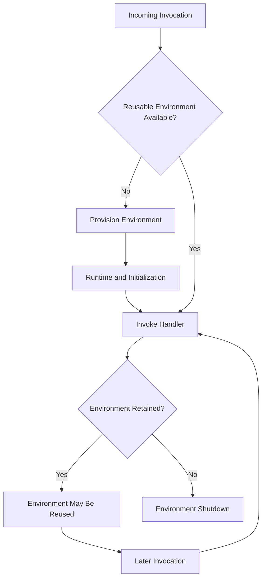
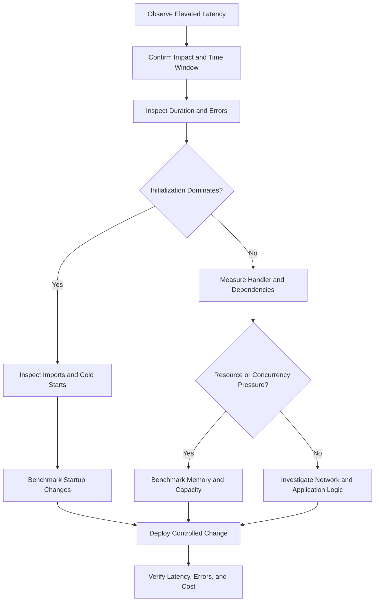

# 07- Performance and Cold Start Issues

## Overview

AWS Lambda performance issues commonly appear as elevated invocation latency, intermittent slow requests, initialization delays, timeouts, memory exhaustion, throttling, or unexpected execution costs. These symptoms can originate from the Lambda execution environment, Python application initialization, dependency loading, network connections, downstream services, or concurrency behavior.

Effective troubleshooting requires separating **cold-start latency from handler execution time** and **Lambda resource constraints from downstream bottlenecks**. Increasing memory, extending timeouts, or enabling provisioned concurrency may improve specific workloads, but these changes should follow measurement rather than replace root-cause analysis.

This document covers a production-oriented approach to identifying and resolving Lambda performance and cold-start issues in Python-based backend systems.

## Lambda Performance Lifecycle

A Lambda invocation may involve environment provisioning, runtime initialization, handler execution, and eventual environment reuse or shutdown. The exact work performed depends on whether an execution environment is new or reused.

- **Environment provisioning:** AWS prepares an execution environment.
- **Initialization:** The runtime starts, application modules are imported, extensions initialize, and module-level code executes.
- **Invocation:** Lambda invokes the handler with the event and context.
- **Environment reuse:** AWS may retain the environment for subsequent invocations.
- **Shutdown:** AWS eventually removes environments that are no longer needed or cannot be reused.



Warm execution is generally faster because it can avoid environment initialization. However, Lambda does not guarantee that an execution environment will be retained or reused. Scaling, deployments, environment replacement, and workload changes can result in additional initialization.

Do not design application correctness around the assumption that global variables, in-memory caches, or connections will survive indefinitely.

## Identify the Type of Latency

Start by identifying the symptom and comparing it with Lambda logs, metrics, and downstream telemetry.

| Symptom | Possible causes | First investigation |
|---|---|---|
| First invocation is slow | Cold start, runtime initialization, expensive imports | Inspect `Init Duration` |
| Latency increases during traffic spikes | Environment creation, throttling, downstream saturation | Compare concurrency and duration metrics |
| Every invocation is slow | Handler inefficiency, database queries, external API latency | Measure handler and dependency time |
| Latency increases with payload size | Parsing, serialization, memory pressure, inefficient algorithms | Benchmark representative payloads |
| Requests time out intermittently | Slow dependencies, connection setup, retries, insufficient timeout | Inspect duration, logs, and dependency latency |
| Latency increases after deployment | Dependency changes, larger package, initialization regression | Compare published versions and deployment artifacts |
| Memory errors occur | Insufficient memory, large allocations, native-library behavior | Inspect memory configuration and runtime logs |
| Lambda duration is low but client latency is high | API integration overhead, network latency, upstream processing | Trace the complete request path |

A request occurring after a period of inactivity is not automatically a cold-start problem. DNS resolution, TLS negotiation, database connection establishment, and downstream service delays can produce similar symptoms.

## Diagnose Cold Starts

### Understand initialization indicators

CloudWatch logs can include initialization information when applicable.

Example:

```text
REPORT RequestId: ...
Duration: 145.32 ms
Billed Duration: 146 ms
Memory Size: 512 MB
Max Memory Used: 178 MB
Init Duration: 420.15 ms
```

Interpret these fields carefully:

- `Duration` represents the reported invocation execution duration.
- `Init Duration`, when present, indicates initialization time associated with a new execution environment.
- `Billed Duration` is a billing-related measurement and should not be treated as the complete user-perceived request latency.
- `Max Memory Used` provides information about observed memory usage but does not, by itself, establish a safe memory configuration.

End-to-end latency may also include API Gateway, client networking, queue delays, and downstream operations that are not represented by Lambda's duration metric.

### Inspect initialization records

Use CloudWatch Logs Insights to examine recent invocation reports.

```sql
fields @timestamp, @type, @duration, @billedDuration,
       @initDuration, @maxMemoryUsed, @message
| filter @type = "REPORT"
| sort @timestamp desc
| limit 100
```

Structured field availability depends on the log format. If a field is unavailable, inspect raw `REPORT` messages or adapt the query to the selected log group's actual schema.

Compare:

- Initialization duration and invocation duration.
- Invocation volume and concurrent executions.
- Error and timeout counts.
- Function versions and aliases.
- Memory settings and deployment changes.
- Downstream service latency.
- Cold-start behavior under realistic traffic.

### Verify the hypothesis

A cold-start diagnosis is more credible when slow invocations consistently include initialization time and comparable warm invocations are substantially faster.

If warm and cold invocations are both slow, investigate application logic, database queries, networking, and external dependencies before focusing on startup optimization.

## Reduce Python Initialization Overhead

Python Lambda functions may spend significant time importing packages, loading configuration, creating clients, and executing module-level code.

### Minimize unnecessary imports

Every dependency should justify its startup and maintenance cost.

Poor implementation:

```python
import pandas as pd
import boto3
import requests

REFERENCE_DATA = pd.read_csv("/var/task/reference-data.csv")


def lambda_handler(event, context):
    return {"statusCode": 200, "body": "OK"}
```

If the function only returns a simple response, importing Pandas and loading a dataset adds unnecessary initialization work.

Improved implementation:

```python
import json


def lambda_handler(event, context):
    return {
        "statusCode": 200,
        "headers": {"Content-Type": "application/json"},
        "body": json.dumps({"status": "ok"}),
    }
```

Avoid importing heavy dependencies when the function does not need them. Lazy initialization can help when a dependency is required only for a subset of invocations, but it moves initialization latency to the first invocation that uses that dependency.

### Reuse SDK clients and safe resources

Creating SDK clients at module scope can reduce repeated construction and allow connections to be reused across warm invocations.

```python
import json
import os

import boto3

TABLE_NAME = os.environ["ORDERS_TABLE"]

dynamodb = boto3.resource("dynamodb")
orders_table = dynamodb.Table(TABLE_NAME)


def lambda_handler(event, context):
    order_id = event["order_id"]

    response = orders_table.get_item(
        Key={"order_id": order_id},
        ConsistentRead=False,
    )

    return {
        "statusCode": 200,
        "headers": {"Content-Type": "application/json"},
        "body": json.dumps(response.get("Item")),
    }
```

Production considerations:

- Reuse clients and immutable configuration where appropriate.
- Do not store request-specific state in global variables.
- Handle stale connections and transient failures.
- Do not assume the environment will remain alive indefinitely.
- Avoid recreating clients for every invocation without a reason.
- Apply appropriate secret rotation and cache invalidation strategies.

Execution-environment reuse is an optimization, not a durability guarantee.

### Avoid expensive module-level operations

Common initialization bottlenecks include:

- Large framework and dependency imports.
- Loading large reference datasets or machine-learning models.
- Remote configuration calls.
- Synchronous database connection establishment.
- Network calls during module import.
- Directory scans and expensive reflection.
- Unnecessary thread pools and background initialization.

For a framework-heavy Python application, measure import time before redesigning the architecture. Splitting functions or isolating optional dependencies can reduce startup work when those changes also make sense for service boundaries.

## Optimize Dependencies and Deployment Packages

Large dependency sets increase artifact size and operational complexity. They can also increase initialization overhead when they require substantial import work.

### Inspect dependency usage

Identify packages that are:

- Unused by the handler.
- Imported only for optional functionality.
- Duplicated across layers and the deployment package.
- Heavy relative to the function's responsibilities.
- Built for an incompatible runtime, operating system, or architecture.

Measure Python import activity locally:

```bash
python -X importtime -c "import your_module" 2> import-time.log
```

Replace `your_module` with the application module being investigated. Local measurements help identify expensive imports but are not a substitute for testing the deployed Lambda runtime.

Inspect a ZIP deployment artifact:

```bash
unzip -l function.zip
```

Remove unnecessary development dependencies, test fixtures, local environments, and unused packages. Keep dependencies reproducible and validate native extensions against the target Lambda runtime and architecture.

### Evaluate Lambda layers

Layers can centralize shared dependencies, but they do not automatically reduce cold-start latency.

| Benefit | Trade-off |
|---|---|
| Share common dependencies across functions | Requires version coordination |
| Separate dependency packaging from application code | Can complicate debugging |
| Reuse approved dependency bundles | Can introduce compatibility issues |
| Centralize dependency updates | A layer update may require coordinated function releases |

Use layers when dependency sharing provides a clear maintenance or deployment benefit. Self-contained deployment packages may be simpler for functions with independent dependencies.

## Tune Memory and CPU Allocation

Lambda allocates CPU resources in proportion to configured memory. Increasing memory can improve CPU-bound work, compression, serialization, parsing, and some I/O-heavy workloads.

The optimal setting depends on the workload, so evaluate latency and cost together.

### Identify memory pressure

Investigate:

- `Max Memory Used` approaching the configured limit.
- Runtime termination or out-of-memory symptoms.
- Excessive garbage-collection overhead.
- Large Python object graphs.
- Repeated copies during parsing or transformation.
- Native-library allocations not fully represented by Python-level profiling.

High observed memory usage is a reason to investigate, not proof of imminent failure. Native memory exhaustion may not be obvious from Python-level metrics alone.

### Benchmark candidate memory settings

For each candidate configuration, record:

- Median, p95, and p99 latency.
- Initialization duration.
- Error and timeout rates.
- Maximum observed memory usage.
- Invocation cost.
- Throughput under realistic concurrency.

Inspect the current configuration:

```bash
aws lambda get-function-configuration \
  --function-name orders-api \
  --query '{
    MemorySize:MemorySize,
    Timeout:Timeout,
    Architectures:Architectures,
    LastModified:LastModified
  }'
```

Update memory only after establishing a baseline:

```bash
aws lambda update-function-configuration \
  --function-name orders-api \
  --memory-size 1024
```

This command modifies the function configuration. Replace the example value with a benchmarked setting and wait for the update to complete.

Verify the resulting configuration:

```bash
aws lambda get-function-configuration \
  --function-name orders-api \
  --query '{
    State:State,
    LastUpdateStatus:LastUpdateStatus,
    MemorySize:MemorySize
  }'
```

Do not assume that doubling memory doubles performance. The improvement depends on CPU demand, I/O wait, dependency latency, and workload characteristics.

## Investigate Timeouts and Slow Dependencies

A Lambda timeout can result from inefficient handler code, but it often exposes a dependency or network problem.

Common causes include:

- Slow database connection establishment or queries.
- DNS resolution and TLS negotiation.
- HTTP requests without explicit timeouts.
- Retries consuming the remaining execution budget.
- Connection pool exhaustion.
- Large responses or expensive serialization.
- Waiting on locks or thread pools.
- Downstream throttling or degradation.

### Use bounded network timeouts

Avoid unbounded waits in application code.

```python
import json

import urllib3

http = urllib3.PoolManager(
    timeout=urllib3.Timeout(connect=1.0, read=3.0),
    retries=False,
)


def lambda_handler(event, context):
    response = http.request(
        "GET",
        "https://example.com/health",
    )

    return {
        "statusCode": response.status,
        "headers": {"Content-Type": "application/json"},
        "body": json.dumps(
            {"upstream_status": response.status}
        ),
    }
```

This example demonstrates bounded HTTP waits. A production implementation should validate destinations, handle connection and response errors, enforce an overall request budget, and avoid returning sensitive upstream details to clients.

Connection and read timeouts are not necessarily a strict wall-clock deadline for the entire operation. Account for DNS behavior, retries, response processing, and other work.

### Budget execution time

The Lambda timeout should accommodate legitimate work while remaining bounded by the upstream caller's deadline and downstream operation budgets.

```text
Client deadline
    └── API integration budget
          └── Lambda execution budget
                ├── Input validation
                ├── Database calls
                ├── External HTTP calls
                └── Serialization and response
```

For synchronous APIs, the caller may time out before Lambda finishes. The function can continue consuming resources even though the caller no longer needs the response.

For long-running asynchronous work, a longer timeout may be reasonable if the processing model supports it. Multi-step workflows may be better suited to SQS, Step Functions, or a container-based service.

## Diagnose VPC-Related Latency

VPC-connected Lambda functions can experience additional networking or initialization work depending on their configuration and dependencies. VPC attachment does not automatically make every invocation slow.

Investigate:

- Whether private VPC access is actually required.
- DNS resolution and hostname configuration.
- Routes and security-group rules.
- NAT gateway and VPC endpoint paths.
- Database connection establishment.
- TLS negotiation and authentication.
- Subnet IP availability during scaling.
- Downstream service latency.

For database-backed functions, measure connection establishment separately from query execution. A slow first database operation may be a connection or authentication issue rather than a Lambda cold-start issue.

### Reduce connection overhead

- Reuse database connections when the driver and execution model make it safe.
- Set bounded connection and query timeouts.
- Consider Amazon RDS Proxy when database connection management is a bottleneck.
- Avoid opening a new database connection for every query.
- Keep transactions short.
- Model concurrency against database connection capacity.

Connection reuse must account for stale connections, server-side idle timeouts, credential rotation, and environments that may be frozen between invocations.

Refer to `04- VPC Networking and Connectivity Issues.md` for routing, DNS, and connectivity troubleshooting.

## Manage Cold Starts with Provisioned Concurrency

Provisioned concurrency prepares execution environments in advance for a published Lambda version or alias. It is useful when predictable startup latency matters more than minimizing baseline cost.

### Appropriate use cases

Provisioned concurrency may be appropriate for:

- Latency-sensitive APIs with strict tail-latency targets.
- Interactive applications with predictable traffic.
- Scheduled traffic peaks that can be anticipated.
- Functions with substantial initialization overhead that cannot be reduced economically.

It may be less attractive for infrequently invoked functions, unpredictable traffic without suitable scaling controls, or workloads where downstream latency dominates the total response time.

### Configure and verify provisioned concurrency

Provisioned concurrency is configured against a published version or alias rather than the unqualified `$LATEST` version.

```bash
aws lambda put-provisioned-concurrency-config \
  --function-name orders-api \
  --qualifier live \
  --provisioned-concurrent-executions 10
```

This command modifies the function's provisioned concurrency configuration. The `live` qualifier must identify a published version or alias, and the function must satisfy the feature's requirements.

Inspect the configuration:

```bash
aws lambda get-provisioned-concurrency-config \
  --function-name orders-api \
  --qualifier live
```

Wait until provisioning succeeds before routing latency-sensitive traffic to the configured capacity. Acceptance of the configuration request does not mean the environments are immediately ready.

### Understand the trade-offs

| Benefit | Limitation |
|---|---|
| Reduces initialization latency for provisioned environments | Incurs additional cost while capacity is provisioned |
| Makes baseline capacity more predictable | Requires capacity planning and alias management |
| Supports latency-sensitive traffic | Unexpected demand can exceed provisioned capacity |
| Improves startup behavior | Does not eliminate slow handler logic or downstream latency |

Monitor provisioned concurrency utilization and spillover. If demand exceeds provisioned capacity, additional invocations may use on-demand environments and experience initialization latency.

## Evaluate Lambda SnapStart

Lambda SnapStart uses snapshots of initialized execution environments for supported runtimes and configurations. It can reduce startup latency without maintaining provisioned environments continuously, but support and behavior depend on runtime and feature compatibility.

Before adopting SnapStart:

- Verify current support for the selected runtime, Region, and function configuration.
- Check compatibility with extensions and other function features.
- Ensure initialization does not capture invalid or unsafe state in the snapshot.
- Validate connections, credentials, random-number generation, and time-sensitive initialization after restore.
- Benchmark initialization and invocation latency under realistic workloads.

SnapStart does not eliminate every source of latency. Handler execution, network calls, and downstream services may still dominate.

Compare SnapStart with provisioned concurrency based on runtime support, startup behavior, traffic predictability, latency objectives, and total cost. Do not assume that the two features are interchangeable or can always be enabled together.

## Diagnose Concurrency-Related Latency

Concurrency is the number of function invocations executing simultaneously. Traffic bursts can require additional execution environments and expose downstream capacity limits.

Common symptoms include:

- Higher tail latency during traffic spikes.
- Increasing `Throttles`.
- Increased database connections.
- HTTP 429 or 5xx responses from downstream services.
- Retries amplifying the original load.
- Errors that occur only at high traffic levels.

High concurrency is not inherently a failure. It becomes a problem when demand exceeds Lambda capacity, downstream capacity, or the workload's intended operating envelope.

### Protect downstream services

Reserved concurrency can cap a function's concurrency and protect shared dependencies. It also reserves account concurrency for that function and may constrain its throughput.

For queue-driven workloads, configure event source mapping scaling and concurrency where supported. Select batch sizes, retry policies, and maximum concurrency based on downstream capacity and processing semantics.

Concurrency limits alone are not a complete backpressure strategy. The surrounding architecture must handle rejected work, retries, queue growth, deadlines, and failed messages safely.

## Measure Performance with CloudWatch

Use metrics and logs to distinguish application latency, scaling behavior, and resource pressure.

| Metric or signal | What it helps identify | Important caveat |
|---|---|---|
| `Duration` | Invocation execution duration | Does not represent the entire upstream request path |
| `Invocations` | Workload volume | Does not count every throttled request as an invocation |
| `Errors` | Failed executions | Investigate application and runtime errors separately |
| `Throttles` | Concurrency or capacity restrictions | Correlate with account and function concurrency |
| `ConcurrentExecutions` | Active execution pressure | Interpret against traffic and downstream capacity |
| `Max Memory Used` in logs | Observed memory utilization | Review representative invocations |
| `Init Duration` in logs | Initialization overhead | Present only when applicable |
| `IteratorAge` for supported stream sources | Processing lag | Applies to stream-processing scenarios |
| Asynchronous event age and failure metrics | Queue delay and asynchronous failures | Interpret according to the invocation model |

Create alarms for user-visible latency, sustained errors, throttling, and workload-specific processing lag. Track p95 and p99 latency where appropriate because averages can hide severe but intermittent delays.

For distributed systems, use structured logs, correlation IDs, and tracing to connect a slow Lambda invocation with its upstream request and downstream operations.

## Performance Troubleshooting Workflow

Follow a repeatable process before changing production configuration.



### Diagnostic commands

Inspect the current function configuration:

```bash
aws lambda get-function-configuration \
  --function-name orders-api
```

Read recent CloudWatch logs:

```bash
aws logs tail /aws/lambda/orders-api \
  --since 30m
```

Retrieve recent duration metrics:

```bash
aws cloudwatch get-metric-statistics \
  --namespace AWS/Lambda \
  --metric-name Duration \
  --dimensions Name=FunctionName,Value=orders-api \
  --start-time 2026-10-11T16:00:00Z \
  --end-time 2026-10-11T17:00:00Z \
  --period 60 \
  --statistics Average Maximum
```

Replace the example timestamps with the incident's UTC time window. This command returns aggregated datapoints; percentile analysis requires an appropriate CloudWatch metric query or dashboard configuration.

### Verify every optimization

After a change:

- Confirm the intended function version or alias received the configuration.
- Wait for configuration updates or provisioned concurrency initialization to complete.
- Exercise representative invocation paths.
- Compare latency percentiles, initialization duration, errors, throttles, and downstream latency.
- Measure cost and concurrency under representative load.
- Roll back if error rates increase or operational objectives are violated.

Change one major variable at a time when practical. Simultaneously changing memory, dependencies, timeouts, and concurrency makes it harder to establish which change improved or degraded performance.

## Common Performance Mistakes

| Mistake | Why it causes problems | Better approach |
|---|---|---|
| Increasing memory without benchmarking | May increase cost without fixing the bottleneck | Compare latency and cost across candidate settings |
| Enabling provisioned concurrency for every function | Adds baseline cost and operational complexity | Reserve it for latency-sensitive workloads |
| Assuming warm environments are permanent | Creates unsafe reliance on cached state or connections | Treat reuse as opportunistic |
| Creating SDK clients on every invocation | Adds avoidable initialization work | Reuse safe clients across invocations |
| Importing every dependency at module scope | Increases startup work | Minimize imports and defer genuinely optional work |
| Increasing timeouts to hide slow dependencies | Allows unhealthy requests to consume resources longer | Bound dependency calls and investigate latency |
| Increasing concurrency without checking database capacity | Can exhaust connection limits | Model downstream capacity and apply backpressure |
| Optimizing only average latency | Hides cold starts and tail-latency problems | Track p95/p99 and compare cold and warm behavior |
| Treating SnapStart as a universal solution | Ignores runtime support and snapshot compatibility | Verify support and benchmark the deployed workload |
| Ignoring cost during performance tests | Can produce an uneconomic configuration | Compare cost per successful operation |

## Production Performance Checklist

Before deploying a performance-sensitive Lambda function, verify:

- [ ] Memory and timeout are selected using representative workload measurements.
- [ ] Initialization avoids unnecessary imports, remote calls, and expensive setup.
- [ ] SDK clients and reusable resources are managed safely.
- [ ] Network requests and database operations have bounded timeouts.
- [ ] Concurrency is compatible with downstream capacity and retry behavior.
- [ ] Cold-start and warm-invocation latency are measured separately where practical.
- [ ] Tail latency, errors, throttles, and workload-specific lag have actionable alarms.
- [ ] Provisioned concurrency or SnapStart is used only after validating support, requirements, and cost.
- [ ] Deployment changes are benchmarked against a known baseline.
- [ ] Rollback and post-deployment verification procedures are documented.

## Key Takeaways

- Diagnose initialization latency separately from handler execution and end-to-end request latency before selecting an optimization.
- Minimize unnecessary initialization work, reuse safe clients, and measure database and network latency independently.
- Tune memory, timeout, and concurrency using representative measurements of latency, reliability, and cost.
- Use provisioned concurrency or SnapStart only when their requirements and trade-offs match the workload.
- Verify performance changes using tail latency, error rates, concurrency, downstream health, and cost.