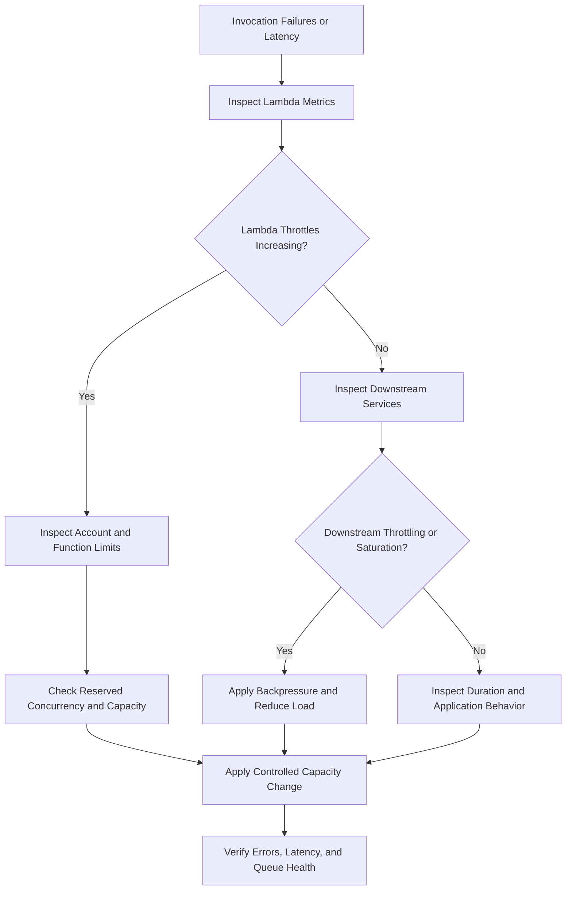

# 08- Concurrency and Throttling Issues

## Overview

AWS Lambda concurrency and throttling issues occur when incoming invocation demand exceeds available execution capacity, configured concurrency limits, or downstream system capacity. These problems can cause increased latency, failed synchronous requests, delayed asynchronous processing, queue backlogs, and cascading failures across dependent services.

Lambda scales automatically, but automatic scaling does not mean unlimited or instantaneous capacity. Account quotas, function-level concurrency settings, event source mapping configuration, scaling behavior, and downstream limits all influence how much work a function can process safely.

Effective troubleshooting requires distinguishing **Lambda throttling from downstream throttling**, identifying which concurrency limit is being reached, and determining whether retries are recovering from the incident or amplifying it.

## Understand Lambda Concurrency

Concurrency is the number of function invocations executing simultaneously.

For a simplified workload, average concurrency can be estimated using Little's Law:

\[
\text{Concurrency} \approx \text{Arrival Rate} \times \text{Average Duration}
\]

For example, if a function receives 200 requests per second and each invocation takes an average of 0.25 seconds:

\[
200 \times 0.25 = 50
\]

The workload requires approximately 50 concurrent executions on average. Traffic bursts, tail latency, retries, and uneven processing durations can require additional capacity.

This estimate is a planning aid, not a capacity guarantee. Validate concurrency under representative traffic and account for downstream dependencies.

### Lambda concurrency types

| Type | Purpose | Production consideration |
|---|---|---|
| Account concurrency quota | Limits concurrent execution capacity available to the account or applicable capacity pool | Other functions may consume shared capacity |
| Unreserved concurrency | Capacity available to functions without reserved concurrency, subject to account-level rules | Shared capacity can become constrained |
| Reserved concurrency | Reserves concurrency for a function and establishes its concurrency ceiling | Can protect downstream services but also restrict throughput |
| Provisioned concurrency | Keeps execution environments initialized for a published version or alias | Adds cost and does not eliminate every possible throttling condition |
| Event source mapping maximum concurrency | Limits concurrent processing for supported event source mappings | Must be compatible with function and downstream capacity |

Reserved concurrency and provisioned concurrency serve different purposes. Reserved concurrency controls the function's concurrency allocation and maximum. Provisioned concurrency prepares execution environments in advance to reduce initialization latency.

## Recognize Throttling Symptoms

Throttling occurs when an invocation cannot obtain execution capacity or when a service rejects requests because a limit has been reached.

| Symptom | Possible cause | Investigation |
|---|---|---|
| Synchronous API returns HTTP 429 | Lambda throttling or upstream rate limiting | Inspect API integration errors and Lambda `Throttles` |
| API returns HTTP 5xx during traffic spikes | Invocation failure, integration failure, or downstream overload | Correlate API and Lambda logs |
| Asynchronous events accumulate | Insufficient processing capacity or repeated failures | Inspect asynchronous event age, errors, and concurrency |
| SQS queue depth increases | Consumer throughput is below message arrival rate | Inspect queue metrics, event source mapping, and Lambda concurrency |
| Database connections are exhausted | Lambda concurrency exceeds database capacity | Inspect connection counts and database errors |
| Lambda `Throttles` increases | Function or account concurrency constraints | Check reserved concurrency and account usage |
| Downstream HTTP 429 increases while Lambda throttles remain low | Downstream service rate limits | Inspect downstream response codes and request rates |
| Processing latency rises without throttling | Slow dependencies or increased handler duration | Inspect duration percentiles and dependency latency |

Do not assume every HTTP 429 originates from Lambda. API Gateway, external APIs, databases, and other services may enforce their own limits.

## Troubleshooting Workflow

Use a consistent diagnostic sequence:

**Symptom → Possible causes → Isolation strategy → Diagnostic commands → Root cause verification → Corrective action → Prevention**



### Inspect Lambda configuration

Use the following read-only command to inspect the function's concurrency configuration.

```bash
aws lambda get-function-concurrency \
  --function-name orders-api
```

If reserved concurrency is configured, the response includes the reserved concurrency value. If it is not configured, the command may return a resource-not-found-style error indicating that no reserved concurrency configuration exists. This does not necessarily mean the function is unavailable.

Inspect general function configuration:

```bash
aws lambda get-function-configuration \
  --function-name orders-api \
  --query '{
    State:State,
    LastUpdateStatus:LastUpdateStatus,
    Timeout:Timeout,
    MemorySize:MemorySize,
    ReservedConcurrentExecutions:ReservedConcurrentExecutions
  }'
```

Inspect account-level concurrency information:

```bash
aws lambda get-account-settings \
  --query 'AccountLimit.{
    ConcurrentExecutions:ConcurrentExecutions,
    UnreservedConcurrentExecutions:UnreservedConcurrentExecutions
  }'
```

These values help establish the account's concurrency limits and available unreserved capacity. Interpret them alongside other functions' reservations and actual concurrent execution metrics.

## Investigate Account-Level Concurrency Exhaustion

Lambda functions share account-level concurrency capacity within the applicable Region and account configuration. A function can experience throttling even when its own reserved concurrency is not fully utilized if shared capacity is unavailable or another applicable quota is reached.

### Typical causes

- A sudden increase in requests across multiple functions.
- Another function consuming shared concurrency.
- Reserved concurrency allocations reducing available unreserved capacity.
- Long-running invocations holding concurrency for extended periods.
- Retry amplification during a downstream incident.
- An unexpected event source or scheduled workload producing a traffic spike.

### Inspect concurrency metrics

Use CloudWatch metrics to correlate throttling with actual execution demand.

```bash
aws cloudwatch get-metric-statistics \
  --namespace AWS/Lambda \
  --metric-name Throttles \
  --dimensions Name=FunctionName,Value=orders-api \
  --start-time 2026-10-11T16:00:00Z \
  --end-time 2026-10-11T17:00:00Z \
  --period 60 \
  --statistics Sum
```

Replace the example timestamps with the incident's UTC time window.

Inspect concurrent executions similarly:

```bash
aws cloudwatch get-metric-statistics \
  --namespace AWS/Lambda \
  --metric-name ConcurrentExecutions \
  --dimensions Name=FunctionName,Value=orders-api \
  --start-time 2026-10-11T16:00:00Z \
  --end-time 2026-10-11T17:00:00Z \
  --period 60 \
  --statistics Maximum
```

These commands return aggregated datapoints, not a complete incident timeline. Use CloudWatch dashboards and additional metrics to correlate function-level and account-level behavior.

### Corrective actions

- Identify which functions consume the available concurrency.
- Reduce unnecessary invocation volume or execution duration.
- Increase reserved concurrency when justified and supported by available account capacity.
- Request a quota increase when the workload genuinely requires additional account capacity.
- Move bursty background workloads behind queues when asynchronous processing is appropriate.
- Protect shared downstream services before increasing concurrency.

Increasing account concurrency without checking database, API, or third-party capacity can shift the failure from Lambda to a downstream dependency.

## Investigate Reserved Concurrency Issues

Reserved concurrency gives a function a dedicated concurrency allocation and sets its maximum simultaneous execution count.

For example, a function with reserved concurrency of 20 cannot execute more than 20 concurrent invocations under that configuration. Additional demand may be throttled or handled according to the invocation source's retry behavior.

### Inspect the reservation

```bash
aws lambda get-function-concurrency \
  --function-name orders-api
```

### Modify reserved concurrency

The following command changes the function's reserved concurrency and is a mutating operation.

```bash
aws lambda put-function-concurrency \
  --function-name orders-api \
  --reserved-concurrent-executions 50
```

Use this only after validating account capacity and downstream limits. The reservation affects shared account concurrency availability.

Verify the configuration:

```bash
aws lambda get-function-concurrency \
  --function-name orders-api
```

### Remove a reservation

Removing reserved concurrency allows the function to use shared unreserved capacity, subject to account limits and other applicable controls.

```bash
aws lambda delete-function-concurrency \
  --function-name orders-api
```

This is a mutating command. Verify the result afterward and ensure the function no longer depends on the removed cap for downstream protection.

### Common mistakes

- Setting reserved concurrency too low and unintentionally throttling normal traffic.
- Setting it too high without considering database connection limits.
- Reserving concurrency for many functions without planning total account capacity.
- Removing a protective concurrency limit during an incident without checking downstream health.
- Confusing reserved concurrency with provisioned concurrency.

Reserved concurrency is both a capacity control and a protective mechanism. Removing it can improve throughput while also increasing the risk of downstream overload.

## Investigate SQS Event Source Mapping Concurrency

For SQS-triggered Lambda functions, the event source mapping polls the queue and invokes the function with batches of messages.

The effective processing rate depends on message arrival rate, batch size, function duration, concurrency limits, event source mapping configuration, and downstream capacity.

### Typical symptoms

- Queue depth increases continuously.
- Oldest-message age rises.
- Lambda concurrency remains below the expected level.
- Messages repeatedly return to the queue.
- Database or external API limits are reached during scaling.
- Failed batches delay otherwise healthy messages.

### Inspect the event source mapping

List mappings for a function:

```bash
aws lambda list-event-source-mappings \
  --function-name order-worker
```

Inspect a specific mapping:

```bash
aws lambda get-event-source-mapping \
  --uuid <event-source-mapping-uuid>
```

Replace the placeholder with the mapping UUID returned by the list command.

Check:

- Mapping state and state-transition status.
- Queue visibility timeout.
- Batch size and batching window.
- Maximum concurrency, if configured and supported.
- Function reserved concurrency.
- Partial batch response configuration.
- Queue depth and oldest-message age.
- Downstream connection and request limits.

### Apply backpressure

For SQS workloads, maximum concurrency on the event source mapping can limit how much work a single consumer mapping sends to Lambda, where supported.

Choose the limit according to the capacity of downstream systems rather than maximizing Lambda concurrency.

For example, if a database can safely sustain 100 concurrent application operations across all consumers, allocating the entire capacity to one Lambda mapping may starve other services. Model the combined workload, including other Lambda functions, web applications, and scheduled jobs.

For detailed retry and batch-failure behavior, refer to the relevant event source mapping and troubleshooting documentation.

## Investigate Asynchronous Invocation Backlogs

Lambda asynchronous invocation queues events internally for processing. Events can be delayed when invocation capacity is constrained or when processing repeatedly fails.

Typical causes include:

- Sustained traffic above processing capacity.
- Function throttling.
- Handler errors and repeated retries.
- Slow dependencies increasing invocation duration.
- Insufficient reserved or account concurrency.
- Large or sustained event bursts.

Inspect asynchronous invocation metrics, including event age and failure counts where applicable.

Do not confuse Lambda's internal asynchronous invocation queue with an SQS queue. Their configuration, retry semantics, visibility controls, and failure-handling options differ.

### Corrective actions

- Reduce unnecessary event production.
- Resolve the underlying throttling or handler failure.
- Optimize execution duration when it is the throughput bottleneck.
- Review asynchronous retry and event-age settings.
- Configure a dead-letter queue or failure destination where appropriate.
- Make processing idempotent before increasing retry volume.

Increasing concurrency can help clear a backlog only when the function and downstream services can process additional work safely.

## Distinguish Lambda Throttling from Downstream Throttling

A function can receive invocation capacity successfully and still fail because a downstream dependency rejects requests.

Examples include:

- An external API returning HTTP 429.
- DynamoDB throttling due to capacity or partition-level constraints.
- Database connection exhaustion.
- A rate-limited internal microservice.
- A network or connection-pool bottleneck.

### Diagnostic strategy

1. Compare Lambda `Throttles` with Lambda `Errors`.
2. Inspect handler logs for downstream status codes and exception types.
3. Measure dependency latency separately from total handler duration.
4. Check the downstream service's own metrics and quotas.
5. Verify whether retries increase request volume.
6. Confirm that concurrency changes do not exceed downstream capacity.

A healthy Lambda concurrency metric does not prove that the entire request path is healthy.

### Apply controlled retries

Retries are useful for transient failures, but unrestricted retries can amplify an outage.

A robust design should use:

- Bounded retry attempts.
- Exponential backoff with jitter where applicable.
- Explicit request deadlines.
- Idempotency for operations that may be repeated.
- Circuit-breaking or load-shedding patterns when appropriate.
- Queue-based buffering for workloads that do not require immediate completion.

Do not retry permanent failures such as invalid input or authorization errors without a corrective action.

## Estimate Required Concurrency

Use arrival rate and execution duration as an initial capacity estimate.

\[
C \approx \lambda \times W
\]

Where:

- \(C\) is average concurrency.
- \(\lambda\) is average arrival rate in requests per second.
- \(W\) is average execution duration in seconds.

Example:

| Arrival rate | Average duration | Estimated average concurrency |
|---:|---:|---:|
| 50 requests/s | 0.2 s | 10 |
| 100 requests/s | 0.5 s | 50 |
| 200 requests/s | 0.8 s | 160 |
| 500 requests/s | 1.0 s | 500 |

This estimate does not include safety margins for bursts, retries, tail latency, or uneven workload distribution. Validate the result with load testing and CloudWatch metrics.

### Plan for downstream capacity

Suppose an order-processing Lambda function invokes PostgreSQL and each active invocation may hold a database connection.

If the function is allowed 300 concurrent executions but the database can safely support only 80 connections for that workload, unconstrained scaling can exhaust the database even when Lambda itself is healthy.

Possible mitigations include:

- Reducing Lambda concurrency.
- Using Amazon RDS Proxy when appropriate.
- Optimizing database queries and transaction duration.
- Buffering work through SQS.
- Separating workloads with different latency and capacity requirements.
- Reducing connection creation and unnecessary database round trips.

Capacity planning must account for all consumers of the same database, not just one Lambda function.

## Monitor Queue Health and Backpressure

For queue-driven systems, Lambda concurrency alone does not indicate whether the workload is keeping up.

Monitor the relationship between message arrival rate, processing rate, queue depth, and message age.

| Signal | Interpretation | Potential action |
|---|---|---|
| Queue depth rises continuously | Incoming work exceeds processing throughput | Increase safe capacity or reduce incoming load |
| Oldest-message age rises | Processing delay is increasing | Investigate consumer health and concurrency |
| Queue depth is high but concurrency is low | Mapping disabled, constrained, failing, or under-scaled | Inspect mapping state and configuration |
| Concurrency is high and database errors increase | Downstream saturation | Apply backpressure and reduce consumer concurrency |
| Retries increase while throughput falls | Repeated failures consume processing capacity | Fix root cause and review retry policy |
| Dead-letter queue receives messages | Work is exhausting its processing policy | Inspect failure causes and replay safely |

A growing queue can be a healthy buffer during a short traffic burst. It becomes an operational problem when the backlog cannot drain within the required processing deadline.

## Observability and Alerting

Create alarms that distinguish capacity pressure from application failure.

Recommended signals include:

- Lambda `Throttles`.
- Lambda `Errors`.
- Lambda `Duration` percentiles.
- `ConcurrentExecutions`.
- Account-level concurrency usage.
- SQS `ApproximateNumberOfMessagesVisible`.
- SQS `ApproximateAgeOfOldestMessage`.
- Downstream throttling and connection utilization.
- Asynchronous event age and failure metrics where applicable.

Use dimensions appropriate to each metric. Function-level metrics and account-level metrics answer different questions and should not be treated as interchangeable.

A useful incident dashboard should correlate request volume, Lambda concurrency, throttles, errors, duration, queue backlog, and downstream health over the same time window.

## Production Incident Response

When throttling affects production traffic, prioritize safe recovery over maximizing throughput.

1. Confirm the impacted function, alias, event source, and Region.
2. Determine whether Lambda or a downstream service is rejecting work.
3. Check reserved concurrency, account limits, and current concurrency.
4. Inspect duration, errors, queue depth, and message age.
5. Identify recent deployments, traffic spikes, or configuration changes.
6. Restore capacity or apply backpressure according to the actual bottleneck.
7. Verify that retries and queued work are recovering without duplicate business effects.
8. Monitor latency, errors, downstream health, and cost until the workload stabilizes.

Avoid increasing concurrency blindly during a database or third-party outage. More concurrent requests can create more failed operations, increase retries, and prolong recovery.

## Common Mistakes

| Mistake | Why it is dangerous | Better approach |
|---|---|---|
| Assuming Lambda scales without limits | Account and function quotas still apply | Plan capacity and monitor throttling |
| Increasing concurrency during downstream failure | Can amplify overload | Fix the dependency or apply backpressure |
| Treating every HTTP 429 as Lambda throttling | Misidentifies the failing service | Correlate Lambda and downstream telemetry |
| Using reserved concurrency only as a throughput setting | Ignores its protective role | Set limits based on both capacity and isolation |
| Ignoring asynchronous event age | Backlogs can grow while invocation failures appear intermittent | Alarm on delay and failure metrics |
| Increasing retries without idempotency | Can repeat business operations | Design safe duplicate handling |
| Ignoring SQS mapping limits | Consumer scaling may not match queue demand | Inspect mapping and queue configuration |
| Optimizing average duration only | Tail latency increases concurrency requirements | Measure percentiles under realistic load |
| Changing multiple capacity controls at once | Makes incident diagnosis harder | Apply controlled changes and verify each result |

## Key Takeaways

- Lambda throttling can originate from account concurrency limits, function reservations, event source mapping controls, or downstream services; identify the failing boundary before changing capacity.
- Use arrival rate and execution duration to estimate concurrency, then validate the estimate with load testing and CloudWatch metrics.
- Reserved concurrency can protect dependencies and isolate workloads, but poorly chosen limits can cause throttling or starve shared capacity.
- Queue-based processing requires monitoring backlog, oldest-message age, retries, and downstream capacity in addition to Lambda concurrency.
- Recover from throttling by correcting the bottleneck, applying safe backpressure, and verifying that retries and duplicate events do not create additional failures.