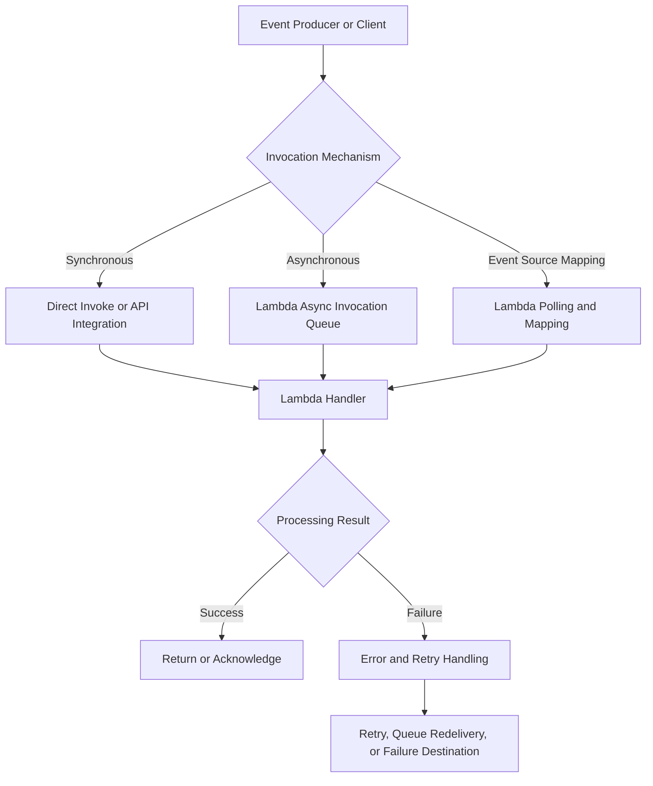

# 09- Event Source and Invocation Failures

## Overview

AWS Lambda invocation failures occur when a function cannot be invoked successfully, an event source cannot deliver work as expected, or an invocation completes without producing the intended business outcome. These failures can originate from invocation permissions, function configuration, event source mappings, payload validation, service integration settings, throttling, retry behavior, or application exceptions.

Troubleshooting requires understanding **who invokes the function, how the event reaches Lambda, what delivery guarantees apply, and which component owns retries**. Direct invocation, Lambda asynchronous invocation, and event source mappings have different failure semantics. Applying the wrong recovery strategy can cause lost work, duplicate processing, delayed recovery, or repeated business operations.

This document focuses on diagnosing invocation and event-delivery failures across API Gateway, direct Lambda invocation, SQS, S3, EventBridge, SNS, and DynamoDB Streams.

## Understand the Invocation Path

The first step is to identify the invocation mechanism because it determines the relevant permissions, response behavior, retry policy, and diagnostic signals.



| Invocation mechanism | Example | Who initiates delivery? | Failure behavior |
|---|---|---|---|
| Synchronous invocation | API Gateway or SDK `RequestResponse` | Caller or integration | Caller receives the invocation result or error |
| Asynchronous invocation | SDK `Event`, S3 notification, supported EventBridge target configuration | Producer or AWS service submits an event to Lambda | Lambda manages asynchronous delivery and retry behavior |
| Event source mapping | SQS, DynamoDB Streams, Kinesis | Lambda-managed pollers read the source | Mapping-specific retry, checkpoint, visibility, or record-processing behavior applies |
| Function URL | HTTP client | HTTP client through Lambda's URL endpoint | HTTP status and invocation behavior depend on the function and request path |

The same upstream service can support different delivery paths. For example, an EventBridge rule can invoke Lambda as a target, while other architectures may use a queue as an intermediary. Diagnose the actual integration rather than assuming that every event-driven invocation uses an event source mapping.

## Diagnose Invocation Failures

Use a consistent troubleshooting process:

**Symptom → Possible causes → Isolation strategy → Diagnostic commands → Root cause verification → Corrective action → Prevention**

### Common symptoms

| Symptom | Likely causes | Initial investigation |
|---|---|---|
| Client receives HTTP 5xx | Handler exception, timeout, integration failure | Inspect client response, integration logs, and Lambda logs |
| SDK invocation returns an access-denied error | Missing caller permission or resource policy | Inspect caller identity and Lambda resource policy |
| Lambda is never invoked | Incorrect integration, missing trigger, disabled mapping, or permission failure | Inspect event source and integration configuration |
| Function runs but processes the wrong data | Incorrect event parsing or schema assumptions | Inspect sanitized event payloads |
| Events are delivered repeatedly | Retries, visibility timeout expiry, or duplicate delivery | Inspect invocation history and idempotency records |
| Events disappear from the expected workflow | Misconfigured destination, failed producer request, or unobserved source failure | Inspect producer-side and service-side delivery metrics |
| SQS messages remain in the queue | Consumer failures, disabled mapping, insufficient capacity | Inspect mapping state, queue metrics, and function errors |
| Stream processing falls behind | Slow handler, throttling, or repeated record failures | Inspect iterator age, concurrency, and stream configuration |
| EventBridge target receives no events | Rule pattern mismatch, disabled rule, or target permission issue | Test event matching and inspect target configuration |

A function having a valid deployment does not prove that it is correctly connected to its event source.

## Check Function and Invocation Configuration

Inspect the function configuration:

```bash
aws lambda get-function-configuration \
  --function-name order-processor \
  --query '{
    State:State,
    LastUpdateStatus:LastUpdateStatus,
    Runtime:Runtime,
    Handler:Handler,
    Timeout:Timeout,
    MemorySize:MemorySize,
    Role:Role
  }'
```

Verify that:

- The function is in an appropriate state.
- The runtime and handler match the deployment package.
- The timeout accommodates legitimate processing.
- The execution role is the intended role.
- The caller invokes the correct function, version, alias, account, and Region.
- Required resource-based permissions are present.
- Event source configuration matches the deployed handler's expected event format.

Inspect the function's resource-based policy:

```bash
aws lambda get-policy \
  --function-name order-processor
```

This command inspects the function's resource policy. If the function has no resource-based policy, AWS may return a resource-not-found-style error for the policy rather than a function-not-found error.

Resource-based policies control which principals or services may invoke a function. They are distinct from the execution role, which determines what the function can access after invocation.

## Troubleshoot Synchronous Invocation Failures

Synchronous invocation waits for Lambda to return an invocation result. Typical callers include API Gateway, Lambda SDK clients, and other services making synchronous calls.

### Inspect SDK invocation results

A direct invocation can use the AWS CLI:

```bash
aws lambda invoke \
  --function-name order-processor \
  --invocation-type RequestResponse \
  --payload '{"order_id":"order-123"}' \
  --cli-binary-format raw-in-base64-out \
  response.json
```

The command invokes the function synchronously and writes the function response to `response.json`.

Inspect the response:

```bash
cat response.json
```

Check the CLI response for `StatusCode`, `FunctionError`, and other returned metadata.

A successful Lambda invocation status does not necessarily mean the business operation succeeded. The handler may catch an exception and return an application-level error payload, or an API integration may translate the result into an HTTP response.

### Distinguish transport errors from handler errors

| Failure type | Meaning | Diagnostic focus |
|---|---|---|
| Access denied | Caller is not authorized to invoke the function | IAM identity policy, resource policy, permissions boundaries, organization controls |
| Function not found | Incorrect function name, Region, account, or qualifier | Target ARN and deployment configuration |
| `FunctionError` in invocation response | Handler or runtime reported a function error | Response payload and CloudWatch logs |
| Timeout | Function exceeded its configured execution time | Handler duration and dependency latency |
| Throttling | Invocation capacity or a relevant limit was exceeded | Function and account concurrency |
| Integration error | The upstream service could not successfully complete the integration | Integration logs, mapping configuration, and permissions |

Do not repeatedly retry authorization, validation, or configuration errors. Correct the underlying failure first.

## Troubleshoot Asynchronous Invocation Failures

With asynchronous invocation, Lambda accepts an event for later processing rather than waiting for the handler's business result. Lambda manages an internal queue and attempts delivery according to its asynchronous invocation configuration.

This is different from an SQS event source mapping, where Lambda polls an external queue.

### Common failure modes

- The function repeatedly throws exceptions.
- Invocation throttling delays processing.
- The event becomes too old to be processed.
- The configured retry policy is exhausted.
- A failure destination or dead-letter queue is misconfigured.
- Duplicate events trigger repeated business operations.
- The producer assumes event acceptance guarantees business completion.

### Inspect asynchronous invocation configuration

```bash
aws lambda get-function-event-invoke-config \
  --function-name order-processor
```

If the function uses a qualifier, inspect the configuration associated with the relevant version or alias.

Review:

- Maximum retry attempts.
- Maximum event age.
- Dead-letter configuration, where applicable.
- On-success and on-failure destinations.
- The qualifier receiving the invocation.
- CloudWatch metrics for asynchronous errors, throttles, and event age.

### Configure failure handling

A function can be configured with an asynchronous invocation policy that controls retry attempts, event age, and failure destinations.

The following example configures an on-failure destination:

```bash
aws lambda put-function-event-invoke-config \
  --function-name order-processor \
  --destination-config '{
    "OnFailure": {
      "Destination": "arn:aws:sqs:ap-south-1:123456789012:order-failures"
    }
  }'
```

This command modifies the asynchronous invocation configuration. Replace the Region, account ID, queue name, and function name with the actual resource identifiers. Ensure that the required destination permissions and resource configuration are correct.

Verify the configuration:

```bash
aws lambda get-function-event-invoke-config \
  --function-name order-processor
```

An on-failure destination is not a substitute for application-level error handling. It provides a mechanism to preserve failure information after the configured asynchronous processing policy is exhausted.

## Troubleshoot Event Source Mappings

An event source mapping is a Lambda-managed integration that reads from supported sources and invokes the function with batches of records.

Common sources include SQS, Kinesis, and DynamoDB Streams. Each source has different delivery, ordering, checkpointing, and retry characteristics.

### Inspect event source mappings

List mappings associated with a function:

```bash
aws lambda list-event-source-mappings \
  --function-name order-processor
```

Inspect a specific mapping:

```bash
aws lambda get-event-source-mapping \
  --uuid <event-source-mapping-uuid>
```

Replace the placeholder with the UUID returned by the list command.

Inspect:

- Mapping state and state-transition status.
- Source ARN and target function.
- Batch size and batching window.
- Enabled or disabled state.
- Maximum concurrency where supported.
- Filter criteria.
- Function response types.
- Source-specific retry and failure settings.

A mapping that exists is not necessarily active or successfully processing records. Check its state and recent processing metrics.

### SQS-specific failures

For SQS-triggered Lambda functions, Lambda polls the queue and invokes the handler with batches of messages.

Common problems include:

- The event source mapping is disabled.
- The queue ARN or function association is incorrect.
- The function lacks required SQS permissions for its polling configuration.
- The visibility timeout is too short for processing and retries.
- Handler exceptions cause messages to become visible again.
- Batch processing fails because one record is invalid.
- Concurrency limits prevent the consumer from keeping up.

Inspect the queue:

```bash
aws sqs get-queue-attributes \
  --queue-url <queue-url> \
  --attribute-names All
```

Inspect CloudWatch metrics for visible messages, in-flight messages, and oldest-message age. These metrics help distinguish a consumer that is not running from one that is running but cannot keep up.

For SQS event source mappings, the function execution role generally needs the appropriate SQS polling permissions, and the event source mapping must reference the intended queue.

### DynamoDB Streams and Kinesis failures

Stream-based event source mappings read records in order within their source-defined processing boundaries. Processing failures can delay checkpoints and cause records to be retried, depending on the source and mapping configuration.

Investigate:

- Iterator age and processing lag.
- Handler duration and throttling.
- Batch size and batching window.
- Retry limits and record-age limits where supported.
- Partial batch response configuration.
- Failure destinations and discarded-record behavior.
- Partition or shard-level throughput constraints.

A persistent error in one batch can affect the progress of subsequent records, depending on the event source and configured failure handling. Do not assume that a stream consumer can skip a bad record without explicitly configuring and implementing the required behavior.

## Troubleshoot API Gateway and Function URL Integrations

HTTP integrations can fail before Lambda executes, while the function is executing, or when the integration attempts to translate the response.

### Check the request path

For API Gateway, inspect:

- API route and HTTP method.
- Integration target and payload format version.
- Lambda invocation permission.
- Authorizer behavior.
- Integration timeout and response mapping.
- API Gateway execution or access logs.
- Lambda handler logs.

For Lambda function URLs, inspect:

- URL configuration and authentication type.
- Resource policy and caller permissions.
- Request method and payload.
- CORS settings when the failure occurs in a browser.
- Function response format and runtime errors.

### Interpret the response carefully

| Observation | Possible explanation |
|---|---|
| API Gateway returns an authorization error | API authorizer or IAM authorization failure |
| API Gateway returns an integration error | Lambda invocation failure, timeout, or integration configuration problem |
| Lambda logs show no matching invocation | Request may have failed before reaching the function, or logs may be missing |
| Lambda logs show an exception | Handler or runtime failure |
| Function URL returns an application error response | Handler may have completed normally but reported a business failure |
| Browser reports a CORS failure | Browser rejected the response due to CORS policy; the backend may still have executed |

Use API Gateway access and execution logs together with Lambda logs to locate the failure boundary.

Refer to `03- API Gateway Integration Issues.md` for API Gateway-specific diagnostics.

## Troubleshoot S3 Event Notifications

S3 event notifications can invoke Lambda asynchronously when configured with the required permissions. S3 event delivery is designed for at-least-once delivery, so duplicate notifications can occur.

Common failures include:

- Missing Lambda resource-based permission for S3.
- Incorrect bucket or function Region.
- Notification configuration referencing the wrong function.
- Object key filtering that excludes the uploaded object.
- Handler assumptions about event encoding or record structure.
- Duplicate processing.
- Recursive invocation when the function writes back to the same triggering location.

### Verify invocation permission

Inspect the function policy:

```bash
aws lambda get-policy \
  --function-name file-processor
```

Check that the policy allows the intended S3 bucket to invoke the function, with appropriate source restrictions.

A typical permission is added through a command such as:

```bash
aws lambda add-permission \
  --function-name file-processor \
  --statement-id AllowOrdersBucketInvoke \
  --action lambda:InvokeFunction \
  --principal s3.amazonaws.com \
  --source-arn arn:aws:s3:::example-orders-bucket \
  --source-account 123456789012
```

This command modifies the function's resource policy. Replace the example bucket and account identifiers, and ensure the permission is narrowly scoped.

### Prevent recursive processing

If a function processes an uploaded object and writes its output back into the same bucket and triggering prefix, it may generate new notifications and invoke itself repeatedly.

Prevent recursion by:

- Using separate input and output buckets.
- Applying event notification prefix and suffix filters.
- Writing output to a non-triggering prefix.
- Making the processing workflow idempotent.
- Monitoring invocation spikes and unexpected costs.

## Troubleshoot EventBridge and SNS Delivery

EventBridge rules and SNS subscriptions have their own delivery and retry behavior. When these services invoke Lambda directly, resource-based permissions must allow the intended service to invoke the target.

### EventBridge checks

Inspect the rule:

```bash
aws events describe-rule \
  --name order-events-rule
```

Inspect targets:

```bash
aws events list-targets-by-rule \
  --rule order-events-rule
```

Verify:

- The rule is enabled.
- The event pattern matches the actual event.
- The target ARN identifies the intended function or alias.
- The target invocation permission exists.
- The target configuration is valid.
- Delivery failures and configured retry or dead-letter handling are monitored.

An event that does not match a rule is not the same as a target invocation failure. Validate the pattern against a representative event before investigating Lambda itself.

### SNS checks

For SNS-to-Lambda integrations, verify:

- The topic subscription targets the correct function.
- The subscription is confirmed and active.
- The Lambda resource policy permits the intended SNS topic.
- The source topic ARN is restricted appropriately.
- Delivery errors and function processing failures are monitored separately.

A successful service-level delivery does not guarantee that the handler completed the business operation successfully.

## Handle Duplicate Events and Idempotency

At-least-once delivery means a consumer may receive the same event more than once. Retries, redelivery, partial failures, and ambiguous timeouts can produce duplicate processing attempts.

Exactly-once business outcomes are not guaranteed simply because a message or event is delivered successfully.

### Implement idempotent processing

For an order-processing workflow, use a stable business identifier or event identifier to detect repeated work.

```python
import json
import os

import boto3
from botocore.exceptions import ClientError

dynamodb = boto3.resource("dynamodb")
processed_events = dynamodb.Table(os.environ["PROCESSED_EVENTS_TABLE"])


def claim_event(event_id: str) -> bool:
    try:
        processed_events.put_item(
            Item={"event_id": event_id, "status": "PROCESSING"},
            ConditionExpression="attribute_not_exists(event_id)",
        )
        return True
    except ClientError as exc:
        if exc.response["Error"]["Code"] == "ConditionalCheckFailedException":
            return False
        raise


def lambda_handler(event, context):
    event_id = event["event_id"]

    if not claim_event(event_id):
        return {
            "statusCode": 200,
            "body": json.dumps({"status": "already_processed"}),
        }

    # Perform the business operation using a durable workflow
    # that handles retries and processing failures safely.

    return {
        "statusCode": 200,
        "body": json.dumps({"status": "accepted"}),
    }
```

This example illustrates conditional claiming, but a production idempotency implementation must handle the `PROCESSING` state safely. If the function crashes after claiming the event but before completing the operation, a simple permanent claim can prevent legitimate recovery.

A production design should consider:

- Atomic state transitions.
- Lease expiry or recovery for abandoned processing.
- Durable completion records.
- Idempotent downstream operations.
- Transactional writes where available.
- The relationship between the idempotency record and the business side effect.

Do not mark an event as successfully processed before the business operation is durably completed unless the workflow has a deliberate recovery mechanism.

## Understand Partial Batch Failures

When a Lambda event source mapping processes batches, one invalid record can cause unnecessary retries if the handler treats the entire batch as failed.

For supported event sources, partial batch response handling allows the function to report individual records that failed, so successfully processed records do not need to be retried unnecessarily.

Support and response semantics vary by event source. Configure the event source mapping and handler together.

### SQS partial batch response example

The following Python handler demonstrates reporting failed SQS message identifiers.

```python
import json
import logging

logger = logging.getLogger()
logger.setLevel(logging.INFO)


def process_message(body: str) -> None:
    payload = json.loads(body)

    if "order_id" not in payload:
        raise ValueError("Missing order_id")

    # Perform idempotent business processing here.


def lambda_handler(event, context):
    batch_item_failures = []

    for record in event.get("Records", []):
        message_id = record["messageId"]

        try:
            process_message(record["body"])
        except Exception:
            logger.exception(
                "Failed to process SQS message",
                extra={"message_id": message_id},
            )
            batch_item_failures.append(
                {"itemIdentifier": message_id}
            )

    return {"batchItemFailures": batch_item_failures}
```

Configure the event source mapping to enable the `ReportBatchItemFailures` response type. Without the corresponding configuration, returning `batchItemFailures` alone does not enable partial batch handling.

For production use, distinguish transient failures from permanent invalid messages, protect logs from sensitive payload data, and ensure that successful records are safe to process again if the invocation is interrupted.

## Diagnose Permissions and Cross-Service Invocation

Lambda integrations commonly require two distinct permission checks:

- **Invocation permission:** Allows the caller or AWS service to invoke the function.
- **Execution permission:** Allows the function's execution role to access resources while processing the event.

For example, an S3 notification requires permission for S3 to invoke the function. The function may separately need permissions to read the object from S3 and write the processed result to another resource.

Check both permission boundaries.

| Failure | Permission area |
|---|---|
| AWS service cannot invoke the function | Lambda resource-based policy |
| SDK caller receives `AccessDeniedException` | Caller identity policy and applicable resource or organization policies |
| Handler cannot read an S3 object | Function execution role |
| Handler cannot write to DynamoDB | Function execution role and table or organization controls |
| Cross-account invocation fails | Caller permissions, target resource policy, and applicable cross-account configuration |

Avoid broad wildcard permissions as a troubleshooting shortcut. Use the narrowest principal, resource, and action set that supports the integration.

Refer to `05- IAM and Permission Errors.md` for detailed IAM diagnostics.

## Monitoring and Operational Verification

Monitor both invocation delivery and business processing. A function can show successful invocations while downstream work is incomplete, or show no Lambda errors while the event source is failing to deliver events.

Useful signals include:

- Lambda `Invocations`, `Errors`, `Throttles`, and `Duration`.
- Asynchronous event age and failure metrics.
- SQS visible messages and oldest-message age.
- DynamoDB Streams or Kinesis iterator age.
- EventBridge target delivery failures.
- API Gateway integration errors and latency.
- Dead-letter queue depth and failure destination activity.
- Business-level counts of received, processed, rejected, and completed events.

Use structured logs with event identifiers, correlation IDs, and processing status. Avoid logging credentials, authorization headers, full sensitive payloads, or secrets.

### Post-fix verification

After correcting a failure:

1. Verify the function and integration configuration.
2. Confirm that the event source or caller can invoke the intended function.
3. Send a controlled test event where safe.
4. Verify the handler's logs and expected business side effects.
5. Confirm retries and queue backlogs are recovering.
6. Verify that duplicate events do not repeat business operations.
7. Monitor error rates, event age, and downstream health.
8. Document any replay or recovery procedure required for events that failed during the incident.

## Common Mistakes

| Mistake | Why it causes problems | Better approach |
|---|---|---|
| Assuming every event uses the same retry policy | Invocation models and event sources differ | Identify the exact delivery mechanism |
| Treating accepted asynchronous events as completed work | Acceptance is not business completion | Monitor processing outcomes and failure destinations |
| Repeatedly retrying permission errors | Permanent configuration errors remain unresolved | Correct the relevant policy or configuration |
| Assuming successful Lambda status means business success | The handler can return an application-level failure | Validate business outcomes |
| Ignoring event source mapping state | Existing mappings can be disabled or failing | Inspect state and processing metrics |
| Processing entire batches as failed for one bad record | Causes unnecessary duplicate work | Use partial batch responses where supported |
| Assuming exactly-once processing | Duplicate delivery and ambiguous failures are possible | Implement idempotent business operations |
| Logging full event payloads indiscriminately | Can expose sensitive data | Log identifiers and sanitized diagnostic context |
| Replaying failures without checking side effects | Can duplicate payments, orders, or external actions | Verify idempotency and recovery state first |
| Allowing S3-triggered recursive writes | Can create invocation loops and unexpected costs | Separate input and output paths |

## Key Takeaways

- Identify the invocation model before troubleshooting because synchronous calls, asynchronous invocation, and event source mappings have different failure and retry semantics.
- Check function configuration, invocation permissions, event source mapping state, and service-specific delivery configuration before changing application code.
- Treat event delivery as potentially duplicated and implement idempotent business operations with durable recovery behavior.
- Use partial batch responses for supported event sources to isolate record-level failures and reduce unnecessary retries.
- Verify recovery through both Lambda telemetry and business-level outcomes, including queue backlog, event age, dead-letter handling, and downstream side effects.