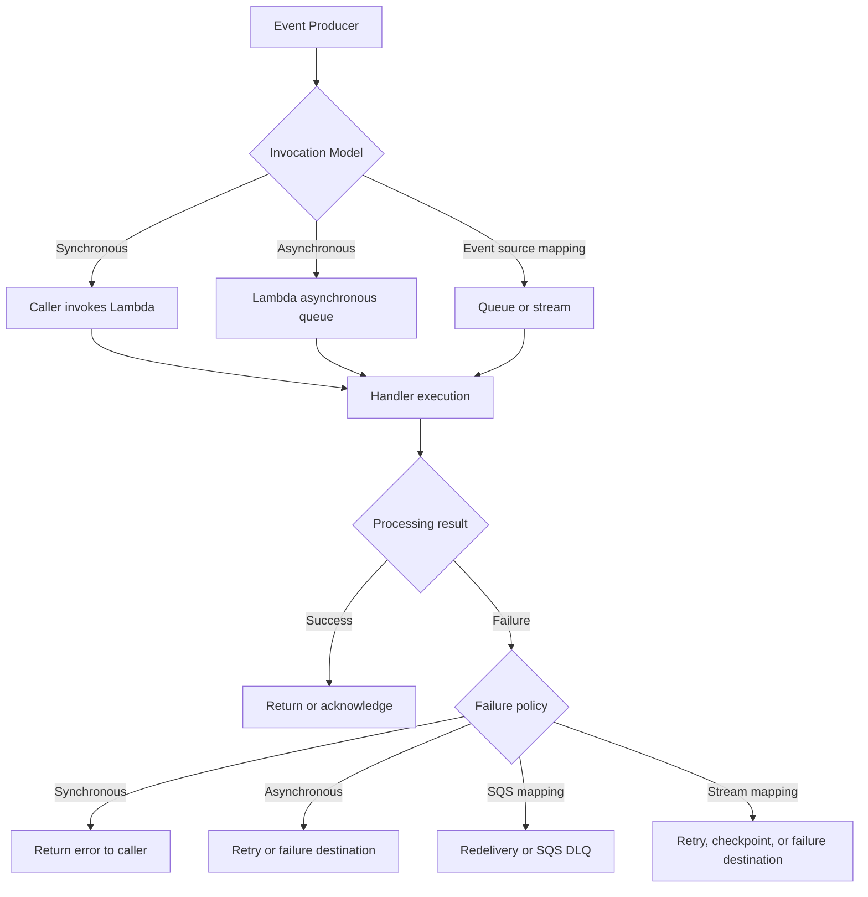
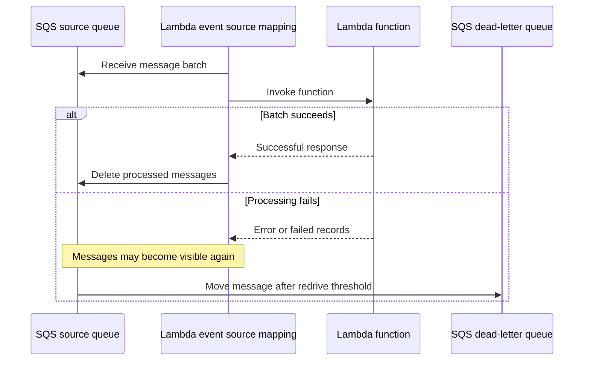

# 10- Retry, DLQ and Destination Failures

## Overview

AWS Lambda retry and failure-handling mechanisms determine what happens when an invocation fails, an event cannot be processed, or a downstream dependency becomes unavailable. Incorrect configuration can cause repeated execution, duplicate business operations, lost events, growing backlogs, unexpected costs, and delayed recovery.

Lambda supports several failure-handling mechanisms:

- Caller-managed retries for synchronous invocations.
- Lambda-managed retries for asynchronous invocations.
- Dead-letter queues (DLQs) for supported failure paths.
- On-success and on-failure destinations for asynchronous invocation outcomes.
- Event source mapping retries, checkpoints, and failure destinations.
- Partial batch responses for supported event sources.
- Application-level retries, idempotency, and compensating operations.

These mechanisms are not interchangeable. An asynchronous invocation DLQ does not automatically handle failures from an SQS event source mapping. Similarly, an on-failure destination is not a universal recovery mechanism for every Lambda integration.

The primary engineering objective is to preserve recoverable work, prevent duplicate business effects, isolate poison messages, and make recovery observable and repeatable.

## Understand the Failure-Handling Model

The appropriate recovery strategy depends on the invocation mechanism and which component owns delivery.



### Failure-handling mechanisms

| Mechanism | Retry owner | Typical use |
|---|---|---|
| Synchronous invocation | Caller or SDK | REST APIs and direct SDK calls |
| Asynchronous invocation | Lambda | Background events and asynchronous API calls |
| Asynchronous DLQ | Lambda asynchronous invocation system | Preserve original failed events |
| Asynchronous destination | Lambda asynchronous invocation system | Route invocation outcomes and execution context |
| SQS redelivery | SQS and event source mapping | Retry messages that were not successfully processed |
| SQS dead-letter queue | SQS redrive policy | Isolate repeatedly unsuccessful messages |
| Stream retry and checkpoint controls | Event source mapping | Kinesis and DynamoDB Streams processing |
| Application-level retry | Application code or SDK | Transient HTTP, database, or service failures |

A reliable design defines retry ownership at each boundary. Multiple retry layers may be necessary, but their combined attempt count and time budget must be understood.

## Synchronous Invocation Failures

For synchronous invocations, Lambda returns the execution result to the caller. Lambda does not automatically apply its asynchronous retry policy to a failed `RequestResponse` invocation.

The caller decides whether to retry, return an error, or initiate another workflow.

### Typical failure scenarios

- The handler raises an exception.
- The function times out.
- A downstream API returns a transient error.
- The caller experiences a network timeout and cannot determine whether the operation completed.
- API Gateway or another integration cannot successfully invoke the function.

### Recommended handling

1. Return an appropriate error response for the operation.
2. Retry only failures that are plausibly transient.
3. Apply bounded retries with exponential backoff and jitter.
4. Use idempotency for operations that create business side effects.
5. Set an overall request deadline so retries do not exceed the caller's latency budget.

A network timeout is ambiguous: the function may have completed the operation even though the caller did not receive the response. Retrying a payment, order creation, or external API request without idempotency can create duplicate effects.

For HTTP integrations, distinguish a Lambda invocation failure from an application-level error response. A handler can return an error payload without raising an exception, so infrastructure-level success does not prove business-level success.

## Asynchronous Invocation Retries

Lambda asynchronous invocation accepts an event and queues it for later processing. Lambda manages delivery attempts independently of the original producer's request.

For function errors, Lambda normally retries twice by default, with delays between attempts. For throttling and certain system errors, Lambda can retry for a longer period according to its asynchronous queue behavior. The maximum event age and configured retry policy determine how long events remain eligible for processing.

Exact behavior depends on the invocation configuration and failure category. Inspect the deployed configuration rather than relying only on defaults.

### Inspect the asynchronous invocation configuration

```bash
aws lambda get-function-event-invoke-config \
  --function-name order-processor
```

Review:

- `MaximumRetryAttempts`
- `MaximumEventAgeInSeconds`
- `DestinationConfig`
- Function qualifier, if applicable

This command is read-only. Asynchronous invocation configuration is distinct from event source mapping configuration.

### Configure retry behavior

The following example configures one retry for function errors and limits event age to one hour.

```bash
aws lambda put-function-event-invoke-config \
  --function-name order-processor \
  --maximum-retry-attempts 1 \
  --maximum-event-age-in-seconds 3600
```

This command modifies the function's asynchronous invocation configuration. Validate the policy against business recovery requirements before applying it.

Verify the result:

```bash
aws lambda get-function-event-invoke-config \
  --function-name order-processor
```

A shorter event-age limit can prevent stale events from executing long after they are useful. However, it can also discard work that might have recovered after a prolonged dependency outage. Ensure that an appropriate failure destination or recovery procedure exists when events must be preserved.

## Dead-Letter Queues and Destinations

Lambda supports DLQs and destinations for specific failure-handling paths. Both can preserve information about unsuccessful processing, but they have different message formats and operational behavior.

### Dead-letter queue

For supported asynchronous invocation configurations, a DLQ receives the original event after Lambda can no longer process it according to the asynchronous delivery policy.

Common targets include Amazon SQS and Amazon SNS.

A DLQ is useful when operators need the original event for investigation or replay. It is not a replacement for application logs, structured error reporting, or business-level idempotency.

### Asynchronous invocation destination

A destination receives an invocation record after asynchronous processing reaches a configured outcome.

An on-failure destination can capture context about a failed invocation, including the original request and execution response metadata. An on-success destination can support audit trails or downstream workflow integration.

Supported destination types include Amazon SQS, Amazon SNS, Lambda, and Amazon EventBridge. Amazon S3 is supported for asynchronous invocation destinations in applicable configurations; verify the current service documentation and configuration requirements before relying on it.

### DLQ versus destination

| Characteristic | DLQ | Asynchronous destination |
|---|---|---|
| Primary purpose | Preserve the original failed event | Route an invocation outcome |
| Failure information | Original event payload | Invocation record with request and execution context |
| Success handling | Not intended for successful events | Can support on-success handling |
| Typical use | Investigation and replay | Workflow integration, audit, and failure analysis |
| Configuration | Asynchronous DLQ configuration | Asynchronous `DestinationConfig` |
| Operational concern | Redrive and duplicate processing | Destination permissions, delivery failures, and record parsing |

Use a DLQ when the original event is the primary recovery artifact. Use a destination when the invocation outcome and execution context are important to downstream processing. Both may be appropriate when they serve distinct requirements.

## Configure an On-Failure Destination

The following example configures an SQS queue to receive records for failed asynchronous invocations.

```bash
aws lambda put-function-event-invoke-config \
  --function-name order-processor \
  --destination-config '{
    "OnFailure": {
      "Destination": "arn:aws:sqs:ap-south-1:123456789012:order-failures"
    }
  }'
```

Replace the function name, Region, account ID, and queue name with the actual values.

Before applying the configuration, verify that:

- The destination exists and satisfies the integration's Region requirements.
- The destination type is supported.
- Lambda has the required permission to deliver records.
- The destination consumer can parse the invocation record format.
- The queue has sufficient retention and monitoring.
- The recovery procedure is documented.

Inspect the configuration:

```bash
aws lambda get-function-event-invoke-config \
  --function-name order-processor
```

A destination can itself become unavailable or fail to accept records. Monitor destination delivery failures and ensure that its capacity, permissions, retention, and downstream processing are sufficient.

## Configure an Asynchronous Dead-Letter Queue

A DLQ can be configured for a function's supported asynchronous invocation path.

For example:

```bash
aws lambda update-function-configuration \
  --function-name order-processor \
  --dead-letter-config TargetArn=arn:aws:sqs:ap-south-1:123456789012:order-dlq
```

This command modifies the function configuration. Confirm that the target ARN identifies a supported destination and that the required delivery permissions are in place.

Verify the configuration:

```bash
aws lambda get-function-configuration \
  --function-name order-processor \
  --query 'DeadLetterConfig'
```

Do not confuse the function-level asynchronous DLQ with an SQS queue's redrive policy. The former handles eligible failed asynchronous Lambda events; the latter moves messages from a source queue to a configured DLQ after repeated unsuccessful processing.

## SQS Redrive and Lambda Event Source Mappings

When Lambda consumes SQS messages through an event source mapping, SQS retains messages until they are deleted after successful processing. Messages that are not successfully processed can become visible again after the visibility timeout.

An SQS dead-letter queue is configured through the source queue's redrive policy, not through Lambda's asynchronous invocation configuration.

### Understand the processing lifecycle



### Inspect the queue redrive configuration

```bash
aws sqs get-queue-attributes \
  --queue-url <source-queue-url> \
  --attribute-names RedrivePolicy VisibilityTimeout MessageRetentionPeriod
```

The command is read-only. Check the redrive policy's DLQ ARN and maximum receive count.

For example:

```json
{
  "deadLetterTargetArn": "arn:aws:sqs:ap-south-1:123456789012:order-dlq",
  "maxReceiveCount": "5"
}
```

The receive count should reflect expected transient failures and processing behavior. A low threshold may move temporarily failing messages to the DLQ too quickly; a very high threshold can prolong poison-message retries and increase operational costs.

### Visibility timeout considerations

The visibility timeout must accommodate function processing time and expected retry behavior. For Lambda with an SQS event source mapping, AWS recommends setting the queue visibility timeout to at least six times the function timeout, plus any maximum batching window, to allow for retries and throttling.

This recommendation is a starting point, not a substitute for load testing. Consider downstream latency, batch size, function timeout, and the queue's retention policy.

## Partial Batch Failures and Retry Amplification

Without partial batch response handling, a single failed record can cause a whole batch to be retried. This can repeat successful operations and delay progress.

For SQS event source mappings, configure `FunctionResponseTypes` to include `ReportBatchItemFailures`, then return the identifiers of failed records.

### Example: SQS partial batch response

```python
import json
import logging

logger = logging.getLogger()
logger.setLevel(logging.INFO)


def process_order(payload: dict) -> None:
    order_id = payload.get("order_id")
    if not order_id:
        raise ValueError("Missing order_id")

    # Perform idempotent business processing here.


def lambda_handler(event, context):
    failures = []

    for record in event.get("Records", []):
        message_id = record["messageId"]

        try:
            payload = json.loads(record["body"])
            process_order(payload)
        except Exception:
            logger.exception(
                "Order message processing failed",
                extra={"message_id": message_id},
            )
            failures.append({"itemIdentifier": message_id})

    return {"batchItemFailures": failures}
```

Enable partial batch responses on the event source mapping:

```bash
aws lambda update-event-source-mapping \
  --uuid <event-source-mapping-uuid> \
  --function-response-types ReportBatchItemFailures
```

This command modifies the mapping. Verify the result:

```bash
aws lambda get-event-source-mapping \
  --uuid <event-source-mapping-uuid> \
  --query '{
    State:State,
    FunctionResponseTypes:FunctionResponseTypes,
    BatchSize:BatchSize
  }'
```

Partial batch response behavior varies by event source. Confirm that the source supports the feature and that the handler returns the required response format.

The handler must not silently discard failed records. It should report failures accurately, and the application should distinguish transient failures from invalid messages that will never succeed without intervention.

## Stream Event Source Mapping Failures

DynamoDB Streams and Kinesis use checkpoint-based processing rather than SQS-style message deletion. Failure handling can involve retries, checkpoint movement, record-age limits, and destinations for records that cannot be processed.

Inspect the mapping configuration:

```bash
aws lambda get-event-source-mapping \
  --uuid <event-source-mapping-uuid>
```

Review supported configuration fields such as:

- `MaximumRetryAttempts`
- `MaximumRecordAgeInSeconds`
- `BisectBatchOnFunctionError`
- `DestinationConfig`
- `FunctionResponseTypes`
- `StartingPosition`
- Mapping state and source ARN

Not every setting is supported by every source type. Verify the supported fields for the specific event source.

### Poison records and batch bisection

A poison record consistently causes processing to fail. If the source and mapping support batch bisection, Lambda can split a failed batch to isolate problematic records.

This can reduce the time needed to identify a bad record, but it may increase invocation count and processing overhead. Combine it with partial batch responses where supported and with an appropriate failure destination.

### Preserve ordering and checkpoint semantics

For ordered streams, skipping or discarding a failed record can affect downstream correctness. Before configuring retry limits or failure destinations, decide whether later records may be processed after an earlier record fails.

For DynamoDB Streams and Kinesis, inspect iterator age and the configured checkpoint and failure behavior. Do not assume that a failed record can be safely skipped simply because the handler can identify it.

## Diagnose Retry and Destination Failures

### Symptom: Events are not reaching the DLQ

**Possible causes**

- The wrong failure mechanism was configured.
- The DLQ belongs to an SQS redrive policy, but the failure occurs in Lambda's asynchronous invocation path, or vice versa.
- The function is invoked synchronously, where asynchronous DLQ settings do not apply.
- The destination ARN is incorrect or unsupported.
- Required destination permissions are missing.
- The event has not yet exhausted its configured retry policy.
- The source or function configuration was not updated as expected.

**Isolation strategy**

1. Identify the exact invocation model.
2. Inspect the relevant function, event source mapping, or SQS redrive configuration.
3. Verify the configured retry threshold and event-age limit.
4. Inspect Lambda and source-service metrics.
5. Check permissions and destination availability.
6. Trigger a controlled test failure where safe.

### Symptom: The destination receives records but recovery fails

**Possible causes**

- The consumer expects the original event, but the destination delivers an invocation record.
- The recovery handler does not account for missing or malformed payload fields.
- The downstream service is still unavailable.
- The event has already produced a business side effect.
- The replay process is not idempotent.

**Corrective actions**

- Validate the record schema before replay.
- Preserve the original event identifier and correlation ID.
- Confirm that the root cause is resolved.
- Replay in bounded batches.
- Track attempted, successful, and rejected replays.
- Keep replay permissions separate from ordinary runtime permissions.

## Build a Safe Replay Workflow

A DLQ is a recovery buffer, not a mechanism that automatically guarantees recovery. Replaying all messages immediately can overwhelm a recovering database or external API.

A safe replay workflow should:

1. Identify the failure cause and confirm it is resolved.
2. Inspect message age, receive count, payload validity, and failure context.
3. Determine whether the original operation partially succeeded.
4. Verify idempotency and duplicate-side-effect protection.
5. Replay a small batch or representative message first.
6. Apply rate limits and concurrency controls.
7. Track replay outcomes and preserve failed messages.
8. Stop replay if errors or downstream saturation return.

For SQS DLQs, use controlled redrive operations where appropriate, or a dedicated replay consumer that can validate and rate-limit messages. Avoid deleting or purging a DLQ as a substitute for investigating its contents.

### Recovery checklist

- [ ] Root cause identified and corrected.
- [ ] Destination and consumer permissions verified.
- [ ] Event schema and required fields validated.
- [ ] Idempotency keys and prior side effects checked.
- [ ] Replay rate and batch size limited.
- [ ] Success and failure counts monitored.
- [ ] Unrecoverable messages retained for investigation.
- [ ] Recovery completed and operational evidence recorded.

## Retry Design for Downstream Dependencies

Retries can improve reliability when failures are transient, such as connection resets or temporary throttling. They can worsen an outage when a dependency is already overloaded.

Use bounded retries, exponential backoff, jitter, and an overall deadline. Avoid retrying deterministic errors such as invalid input or authorization failures.

For example, an HTTP dependency may return `429` or `503` during temporary overload. A retry policy should respect `Retry-After` where appropriate, cap attempts, and avoid retrying beyond the Lambda invocation's remaining time.

```python
import random
import time

import requests


def request_with_retry(
    url: str,
    *,
    attempts: int = 3,
    base_delay: float = 0.2,
    max_delay: float = 2.0,
) -> requests.Response:
    for attempt in range(attempts):
        try:
            response = requests.get(url, timeout=(1.0, 3.0))

            if response.status_code not in (429, 500, 502, 503, 504):
                response.raise_for_status()
                return response

            if attempt == attempts - 1:
                response.raise_for_status()

        except (requests.ConnectionError, requests.Timeout):
            if attempt == attempts - 1:
                raise

        delay = min(max_delay, base_delay * (2**attempt))
        time.sleep(random.uniform(0, delay))

    raise RuntimeError("Retry attempts exhausted")
```

This example illustrates bounded retries for an idempotent HTTP GET. Production code should also account for the invocation's remaining time, honor a valid `Retry-After` header where applicable, and use an explicit retryable-status policy. Do not blindly retry non-idempotent requests such as payment creation without a downstream idempotency key.

Retries at multiple layers multiply. If an SDK, application, queue, and workflow each retry independently, the number of attempts can grow rapidly. Define retry budgets across the entire request path.

## Observability and Failure Metrics

Monitor both the original processing path and the recovery path.

| Signal | What it indicates | Operational response |
|---|---|---|
| Lambda `Errors` | Failed function executions | Inspect logs and exception categories |
| Lambda `Throttles` | Invocation attempts rejected due to concurrency limits | Inspect concurrency and downstream capacity |
| Asynchronous event age | Time an event waits before processing | Check backlog, throttling, and handler latency |
| Asynchronous destination delivery failures | Failure to deliver invocation records | Inspect destination permissions and availability |
| SQS `ApproximateNumberOfMessagesVisible` | Approximate queue backlog | Check consumer capacity and processing rate |
| SQS `ApproximateAgeOfOldestMessage` | Age of the oldest queued message | Assess SLA impact and consumer health |
| SQS DLQ depth | Messages requiring investigation or replay | Triage failure categories and recovery priority |
| Stream iterator age | Consumer lag behind stream records | Inspect handler duration, throttling, and retry behavior |
| Business processing failures | Operations that did not complete successfully | Correlate application records with infrastructure telemetry |

Metric names and availability vary by service and integration. Configure alarms for meaningful operational thresholds rather than relying only on aggregate invocation counts.

### Structured logging

Include stable identifiers that help correlate events across retries and services.

```python
import json
import logging

logger = logging.getLogger()
logger.setLevel(logging.INFO)


def log_processing_failure(
    event_id: str,
    error_type: str,
    retryable: bool,
) -> None:
    logger.error(
        json.dumps(
            {
                "event_id": event_id,
                "error_type": error_type,
                "retryable": retryable,
                "event": "processing_failed",
            }
        )
    )
```

Avoid logging full sensitive payloads, credentials, access tokens, or unnecessary personal data. Ensure that logs distinguish an individual record failure from a failed batch or invocation.

## Security and Cost Considerations

Retry and failure-handling infrastructure introduces additional permissions and potential costs.

### Security

- Grant Lambda permission to send messages to or publish to only the intended destination.
- Restrict destination resource policies to trusted principals and accounts.
- Protect DLQs because they can contain sensitive original events.
- Use encryption and appropriate key policies for SQS, SNS, and other destinations where configured.
- Separate replay permissions from ordinary function execution permissions.
- Audit configuration changes and replay operations.
- Redact sensitive data in failure records where the architecture allows it.

### Cost and capacity

- Repeated invocations increase compute and downstream request costs.
- Large DLQs increase retention and operational handling requirements.
- Destination consumers can create additional processing costs.
- Replay surges can overload databases, APIs, or other dependencies.
- Excessively long retry periods can retain stale work and delay incident detection.

Use concurrency limits, queue-based buffering, rate-limited replay, and downstream capacity planning to prevent retry storms.

## Common Mistakes

| Mistake | Why it fails | Better approach |
|---|---|---|
| Configuring an asynchronous DLQ for an SQS mapping failure | The mapping uses SQS delivery and redrive semantics | Configure the SQS source queue's redrive policy |
| Treating DLQs and destinations as equivalent | Their record formats and use cases differ | Choose based on required recovery information |
| Retrying every exception | Permanent failures consume capacity and delay recovery | Classify transient and permanent failures |
| Using unlimited application retries | Can amplify dependency outages | Bound retries by attempts and deadline |
| Replaying the entire DLQ immediately | Can overwhelm downstream systems and duplicate side effects | Replay gradually with idempotency |
| Ignoring destination delivery failures | Failed invocation records may not reach the recovery system | Alarm on destination delivery failures |
| Returning partial batch failures without enabling the mapping option | The mapping may not honor the intended record-level behavior | Configure and verify `ReportBatchItemFailures` |
| Assuming a DLQ automatically reprocesses messages | DLQs preserve failed work; they do not guarantee business recovery | Implement an explicit triage and replay workflow |
| Deleting messages before durable processing | Can cause unrecoverable data loss | Acknowledge only after the required operation succeeds |
| Layering retries without a global budget | Produces excessive attempts and latency | Define retry ownership and limits at each boundary |

## Key Takeaways

- Retry and failure-handling behavior depends on the invocation model; synchronous calls, asynchronous invocations, SQS mappings, and stream mappings require different recovery strategies.
- Use DLQs to preserve failed work and destinations to route invocation outcomes, while verifying permissions, payload formats, and delivery behavior.
- Configure source-specific retry controls, visibility timeouts, partial batch responses, and stream failure handling according to the actual event source.
- Make replay safe through idempotency, root-cause correction, bounded concurrency, and explicit success and failure tracking.
- Monitor the full failure lifecycle, including invocation errors, event age, destination delivery failures, DLQ depth, and downstream health.