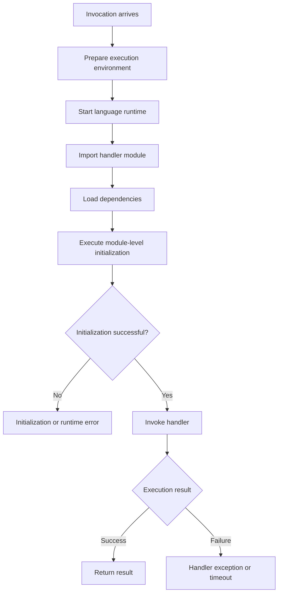

# 11- Dependency and Runtime Errors

## Overview

AWS Lambda dependency and runtime errors occur when a function cannot initialize, load its handler, import required modules, execute native extensions, or communicate correctly with the Lambda runtime environment.

These failures commonly appear after deployment, dependency upgrades, Python runtime changes, packaging changes, or migration between local development and AWS.

A function can work locally and still fail in Lambda because the deployment environment differs in operating system, CPU architecture, Python version, filesystem layout, environment variables, and installed libraries.

This document provides a systematic approach to diagnosing and resolving Lambda handler, runtime, dependency, packaging, and initialization failures in Python-based backend applications.

## Understand the Lambda Initialization Lifecycle

Lambda prepares an execution environment before invoking a handler. During initialization, the runtime starts, imports the handler module, and executes module-level initialization code.

A failure during this phase can prevent the handler from running entirely.



The exact lifecycle depends on the runtime and invocation path. Lambda can reuse an execution environment for subsequent invocations, so module-level initialization usually does not run for every invocation in the same environment.

### Failure categories

| Failure category | Typical symptom | Likely area to investigate |
|---|---|---|
| Handler configuration | `Runtime.HandlerNotFound` or handler import errors | Handler setting and file layout |
| Missing Python module | `ModuleNotFoundError` | Packaging and import paths |
| Missing symbol | `ImportError` | Package version or incorrect import |
| Native library loading | `ImportError: cannot open shared object file` | OS libraries, ABI, architecture |
| Python version mismatch | Syntax errors or incompatible package behavior | Runtime and dependency versions |
| Initialization failure | `INIT_REPORT` or initialization error logs | Module-level code and configuration |
| Runtime startup failure | Runtime exits before handler execution | Runtime configuration, package, or bootstrap |
| Runtime interface mismatch | Runtime API or entrypoint errors | Custom runtime or container configuration |
| Permission failure during initialization | `AccessDeniedException` | Execution role and service configuration |
| Network failure during initialization | Connection timeout or DNS error | VPC, endpoints, routing, and external dependencies |

## Establish a Diagnostic Baseline

Before changing code or rebuilding packages, collect the deployed configuration and recent logs.

### Inspect the function configuration

```bash
aws lambda get-function-configuration \
  --function-name order-processor \
  --query '{
    FunctionName:FunctionName,
    Runtime:Runtime,
    Handler:Handler,
    PackageType:PackageType,
    Architectures:Architectures,
    State:State,
    LastUpdateStatus:LastUpdateStatus,
    LastUpdateStatusReason:LastUpdateStatusReason,
    MemorySize:MemorySize,
    Timeout:Timeout,
    Layers:Layers[*].Arn
  }'
```

This is a read-only command.

Check that:

- The configured runtime matches the application.
- The handler points to the correct module and function.
- The architecture matches the compiled dependencies.
- The function package type matches the deployment strategy.
- The function is in a usable state.
- The last update completed successfully.
- The configured layers are compatible with the application.

Some fields are absent or behave differently for container-image functions and custom runtimes. Interpret the output according to the function's package type.

### Retrieve recent logs

```bash
aws logs tail /aws/lambda/order-processor \
  --since 30m \
  --follow
```

This command reads CloudWatch Logs. Stop following the stream when sufficient evidence has been collected.

Look for:

- `INIT_START`
- `INIT_REPORT`
- `START`
- `END`
- `REPORT`
- Python traceback details
- `Runtime.ImportModuleError`
- `Runtime.HandlerNotFound`
- `ModuleNotFoundError`
- `ImportError`
- Runtime exit messages

The exact log fields vary by runtime version and logging configuration.

### Verify the deployment target

```bash
aws lambda get-function \
  --function-name order-processor \
  --query '{
    Configuration:Configuration.{
      Runtime:Runtime,
      Handler:Handler,
      PackageType:PackageType,
      Architectures:Architectures
    },
    Code:Code.{
      RepositoryType:RepositoryType,
      ImageUri:ImageUri,
      ResolvedImageUri:ResolvedImageUri
    }
  }'
```

This is a read-only command. For ZIP-based functions, inspect the deployed artifact and code location using the appropriate deployment workflow. For container-image functions, verify the image URI and the image digest associated with the deployed version.

Do not assume the source code currently present in a repository matches the code deployed to the failing function.

## Handler Configuration Errors

The Lambda handler setting identifies the module and callable that Lambda invokes.

For a Python file named `app.py` containing `lambda_handler`, the handler setting is:

```text
app.lambda_handler
```

For a file named `src/handler.py`, the correct setting depends on how the file is packaged. If `handler.py` is at the root of the deployment package, the setting is:

```text
handler.lambda_handler
```

Lambda does not automatically infer the correct handler from a Python filename or from a framework's local entrypoint.

### Common causes

- The handler file is missing from the deployment package.
- The handler module name is incorrect.
- The callable name is incorrect.
- The handler is nested in a directory that is not importable.
- A deployment package contains an unexpected extra top-level directory.
- A case-sensitive filename mismatch exists.
- A module import fails before Lambda can locate the handler callable.

### Example: Incorrect package layout

Incorrect:

```text
deployment.zip
└── order_service/
    ├── handler.py
    └── requirements.txt
```

If the handler is configured as `handler.lambda_handler`, Lambda will not find `handler.py` at the package root.

A suitable layout is:

```text
deployment.zip
├── handler.py
├── requirements.txt
└── dependencies/
```

The `dependencies/` directory is illustrative; its contents and importability depend on the packaging approach.

For ZIP deployments, build the archive so that the handler module and required files are located where Lambda expects them.

### Inspect the ZIP package

```bash
unzip -l deployment.zip
```

Verify that the archive contains the expected files at the correct paths.

### Correct the handler configuration

```bash
aws lambda update-function-configuration \
  --function-name order-processor \
  --handler handler.lambda_handler
```

This command modifies the function configuration. Confirm the module and callable names before applying it.

Verify the update:

```bash
aws lambda get-function-configuration \
  --function-name order-processor \
  --query '{Handler:Handler,LastUpdateStatus:LastUpdateStatus}'
```

Wait for the configuration update to complete before testing an invocation.

## Missing Python Dependencies

A missing dependency typically raises `ModuleNotFoundError` or `ImportError`.

For example:

```text
[ERROR] Runtime.ImportModuleError: Unable to import module 'handler':
No module named 'requests'
```

A dependency installed on a developer's machine is not automatically available in Lambda. Lambda loads application code, libraries included in the deployment package, libraries supplied through layers, and libraries available in the selected runtime.

### Symptom and root-cause analysis

**Possible causes**

- The dependency was never included in the deployment artifact.
- `pip install` ran in a different environment than the build environment.
- The dependency was installed into an unexpected directory.
- The package is supplied by a layer that is not attached to the function.
- The package version or import name is incorrect.
- A dependency is present locally but absent from the deployed artifact.

**Isolation strategy**

1. Identify the exact missing module from the traceback.
2. Inspect the ZIP archive or container image.
3. Check the build command and installation target.
4. Inspect attached Lambda layers.
5. Reproduce the import in a compatible environment.
6. Rebuild and deploy a controlled artifact.

### Package dependencies into a ZIP deployment

Example project:

```text
order-processor/
├── handler.py
├── requirements.txt
└── tests/
```

Example `requirements.txt`:

```text
requests==2.32.5
```

Pin a version that is compatible with the selected runtime and your dependency policy. The version above is an example; validate the version against current security advisories and application requirements before adopting it.

Build the package in a clean environment:

```bash
python -m venv .venv
```

Activate the virtual environment using the appropriate command for your operating system, then install the dependencies into a dedicated package directory:

```bash
python -m pip install \
  --requirement requirements.txt \
  --target package
```

Copy the handler into the package directory and create the archive:

```bash
cp handler.py package/
cd package
zip -r ../deployment.zip .
cd ..
```

The `cp` and `zip` commands shown use a Unix-like shell. Use equivalent commands when building on Windows.

The resulting archive should contain `handler.py` and the installed dependencies at the archive root, rather than placing everything beneath a nested `package/` directory.

### Verify dependency imports

Run a local smoke test in the build environment:

```bash
PYTHONPATH=package python -c "import requests; print(requests.__version__)"
```

This verifies that the package can be imported in the local environment. It does not prove compatibility with Lambda's operating system or architecture.

## Native Dependencies and Architecture Mismatches

Python packages that include compiled extensions require compatible binaries. A wheel built for Windows cannot generally be used directly in a Linux Lambda environment. Similarly, an x86-64 binary cannot be loaded in an ARM64 execution environment.

Common examples include packages that depend on:

- NumPy
- Pandas
- Pillow
- `cryptography`
- `psycopg2`
- Database client libraries
- Custom C or C++ extensions

A package may install successfully yet fail at import time because a shared library is missing or the binary targets the wrong architecture.

### Identify the function architecture

```bash
aws lambda get-function-configuration \
  --function-name order-processor \
  --query 'Architectures'
```

Typical architecture values are `x86_64` and `arm64`.

### Build for the correct platform

For a ZIP-based deployment, use a Linux-compatible build environment that matches the target architecture and Python runtime. A container image based on an appropriate AWS Lambda base image is often a practical option.

Example using Docker for an x86-64 Lambda-compatible Python build environment:

```bash
docker run --rm \
  --platform linux/amd64 \
  --entrypoint /bin/bash \
  -v "$PWD:/var/task" \
  public.ecr.aws/lambda/python:3.12 \
  -lc "python -m pip install \
       --requirement /var/task/requirements.txt \
       --target /var/task/package"
```

This is a build example, not a complete deployment pipeline. Adjust the platform, runtime image, and output directory to match the target function. For ARM64, use an ARM64-compatible image and build environment.

Before deploying, confirm that:

- The runtime version is supported.
- The package's wheel or compiled extension matches the target platform.
- Required shared libraries are present.
- The dependency versions are compatible.
- The build is reproducible in CI.

### Inspect native shared-library dependencies

For ELF binaries in a Linux build environment, commands such as the following can help diagnose missing libraries:

```bash
file package/some_extension*.so
ldd package/some_extension*.so
```

Run these commands in a compatible Linux environment. A binary's file type and architecture must match the Lambda target.

Do not blindly copy shared libraries from a developer workstation. Build and test the artifact using a compatible environment.

## Python Runtime Version Errors

Lambda runtime versions determine the Python interpreter and supported runtime environment. Dependencies may behave differently across Python versions because of language changes, removed APIs, wheel availability, and native ABI compatibility.

A function can fail after a runtime upgrade even if its application code has not changed.

### Typical symptoms

- `SyntaxError` or unsupported language syntax.
- Import failures after a dependency upgrade.
- Native extension errors.
- Deprecated or removed standard-library APIs.
- Changed exception behavior or serialization.
- Startup failures caused by incompatible packages.

### Diagnostic workflow

1. Inspect the configured runtime.
2. Identify the Python version used to build the package.
3. Check the dependency lock file.
4. Verify package compatibility with the target Python version.
5. Run tests in the target runtime environment.
6. Deploy a controlled version and verify initialization and invocation.

### Inspect the runtime

```bash
aws lambda get-function-configuration \
  --function-name order-processor \
  --query '{Runtime:Runtime,Handler:Handler,LastUpdateStatus:LastUpdateStatus}'
```

### Verify locally

```bash
python --version
python -m pip freeze
```

These commands describe the local environment, not the deployed runtime. Use a Lambda-compatible container or an equivalent CI environment for stronger validation.

### Runtime upgrade practices

- Pin dependency versions.
- Review runtime support and deprecation schedules.
- Run unit and integration tests against the target runtime.
- Rebuild native dependencies.
- Deploy through a version or alias strategy where appropriate.
- Monitor initialization failures, errors, and latency after rollout.
- Maintain a tested rollback path.

Do not assume that a runtime upgrade is only a configuration change. It can require a dependency rebuild and a full compatibility test.

## Initialization Errors

Initialization failures occur before normal handler execution. They commonly originate from module-level code, dependency imports, environment configuration, secret retrieval, or external network calls.

Example:

```python
import os
import requests

API_URL = os.environ["UPSTREAM_API_URL"]
response = requests.get(API_URL, timeout=3)
response.raise_for_status()
```

This is a risky initialization pattern. Every new execution environment may attempt a network request before handling an invocation. A missing environment variable can also prevent the module from loading.

### Common causes

- Required environment variables are absent.
- Secret retrieval fails because of IAM permissions.
- An initialization-time network call cannot reach its destination.
- A dependency import fails.
- Module-level code performs slow or unreliable work.
- Initialization assumes a file or resource exists.
- Initialization exceeds the configured initialization or invocation time budget for the relevant runtime and execution mode.

### Recommended design

Perform deterministic, lightweight initialization at module scope. Defer request-specific work to the handler, and avoid making startup depend unnecessarily on an external service being available.

For reusable clients, module-level initialization can be appropriate when the client can be created without performing network I/O and when reuse is safe.

```python
import json
import logging
import os

import requests

logger = logging.getLogger()
logger.setLevel(logging.INFO)

API_URL = os.environ["UPSTREAM_API_URL"]
HTTP_TIMEOUT = (1.0, 3.0)

session = requests.Session()


def lambda_handler(event, context):
    try:
        response = session.get(
            API_URL,
            timeout=HTTP_TIMEOUT,
        )
        response.raise_for_status()

        return {
            "statusCode": 200,
            "body": json.dumps({"status": "ok"}),
        }
    except requests.RequestException:
        logger.exception(
            "Upstream request failed",
            extra={"request_id": context.aws_request_id},
        )
        return {
            "statusCode": 502,
            "body": json.dumps({"error": "upstream_unavailable"}),
        }
```

This example reuses an HTTP session within a warm execution environment. The upstream call still occurs during the invocation, not during module import.

In production, distinguish transient upstream failures from permanent errors, apply a deliberate retry policy, and ensure that the handler's response format matches the configured integration.

### Secrets and configuration

Avoid fetching secrets unnecessarily during every invocation, but also avoid assuming that a secret cached in memory remains valid indefinitely.

A reasonable approach is to:

- Use environment variables for non-sensitive configuration.
- Retrieve sensitive values through Secrets Manager or Parameter Store as appropriate.
- Grant only the required secret access permissions.
- Cache retrieved values when appropriate, with a deliberate refresh strategy.
- Handle secret rotation and temporary retrieval failures.
- Avoid logging secret values.

A failed secret lookup can be an IAM, networking, endpoint, encryption-key policy, or service availability issue rather than a Python dependency problem.

## Lambda Layers and Import Path Problems

Lambda layers provide a way to share dependencies or supporting files across functions. For Python functions, libraries supplied by a layer must be located in a path that the runtime can import.

A typical layer archive contains a `python/` directory:

```text
layer.zip
└── python/
    ├── requests/
    ├── urllib3/
    └── other_dependencies/
```

For Python layers, placing dependencies beneath the expected `python/` directory allows Lambda to add the layer's library paths to the runtime environment.

### Common mistakes

- The archive contains an extra top-level directory.
- Dependencies were installed outside the expected Python layer path.
- The layer targets an incompatible Python version or architecture.
- A function uses a different dependency version than expected.
- A layer is published but not attached to the function.
- Multiple layers introduce conflicting package versions.

### Inspect attached layers

```bash
aws lambda get-function-configuration \
  --function-name order-processor \
  --query 'Layers[*].{Arn:Arn,CodeSize:CodeSize}'
```

This command is read-only. Inspect the actual layer archive and the dependency versions it contains when an import fails.

### Choose between ZIP dependencies, layers, and images

| Approach | Advantages | Limitations | Suitable when |
|---|---|---|---|
| Dependencies in ZIP | Simple deployment artifact; dependencies versioned with the function | Artifact must include all required libraries | Function-specific dependencies |
| Lambda layers | Reuse dependencies across multiple functions | Version coordination and dependency conflicts | Shared, stable dependency sets |
| Container image | Explicit control over operating system packages and dependencies | Requires image build, registry management, and image deployment practices | Larger dependency stacks or complex system libraries |

Choose the simplest deployment model that meets the application's dependency and operational requirements. Avoid creating layers solely to reduce package size if they introduce difficult version coordination.

## Container Image Runtime Errors

Lambda container-image functions use an image based on a compatible Lambda base image or a custom image that implements the Lambda Runtime API requirements.

A container that starts successfully under ordinary Docker execution is not necessarily a valid Lambda function image.

### Common causes

- The image uses an incompatible base image.
- The handler or command is configured incorrectly.
- The custom runtime does not implement the expected Runtime API interactions.
- The image targets the wrong CPU architecture.
- Required shared libraries are missing.
- The image does not include the required application files.
- The deployed function still references an older image digest.

### Inspect the deployed image

```bash
aws lambda get-function \
  --function-name order-processor \
  --query '{
    PackageType:Configuration.PackageType,
    Architectures:Configuration.Architectures,
    ImageUri:Code.ImageUri,
    ResolvedImageUri:Code.ResolvedImageUri
  }'
```

The `ResolvedImageUri` field, when returned, helps identify the image version resolved by Lambda. Image deployment and update behavior should be verified against the actual function configuration.

### Recommended practices

- Start with an AWS Lambda base image for the intended runtime when possible.
- Set the handler or entrypoint according to the chosen base image and runtime.
- Build for the target architecture.
- Pin base image versions or otherwise control image updates.
- Scan dependencies and images for known vulnerabilities.
- Test startup and invocation using a Lambda-compatible environment.
- Verify the deployed image after publishing a new version.

For a custom runtime, validate the Runtime API integration and bootstrap implementation independently of ordinary application logic.

## Runtime Errors Versus Handler Errors

Not every failed invocation indicates a broken runtime.

| Observation | Likely interpretation |
|---|---|
| Handler module cannot be imported | Packaging, handler setting, or dependency issue |
| Python traceback from handler logic | Application exception |
| Runtime exits unexpectedly | Runtime, process, native library, or resource issue |
| Function times out after handler starts | Slow operation, blocking call, or insufficient timeout |
| Initialization fails before `START` | Module import, initialization, configuration, or startup issue |
| Function returns HTTP 500 through an integration | Could be an application error or integration-specific behavior |
| Function cannot access a secret | IAM, KMS policy, networking, or secret configuration issue |

Use the earliest failure in the log sequence as a starting point. Later messages may be consequences rather than root causes.

## Verify a Fix Before Production Deployment

A reliable remediation workflow validates both the artifact and the deployed function.

### Local checks

```bash
python -m compileall .
python -m pytest
```

These commands check Python syntax and run the test suite in the current environment. They do not validate Lambda packaging, runtime compatibility, IAM permissions, or VPC connectivity.

### Package inspection

```bash
unzip -l deployment.zip
```

Verify the handler path, dependencies, configuration files, and any required assets.

### Deploy to a test function

Use a non-production function or a controlled version to validate the fix.

For a ZIP-based function, a deployment command may look like:

```bash
aws lambda update-function-code \
  --function-name order-processor-test \
  --zip-file fileb://deployment.zip
```

This command changes the function code. Ensure the ZIP is built for the configured runtime and architecture before deployment.

Wait for the update to complete, then inspect the configuration:

```bash
aws lambda get-function-configuration \
  --function-name order-processor-test \
  --query '{
    State:State,
    LastUpdateStatus:LastUpdateStatus,
    LastUpdateStatusReason:LastUpdateStatusReason,
    Runtime:Runtime,
    Handler:Handler,
    Architectures:Architectures
  }'
```

Invoke the test function with a representative event:

```bash
aws lambda invoke \
  --function-name order-processor-test \
  --cli-binary-format raw-in-base64-out \
  --payload '{"order_id":"order-123"}' \
  response.json
```

Inspect both the invocation metadata and the contents of `response.json`. A successful CLI invocation does not automatically mean the application returned a successful business result; synchronous Lambda invocations can return a successful invocation status while the handler's response represents an application error.

After deployment, verify logs, error metrics, initialization duration, and a representative downstream interaction.

## Troubleshooting Workflow

Use a consistent diagnostic sequence.

### Symptom

Record the exact error message, request ID, timestamp, function version or alias, and invocation path.

### Possible causes

Identify likely failure domains:

- Handler and package layout.
- Python version and dependency compatibility.
- Native binaries and architecture.
- Initialization and environment variables.
- Layer configuration.
- Container image and runtime bootstrap.
- IAM and network access.

### Isolation strategy

Start with read-only inspection. Avoid changing multiple settings at once because doing so makes it difficult to determine which change fixed the issue.

### Diagnostic commands

Use the function configuration, recent logs, deployment artifact listing, and relevant service configuration to establish the failure location.

### Root-cause verification

Reproduce the error in a compatible environment or on a test function. Confirm that the observed failure disappears after the targeted correction.

### Corrective action

Change only the relevant handler setting, dependency package, layer, runtime, architecture, environment configuration, or permission.

### Prevention

Add automated checks for package contents, dependency resolution, runtime compatibility, handler imports, and deployment verification.

## Common Mistakes

| Mistake | Why it causes problems | Better approach |
|---|---|---|
| Packaging dependencies from a local virtual environment without validation | Local binaries may not work in Lambda | Build in a compatible environment |
| Including an extra directory inside the ZIP | Handler and dependency paths no longer match expectations | Inspect archive contents before deployment |
| Updating code without checking the handler | The function can still fail before handler execution | Validate the configured module and callable |
| Assuming `pip install` succeeded means the package is deployable | Installation does not prove runtime or architecture compatibility | Run import and invocation smoke tests |
| Upgrading Python without rebuilding dependencies | Native extensions or package APIs may be incompatible | Test the full dependency set against the target runtime |
| Performing network calls at module import | Startup depends on external availability and adds initialization latency | Keep initialization lightweight and defer request-specific work |
| Treating every `ImportError` as a missing package | The real cause may be an incompatible binary or missing shared library | Inspect the full traceback and binary dependencies |
| Reusing a layer without checking its contents | The function may load unexpected or conflicting versions | Pin layer versions and verify deployed configuration |
| Testing only locally | The local OS, environment, and permissions differ from Lambda | Validate in a Lambda-compatible test environment |
| Logging sensitive initialization data | Startup errors can expose credentials or personal data | Log error context without secret values |

## Production Readiness Checklist

Before releasing a dependency or runtime change, verify the following:

- [ ] Handler configuration matches the deployment artifact.
- [ ] All required dependencies are packaged or supplied by verified layers.
- [ ] Native dependencies match the Lambda runtime and architecture.
- [ ] Dependency versions are pinned and reviewed for security issues.
- [ ] Initialization does not depend unnecessarily on network availability.
- [ ] Environment variables and secret access are validated.
- [ ] Unit tests and runtime-compatible import checks pass.
- [ ] A test invocation succeeds with a representative event.
- [ ] Logs and metrics are checked after deployment.
- [ ] The release has a rollback path and an identified owner.

## Key Takeaways

- Diagnose Lambda failures by locating the earliest failure in the initialization and invocation lifecycle rather than assuming every error originates in handler code.
- Package Python dependencies for the actual Lambda runtime, operating system, and CPU architecture; local installation success is not proof of deployment compatibility.
- Verify handler paths, ZIP structure, layer contents, container entrypoints, and deployed configuration before modifying application logic.
- Keep initialization lightweight, handle configuration and external-service failures deliberately, and avoid logging sensitive values.
- Validate fixes through automated tests, Lambda-compatible smoke tests, deployed logs, and a controlled rollout with a rollback path.