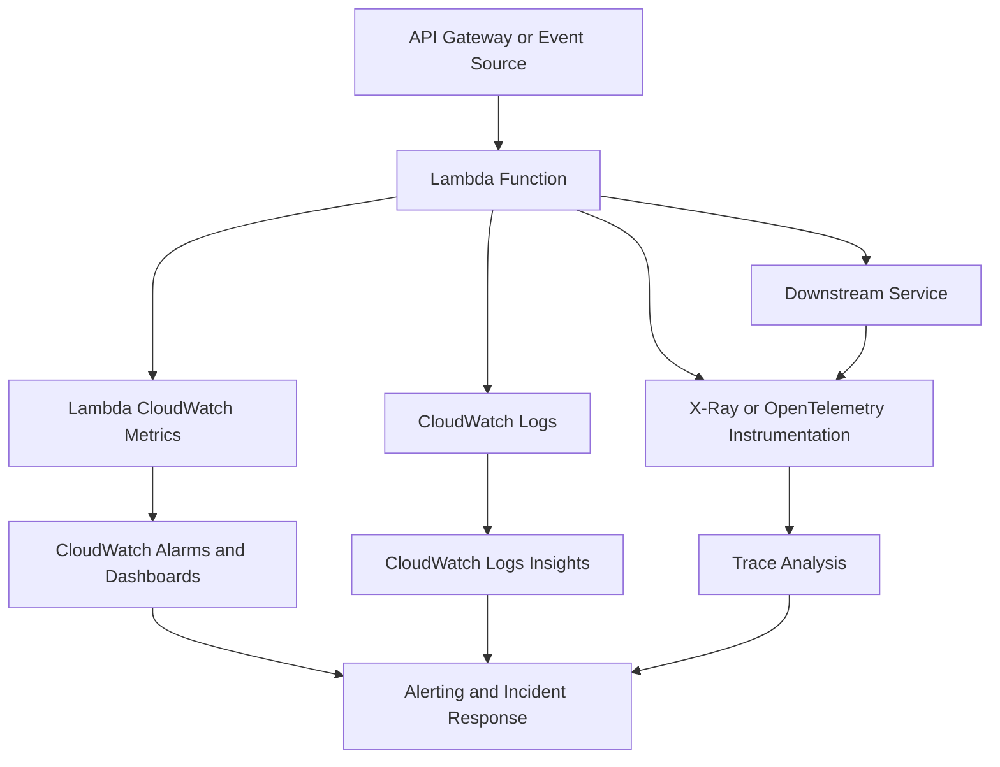
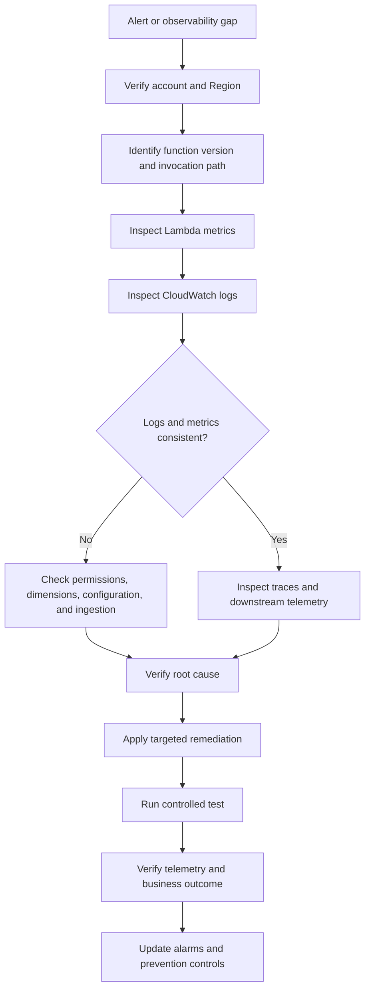

# 12- Monitoring and Observability Issues

## Overview

AWS Lambda monitoring and observability issues occur when engineers cannot reliably determine whether a function is healthy, why an invocation failed, where latency originates, or how a workload affects downstream systems and operating costs.

Lambda integrates with Amazon CloudWatch for logs, metrics, dashboards, and alarms. AWS X-Ray and OpenTelemetry-based instrumentation can provide distributed tracing, while AWS CloudTrail records relevant API activity for auditing.

These capabilities answer different operational questions:

- **Monitoring:** Is the function behaving within expected operational limits?
- **Logging:** What happened during a particular invocation?
- **Metrics:** How frequently are failures, throttling, latency, or resource pressure occurring?
- **Tracing:** Which service or operation contributed to end-to-end latency or failure?
- **Auditing:** Who changed a function's configuration, permissions, or deployment?

A production Lambda system needs these signals to work together. A function can report successful invocations while its downstream dependency is degrading, its asynchronous queue is accumulating events, or its latency is approaching the caller's timeout.

This document covers diagnosing missing logs, incorrect metrics, tracing gaps, misleading dashboards, ineffective alarms, and observability blind spots in Lambda-based backend systems.

## Lambda Observability Architecture

A typical observability architecture combines Lambda's built-in metrics with application logs, distributed traces, and service-specific telemetry.



The exact telemetry available depends on the invocation path, instrumentation, runtime, service integration, and account configuration.

### Observability signal responsibilities

| Signal | Primary purpose | Example |
|---|---|---|
| CloudWatch Logs | Detailed event and application diagnostics | Python traceback or validation failure |
| Lambda metrics | Function-level operational health | Errors, throttles, duration |
| Event-source metrics | Delivery and processing health | SQS queue backlog or stream iterator age |
| Distributed traces | Cross-service request analysis | Time spent in a database call |
| CloudTrail events | AWS API auditing | Function configuration or resource-policy change |
| Custom metrics | Business and application-specific behavior | Orders rejected or messages processed |
| Dashboards | Correlated operational visibility | Error rate, latency, and concurrency together |
| Alarms | Detection of actionable conditions | Sustained error rate or growing backlog |

Do not treat a single signal as proof of system health. Lambda's `Errors` metric does not capture every business failure, and successful function invocations do not guarantee successful downstream business processing.

## Diagnose Missing CloudWatch Logs

Missing logs are often caused by incorrect log-group selection, insufficient execution-role permissions, an incorrect Region, a function version mismatch, or an application that never reaches its logging statements.

### Common symptoms

- No log group exists for the function.
- The log group exists, but no recent log streams appear.
- Lambda reports an invocation, but expected application messages are absent.
- Logs appear in a different Region or under another function name.
- The function works, but its execution role cannot create log streams or write events.

### Diagnostic workflow

#### Verify the AWS account and Region

```bash
aws sts get-caller-identity
```

This read-only command identifies the current AWS account and principal.

Check the configured Region:

```bash
aws configure get region
```

A command-level `--region` option or an environment variable may override the configured Region. Verify the Region used by the actual operational command.

#### Inspect the execution role

```bash
aws lambda get-function-configuration \
  --function-name order-processor \
  --query '{
    Role:Role,
    State:State,
    LastUpdateStatus:LastUpdateStatus
  }'
```

The execution role generally needs permissions to create log groups or streams and publish log events, unless those resources and permissions are managed separately.

The AWS-managed `AWSLambdaBasicExecutionRole` policy provides common CloudWatch Logs permissions for Lambda execution roles. In tightly controlled environments, use an appropriately scoped custom policy.

#### Inspect the log group

```bash
aws logs describe-log-groups \
  --log-group-name-prefix /aws/lambda/order-processor \
  --query 'logGroups[*].{
    LogGroupName:logGroupName,
    RetentionInDays:retentionInDays,
    StoredBytes:storedBytes
  }'
```

This command is read-only.

Lambda commonly writes to a log group named:

```text
/aws/lambda/<function-name>
```

Logging configuration and deployment arrangements can affect the destination. Check the function's actual logging configuration rather than assuming the default.

#### Retrieve recent events

```bash
aws logs tail /aws/lambda/order-processor \
  --since 30m
```

This command reads existing logs. It does not create missing log events.

If the group does not exist, investigate whether the function has been invoked, whether logging is configured as expected, and whether the execution role can publish logs.

### Root-cause verification

After correcting the relevant permission or configuration:

1. Invoke a non-production function or a safe test path.
2. Capture the invocation request ID.
3. Confirm that a log stream is created or updated.
4. Verify that application messages and the Lambda request ID are visible.
5. Confirm that the execution role has only the permissions required.

Do not solve missing logs by granting broad administrative permissions to the execution role.

## Diagnose Incorrect or Missing Lambda Metrics

Lambda publishes service metrics to CloudWatch. Many standard metrics are emitted at one-minute intervals, but metric availability, dimensions, and emission behavior depend on the metric and whether relevant activity occurred.

A missing datapoint does not always mean the metric value is zero.

### Important built-in metrics

| Metric | Meaning | Diagnostic use |
|---|---|---|
| `Invocations` | Number of function invocations | Establish workload volume |
| `Errors` | Invocations that result in function errors | Detect runtime and handler failures |
| `Duration` | Execution duration for invocations | Investigate latency and runtime pressure |
| `Throttles` | Invocation requests throttled by Lambda | Detect concurrency or request-rate constraints |
| `ConcurrentExecutions` | Concurrent executions | Understand capacity consumption |
| `UnreservedConcurrentExecutions` | Account-level unreserved concurrency usage | Investigate account-wide concurrency pressure |
| `AsyncEventAge` | Age of events in the asynchronous invocation queue | Detect asynchronous processing delays |
| `AsyncEventsDropped` | Asynchronous events discarded after retry or queue-expiration conditions | Detect lost asynchronous work |
| `DeadLetterErrors` | Failures delivering asynchronous events to a configured dead-letter queue | Detect failure-handling delivery problems |
| `DestinationDeliveryFailures` | Failures delivering asynchronous invocation records to destinations | Detect destination delivery problems |

Metric availability and dimensions should be verified against current AWS documentation for the function and invocation mode.

### Query recent errors

```bash
aws cloudwatch get-metric-statistics \
  --namespace AWS/Lambda \
  --metric-name Errors \
  --dimensions Name=FunctionName,Value=order-processor \
  --start-time 2026-10-11T12:00:00Z \
  --end-time 2026-10-11T13:00:00Z \
  --period 60 \
  --statistics Sum
```

This command is read-only. Replace the example timestamps with the investigation window.

Use the correct Region and dimensions. Metrics for aliases, versions, and event sources may require additional dimensions or different queries.

### Query invocation volume

```bash
aws cloudwatch get-metric-statistics \
  --namespace AWS/Lambda \
  --metric-name Invocations \
  --dimensions Name=FunctionName,Value=order-processor \
  --start-time 2026-10-11T12:00:00Z \
  --end-time 2026-10-11T13:00:00Z \
  --period 60 \
  --statistics Sum
```

Compare invocation volume with errors and throttles over the same period.

### Why metrics may appear missing

- No invocation occurred during the selected time window.
- The dashboard uses the wrong Region.
- The query uses the wrong function name or dimension combination.
- The dashboard references an alias while the query targets the unqualified function, or vice versa.
- The selected period or statistic hides short-lived spikes.
- Metrics have not yet been published or propagated.
- The metric is not applicable to the selected invocation model.
- A graph treats missing data as zero or interpolates values in a misleading way.

### Avoid misleading zero values

A zero means the metric has an observed value of zero for the relevant period. Missing data means CloudWatch has no datapoint for that period.

Choose alarm behavior deliberately:

- Use `notBreaching` when missing telemetry should not trigger an alarm and the absence is acceptable.
- Use `breaching` when missing telemetry itself indicates an operational failure.
- Use `ignore` when missing data should preserve the current alarm state.
- Use `missing` when the alarm should evaluate missing data according to its configured behavior.

The correct choice depends on whether the workload is expected to be active and whether the signal is expected to exist continuously.

## Diagnose Misleading Error Rates

The Lambda `Errors` metric is a count, not an error percentage. A function that processes 10 requests and fails 2 times has a different operational profile from a function that processes 100,000 requests and fails 2 times.

Monitor error counts alongside invocation volume and, where appropriate, calculate an error rate.

\[
\text{Error Rate} =
\frac{\text{Errors}}{\text{Invocations}} \times 100
\]

This ratio is meaningful only when numerator and denominator cover compatible dimensions and time periods.

### Example: CloudWatch metric math

A CloudWatch metric-math expression can calculate the error percentage from `Errors` and `Invocations`.

```text
IF(invocations > 0, 100 * errors / invocations, 0)
```

Use the expression as a starting point, not a universal alarm definition. If no invocation occurs, treating the error rate as zero may hide an inactive service. A separate availability or traffic alarm may be needed.

For APIs, also inspect:

- API Gateway request count.
- API Gateway integration errors.
- API Gateway latency.
- Lambda invocation and error metrics.
- Downstream service errors.
- Client-visible response codes.

An API Gateway request can fail before Lambda executes, so Lambda metrics alone cannot describe end-to-end API availability.

## Diagnose Missing or Unhelpful Application Logs

Lambda automatically captures standard output and standard error for supported runtimes when logging is configured appropriately. Python's `print()` and the standard `logging` module are common logging options.

Structured logs are generally more useful than unstructured messages because they can be filtered and aggregated reliably.

### Example: Structured Python logging

```python
import json
import logging
from datetime import datetime, timezone

logger = logging.getLogger()
logger.setLevel(logging.INFO)


def lambda_handler(event, context):
    request_id = context.aws_request_id

    logger.info(
        json.dumps(
            {
                "event": "order_processing_started",
                "request_id": request_id,
                "function_name": context.function_name,
                "timestamp": datetime.now(timezone.utc).isoformat(),
            }
        )
    )

    order_id = event.get("order_id")
    if not order_id:
        logger.warning(
            json.dumps(
                {
                    "event": "order_validation_failed",
                    "request_id": request_id,
                    "reason": "missing_order_id",
                }
            )
        )
        return {
            "statusCode": 400,
            "body": json.dumps({"error": "missing_order_id"}),
        }

    logger.info(
        json.dumps(
            {
                "event": "order_processing_completed",
                "request_id": request_id,
                "order_id": order_id,
            }
        )
    )

    return {
        "statusCode": 200,
        "body": json.dumps({"status": "accepted"}),
    }
```

The example uses JSON strings so the log records remain structured. When using Lambda's supported structured JSON logging configuration, verify whether the runtime already emits structured records to avoid unnecessary double encoding.

### Logging recommendations

- Include the Lambda request ID in application log records.
- Use stable event names and consistent field names.
- Log useful error context without logging credentials or sensitive payloads.
- Use `logger.exception()` when a traceback is necessary and safe to record.
- Avoid logging the same exception repeatedly at multiple layers.
- Do not log entire event payloads by default.
- Use appropriate log levels for expected business outcomes and unexpected failures.
- Avoid high-volume debug logging in production unless deliberately enabled.

### Common mistake: Logging only the exception message

An exception message may omit the stack trace and contextual information needed to identify the failure location.

Prefer:

```python
try:
    process_order(event)
except Exception:
    logger.exception(
        "Order processing failed",
        extra={"request_id": context.aws_request_id},
    )
    raise
```

This pattern records the traceback and re-raises the exception so Lambda can observe the failure.

Use it only when the invocation model and retry policy should treat the exception as a failure. If the application intentionally converts an exception into a handled response, define that behavior explicitly.

## Diagnose CloudWatch Logs Insights Queries

CloudWatch Logs Insights is useful for finding patterns across large volumes of log events without downloading all logs locally.

### Find recent Lambda errors

```sql
fields @timestamp, @requestId, @message
| filter @message like /ERROR|Exception|Traceback/
| sort @timestamp desc
| limit 100
```

This query is a broad search. It may return false positives or miss errors that are not written using these strings.

### Find slow invocations

```sql
filter @type = "REPORT"
| fields @timestamp, @requestId, @duration, @billedDuration,
         @maxMemoryUsed, @memorySize
| sort @duration desc
| limit 50
```

The exact fields available depend on the Lambda log format. If the function uses a custom logging format, adapt the query to the actual records.

### Group application errors by event

```sql
fields @timestamp, @message
| filter @message like /processing failed/
| stats count(*) as failure_count by bin(5m)
| sort bin(5m) desc
```

This example measures matching log records, not necessarily unique failed invocations. If the same invocation logs the error several times, the count can overstate the number of failures.

### Find repeated failures by request ID

```sql
fields @timestamp, @requestId, @message
| filter @message like /Exception|Traceback/
| stats count(*) as matching_records by @requestId
| sort matching_records desc
| limit 50
```

Use the request ID to correlate records from a single invocation when that field is available.

### Query optimization

- Narrow the time range before running expensive queries.
- Select only the fields needed for the investigation.
- Filter early on stable fields or known error markers.
- Avoid broad regular expressions over large log groups when a structured field is available.
- Be aware of scanned log volume and query cost.
- Validate that the query counts invocations, events, or records according to the intended measurement.

## Diagnose Latency and Duration Problems

A Lambda function can become slow even when its `Errors` metric remains low.

Common causes include:

- Cold starts or initialization overhead.
- Slow downstream HTTP requests.
- Database connection establishment.
- DNS resolution or network routing issues.
- Excessive serialization or deserialization.
- Memory pressure and CPU constraints.
- Large deployment packages or dependency imports.
- Lock contention or inefficient application code.
- Downstream throttling and retry delays.

### Use duration percentiles

The `Duration` metric can be examined using percentiles such as p50, p90, p95, and p99, where supported by the selected metric query.

Percentiles expose tail latency that averages can hide. For example, a low average duration may coexist with a small number of requests that exceed the API's end-to-end timeout.

Correlate duration with:

- `Init Duration` in supported Lambda log reports.
- Memory configuration and maximum memory used.
- Downstream service latency.
- Concurrent execution levels.
- Throttles and retry activity.
- Request volume and payload size.

### Inspect invocation reports

A Lambda report record may include:

```text
REPORT RequestId: ... Duration: 820.45 ms
Billed Duration: 821 ms Memory Size: 512 MB
Max Memory Used: 210 MB Init Duration: 145.32 ms
```

This is an illustrative example. Exact fields and formatting vary.

Interpret the fields carefully:

- `Duration` measures execution duration reported by Lambda.
- `Billed Duration` reflects the duration used for billing under the applicable pricing model.
- `Memory Size` is the configured memory allocation.
- `Max Memory Used` indicates observed memory consumption.
- `Init Duration`, when present, helps identify initialization overhead.

Do not assume every slow invocation is a cold start simply because the function has a high p99 duration.

## Diagnose Distributed Tracing Gaps

Distributed tracing helps explain where time is spent across an API gateway, Lambda, database, HTTP client, and other services.

A trace is useful only when the relevant components produce compatible instrumentation and propagate trace context correctly.

### Typical symptoms

- Lambda invocations appear in logs, but traces are absent.
- The root API request appears, but downstream calls are missing.
- Traces are fragmented into separate segments.
- The service map does not show the expected dependency.
- Trace data exists, but sampling excludes the problematic request.

### Verify tracing configuration

```bash
aws lambda get-function-configuration \
  --function-name order-processor \
  --query '{
    TracingMode:TracingConfig.Mode,
    Runtime:Runtime,
    Role:Role
  }'
```

This is a read-only configuration check.

Lambda tracing configuration may be `Active` or `PassThrough`. The practical behavior depends on the tracing integration and instrumentation used.

### Enable active tracing

A configuration change can enable active tracing:

```bash
aws lambda update-function-configuration \
  --function-name order-processor \
  --tracing-config Mode=Active
```

This modifies the function configuration. Verify that the execution role has the permissions required by the selected tracing integration and that organizational policies allow the change.

Then verify the update:

```bash
aws lambda get-function-configuration \
  --function-name order-processor \
  --query 'TracingConfig'
```

Active tracing configuration alone does not guarantee complete end-to-end traces. Application instrumentation, supported service integrations, sampling, and trace-context propagation still matter.

### X-Ray and OpenTelemetry

| Approach | Strengths | Considerations |
|---|---|---|
| AWS X-Ray integration | AWS-native tracing capabilities and service integration | Instrumentation coverage and sampling affect visibility |
| OpenTelemetry | Vendor-neutral instrumentation and export options | Requires compatible libraries, configuration, and a collector or supported export path |
| Logs and correlation IDs | Simple operational correlation | Does not provide a complete timing tree or dependency graph |

Use the tracing approach that matches the organization's observability platform. Avoid assuming that enabling X-Ray automatically instruments every database driver, HTTP client, or third-party library.

### Common tracing mistakes

- Not propagating trace context across asynchronous boundaries.
- Assuming every request will be sampled.
- Forgetting to instrument custom HTTP clients or database calls.
- Mixing incompatible tracing libraries or SDK configurations.
- Recording sensitive data in span attributes.
- Treating the absence of a trace as proof that the invocation never happened.

For asynchronous event processing, correlate the original event with the consumer invocation using stable event IDs or business correlation IDs. Trace continuity depends on the event source and instrumentation.

## Diagnose Invocation and Event-Source Observability Gaps

Lambda's built-in metrics do not replace metrics from the services that deliver events.

For event-driven workloads, inspect both the Lambda function and the source service.

| Event source or integration | Signals to inspect | Common blind spot |
|---|---|---|
| API Gateway | Request count, integration latency, integration errors, 4xx and 5xx responses | Requests rejected before Lambda execution |
| SQS | Visible messages, oldest message age, queue depth, dead-letter queue depth | Messages waiting in the queue while Lambda itself appears healthy |
| Kinesis or DynamoDB Streams | Iterator age, processing errors, event-source mapping state | Lag or checkpoint delays despite successful individual invocations |
| S3 | Notification configuration, delivery path, Lambda errors | Events not reaching the expected target |
| EventBridge | Matched events, target delivery failures, retry and dead-letter behavior | Rules not matching or target delivery failures |
| SNS | Delivery failures and subscription configuration | Failed subscription delivery |
| Asynchronous Lambda invocation | `AsyncEventAge`, `AsyncEventsDropped`, destination delivery metrics | Events accumulating or being discarded outside a direct request-response path |

The available metrics and dimensions vary by service and configuration. Confirm the relevant metric names, namespace, and dimensions before creating alarms.

### SQS example

An SQS-triggered Lambda may have low `Errors` while its queue backlog continues to grow because incoming traffic exceeds processing capacity.

Monitor:

- `ApproximateAgeOfOldestMessage`.
- `ApproximateNumberOfMessagesVisible`.
- Lambda `Errors` and `Throttles`.
- Lambda concurrent executions.
- Event-source mapping state.
- Dead-letter queue depth, when configured.

A healthy Lambda metric dashboard does not prove the entire queue-processing system is healthy.

### Diagnose asynchronous Lambda invocations

Direct asynchronous invocation queues events for later execution. Delivery and retry behavior can lead to duplicate processing, and events can eventually be discarded or delivered to configured failure destinations depending on the configuration.

Inspect:

- `AsyncEventAge`.
- `AsyncEventsDropped`.
- `DeadLetterErrors`.
- `DestinationDeliveryFailures`.
- Function `Errors`.
- Relevant destination queue or event-bus metrics.

Do not confuse an asynchronous invocation failure with an event-source mapping failure. They have different retry, batching, and operational semantics.

## Diagnose Incorrect Alarm Behavior

CloudWatch alarms evaluate metric data according to configured thresholds, periods, evaluation windows, and missing-data treatment.

An alarm can be technically functioning but operationally useless if it triggers on harmless spikes, ignores missing telemetry, or measures the wrong resource.

### Common alarm problems

- Alarm uses the wrong function name or Region.
- Metric dimensions do not match the intended resource.
- Threshold is based on a count when a percentage is needed.
- Evaluation period is too short and causes noisy alerts.
- Missing data is interpreted incorrectly.
- Alarm monitors only Lambda errors and ignores API or queue failures.
- Notification actions are missing or point to the wrong target.
- A function is expected to be idle, but the alarm assumes continuous traffic.
- A deployment changes traffic distribution between aliases or versions.

### Inspect alarm configuration

```bash
aws cloudwatch describe-alarms \
  --alarm-names order-processor-errors \
  --query 'MetricAlarms[*].{
    Name:AlarmName,
    State:StateValue,
    Reason:StateReason,
    Metric:MetricName,
    Namespace:Namespace,
    Period:Period,
    EvaluationPeriods:EvaluationPeriods,
    Threshold:Threshold,
    Comparison:ComparisonOperator,
    MissingData:TreatMissingData
  }'
```

This is a read-only command. Metric-math alarms and composite alarms have additional configuration fields that may require separate inspection.

### Recommended alarm design

| Signal | Example alarm intent | Operational response |
|---|---|---|
| Error count or error rate | Sustained failures above a meaningful threshold | Inspect logs and recent deployments |
| Throttles | Requests are being rejected due to capacity constraints | Check concurrency allocation and downstream capacity |
| Duration percentile | Tail latency approaches the caller's timeout | Inspect initialization and dependency latency |
| Queue age | Work is not being processed quickly enough | Check consumer health and backlog |
| Async event age | Asynchronous work is accumulating | Inspect function capacity and downstream failures |
| Dropped async events | Events are being discarded | Investigate retries, expiration, and failure destinations |
| DLQ depth | Failed work requires intervention | Triage and replay messages safely |
| Missing telemetry | Expected metrics or logs disappear | Check instrumentation, permissions, and ingestion |

Set thresholds based on the service's SLOs, traffic profile, and failure tolerance rather than arbitrary values.

## Diagnose Missing Custom Metrics

Custom metrics are useful when infrastructure-level metrics cannot express application health. Examples include orders completed, records rejected, messages permanently failed, or jobs delayed beyond a business deadline.

### Common causes

- The application never emits the metric.
- The metric uses inconsistent names or dimensions.
- Metric publishing permissions are missing.
- A custom metric is emitted only on success, hiding failures.
- Dimensions create excessive metric cardinality.
- The metric is published asynchronously or through an extension that is not configured correctly.
- Dashboard queries use the wrong namespace or dimension combination.

### Prefer structured business events when appropriate

Not every application event needs to become a CloudWatch custom metric. Structured logs can often support counts and aggregations through Logs Insights, while custom metrics are better suited to frequently evaluated operational signals and alarms.

For example, a Python handler can log a business outcome:

```python
import json
import logging

logger = logging.getLogger()
logger.setLevel(logging.INFO)


def record_outcome(order_id: str, outcome: str) -> None:
    logger.info(
        json.dumps(
            {
                "event": "order_processing_outcome",
                "order_id": order_id,
                "outcome": outcome,
            }
        )
    )
```

This function records an event but does not publish a CloudWatch custom metric directly. A metric can be derived from logs using a supported CloudWatch mechanism, or published through an appropriate metrics API or telemetry integration.

If the application calls `cloudwatch:PutMetricData` directly, the execution role needs that permission. Consider the added API latency, failure behavior, and cost implications before publishing metrics synchronously on every invocation.

## Diagnose Logging Configuration and Retention Issues

Lambda logging behavior can be affected by function-level logging configuration, runtime log format, log-group settings, and organizational logging policies.

Inspect the logging configuration:

```bash
aws lambda get-function-configuration \
  --function-name order-processor \
  --query 'LoggingConfig'
```

Depending on the function and configuration, the output may include the log group, log format, application log level, and system log level.

### Retention

CloudWatch log groups may retain logs indefinitely unless a retention policy is configured.

Inspect retention:

```bash
aws logs describe-log-groups \
  --log-group-name-prefix /aws/lambda/order-processor \
  --query 'logGroups[*].{
    Name:logGroupName,
    RetentionInDays:retentionInDays
  }'
```

A missing retention value generally means that no explicit retention policy is configured.

Set a retention period appropriate for incident response, audit requirements, compliance obligations, and cost management. Do not shorten retention without verifying legal and operational requirements.

### Logging cost considerations

CloudWatch costs depend on ingestion volume, retention, queries, and related observability services.

Reduce unnecessary volume by:

- Avoiding full event payload logging.
- Using suitable log levels.
- Emitting structured, actionable records.
- Applying retention policies.
- Restricting verbose diagnostic logging to controlled periods.
- Optimizing Logs Insights queries.
- Avoiding duplicate exception logging.

Do not suppress errors merely to reduce ingestion cost. Preserve the information required to detect, investigate, and recover from production failures.

## Diagnose Observability Permissions

Monitoring failures can originate in IAM rather than the logging or tracing implementation.

Different permissions govern different operations:

- The Lambda execution role controls what the function can do while running.
- The deployment identity controls configuration changes and deployments.
- The operator's identity controls whether a person or automation can inspect metrics, logs, traces, and alarms.
- Resource policies and organizational controls may impose additional restrictions.

### Example failure domains

| Operation | Possible permission area |
|---|---|
| Write Lambda logs | CloudWatch Logs permissions on the execution role |
| Publish custom metrics | CloudWatch metric publishing permissions |
| Inspect metrics | CloudWatch read permissions for the operator |
| Query logs | CloudWatch Logs query and read permissions |
| Enable tracing | Lambda configuration permissions and relevant tracing setup |
| Deliver logs to a custom destination | Destination-specific permissions and service configuration |
| Read secret during initialization | Secrets Manager or Parameter Store access and potentially KMS permissions |

### Troubleshooting process

1. Identify the principal performing the failed operation.
2. Capture the exact `AccessDenied` message and requested action.
3. Inspect the identity policy, resource policy, permission boundary, session policy, and relevant organizational controls.
4. Verify Region and resource ARN.
5. Reproduce the operation with the intended identity.
6. Add only the required permission and verify the result.

Do not attach broad administrator policies as a permanent troubleshooting workaround.

## Correlate Deployments with Observability Changes

A deployment can change logging format, tracing behavior, runtime initialization, metric dimensions, environment variables, and error handling.

When a metric or log pattern changes immediately after deployment, correlate the incident with:

- Function version and alias changes.
- Runtime updates.
- Dependency upgrades.
- Logging configuration changes.
- Execution-role modifications.
- Environment-variable changes.
- Event-source mapping updates.
- Traffic-shifting or rollback activity.

Lambda versions are immutable snapshots of function code and versioned configuration, while aliases can direct traffic to versions. Use version-aware monitoring where necessary to determine whether a new release caused the issue.

A safe release process should include:

1. Automated unit and integration tests.
2. Deployment to a test environment or controlled version.
3. Smoke tests that verify both behavior and telemetry.
4. Canary or weighted rollout when appropriate.
5. Post-deployment checks of errors, duration, throttles, and business outcomes.
6. Rollback criteria that include observability failures, not just application exceptions.

A function that successfully returns responses but stops emitting critical telemetry should not automatically be considered production-ready.

## Production Incident Diagnostic Workflow

Use this sequence when observability signals appear missing, inconsistent, or misleading.



### Diagnostic checklist

- [ ] Confirm the AWS account, Region, function name, alias, and version.
- [ ] Check Lambda invocation, error, duration, and throttling metrics.
- [ ] Inspect recent logs using the correct log group and time window.
- [ ] Verify execution-role permissions and logging configuration.
- [ ] Check the event source or API integration for failures outside Lambda.
- [ ] Inspect trace sampling, context propagation, and downstream instrumentation.
- [ ] Confirm that alarms use the correct metric dimensions and missing-data behavior.
- [ ] Compare the incident timeline with recent deployments or configuration changes.
- [ ] Reproduce the issue safely and verify the corrective action.
- [ ] Confirm that dashboards and alarms detect recurrence.

## Common Mistakes

| Mistake | Why it is harmful | Better approach |
|---|---|---|
| Treating missing metrics as zero | Can hide inactive services or telemetry failures | Configure missing-data behavior intentionally |
| Monitoring only `Errors` | Misses queue backlogs, business failures, and latency degradation | Combine Lambda, source-service, and application signals |
| Logging full event payloads | Increases cost and can expose sensitive data | Log identifiers, outcomes, and sanitized context |
| Using averages alone | Hides tail latency | Monitor useful duration percentiles |
| Assuming active tracing guarantees complete traces | Sampling and instrumentation gaps can omit dependencies | Verify trace propagation and downstream instrumentation |
| Creating alarms on arbitrary thresholds | Produces noise or misses real incidents | Base thresholds on SLOs and workload characteristics |
| Counting log records as failed invocations | Duplicate records can inflate failure counts | Correlate with request IDs or reliable event identifiers |
| Granting administrator permissions to fix logging | Expands the runtime or operator security boundary | Grant the minimum required actions |
| Ignoring event-source metrics | Lambda can look healthy while messages accumulate | Monitor queue age, iterator age, delivery failures, and DLQs |
| Ignoring observability after deployment | A release may silently break telemetry | Include logging, metrics, and tracing in smoke tests |

## Key Takeaways

- Combine CloudWatch Logs, Lambda metrics, event-source metrics, tracing, and application-level signals; no single signal proves end-to-end health.
- Diagnose missing telemetry by verifying account, Region, dimensions, log groups, runtime configuration, IAM permissions, and instrumentation before changing application code.
- Monitor error rates, latency percentiles, throttling, queue age, and dropped or failed asynchronous events according to the workload's SLOs.
- Use structured, correlation-friendly logs and deliberate tracing instrumentation while minimizing sensitive data exposure and unnecessary telemetry cost.
- Treat dashboards, alarms, and post-deployment observability checks as production requirements, with thresholds and missing-data behavior designed around real operational failure modes.