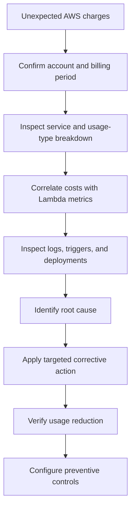
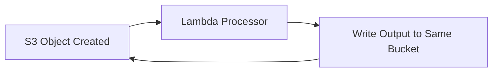

# 13- Cost Anomalies and Billing Problems

## Overview

AWS Lambda cost anomalies occur when invocation volume, execution duration, concurrency, logging, networking, or downstream service usage exceeds expected levels. Although Lambda follows a pay-per-use model, uncontrolled retries, recursive event processing, inefficient code, and poorly managed supporting resources can produce substantial and unexpected charges.

A cost investigation should examine the complete serverless workload rather than Lambda alone. API Gateway, Amazon SQS, Amazon CloudWatch, AWS X-Ray, NAT Gateway, DynamoDB, and other integrated services can contribute significantly to total spending.

The objective is to identify the specific usage responsible for the increase, contain ongoing waste safely, restore expected behavior, and introduce controls that prevent recurrence.

## Understand Lambda Cost Components

Lambda charges depend on the invocation model, architecture, Region, configured resources, applicable pricing plan, and current account benefits. Verify current AWS pricing before making financial projections.

| Cost component | Primary cost driver | Common anomaly |
|---|---|---|
| Requests | Number of invocations | Unexpected traffic or recursive invocations |
| Compute duration | Billable execution time and memory configuration | Slow dependencies or inefficient processing |
| Provisioned concurrency | Configured provisioned capacity and its duration | Unused capacity left enabled |
| Ephemeral storage | Applicable storage configuration and usage | Oversized temporary storage requirements |
| CloudWatch Logs | Log ingestion, retention, and query activity | Excessive debug logging |
| Tracing and telemetry | Trace ingestion and related observability usage | Excessive telemetry volume |
| Networking | NAT Gateway, endpoints, and data transfer | Large volumes of outbound traffic |
| Event-source services | Requests, delivery, buffering, and processing | High-volume queue or stream processing |
| Downstream services | Database operations, API calls, storage, and compute | Retry storms or inefficient access patterns |

Not every component is billed in the same way. For example, configuring additional Lambda memory affects the compute pricing calculation, while a NAT Gateway introduces separate networking charges.

### Estimate compute consumption

A simplified estimate of Lambda compute usage is:

\[
\text{GB-seconds} =
\text{Invocations} \times
\text{Average Duration (seconds)} \times
\text{Memory (GB)}
\]

The applicable compute price is then applied to billable usage, subject to the current pricing model and any eligible discounts or free usage.

Request charges must be considered separately. Provisioned concurrency, architecture-specific pricing, and other features can introduce additional cost components.

Increasing memory may increase the price per execution while reducing execution duration. Whether the change improves overall cost depends on the workload and must be measured.

## Diagnose an Unexpected AWS Bill

Use a structured investigation rather than changing Lambda configuration based on a single billing line item.



### Inspect billing data

Open AWS Cost Explorer and group spending by:

- Service.
- Region.
- Usage type.
- Linked account, where applicable.
- Resource, when resource-level cost data is available and configured.

Compare the affected period with a comparable historical period. Determine whether the increase comes from Lambda requests, compute duration, provisioned capacity, logging, networking, or a downstream service.

Billing data may lag behind actual usage. During an active incident, use CloudWatch metrics and application logs to identify and contain the problem while billing data catches up.

### Inspect Lambda configuration

List functions in the affected Region:

```bash
aws lambda list-functions \
  --region ap-south-1 \
  --query 'Functions[*].{
    Name:FunctionName,
    Memory:MemorySize,
    Timeout:Timeout,
    Runtime:Runtime,
    LastModified:LastModified
  }'
```

Inspect an individual function:

```bash
aws lambda get-function-configuration \
  --function-name order-processor \
  --region ap-south-1 \
  --query '{
    Name:FunctionName,
    Memory:MemorySize,
    Timeout:Timeout,
    State:State,
    ReservedConcurrency:ReservedConcurrentExecutions,
    Tracing:TracingConfig,
    Logging:LoggingConfig
  }'
```

These are read-only inspection commands. They reveal configuration, not actual billed usage. Correlate the results with billing data and CloudWatch metrics before concluding that a configuration caused the increase.

## Diagnose Invocation Spikes

Unexpected invocation growth is a common cause of higher request and compute charges.

### Possible causes

- A sudden increase in API traffic.
- A scheduled rule running more frequently than intended.
- An event source producing unexpected or duplicate events.
- An SQS backlog causing sustained processing.
- An S3 event notification loop.
- A Lambda function invoking itself directly or indirectly.
- Application-level retries generating repeated requests.
- A deployment changing event filters or invocation behavior.
- An unintended or compromised integration generating traffic.

### Inspect invocation metrics

```bash
aws cloudwatch get-metric-statistics \
  --namespace AWS/Lambda \
  --metric-name Invocations \
  --dimensions Name=FunctionName,Value=order-processor \
  --start-time 2026-10-11T12:00:00Z \
  --end-time 2026-10-11T13:00:00Z \
  --period 60 \
  --statistics Sum \
  --region ap-south-1
```

Replace the example timestamps with the actual investigation window in UTC.

Inspect errors over the same period:

```bash
aws cloudwatch get-metric-statistics \
  --namespace AWS/Lambda \
  --metric-name Errors \
  --dimensions Name=FunctionName,Value=order-processor \
  --start-time 2026-10-11T12:00:00Z \
  --end-time 2026-10-11T13:00:00Z \
  --period 60 \
  --statistics Sum \
  --region ap-south-1
```

Repeat with `Throttles` as the metric name to investigate rejected invocations.

Metric dimensions must match the intended function or qualified resource. A query using the wrong dimensions can return no datapoints and lead to incorrect conclusions.

### Identify invocation sources

Inspect event-source mappings:

```bash
aws lambda list-event-source-mappings \
  --function-name order-processor \
  --region ap-south-1
```

Inspect the function's resource-based policy:

```bash
aws lambda get-policy \
  --function-name order-processor \
  --region ap-south-1
```

The second command can return a resource-not-found error when no resource-based policy exists. That does not prove that the function has no valid invocation path because permissions and integrations vary by invocation mechanism.

Also inspect EventBridge rules, schedules, SQS queues, S3 notifications, API integrations, and application code that invokes Lambda.

### Corrective actions

- Remove unintended triggers after confirming their ownership and purpose.
- Correct overly broad event filters.
- Stop recursive invocation paths.
- Apply appropriate concurrency limits to protect downstream systems.
- Implement idempotency for duplicate events.
- Add alarms for unexpected invocation volume.
- Review relevant CloudTrail events when a configuration change or suspicious invocation source is suspected.

Avoid disabling all triggers indiscriminately. Doing so can interrupt legitimate production work or create a backlog that increases recovery costs.

## Diagnose Recursive Invocation and Event Loops

An event loop occurs when a function generates an event that triggers the same function again, directly or indirectly.

For example, a Lambda function processes objects uploaded to an S3 bucket and writes processed files back to that bucket. If the notification also matches output objects, the function can repeatedly trigger itself.



### Prevention

- Use separate input and output buckets when appropriate.
- Filter notifications by carefully selected prefixes or suffixes.
- Separate input and output object paths.
- Ensure that application code does not unintentionally invoke the same function.
- Use idempotency keys and duplicate-event protection.
- Set concurrency limits as a containment mechanism.
- Monitor invocation rates and unexpected output writes.

Lambda provides recursive loop detection for certain supported services and invocation chains. Coverage and behavior are not universal, so detection must not replace correct event routing.

### Emergency containment

If a loop is actively generating charges:

1. Identify the event source and confirm the loop.
2. Disable or narrow the specific trigger if it is safe to do so.
3. Apply a suitable concurrency limit when immediate containment is necessary.
4. Verify that the invocation rate decreases.
5. Correct the event routing or application logic.
6. Restore normal processing and verify legitimate events.

Setting a function's reserved concurrency to zero can prevent it from executing until the limit is changed. This is a strong containment measure, but it can cause queue backlogs, redelivery, and processing delays.

## Diagnose High Compute Duration

Lambda compute consumption increases with billable duration and configured memory under the applicable pricing model.

A function can be slow even when CPU utilization is low. For example, repeated database round trips or slow external HTTP requests can keep an invocation running longer and increase compute consumption.

### Inspect duration

```bash
aws cloudwatch get-metric-statistics \
  --namespace AWS/Lambda \
  --metric-name Duration \
  --dimensions Name=FunctionName,Value=order-processor \
  --start-time 2026-10-11T12:00:00Z \
  --end-time 2026-10-11T13:00:00Z \
  --period 60 \
  --statistics Average Maximum \
  --region ap-south-1
```

Compare duration with invocation volume, errors, memory configuration, and downstream service latency. Use percentiles in CloudWatch metric graphs or metric queries where appropriate to identify tail-latency problems.

### Common causes

- Slow SQL queries or missing database indexes.
- Repeated HTTP requests instead of batching.
- Inefficient serialization or data transformations.
- Excessive dependency initialization.
- Large imports or unnecessarily heavy deployment packages.
- Unbounded application-level retries.
- Missing timeouts for downstream operations.
- Repeated connection establishment.
- Large payloads or unnecessary processing.

### Corrective actions

- Reuse safe clients and connections across warm invocations.
- Configure explicit timeouts for HTTP and database operations.
- Improve query plans and reduce unnecessary round trips.
- Batch work where payload limits and processing semantics permit.
- Remove unused dependencies and optimize initialization.
- Benchmark representative workloads across memory configurations.
- Separate latency-sensitive API work from long-running background processing.

Increasing memory without measurement can increase cost unnecessarily. Reducing memory too aggressively can extend execution duration or cause memory exhaustion. Optimize using cost per successful operation rather than memory allocation alone.

## Diagnose Memory and Ephemeral Storage Problems

Memory and ephemeral storage are separate resources.

- **Memory** determines the configured memory allocation and influences available CPU resources.
- **Ephemeral storage** provides temporary filesystem capacity to the function's execution environment.

### Memory-related symptoms

- Duration rises after reducing memory.
- Large in-memory transformations cause unpredictable latency.
- Functions experience out-of-memory failures.
- Processing consumes more compute than expected because memory is unnecessarily high.

### Ephemeral-storage symptoms

- Large temporary files exhaust available storage.
- Storage is configured far beyond workload requirements.
- File-processing workloads create unexpected charges under the applicable pricing model.

Inspect the configuration:

```bash
aws lambda get-function-configuration \
  --function-name file-processor \
  --region ap-south-1 \
  --query '{
    MemorySize:MemorySize,
    EphemeralStorage:EphemeralStorage,
    Timeout:Timeout
  }'
```

### Corrective actions

- Measure peak memory usage with representative payloads.
- Benchmark multiple memory settings.
- Stream large files instead of loading them entirely into memory.
- Delete temporary files when no longer needed.
- Configure ephemeral storage according to actual workload requirements.
- Avoid using temporary execution-environment storage for durable business state.

Make resource changes only after testing representative workloads and verifying the effect on latency, reliability, and total cost.

## Diagnose Provisioned Concurrency Charges

Provisioned concurrency initializes execution environments ahead of requests to reduce cold-start latency for supported workloads. It is useful for latency-sensitive APIs, but configured capacity can create charges while demand is low.

### Common causes

- Provisioned concurrency remains enabled after a traffic spike.
- Capacity is configured for a rarely used alias.
- Configured capacity exceeds actual demand.
- Multiple aliases or versions have unnecessary allocations.
- Scaling schedules retain capacity after it is no longer needed.

### Inspect configuration

```bash
aws lambda list-provisioned-concurrency-configs \
  --function-name order-processor \
  --region ap-south-1
```

Inspect a specific alias:

```bash
aws lambda get-provisioned-concurrency-config \
  --function-name order-processor \
  --qualifier production \
  --region ap-south-1
```

These are read-only commands.

### Corrective actions

- Compare configured capacity with actual traffic and latency requirements.
- Remove provisioned concurrency from unused aliases.
- Consider Application Auto Scaling where supported and appropriate.
- Review scheduled scaling policies for obsolete schedules.
- Use on-demand concurrency when occasional cold starts are acceptable.
- Verify that the reduction does not violate latency objectives.

Reserved concurrency and provisioned concurrency serve different purposes. Reserved concurrency controls and reserves a function's concurrency capacity; provisioned concurrency prepares execution environments and has separate billing implications.

## Diagnose Excessive CloudWatch Logs Charges

CloudWatch Logs ingestion, retention, and query activity can become significant cost drivers in high-throughput Lambda workloads.

### Common causes

- Logging every event payload.
- Repeated stack traces caused by retry loops.
- Debug logging enabled in production.
- Logging the same exception at multiple layers.
- Per-record logs in high-volume batch processing.
- Indefinite log retention.
- Expensive Logs Insights queries across large time ranges.

### Inspect log groups

```bash
aws logs describe-log-groups \
  --log-group-name-prefix /aws/lambda/order-processor \
  --region ap-south-1 \
  --query 'logGroups[*].{
    Name:logGroupName,
    StoredBytes:storedBytes,
    RetentionInDays:retentionInDays
  }'
```

`storedBytes` indicates stored volume, not total ingestion charges. Use billing data to determine the actual CloudWatch usage types responsible for increased spending.

### Configure retention

The following command changes the log group's retention policy:

```bash
aws logs put-retention-policy \
  --log-group-name /aws/lambda/order-processor \
  --retention-in-days 30 \
  --region ap-south-1
```

Verify the change:

```bash
aws logs describe-log-groups \
  --log-group-name-prefix /aws/lambda/order-processor \
  --region ap-south-1 \
  --query 'logGroups[*].{
    Name:logGroupName,
    RetentionInDays:retentionInDays
  }'
```

Thirty days is an example, not a universal recommendation. Retention must meet incident response, audit, regulatory, and operational requirements.

### Reduce logging costs safely

- Use structured logs with stable event names.
- Log identifiers and relevant context instead of full payloads.
- Select appropriate log levels.
- Avoid duplicate exception reporting.
- Apply suitable retention policies.
- Narrow Logs Insights query time ranges.
- Preserve critical error and security telemetry.

Do not remove operationally essential logs solely to reduce ingestion charges.

## Diagnose VPC and NAT Gateway Charges

Lambda functions configured for VPC access may incur costs through associated networking resources. A common source of unexpected spending is a NAT Gateway used for outbound connectivity from private subnets.

### Common causes

- Large outbound traffic volumes pass through NAT.
- Multiple NAT Gateways are provisioned unnecessarily.
- Functions access public services through NAT when private connectivity may be suitable.
- Functions download large files or dependencies during execution.
- Cross-Region data transfer increases.
- Interface endpoints are provisioned without evaluating their hourly and data-processing charges.

### Investigation

1. Group billing data by service, Region, and usage type.
2. Inspect NAT Gateway and VPC endpoint inventory.
3. Review VPC Flow Logs where enabled.
4. Correlate network activity with Lambda invocation and duration metrics.
5. Identify destinations and outbound traffic volume.
6. Compare the cost and security trade-offs of NAT Gateways, gateway endpoints, and interface endpoints.

### Corrective actions

- Use S3 or DynamoDB gateway endpoints where appropriate.
- Evaluate interface endpoints for supported AWS services.
- Remove unused NAT Gateways only after validating routing and availability requirements.
- Reduce repeated downloads and unnecessary outbound calls.
- Keep data processing close to the data when practical.
- Avoid unnecessary cross-Region data movement.

Gateway and interface endpoints have different pricing models. An endpoint is not automatically cheaper than NAT for every workload. Compare hourly charges, data processing, availability requirements, and routing behavior.

## Diagnose Retry-Driven Cost Growth

Retries can multiply compute and downstream charges during an incident. If the application retries a failed database call internally and the event source also retries the invocation, a single logical operation may produce many repeated operations.

### Distinguish retry mechanisms

| Invocation path | Retry behavior to investigate |
|---|---|
| Synchronous invocation | Caller or upstream service retries |
| Asynchronous Lambda invocation | Lambda's asynchronous retry and event-expiration behavior |
| SQS event-source mapping | Message visibility timeout, redelivery, batching, and queue retry behavior |
| Kinesis or DynamoDB Streams mapping | Checkpointing, batch handling, retries, and shard progress |
| EventBridge target | Target delivery retry policy and dead-letter configuration |
| Step Functions | State-level retry and catch configuration |

Retry semantics differ across invocation models. Do not assume they share a single retry policy.

### Corrective actions

- Set explicit timeouts for downstream calls.
- Use bounded exponential backoff with jitter where appropriate.
- Avoid unbounded application-level retries.
- Configure event-source retry and failure handling deliberately.
- Use dead-letter queues or supported failure destinations.
- Implement idempotent processing.
- Avoid retrying permanent errors such as invalid input.
- Alarm on growing queue age, failed deliveries, and dropped asynchronous events.

Dead-letter queues do not eliminate cost or guarantee successful recovery. They introduce storage, monitoring, and replay responsibilities.

## Diagnose Event-Source Processing Costs

Event-driven workloads incur costs through Lambda and the services that deliver, buffer, or store events.

### SQS processing anomalies

Common causes include:

- A backlog requiring sustained processing.
- Large batches with expensive per-message operations.
- Repeated processing of poison messages.
- A visibility timeout that is too short for expected processing.
- Unnecessary queue activity under the applicable integration and pricing model.

Inspect queue attributes:

```bash
aws sqs get-queue-attributes \
  --queue-url "$QUEUE_URL" \
  --attribute-names ApproximateNumberOfMessages ApproximateNumberOfMessagesNotVisible VisibilityTimeout RedrivePolicy \
  --region ap-south-1
```

This is a read-only command. Set `QUEUE_URL` to the intended queue URL.

Corrective actions include tuning batch size, setting a suitable visibility timeout, implementing partial batch responses where supported, configuring a DLQ, and monitoring queue age alongside Lambda errors and throttles.

### Stream-processing anomalies

For Kinesis and DynamoDB Streams, inspect event-source mapping configuration, iterator age, retries, and batch behavior.

A repeatedly failing batch can delay processing progress and cause sustained compute consumption. Use appropriate failure handling and partial batch responses where supported by the event source and mapping configuration.

## Diagnose Unexpected Downstream Service Costs

The source of a cost anomaly may be a downstream service rather than Lambda itself.

Examples include:

- DynamoDB request volume rising because each invocation performs multiple reads.
- RDS load increasing because connection reuse is poor.
- External API calls multiplying due to nested retries.
- S3 request charges increasing because a function lists an entire bucket on every invocation.
- Step Functions state-transition charges increasing due to excessive workflow steps or retries.

### Investigation approach

- Group billing data by service and usage type.
- Correlate downstream request metrics with Lambda invocation volume.
- Inspect application logs for repeated calls and retries.
- Examine query patterns and batch sizes.
- Verify whether a deployment introduced additional downstream operations.
- Compare total cost per successful business operation before and after the change.

Optimize the complete request path. Reducing Lambda duration while multiplying database requests may lower one cost component and increase total workload spending.

## Use AWS Budgets and Cost Anomaly Detection

Preventive billing controls help identify spending changes before they become prolonged incidents.

### AWS Budgets

Create budgets for relevant accounts, services, or cost categories. Configure notifications based on actual or forecasted spending where supported by the selected budget type.

Budgets detect spending thresholds but do not automatically stop resource consumption.

### AWS Cost Anomaly Detection

Cost Anomaly Detection uses historical spending patterns to identify unusual changes. Configure monitors and alert subscriptions for the accounts and services relevant to the workload.

Anomaly detection complements workload-level alarms but does not replace them. Billing data can arrive later than CloudWatch metrics, so operational alarms remain necessary for immediate invocation spikes, queue failures, and recursive processing.

### Preventive control matrix

| Control | Purpose | Response |
|---|---|---|
| Invocation alarm | Detect unexpected request volume | Identify the trigger or traffic source |
| Error and throttle alarms | Detect failures and capacity pressure | Inspect retries and concurrency |
| Queue-age alarm | Detect stalled event processing | Investigate consumers and dependencies |
| Log-ingestion review | Detect excessive logging | Reduce unnecessary volume |
| AWS Budget notification | Detect spending approaching a threshold | Review service and usage-type breakdown |
| Cost Anomaly Detection | Detect unusual spending changes | Correlate billing changes with traffic and deployments |
| Concurrency limit | Contain runaway execution and protect dependencies | Investigate before restoring normal capacity |

## Estimate Cost Before Deployment

Use representative load tests and current AWS pricing to estimate the cost of the complete architecture.

Include:

- Expected invocation volume.
- Average and tail execution duration.
- Memory allocation and architecture.
- Provisioned concurrency, if configured.
- Event-source and API request charges.
- Log ingestion, retention, and query volume.
- Tracing and telemetry usage.
- Networking and data transfer.
- Downstream requests and storage.
- Retries, duplicate events, and expected failure volume.

A useful engineering metric is cost per successful business operation:

\[
\text{Cost per Success}
=
\frac{\text{Total Workload Cost}}
{\text{Successful Business Operations}}
\]

Define the numerator and denominator consistently. Include supporting services and distinguish attempted operations from successfully completed business outcomes.

For event-driven workflows, estimate the cost of duplicate events, failed batches, replay operations, and backlog recovery as well.

## Cost Investigation Checklist

- [ ] Confirm the AWS account, billing period, and affected Regions.
- [ ] Identify the services and usage types responsible for the increase.
- [ ] Compare Lambda invocations, duration, errors, and throttles with historical baselines.
- [ ] Inspect event-source mappings, schedules, triggers, and recursive invocation paths.
- [ ] Review memory, timeout, ephemeral storage, and provisioned concurrency settings.
- [ ] Examine CloudWatch Logs ingestion, retention, and query activity.
- [ ] Inspect NAT Gateway, endpoint, and data-transfer charges.
- [ ] Correlate downstream service costs with Lambda workload changes.
- [ ] Review recent deployments and configuration changes.
- [ ] Apply the narrowest safe corrective action.
- [ ] Verify that usage and business outcomes return to expected levels.
- [ ] Configure budgets, anomaly detection, and operational alarms.
- [ ] Document the root cause and implement a regression-prevention measure.

## Common Mistakes

| Mistake | Why it is harmful | Better approach |
|---|---|---|
| Investigating only Lambda charges | Misses networking, logging, and downstream costs | Analyze the complete workload by service and usage type |
| Assuming higher memory always means higher total cost | Ignores the relationship between memory and duration | Benchmark cost per successful operation |
| Disabling every trigger immediately | Interrupts legitimate workloads and creates backlogs | Identify and contain the specific source |
| Treating reserved concurrency as a billing discount | It is primarily a capacity-control mechanism | Use it for isolation and backpressure |
| Leaving provisioned concurrency enabled indefinitely | Creates avoidable capacity charges during idle periods | Align capacity with latency requirements |
| Reducing logging without considering incident needs | Weakens troubleshooting and security visibility | Optimize volume and retention while preserving critical signals |
| Relying only on billing alerts | Billing data may lag behind live incidents | Combine cost controls with operational alarms |
| Ignoring retry behavior | Repeated processing multiplies compute and downstream charges | Bound retries and implement idempotency |
| Assuming VPC access is free | NAT Gateways and endpoints can introduce separate charges | Review routing, traffic, and endpoint economics |
| Failing to clean up test resources | Functions, queues, logs, and networking resources may continue to incur charges | Maintain explicit cleanup procedures and ownership |

## Key Takeaways

- Diagnose cost anomalies by correlating billing usage types with Lambda metrics, event sources, networking, logs, and downstream services.
- Investigate invocation spikes, recursive event loops, retry storms, excessive execution duration, and idle provisioned concurrency as common causes of unexpected spending.
- Optimize memory, duration, logging, and networking through measurement while preserving reliability, security, and operational visibility.
- Use AWS Budgets and Cost Anomaly Detection for spending awareness, combined with CloudWatch alarms for faster workload-level incident detection.
- Prevent recurrence with idempotent processing, bounded retries, deliberate concurrency controls, resource cleanup, and cost-per-successful-operation tracking.