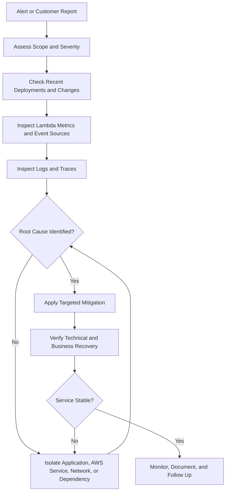

# 14- Production Incident Diagnosis and Recovery

## Overview

Production incidents involving AWS Lambda can originate from application defects, runtime failures, concurrency limits, downstream service degradation, networking problems, event-delivery failures, deployment changes, or unexpected traffic. Because Lambda frequently participates in distributed, event-driven architectures, a failure in one component can propagate across multiple services.

Effective incident response requires more than inspecting a function's error logs. Engineers must establish the scope of impact, identify the failing component, contain ongoing damage, restore service safely, and verify that business operations have recovered.

This document provides a systematic approach to diagnosing and recovering from Lambda production incidents, with practical AWS CLI commands, Python examples, failure-isolation strategies, and recovery procedures.

## Production Incident Response Principles

During an incident, prioritize restoring a safe and reliable service over immediately identifying every contributing factor.

Use these principles:

- **Establish impact first:** Determine which users, operations, functions, and downstream systems are affected.
- **Use evidence before changing configuration:** Correlate metrics, logs, traces, event-source state, and deployment history.
- **Contain ongoing damage:** Stop recursive invocations, protect overloaded dependencies, and prevent uncontrolled retries.
- **Preserve recoverability:** Avoid deleting queues, event records, logs, or resources that may be needed for recovery.
- **Make reversible changes:** Prefer targeted mitigations that can be verified and rolled back.
- **Verify business outcomes:** A successful Lambda invocation does not necessarily mean that the business operation completed correctly.
- **Record the timeline:** Capture symptoms, decisions, configuration changes, and recovery milestones.

### Incident severity

| Severity | Typical condition | Initial response |
|---|---|---|
| Critical | Broad production outage, data corruption, or uncontrolled processing | Immediate incident coordination and containment |
| High | Major feature unavailable or sustained processing backlog | Prioritize service restoration and dependency isolation |
| Medium | Partial degradation with a viable workaround | Investigate and mitigate within the agreed response window |
| Low | Limited impact, isolated failures, or non-urgent operational issue | Diagnose and schedule corrective work |

Use the organization's incident severity definitions and service-level objectives rather than treating this table as a universal standard.

## Incident Diagnosis Workflow

A consistent diagnostic process prevents engineers from jumping between unrelated configuration changes.



### Initial triage checklist

- [ ] Confirm the AWS account, Region, and affected environment.
- [ ] Identify the affected function, alias, version, and invocation path.
- [ ] Establish the incident start time and current impact.
- [ ] Check Lambda errors, throttles, duration, and concurrent executions.
- [ ] Inspect API Gateway, SQS, EventBridge, or stream metrics as applicable.
- [ ] Review recent deployments, IAM changes, environment changes, and event-source configuration.
- [ ] Identify downstream dependencies that are failing or becoming overloaded.
- [ ] Determine whether retries, duplicate events, or data loss are occurring.
- [ ] Choose a targeted mitigation and define how its effectiveness will be measured.

## Establish the Incident Context

Before running diagnostic commands, verify that all investigation tools are targeting the correct account and Region.

### Verify account identity

```bash
aws sts get-caller-identity
```

This read-only command returns the account and identity associated with the current AWS credentials.

### Verify the intended function

```bash
aws lambda get-function-configuration \
  --function-name order-processor \
  --region ap-south-1 \
  --query '{
    Name:FunctionName,
    State:State,
    LastUpdateStatus:LastUpdateStatus,
    Runtime:Runtime,
    Handler:Handler,
    Memory:MemorySize,
    Timeout:Timeout,
    Role:Role,
    Version:Version
  }'
```

Replace the example function name and Region with the affected resource.

For alias-based deployments, inspect the alias separately:

```bash
aws lambda get-alias \
  --function-name order-processor \
  --name production \
  --region ap-south-1
```

Record the version currently receiving production traffic. An incident affecting an alias may be caused by the deployed version, its configuration, or a downstream dependency rather than the unqualified function.

## Diagnose Lambda Invocation Failures

Invocation failures can originate before the handler runs, inside the runtime, or after the function returns.

### Identify the failure category

| Symptom | Possible cause | Initial investigation |
|---|---|---|
| No Lambda invocation | Trigger, routing, or caller failure | Inspect upstream service and event-source configuration |
| Invocation returns an error | Handler exception or runtime failure | Inspect logs and invocation response |
| Invocation times out | Slow dependency or excessive processing | Inspect duration and dependency latency |
| Requests are throttled | Concurrency or account capacity constraints | Inspect throttles and concurrency |
| Function returns success but work is missing | Application logic or incomplete downstream operation | Verify business records and downstream state |
| Failures begin after deployment | Code or configuration regression | Compare the deployed version and configuration |
| Asynchronous work is delayed | Queue backlog or repeated failures | Inspect event age, queue depth, and failure handling |

### Inspect recent errors

```bash
aws cloudwatch get-metric-statistics \
  --namespace AWS/Lambda \
  --metric-name Errors \
  --dimensions Name=FunctionName,Value=order-processor \
  --start-time 2026-10-11T12:00:00Z \
  --end-time 2026-10-11T13:00:00Z \
  --period 60 \
  --statistics Sum \
  --region ap-south-1
```

Replace the example UTC timestamps with the incident window.

Check `Invocations`, `Duration`, and `Throttles` over the same period. Use CloudWatch metric graphs or queries to inspect percentiles when tail latency matters.

An increase in `Errors` does not reveal the root cause by itself. Correlate it with log messages, request IDs, deployment history, and downstream metrics.

## Diagnose Runtime and Handler Failures

Runtime and handler failures can prevent a function from processing requests correctly even when its configuration appears valid.

Common causes include:

- Incorrect handler configuration.
- Missing Python dependencies.
- Incompatible package versions.
- Unsupported or deprecated runtime versions.
- Import-time exceptions.
- Malformed event data.
- Unexpected environment-variable values.
- Unhandled exceptions or incorrect exception handling.

### Inspect recent logs

```bash
aws logs tail /aws/lambda/order-processor \
  --since 30m \
  --region ap-south-1
```

This command reads recent log events. It assumes the default log-group name; verify the actual logging configuration if the function uses a custom log group.

Look for:

- `Runtime.ImportModuleError`.
- Handler lookup failures.
- Python tracebacks.
- Initialization failures.
- Validation errors.
- Unexpected response or serialization errors.

### Example: safer Python error handling

```python
import json
import logging

logger = logging.getLogger()
logger.setLevel(logging.INFO)


def lambda_handler(event, context):
    request_id = context.aws_request_id

    try:
        order_id = event["order_id"]
        process_order(order_id)

        logger.info(
            "Order processed",
            extra={"request_id": request_id},
        )

        return {
            "statusCode": 200,
            "body": json.dumps({"status": "processed"}),
        }

    except KeyError:
        logger.warning(
            "Invalid order event: missing order_id",
            extra={"request_id": request_id},
        )
        return {
            "statusCode": 400,
            "body": json.dumps({"error": "missing_order_id"}),
        }

    except Exception:
        logger.exception(
            "Order processing failed",
            extra={"request_id": request_id},
        )
        raise


def process_order(order_id):
    # Replace with the actual business operation.
    if not order_id:
        raise ValueError("Invalid order identifier")
```

This example handles missing input explicitly and re-raises unexpected failures so Lambda can observe them.

For asynchronous invocations and event-source mappings, the failure response affects retry behavior. For synchronous API integrations, an exception may surface as an integration failure unless the application or integration explicitly maps it to an appropriate HTTP response.

Do not convert every exception into HTTP 200 or an apparently successful event result. Doing so can hide failures from monitoring and prevent intended retry mechanisms from operating.

## Diagnose Timeouts and Slow Dependencies

Timeouts often indicate a problem beyond the Lambda handler itself.

Possible causes include:

- Slow database queries.
- Connection exhaustion.
- External API latency.
- DNS resolution failures.
- Missing outbound connectivity.
- Retry loops inside the handler.
- Large payload processing.
- A function timeout that is too short for legitimate work.

### Inspect duration and memory configuration

```bash
aws lambda get-function-configuration \
  --function-name order-processor \
  --region ap-south-1 \
  --query '{
    Timeout:Timeout,
    Memory:MemorySize,
    EphemeralStorage:EphemeralStorage
  }'
```

Compare the configured timeout with observed duration, caller deadlines, and downstream operation timeouts.

### Recovery actions

- Identify the slow operation from logs or traces.
- Check the downstream service's health and capacity.
- Set explicit timeouts on HTTP and database operations.
- Reduce unnecessary network round trips.
- Tune memory after benchmarking representative requests.
- Increase the Lambda timeout only when the workload legitimately requires more execution time and its caller or event source permits it.
- Move long-running work to asynchronous processing when synchronous completion is inappropriate.

Increasing the timeout without fixing an unbounded dependency wait can increase resource consumption while delaying failure detection.

## Diagnose Throttling and Concurrency Exhaustion

Lambda throttling occurs when an invocation cannot obtain execution capacity under the applicable concurrency limits or service quotas.

Concurrency pressure may result from legitimate traffic growth, slow invocations, retries, recursive invocation, or insufficient capacity allocation.

### Inspect concurrency configuration

```bash
aws lambda get-function-concurrency \
  --function-name order-processor \
  --region ap-south-1
```

This command inspects reserved concurrency configuration. If no reserved concurrency is configured, the command may return a resource-not-found response for that configuration.

Inspect throttles:

```bash
aws cloudwatch get-metric-statistics \
  --namespace AWS/Lambda \
  --metric-name Throttles \
  --dimensions Name=FunctionName,Value=order-processor \
  --start-time 2026-10-11T12:00:00Z \
  --end-time 2026-10-11T13:00:00Z \
  --period 60 \
  --statistics Sum \
  --region ap-south-1
```

### Recovery actions

1. Determine whether the function or the account is experiencing capacity pressure.
2. Check execution duration and downstream latency.
3. Identify recursive invocation or retry amplification.
4. Review reserved concurrency and account-level concurrency limits.
5. Protect downstream services before increasing concurrency.
6. Adjust capacity or traffic gradually.
7. Verify that throttling decreases without overwhelming dependent systems.

Increasing concurrency is not always the correct mitigation. If a database is already overloaded, allowing more Lambda executions may make the incident worse.

## Diagnose API Gateway and Function URL Incidents

A Lambda-backed API can fail even when the function itself is healthy.

Possible failure points include:

- API Gateway authorization.
- Request validation.
- Integration configuration.
- Lambda invocation permissions.
- Function URL authentication or resource policy.
- API throttling.
- Incorrect response format.
- Lambda runtime errors.
- Downstream dependency failures.

### Recovery sequence

1. Inspect the API's response status and error body.
2. Determine whether Lambda was invoked.
3. Inspect API Gateway metrics and logs.
4. Inspect Lambda metrics and logs for the corresponding time window.
5. Verify integration configuration and invocation permissions.
6. Test the function independently when safe.
7. Validate the public request path after the correction.

For API Gateway, distinguish client errors from integration failures. A 4xx response may indicate invalid input or authorization failure, while a 5xx response can indicate an integration or application problem. The exact interpretation depends on the API type and response mapping.

A function URL uses a different integration and authorization model from API Gateway. Do not apply API Gateway-specific assumptions to function URL troubleshooting.

## Diagnose VPC and Database Connectivity Failures

A VPC-connected Lambda can fail because of subnet selection, security groups, routing, DNS, endpoint configuration, or downstream database capacity.

### Common symptoms

- Connection timeouts.
- DNS resolution errors.
- Database connection exhaustion.
- Requests succeed outside Lambda but fail from the function.
- Outbound API requests fail after a VPC configuration change.

### Diagnostic workflow

- Verify the function's VPC, subnet, and security-group configuration.
- Check whether the database allows inbound traffic from the Lambda security group.
- Confirm subnet routes and network ACL behavior.
- Verify DNS settings and hostname resolution.
- Check whether public outbound connectivity requires a correctly configured NAT path.
- Inspect database connection counts and capacity.
- Review VPC Flow Logs when available.

### Recovery considerations

Avoid broad security-group changes that expose databases or other private services unnecessarily.

For database connection exhaustion:

- Reuse database clients where safe.
- Reduce excessive connection creation.
- Limit Lambda concurrency according to database capacity.
- Consider RDS Proxy where suitable.
- Ensure database connection and query timeouts are configured.
- Validate connection recovery after the incident.

If a network configuration change is suspected, compare it with the last known working configuration before applying additional changes.

## Diagnose Event-Source and Asynchronous Processing Failures

Event-driven workloads require investigation of both Lambda and the service responsible for event delivery.

A function may report successful invocations while events remain delayed in a queue. Conversely, a function may be healthy while its event source cannot deliver work because of permissions or configuration problems.

### Event-source diagnostic matrix

| Integration | Signals to inspect | Typical recovery action |
|---|---|---|
| SQS | Visible messages, oldest message age, DLQ depth, Lambda throttles | Restore consumer capacity and correct poison-message handling |
| Kinesis | Iterator age, mapping state, processing errors | Fix processing failures and restore shard progress |
| DynamoDB Streams | Iterator age, batch failures, mapping state | Correct handler or checkpoint-related processing issues |
| EventBridge | Target delivery failures, retry policy, DLQ | Fix target permissions or destination configuration |
| S3 notifications | Notification configuration and Lambda invocation metrics | Correct filters, permissions, or destination settings |
| Asynchronous Lambda invocation | Event age, dropped events, destination delivery errors | Correct function failures and retry or destination configuration |

Metric names and availability depend on the service and configuration. Confirm the correct namespace, dimensions, and event-source-specific behavior.

### SQS recovery example

Inspect queue attributes:

```bash
aws sqs get-queue-attributes \
  --queue-url "$QUEUE_URL" \
  --attribute-names ApproximateNumberOfMessages ApproximateNumberOfMessagesNotVisible VisibilityTimeout RedrivePolicy \
  --region ap-south-1
```

This is a read-only command. Replace `QUEUE_URL` with the intended queue URL.

If the backlog is growing:

1. Check Lambda errors and throttles.
2. Inspect event-source mapping state and batch configuration.
3. Check downstream dependency capacity.
4. Identify poison messages and repeated failures.
5. Restore consumer processing safely.
6. Verify that queue age and backlog decrease.

Do not purge a production queue as a routine recovery action. Purging permanently removes messages and may cause business data loss.

## Diagnose Duplicate Events and Data Consistency Problems

Lambda integrations can deliver events more than once. Retries, visibility timeouts, partial failures, and network errors can cause duplicate processing.

The correct reliability goal is generally to make business operations idempotent rather than assume exactly-once delivery.

### Recovery strategy

- Identify the affected business operation and event identifiers.
- Determine whether duplicate writes or side effects occurred.
- Stop further amplification if duplicates are still being produced.
- Reconcile the authoritative business records.
- Use idempotency keys or conditional writes to prevent repeated effects.
- Replay failed events only after verifying that replay is safe.
- Record any data repair and validate the final business state.

For financial or order-processing workloads, do not blindly replay every failed invocation. A previous attempt may have committed the business transaction even if the function timed out before returning success.

## Diagnose IAM and Permission Failures

Permission failures can occur when Lambda accesses downstream resources or when an AWS service invokes the function.

Distinguish between:

- The Lambda execution role.
- The function's resource-based policy.
- The caller's identity policy.
- Service-linked or service-specific roles.
- Resource policies and organizational controls.

### Inspect the execution role

```bash
aws lambda get-function-configuration \
  --function-name order-processor \
  --region ap-south-1 \
  --query 'Role'
```

Inspect the function resource policy:

```bash
aws lambda get-policy \
  --function-name order-processor \
  --region ap-south-1
```

### Recovery actions

1. Capture the exact denied action and resource ARN.
2. Identify the principal making the request.
3. Inspect relevant identity and resource policies.
4. Verify Region, account, and resource identifiers.
5. Check permission boundaries and organizational controls.
6. Add the minimum required permission.
7. Retest with the intended principal.

Do not grant broad administrator permissions as an incident workaround unless a separately authorized, tightly controlled emergency process explicitly requires it. Prefer a narrow, documented correction.

## Recover from a Failed Deployment

Deployment-related incidents can result from code defects, dependency changes, runtime changes, environment configuration, IAM modifications, or incompatible event contracts.

### Inspect recent function updates

```bash
aws lambda get-function-configuration \
  --function-name order-processor \
  --region ap-south-1 \
  --query '{
    LastModified:LastModified,
    LastUpdateStatus:LastUpdateStatus,
    Version:Version,
    Runtime:Runtime,
    Handler:Handler,
    Environment:Environment
  }'
```

Treat environment-variable output as sensitive. Avoid sharing command output that contains secrets or internal configuration values.

For alias-based deployments, inspect the alias's current routing:

```bash
aws lambda get-alias \
  --function-name order-processor \
  --name production \
  --region ap-south-1
```

### Recovery options

- Roll the alias back to a previously validated version.
- Revert a configuration change through the deployment pipeline or infrastructure-as-code source.
- Deploy a corrective version after verifying the defect.
- Restore a compatible dependency or environment configuration.
- Disable or pause the specific event source if processing is unsafe.

A published Lambda version captures code and versioned configuration, but not every external dependency or mutable resource. Rolling back a version does not automatically reverse database migrations, restore deleted data, or undo external side effects.

Prefer alias-based releases and infrastructure-as-code-managed configuration so recovery can be repeatable and auditable.

## Diagnose Recursive Invocations and Runaway Processing

Recursive invocations can rapidly increase cost, consume concurrency, and overwhelm downstream services.

Common causes include:

- A function writing to the same S3 bucket that triggers it.
- A function publishing an event that routes back to itself.
- A workflow repeatedly invoking the same function without a termination condition.
- An application retry loop that creates new asynchronous invocations.

### Containment procedure

1. Identify the source of repeated invocations.
2. Confirm whether the pattern is intentional.
3. Disable or narrow the specific trigger when safe.
4. Apply a concurrency limit if additional containment is required.
5. Verify that the invocation rate and downstream load decrease.
6. Correct the routing or application logic.
7. Restore processing and monitor for recurrence.

Lambda's recursive loop detection can help with certain supported invocation chains, but it does not cover every possible loop. Event filtering, idempotency, bounded retries, and operational alarms remain essential.

## Diagnose Unexpected Cost Growth During an Incident

Cost increases may be a consequence of the incident rather than its initial cause.

Typical mechanisms include:

- Repeated invocations.
- Longer execution duration.
- Retry storms.
- Excessive CloudWatch Logs ingestion.
- Unused provisioned concurrency.
- NAT Gateway data processing.
- Expensive downstream calls.

### Recovery priorities

- Contain runaway invocations first.
- Protect overloaded downstream dependencies.
- Correct retry and event-routing behavior.
- Reduce unnecessary logging without removing critical diagnostics.
- Review provisioned concurrency and networking only after identifying the source of charges.
- Configure cost and operational alarms to detect recurrence.

Billing information may lag behind live usage. Use CloudWatch metrics and service-level telemetry for immediate containment, then confirm the financial impact through Cost Explorer and billing data.

## Safe Recovery and Rollback Procedures

Recovery changes should minimize additional impact and preserve the ability to diagnose the original failure.

### Recommended sequence

1. Record the current configuration and the known failure state.
2. Select the smallest mitigation that can restore service.
3. Assess the effect on queued work, retries, downstream capacity, and data consistency.
4. Apply the change through the approved operational path.
5. Verify technical health and business outcomes.
6. Monitor for recurrence and unintended side effects.
7. Document the change and any remaining risks.

### Recovery decision matrix

| Incident | Preferred first action | Important risk |
|---|---|---|
| Bad deployment | Roll back the alias or deployment configuration | External schema or data changes may remain |
| Downstream overload | Reduce concurrency or apply backpressure | Backlogs may grow |
| Recursive event loop | Stop or narrow the triggering path | Legitimate events may be delayed |
| Poison-message failure | Isolate and redrive according to policy | Incorrect replay may duplicate side effects |
| IAM regression | Restore the minimum required permission | Broad emergency permissions may persist |
| VPC connectivity failure | Restore known-good routing or security configuration | Overly broad network rules can expose resources |
| High invocation volume | Identify the trigger and contain excess traffic | Legitimate requests may be rejected |
| Missing telemetry | Restore logging or tracing configuration | Investigation may remain incomplete until signals recover |

## Verify Service Recovery

A deployment or configuration update is not proof that the incident is resolved.

Validate several independent signals.

### Technical verification

- Lambda invocations and errors return to expected levels.
- Throttles and duration are within acceptable bounds.
- Event-source mappings are enabled and processing correctly.
- Queue age and backlog are decreasing.
- Downstream services are recovering.
- Logs and traces are available.
- Alarms return to the expected state.

### Business verification

- Required records are present and consistent.
- Orders, payments, or jobs have reached the correct final state.
- No unintended duplicate side effects remain.
- Failed events are accounted for.
- Replayed work completes successfully.
- User-visible behavior matches the service contract.

### Post-mitigation monitoring

Continue monitoring long enough to cover the workload's relevant processing and retry windows. For asynchronous systems, immediate success after a configuration change does not guarantee that delayed events will process correctly.

## Post-Incident Review

A production incident should produce durable improvements rather than only a restored service.

Record:

- Impact and affected services.
- Start time, detection time, mitigation time, and recovery time.
- Customer-visible symptoms.
- Technical root cause and contributing factors.
- Relevant metrics, logs, traces, and deployment changes.
- Mitigation steps and their side effects.
- Data reconciliation or replay actions.
- Preventive engineering work.
- Owners and deadlines for follow-up tasks.

Focus the review on system behavior and corrective actions rather than individual blame.

Potential follow-up work includes stronger alarms, improved idempotency, safer deployment strategies, automated rollback criteria, better dependency timeouts, and clearer operational runbooks.

## Production Readiness Checklist

Before operating a Lambda workload in production, verify that the following controls are in place.

### Reliability

- [ ] Invocation models and retry behavior are understood.
- [ ] Idempotency is implemented for operations that can be repeated.
- [ ] Dead-letter queues or failure destinations are configured where appropriate.
- [ ] Timeouts and downstream retry policies are bounded.
- [ ] Concurrency limits protect downstream dependencies.
- [ ] Event-source failure and replay procedures are documented.

### Observability

- [ ] Structured logs include useful correlation identifiers.
- [ ] Error, duration, throttling, and concurrency metrics are monitored.
- [ ] Event-source metrics are included in dashboards.
- [ ] Alarms have actionable thresholds and notification targets.
- [ ] Missing telemetry can be detected where its absence is operationally significant.
- [ ] Deployment verification includes telemetry checks.

### Security and recovery

- [ ] Execution roles follow least privilege.
- [ ] Production changes are auditable.
- [ ] Secrets are not exposed in logs or command output.
- [ ] Rollback procedures are tested.
- [ ] Queue replay and data reconciliation procedures are documented.
- [ ] Resource ownership and incident responsibilities are clear.

### Cost and capacity

- [ ] AWS Budgets or suitable cost monitoring is configured.
- [ ] Unexpected invocation spikes can be detected.
- [ ] Logging retention is configured according to policy.
- [ ] Concurrency and downstream capacity have been evaluated.
- [ ] Networking and provisioned concurrency costs are understood.
- [ ] Cleanup and recovery procedures avoid unnecessary resource accumulation.

## Common Mistakes

| Mistake | Why it is harmful | Better approach |
|---|---|---|
| Changing several settings at once | Makes cause-and-effect difficult to establish | Apply targeted, measurable mitigations |
| Increasing concurrency without checking dependencies | Can overwhelm databases or APIs | Assess downstream capacity first |
| Increasing timeouts without diagnosing latency | Extends failure duration and may increase cost | Find and fix slow operations |
| Replaying all failed events blindly | Can duplicate committed business operations | Verify idempotency and reconcile state |
| Purging queues during recovery | Permanently removes pending work | Preserve messages and isolate poison events |
| Rolling back code without considering schema changes | The old version may be incompatible with the current data model | Evaluate backward compatibility and migration state |
| Granting broad permissions to resolve access failures | Creates security exposure that may outlive the incident | Restore only the required permissions |
| Treating successful invocations as complete recovery | Business operations may still be missing or inconsistent | Verify final business state |
| Stopping investigation when metrics normalize | Hidden backlogs or delayed retries may remain | Monitor through the relevant processing window |
| Skipping the post-incident review | The same failure can recur | Convert findings into owned preventive actions |

## Key Takeaways

- Diagnose Lambda incidents by correlating function metrics, logs, event-source state, deployment history, and downstream service health before changing configuration.
- Contain runaway processing, retries, and downstream overload with targeted mitigations that preserve data and allow safe recovery.
- Treat invocation success, event delivery, and successful business completion as separate conditions; verify final business state before declaring recovery.
- Use reversible deployments, bounded retries, idempotency, least-privilege permissions, and explicit recovery procedures to reduce incident impact.
- Convert every significant incident into measurable improvements in monitoring, deployment safety, reliability, security, and operational readiness.
```#+#+#+#+