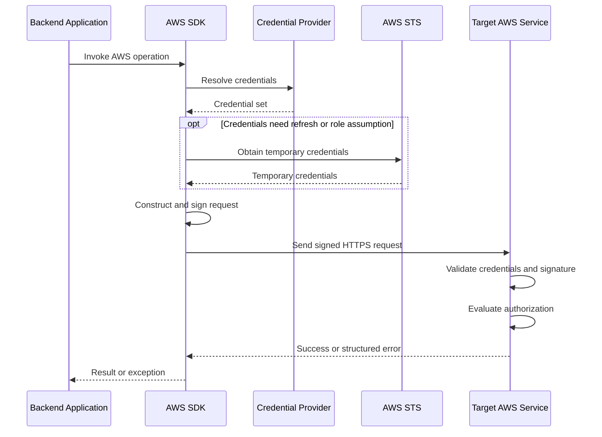

# 01- Authentication and Signature Validation Issues

## Overview

AWS authentication and signature validation failures occur when AWS cannot validate the credentials associated with a request or verify its cryptographic signature. These failures commonly affect Python backend applications, AWS SDK integrations, CI/CD pipelines, cross-account workloads, and services that invoke AWS APIs.

Effective troubleshooting requires separating authentication, request signing, authorization, and transport security. Each addresses a different security concern, and applying the wrong fix can introduce unnecessary permissions or leave the underlying problem unresolved.

This document covers credential resolution, expired credentials, AWS Security Token Service (STS), role assumption, AWS Signature Version 4 (SigV4), clock skew, and production diagnostics.

## Authentication, Signing, and Authorization

| Concern | Purpose | Typical failure | Primary diagnostic |
|---|---|---|---|
| Authentication | Establish the identity associated with a request | `InvalidClientTokenId` | Verify the credential provider and active identity |
| Request signing | Authenticate supported requests and protect signed request components against unauthorized modification | `SignatureDoesNotMatch` | Inspect signing configuration and canonicalization |
| Authorization | Determine whether the principal can perform the requested action | `AccessDenied` | Inspect applicable IAM and resource policies |
| Transport security | Protect communication and validate the server's TLS identity | Certificate verification or TLS handshake error | Inspect endpoint, certificates, and trust configuration |

A correctly signed request can still be denied by IAM policies, resource policies, permissions boundaries, service control policies (SCPs), or service-specific authorization controls.

Similarly, a successful identity check does not prove that the principal can access a particular S3 object, decrypt a KMS ciphertext, or invoke another AWS service.

## AWS Authentication and Request Flow

A typical AWS SDK request follows this sequence:



The exact sequence depends on the credential provider, whether credentials require refreshing, and the target service.

Before modifying configuration, establish:

- Which AWS service and operation are failing.
- Which AWS account and principal the process uses.
- Whether credentials are static, temporary, federated, or role-based.
- Whether the request is generated by an SDK, CLI, or custom signer.
- Which region, endpoint, and signing configuration are active.
- Whether the failure began after a deployment, credential rotation, role change, or system-clock issue.

## Troubleshooting Missing or Invalid Credentials

### Symptoms

Common errors include:

- `Unable to locate credentials`
- `NoCredentialsError`
- `InvalidClientTokenId`
- `UnrecognizedClientException`
- `The security token included in the request is invalid`

### Likely root causes

| Root cause | Explanation |
|---|---|
| Missing credentials | No available provider returns usable credentials |
| Incorrect AWS profile | The process uses a different profile than intended |
| Stale environment variables | Environment credentials override the expected provider |
| Invalid access key or secret key | Credentials are incorrect, deactivated, or no longer valid |
| Incomplete temporary credentials | The session token is missing or does not match the other credential fields |
| Different CLI and application environments | The CLI and deployed application resolve different identities |
| Incorrect SDK configuration | The application initializes a client with unintended credentials or region settings |

### Verify the active identity

Run this read-only command:

```bash
aws sts get-caller-identity \
  --region <AWS_REGION>
```

The response contains the AWS account ID, principal ARN, and user ID.

Interpret the result carefully:

- **Expected identity:** The CLI authenticated successfully for this operation.
- **Unexpected identity:** Inspect the active profile, environment overrides, and role-assumption configuration.
- **Authentication failure:** Investigate credential availability, validity, expiration, and provider configuration.

A successful call does not prove that the application uses the same identity or has permission to perform the failing operation.

Inspect the CLI's configuration sources:

```bash
aws configure list
```

This helps identify the active profile, region, and credential source. Review the output before sharing it because configuration metadata can reveal details about the environment.

To test a specific profile:

```bash
aws sts get-caller-identity \
  --profile <AWS_PROFILE> \
  --region <AWS_REGION>
```

An AWS CLI profile is not automatically used by every SDK or application process.

### Inspect environment overrides safely

Environment variables can change credential resolution. Check whether relevant variables are set without printing their values:

```python
import os

VARIABLES = (
    "AWS_ACCESS_KEY_ID",
    "AWS_SECRET_ACCESS_KEY",
    "AWS_SESSION_TOKEN",
    "AWS_PROFILE",
    "AWS_DEFAULT_REGION",
)

for variable in VARIABLES:
    state = "set" if os.getenv(variable) else "not set"
    print(f"{variable}: {state}")
```

For temporary credentials, the access key ID, secret access key, and session token must belong to the same credential set.

Avoid dumping the entire environment into application logs or CI/CD output. Other environment variables may contain database passwords, API tokens, and application secrets.

### Corrective actions

1. Identify the credential provider the process should use.
2. Remove unintended profile or environment-variable overrides.
3. Restore the approved identity configuration.
4. Replace invalid credentials through the approved credential-management process.
5. Prefer workload roles and supported SDK credential providers over manually managed long-lived keys.
6. Repeat the identity check and test the specific AWS operation.

Never print secret access keys or session tokens to diagnose credential failures.

## Troubleshooting Expired Temporary Credentials

### Symptoms

- `ExpiredToken`
- `ExpiredTokenException`
- Requests fail after running successfully for some time.
- One application instance fails while another continues working.
- Authentication failures appear after a role session expires.

### Likely root causes

- The application retains a copied set of temporary credentials.
- The credential provider cannot refresh the session.
- The application uses an expired session token.
- A custom credential cache ignores expiration.
- The runtime loses access to the identity provider or metadata endpoint needed to obtain credentials.

### Isolation strategy

Verify the identity using the same runtime and credential provider as the failing operation. Determine whether the application uses SDK-managed credentials or manually supplied credential values.

If the CLI succeeds but the application fails, inspect client initialization, credential-source selection, and the lifetime of cached credentials. Refreshing a CLI session does not automatically refresh credentials in a separately running application.

### Corrective actions

- Use a supported SDK credential provider that refreshes temporary credentials.
- Avoid copying temporary credential values into configuration for indefinite reuse.
- Reinitialize incorrectly configured clients when necessary.
- Restore access to the credential provider or identity service.
- Retry only after obtaining valid credentials and only when the operation is safe to repeat.

### Prevention

- Prefer IAM roles for EC2, Lambda, ECS, and supported Kubernetes workload-identity mechanisms.
- Test credential refresh during deployment and integration testing.
- Monitor credential-provider failures and unexpected authentication error rates.
- Avoid custom credential caches unless expiration and refresh behavior are explicitly managed.

## Troubleshooting STS and Role-Assumption Failures

STS role assumption requires a valid source identity and an allowed trust relationship with the target role. Cross-account failures often involve either the source principal's permissions or the target role's trust policy.

### Symptoms

- `AccessDenied` from `AssumeRole`
- An STS operation fails despite valid source credentials.
- A workload assumes a role in the wrong account.
- Role assumption succeeds, but subsequent AWS service calls fail.

### Inspect the target role

```bash
aws iam get-role \
  --role-name <ROLE_NAME>
```

Inspect the returned `AssumeRolePolicyDocument` for the expected principal, allowed STS action, and applicable conditions.

List managed policies attached to the role:

```bash
aws iam list-attached-role-policies \
  --role-name <ROLE_NAME>
```

List inline policy names:

```bash
aws iam list-role-policies \
  --role-name <ROLE_NAME>
```

These commands provide an initial view of the role configuration. Further inspection is required to determine the permissions granted by attached and inline policies.

### Check both sides of the trust relationship

For a typical cross-account `AssumeRole` workflow:

1. The source principal must be permitted to call `sts:AssumeRole` on the target role.
2. The target role's trust policy must trust the intended source principal or supported federated identity.
3. Required conditions, such as an external ID or MFA condition, must be satisfied.
4. Applicable organization policies, permissions boundaries, session policies, and other constraints must not prevent the operation.
5. The resulting role must have the permissions required for subsequent target-service operations.

| Observation | Likely cause | Corrective action |
|---|---|---|
| Source identity lacks `sts:AssumeRole` permission | Source identity policy or another applicable constraint denies the operation | Correct the narrowly scoped permission |
| Target role does not trust the source | Trust policy is missing or incorrectly scoped | Update the trust relationship through the approved change process |
| Required condition is unsatisfied | Request does not match the trust policy | Correct the calling workflow or intended condition |
| Role assumption succeeds but target API fails | Target role lacks permission or another control denies the operation | Investigate the target API's authorization |
| Web-identity assumption fails | Issuer, audience, subject, or trust configuration mismatch | Inspect token claims and trust conditions without exposing the token |
| Role session expires during processing | Session lifecycle or credential-refresh issue | Review session configuration and refresh behavior |

### Verify the assumed identity

For a CLI profile configured to assume a role:

```bash
aws sts get-caller-identity \
  --profile <ROLE_PROFILE> \
  --region <AWS_REGION>
```

For a controlled role-assumption test:

```bash
aws sts assume-role \
  --role-arn arn:aws:iam::<ACCOUNT_ID>:role/<ROLE_NAME> \
  --role-session-name <SESSION_NAME> \
  --query 'AssumedRoleUser'
```

The query restricts displayed output to the assumed-role identity rather than the credential object. A successful command creates a temporary role session and requires appropriate source permissions and target trust configuration.

### Production considerations

- Use short-lived credentials instead of long-lived access keys wherever possible.
- Use meaningful role-session names to improve audit investigation.
- Apply external IDs where appropriate for third-party cross-account access; an external ID does not replace least privilege.
- Restrict trust policies to intended principals and conditions.
- Monitor unexpected role assumptions and trust-policy modifications.
- Do not grant broad administrative permissions to resolve an unexplained STS denial.

## Troubleshooting SigV4 Signature Validation

### How SigV4 works

AWS Signature Version 4 authenticates supported requests by calculating a keyed signature over a canonical representation of the request.

The signature depends on request components, payload representation, signing timestamp, credential scope, and signing credentials.

The general process is:

1. Construct the canonical request.
2. Hash the canonical request.
3. Construct the string to sign.
4. Derive a signing key using the secret access key, date, region, service, and `aws4_request` terminator.
5. Calculate the signature.
6. Include the signature through the required authorization mechanism.
7. Transmit the request over HTTPS.

The credential scope conventionally includes the date, region, service, and `aws4_request` terminator.

### Canonical request structure

A canonical request has this general structure:

```text
HTTPMethod
CanonicalURI
CanonicalQueryString
CanonicalHeaders

SignedHeaders
HashedPayload
```

The canonicalization rules are strict. Differences in URI encoding, query parameter ordering, header normalization, signed headers, or payload hashing can produce a different signature.

### Common signature errors

| Error | Possible cause | Diagnostic focus |
|---|---|---|
| `SignatureDoesNotMatch` | Canonical request or signing inputs differ from the service's interpretation | Verify method, URI, query, headers, payload hash, region, service, and timestamp |
| `AuthorizationHeaderMalformed` | Authorization header or credential scope is malformed | Inspect header structure and credential scope |
| `IncompleteSignature` | Required signing fields are missing or invalid | Verify signer implementation and header construction |
| `InvalidSignatureException` | Signature verification failed | Inspect service-specific signing requirements and SDK configuration |
| `RequestExpired` | Timestamp or signature validity window has expired | Check request timing and system clock |
| `InvalidToken` | Temporary session token is invalid, missing, or expired | Verify the credential set and token handling |

Exact error names and response details vary by service and operation.

### Verify endpoint, region, and service

The signing key is derived using a scope that includes the region and service. Signing for an incompatible endpoint or region may cause signature validation to fail.

Check the following:

- The configured endpoint matches the intended service and region.
- The SDK uses the correct signing region.
- Custom endpoints have not introduced an incompatible signing configuration.
- Proxies, gateways, or middleware do not modify signed headers or request content.
- The request follows the service's signing requirements.

A successful STS request does not validate the signing configuration of every other AWS service. Test the actual target operation using its intended endpoint and runtime configuration.

### Inspect the canonical request safely

For a custom signer, validate:

- HTTP method and canonical URI.
- URI percent-encoding rules.
- Canonical query-string encoding and sorting.
- Canonical header names and normalized values.
- Signed-header list and ordering.
- Payload hash and service-specific payload-signing requirements.
- Credential scope, timestamp, and session-token inclusion.
- Endpoint and signing-region configuration.

Do not log authorization headers, secret access keys, session tokens, or complete signed requests containing sensitive payloads in production. Use sanitized traces in a controlled test environment.

### Prefer supported SDK signing implementations

A supported AWS SDK manages request signing and integrates with credential providers for supported operations. A custom SigV4 implementation introduces additional risks involving canonicalization, credential refresh, service-specific behavior, and maintenance.

Example using Boto3:

```python
import boto3


def list_s3_buckets() -> list[str]:
    session = boto3.Session()
    client = session.client("s3")

    response = client.list_buckets()
    return [
        bucket["Name"]
        for bucket in response.get("Buckets", [])
    ]
```

The SDK resolves credentials and signs the request using its configured provider chain. The caller still needs permission to list buckets, and returned resource metadata should be handled according to application security requirements.

## Troubleshooting Clock Skew and Request Expiration

### Symptoms

- `RequestExpired`
- Intermittent signature validation failures across instances.
- Requests fail after a host restart or time-synchronization problem.
- Failures begin after long processing delays or reuse of a previously signed request.

### Likely root causes

- The host clock is incorrect.
- System time synchronization is unavailable or unhealthy.
- The application generates signatures too early and transmits requests too late.
- Temporary credentials expire before the request is processed.
- The application reuses an old signed request or credential set.

### Diagnostic commands

Inspect UTC time:

```bash
date -u
```

On Linux systems using `systemd`:

```bash
timedatectl status
```

These commands inspect system time and synchronization status. Availability and output depend on the operating system and runtime environment.

Compare failures across hosts, containers, regions, and deployment versions. Correlate application timestamps with credential expiration, host events, and request delays.

### Corrective actions

- Restore reliable time synchronization on the affected host.
- Generate signatures close to request transmission time.
- Allow the SDK to refresh temporary credentials.
- Recreate stale signed requests rather than replaying them after expiration.
- Apply bounded retries only after correcting transient conditions.

Repeatedly retrying a deterministically invalid signature adds latency and load without resolving the cause.

## Troubleshooting Python Backend Applications

Backend applications frequently use different identities in development, CI/CD, and production. A local request may succeed while the deployed application fails because its credential provider, account, region, or runtime configuration differs.

### Recommended credential strategies

| Environment | Preferred approach | Key consideration |
|---|---|---|
| Local development | AWS IAM Identity Center or an approved development profile | Avoid production credentials on developer machines |
| EC2 | Instance profile and IAM role | Verify instance-role configuration and metadata access |
| Lambda | Execution role | Grant the function only the required permissions |
| ECS | Task role for application permissions | Distinguish the task role from the task execution role |
| EKS | Supported workload identity, such as EKS Pod Identity or IRSA | Bind AWS permissions to the intended workload |
| CI/CD | Federated deployment identity, such as OIDC-based role assumption where supported | Restrict trust to the intended repository, workflow, and environment |
| Cross-account workload | Assume a narrowly scoped target role | Validate source permissions and target trust |

The exact configuration depends on the deployment platform. Do not assume that a local profile will be available inside a production container.

### Verify the Boto3 identity

```python
import boto3


def get_active_aws_identity() -> dict[str, str]:
    session = boto3.Session()
    sts = session.client("sts")
    response = sts.get_caller_identity()

    return {
        "account": response["Account"],
        "arn": response["Arn"],
        "user_id": response["UserId"],
    }


if __name__ == "__main__":
    identity = get_active_aws_identity()
    print(f"AWS account: {identity['account']}")
    print(f"AWS principal: {identity['arn']}")
```

Run this diagnostic in the same execution environment as the failing application. It reports identity metadata rather than credential material.

Do not expose this diagnostic through a public endpoint. Calling STS on every health-check request adds latency and creates an unnecessary dependency on a remote API.

### Common Python mistakes

**Manually supplying incomplete temporary credentials**

Temporary credentials require the associated session token. Prefer the SDK provider chain or pass a complete credential set only when an explicit integration requires it.

**Initializing clients from an unintended profile**

Environment variables and process configuration may override the expected credential source. Verify the identity used by the process rather than assuming it matches the local CLI.

**Caching credentials indefinitely**

Temporary credentials expire. Use a provider that refreshes credentials and avoid retaining copied credential values beyond their validity.

**Logging sensitive request information**

Do not log authorization headers, access keys, session tokens, secret values, or unredacted signed URLs. Include sanitized error codes, service names, request identifiers, and timestamps instead.

**Assuming identity verification proves resource access**

`GetCallerIdentity` verifies the caller for that operation. It does not prove that the principal can read a specific S3 object, decrypt a KMS ciphertext, or invoke another AWS service.

## AWS CLI Diagnostic Reference

Use the following commands to establish identity, inspect role configuration, and investigate available audit evidence.

| Command | Purpose | Expected interpretation |
|---|---|---|
| `aws sts get-caller-identity` | Resolve the current CLI identity | Returns the account and principal ARN when authentication succeeds |
| `aws configure list` | Inspect CLI configuration sources | Helps identify the active profile, region, and credential source |
| `aws iam get-role --role-name <ROLE_NAME>` | Inspect role metadata and trust policy | Reveals the role's trust configuration |
| `aws iam list-attached-role-policies --role-name <ROLE_NAME>` | List managed policies attached to a role | Identifies policy attachments requiring further inspection |
| `aws iam list-role-policies --role-name <ROLE_NAME>` | List inline policy names | Identifies inline policies requiring inspection |
| `aws sts assume-role --role-arn <ROLE_ARN> --role-session-name <SESSION_NAME> --query 'AssumedRoleUser'` | Test a role-assumption path | Returns the assumed-role identity when successful |
| `aws cloudtrail lookup-events --lookup-attributes AttributeKey=EventName,AttributeValue=AssumeRole --region <AWS_REGION>` | Search available management events by event name | Helps correlate role assumptions with identities and timestamps |

For a bounded CloudTrail investigation:

```bash
aws cloudtrail lookup-events \
  --lookup-attributes AttributeKey=EventName,AttributeValue=AssumeRole \
  --start-time <START_TIME> \
  --end-time <END_TIME> \
  --region <AWS_REGION>
```

CloudTrail event availability depends on event type, logging configuration, region, retention, and delivery timing. Lookup results do not guarantee that every relevant request will be available.

Inspect relevant event fields, including event source, event name, event time, region, error code, error message, and user identity. Redact sensitive identifiers before sharing evidence outside the authorized investigation team.

### Read-only inspection versus changes

Most diagnostic commands in this document inspect configuration or identity. An explicit `AssumeRole` test creates a temporary role session when successful but does not modify IAM policy configuration.

Changes to IAM policies, trust relationships, credential configuration, or organizational controls should follow the normal review and deployment process. Record emergency changes and verify their scope instead of applying broad permissions as a troubleshooting shortcut.

## Production Prevention Checklist

### Credentials and identity

- [ ] Prefer short-lived credentials and supported workload identity mechanisms.
- [ ] Verify that each workload uses the expected AWS account and principal.
- [ ] Remove unintended environment-variable and profile overrides.
- [ ] Ensure temporary credentials can refresh before expiration.
- [ ] Restrict role trust policies to intended principals and conditions.
- [ ] Avoid embedding credentials in source code, container images, and CI/CD logs.

### Request signing

- [ ] Prefer AWS SDKs or supported signing libraries.
- [ ] Verify the endpoint, region, service name, timestamp, and credential scope.
- [ ] Include the session token when using temporary credentials.
- [ ] Prevent proxies and middleware from modifying signed request components.
- [ ] Generate signatures close to request transmission time.
- [ ] Maintain reliable system time synchronization.

### Operations and observability

- [ ] Record the failing service, operation, region, request timestamp, and sanitized error code.
- [ ] Verify the active identity before investigating authorization policies.
- [ ] Preserve relevant CloudTrail events and application diagnostics.
- [ ] Avoid logging authorization headers or credential material.
- [ ] Test credential refresh and role assumption in the actual deployment environment.
- [ ] Monitor suspicious authentication failures and unexpected role assumptions.
- [ ] Document corrective changes and verify the original operation after remediation.

## Common Misconceptions

| Misconception | Correct interpretation |
|---|---|
| Every `AccessDenied` error means credentials are invalid | The request may be authenticated successfully but denied by authorization controls |
| `GetCallerIdentity` proves all AWS permissions are correct | It verifies the identity for that operation, not access to unrelated resources |
| Every SigV4 failure is caused by an incorrect secret key | Region, service, canonicalization, timestamp, payload hash, and session-token handling can also cause failures |
| Temporary credentials need only an access key and secret key | The associated session token is also required |
| A correct identity policy guarantees cross-account access | The target role's trust relationship and other applicable constraints must also permit the operation |
| Retrying authentication failures always helps | Deterministic configuration or signature errors require correction |
| Private network placement guarantees authorization | Network reachability and identity-based authorization are separate controls |

## Key Takeaways

- Verify the active principal and credential source before changing permissions or application configuration.
- Separate authentication, SigV4 validation, authorization, and transport-security failures because they require different corrective actions.
- For role-assumption failures, investigate both the source principal's permissions and the target role's trust policy.
- Prefer SDK-managed signing and credential refresh; verify the region, service, timestamp, session token, and canonical request when diagnosing SigV4.
- Use sanitized evidence, narrowly scoped corrective changes, and post-fix verification instead of broad permissions or sensitive credential logging.