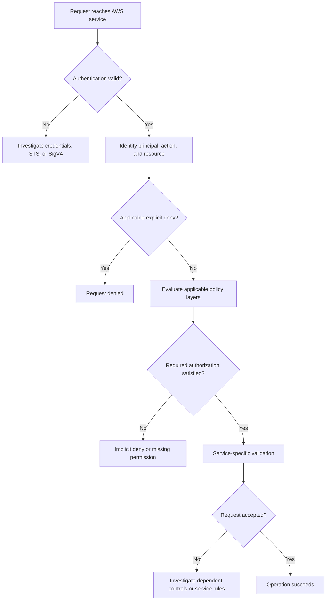

# 02- IAM Permissions and Access Denied Errors

## Overview

IAM permission failures occur when an AWS request cannot satisfy the authorization requirements imposed by identity-based policies, resource-based policies, organizational controls, permissions boundaries, session policies, or service-specific authorization mechanisms.

An `AccessDenied` error does not necessarily indicate that the caller lacks an identity-based permission. The request may also be blocked by an explicit deny, an AWS Organizations service control policy (SCP), a resource policy, a permissions boundary, a session policy, a VPC endpoint policy, or a dependent service such as AWS KMS.

For backend engineers, systematic authorization troubleshooting is essential because IAM failures frequently appear as application errors in Django, FastAPI, Lambda functions, Celery workers, CI/CD pipelines, and distributed microservices.

This document provides a structured approach to identifying the effective caller identity, locating the authorization boundary that rejected a request, correcting the minimum required permission, and preventing recurrence.

## How AWS Authorization Works

AWS evaluates authorization for each request after identifying the caller and validating the request's authentication requirements.

A successful authentication establishes which principal is making the request. Authorization determines whether that principal can perform the requested action on the target resource under the applicable policies and conditions.

### Authentication versus authorization

| Concern | Purpose | Example failure |
|---|---|---|
| Authentication | Establish the caller's identity using valid credentials | `ExpiredToken` |
| Request signing | Authenticate request integrity and signing context where SigV4 is required | `SignatureDoesNotMatch` |
| Authorization | Determine whether the caller can perform an action on a resource | `AccessDenied` |
| Network access | Determine whether the request can reach the endpoint | Connection timeout |
| Service-specific validation | Validate service-specific requirements beyond IAM authorization | Invalid resource state |

A successful `aws sts get-caller-identity` call confirms the identity associated with that request. It does not prove that the identity can access an S3 object, decrypt a KMS ciphertext, or invoke a particular Lambda function.

### Authorization evaluation flow



The diagram is a troubleshooting abstraction. AWS authorization behavior depends on the principal type, resource type, service, policy type, and request context. Not every policy category participates in every request.

## Common IAM Permission Failure Categories

| Failure category | Typical symptoms | First investigation |
|---|---|---|
| Missing identity permission | `AccessDenied` for an API action | Inspect attached and inline identity policies |
| Explicit deny | Request remains denied despite an allow | Search applicable policies for matching deny statements |
| Incorrect resource ARN | Permission exists but does not match the target | Compare the request resource with the policy ARN |
| Incorrect action | Similar API action is allowed, but the actual operation fails | Identify the exact AWS API action |
| Trust-policy failure | `AssumeRole` fails | Inspect the target role trust policy and caller permissions |
| SCP restriction | Organization member account cannot perform an action | Review applicable organizational policies |
| Permissions boundary | Role or user has an allow but cannot use it | Inspect the principal's boundary |
| Session policy restriction | Assumed-role session has fewer permissions than expected | Inspect the policy supplied during role assumption |
| Resource-policy restriction | Access fails despite an identity-policy allow | Inspect the resource policy and principal type |
| KMS authorization failure | S3, EBS, RDS, or another service cannot use a key | Inspect key policy, IAM permissions, grants, and key state |
| VPC endpoint policy | Requests through a private endpoint are denied | Inspect the endpoint policy and request path |
| Service-specific authorization | API fails because of an additional dependent permission | Inspect the service's documented authorization requirements |

Treat the error message as evidence, not as a complete explanation of the authorization decision.

## Identify the Effective Caller

Before modifying a policy, establish which credentials the failing process actually uses.

A developer may successfully execute an AWS CLI command using an SSO profile while the application uses an EC2 instance profile, ECS task role, Lambda execution role, or credentials injected into a container.

### Verify the active identity

**Read-only diagnostic command:**

```bash
aws sts get-caller-identity
```

Example output:

```json
{
  "UserId": "AROAXXXXXXXXXXXXX:application-session",
  "Account": "123456789012",
  "Arn": "arn:aws:sts::123456789012:assumed-role/application-role/application-session"
}
```

The account ID and ARN above are illustrative placeholders.

Interpret the output as follows:

- `Account`: The AWS account associated with the caller.
- `Arn`: The identity used for this request. An assumed-role ARN identifies the role session rather than the underlying IAM role ARN.
- `UserId`: The caller's unique identifier, which may include the role-session name.

If the ARN differs from the expected identity, investigate the credential provider chain before editing IAM policies.

### Inspect AWS CLI configuration

```bash
aws configure list
aws configure list-profiles
```

These commands help identify the selected profile, credential source, and configured region. Avoid publishing their output without reviewing it for sensitive information.

Check relevant environment-variable names without printing credential values:

```python
import os

credential_variable_names = (
    "AWS_ACCESS_KEY_ID",
    "AWS_SECRET_ACCESS_KEY",
    "AWS_SESSION_TOKEN",
    "AWS_PROFILE",
    "AWS_ROLE_ARN",
    "AWS_WEB_IDENTITY_TOKEN_FILE",
)

for name in credential_variable_names:
    print(f"{name}: {'set' if os.getenv(name) else 'not set'}")
```

Environment variables are only one possible credential source. AWS SDKs can also retrieve credentials from shared configuration, workload identity providers, container credentials, and instance metadata.

### Common root causes

- The application uses a different AWS profile than the terminal.
- Environment variables override the intended credentials.
- A container has no task role or instance credentials are unavailable.
- The assumed role belongs to a different account.
- Temporary credentials have expired.
- A deployment uses a different execution role than the development environment.
- A process caches credentials rather than allowing the SDK to refresh them.

**Corrective action:** Confirm the effective identity in the same execution environment as the failing operation. Do not assume that a successful local CLI request proves the deployed application uses the same principal.

## Understand IAM Policy Evaluation

AWS authorization is not a simple union of every policy attached to an identity. Policy types have different effects and apply under different rules.

### Identity-based policies

Identity-based policies attach to IAM users, groups, or roles. They define actions the identity may perform on specified resources, subject to other applicable controls.

Example policy allowing an application role to read objects from a designated S3 prefix:

```json
{
  "Version": "2012-10-17",
  "Statement": [
    {
      "Sid": "ReadApplicationObjects",
      "Effect": "Allow",
      "Action": [
        "s3:GetObject"
      ],
      "Resource": "arn:aws:s3:::example-application-bucket/reports/*"
    }
  ]
}
```

This policy does not automatically grant `s3:ListBucket`, write access, or KMS decrypt permissions. Those are separate authorization requirements.

### Explicit deny and implicit deny

An **explicit deny** is a matching policy statement with `"Effect": "Deny"`. An **implicit deny** occurs when no applicable authorization grants the requested action.

| Situation | Result |
|---|---|
| Applicable explicit deny matches | Denied |
| No applicable allow grants the action | Denied |
| Applicable allow grants the action and no blocking control applies | Potentially allowed |
| Identity allow exists but a permissions boundary or other limiting control excludes the action | Denied |

An explicit deny takes precedence over an allow within the applicable authorization evaluation.

For example, an identity policy may allow S3 reads while an organization policy explicitly denies access to a restricted bucket. Adding another identity-based allow does not resolve that conflict.

### Permissions boundaries

A permissions boundary defines the maximum permissions that an IAM user or role can receive through identity-based policies.

A boundary does not independently grant permissions. A permission generally requires an applicable allow from an identity policy and must also be permitted by the boundary and any other relevant controls.

Inspect a role's boundary:

```bash
aws iam get-role \
  --role-name application-role \
  --query 'Role.PermissionsBoundary'
```

Inspect the boundary policy's default version:

```bash
aws iam get-policy \
  --policy-arn arn:aws:iam::123456789012:policy/application-boundary \
  --query 'Policy.{Arn:Arn,DefaultVersionId:DefaultVersionId}'
```

Then retrieve the version's document:

```bash
aws iam get-policy-version \
  --policy-arn arn:aws:iam::123456789012:policy/application-boundary \
  --version-id v1 \
  --query 'PolicyVersion.Document'
```

Replace the version ID with the actual default version returned by `get-policy`. These commands inspect configuration; they do not modify permissions.

### Service control policies

An SCP establishes permission guardrails for principals in AWS Organizations member accounts. It does not grant permissions by itself.

An SCP can prevent an action that an identity policy otherwise allows. Effective permissions depend on the applicable organization hierarchy and the policy configuration.

SCPs do not restrict the AWS Organizations management account in the same manner as member accounts. They also do not replace resource policies, trust policies, or service-specific authorization requirements.

Ask the organization administrator to inspect the applicable SCPs when an IAM allow appears correct but an action remains denied.

### Session policies

A session policy can restrict permissions for an assumed-role session. It does not grant the session permissions that the role itself does not have.

When investigating a restricted session, inspect the `AssumeRole` request, including any supplied inline or managed session policies, as well as the target role's policies and applicable controls.

### Resource-based policies

Resource-based policies are attached to resources such as S3 buckets, KMS keys, and SQS queues.

They can grant access to principals outside the resource owner's account, subject to applicable restrictions. Their interaction with identity policies depends on the resource type and principal involved.

For cross-account access, verify both sides of the relationship and the target service's authorization model. An identity policy in the caller's account alone is generally insufficient for cross-account access to a resource that requires authorization from the resource-owning account.

## Systematic Troubleshooting Workflow

Use the following process for an unexplained `AccessDenied` error.

### Step 1: Capture the exact failed operation

Record:

- AWS service and API operation.
- Timestamp, including timezone.
- AWS region and target account.
- Target resource ARN or identifier.
- Caller ARN from the failing environment.
- Full error code and sanitized message.
- Request ID or extended request ID, when supplied.
- Application, deployment, and correlation identifiers.

Do not capture access keys, session tokens, secret values, or sensitive request payloads.

A message such as `AccessDenied` is less useful than an error that identifies the service operation, resource, or missing authorization context.

### Step 2: Reproduce using the same identity

Execute the relevant read-only diagnostic commands from the same runtime or use an approved diagnostic mechanism that assumes the same workload role.

For example:

```bash
aws sts get-caller-identity
aws s3api head-object \
  --bucket example-application-bucket \
  --key reports/example.csv \
  --region ap-south-1
```

The `head-object` command checks access to a particular object. A successful call does not prove that the caller can list the bucket or read every object.

If reproducing the operation would cause a write, deletion, deployment, or other state change, use an approved non-mutating diagnostic instead.

### Step 3: Determine the exact action and resource

Map the failing SDK operation to its IAM action and resource requirements using the service authorization reference.

Examples:

| Application operation | Common IAM action | Resource considerations |
|---|---|---|
| Read an S3 object | `s3:GetObject` | Object ARN and prefix |
| List S3 objects | `s3:ListBucket` | Bucket ARN; prefix conditions may apply |
| Read a secret | `secretsmanager:GetSecretValue` | Secret ARN |
| Read a Parameter Store value | `ssm:GetParameter` | Parameter ARN |
| Decrypt a KMS ciphertext | `kms:Decrypt` | KMS key ARN and key policy |
| Assume a role | `sts:AssumeRole` | Target role ARN and trust policy |
| Invoke a Lambda function | `lambda:InvokeFunction` | Function ARN and applicable resource policy |
| Publish to an SQS queue | `sqs:SendMessage` | Queue ARN |

These are common mappings, not exhaustive authorization specifications. Some service operations require multiple actions, and dependent-service permissions may be involved.

### Step 4: Inspect identity and resource policies

Identify the role or user, then inspect its attached and inline policies.

```bash
aws iam list-attached-role-policies \
  --role-name application-role

aws iam list-role-policies \
  --role-name application-role

aws iam get-role \
  --role-name application-role
```

For an attached customer-managed policy, inspect its default version:

```bash
aws iam get-policy \
  --policy-arn arn:aws:iam::123456789012:policy/application-s3-read

aws iam get-policy-version \
  --policy-arn arn:aws:iam::123456789012:policy/application-s3-read \
  --version-id v1
```

For an inline policy:

```bash
aws iam get-role-policy \
  --role-name application-role \
  --policy-name application-inline-policy
```

Use the actual default policy version instead of assuming it is `v1`. For S3, inspect the bucket policy as well. For KMS, inspect the key policy and relevant grants.

### Step 5: Inspect higher-level authorization controls

If the identity policy appears correct, check:

- Explicit deny statements in applicable policies.
- The role's permissions boundary.
- The session policy, if the request uses restricted session credentials.
- Applicable SCPs and organization policy constraints.
- The resource policy and its conditions.
- VPC endpoint policies, if the request uses an endpoint.
- Service-specific resource policies and dependent permissions.
- Conditions involving region, principal ARN, source VPC, source endpoint, encryption context, tags, or requested API parameters.

Not every control applies to every request. Focus on controls relevant to the principal, resource, and service.

### Step 6: Apply the narrowest corrective change

Choose a correction that matches the actual failure:

- Add a missing action to the appropriate role policy.
- Correct a resource ARN or prefix.
- Repair a trust relationship for role assumption.
- Remove or refine an unintended deny through the responsible policy owner.
- Correct a required condition or session restriction.
- Update a resource policy when resource-side authorization is missing.
- Fix a KMS key policy, grant, or dependent-service permission.
- Adjust a VPC endpoint policy only when the endpoint policy is the cause.

Do not grant `AdministratorAccess` as a troubleshooting shortcut. Broad permissions can hide the actual defect and introduce privilege-escalation risks.

### Step 7: Verify and preserve evidence

Re-run the original operation using the same identity and resource. Confirm the intended operation succeeds and that unrelated permissions remain restricted.

Capture the change record, relevant policy versions, request IDs, and verification results. If the failure involves suspicious access or an unexpected privilege change, escalate through the security incident process rather than treating it as an ordinary configuration defect.

## AWS CLI Diagnostic Reference

The following commands are primarily read-only. They require the caller to have permission to inspect the relevant IAM or service configuration.

| Command | Purpose | Interpretation |
|---|---|---|
| `aws sts get-caller-identity` | Identify the effective caller | Confirms identity and account for the diagnostic request |
| `aws iam get-role` | Inspect role metadata and trust policy | Reveals role ARN, trust relationship, and boundary metadata |
| `aws iam list-attached-role-policies` | List managed policies attached to a role | Identifies policies requiring further inspection |
| `aws iam list-role-policies` | List inline role policies | Identifies embedded authorization rules |
| `aws iam get-policy` | Inspect managed policy metadata | Provides the default version ID |
| `aws iam get-policy-version` | Retrieve a managed policy document | Allows comparison of actions, resources, and conditions |
| `aws iam get-role-policy` | Retrieve a role's inline policy | Shows the inline policy document |
| `aws iam simulate-principal-policy` | Simulate selected policy decisions | Helps test a principal, action, resource, and supplied context |
| `aws cloudtrail lookup-events` | Search available CloudTrail event history | Helps locate recorded API calls and error details |
| `aws kms describe-key` | Inspect KMS key metadata and state | Helps identify disabled, pending-deletion, or incorrect keys |
| `aws secretsmanager describe-secret` | Inspect secret metadata | Helps investigate resource identity, rotation, and configuration |
| `aws ec2 describe-security-groups` | Inspect security-group rules | Helps diagnose network-level reachability issues |

### Simulate a policy decision

```bash
aws iam simulate-principal-policy \
  --policy-source-arn arn:aws:iam::123456789012:role/application-role \
  --action-names s3:GetObject \
  --resource-arns arn:aws:s3:::example-application-bucket/reports/example.csv
```

Inspect the `EvalDecision` field in the result. A decision of `allowed` indicates that the simulator permits the tested action under the supplied simulation context; it is not a guarantee that the real service request will succeed.

The simulator has important limitations:

- It may not fully reproduce every real request context or every service's authorization behavior.
- It does not prove that credentials are valid or that SigV4 signing succeeds.
- It does not test network reachability.
- Resource policies, SCPs, session policies, boundaries, and context conditions must be represented and supported appropriately for the simulation to be meaningful.
- The caller must have the permissions required to use the simulator.

Use simulation as one diagnostic input, not as definitive proof of end-to-end authorization.

### Inspect CloudTrail event history

```bash
aws cloudtrail lookup-events \
  --lookup-attributes AttributeKey=EventName,AttributeValue=GetObject \
  --start-time 2026-10-12T00:00:00Z \
  --end-time 2026-10-13T00:00:00Z \
  --max-results 50
```

Replace the time range and event name with the actual investigation window and API operation.

`lookup-events` queries CloudTrail event history, which has a limited retention window. It is not a complete substitute for organization-wide trail logs or CloudTrail Lake. S3 object-level API activity, for example, requires appropriate data-event logging; management-event history alone may not contain the failed request.

Review the event's principal, event source, event name, region, error code, error message, and request identifiers where available. Redact sensitive values before sharing investigation output.

## Troubleshooting S3 Access Denied

S3 authorization is a frequent source of confusing permission errors because object operations and bucket operations often require different actions and resources.

### Common causes

- The role lacks `s3:GetObject` for the target object.
- The role lacks `s3:ListBucket` for a listing operation.
- The policy resource ARN uses the wrong bucket or prefix.
- The bucket policy restricts the caller.
- An SCP, permissions boundary, or session policy limits access.
- The request is made through a VPC endpoint with a restrictive endpoint policy.
- The object is encrypted with SSE-KMS and the caller lacks required KMS authorization.
- The object belongs to another account, and the cross-account permissions are incomplete.
- The requested object key is incorrect or the object does not exist.

### Distinguish bucket and object resources

A bucket ARN and an object ARN are different resource types.

```text
Bucket:
arn:aws:s3:::example-application-bucket

Object:
arn:aws:s3:::example-application-bucket/reports/example.csv
```

For example, a policy that allows `s3:GetObject` on `arn:aws:s3:::example-application-bucket/*` does not automatically allow `s3:ListBucket` on the bucket ARN.

A listing policy typically uses the bucket ARN:

```json
{
  "Version": "2012-10-17",
  "Statement": [
    {
      "Sid": "ListReportsPrefix",
      "Effect": "Allow",
      "Action": "s3:ListBucket",
      "Resource": "arn:aws:s3:::example-application-bucket",
      "Condition": {
        "StringLike": {
          "s3:prefix": [
            "reports",
            "reports/*"
          ]
        }
      }
    }
  ]
}
```

A separate object-read statement may be required for `s3:GetObject` on the appropriate object ARN.

### Diagnostic sequence

```bash
aws sts get-caller-identity

aws s3api head-object \
  --bucket example-application-bucket \
  --key reports/example.csv \
  --region ap-south-1

aws s3api get-bucket-policy \
  --bucket example-application-bucket \
  --region ap-south-1
```

The bucket-policy command fails if the caller cannot retrieve that policy or the bucket has no applicable bucket policy document. Do not interpret a failed policy-inspection command as proof that the policy is the cause of the original failure.

For an SSE-KMS object, also inspect the KMS key and verify that the relevant principal can perform the required decrypt operation under the key's authorization model.

### S3 verification checklist

- Confirm the caller ARN.
- Confirm the bucket, key, region, and account.
- Identify whether the operation is listing, reading, writing, or deleting.
- Compare the exact IAM action and resource ARN.
- Inspect bucket policy and relevant organization or boundary controls.
- Check KMS permissions if the object uses SSE-KMS.
- Verify the original operation after applying the minimum correction.

## Troubleshooting AssumeRole Failures

`sts:AssumeRole` involves two distinct authorization questions:

1. Is the caller allowed to request assumption of the target role?
2. Does the target role's trust policy allow that caller to assume it?

Both must be satisfied, along with any applicable conditions and organization restrictions.

### Inspect the role

```bash
aws iam get-role \
  --role-name target-application-role \
  --query 'Role.{Arn:Arn,TrustPolicy:AssumeRolePolicyDocument,Boundary:PermissionsBoundary}'
```

Review the trust policy for:

- The expected trusted account, role, user, or federated principal.
- Correct principal ARN and account.
- Required external ID conditions, if applicable.
- Required MFA or other condition keys.
- Organization, source identity, or session-tag restrictions.
- Whether the calling workload is using the intended source identity.

### Example trust policy for a cross-account workload

```json
{
  "Version": "2012-10-17",
  "Statement": [
    {
      "Sid": "TrustApprovedApplicationRole",
      "Effect": "Allow",
      "Principal": {
        "AWS": "arn:aws:iam::111122223333:role/source-application-role"
      },
      "Action": "sts:AssumeRole"
    }
  ]
}
```

The account ID and role names are placeholders. This policy is an example of a direct trust relationship, not a universal trust-policy template. Add required conditions for the actual security architecture.

The source role also needs an applicable identity-based permission allowing `sts:AssumeRole` on the target role ARN.

### Test role assumption

```bash
aws sts assume-role \
  --role-arn arn:aws:iam::444455556666:role/target-application-role \
  --role-session-name application-diagnostics
```

This command creates temporary credentials if successful. Treat the output as secret material. Avoid saving it in terminal logs, CI artifacts, shared files, or shell history.

Prefer configured role profiles, AWS IAM Identity Center, or SDK credential providers that manage temporary credentials without manually handling access keys.

### Common mistakes

- Adding `sts:AssumeRole` to the source role but forgetting the target trust policy.
- Trusting an entire account when only a specific workload role should be trusted.
- Referencing the wrong role ARN or account ID.
- Omitting a required external ID or MFA condition.
- Assuming the target role successfully means it has the required target-service permissions.
- Using long-lived access keys when workload identity federation or a role is available.

After successful assumption, call `get-caller-identity` using the assumed-role credentials and test the intended operation separately.

## Troubleshooting KMS Authorization Failures

KMS errors often occur even when the caller has permission to access the service using the encrypted resource.

For example, an application may have `s3:GetObject` but fail to read an object encrypted with a customer-managed KMS key because the required decrypt authorization is missing.

### Common causes

- The IAM policy does not allow the required KMS action.
- The KMS key policy does not authorize the principal or delegate authorization appropriately.
- A KMS grant is absent, revoked, or unsuitable for the operation.
- The caller references the wrong key or region.
- The key is disabled, pending deletion, or otherwise unavailable for the operation.
- The encryption context does not match a policy condition.
- A service integration requires a service principal or a role with specific key permissions.
- An SCP or another applicable restriction blocks the operation.

### Inspect key metadata

```bash
aws kms describe-key \
  --key-id arn:aws:kms:ap-south-1:123456789012:key/EXAMPLE-KEY-ID \
  --region ap-south-1
```

Review the key state, ARN, key usage, and relevant metadata.

Inspect the key policy:

```bash
aws kms get-key-policy \
  --key-id arn:aws:kms:ap-south-1:123456789012:key/EXAMPLE-KEY-ID \
  --policy-name default \
  --region ap-south-1
```

List grants when appropriate:

```bash
aws kms list-grants \
  --key-id arn:aws:kms:ap-south-1:123456789012:key/EXAMPLE-KEY-ID \
  --region ap-south-1
```

These commands inspect configuration. They do not prove that the failing request uses the same identity or encryption context.

### IAM and key-policy interaction

KMS authorization depends on the key policy, the principal's IAM permissions where applicable, grants, and applicable restrictions.

A key policy can directly authorize a principal or delegate authorization to IAM policies in the owning account. Cross-account access generally requires authorization from the key-owning account and permission for the caller in its own account, subject to the applicable KMS rules.

Do not add broad KMS permissions without establishing which principal must perform which operation.

### Corrective and verification steps

1. Identify the exact key ARN and region used by the encrypted resource.
2. Identify the principal making the KMS request. It may differ from the principal performing the outer service operation.
3. Inspect the key policy, IAM policy, grants, and key state.
4. Validate any encryption-context conditions and service integration requirements.
5. Make the minimum required change through the approved change process.
6. Retry the original encrypted-resource operation and confirm that unrelated key operations remain restricted.

KMS changes can affect multiple workloads. Coordinate policy changes, key lifecycle actions, and grant modifications with the resource owners.

## Troubleshooting Secrets Manager and Parameter Store

Secret retrieval failures may be caused by IAM, KMS, secret identity, region, resource state, or rotation behavior.

### Secrets Manager

For `secretsmanager:GetSecretValue`, inspect:

- The exact secret ARN and region.
- The caller's identity policy.
- The secret's resource policy, if configured.
- KMS authorization when the secret uses a customer-managed key.
- Whether the requested version or staging label exists.
- Whether rotation is failing or the application is caching an old secret.

Read secret metadata without retrieving the secret value:

```bash
aws secretsmanager describe-secret \
  --secret-id example/application/database \
  --region ap-south-1
```

To inspect rotation configuration, review the returned metadata for rotation-related fields. Avoid `get-secret-value` during routine metadata diagnosis unless retrieving the value is necessary and authorized.

### Systems Manager Parameter Store

For Parameter Store, inspect the parameter's name, region, tier, and encryption configuration.

```bash
aws ssm describe-parameters \
  --parameter-filters Key=Name,Option=Equals,Values=/application/database/password \
  --region ap-south-1
```

This lists parameter metadata rather than the decrypted value. SecureString parameters may require KMS authorization when read with decryption enabled.

### Diagnostic distinctions

| Symptom | Potential cause | Investigation |
|---|---|---|
| Secret cannot be retrieved | Missing `secretsmanager:GetSecretValue` | Inspect caller and IAM policy |
| Secret metadata is visible but value retrieval fails | Secret-value permission or KMS issue | Check IAM and key authorization |
| Parameter exists but decrypted read fails | Missing SSM or KMS permission | Inspect parameter type and KMS policy |
| Application continues using old credentials | Stale secret cache or incomplete refresh | Inspect cache TTL and refresh behavior |
| Rotation fails | Rotation execution role, network, or database credential mismatch | Inspect rotation logs and dependent permissions |
| Secret is not found | Incorrect name, region, account, or version | Verify metadata and deployment configuration |

Never log the retrieved secret value while troubleshooting. Log the secret identifier, operation, error category, and correlation ID where permitted, but avoid exposing secret contents.

## Secure Secret Retrieval in Python

Backend services should retrieve secrets through workload identity and the official AWS SDK rather than hardcoding credentials or manually managing long-lived access keys.

The following example retrieves a secret from Secrets Manager and parses its JSON value. It does not log the secret.

```python
import json
import logging
import os

import boto3
from botocore.exceptions import BotoCoreError, ClientError

logger = logging.getLogger(__name__)


def load_database_configuration() -> dict[str, str]:
    secret_id = os.environ["DATABASE_SECRET_ID"]
    region = os.environ["AWS_REGION"]

    session = boto3.Session()
    client = session.client(
        "secretsmanager",
        region_name=region,
    )

    try:
        response = client.get_secret_value(SecretId=secret_id)
        secret_string = response.get("SecretString")

        if not secret_string:
            raise ValueError("Expected a JSON SecretString")

        configuration = json.loads(secret_string)

        required_fields = {"username", "password", "host", "dbname"}
        if not required_fields.issubset(configuration):
            raise ValueError("Database secret is missing required fields")

        return configuration

    except (ClientError, BotoCoreError):
        logger.exception(
            "Unable to retrieve database configuration from Secrets Manager"
        )
        raise
```

`DATABASE_SECRET_ID` and `AWS_REGION` should be supplied through deployment configuration. The process obtains AWS credentials from the configured SDK credential provider chain, such as an ECS task role, EC2 instance profile, Lambda execution role, or federated identity.

The example deliberately raises an exception if required fields are missing. Adapt the expected schema to the secret's actual format.

### Production considerations

- Grant the workload only the required secret-read permission and associated KMS access, where necessary.
- Use separate secrets for workloads with different access requirements.
- Avoid retrieving the same secret on every request. Cache secrets for a bounded period appropriate to the rotation policy.
- Refresh cached credentials after authentication failures where safe and supported.
- Ensure database connection pools can replace connections that use rotated credentials.
- Use a rotation strategy that coordinates the secret store and the target database.
- Avoid placing secrets in Docker image layers, source control, command-line arguments, exception messages, or CI/CD logs.
- Restrict access to deployment configuration and runtime diagnostics.
- Consider the availability implications of retrieving a secret during startup versus on demand.

Secret caching reduces API calls and startup latency but delays adoption of rotated values. Choose a bounded cache TTL and define behavior for refresh failures, stale credentials, and service recovery.

## Troubleshooting Network and Endpoint Restrictions

Not every apparent access failure is an IAM policy failure. A request may fail before AWS authorization occurs because DNS resolution, routing, security groups, network ACLs, TLS, or endpoint configuration prevents connectivity.

### Security groups and network ACLs

Security groups are stateful virtual firewall controls attached to supported network interfaces. Network ACLs are stateless subnet-level controls.

A restrictive security group may prevent a backend from reaching a required AWS service endpoint. A network ACL may also block request or response traffic because its rules are stateless.

Inspect security groups:

```bash
aws ec2 describe-security-groups \
  --group-ids sg-0123456789abcdef0 \
  --region ap-south-1
```

Interpret the ingress and egress rules in the context of the workload's subnet, routes, destination, and required ports. Avoid broad rules such as unrestricted inbound access unless explicitly justified.

### VPC endpoints

A VPC endpoint policy can restrict which principals or resources may be accessed through that endpoint. An endpoint policy does not replace the IAM or resource-policy authorization required by the target service.

When a request works through a public endpoint but fails through a private endpoint, investigate:

- Whether the request resolves to the expected endpoint.
- Private DNS settings.
- Endpoint policy restrictions.
- Route tables and network ACLs where applicable.
- Security-group rules on interface endpoints.
- Service-specific IAM and resource policies.

Network connectivity and authorization are separate layers. A successful TCP connection does not imply that AWS will authorize the request, and an `AccessDenied` response generally indicates that the request reached a service capable of rejecting it.

## Troubleshooting Unexpected WAF Blocks

AWS WAF can reject a request even when the caller has permission to invoke the backend service.

Investigate WAF when public API clients receive HTTP `403` responses or application requests fail before reaching the expected backend handler.

### Diagnostic approach

1. Determine whether the response originated from the API gateway, load balancer, CloudFront distribution, WAF, or application.
2. Identify the associated web ACL and protected resource.
3. Inspect WAF logs, sampled requests, and the rule that terminated evaluation.
4. Review managed rule groups, rate-based rules, IP sets, geographic restrictions, and custom rule conditions.
5. Reproduce the request using an approved test case.
6. Adjust the narrowest rule or exception necessary, then verify that other protections remain effective.

Do not disable the entire web ACL merely to restore one request. A narrowly scoped exception may be appropriate, but broad exclusions can expose the application to injection attacks, abuse, or denial-of-service traffic.

WAF authorization and IAM authorization are different. A request can pass WAF and still fail IAM, or be rejected by WAF before the backend authorization code executes.

## CloudTrail Investigation of Access Denied Errors

CloudTrail provides API activity records that help establish which principal performed an operation, when it occurred, and whether AWS recorded an error.

### Query recent API activity

```bash
aws cloudtrail lookup-events \
  --lookup-attributes AttributeKey=EventName,AttributeValue=AssumeRole \
  --start-time 2026-10-12T00:00:00Z \
  --end-time 2026-10-13T00:00:00Z \
  --max-results 50
```

For an investigation, replace the example event name and time range with the failed operation and actual incident window.

Review the event source, event name, principal, region, request parameters, error code, error message, and request ID where present. Event fields vary by service and operation.

### Why an event may be missing

- The event is outside the event-history retention window.
- The investigation targets the wrong region or account.
- The required event type was not logged.
- The event is a data event that was not enabled for the relevant resource.
- The organization uses centralized trails or CloudTrail Lake rather than the queried event-history view.
- The logging pipeline has not delivered or indexed the event yet.

Do not conclude that an operation never occurred merely because it is absent from one lookup result.

### Production logging recommendations

- Enable and centrally retain appropriate CloudTrail management events.
- Configure data-event logging for sensitive resources when justified by security and cost requirements.
- Protect log storage against unauthorized alteration and deletion.
- Restrict access to audit data.
- Monitor logging configuration and delivery health.
- Use GuardDuty and Security Hub findings to enrich investigation workflows where relevant.
- Define retention, evidence-preservation, and incident-escalation procedures before an incident occurs.

## Production Scenarios

### Scenario: A FastAPI service cannot read an S3 object

**Symptoms:** The API returns an internal error after an S3 read fails with `AccessDenied`.

**Investigation:**

1. Record the request ID and identify the failing S3 operation.
2. Run `get-caller-identity` from the workload environment.
3. Confirm the bucket, object key, and region.
4. Inspect the role's policy and the bucket policy.
5. Check SCPs, boundaries, session policies, and endpoint restrictions.
6. Determine whether the object uses SSE-KMS.
7. Apply the minimum correction and retry the operation.

**Prevention:** Use a dedicated workload role, restrict object access to required prefixes, test the deployed identity in integration tests, and alert on recurring authorization failures.

### Scenario: A Celery worker cannot retrieve a rotated database secret

**Symptoms:** The worker begins receiving database authentication failures after secret rotation.

**Investigation:**

1. Confirm the worker's effective AWS identity.
2. Verify that secret retrieval still succeeds.
3. Inspect the rotation status and rotation execution logs.
4. Determine whether the application cache still contains the old secret.
5. Check whether existing database connections must be recycled.
6. Verify the target database accepts the rotated credential.

**Prevention:** Define bounded cache lifetimes, coordinate secret and database rotation, and ensure the connection pool can recover from stale authentication.

### Scenario: A deployment pipeline cannot assume a production role

**Symptoms:** A CI/CD job fails with `AccessDenied` for `sts:AssumeRole`.

**Investigation:**

1. Verify the identity or federated principal used by the job.
2. Inspect the target role trust policy.
3. Check source-side permission to assume the target role.
4. Validate required OIDC claims, audience, subject conditions, or other trust constraints where applicable.
5. Inspect applicable organization restrictions.
6. Test using the intended pipeline identity.

**Prevention:** Prefer short-lived federated credentials, restrict trust to approved repositories and deployment contexts, and separate development and production roles.

### Scenario: A KMS-encrypted workload fails after a policy change

**Symptoms:** The workload can access the surrounding service resource but cannot decrypt the data.

**Investigation:**

1. Confirm the key ARN and region.
2. Identify the principal performing the cryptographic operation.
3. Inspect the key policy, IAM permissions, grants, and key state.
4. Review encryption-context conditions.
5. Inspect relevant CloudTrail events where available.
6. Restore the narrowest required authorization and verify the original workload operation.

**Prevention:** Version-control policy changes, review key-policy modifications, test encryption-dependent workflows, and maintain a controlled recovery procedure for key-access incidents.

## Preventive Controls and Operational Best Practices

### Least-privilege access reviews

- Assign permissions to workload roles rather than individual developers' long-lived credentials.
- Separate read, write, administrative, and deployment capabilities.
- Restrict resources to required ARNs and prefixes.
- Use condition keys where they reliably express a security boundary.
- Review unused permissions and stale roles periodically.
- Remove temporary troubleshooting permissions after the approved diagnostic window.
- Validate policy changes in a non-production environment where practical.

Least privilege reduces the impact of compromised credentials and accidental misuse. Its trade-off is additional policy maintenance and the need for effective testing and observability.

### Privileged-access protection

- Require MFA for appropriate human access.
- Prefer IAM Identity Center or federated access over long-lived IAM user access keys.
- Use separate administrative roles and tightly controlled privilege elevation.
- Restrict role trust policies and avoid wildcard principals unless justified.
- Monitor changes to trust policies, permission policies, access keys, and KMS policies.
- Review emergency access procedures and test them periodically.

### Secure CI/CD identities

- Prefer OIDC federation or other supported short-lived credential mechanisms.
- Scope trust conditions to approved repositories, branches, environments, and workflow identities as appropriate.
- Separate build permissions from deployment permissions.
- Avoid static AWS access keys in repository secrets when federation is available.
- Prevent secrets from appearing in job logs and artifacts.
- Audit changes to production deployment roles.

### Monitoring and incident readiness

- Centralize CloudTrail logging across relevant accounts and regions.
- Enable security findings through services such as GuardDuty and Security Hub where appropriate.
- Use AWS Config rules or organization-level controls to detect policy and configuration drift.
- Alert on unexpected privilege changes, suspicious role assumptions, credential misuse, and logging interruptions.
- Define incident ownership, escalation criteria, evidence handling, and recovery procedures.
- Review findings regularly and test remediation workflows.

### Cost and operational trade-offs

| Control | Benefit | Trade-off |
|---|---|---|
| More granular IAM policies | Limits blast radius | Requires testing and maintenance |
| Centralized audit logging | Improves investigation and accountability | Storage, ingestion, and query costs |
| Data-event logging | Adds visibility into sensitive data operations | Can increase event volume and cost |
| Short secret-cache TTL | Speeds adoption of rotated credentials | More secret-service calls and dependency on availability |
| Customer-managed KMS keys | More control over key policies and lifecycle | Additional governance and operational responsibility |
| Strict VPC endpoint policies | Limits access through private paths | Can break legitimate workloads if policies drift |
| WAF managed rules | Reduces exposure to common application attacks | False positives and rule-tuning overhead |

Choose controls based on threat model, workload criticality, regulatory requirements, cost, and operational capability.

## Security Verification Checklist

Use this checklist during incident triage, deployment reviews, and recurring access reviews.

- [ ] The effective caller identity is known and matches the intended workload.
- [ ] The exact AWS operation, resource ARN, account, and region are confirmed.
- [ ] The applicable identity policy and policy version have been inspected.
- [ ] Relevant trust policies, resource policies, permissions boundaries, session policies, and SCPs have been considered.
- [ ] Explicit denies and applicable condition keys have been evaluated.
- [ ] Dependent services such as KMS and Secrets Manager have been checked where relevant.
- [ ] Network reachability and endpoint restrictions have been distinguished from IAM authorization.
- [ ] CloudTrail evidence and request identifiers have been preserved where available.
- [ ] The corrective change grants only the required permission.
- [ ] The original operation succeeds under the intended identity.
- [ ] Unrelated access remains restricted.
- [ ] The root cause, remediation, and preventive action are documented.

## Key Takeaways

- **Identify the actual caller first.** The credentials used by a deployed workload may differ from the credentials used by a developer's CLI.
- **Evaluate all applicable authorization layers.** Identity policies, trust policies, resource policies, boundaries, SCPs, session policies, and service-specific controls can affect the final decision.
- **Match the exact action and resource.** A permission for one API operation, bucket ARN, object prefix, or KMS key does not automatically authorize another.
- **Use evidence-driven remediation.** Combine policy inspection, targeted simulation, request identifiers, and CloudTrail evidence; never use administrator access as a shortcut.
- **Prevent recurrence through workload identity and observability.** Use short-lived credentials, least privilege, controlled policy changes, centralized audit logging, and repeatable verification.