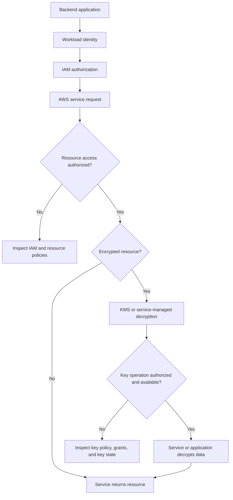
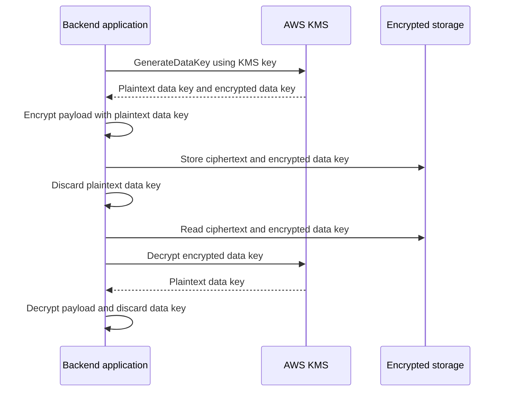

# 03- Encryption and KMS Key Access Issues

## Overview

Encryption and AWS Key Management Service (KMS) failures can prevent backend applications from reading encrypted data, retrieving secrets, restoring databases, creating encrypted volumes, or accessing protected resources. These failures frequently surface as `AccessDeniedException`, `KMSAccessDeniedException`, `InvalidCiphertextException`, or service-specific errors.

An application may have permission to access an S3 object but lack permission to use the KMS key protecting it. Similarly, a secret may exist and be accessible at the resource level, yet retrieval can fail because the configured KMS key is unavailable or the caller lacks the required authorization.

Effective troubleshooting requires distinguishing:

- **Resource authorization:** Whether the caller can access the S3 object, secret, database, volume, or other resource.
- **Key authorization:** Whether the relevant principal can use the KMS key for the required operation.
- **Key state:** Whether the key is enabled and available for the operation.
- **Cryptographic context:** Whether the ciphertext, encryption context, algorithm, and key match the original encryption operation.
- **Service integration:** Whether the AWS service or workload has the required permissions and configuration.
- **Data-key handling:** Whether the encrypted data key can be recovered and used to decrypt the protected data.

This document provides a systematic approach to identifying encryption failures, inspecting KMS authorization, restoring access safely, and preventing recurring incidents.

## Encryption Architecture and Failure Boundaries

AWS workloads commonly combine TLS for data in transit, service-level encryption at rest, and KMS for controlling access to cryptographic keys.



This is a conceptual troubleshooting flow. The exact sequence depends on the service and encryption model. With service-managed encryption, the AWS service may perform cryptographic operations on behalf of the caller. With client-side encryption, the application may call KMS directly and decrypt the data itself.

### Identify the encryption model

| Encryption model | Typical examples | Main troubleshooting focus |
|---|---|---|
| Service-managed encryption | S3 SSE-S3 and supported service defaults | Resource configuration and service behavior |
| AWS-managed KMS key | Keys such as `aws/s3` or `aws/secretsmanager` | Service integration, IAM permissions, and key-specific constraints |
| Customer-managed KMS key | Customer-created KMS keys | Key policy, IAM policy, grants, key state, and lifecycle |
| Client-side encryption | Application encrypts data before storage | Application identity, key handling, ciphertext metadata, and decryption logic |
| TLS encryption in transit | HTTPS and supported service connections | Certificates, protocol configuration, hostname validation, and trust chain |

Not every encryption failure is a KMS failure. Identify where encryption occurs and which component performs the cryptographic operation before changing permissions.

## KMS Authorization Fundamentals

KMS authorization determines whether a principal can use a particular key for a specific operation.

The applicable controls depend on the key policy, IAM policies, grants, principal, key type, and request context.

### Key policies

Every KMS key has a key policy. It is the primary resource-based authorization mechanism for that key.

A key policy can:

- Directly authorize specific principals.
- Delegate authorization to IAM policies in the owning account.
- Restrict operations through conditions.
- Define administrative and key-usage permissions.

An IAM policy granting `kms:Decrypt` does not automatically guarantee access. The key policy must authorize the principal directly or permit IAM-based authorization as appropriate.

Inspect the key policy:

```bash
aws kms get-key-policy \
  --key-id arn:aws:kms:ap-south-1:123456789012:key/EXAMPLE-KEY-ID \
  --policy-name default \
  --region ap-south-1
```

**Purpose:** Retrieve the selected key policy.

**Expected output:** A JSON policy document containing statements that define which principals can administer or use the key.

**Interpretation:** Check the principal, action, effect, resource context, and conditions. A policy may permit key administration without permitting decryption.

Do not replace an existing key policy with a generic policy merely because a workload receives an access-denied error. Doing so can unintentionally remove administrative or recovery access.

### Identity-based IAM policies

An identity policy grants a principal permission to perform an action, subject to the applicable KMS authorization rules and other restrictions.

Example policy for a workload that must decrypt data using one customer-managed key:

```json
{
  "Version": "2012-10-17",
  "Statement": [
    {
      "Sid": "DecryptApplicationData",
      "Effect": "Allow",
      "Action": [
        "kms:Decrypt"
      ],
      "Resource": "arn:aws:kms:ap-south-1:123456789012:key/EXAMPLE-KEY-ID"
    }
  ]
}
```

This statement does not independently establish complete access. The key policy or applicable KMS authorization configuration must also permit the operation.

Grant only the operations required by the workload. A reader may need `kms:Decrypt`, while a component that encrypts new data may need `kms:GenerateDataKey` or another operation depending on its implementation.

### KMS grants

KMS grants provide a mechanism for delegating specific key operations to a grantee. AWS services and integrations may use grants to support their workflows.

Inspect existing grants:

```bash
aws kms list-grants \
  --key-id arn:aws:kms:ap-south-1:123456789012:key/EXAMPLE-KEY-ID \
  --region ap-south-1
```

Review the grantee principal, operations, constraints, and grant state where available.

A missing or unsuitable grant may explain a service integration failure, but not every KMS request requires a separate grant. Do not create grants indiscriminately without understanding the service integration and authorization model.

### Explicit deny and other restrictions

Even when key and IAM policies contain matching allows, access can still fail because of an explicit deny or another applicable restriction.

Investigate:

- Service control policies.
- Permissions boundaries.
- Session policies.
- Key-policy conditions.
- Encryption-context constraints.
- VPC endpoint policies where relevant to the surrounding service request.
- Cross-account authorization requirements.
- Key state and key type restrictions.

For cross-account KMS access, the key-owning account must authorize the external principal through the supported key-policy or grant model, and the caller's account must also authorize the required operation. An IAM allow in only one account is insufficient.

## Systematic Troubleshooting Workflow

Use this workflow whenever an application or AWS service fails to access encrypted data.

### Capture the original failure

Record:

- AWS service and failed API operation.
- Timestamp and region.
- Caller ARN and target resource ARN.
- KMS key ARN, if known.
- Error code and sanitized error message.
- AWS request ID and extended request ID, where available.
- Application deployment, correlation ID, and relevant configuration version.

Never include access keys, secret values, decrypted payloads, or other sensitive material in the incident record.

### Confirm the caller identity

Run this command in the same environment as the failing workload:

```bash
aws sts get-caller-identity
```

**Purpose:** Establish the identity used by the diagnostic request.

**Expected output:** The account ID and ARN associated with the current credentials.

If the command uses a different credential provider or execution environment from the application, its result may not represent the application's actual identity. Verify the identity from the deployed runtime or use an approved diagnostic mechanism.

### Inspect the key

```bash
aws kms describe-key \
  --key-id arn:aws:kms:ap-south-1:123456789012:key/EXAMPLE-KEY-ID \
  --region ap-south-1
```

Review:

- Key ARN and owning account.
- Region.
- Key state.
- Key usage and key specification.
- Whether the application references the intended key.

A disabled key or a key pending deletion may be unavailable for the required operation. An incorrect region or key ARN can cause the application to reference a different key than expected.

This command inspects metadata. It does not prove that the caller is authorized to perform cryptographic operations.

### Inspect authorization

Review the relevant:

1. IAM policy attached to the caller.
2. KMS key policy.
3. KMS grants, if relevant.
4. Resource policy for the surrounding AWS service.
5. Applicable SCPs, permissions boundaries, and session policies.
6. Required encryption-context conditions.
7. Service-specific role and key requirements.

Use read-only inspection commands before making changes.

### Reproduce the smallest relevant operation

Prefer a targeted operation that isolates the failure without exposing sensitive data or changing production state.

For example, inspect an encrypted S3 object's metadata:

```bash
aws s3api head-object \
  --bucket example-application-bucket \
  --key reports/example.csv \
  --region ap-south-1
```

This helps verify object existence and metadata access, but it does not necessarily prove that the caller can retrieve and decrypt the object's contents.

A successful metadata request followed by a failed object read can indicate a failure in a later authorization or decryption step. The exact behavior depends on the service and operation.

### Apply and verify the correction

Correct the specific failure:

- Add a missing required action to the appropriate identity policy.
- Update a key policy through an approved change process.
- Correct a resource ARN, key ARN, or region.
- Repair an applicable grant or service integration.
- Restore a key to an appropriate operational state, when permitted and safe.
- Correct an encryption-context mismatch.
- Fix cross-account authorization.
- Repair the application's encryption or decryption implementation.

Then retry the original workload operation under the intended identity. Confirm that the fix does not grant unrelated key access.

## Common KMS Error Categories

Error names and messages vary by AWS service, SDK, and operation. Use the complete response and request identifiers rather than relying on a single error string.

| Symptom or error | Likely causes | Investigation |
|---|---|---|
| `AccessDeniedException` | Missing IAM permission, restrictive key policy, explicit deny, or other authorization control | Inspect the caller, key policy, IAM policy, and applicable restrictions |
| `KMSAccessDeniedException` | A service integration cannot use the key as required | Identify the principal performing the KMS operation and inspect the service integration |
| `InvalidCiphertextException` | Ciphertext does not match the key or operation, or required encryption context differs | Verify ciphertext integrity, key identity, encryption context, and algorithm |
| `DisabledException` | The key is disabled | Inspect key state and the approved recovery procedure |
| `KMSInvalidStateException` | The key is in a state that does not permit the requested operation | Inspect key state and lifecycle history |
| `NotFoundException` | Incorrect key identifier, region, account, or resource reference | Confirm the key ARN and region |
| Throttling or rate-limit errors | KMS request volume exceeds available throughput or quotas | Inspect request rate, retry behavior, quotas, and application concurrency |
| Decryption succeeds locally but fails in production | Different credentials, key, region, ciphertext, or encryption context | Compare sanitized configuration and effective identity |
| S3 read fails on SSE-KMS object | Missing decrypt authorization or incorrect key configuration | Inspect S3 permissions and the associated KMS authorization |
| Secret retrieval fails | Missing secret-read permission or KMS authorization | Inspect Secrets Manager permissions, key policy, and secret metadata |

An authorization error may not disclose every policy layer that contributed to the decision. Lack of a detailed error message is not evidence that the key policy is necessarily wrong.

## S3 Server-Side Encryption Failures

Amazon S3 supports multiple server-side encryption configurations. The diagnostic process depends on which configuration protects the object.

### Distinguish S3 encryption modes

| Mode | KMS involved in the application's object-read authorization? | Typical investigation |
|---|---|---|
| SSE-S3 | No customer KMS permission is required for the S3 encryption layer | Inspect S3 authorization and object configuration |
| SSE-KMS with an AWS-managed key | KMS is involved, but the key is AWS-managed | Inspect S3 permissions and applicable KMS authorization requirements |
| SSE-KMS with a customer-managed key | KMS is involved and customer-managed key controls apply | Inspect S3, IAM, key policy, and cross-account configuration |
| Client-side encryption | Application performs cryptographic operations | Inspect application key handling, KMS calls, ciphertext metadata, and decryption logic |

Do not assume that every encrypted S3 object requires an explicit `kms:Decrypt` permission from the application. The requirements depend on the encryption mode, operation, and service authorization model.

### Typical symptoms

- Object metadata is accessible but content retrieval fails.
- S3 returns an access-denied response for a KMS-encrypted object.
- A workload can read objects encrypted with one key but not another.
- Cross-account reads fail even though the object policy appears correct.
- An application fails after a bucket's default encryption configuration changes.

### Diagnostic sequence

Inspect the object metadata:

```bash
aws s3api head-object \
  --bucket example-application-bucket \
  --key reports/example.csv \
  --region ap-south-1
```

Review the encryption-related fields returned by the operation, including the server-side encryption mode and KMS key identifier when present.

Inspect the bucket's default encryption configuration:

```bash
aws s3api get-bucket-encryption \
  --bucket example-application-bucket \
  --region ap-south-1
```

This command shows the bucket's default encryption configuration. It does not prove that an existing object was encrypted using that current default; existing objects may have different encryption settings.

For SSE-KMS objects, confirm:

- The object references the expected key.
- The key is in the correct region.
- The workload's S3 permissions match the requested operation.
- The applicable KMS authorization allows the required cryptographic operation.
- The bucket policy and applicable organization restrictions do not block the request.
- Cross-account requirements are satisfied where relevant.

### Corrective actions

Prefer changing the specific policy or configuration that caused the failure. Do not disable encryption as a shortcut.

If the key was changed or the bucket's default encryption was updated, verify existing object metadata and the application's handling of historical objects. Changing a bucket's default encryption configuration does not automatically re-encrypt all existing objects.

## EBS and RDS Encryption Failures

Encryption problems involving EBS and RDS can affect more than application reads. They may prevent volume creation, snapshot copying, database restoration, or resource startup.

### EBS encrypted volumes

EBS encryption uses KMS-backed encryption for supported operations. Permissions required during volume or snapshot operations may differ from permissions required by an application reading data from an already attached volume.

Investigate:

- The KMS key associated with the volume or snapshot.
- The key state and owning account.
- The principal initiating the operation.
- Permissions required for volume creation, attachment, snapshot copying, or related operations.
- Whether the source snapshot and destination key belong to different accounts.
- Whether the key is accessible to the service and principal involved.

Inspect volume metadata:

```bash
aws ec2 describe-volumes \
  --volume-ids vol-0123456789abcdef0 \
  --region ap-south-1
```

Review the volume's `Encrypted` and `KmsKeyId` fields where returned.

Inspect snapshot metadata:

```bash
aws ec2 describe-snapshots \
  --snapshot-ids snap-0123456789abcdef0 \
  --region ap-south-1
```

The result helps identify the snapshot's encryption configuration and source context. Access to the metadata does not guarantee permission to copy or restore the snapshot.

### RDS encrypted databases and snapshots

RDS encryption can affect database creation, snapshot restoration, snapshot copying, and cross-account recovery workflows.

Investigate:

- The DB instance or snapshot's KMS key.
- Whether the key is available in the required region.
- Whether the principal has the permissions required for the operation.
- Whether the snapshot is shared and the key authorization supports the intended account.
- Whether a snapshot copy requires a different destination key.
- Whether key state or deletion scheduling affects the operation.

Inspect DB instance metadata:

```bash
aws rds describe-db-instances \
  --db-instance-identifier example-database \
  --region ap-south-1
```

Inspect snapshot metadata:

```bash
aws rds describe-db-snapshots \
  --db-snapshot-identifier example-database-snapshot \
  --region ap-south-1
```

Review the returned encryption and KMS key fields where applicable.

### Important operational distinction

The principal initiating an AWS control-plane operation is not necessarily the same as the database application identity used for ordinary queries. Troubleshoot the failed AWS API operation with the identity and permissions appropriate to that operation.

Do not modify application database credentials to resolve a KMS authorization error unless evidence shows that database authentication itself is failing.

## Secrets Manager and Parameter Store Encryption Failures

Secrets Manager and Systems Manager Parameter Store can use KMS to protect secret values. Retrieval failures can originate from secret authorization, key authorization, rotation, or application caching.

### Secrets Manager diagnostic commands

Inspect secret metadata:

```bash
aws secretsmanager describe-secret \
  --secret-id example/application/database \
  --region ap-south-1
```

Review the returned ARN, KMS key identifier, rotation status, and other relevant metadata.

Inspect the referenced KMS key:

```bash
aws kms describe-key \
  --key-id arn:aws:kms:ap-south-1:123456789012:key/EXAMPLE-KEY-ID \
  --region ap-south-1
```

Investigate the secret's IAM permissions and key authorization separately. Depending on the secret configuration and encryption model, retrieving the value may require `secretsmanager:GetSecretValue` and appropriate KMS authorization.

Do not retrieve the secret value simply to inspect its configuration. Avoid printing secret contents to the terminal or logs.

### Parameter Store diagnostic commands

Inspect parameter metadata:

```bash
aws ssm describe-parameters \
  --parameter-filters Key=Name,Option=Equals,Values=/application/database/password \
  --region ap-south-1
```

For a `SecureString` parameter, determine whether it uses the default AWS-managed key or a customer-managed key.

When a read requests decryption, check the relevant SSM permission, KMS authorization, parameter ARN, and region. A successful metadata query does not prove that the caller can retrieve and decrypt the value.

### Secret rotation failure patterns

| Symptom | Potential cause | Corrective direction |
|---|---|---|
| Retrieval fails immediately after a key-policy change | The workload or service can no longer use the key | Restore the required narrow authorization |
| Rotation reports an error | Rotation role, network access, or dependent-service permission is incorrect | Inspect rotation execution logs and the rotation role |
| Secret retrieval works but database login fails | Cached value, incomplete rotation, or database credential mismatch | Validate rotation state and connection-pool refresh |
| One environment works but another fails | Different role, region, secret ARN, or key configuration | Compare sanitized deployment settings |
| A secret version exists but cannot be retrieved as requested | Version ID or staging-label mismatch | Inspect version metadata and retrieval parameters |

### Secure Python retrieval

Use the AWS SDK credential provider chain instead of hardcoded AWS access keys.

```python
import json
import logging
import os

import boto3
from botocore.exceptions import BotoCoreError, ClientError

logger = logging.getLogger(__name__)


def load_database_secret() -> dict[str, str]:
    secret_id = os.environ["DATABASE_SECRET_ID"]
    region = os.environ["AWS_REGION"]

    client = boto3.Session().client(
        "secretsmanager",
        region_name=region,
    )

    try:
        response = client.get_secret_value(SecretId=secret_id)
        secret_string = response.get("SecretString")

        if not secret_string:
            raise ValueError("Expected a JSON SecretString")

        secret = json.loads(secret_string)
        required_fields = {"username", "password", "host", "dbname"}

        if not required_fields.issubset(secret):
            raise ValueError("Database secret is missing required fields")

        return secret

    except (ClientError, BotoCoreError):
        logger.exception("Failed to retrieve database secret")
        raise
```

This example assumes the secret contains a JSON `SecretString` with the required fields. Adapt the schema to the application's actual secret format.

The exception is logged and re-raised without logging the returned secret. Ensure downstream logging and error-reporting systems do not serialize the secret object.

### Production recommendations

- Give each workload access only to the secrets it requires.
- Scope KMS permissions to the intended key.
- Cache secret values for a bounded period aligned with rotation requirements.
- Refresh credentials safely after rotation.
- Recycle database connections when they retain stale authentication state.
- Define startup and runtime behavior for temporary secret-service outages.
- Avoid placing secret values in logs, tracing spans, exception messages, or metrics labels.
- Monitor secret rotation failures and retrieval error rates.

Caching reduces API calls and latency but delays adoption of rotated values. The application must have a deliberate strategy for refreshing secrets and recovering from stale credentials.

## Encryption Context and Invalid Ciphertext

An encryption context is a set of non-secret key-value pairs that can be supplied to supported symmetric KMS cryptographic operations. KMS authenticates the encryption context as part of the cryptographic operation.

Encryption context can provide additional security by binding encrypted data to application metadata, such as a tenant identifier or data category. It is not secret and must not contain passwords, tokens, or sensitive personal data.

### Example: encrypt and decrypt with context

```python
import boto3
from botocore.exceptions import BotoCoreError, ClientError


def encrypt_value(
    plaintext: bytes,
    key_id: str,
    region: str,
    encryption_context: dict[str, str],
) -> bytes:
    client = boto3.Session().client("kms", region_name=region)

    response = client.encrypt(
        KeyId=key_id,
        Plaintext=plaintext,
        EncryptionContext=encryption_context,
    )
    return response["CiphertextBlob"]


def decrypt_value(
    ciphertext: bytes,
    region: str,
    encryption_context: dict[str, str],
) -> bytes:
    client = boto3.Session().client("kms", region_name=region)

    response = client.decrypt(
        CiphertextBlob=ciphertext,
        EncryptionContext=encryption_context,
    )
    return response["Plaintext"]


if __name__ == "__main__":
    context = {
        "application": "reporting-service",
        "environment": "production",
    }

    try:
        ciphertext = encrypt_value(
            plaintext=b"example-sensitive-payload",
            key_id="arn:aws:kms:ap-south-1:123456789012:key/EXAMPLE-KEY-ID",
            region="ap-south-1",
            encryption_context=context,
        )

        plaintext = decrypt_value(
            ciphertext=ciphertext,
            region="ap-south-1",
            encryption_context=context,
        )

        assert plaintext == b"example-sensitive-payload"

    except (ClientError, BotoCoreError):
        raise
```

The example uses a small payload appropriate for direct KMS encryption. For larger application data, use envelope encryption with a data key rather than sending the entire payload to KMS. In production, use an approved workload identity and a controlled test key and test data.

### Common causes of `InvalidCiphertextException`

- The ciphertext was generated using a different key.
- The ciphertext was truncated or corrupted.
- The decrypt request supplies an encryption context different from the one used for encryption.
- The application uses the wrong algorithm or data format.
- Ciphertext metadata was lost or associated with the wrong record.
- The application incorrectly assumes that every ciphertext is compatible with every KMS key.

### Prevention

Store the metadata required for decryption alongside the ciphertext, while ensuring the metadata cannot be tampered with in a way that violates the application's security model.

For client-side encryption, maintain a stable and versioned ciphertext format that identifies the relevant key, algorithm, and encryption context. Treat the ciphertext as untrusted input and handle decryption failures without exposing plaintext or sensitive implementation details.

## Envelope Encryption and Data-Key Failures

Envelope encryption uses a data key to encrypt application data and a KMS key to protect that data key.

The application or service can encrypt large payloads locally while KMS manages access to the protected data key.



The diagram illustrates a common client-side pattern. Services such as S3 can implement envelope encryption internally, so the application does not necessarily perform each step itself.

### Troubleshooting data-key failures

Investigate:

- Whether the encrypted data key is present and uncorrupted.
- Whether it was encrypted under the expected KMS key.
- Whether the decrypt request uses the correct encryption context.
- Whether the application has permission to use the key.
- Whether the plaintext data key is safely managed in memory.
- Whether the application uses the expected encryption library and ciphertext format.

### Operational considerations

- Minimize plaintext data-key lifetime.
- Never log plaintext data keys.
- Avoid writing plaintext keys to temporary files or persistent caches.
- Use established cryptographic libraries rather than implementing encryption primitives.
- Version the encrypted payload format to support controlled migration.
- Define how key access is restored if an authorization change breaks decryption.

Loss of access to an encrypted data key can make the associated data unreadable even when the ciphertext itself remains intact. Key lifecycle management is therefore part of data durability and disaster recovery planning.

## KMS Key Lifecycle and Availability

KMS key lifecycle operations can have broad effects across applications, storage, backups, and recovery workflows.

### Key states and operational implications

| State or lifecycle event | Potential effect | Response |
|---|---|---|
| Enabled | Key may be available for supported operations | Verify authorization and key configuration |
| Disabled | Cryptographic operations requiring the key are unavailable | Confirm impact and follow the approved enablement procedure |
| Pending deletion | Key is scheduled for deletion and may be unavailable for normal cryptographic use | Escalate immediately and assess cancellation options |
| Deleted | The key can no longer be used | Assess recoverability and affected encrypted data |
| Rotation configuration changed | Future key material management may differ | Verify rotation configuration and application assumptions |

Exact lifecycle behavior depends on the key type and service. Verify the current key state and applicable AWS documentation before attempting recovery.

### Inspect rotation configuration

For supported symmetric encryption keys, inspect rotation status:

```bash
aws kms get-key-rotation-status \
  --key-id arn:aws:kms:ap-south-1:123456789012:key/EXAMPLE-KEY-ID \
  --region ap-south-1
```

Review whether rotation is enabled and whether the key type supports the requested operation.

Automatic rotation changes key material managed by KMS while retaining the key's identity for supported operations. It does not automatically re-encrypt every externally stored ciphertext or eliminate the need to preserve key access.

For customer-managed keys, distinguish automatic rotation from manual migration to a new KMS key. A new key has a different identity and may require re-encryption or explicit handling of historical data.

### Key deletion and recovery planning

Before scheduling key deletion:

- Identify every application and AWS resource that depends on the key.
- Assess snapshots, backups, archived data, and historical ciphertext.
- Verify that recovery requirements can still be met.
- Review key ownership, policy administration, and access dependencies.
- Obtain the required approvals and document the rollback plan.
- Monitor key lifecycle changes.

Deleting a key that protects retained ciphertext can cause permanent data loss. Treat deletion as a high-impact security and data-lifecycle operation.

## CloudTrail and KMS Investigation

CloudTrail can help identify KMS API calls and key-management changes when the relevant events are available.

### Inspect recent KMS API activity

```bash
aws cloudtrail lookup-events \
  --lookup-attributes AttributeKey=EventSource,AttributeValue=kms.amazonaws.com \
  --start-time 2026-10-12T00:00:00Z \
  --end-time 2026-10-13T00:00:00Z \
  --max-results 50
```

Replace the example time range with the incident window.

Review relevant event details:

- Principal and session identity.
- Event name and source.
- Region.
- Error code and message, when recorded.
- Request parameters, where available.
- Request identifiers and correlation information.
- Changes to key policies, grants, key state, or rotation configuration.

CloudTrail event-history lookup has a limited retention window and does not guarantee that every event relevant to an incident is available in the queried view. For longer investigations, use the configured trail destination or CloudTrail Lake where appropriate.

### Detect suspicious key usage

Security monitoring should consider:

- Unexpected `Decrypt`, `GenerateDataKey`, or other cryptographic API activity.
- Key-policy or grant changes outside approved workflows.
- Attempts to disable or schedule deletion of keys.
- Unusual role assumptions preceding KMS calls.
- Unexpected access to keys across accounts.
- Repeated authorization failures that may indicate configuration errors or attempted misuse.

Use GuardDuty, Security Hub, CloudWatch, and organization-level monitoring where applicable to correlate findings and support investigation. Do not assume that every suspicious KMS operation automatically produces a specific security finding.

## Production Remediation and Incident Response

A KMS failure may be an ordinary configuration defect or a symptom of compromised credentials, unauthorized policy changes, or an attempt to access protected data.

### Distinguish operational errors from security incidents

| Evidence | Likely response |
|---|---|
| A deployment starts failing immediately after an approved policy change | Investigate change scope and authorization differences |
| A single workload references the wrong key ARN | Correct deployment configuration and verify |
| Unexpected principals begin accessing a sensitive key | Escalate for security investigation |
| Key policies or grants change outside the approved workflow | Preserve evidence and investigate the change |
| A key is disabled or scheduled for deletion unexpectedly | Escalate immediately and assess service and data impact |
| Large volumes of unusual decrypt operations appear | Investigate potential misuse and preserve audit evidence |

### Incident handling sequence

1. **Contain the threat.** If compromise is suspected, restrict the affected identity or workload through an approved process. Avoid indiscriminate changes that could destroy evidence or cause unnecessary service disruption.
2. **Preserve evidence.** Retain relevant CloudTrail events, policy versions, request identifiers, timestamps, and deployment records.
3. **Identify affected data.** Determine which resources and workloads depend on the key and whether unauthorized access may have occurred.
4. **Restore appropriate authorization.** Correct unintended policy changes and restrict unnecessary access.
5. **Handle compromised credentials.** Revoke or disable compromised credentials, restrict role assumption, and review active sessions and workload identity configuration.
6. **Validate recovery.** Test the original operation and dependent workflows under their intended identities.
7. **Prevent recurrence.** Add policy validation, alerts, access reviews, and change controls based on the root cause.

Revoking or replacing credentials does not automatically terminate every already-issued role session in all circumstances. Follow AWS-supported session-restriction mechanisms and validate their effects for the affected identity type.

Do not disable a production key as a generic incident-containment step without assessing the consequences. Key disablement can interrupt legitimate workloads and recovery operations. Choose containment actions based on the threat, affected resources, and incident-response plan.

## Practical Troubleshooting Exercises

Use an isolated development account or approved test environment. Do not modify production key policies or disable production keys to reproduce failures.

### Diagnose an S3 SSE-KMS read failure

**Prerequisites**

- An S3 test bucket containing a non-sensitive test object.
- A test customer-managed KMS key.
- A workload role with deliberately scoped permissions.
- Permission to inspect the test bucket, role, and key.

**Procedure**

1. Record the workload's effective caller identity.
2. Inspect the object's encryption metadata.
3. Inspect the key's state and key policy.
4. Review the role's S3 and KMS permissions.
5. Reproduce the failure using the same workload identity.
6. Apply a minimal correction in the test environment.
7. Repeat the object read and verify that access succeeds.

**Expected outcome:** You can distinguish an S3 resource authorization failure from a KMS authorization failure and identify the missing control.

**Cleanup:** Remove temporary test permissions and test resources using the approved account cleanup procedure. Retain only the evidence required for the exercise.

### Diagnose a secret retrieval failure

**Prerequisites**

- A test secret in Secrets Manager.
- A workload role with permission to inspect secret metadata.
- A supported KMS configuration for the secret.

**Procedure**

1. Verify the caller identity.
2. Inspect secret metadata without retrieving the value.
3. Identify the configured KMS key.
4. Inspect the relevant secret-read permission and key authorization.
5. Reproduce the retrieval failure in the test environment.
6. Apply the narrowest correction.
7. Verify retrieval without printing the secret.

**Expected outcome:** You can separate secret-level authorization from KMS key authorization.

**Cleanup:** Remove temporary test permissions and delete test resources according to the environment's retention requirements. Do not delete shared keys or secrets used by other workloads.

### Cost and quota considerations

KMS requests, CloudTrail logging, secret retrieval, and security monitoring may incur charges depending on service configuration and usage. Exercise design should account for request volume, configured quotas, data retention, and the cost of test resources.

Avoid high-volume loops against cryptographic APIs during troubleshooting. Use targeted requests, bounded retries, and exponential backoff where appropriate.

## Prevention Checklist

### IAM and KMS access

- [ ] Workloads use dedicated roles and short-lived credentials.
- [ ] Key policies and IAM policies follow least privilege.
- [ ] Resource and key ARNs are validated in deployment configuration.
- [ ] Cross-account key access is explicitly designed and tested.
- [ ] Grants are reviewed where relevant to service integrations.
- [ ] Encryption-context conditions are consistent between encryption and decryption.
- [ ] Key administrators and key users have appropriately separated permissions.

### Encryption and key lifecycle

- [ ] Sensitive data uses an approved encryption configuration.
- [ ] TLS certificate and hostname validation are enabled for transport security.
- [ ] Key state and rotation configuration are monitored.
- [ ] Key deletion requires review and approval.
- [ ] Historical ciphertext and backups remain recoverable under the retention policy.
- [ ] Applications use established encryption libraries and versioned ciphertext formats.
- [ ] Plaintext data keys and decrypted secrets are never logged or persisted unnecessarily.

### Monitoring and recovery

- [ ] Relevant CloudTrail events are retained and accessible.
- [ ] Key-policy changes and unusual cryptographic operations are monitored.
- [ ] Security findings have clear ownership and escalation procedures.
- [ ] Recovery procedures account for encrypted backups and key dependencies.
- [ ] Encryption-dependent workflows are included in deployment and recovery tests.
- [ ] Authorization changes are reviewed and verified after deployment.

## Key Takeaways

- **Separate resource access from key access.** A successful S3, RDS, or Secrets Manager authorization check does not guarantee that the required KMS operation is authorized.
- **Inspect the complete authorization context.** Review the effective principal, IAM policy, key policy, grants, key state, encryption context, and applicable restrictions before changing permissions.
- **Treat key lifecycle as a data durability concern.** Disabling or deleting a key can interrupt workloads or permanently affect access to encrypted data.
- **Protect cryptographic material and audit evidence.** Never log secrets or plaintext data keys, and use CloudTrail and controlled incident procedures to investigate suspicious key activity.
- **Verify the original workload after remediation.** Test with the intended identity, restore only the required permissions, and remove temporary diagnostic access.