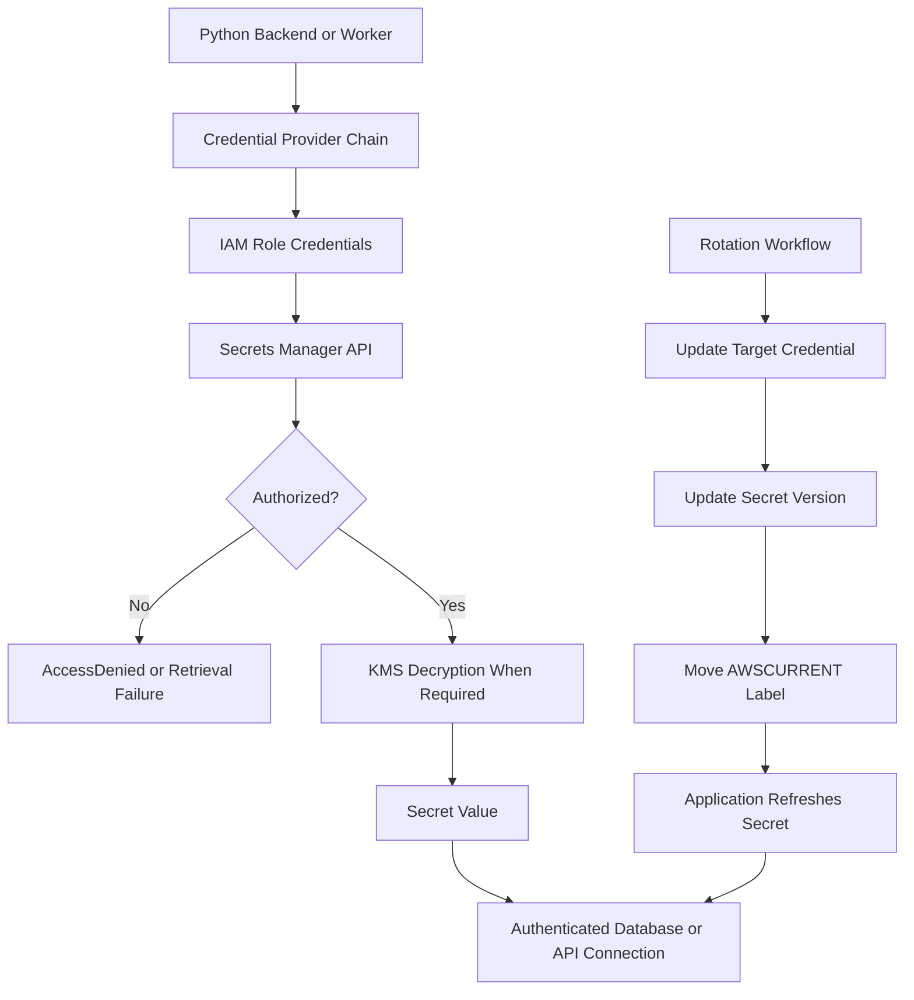
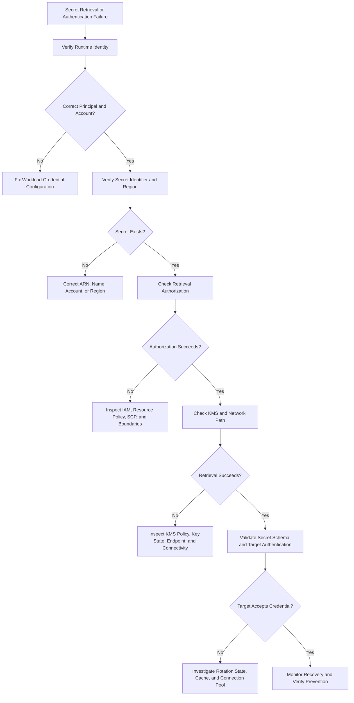

# 04- Secrets Retrieval and Rotation Issues

## Overview

Secrets retrieval and rotation failures occur when an application cannot securely obtain credentials, receives invalid or outdated credentials, or continues using credentials that have already been rotated or revoked. These failures commonly affect database connections, third-party API integrations, service-to-service authentication, background workers, and distributed backend applications.

In AWS, secrets are commonly stored in AWS Secrets Manager or AWS Systems Manager Parameter Store. Applications retrieve them using an IAM role, and AWS KMS may provide the encryption and decryption capabilities required to access encrypted values.

A production failure can involve several independent layers:

- **Identity:** The application does not have valid AWS credentials or is using the wrong IAM role.
- **Authorization:** The role lacks permission to retrieve the secret or decrypt its value.
- **Secret configuration:** The secret name, ARN, Region, version, or staging label is incorrect.
- **Network connectivity:** The workload cannot reach the required AWS endpoint.
- **Rotation:** The stored secret and the credential accepted by the target service are temporarily inconsistent.
- **Application behavior:** The application caches stale values, fails to refresh credentials, or does not recreate authenticated connections.
- **Operational controls:** Rotation failures, expired credentials, or access-denied events are not detected promptly.

This document provides a systematic troubleshooting workflow for these failure categories, with an emphasis on Python backend services, AWS IAM, KMS, distributed workloads, and production operations.

## Secrets Retrieval Architecture

A typical backend workload retrieves a secret through the AWS SDK using temporary credentials associated with its execution role.



The exact sequence depends on the service, secret configuration, and rotation implementation. Secrets Manager manages secret versions and staging labels, while a rotation workflow coordinates changes to the target system and the stored secret.

For a database password, successful secret retrieval does not prove that the database accepts the password. Conversely, a successful database connection does not prove that the application can retrieve the latest secret: the application may still be using a cached value.

## Identify the Failure Category

Start by determining whether the failure occurs during AWS authentication, secret authorization, network access, secret selection, or authentication against the downstream service.

| Observable symptom | Likely failure category | First investigation |
|---|---|---|
| `Unable to locate credentials` | AWS credential configuration | Inspect the SDK credential provider chain and workload identity |
| `ExpiredToken` | Expired or invalid temporary credentials | Check credential refresh and the source of credentials |
| `AccessDeniedException` | Secrets Manager authorization | Inspect the caller identity and applicable IAM policies |
| KMS `AccessDeniedException` | Key authorization | Inspect key policy, IAM permissions, grants, and encryption context |
| `ResourceNotFoundException` | Incorrect secret identifier or Region | Verify the secret ARN, name, account, and Region |
| `DecryptionFailure` | Decryption or key-access problem | Inspect KMS permissions, key state, and secret encryption configuration |
| `EndpointConnectionError` | Network or endpoint configuration | Check DNS, routes, security groups, endpoints, and proxies |
| `ResourceNotFoundException` for a version | Invalid version selection | Inspect version IDs and staging labels |
| Database authentication failure after rotation | Stale secret or connection | Compare active secret version metadata with the target credential state |
| Intermittent failures after rotation | Cache or deployment inconsistency | Inspect cache TTLs, refresh logic, worker restarts, and rotation events |
| Rotation Lambda failure | Rotation workflow | Inspect Lambda logs, execution role, network access, and target-service authentication |

AWS SDK error messages can vary by service, SDK version, and request path. Use the actual exception code and request ID rather than relying only on the displayed message.

## Establish the Actual Runtime Identity

Before modifying permissions, confirm which AWS identity the failing process is using.

### Inspect the caller identity

**Read-only diagnostic command:**

```bash
aws sts get-caller-identity \
  --region <region>
```

The response contains the AWS account ID, caller ARN, and user ID. For an assumed role, the ARN generally identifies an STS role session.

Interpret the output carefully:

- An unexpected account may indicate that the workload is using credentials from another environment.
- An unexpected role may indicate a misconfigured task role, instance profile, IRSA association, EKS Pod Identity configuration, or local credential source.
- A successful response confirms that the current credentials can call this STS operation. It does not prove that the identity can retrieve a particular secret.

### Inspect the credential provider chain

Boto3 can obtain credentials from multiple sources, including environment variables, shared credentials files, AWS profiles, container credential providers, and instance metadata.

For production workloads, prefer temporary credentials delivered through the platform's supported workload identity mechanism.

Common deployment expectations include:

| Workload | Preferred identity mechanism |
|---|---|
| EC2 application | IAM instance profile |
| ECS task | ECS task role |
| Lambda function | Lambda execution role |
| EKS workload | EKS Pod Identity or IAM Roles for Service Accounts (IRSA), as appropriate |
| CI/CD pipeline | Federated identity and short-lived role sessions |
| Local development | AWS IAM Identity Center or another approved temporary-credential workflow |

Avoid placing long-lived access keys in environment variables, Docker images, source control, or deployment manifests.

### Check the identity in Python

```python
import boto3


def get_caller_identity() -> dict[str, str]:
    """Return the AWS identity used by the active Boto3 session."""
    session = boto3.Session()
    sts = session.client("sts")

    identity = sts.get_caller_identity()

    return {
        "account": identity["Account"],
        "arn": identity["Arn"],
        "user_id": identity["UserId"],
    }
```

Log the returned account and ARN when diagnosing an identity mismatch, subject to the application's logging policy. Never log access keys, session tokens, or secret values.

## Troubleshoot Secrets Manager Retrieval

### Verify the secret identifier and Region

Secrets are regional resources. A secret name that exists in one Region may not exist in another, and cross-account retrieval generally requires the complete secret ARN.

**Read-only diagnostic command:**

```bash
aws secretsmanager describe-secret \
  --secret-id <secret-name-or-arn> \
  --region <region>
```

Inspect:

- `ARN`: Confirms the resource identity and account.
- `Name`: Confirms the expected secret name.
- `KmsKeyId`: Identifies the configured encryption key when applicable.
- `RotationEnabled`: Indicates whether rotation is enabled.
- `RotationRules`: Shows the configured rotation schedule when returned.
- `VersionIdsToStages`: Maps version IDs to staging labels such as `AWSCURRENT` and `AWSPREVIOUS`.

`DescribeSecret` returns metadata, not the secret value. However, access to metadata can still reveal infrastructure details and should be limited appropriately.

If the command fails, verify the selected AWS profile, account, Region, secret identifier, and caller identity before investigating deeper authorization issues.

### Check retrieval permissions

The caller generally needs `secretsmanager:GetSecretValue` for the target secret. Depending on the workflow, it may also need other permissions, such as `secretsmanager:DescribeSecret`.

A narrowly scoped identity policy could resemble the following:

```json
{
  "Version": "2012-10-17",
  "Statement": [
    {
      "Sid": "ReadApplicationDatabaseSecret",
      "Effect": "Allow",
      "Action": [
        "secretsmanager:GetSecretValue"
      ],
      "Resource": "arn:aws:secretsmanager:<region>:<account-id>:secret:<secret-name>-*"
    }
  ]
}
```

Replace the placeholders with the actual resource details. Secrets Manager ARNs commonly include a generated suffix, which is why examples often use a suffix wildcard.

Do not copy the wildcard pattern blindly into every policy. Use the narrowest resource scope compatible with the actual secret ARN and deployment model.

Investigate the following when access is denied:

- The workload's effective role and attached policies.
- Inline policies and managed policies attached to the role.
- Resource-based policies on the secret, where applicable.
- Service control policies and permissions boundaries.
- Session policies or other restrictions associated with the role session.
- Explicit denies and applicable conditions.
- Cross-account resource and identity policies, if applicable.

An identity policy's `Allow` does not override an applicable explicit `Deny`.

### Retrieve the secret using the AWS CLI

**Read-only command that returns sensitive data:**

```bash
aws secretsmanager get-secret-value \
  --secret-id <secret-arn> \
  --version-stage AWSCURRENT \
  --region <region> \
  --query '{ARN:ARN,VersionId:VersionId,VersionStages:VersionStages}'
```

The query limits the displayed response to metadata and avoids printing the secret value in the terminal.

Interpret the result:

- `VersionId` identifies the retrieved version.
- `VersionStages` shows the staging labels associated with that version.
- `AWSCURRENT` normally identifies the version consumers should use.

If the command succeeds but the application fails, compare the application's Region, secret identifier, version selection, credentials, network path, and SDK behavior with the successful CLI invocation.

Do not run an unrestricted `get-secret-value` command in a shared terminal, automated diagnostic transcript, or CI job where its output may expose the credential.

## Troubleshoot KMS Authorization and Decryption

Secrets Manager encrypts secret values at rest. When a customer-managed KMS key is used, retrieval may require authorization to use that key in addition to permission to retrieve the secret.

### Understand the authorization boundary

A successful `secretsmanager:GetSecretValue` authorization does not necessarily guarantee that the caller can decrypt a secret encrypted under a customer-managed key.

Check:

- Whether the secret uses the expected KMS key.
- Whether the key is enabled and available.
- Whether the key policy permits the relevant principal or delegates permissions to IAM.
- Whether the caller has the required KMS permissions.
- Whether an applicable grant permits or restricts the operation.
- Whether the secret is in another account.
- Whether encryption-context conditions match the actual request.
- Whether an SCP, permissions boundary, session policy, or explicit deny restricts access.

For a customer-managed key, `kms:Decrypt` is commonly relevant to reading the encrypted secret. The precise authorization path depends on the service integration and policy design.

**Read-only diagnostic command:**

```bash
aws kms describe-key \
  --key-id <key-id-or-arn> \
  --region <region>
```

Inspect the key state, key ARN, key manager, and key usage. A key in a disabled or otherwise unusable state can prevent decryption even when the IAM policy appears correct.

To inspect the key policy:

```bash
aws kms get-key-policy \
  --key-id <key-id-or-arn> \
  --policy-name default \
  --region <region>
```

To inspect grants:

```bash
aws kms list-grants \
  --key-id <key-id-or-arn> \
  --region <region>
```

These are inspection operations. Do not delete grants or modify key policies merely to test whether permissions are the cause.

### Understand encryption-context conditions

KMS encryption context is authenticated additional data associated with supported encryption operations. It is not secret, and it can be used in authorization conditions.

When a policy restricts KMS access using encryption context, a mismatch between the expected and actual context can cause authorization failures.

For Secrets Manager, investigate the documented encryption-context behavior of the relevant integration rather than assuming the application can supply an arbitrary context to `GetSecretValue`.

Do not log secret values while diagnosing encryption failures. Use CloudTrail event metadata, key identifiers, error codes, and the applicable documented context conditions.

### Cross-account secret retrieval

Cross-account access requires an intentional authorization design. For a customer-managed KMS key, the key policy and the caller's IAM permissions must support the required cross-account operation. The secret's resource policy must also permit the intended principal where required.

Verify both sides:

1. The caller assumes the expected role or uses the expected federated identity.
2. The caller has permission to retrieve the specific secret.
3. The secret resource policy permits the intended cross-account access.
4. The KMS key policy supports the cross-account principal or role.
5. The caller has the required KMS permissions.
6. No explicit deny or organization-level restriction blocks the request.

Avoid granting access to an entire account when only one workload role requires the secret.

## Troubleshoot Parameter Store Retrieval

Systems Manager Parameter Store is often used for application configuration, including encrypted `SecureString` parameters. Secrets Manager is generally better suited to managed secret rotation, while Parameter Store is useful for hierarchical configuration and other parameter-management workflows.

### Inspect parameter metadata

**Read-only command:**

```bash
aws ssm describe-parameters \
  --parameter-filters \
    "Key=Name,Option=Equals,Values=<parameter-name>" \
  --region <region>
```

This operation returns parameter metadata rather than the parameter value. Check the parameter name, type, tier, and other available metadata.

To retrieve an encrypted value without printing it:

```bash
aws ssm get-parameter \
  --name <parameter-name> \
  --with-decryption \
  --region <region> \
  --query 'Parameter.{Name:Name,Type:Type,Version:Version,ARN:ARN}'
```

For `SecureString`, `--with-decryption` requests the plaintext value from Systems Manager. The query suppresses that value from the displayed response.

Common permissions include:

- `ssm:GetParameter` for a specific parameter.
- `ssm:GetParameters` for multiple named parameters.
- `ssm:GetParametersByPath` for hierarchical retrieval.
- Appropriate KMS permissions when a customer-managed key is used and the caller must be authorized to decrypt.

Be careful with `GetParametersByPath`. A broad path permission can expose more parameters than intended, depending on the policy and hierarchy. Design path structures and IAM resource scopes together.

### Distinguish service authorization from KMS authorization

A parameter retrieval can fail because the caller lacks SSM permissions, because the encrypted value cannot be decrypted, or because the parameter identifier is incorrect.

Inspect the exact AWS error and the parameter's type before changing policies.

For customer-managed KMS keys, verify the key policy and relevant IAM permissions. For AWS-managed keys, the supported authorization model may differ, so do not assume every KMS policy change is available or necessary.

## Troubleshoot Network and Endpoint Failures

A correctly authorized application can still fail to retrieve secrets if it cannot reach the AWS API endpoint.

This is particularly relevant to applications running in private subnets, ECS tasks, EKS pods, and private EC2 instances without outbound internet access.

### Check the connectivity path

For Secrets Manager or Systems Manager API access, verify:

- The Region-specific service endpoint.
- VPC DNS resolution and DNS hostnames settings where required.
- Route tables and NAT configuration, if the workload uses a NAT path.
- Security-group egress rules and endpoint security-group ingress rules.
- Network ACL rules in both directions.
- Interface VPC endpoint configuration and private DNS settings, if used.
- Network policies or proxies that can affect container workloads.
- The application's configured AWS endpoint or proxy variables.

A VPC interface endpoint can allow private access to a supported AWS service without requiring a public internet path. It does not automatically grant IAM permission to call the service.

### Inspect VPC endpoints

**Read-only command:**

```bash
aws ec2 describe-vpc-endpoints \
  --filters "Name=vpc-id,Values=<vpc-id>" \
  --region <region> \
  --query 'VpcEndpoints[].{Id:VpcEndpointId,Service:ServiceName,State:State,PrivateDns:PrivateDnsEnabled,Subnets:SubnetIds}'
```

Check that the endpoint exists for the correct service and Region, is available, and has the expected subnet and private DNS configuration.

For an interface endpoint, also inspect its security groups and endpoint policy. An endpoint policy can further restrict which principals or resources may be accessed through that endpoint.

Do not assume an endpoint policy replaces IAM authorization. It is an additional control.

### Differentiate network errors from authorization errors

| Error pattern | More likely explanation |
|---|---|
| DNS resolution failure | Incorrect endpoint, DNS configuration, or private DNS issue |
| Connection timeout | Routing, security-group, NACL, endpoint, or proxy problem |
| TLS certificate error | Incorrect hostname, trust-store configuration, or TLS interception |
| `AccessDeniedException` | Authorization failure rather than ordinary network reachability |
| `ResourceNotFoundException` | Wrong resource identifier, account, or Region |
| Intermittent connection reset | Network path instability, proxy behavior, or connection-management issue |

Use VPC Flow Logs, endpoint configuration, application networking diagnostics, and service-side evidence to isolate the failing layer.

## Troubleshoot Secret Rotation Failures

Secret rotation is a coordinated state transition involving the secret store and the target system. Rotation can fail if either side changes without the other reaching a consistent state.

### Understand Secrets Manager version stages

Secrets Manager assigns staging labels to secret versions. Common labels include:

- `AWSCURRENT`: The version currently intended for consumers.
- `AWSPREVIOUS`: The previous current version, when applicable.
- `AWSPENDING`: A version being prepared during a rotation workflow, when applicable.

A rotation workflow may create a pending version, apply a credential change to the target system, validate it, and then promote the version to current. Exact behavior depends on the rotation implementation.

Inspect version-stage mappings:

```bash
aws secretsmanager describe-secret \
  --secret-id <secret-arn> \
  --region <region> \
  --query 'VersionIdsToStages'
```

The response contains version identifiers and their staging labels, not the secret values.

### Inspect rotation status and configuration

```bash
aws secretsmanager describe-secret \
  --secret-id <secret-arn> \
  --region <region> \
  --query '{RotationEnabled:RotationEnabled,RotationRules:RotationRules,LastChangedDate:LastChangedDate,LastRotatedDate:LastRotatedDate,NextRotationDate:NextRotationDate}'
```

Fields returned depend on the secret's configuration and service response. An absent timestamp is not proof of a successful rotation.

For automated rotation, investigate:

- Rotation Lambda execution failures.
- Lambda execution-role permissions.
- Network access from the rotation function to the target database or service.
- Target-service credential policies and password constraints.
- Concurrent rotation attempts.
- Version-stage transitions.
- Secret retrieval permissions for the application.
- Whether clients refresh credentials after rotation.
- Whether existing authenticated connections remain usable.

### Inspect rotation Lambda logs

If rotation uses Lambda, identify the configured function and inspect its logs.

```bash
aws secretsmanager describe-secret \
  --secret-id <secret-arn> \
  --region <region> \
  --query '{RotationEnabled:RotationEnabled,RotationLambdaARN:RotationLambdaARN}'
```

If a function ARN is returned, inspect the relevant Lambda log group in CloudWatch Logs. Do not dump the secret value or full event payloads into diagnostic logs.

Look for:

- Permission errors from Secrets Manager, KMS, or the target service.
- Database connection failures.
- Incorrect network routes or security-group rules.
- Invalid pending-version state.
- Password-policy violations.
- Failed validation before promotion.
- Timeouts or repeated retries.

Do not manually move staging labels or overwrite a target credential until the current rotation state is understood. An improvised change can leave the stored secret and target credential inconsistent.

### Recover safely from a failed rotation

Use this sequence:

1. Confirm the secret's current and pending version metadata.
2. Determine whether the target system's credential was changed.
3. Inspect rotation logs and the target system's authentication state.
4. Identify which credential is accepted by the target system without exposing it in logs.
5. Follow the documented recovery procedure for the rotation implementation.
6. Restore a consistent target credential and secret version state.
7. Validate retrieval using the intended workload role.
8. Validate a new connection from the application.
9. Confirm that subsequent rotation can complete successfully.

Do not assume that `AWSPREVIOUS` is valid for the target system. A previous secret version may no longer match the credential accepted by the database or API.

## Diagnose Stale Secret Caches

Repeated secret retrieval is expensive and adds latency. Applications therefore often cache secret values. However, an indefinitely cached credential can continue to fail after rotation or revocation.

A cache should have an explicit refresh strategy and a documented maximum staleness window.

### Common cache failure modes

- The application caches a password for longer than the rotation interval.
- A process refreshes the cache but continues using an existing database connection pool.
- One application instance refreshes successfully while another retains a stale value.
- Celery workers run for days without refreshing their cached configuration.
- An application treats a failed refresh as permission to use an expired credential indefinitely.
- A secret is rotated successfully, but a client library retains authenticated sessions established with the old credential.

### Recommended cache behavior

- Use a bounded TTL based on the rotation schedule and acceptable staleness.
- Refresh on a scheduled basis with jitter to avoid synchronized API requests.
- Consider a controlled refresh after a confirmed authentication failure.
- Use single-flight refresh or equivalent coordination within a process to avoid a burst of concurrent requests.
- Apply bounded retries with exponential backoff and jitter to transient retrieval failures.
- Avoid retrying permanent authorization failures indefinitely.
- Ensure that connection pools can replace connections when credentials change.
- Define behavior for an unavailable secret store: continue only when the existing credential remains valid and the security policy permits it.
- Never log cached secret contents or include them in exception messages.

A cache TTL is not a credential-validity guarantee. Rotation, revocation, or target-system changes can invalidate a credential before the local cache expires.

## Secure Secret Retrieval in Python

Use the AWS SDK credential provider chain rather than hardcoding access keys. Retrieve only the required secret, parse it safely, and avoid logging its value.

### Minimal retrieval implementation

Install Boto3 if it is not already included in the application's dependencies:

```bash
pip install boto3
```

A small retrieval function can be implemented as follows:

```python
import json
from typing import Any

import boto3
from botocore.exceptions import BotoCoreError, ClientError


class SecretRetrievalError(RuntimeError):
    """Raised when an application secret cannot be retrieved."""


def get_secret(
    secret_arn: str,
    region_name: str,
) -> dict[str, Any]:
    """
    Retrieve and parse a JSON secret from AWS Secrets Manager.

    AWS credentials are resolved through the Boto3 credential provider chain.
    The secret value is never included in raised exception messages.
    """
    client = boto3.client(
        "secretsmanager",
        region_name=region_name,
    )

    try:
        response = client.get_secret_value(
            SecretId=secret_arn,
            VersionStage="AWSCURRENT",
        )
    except (ClientError, BotoCoreError) as exc:
        raise SecretRetrievalError(
            "Unable to retrieve the configured application secret"
        ) from exc

    secret_string = response.get("SecretString")

    if secret_string is None:
        raise SecretRetrievalError(
            "The configured secret does not contain a SecretString"
        )

    try:
        secret = json.loads(secret_string)
    except json.JSONDecodeError as exc:
        raise SecretRetrievalError(
            "The configured secret is not valid JSON"
        ) from exc

    if not isinstance(secret, dict):
        raise SecretRetrievalError(
            "The configured secret must be a JSON object"
        )

    return secret
```

This example intentionally does not log the underlying AWS exception message or secret payload. In production, record a sanitized error category and relevant request metadata through a controlled logging path.

For secrets stored as binary data, implement an explicit binary-handling path rather than assuming `SecretString` exists.

### Production considerations

The minimal implementation is not a complete secret-management layer. A production implementation should also consider:

- Client reuse to avoid repeatedly creating SDK clients.
- Bounded timeouts and retry behavior appropriate to the workload.
- Secret caching and refresh policy.
- Schema validation for required keys and expected types.
- Handling of missing, malformed, or unexpectedly structured values.
- Connection-pool refresh after credential changes.
- Metrics for retrieval latency, failures, and refresh age.
- Safe exception handling that prevents accidental disclosure through chained exceptions or framework error reporting.

Be especially careful when using `raise ... from exc`: exception chaining can preserve the underlying exception. If the logging or error-reporting system serializes exception details, verify that it does not expose sensitive request parameters or values.

### Validate secret schemas

For a database secret, validate the fields required by the application before attempting to connect.

```python
def validate_database_secret(secret: dict[str, object]) -> dict[str, str]:
    required = ("host", "username", "password", "dbname")
    missing = [
        key
        for key in required
        if not isinstance(secret.get(key), str) or not secret[key]
    ]

    if missing:
        raise ValueError(
            f"Database secret is missing required fields: {', '.join(missing)}"
        )

    return {
        key: secret[key]
        for key in required
    }
```

This function validates shape and presence, not whether the credential is accepted by the target system. Keep error messages limited to field names and other non-sensitive metadata.

## Django, FastAPI, and Celery Considerations

Secret retrieval must be integrated with application lifecycle and credential-refresh behavior.

### Django

Avoid retrieving secrets at arbitrary points throughout the request path. Establish a deliberate configuration-loading strategy and understand the trade-off between startup-time retrieval and runtime refresh.

Startup retrieval is simple, but a process may keep stale credentials indefinitely. Runtime retrieval supports refresh but adds latency, dependency on Secrets Manager availability, and additional error-handling complexity.

For database credentials, changing the value in application memory does not automatically reauthenticate existing database connections. The application must manage connection recycling and reconnection behavior appropriately.

### FastAPI

Use application lifespan management to initialize shared clients and resources. Do not create a new Secrets Manager client for every request unless there is a specific reason.

If the application caches credentials, implement refresh and connection-pool lifecycle management explicitly. Ensure that a failed secret refresh does not accidentally replace a valid configuration with an empty or partial value.

### Celery workers

Long-running workers are particularly susceptible to stale secrets because their processes can outlive many rotation intervals.

Plan for:

- Bounded cache TTLs.
- Safe refresh of credentials.
- Reconnection behavior for database and broker clients.
- Worker recycling when required by the chosen architecture.
- Coordinated deployment and rotation schedules.
- Metrics that identify workers using outdated credential versions without exposing secret values.

Do not assume that restarting a web service automatically refreshes separate Celery worker processes.

## AWS CLI Troubleshooting Workflow

The following commands are read-only inspection operations unless otherwise stated. Commands that retrieve secret values are intentionally constrained to display metadata.

| Responsibility | Command | Purpose | Interpretation |
|---|---|---|---|
| Identity verification | `aws sts get-caller-identity` | Identify the active AWS principal | Verify account and caller ARN |
| Secret metadata | `aws secretsmanager describe-secret` | Inspect secret configuration and versions | Check ARN, Region, rotation, and staging labels |
| Secret retrieval | `aws secretsmanager get-secret-value` | Test authorized retrieval | Use a query that excludes the secret value |
| KMS inspection | `aws kms describe-key` | Inspect key state and metadata | Verify the expected key is usable |
| KMS policy inspection | `aws kms get-key-policy` | Inspect key authorization | Check delegation, principal scope, and conditions |
| KMS grants | `aws kms list-grants` | Inspect grants | Look for relevant principals and constraints |
| Parameter metadata | `aws ssm describe-parameters` | Inspect parameter configuration | Verify name and type |
| Parameter retrieval | `aws ssm get-parameter` | Test retrieval and decryption | Suppress the returned value in output |
| VPC endpoint inspection | `aws ec2 describe-vpc-endpoints` | Check private service access | Verify state, service, and private DNS |
| Audit investigation | `aws cloudtrail lookup-events` | Search recent management events | Inspect identity, error, resource, and time |
| Rotation logs | `aws logs filter-log-events` | Inspect rotation Lambda logs | Identify failures without dumping secret payloads |

### Inspect recent CloudTrail events

For recent management events associated with Secrets Manager:

```bash
aws cloudtrail lookup-events \
  --lookup-attributes \
    AttributeKey=EventSource,AttributeValue=secretsmanager.amazonaws.com \
  --start-time <start-time> \
  --end-time <end-time> \
  --region <region>
```

The response includes event records and may contain request parameters or other operational metadata. Treat investigation output as sensitive and do not copy full event records into unrestricted logs or tickets.

Search for relevant event names, principal identity, resource ARN, error code, and timestamps. CloudTrail event availability and detail depend on the event type, configuration, and delivery path.

### Inspect rotation Lambda logs

```bash
aws logs filter-log-events \
  --log-group-name "/aws/lambda/<rotation-function-name>" \
  --start-time <start-time-epoch-ms> \
  --end-time <end-time-epoch-ms> \
  --region <region>
```

CloudWatch Logs uses epoch timestamps in milliseconds for these parameters. Restrict the time range to the relevant incident window.

Review log retention, access controls, and data-protection policies before sharing output. If a rotation function logs a secret value, treat the incident as a potential credential exposure and remediate the logging path.

## Troubleshooting Decision Flow



## Incident Response for Exposed or Invalid Secrets

Treat suspected credential exposure differently from an ordinary retrieval failure. A secret may still be retrievable while an attacker is already using the compromised credential.

### Immediate containment

1. Identify the exposed credential, affected resource, and potential blast radius.
2. Determine whether the credential is still valid and whether unauthorized use is suspected.
3. Revoke or rotate the credential through the target service's supported process.
4. Restrict affected IAM permissions or disable compromised access paths where appropriate.
5. Review CloudTrail and target-service logs for suspicious use.
6. Preserve relevant evidence and record timestamps, principals, request IDs, and affected resources.
7. Verify that legitimate workloads can authenticate with the replacement credential.

For compromised AWS access keys, disable or deactivate the affected key and replace it through the appropriate identity-management workflow. For temporary role credentials, restrict the affected role or workload identity as needed and understand that already-issued sessions may remain valid until expiration unless an applicable revocation or deny mechanism takes effect.

Do not assume that changing a secret in Secrets Manager immediately invalidates the credential at the target service. The target system must accept the new credential and stop accepting the compromised one.

### Prevent recurrence

- Remove credentials from source code, images, logs, CI artifacts, and deployment manifests.
- Rotate exposed credentials and review access history.
- Use workload roles instead of long-lived access keys where possible.
- Limit secret access to the specific workload and environment.
- Restrict secret values and rotation logs to authorized operators.
- Add automated secret scanning to repositories and CI/CD pipelines.
- Alert on unusual secret retrieval and unexpected identity changes.
- Validate rotation procedures through controlled exercises.

## Verification Checklist

Before closing a secrets-related incident, verify the following:

- [ ] The application uses the intended AWS account, Region, and workload identity.
- [ ] The secret identifier and selected version are correct.
- [ ] IAM and resource-based policies grant only the required access.
- [ ] KMS key state, policy, grants, and applicable conditions permit required operations.
- [ ] Private endpoint and network configuration support the required service calls.
- [ ] Rotation completed and the target system accepts the intended credential.
- [ ] Application caches and connection pools no longer depend on stale credentials.
- [ ] No secret values appear in logs, traces, terminal history, or incident artifacts.
- [ ] Monitoring and alerting detect retrieval and rotation failures.
- [ ] The recovery process and responsible owners are documented.

## Key Takeaways

- Troubleshoot secret failures by separating identity, authorization, KMS, networking, version selection, rotation, and application-cache behavior.
- Use temporary workload credentials and narrowly scoped permissions; never resolve access failures by granting indiscriminate administrator access.
- Treat secret rotation as a coordinated change between the secret store, target system, application cache, and authenticated connections.
- Use AWS CLI metadata queries and CloudTrail evidence to diagnose failures without printing sensitive values.
- Respond to exposed credentials by containing access, rotating or revoking the target credential, preserving evidence, and verifying recovery.