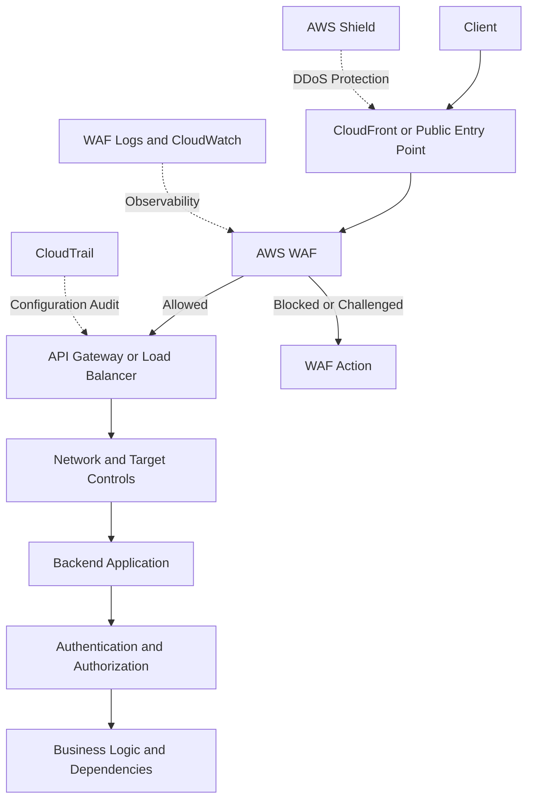

# 06- WAF Rule and DDoS Protection Issues

## Overview

AWS WAF and DDoS protection issues arise when legitimate requests are blocked, malicious traffic reaches an application, rate-based rules behave unexpectedly, or a traffic surge overwhelms backend resources despite edge protection.

These incidents commonly affect public REST APIs, Django and FastAPI applications, API Gateway endpoints, Application Load Balancers, CloudFront distributions, and internet-facing microservices.

Troubleshooting requires identifying which security control handled the request and whether the problem originates in request filtering, DDoS mitigation, network connectivity, application authorization, or backend capacity.

The main responsibilities are distinct:

- **AWS WAF:** Evaluates supported HTTP(S) requests against web ACL rules and applies configured actions.
- **AWS Shield:** Provides DDoS protection for supported AWS resources.
- **CloudFront and load balancers:** Provide traffic entry points, distribution, and other delivery capabilities.
- **API Gateway and application controls:** Enforce API-specific authentication, authorization, throttling, and business rules.
- **CloudWatch and WAF logging:** Provide operational metrics and request-level evidence when configured.
- **CloudTrail:** Records supported AWS API activity, including relevant configuration changes.

A request blocked by WAF might never reach the backend. A request allowed by WAF can still fail at API Gateway, a load balancer, a reverse proxy, or the application itself.

The objective is to identify the responsible control, restore legitimate traffic safely, and retain effective protection against malicious requests.

## Understand the Request Path

A common public backend architecture uses multiple independent security controls.



The actual request path depends on the deployed architecture and resource associations. AWS Shield protection is not simply another sequential request-processing rule; it protects supported resources against DDoS events.

When a request fails, determine whether it was blocked at the edge, rejected by an AWS service, rejected by the application, or unable to reach the destination.

## Classify the Incident

| Observable symptom | Possible cause | Initial investigation |
|---|---|---|
| Legitimate requests receive HTTP 403 | WAF rule, API Gateway policy, application authorization, or another upstream control | Correlate the request with WAF and application logs |
| WAF blocks suddenly increase | Attack traffic, managed-rule changes, configuration changes, or legitimate traffic variation | Inspect terminating rules and recent changes |
| Rate-based rules block normal users | Threshold or aggregation configuration does not match traffic patterns | Inspect rule configuration and request volume |
| Requests work from one location but fail elsewhere | Geo restrictions, edge behavior, routing differences, or source-IP aggregation | Compare request metadata and WAF logs |
| Latency rises during a traffic spike | Backend saturation, dependency pressure, network limits, or attack traffic | Correlate edge and application metrics |
| High traffic reaches the backend despite WAF | Incorrect association, rule scope, action, or matching conditions | Verify the web ACL association and rule evaluation |
| WAF logs appear incomplete or delayed | Logging configuration, delivery delay, filtering, or query-window mismatch | Check destination health and timestamps |
| Application returns 5xx during a traffic surge | Target health, connection exhaustion, or dependency saturation | Inspect load-balancer and application metrics |

An HTTP 403 does not prove that WAF blocked the request. A traffic spike does not, by itself, establish that a DDoS attack is occurring.

## Investigate WAF Rule Behavior

AWS WAF evaluates a web ACL's rules according to configured priorities, statements, and actions. Depending on the configuration, actions can include allowing, blocking, counting, challenging, or presenting a CAPTCHA challenge.

Rule ordering matters because a terminating action can stop further rule evaluation.

### Verify the web ACL association

For a supported regional resource, inspect the associated web ACL:

```bash
aws wafv2 get-web-acl-for-resource \
  --resource-arn <resource-arn> \
  --region <region>
```

This is a read-only inspection operation. Confirm that the protected resource is associated with the intended web ACL.

Inspect a known regional web ACL:

```bash
aws wafv2 get-web-acl \
  --name <web-acl-name> \
  --scope REGIONAL \
  --id <web-acl-id> \
  --region <region>
```

Review:

- Web ACL name, ID, ARN, and default action.
- Rule priorities, statements, and actions.
- Managed rule groups and overrides.
- Rate-based rule configuration.
- Scope-down statements.
- Visibility configuration and metric names.
- Recent configuration changes.

For CloudFront-scoped web ACLs, use the appropriate CloudFront scope and API Region requirements. Do not assume every web ACL uses `REGIONAL` scope.

### Identify the terminating rule

The terminating rule is often the most useful starting point when legitimate requests are blocked.

Inspect WAF logs for fields such as:

- `timestamp`
- `webaclId`
- `terminatingRuleId`
- `terminatingRuleType`
- `action`
- `httpRequest`
- `ruleGroupList`
- `rateBasedRuleList`
- `labels`

The fields available depend on the event and logging configuration.

Correlate the request timestamp, host, URI, method, and other permitted request metadata. Avoid copying authorization headers, cookies, or sensitive payloads into unrestricted diagnostic records.

### Distinguish the default action from rule actions

The web ACL's default action applies when no rule terminates evaluation with another action.

A request may be blocked because:

- A custom rule matched and blocked it.
- A managed rule group produced a terminating block.
- The default action blocks requests that do not match an allow path.
- A challenge or CAPTCHA action was not completed as expected.

Inspect the actual logged action and matching rule instead of assuming that the default action caused the failure.

## Troubleshoot Managed Rule False Positives

AWS Managed Rules provide maintained rule groups for common web threats. However, legitimate application requests can sometimes match security rules.

Typical causes include:

- JSON request bodies containing SQL-like or script-like strings.
- Search endpoints accepting unusual characters.
- Rich-text editors and file-upload workflows.
- Large request bodies.
- Unexpected HTTP headers.
- Framework-generated payloads resembling attack patterns.
- New application features that change normal request structure.

### Isolate the specific rule

1. Identify the terminating rule and rule group.
2. Confirm that the request is legitimate.
3. Determine which request component matched the rule.
4. Review the rule group's documentation and available match details.
5. Reproduce the request in a controlled environment.
6. Evaluate a narrow exception or rule override.
7. Verify that legitimate traffic succeeds and intended attack detection remains effective.

Do not disable an entire managed rule group because one endpoint produces false positives.

### Use Count mode carefully

Count mode allows matching requests to be observed without terminating them through that rule's blocking action. It is useful for evaluating a rule change before enforcing it.

A controlled rollout can follow this sequence:

1. Record the current web ACL configuration.
2. Change the targeted rule or override to Count where appropriate.
3. Observe matching requests and metrics.
4. Determine whether matches represent attacks, legitimate traffic, or both.
5. Apply the narrowest corrective change.
6. Restore the intended enforcement behavior.
7. Verify both application availability and security coverage.

**Security trade-off:** Count mode does not enforce the same blocking behavior as a terminating Block action. During investigation, requests that would otherwise have been blocked can reach the application. Use it selectively for high-risk rules.

## Troubleshoot Rate-Based Rules

AWS WAF rate-based rules track request rates according to configured aggregation criteria and evaluation windows. They can apply an action when traffic exceeds the configured threshold.

Their behavior depends on the rule configuration, aggregation keys, evaluation window, scope-down statement, and current WAF implementation. They are mitigation controls, not precise per-second admission controllers.

### Common causes of unexpected throttling

- Many legitimate users share a public IP through a corporate proxy or NAT.
- The configured threshold is too low for normal peak traffic.
- A scope-down statement includes more requests than intended.
- The aggregation key does not distinguish the relevant client population.
- A retry storm causes otherwise legitimate requests to exceed the threshold.
- The rule is expected to enforce per-user quotas but aggregates traffic using a different key.

### Inspect rate-based rule configuration

```bash
aws wafv2 get-web-acl \
  --name <web-acl-name> \
  --scope REGIONAL \
  --id <web-acl-id> \
  --region <region> \
  --query 'WebACL.Rules[].{Name:Name,Priority:Priority,Statement:Statement,Action:Action,OverrideAction:OverrideAction,VisibilityConfig:VisibilityConfig}'
```

Review the returned rules for:

- Configured limit and evaluation window, where supported.
- Aggregation type and keys.
- Scope-down statement.
- Rule action and priority.
- Metric name and sampled-request visibility configuration.

### Correct rate-based false positives

Possible corrective actions include:

- Raising the limit to reflect measured legitimate traffic.
- Narrowing the scope-down statement.
- Choosing an aggregation strategy appropriate to the client population.
- Separating high-volume public endpoints from sensitive or expensive endpoints.
- Implementing authenticated per-user or per-tenant quotas.
- Adding application-side concurrency limits and backpressure.

Do not use source-IP aggregation as a substitute for business-level authorization or per-account rate limiting.

## Diagnose WAF Logging and Metrics

WAF logs and CloudWatch metrics provide different types of evidence.

| Evidence source | Primary use | Limitation |
|---|---|---|
| WAF logs | Request-level investigation and rule attribution | Delivery may be delayed; sensitive request fields need protection |
| WAF CloudWatch metrics | Aggregate rule and web ACL trends | Aggregate metrics do not explain every individual request |
| Sampled requests | Rapid inspection of a subset of traffic | Sampling is not a complete record of all requests |
| CloudTrail | Audit WAF configuration and API changes | Does not replace request-level WAF logs |
| Application logs | Confirm whether requests reached application code | Cannot explain requests blocked before reaching the application |
| Load-balancer access logs | Investigate requests observed by the load balancer | May not contain requests blocked at an earlier edge layer |

### Verify logging configuration

```bash
aws wafv2 get-logging-configuration \
  --resource-arn <web-acl-arn> \
  --region <region>
```

Inspect:

- Whether logging is configured.
- The destination and delivery path.
- Whether log filtering excludes relevant events.
- Whether redaction or data-protection configuration affects visible fields.
- Whether the investigation uses the correct time window and timezone.

A missing log record does not automatically mean WAF did not evaluate the request. Check the resource association, logging configuration, delivery status, filters, and actual request path.

### Inspect available metrics

```bash
aws cloudwatch list-metrics \
  --namespace AWS/WAFV2 \
  --region <region>
```

This read-only command lists available metrics. Review the metric names and dimensions before interpreting a change in block or allow counts.

WAF metrics are associated with the configured web ACL and rules when visibility is enabled. Their aggregation and update timing can differ from request-level logs.

Do not interpret an increase in block metrics as proof of an attack without examining traffic patterns, affected rules, application impact, and supporting telemetry.

## Troubleshoot AWS Shield and DDoS Events

AWS Shield provides DDoS protection for supported AWS resources. Shield Standard provides baseline protection for eligible AWS services, while Shield Advanced provides additional protections and operational capabilities for eligible protected resources under its service terms.

DDoS-related incidents can target different layers:

- **Network and transport layers:** Traffic volume or protocol-level attacks.
- **Application layer:** HTTP request floods, expensive endpoint requests, or traffic resembling legitimate usage.
- **Resource exhaustion:** CPU, memory, connections, database capacity, or other downstream resources.

AWS Shield, AWS WAF, CloudFront, load balancers, and application-level controls have different responsibilities. No single control guarantees that every attack will be blocked without impact.

### Investigate a suspected event

Establish:

- Which resource is affected.
- When the event started and whether it is ongoing.
- Whether request volume, bandwidth, latency, or error rates changed.
- Whether WAF blocked or allowed the traffic.
- Whether load-balancer target health deteriorated.
- Whether application and database capacity are saturated.
- Whether Shield or other security findings identify a relevant event.
- Whether traffic is concentrated by source, path, protocol, or geography.

Compare the event with a normal baseline. High traffic may also result from a product launch, crawler activity, client retry storm, or configuration error.

### Inspect Shield protection

For accounts and resources where the API is available, inspect Shield protection entries:

```bash
aws shield list-protections \
  --region <region>
```

This read-only command lists applicable Shield protection records. Verify the account, resource ARN, Region, and relevant protection configuration before concluding that the affected resource is covered.

Resource type and configuration determine the applicable protection context. Do not infer coverage from a similarly named resource in another account or Region.

### Respond to active DDoS impact

1. Confirm the affected resource and customer impact.
2. Review AWS service health and available Shield information.
3. Preserve WAF, load-balancer, application, and network telemetry.
4. Apply approved WAF protections or rate-based mitigations when supported by evidence.
5. Scale supported application components if capacity is the limiting factor.
6. Protect expensive dependencies with caching, quotas, concurrency limits, and circuit breakers.
7. Escalate through the organization's AWS support process when required.
8. Verify recovery using request success rate, latency, target health, and dependency saturation.

Avoid broad WAF exceptions during an active attack merely to restore a subset of legitimate traffic. Prefer narrowly scoped changes that preserve the intended security boundary.

## Secure Public API Exposure

A secure public API uses multiple independent controls rather than relying only on WAF.

A common architecture includes:

- CloudFront or another appropriate public entry point.
- AWS WAF with managed and custom rules.
- API Gateway or a load balancer.
- Private application targets where appropriate.
- Application authentication and authorization.
- Rate limiting and request validation.
- Observability, audit logging, and incident alerting.

### Distinguish the controls

| Control | What it protects | What it does not replace |
|---|---|---|
| AWS WAF | Supported HTTP(S) request filtering | Application authorization and business validation |
| AWS Shield | DDoS protection for supported resources | Capacity planning and every application-layer safeguard |
| Security groups | Network connectivity to supported interfaces | HTTP request inspection |
| API Gateway throttling | API-level request throttling | Authentication and authorization |
| Application quotas | Per-user, per-tenant, or business-specific limits | Network-level DDoS mitigation |
| Authentication | Establishes caller identity or credential validity | Authorization for every operation |
| Authorization | Determines whether an operation is permitted | Request filtering and volumetric protection |
| CloudWatch and logging | Detection and diagnosis | Preventive enforcement |

### Protect expensive endpoints

Endpoints that perform costly operations deserve additional safeguards. Examples include report generation, search queries, bulk exports, file processing, and APIs that trigger Celery jobs.

Consider:

- Request-size limits.
- Input validation.
- Per-user and per-tenant quotas.
- Concurrency limits.
- Bounded queue depth.
- Database query timeouts.
- Idempotency for retry-prone operations.
- Caching where data semantics permit it.
- Backpressure when downstream dependencies are saturated.

WAF can filter supported request patterns, but application-level limits are necessary when the correct policy depends on authenticated identity, tenant ownership, or business semantics.

## Investigate WAF Configuration Changes with CloudTrail

Unexpected WAF behavior may follow a change to a web ACL, rule, association, or protected resource.

CloudTrail can help identify the principal and API operation responsible for configuration changes, subject to event availability and the applicable logging configuration.

### Search recent WAF management events

```bash
aws cloudtrail lookup-events \
  --lookup-attributes \
    AttributeKey=EventSource,AttributeValue=wafv2.amazonaws.com \
  --start-time <start-time> \
  --end-time <end-time> \
  --region <region>
```

Inspect:

- Event name and timestamp.
- Caller identity.
- Resource identifiers.
- Request parameters and configuration changes.
- Error details.
- Correlation with deployment and incident timelines.

Treat event records as sensitive operational data. Do not distribute unrestricted event payloads if they contain internal configuration or sensitive identifiers.

CloudTrail is an audit source for supported API activity, not a substitute for WAF request logs. For an individual blocked HTTP request, begin with WAF logs and use CloudTrail to investigate configuration changes.

## Production Incident Runbook

### Initial triage

1. Confirm the affected hostname, resource, request path, and time window.
2. Determine whether the failure is a WAF block, another HTTP response, a connection failure, or backend saturation.
3. Correlate request metadata with WAF logs.
4. Identify the terminating rule and action.
5. Compare traffic volume and rule matches with normal behavior.
6. Check load-balancer target health, application latency, and dependency saturation.
7. Inspect recent web ACL and resource-association changes.
8. Determine whether the incident is a false positive, abusive traffic, a DDoS event, or an unrelated application failure.

### Apply mitigation

- For a confirmed false positive, apply a narrow rule exception or controlled Count-mode evaluation.
- For abusive request patterns, retain or introduce targeted blocking or rate-based mitigation.
- For backend exhaustion, apply concurrency controls, caching, and capacity measures.
- For configuration drift, restore the approved configuration through the normal deployment process.
- For suspected DDoS impact, use applicable AWS protection capabilities and escalate according to the incident-response plan.

### Verify recovery

Confirm that:

- Legitimate requests succeed.
- Malicious or abusive traffic remains subject to the intended controls.
- WAF logs and metrics show expected behavior.
- Application error rates and latency return to acceptable levels.
- Downstream dependencies recover.
- Temporary exceptions and diagnostic changes are removed or formally approved.
- The incident timeline and corrective actions are documented.

## Preventive Best Practices

- Associate the intended web ACL with every applicable public resource.
- Validate managed rules against actual application traffic.
- Use Count mode and staged rollout for rule changes when the risk is acceptable.
- Configure visibility and logging for security-relevant rules.
- Redact or protect sensitive request fields in logs.
- Tune rate-based rules using observed traffic patterns.
- Use application-level quotas for authenticated users and tenants.
- Protect expensive operations with bounded concurrency and dependency timeouts.
- Review WAF changes through code review and controlled deployment.
- Monitor traffic volume, block rates, latency, target health, and backend saturation together.
- Test incident procedures before an actual DDoS event.
- Understand which resources are covered by the account's applicable Shield protections.
- Maintain escalation paths for incidents requiring AWS support.

## Key Takeaways

- Identify the exact WAF rule and terminating action before changing a web ACL; an HTTP 403 alone does not prove that WAF caused the failure.
- Tune managed rules and rate-based rules using observed traffic, narrow exceptions, and controlled rollouts rather than disabling broad protections.
- Combine AWS WAF and Shield with application-level quotas, backend capacity controls, and observability because they protect different layers.
- Use WAF logs for request-level investigations and CloudTrail for configuration-change auditing; neither replaces the other.
- Verify both legitimate traffic recovery and continued attack protection before closing an incident.