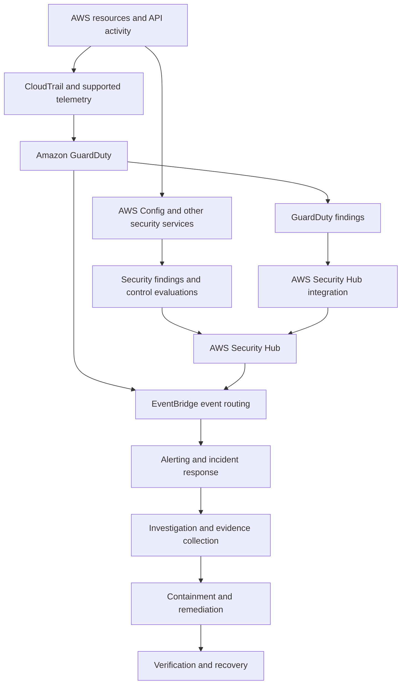
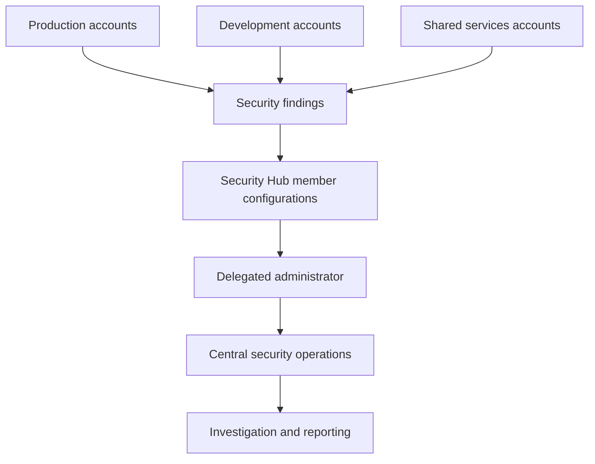
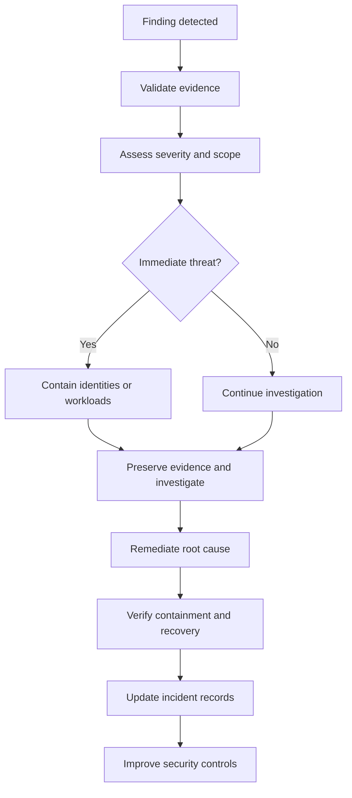

# 07- GuardDuty Findings and Security Hub Issues

## Overview

Amazon GuardDuty and AWS Security Hub are complementary services for detecting threats, evaluating security posture, and managing security findings across AWS environments.

- **Amazon GuardDuty** detects potentially malicious activity by analyzing supported AWS telemetry and threat intelligence.
- **AWS Security Hub** centralizes security findings, evaluates supported security controls, and provides visibility into security posture.
- **AWS CloudTrail** records AWS API activity and provides evidence for investigating suspicious operations.
- **AWS Config** records supported resource configuration changes and evaluates resources against configured rules.
- **Amazon EventBridge** routes security events to notification, investigation, and remediation workflows.

These services provide detective security controls. They do not automatically replace preventive controls such as IAM authorization, security groups, network ACLs, encryption policies, or AWS WAF.

A finding is an investigation signal, not definitive proof of compromise. Production troubleshooting must establish whether the finding is valid, determine its scope, preserve evidence, contain the threat, remediate the root cause, and verify recovery.

### Common failure categories

| Category | Typical symptom | Primary investigation area |
|---|---|---|
| GuardDuty detection | Expected threat finding is missing | Detector status, Region, telemetry, and protection plans |
| Security Hub integration | Source finding is absent from Security Hub | Product integration, account enrollment, and aggregation |
| Threat investigation | High-severity finding affects a workload | Finding details, CloudTrail, network activity, and resource identity |
| Credential compromise | Unexpected API activity or role assumption | IAM principal, access keys, STS sessions, and CloudTrail |
| Compliance failure | Security control reports `FAILED` | Resource configuration and control evaluation |
| Event delivery | Finding exists, but no notification arrives | EventBridge rules, target permissions, and downstream processing |
| Stale finding | Finding remains visible after remediation | Resource state, reevaluation, and workflow status |
| Multi-account visibility | Central security account lacks findings | Organization enrollment, delegated administration, and Region coverage |

## GuardDuty and Security Hub Architecture

### Amazon GuardDuty

GuardDuty analyzes supported telemetry to identify suspicious activity, potentially compromised resources, and other security threats.

Depending on the enabled capabilities and configuration, its analysis can use sources such as CloudTrail management events, VPC Flow Logs, DNS activity, and additional protection-plan data.

Typical investigation targets include:

- Suspicious API activity.
- Unusual credential usage.
- Potentially compromised EC2 instances.
- Suspicious network communication.
- Threats involving supported storage, container, or serverless workloads.

GuardDuty findings include a finding type, severity, affected resources, timestamps, and additional threat-specific details.

**Operational limitation:** Not every suspicious action generates a finding. Detection depends on supported telemetry, enabled capabilities, detection logic, and available evidence.

### AWS Security Hub

Security Hub provides centralized visibility into findings from supported AWS security services and evaluates security posture against supported standards and controls.

It is useful for:

- Prioritizing findings across accounts.
- Tracking configuration and compliance issues.
- Aggregating security findings.
- Integrating findings with incident response systems.
- Monitoring security posture over time.

**Operational limitation:** Enabling Security Hub does not guarantee that every source product, Region, account, or security control is configured correctly.

### Security investigation architecture



This is a logical architecture. GuardDuty can generate findings independently of Security Hub, and downstream event routing depends on the actual service configuration.

## Verify the AWS Account and Region

Many apparent security-service failures are caused by inspecting the wrong account or Region.

Start by confirming the current identity:

```bash
aws sts get-caller-identity
```

The response includes the account ID and ARN associated with the current credentials. Compare them with the account containing the affected resource.

Check the configured default Region:

```bash
aws configure get region
```

Do not rely exclusively on the default Region during an incident. Specify `--region` explicitly in investigation commands.

### Inspect GuardDuty

List detector IDs:

```bash
aws guardduty list-detectors \
  --region <region>
```

Inspect a detector:

```bash
aws guardduty get-detector \
  --detector-id <detector-id> \
  --region <region>
```

Check the detector's enabled state and relevant configuration. An empty detector list can indicate that GuardDuty is not configured in the selected account and Region.

### Inspect Security Hub

```bash
aws securityhub describe-hub \
  --region <region>
```

A successful response confirms that a Security Hub Hub resource exists in the selected account and Region. It does not establish that every integration, standard, control, or aggregation setting is healthy.

These commands are read-only inspection operations. They do not enable services or change security controls.

## GuardDuty Findings Not Appearing

### Symptoms

- Suspicious activity occurs, but no expected GuardDuty finding appears.
- Findings are available in one Region but absent in another.
- A workload is monitored, but the required protection capability is not enabled.
- Findings stop appearing after an account or organization change.

### Likely root causes

- GuardDuty is not enabled in the affected account or Region.
- The relevant optional protection plan is not enabled.
- The activity does not match a supported detection scenario.
- The wrong detector ID, account, or Region is being queried.
- Organization enrollment is incomplete.
- Required telemetry or detection coverage is unavailable.
- The finding exists, but downstream processing fails.

### Troubleshooting procedure

**Step 1: Verify detector availability.**

```bash
aws guardduty list-detectors \
  --region <region>
```

If a detector exists, inspect its status:

```bash
aws guardduty get-detector \
  --detector-id <detector-id> \
  --region <region>
```

**Step 2: Query findings directly.**

```bash
aws guardduty list-findings \
  --detector-id <detector-id> \
  --region <region>
```

If the expected finding is absent, determine whether the activity falls within GuardDuty's supported detection coverage. Do not assume that every unusual API call or network connection must generate a finding.

**Step 3: Inspect protection configuration.**

Review the detector configuration and enabled protection plans. Confirm that the capability needed for the investigation is supported and enabled for the workload.

**Step 4: Verify organization coverage.**

For multi-account deployments, check the delegated administrator, member-account association, and Region coverage. Confirm that newly created accounts are included in the organization's security deployment process.

**Step 5: Separate detection from delivery.**

If the finding exists in GuardDuty but is missing from an alerting system, investigate the downstream event pipeline rather than changing the detector configuration unnecessarily.

### Corrective actions

- Enable GuardDuty through the approved deployment process if it is absent.
- Enable the required protection capabilities.
- Correct account enrollment or regional coverage gaps.
- Repair downstream event routing independently of threat detection.
- Document detection limitations and monitoring gaps.

### Verification

- Confirm the detector is enabled.
- Verify that the required protection configuration is present.
- Confirm account and Region coverage.
- Retrieve findings through the API.
- Validate downstream notification delivery with an approved test.

Avoid generating uncontrolled malicious traffic in production to test detection. Use an approved test environment and supported validation procedures.

## Security Hub Findings Missing or Delayed

### Symptoms

- A GuardDuty finding exists but is absent from Security Hub.
- Findings appear in a member account but not in the central security account.
- Security posture information appears stale.
- Findings exist in Security Hub, but alerting workflows do not trigger.

### Likely root causes

- Security Hub is not enabled in the affected account or Region.
- The source product integration is not enabled.
- Account enrollment or cross-Region aggregation is incomplete.
- The central dashboard queries the wrong Region or account scope.
- A finding filter excludes the relevant result.
- Event processing or downstream alerting is delayed.

### Troubleshooting procedure

**Step 1: Verify Security Hub availability.**

```bash
aws securityhub describe-hub \
  --region <region>
```

Repeat the check for the relevant account and Region, including the central account where applicable.

**Step 2: Retrieve source findings.**

```bash
aws guardduty list-findings \
  --detector-id <detector-id> \
  --region <region>
```

Record the finding ID, account, Region, type, and timestamps.

**Step 3: Query Security Hub.**

```bash
aws securityhub get-findings \
  --region <region> \
  --filters '{
    "ProductName": [
      {
        "Value": "GuardDuty",
        "Comparison": "EQUALS"
      }
    ]
  }' \
  --max-results 10
```

This query filters by product name. If it returns no results, broaden the query and inspect available product metadata before concluding that the integration has failed.

**Step 4: Verify integrations and aggregation.**

Check the source product integration, Security Hub configuration, delegated administrator, and aggregation settings. Confirm that the affected account and Region are included.

**Step 5: Investigate delivery separately.**

If Security Hub contains the finding but the alert is missing, inspect EventBridge rules, target permissions, delivery failures, retry behavior, and downstream processing.

### Corrective actions

- Enable the required Security Hub configuration and source integrations.
- Correct account enrollment and aggregation scope.
- Repair event patterns and target permissions.
- Make downstream consumers idempotent.
- Correlate source and aggregated findings using their identifiers and timestamps rather than assuming every identifier is interchangeable.

### Verification

Confirm that the finding is retrievable through Security Hub, appears in the intended aggregation view, and reaches the expected alerting target.

Allow for service processing and evaluation delays before treating a recently changed configuration as a persistent failure.

## Investigating High-Severity Findings

A high-severity finding requires timely triage, but severity alone does not establish business impact or prove that an attack succeeded.

### Initial triage checklist

- [ ] Confirm the finding ID, type, account, and Region.
- [ ] Identify the affected resource and its business owner.
- [ ] Record first-seen and last-seen timestamps.
- [ ] Preserve the complete finding JSON.
- [ ] Identify relevant principals, API actions, source IPs, or network destinations.
- [ ] Determine whether the activity is expected, suspicious, or confirmed malicious.
- [ ] Check for related findings affecting other resources.
- [ ] Assess possible data exposure, privilege escalation, persistence, and lateral movement.
- [ ] Assign incident priority using business impact and available evidence.
- [ ] Escalate according to the organization's incident response policy.

### Retrieve finding details

```bash
aws guardduty get-findings \
  --detector-id <detector-id> \
  --finding-ids <finding-id> \
  --region <region>
```

Review the finding type, severity, resource details, timestamps, and threat-specific attributes. Preserve the response as investigation evidence in an approved location.

### Investigate CloudTrail activity

For suspicious API activity, inspect CloudTrail event history around the finding timestamp:

```bash
aws cloudtrail lookup-events \
  --lookup-attributes AttributeKey=EventName,AttributeValue=<event-name> \
  --start-time <start-time> \
  --end-time <end-time> \
  --region <region>
```

The command searches event history by event name and time range. Event history has a limited retention period and supported event scope; use the organization's centralized trail or event data store when broader coverage is required.

Inspect:

- Principal identity and session context.
- Source address and user agent.
- Event name and event time.
- Request parameters and affected resources.
- Error codes and whether the operation succeeded.
- Related role assumptions and preceding API calls.

Treat individual fields as evidence requiring correlation, not proof of malicious intent by themselves.

## Compromised EC2 Instances and Suspicious Network Activity

### Symptoms

- GuardDuty identifies suspicious outbound communication.
- An EC2 instance connects to an unexpected destination.
- A finding indicates possible malware or command-and-control activity.
- An instance role is associated with unexpected API calls.
- Multiple workloads show related suspicious behavior.

### Investigation procedure

**Step 1: Inspect the instance.**

```bash
aws ec2 describe-instances \
  --instance-ids <instance-id> \
  --region <region>
```

Review instance state, network interfaces, VPC, subnet, security groups, addresses, and instance profile.

**Step 2: Inspect network rules.**

```bash
aws ec2 describe-security-groups \
  --group-ids <security-group-id> \
  --region <region>
```

Review ingress and egress rules for unnecessary exposure. A permissive rule indicates potential exposure, not proof that a suspicious connection occurred.

**Step 3: Correlate evidence.**

Use GuardDuty findings, VPC Flow Logs where available, CloudTrail, DNS records, workload logs, and endpoint telemetry. Align timestamps and correlate activity across sources.

**Step 4: Contain the threat.**

Depending on the incident policy:

- Isolate the instance using an approved containment mechanism.
- Restrict unnecessary network access.
- Investigate and restrict potentially compromised role permissions.
- Rotate exposed credentials.
- Preserve disk, memory, and other forensic evidence where required.

Changing a security group alone may not stop malicious activity inside the instance or address every communication path.

**Step 5: Recover.**

When instance integrity cannot be established, rebuilding from a trusted image and validated deployment pipeline is often safer than attempting to clean an untrusted system in place.

Patch the underlying vulnerability, rotate exposed credentials, investigate persistence, and validate the replacement workload before restoring traffic.

### Common mistakes

- Terminating the instance before preserving required evidence.
- Assuming a suspicious IP address proves compromise.
- Ignoring alternate network interfaces or routes.
- Reusing credentials that may have been exposed.
- Reintroducing the same vulnerable image.
- Closing the incident without verifying that suspicious activity stopped.

## Credential Compromise and Suspicious IAM Activity

### Symptoms

- Unexpected API calls appear in CloudTrail.
- GuardDuty reports suspicious credential use.
- A principal accesses resources outside its expected operating pattern.
- Unexpected role assumptions or privilege changes occur.
- Access keys or temporary credentials are exposed in logs or repositories.

### Investigation procedure

**Step 1: Identify the credential type.**

Determine whether the activity involves:

- IAM user access keys.
- Temporary STS credentials.
- Assumed-role sessions.
- EC2 instance-profile credentials.
- Lambda execution-role credentials.
- CI/CD deployment identities.

The credential type determines the available containment options.

**Step 2: Inspect permissions and trust relationships.**

Review identity-based policies, resource-based policies, role trust policies, permission boundaries, and applicable organization policies. Correlate these with successful and failed API calls.

**Step 3: Contain the compromise.**

- Deactivate a compromised IAM user access key when appropriate.
- Restrict the affected principal using the approved response procedure.
- Investigate the issuing identity and issuance path for temporary credentials.
- Review role trust policies and principals allowed to assume the role.
- Rotate exposed secrets and use supported mechanisms to restrict future credential issuance.
- Evaluate existing sessions separately from the underlying long-term credential.

Disabling an IAM access key prevents new requests authenticated with that key, but it does not automatically invalidate every temporary credential already issued from an earlier session. Containment must account for the credential type and session lifecycle.

**Step 4: Determine the scope.**

Investigate related API activity, accessible resources, policy changes, role assumptions, and possible persistence. Search for activity from other principals or sessions associated with the same incident.

**Step 5: Verify recovery.**

Confirm that unauthorized activity has stopped, exposed credentials have been replaced or restricted, excessive permissions have been removed, and monitoring remains active.

### Prevention

- Prefer short-lived workload credentials over long-lived access keys.
- Use federation and IAM roles for workloads and CI/CD.
- Protect privileged human access with MFA and access governance.
- Store application secrets in approved secret-management services.
- Scan repositories, build artifacts, and logs for credential leakage.
- Monitor sensitive IAM changes and suspicious credential activity.

## Security Hub Control Failures

Security Hub findings may represent configuration or compliance failures rather than active exploitation. Investigate the control definition and actual resource state before deciding how to remediate.

### Common control failures

| Category | Possible cause | Investigation focus |
|---|---|---|
| S3 protection | Public-access or encryption configuration does not meet requirements | Bucket settings, policies, and data sensitivity |
| EC2 protection | Unnecessary network exposure | Security groups, routing, and intended connectivity |
| IAM protection | Excessive or weakly governed permissions | Effective permissions, trust policies, and MFA |
| Audit logging | Required logging coverage is absent | Trail configuration, destination permissions, and retention |
| Encryption | Resource encryption does not satisfy the control | Encryption settings and KMS access |
| Configuration monitoring | Required resource coverage or rule configuration is missing | AWS Config recording and evaluation scope |

### Troubleshooting procedure

**Step 1: Retrieve failed findings.**

```bash
aws securityhub get-findings \
  --region <region> \
  --filters '{
    "ComplianceStatus": [
      {
        "Value": "FAILED",
        "Comparison": "EQUALS"
      }
    ]
  }' \
  --max-results 20
```

Inspect the control identifier, affected resource, compliance status, and remediation guidance.

**Step 2: Inspect the live resource.**

Use the relevant AWS service API to verify its current configuration. For example, inspect the actual S3 bucket settings or EC2 security group rather than relying exclusively on a dashboard snapshot.

**Step 3: Validate the requirement.**

Compare the live configuration with the control definition, application requirements, and approved exceptions. A business requirement does not automatically make an insecure configuration acceptable.

**Step 4: Remediate through controlled changes.**

Prefer reviewed infrastructure-as-code changes or approved configuration updates. Avoid unreviewed production modifications that create configuration drift.

**Step 5: Verify reevaluation.**

Confirm that the resource meets the requirement and allow for control evaluation and finding ingestion. A finding may remain visible after remediation because resource state, evaluation state, and finding workflow status are distinct.

### Suppression and exceptions

Suppressing a finding is not equivalent to fixing the underlying resource. Exceptions should be documented with:

- Business justification and risk assessment.
- Affected resource and account.
- Compensating controls.
- Responsible owner and approval.
- Expiration or reassessment criteria.

Avoid broad suppression rules that conceal future findings from unrelated resources.

## Multi-Account and Cross-Region Issues

Production environments often use separate accounts for workloads, security operations, logging, and shared services. Centralized security visibility requires deliberate service enrollment and aggregation.

### Architecture



This is a logical model. Actual coverage depends on organization configuration, account enrollment, service enablement, and regional aggregation.

### Troubleshooting checklist

- [ ] Confirm the affected account belongs to the intended AWS Organization.
- [ ] Verify the delegated administrator configuration.
- [ ] Confirm the member account is enrolled in Security Hub.
- [ ] Verify service enablement in required Regions.
- [ ] Inspect cross-Region aggregation settings.
- [ ] Confirm the central view uses the expected account and Region scope.
- [ ] Verify permissions for the investigator and automation roles.
- [ ] Check filters that may exclude findings.
- [ ] Review downstream processing delays and failures.

Correct the specific enrollment, integration, or aggregation issue. Do not grant broad organization-wide permissions merely to make a finding visible.

Use centrally governed infrastructure-as-code and account provisioning processes to keep new accounts aligned with the security baseline.

## EventBridge and Alerting Failures

A finding may exist in GuardDuty or Security Hub while the alerting pipeline fails to notify responders. Investigate detection and event delivery as separate systems.

### Symptoms

- Findings appear in the console, but no notification arrives.
- EventBridge receives an event, but the target fails.
- Notifications are duplicated.
- Finding updates do not trigger the expected workflow.
- A Lambda function or queue consumer fails to process security events.

### Troubleshooting procedure

**Step 1: List event rules.**

```bash
aws events list-rules \
  --region <region>
```

Confirm that the intended rule exists and is enabled.

**Step 2: Inspect rule targets.**

```bash
aws events list-targets-by-rule \
  --rule <rule-name> \
  --region <region>
```

Verify target ARNs and required invocation permissions.

**Step 3: Validate the event pattern.**

Compare the rule's event pattern with the actual event structure. Common errors include incorrect account filters, Region assumptions, severity matching, and finding-type filters.

**Step 4: Inspect delivery and processing failures.**

Review available EventBridge metrics, target service metrics, Lambda errors, queue depth, dead-letter queues, and application logs.

**Step 5: Correct the pipeline.**

- Fix event patterns and permissions.
- Configure retry and dead-letter handling where supported.
- Make consumers idempotent.
- Add structured logging and correlation identifiers.
- Alert on delivery failures and processing backlogs.

### Reliable event processing

Security-event consumers should tolerate duplicate delivery and out-of-order events. Use stable identifiers, persist processing state, and make remediation actions safe to retry.

For Python services, avoid logging complete finding payloads indiscriminately. Apply access controls, retention limits, and redaction policies to security-event logs.

## Stale Findings and Finding Status

A finding's presence in a dashboard does not necessarily mean the underlying issue remains active. An archived finding does not prove that the threat has been eliminated.

Distinguish among:

- **Resource state:** The actual configuration or operational state of the affected resource.
- **Finding state:** The detection service's representation of the issue.
- **Workflow status:** The response team's handling state where supported.
- **Alert state:** Whether the notification pipeline has processed the event.

These states can change independently.

### Investigation procedure

- Retrieve the finding and record its identifiers and timestamps.
- Inspect the underlying resource and related activity.
- Determine whether the original condition still exists.
- Review finding updates and suppression or archival rules.
- Check whether automation incorrectly closed the incident.
- Reopen or escalate the investigation if evidence indicates continued risk.

Do not use archival or workflow-status changes as a substitute for verifying remediation.

## AWS Config and Configuration History

AWS Config records supported resource configuration changes and evaluates resources against configured rules. It provides useful evidence when a Security Hub finding concerns resource configuration.

Use AWS Config to investigate:

- How a resource configuration changed over time.
- Whether a resource violates a configured rule.
- Which resources are affected by a configuration requirement.
- Whether remediation changed the intended configuration.
- Whether configuration drift occurred after deployment.

### Troubleshooting checklist

- Confirm the affected resource type is recorded.
- Verify recording coverage for the account and Region.
- Check that the required Config rule or conformance pack exists.
- Inspect evaluation results and timestamps.
- Correlate configuration history with CloudTrail events.
- Verify the rule's scope and parameters.

AWS Config does not replace GuardDuty's threat detection or CloudTrail's API activity history. These services provide different evidence and should be correlated during investigations.

## Incident Response and Recovery

Security findings should feed a documented response process rather than an ad hoc sequence of console changes.

### Recommended workflow



### Evidence preservation

Capture relevant evidence such as:

- Complete finding JSON and identifiers.
- CloudTrail events and available audit records.
- Resource configuration and network metadata.
- Relevant application and operating-system logs.
- Incident timestamps and containment actions.
- Evidence of credential rotation, policy changes, or resource replacement.

Store evidence in an approved, access-controlled location with appropriate retention and integrity protections.

### Containment principles

- Contain the smallest scope that reliably stops the threat, unless broader containment is necessary.
- Prioritize exposed credentials and privileged identities when compromise is suspected.
- Preserve evidence when practical, but do not delay urgent containment of active harm.
- Avoid destructive changes before assessing their forensic and operational consequences.
- Coordinate with application owners and incident responders.
- Record significant security-control changes.

### Recovery verification

Before closing an incident:

- Confirm suspicious activity has stopped.
- Verify exposed credentials can no longer be used as intended by the attacker.
- Validate that replacement workloads and configurations are trusted.
- Correct the original vulnerability or misconfiguration.
- Investigate related findings and potential secondary compromise.
- Confirm detection and alerting coverage remains enabled.
- Document residual risk and approved exceptions.

## Operational Best Practices

### Preventive controls

- Enforce least-privilege IAM policies and review trust relationships.
- Use short-lived credentials for workloads and deployment pipelines.
- Protect privileged access with appropriate MFA and governance.
- Minimize public network exposure and use private connectivity where practical.
- Enforce encryption and KMS key-access governance.
- Validate infrastructure-as-code changes before deployment.
- Use SCPs and account boundaries to restrict high-risk actions where appropriate.

### Detective controls

- Enable GuardDuty across required accounts and Regions.
- Configure Security Hub integrations and supported security controls.
- Maintain CloudTrail coverage and protected audit-log retention.
- Use AWS Config for required configuration history and compliance evaluation.
- Route high-priority findings to monitored response workflows.
- Monitor event delivery failures, ingestion delays, and processing backlogs.
- Validate detection and alerting paths with approved tests.

### Responsive controls

- Maintain tested incident response runbooks.
- Define escalation thresholds and service ownership.
- Prepare credential-revocation and workload-isolation procedures.
- Preserve investigation evidence.
- Automate low-risk remediation with appropriate guardrails.
- Require approval for destructive or business-impacting actions where necessary.
- Review incidents to improve preventive and detective controls.

### Cost and reliability considerations

- GuardDuty and Security Hub costs depend on enabled capabilities, data sources, coverage, and usage.
- CloudTrail, AWS Config, log storage, EventBridge, and downstream analytics can incur separate costs.
- Broader logging and longer retention improve investigation capabilities but increase storage and analysis costs.
- Automated remediation reduces response time but can interrupt legitimate workloads if poorly scoped.
- Excessive findings create alert fatigue; prioritize using severity, resource criticality, exposure, and evidence.

Verify current service pricing, quotas, supported Regions, and feature availability before deploying security capabilities organization-wide.

## Troubleshooting Decision Matrix

| Symptom | First diagnostic step | Corrective direction |
|---|---|---|
| Expected GuardDuty finding is missing | Verify detector and Region | Check protection coverage and supported detection behavior |
| Security Hub finding is missing | Query the source service and Security Hub independently | Inspect integrations and aggregation |
| Central account lacks findings | Verify account enrollment and Region scope | Correct organization configuration |
| Notification is missing | Confirm the finding exists at the source | Inspect EventBridge patterns, targets, and processing |
| Finding persists after remediation | Inspect the live resource | Check reevaluation and finding workflow state |
| High-severity threat finding | Preserve evidence and identify affected resources | Assess scope, contain, and investigate |
| Suspicious IAM activity | Correlate the principal with CloudTrail events | Restrict compromised credentials and investigate access |
| Security control fails | Retrieve control details and inspect the resource | Correct configuration and verify reevaluation |
| Finding data appears inconsistent | Compare account, Region, identifiers, and timestamps | Inspect filters, integration, and processing order |

## Key Takeaways

- GuardDuty detects threats, while Security Hub centralizes findings and security posture; neither replaces preventive controls or incident response.
- Troubleshoot missing findings by checking account, Region, service configuration, integrations, aggregation, and event delivery independently.
- Correlate findings with CloudTrail and resource configuration, and preserve evidence before destructive remediation when practical.
- Respond to suspected compromise with scoped containment, credential investigation, verified recovery, and documented follow-up.
- Build reliable security operations through least privilege, centralized audit visibility, tested alerting pipelines, controlled remediation, and continuous coverage validation.