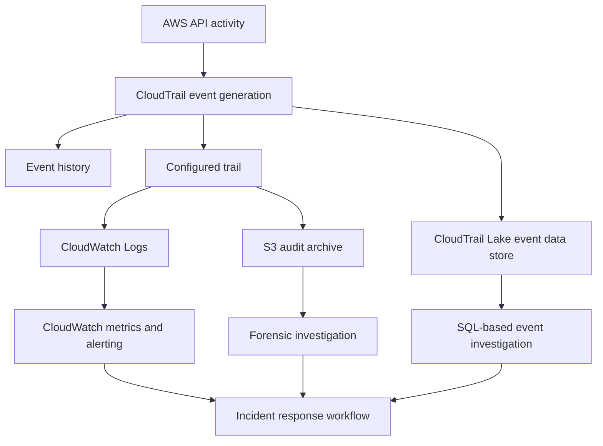
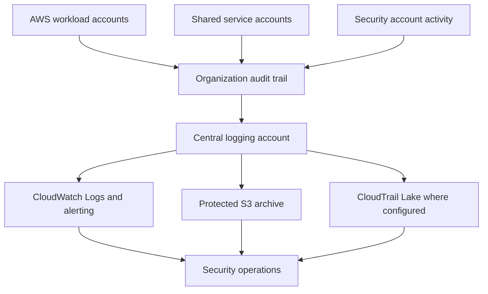
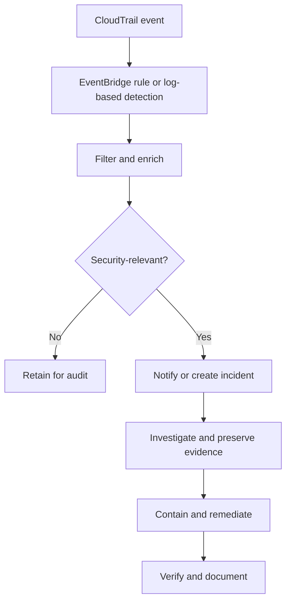

# 08- CloudTrail and Audit Investigation

## Overview

AWS CloudTrail records activity performed through AWS management interfaces and supported service APIs. It provides an audit trail for investigating unauthorized changes, troubleshooting access failures, identifying compromised credentials, and establishing a timeline of security incidents.

For backend engineers, CloudTrail is particularly valuable when an application behaves unexpectedly because of IAM changes, infrastructure modifications, resource deletion, KMS authorization failures, or suspicious activity involving workload identities.

CloudTrail is an audit and investigation service, not a complete application observability platform. It complements Amazon CloudWatch, AWS Config, Amazon GuardDuty, and AWS Security Hub.

### Common investigation scenarios

| Scenario | Investigation objective | Primary evidence |
|---|---|---|
| Unexpected `AccessDenied` | Identify the failed API request and principal | CloudTrail event, IAM policies, and service authorization details |
| Unauthorized resource modification | Determine who changed the configuration | API event, principal identity, request parameters, and timestamp |
| Suspected credential compromise | Identify suspicious API activity | Access key ID, session context, source IP, and related events |
| Deleted or modified infrastructure | Establish the change timeline | Resource API events and AWS Config history where available |
| KMS authorization failure | Identify the principal and failed key operation | CloudTrail event, KMS key ARN, and authorization configuration |
| Missing audit evidence | Determine whether logging covers the activity | Trail configuration, event selectors, Region, and delivery status |
| Unexpected role assumption | Identify the caller and target role | `AssumeRole` event and subsequent role-session activity |
| Security incident | Reconstruct actions and scope | CloudTrail, GuardDuty, Security Hub, and workload logs |

## CloudTrail Event Types

CloudTrail supports different categories of events. Understanding the event type is essential when an investigation produces no results.

### Management events

Management events record control-plane operations that create, modify, describe, or delete AWS resources and configurations.

Examples include:

- `CreateRole`, `UpdateAssumeRolePolicy`, and `AttachRolePolicy`.
- `RunInstances` and `TerminateInstances`.
- `CreateBucket` and supported bucket-configuration changes.
- `PutKeyPolicy` and other supported KMS management operations.
- Changes to security groups, logging configuration, and network resources.

Management events can be read-only or write operations. A read-only event can still be security-relevant because it may reveal reconnaissance or access attempts.

### Data events

Data events record selected operations performed on or within supported resources. Examples include S3 object-level operations and supported Lambda function invocations.

Data events are not automatically equivalent to ordinary management-event coverage. Their collection depends on the relevant trail or event data store configuration and selectors.

Use data events when investigations require evidence of operations such as:

- Reading or downloading S3 objects.
- Writing or deleting S3 objects.
- Invoking supported Lambda functions.
- Tracking access to sensitive resources at the data-operation level.

Data events can increase logging volume and cost significantly. Configure selectors around the resources and operations that require coverage.

### Network activity events

CloudTrail network activity events can record supported network-related API activity, subject to the relevant service, event category, and configuration. They are not a replacement for VPC Flow Logs, packet-level telemetry, or application network logs.

### Event category comparison

| Event category | Typical purpose | Coverage considerations |
|---|---|---|
| Management | Audit resource and control-plane operations | Commonly available through event history; configure trails for durable centralized retention |
| Data | Audit operations on supported resources | Often requires explicit event selectors and can generate high volume |
| Network activity | Audit supported network-related API activity | Availability and collection depend on supported services and configuration |

## CloudTrail Architecture and Data Flow

CloudTrail can provide recent event history, deliver events to an S3 bucket, publish supported events to CloudWatch Logs, and support queries through CloudTrail Lake event data stores.

A production architecture should distinguish event generation, collection, retention, investigation, and alerting.



Not every destination is enabled by default. Trail delivery, CloudWatch Logs integration, and CloudTrail Lake ingestion require the appropriate configuration.

### Event history versus a trail

| Capability | Event history | Configured trail | CloudTrail Lake |
|---|---|---|---|
| Primary purpose | Quick inspection of recent management activity | Durable event delivery to configured destinations | Queryable event retention and analysis |
| Retention | Last 90 days of management events | Depends on destination lifecycle and retention configuration | Depends on event data store retention settings |
| Cross-account centralization | Not a substitute for centralized organization logging | Can use organization trails and centralized destinations | Supports configured event data stores and supported organization use cases |
| Data events | Not available as a complete general-purpose data-event archive | Can collect selected supported data events | Can collect configured supported event sources |
| Investigation | Console and lookup APIs | Search stored logs or query downstream systems | SQL-based queries |
| Cost model | No separate charge for viewing event history | Depends on event delivery, storage, and related services | Depends on ingestion, retention, and applicable pricing |

For production environments, use a configured trail and appropriate retention controls rather than relying solely on event history.

## Verify CloudTrail Configuration

Begin an audit investigation by verifying the AWS account, Region, and active identity.

```bash
aws sts get-caller-identity
```

The command returns the account and ARN associated with the active credentials. Confirm that the CLI is operating in the intended account.

```bash
aws configure get region
```

The configured Region is only a default. Specify `--region` explicitly when investigating regional activity.

### Inspect available trails

```bash
aws cloudtrail describe-trails \
  --region <region>
```

This lists trail metadata visible to the current identity in the selected Region. Review trail names, ARNs, multi-Region settings, organization-trail status, and destination configuration.

Inspect a specific trail:

```bash
aws cloudtrail get-trail \
  --name <trail-name-or-arn> \
  --region <region>
```

Inspect its current logging status:

```bash
aws cloudtrail get-trail-status \
  --name <trail-name-or-arn> \
  --region <region>
```

Review the response for logging status, recent delivery errors, and the latest successful delivery information where returned.

A trail can exist while failing to deliver events. Confirm both its configuration and operational status.

### Inspect event selectors

```bash
aws cloudtrail get-event-selectors \
  --trail-name <trail-name-or-arn> \
  --region <region>
```

Review management-event selectors, data-event selectors, and advanced event selectors. Verify that the required resource types and operations are included.

**Important:** These commands are read-only. They do not create trails, enable logging, or modify selectors.

## Investigate Suspicious API Activity

### Symptoms

- An AWS resource changes without an expected deployment.
- A service unexpectedly loses access to a resource.
- A role performs operations outside its normal workload.
- An administrator reports unfamiliar API calls.
- A resource is deleted, replaced, or reconfigured unexpectedly.

### Investigation procedure

**Step 1: Establish the time window.**

Use timestamps from the alert, application error, GuardDuty finding, or deployment system. Normalize timestamps to UTC when correlating evidence across systems.

**Step 2: Search CloudTrail event history.**

```bash
aws cloudtrail lookup-events \
  --start-time <start-time> \
  --end-time <end-time> \
  --region <region>
```

This searches recent management-event history in the specified Region. Add lookup attributes to narrow the results.

Search for a specific API event:

```bash
aws cloudtrail lookup-events \
  --lookup-attributes AttributeKey=EventName,AttributeValue=DeleteBucket \
  --start-time <start-time> \
  --end-time <end-time> \
  --region <region>
```

Search for activity associated with an access key:

```bash
aws cloudtrail lookup-events \
  --lookup-attributes AttributeKey=AccessKeyId,AttributeValue=<access-key-id> \
  --start-time <start-time> \
  --end-time <end-time> \
  --region <region>
```

The access key identifier is not the secret access key, but it should still be handled according to internal security and data-handling policies.

**Step 3: Inspect the event details.**

The `lookup-events` response contains an `Events` collection. Each event's `CloudTrailEvent` field contains the serialized event JSON.

Review the following fields when present:

| Field | Investigation value |
|---|---|
| `eventTime` | Establishes when the event occurred |
| `eventSource` | Identifies the AWS service |
| `eventName` | Identifies the API operation |
| `awsRegion` | Identifies the Region associated with the event |
| `sourceIPAddress` | Provides source-address context |
| `userAgent` | Helps identify the calling tool or client |
| `userIdentity` | Describes the principal or session |
| `requestParameters` | Shows relevant request parameters where recorded |
| `responseElements` | Provides returned details where recorded |
| `errorCode` | Indicates a failed operation where present |
| `errorMessage` | Provides error context where present |
| `requestID` | Helps correlate the API request with service diagnostics |
| `eventID` | Identifies the CloudTrail event |
| `readOnly` | Indicates whether the operation was classified as read-only where available |

Not every field appears in every event. Sensitive request or response values can be omitted or redacted by AWS services.

**Step 4: Reconstruct the sequence.**

Correlate the suspicious operation with preceding and subsequent events, including role assumptions, policy changes, credential creation, resource modification, and failed access attempts.

**Step 5: Determine the impact.**

Establish which resources were affected, whether operations succeeded, whether data was accessed, and whether the principal retained access.

### Corrective actions

- Contain compromised identities or workloads according to incident-response procedures.
- Preserve the original events and relevant surrounding evidence.
- Review affected resources and reverse unauthorized changes through approved recovery procedures.
- Investigate related principals and resources for additional activity.
- Document the incident timeline and evidence supporting the final assessment.

## Troubleshoot IAM AccessDenied Errors

CloudTrail is useful when a backend service receives an authorization error from an AWS API.

### Common symptoms

- `AccessDenied`
- `AccessDeniedException`
- `UnauthorizedOperation`
- `not authorized to perform`
- `explicit deny in a service control policy`
- `is not authorized to perform: kms:Decrypt`

Exact error text varies by service and authorization context.

### Investigation procedure

**Step 1: Identify the failed operation.**

Search for the relevant event name and time range. Check `eventSource`, `eventName`, `errorCode`, and `errorMessage`.

**Step 2: Identify the principal.**

Inspect `userIdentity`, including the principal ARN, session context, and access key identifier where available.

For assumed-role requests, distinguish the underlying role from the individual role session.

**Step 3: Inspect the applicable authorization controls.**

Review:

- Identity-based policies.
- Resource-based policies.
- Permission boundaries.
- Service control policies.
- Session policies.
- Role trust policies for role assumption.
- Service-specific authorization requirements.

The exact evaluation path depends on the service and principal type.

**Step 4: Check whether the operation was denied or never reached the service.**

CloudTrail evidence can help identify service-side authorization failures, but not every local credential, network, or request-signing failure generates the same service event.

### Corrective actions

Grant only the required action on the required resource, subject to all applicable policy constraints. If the denial is caused by a trust-policy failure, correct the trust relationship rather than expanding the role's permissions.

Do not resolve authorization errors by attaching administrator access indiscriminately.

### Verification

Repeat the intended operation using the correct principal and resource. Confirm that the expected operation succeeds and that unrelated permissions remain restricted.

## Investigate Role Assumption and STS Activity

Unexpected role assumptions can indicate an incorrect trust relationship, a workload configuration problem, or compromised credentials.

### Relevant events

Common investigation targets include:

- `AssumeRole`
- `AssumeRoleWithSAML`
- `AssumeRoleWithWebIdentity`
- `GetSessionToken`
- Other supported STS operations relevant to the authentication flow

### Search role-assumption events

```bash
aws cloudtrail lookup-events \
  --lookup-attributes AttributeKey=EventName,AttributeValue=AssumeRole \
  --start-time <start-time> \
  --end-time <end-time> \
  --region <region>
```

Inspect the event's identity, target role, request parameters, session name, source address, and outcome where available.

### Common failure causes

- The caller is not allowed to call `sts:AssumeRole`.
- The target role's trust policy does not trust the caller.
- An external ID or required condition does not match.
- Web identity or federation configuration is incorrect.
- The requested session duration exceeds the role's configured maximum.
- The application uses an unexpected credential source.
- A session policy restricts the resulting permissions.

### Corrective actions

- Validate the caller's effective permissions.
- Inspect the target role's trust policy.
- Verify federation claims and trust-policy conditions.
- Confirm the workload uses the intended role and credential provider.
- Avoid logging session tokens or other temporary credential material.

CloudTrail may show a successful role assumption followed by denied API operations. Investigate the role session's effective permissions separately from the original role-assumption decision.

## Investigate KMS Authorization and Key-Access Failures

KMS errors can affect S3 operations, database workloads, encrypted logs, application encryption, and secret retrieval.

### Symptoms

- `AccessDeniedException` during a KMS operation.
- An application cannot decrypt previously encrypted data.
- S3 reports an encryption-key access failure.
- A workload cannot retrieve a secret protected by a customer-managed key.
- A KMS key is disabled, pending deletion, or inaccessible.

### Investigation procedure

**Step 1: Identify the failed KMS operation.**

Search for relevant operations such as `Decrypt`, `Encrypt`, `GenerateDataKey`, or `CreateGrant`.

```bash
aws cloudtrail lookup-events \
  --lookup-attributes AttributeKey=EventSource,AttributeValue=kms.amazonaws.com \
  --start-time <start-time> \
  --end-time <end-time> \
  --region <region>
```

Inspect the serialized event JSON to identify the operation, principal, key ARN, error code, and request context where available.

**Step 2: Inspect key metadata.**

```bash
aws kms describe-key \
  --key-id <key-id-or-arn> \
  --region <region>
```

Review the key state, key ARN, key manager, key specification, and usage.

**Step 3: Inspect the key policy.**

```bash
aws kms get-key-policy \
  --key-id <key-id-or-arn> \
  --policy-name default \
  --region <region>
```

Review whether the relevant principal or account has the required permissions and whether the key policy enables the intended IAM authorization model.

**Step 4: Review other authorization constraints.**

Check IAM policies, key policies, grants, encryption context requirements, organization policies, and service-specific integration requirements.

### Corrective actions

- Correct the narrowest missing authorization or key-policy condition.
- Re-enable a disabled key only through an approved process and after validating the cause.
- Verify that the resource and application reference the correct key and Region.
- Preserve existing keys and encrypted data until recovery implications are understood.

### Verification

Repeat the intended operation using the intended workload identity. Confirm that the application can access the required encrypted resource without broadening unrelated permissions.

## Missing or Delayed Audit Evidence

Missing events require a systematic distinction between absent activity, absent collection, delayed delivery, and incomplete investigation scope.

### Common causes

- The event occurred in another Region.
- The investigator is using the wrong account.
- The activity is a data event that was not selected.
- The trail is stopped or misconfigured.
- A trail exists but cannot deliver to its destination.
- The event is outside the event-history retention window.
- The service or operation does not emit the expected event type.
- The event is present in the archive but the query or filter excludes it.

### Troubleshooting procedure

**Step 1: Verify the trail.**

```bash
aws cloudtrail describe-trails \
  --region <region>
```

**Step 2: Check whether logging is active.**

```bash
aws cloudtrail get-trail-status \
  --name <trail-name-or-arn> \
  --region <region>
```

Review the logging state and recent delivery errors.

**Step 3: Inspect selectors.**

```bash
aws cloudtrail get-event-selectors \
  --trail-name <trail-name-or-arn> \
  --region <region>
```

Confirm that the required management or data events are included.

**Step 4: Check destination permissions and health.**

Inspect the configured S3 bucket policy, encryption-key permissions, CloudWatch Logs role permissions, and destination service health as applicable.

**Step 5: Expand the investigation scope.**

Search the correct account and Region, inspect adjacent timestamps, and query the configured archive or CloudTrail Lake event data store if event history is insufficient.

### Prevention

- Deploy organization-wide audit logging using approved centralized controls.
- Configure multi-Region collection where required.
- Select necessary data events for sensitive resources.
- Monitor trail logging status and delivery failures.
- Protect audit archives against unauthorized modification or deletion.
- Define retention and investigation requirements before incidents occur.

A missing event is not proof that an action did not happen. Record the coverage limitations and confidence level when reporting findings.

## CloudTrail Logs in S3 and CloudWatch Logs

### S3 audit archives

S3 is commonly used for durable CloudTrail log storage and long-term evidence retention.

Verify:

- The trail's configured S3 destination.
- Bucket policy permissions required by CloudTrail.
- Encryption configuration and KMS access where applicable.
- Lifecycle and retention policies.
- Access controls and protections against unauthorized deletion.
- Integrity-validation configuration where required.

Do not grant broad public access to an audit bucket or allow routine workload roles to delete audit evidence.

### CloudWatch Logs integration

CloudTrail can deliver supported events to a configured CloudWatch Logs log group, enabling log queries, metrics, and alarms.

Investigate:

- The configured log group and delivery role.
- Log-stream creation and permissions.
- Ingestion delays and service errors.
- Retention settings.
- Metric filters and alarms that depend on event structure.

CloudWatch Logs is useful for operational alerting, while S3 can provide a durable audit archive. They serve different operational purposes.

## Query CloudTrail Lake

CloudTrail Lake supports SQL-based investigation over configured event data stores. It is useful when an incident requires searching a larger dataset or correlating events across a longer period.

### Identify event data stores

```bash
aws cloudtrail list-event-data-stores \
  --region <region>
```

Review available event data stores and confirm that the relevant event source and retention configuration are included.

### Query design

A query can identify events from a specific AWS service and API operation. For example, a conceptual SQL query over a configured CloudTrail Lake event data store is:

```sql
SELECT
    eventTime,
    eventSource,
    eventName,
    awsRegion,
    userIdentity,
    sourceIPAddress,
    errorCode
FROM <event_data_store_table>
WHERE eventSource = 'iam.amazonaws.com'
  AND eventName = 'UpdateAssumeRolePolicy'
  AND eventTime >= '<start-time>'
  AND eventTime <= '<end-time>'
ORDER BY eventTime DESC;
```

Replace the table reference and timestamps with values supported by the selected event data store and its query interface. Validate the query schema before using it in an investigation.

### Operational considerations

- Limit the time window to reduce unnecessary scanning.
- Query only the fields needed for the investigation.
- Confirm the data store contains the relevant event categories.
- Respect query execution limits and service quotas.
- Consider ingestion and retention costs when designing long-term investigation workflows.

CloudTrail Lake queries are not a substitute for ensuring that the required events were collected in the first place.

## Centralized Audit Logging Architecture

For production environments, audit logs should be collected and retained independently of ordinary workload administration.



### Design principles

- Use a dedicated logging account or equivalent isolation boundary.
- Restrict access to audit logs separately from workload administration.
- Apply encryption and appropriate retention controls.
- Monitor changes to trails, destinations, bucket policies, and logging configuration.
- Include all required accounts and Regions.
- Establish documented access and evidence-export procedures.
- Validate the architecture periodically using approved test events.

### Availability and recovery

Audit evidence is most valuable when it survives the incident being investigated. Protect the logging destination against accidental deletion, unauthorized access, and loss of encryption-key availability.

Use retention, versioning, cross-account controls, and other supported protections according to the threat model and regulatory requirements. Where stronger immutability is required, evaluate S3 Object Lock and its retention modes carefully before deployment.

## Security Monitoring and Alerting

CloudTrail can support detection of sensitive API operations, including changes to identity policies, audit configuration, network exposure, and encryption settings.

Potentially useful monitoring targets include:

- Changes to IAM roles, trust policies, and attached policies.
- Creation or deletion of access keys.
- Changes to CloudTrail configuration.
- Modifications to security groups and network ACLs.
- Changes to KMS key policies or key state.
- Public-access configuration changes.
- Unusual role assumption patterns.
- Resource deletion or modification outside approved deployment windows.

Not every event should page an operator. Prioritize alerts using resource criticality, expected operational behavior, risk, and confidence.

### Alerting workflow



Use idempotent event consumers and ensure that notification failures do not silently discard security events.

## Practical Investigation Workflow

Use this checklist during a production incident.

### Before investigation

- [ ] Confirm the account, Region, and investigator identity.
- [ ] Record the incident start time and affected resources.
- [ ] Verify CloudTrail coverage and identify the relevant event sources.
- [ ] Preserve the original alert or finding.
- [ ] Use an approved, access-controlled investigation workspace.

### During investigation

- [ ] Search the narrowest useful time window.
- [ ] Identify the principal, API operation, and resource.
- [ ] Correlate role assumptions with subsequent actions.
- [ ] Distinguish successful requests from failed requests.
- [ ] Inspect relevant IAM, KMS, network, and resource configuration.
- [ ] Search for related activity across accounts and Regions.
- [ ] Preserve raw events and record evidence provenance.

### After investigation

- [ ] Contain compromised identities or workloads when required.
- [ ] Remediate the root cause using approved changes.
- [ ] Verify the intended operation and security controls.
- [ ] Confirm logging and alerting remain operational.
- [ ] Document the timeline, impact, and recovery actions.
- [ ] Record gaps in event coverage and assign preventive work.

## Common Mistakes and Production Pitfalls

| Mistake | Why it causes problems | Better approach |
|---|---|---|
| Relying only on event history | Recent management-event history has limited retention and scope | Maintain configured trails and appropriate archives |
| Ignoring Region boundaries | Regional activity may be missed | Investigate relevant Regions and use centralized coverage |
| Assuming all API calls are logged identically | Event categories and selectors differ | Verify event coverage and selectors |
| Treating `AccessDenied` as proof of compromise | Legitimate policy changes can also cause denials | Correlate principal, request, deployment, and policy evidence |
| Logging secrets during investigation | Credentials and sensitive data can leak | Redact sensitive fields and restrict evidence access |
| Disabling logging to reduce noise | Creates audit gaps during future incidents | Adjust selectors and downstream filters instead |
| Granting administrator access to fix a denial | Expands the blast radius | Correct the specific authorization failure |
| Assuming no event means no activity | Collection or retention may be incomplete | Verify logging coverage, destination health, and query scope |
| Allowing workload administrators to delete audit logs | Compromises forensic integrity | Isolate logging administration and protect retention |
| Alerting on every API event | Creates alert fatigue | Prioritize high-risk events and tune detection rules |

## Key Takeaways

- CloudTrail is a primary source of AWS API audit evidence, but reliable investigations require correct account, Region, event coverage, and retention.
- Distinguish management events, data events, and other supported event categories before concluding that audit evidence is missing.
- Correlate principal identity, API operation, timestamp, request details, and authorization context to investigate access failures and suspicious activity.
- Protect centralized audit destinations independently of workload administration, and monitor trail configuration and delivery failures.
- Treat CloudTrail as part of a broader security investigation workflow alongside IAM, AWS Config, GuardDuty, Security Hub, and workload telemetry.