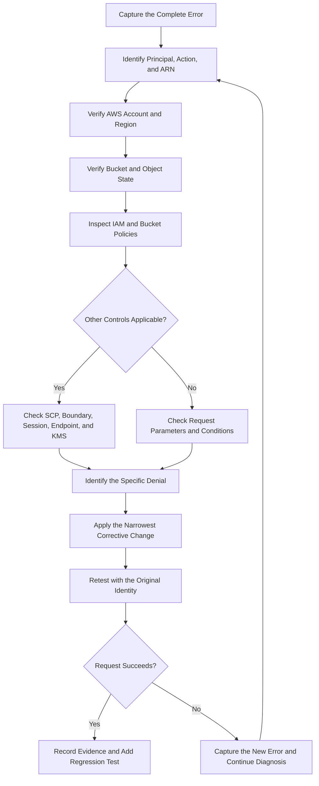

# 01- Access Denied and AccessDenied Errors

## Overview

Amazon S3 `AccessDenied` errors occur when a request is not authorized under the effective permissions and security controls applicable to the request. They commonly appear as HTTP `403 Forbidden` responses during object uploads, downloads, listings, deletions, copies, presigned URL requests, and bucket configuration operations.

The error does not necessarily mean that the caller's IAM policy is missing an `Allow` statement. The request can also be blocked by a bucket policy, an explicit deny, an AWS Organizations policy, a permissions boundary, a session policy, a VPC endpoint policy, S3 Block Public Access, or AWS KMS authorization.

The correct troubleshooting approach is to identify the exact API operation, the calling principal, the resource ARN, and the policy or condition responsible for the denial before changing permissions.

This document covers:

- Common S3 `AccessDenied` symptoms and their meaning.
- A repeatable diagnostic workflow.
- IAM and bucket-policy troubleshooting.
- Cross-account access and organizational restrictions.
- SSE-KMS authorization failures.
- Public-access controls, access points, ACLs, and VPC endpoints.
- Presigned URL and application integration failures.
- AWS CLI commands, least-privilege policy examples, and regression testing.

## Understand the Error

### `AccessDenied` versus HTTP `403 Forbidden`

`AccessDenied` is the AWS service error code. HTTP `403 Forbidden` is the corresponding HTTP status commonly returned for authorization failures.

An error may look like this:

```text
An error occurred (AccessDenied) when calling the GetObject operation:
User: arn:aws:iam::123456789012:role/document-api-role
is not authorized to perform: s3:GetObject
on resource: arn:aws:s3:::company-prod-documents-123456789012/reports/report.pdf
because no identity-based policy allows the s3:GetObject action
```

The message contains important diagnostic information:

| Field | What to investigate |
|---|---|
| Calling principal | Confirm the IAM user, assumed role, or workload identity actually making the request |
| API operation | Identify the required S3 action |
| Resource ARN | Verify the bucket, object key, version, or other resource |
| Denial reason | Look for implicit denial, explicit deny, policy type, or missing authorization |
| Policy ARN | When supplied, inspect the policy identified by AWS |
| Request context | Check conditions involving encryption headers, network location, principal, tags, or other request attributes |

AWS provides enhanced access-denied messages for many requests within the same AWS account or AWS Organizations organization. Cross-account requests outside the same organization and some other request types may return only a generic error.

**Important:** An error message can identify one denial reason even when multiple policies or conditions are involved. Fixing the first reported issue does not guarantee that the request will succeed afterward.

Reference: [Troubleshoot 403 Forbidden errors in Amazon S3](https://docs.aws.amazon.com/AmazonS3/latest/userguide/troubleshoot-403-errors.html).

## Diagnose Implicit Deny and Explicit Deny

IAM authorization distinguishes between implicit and explicit denial.

### Implicit deny

By default, access is denied unless an applicable policy permits the request.

For example, an application role may have permission to list a bucket but no permission to read the objects inside it.

```text
s3:ListBucket  -> Allowed
s3:GetObject   -> Not allowed
```

The application can discover keys but cannot retrieve the object data.

### Explicit deny

An applicable policy contains a `Deny` statement that matches the request.

For example, a bucket policy might deny all requests made without secure transport. Adding an identity-based `Allow` does not override that explicit deny.

### Common policy layers

| Policy or control | Typical failure |
|---|---|
| Identity-based IAM policy | The user or role lacks the required S3 action |
| Bucket policy | The bucket does not allow the principal, or a condition does not match |
| Access-point policy | The request is not allowed through the selected access point |
| Permissions boundary | The principal's maximum permitted access excludes the action |
| Session policy | The assumed-role session has a narrower permission set |
| AWS Organizations SCP | The account's permitted actions exclude the request |
| Resource control policy (RCP) | The applicable resource-level organization policy restricts access |
| VPC endpoint policy | The request through the endpoint is not permitted |
| S3 Block Public Access | The requested public access conflicts with enforced controls |
| AWS KMS key policy or IAM permissions | The object operation cannot use the required encryption key |
| Object ACL or ownership configuration | Legacy object ownership or ACL behavior prevents access |

The effective authorization decision depends on the policies and controls that apply to the specific request. Do not assume that adding an `Allow` to one policy resolves a denial elsewhere.

## Standard Diagnostic Workflow

Use a repeatable sequence to isolate the failing authorization layer.



### Capture the original failure

Record:

- The full AWS CLI error or SDK exception.
- The API operation and request method.
- The bucket, object key, version ID, and Region.
- The AWS identity used by the failing process.
- The timestamp and AWS request ID, if available.
- Any encryption headers, endpoint configuration, or presigned URL parameters relevant to the request.

Do not include access keys, session tokens, SSE-C key material, or complete presigned URLs in diagnostic logs.

### Verify the active identity

```bash
aws sts get-caller-identity
```

For a named profile:

```bash
aws sts get-caller-identity \
  --profile production
```

Compare the returned account ID and ARN with the identity expected by the application or deployment.

A developer's terminal, a Docker container, a Kubernetes workload, a CI/CD runner, and an EC2 instance can all resolve different AWS credentials even when they execute the same code.

### Verify the target resource

```bash
aws s3api head-bucket \
  --bucket company-prod-documents-123456789012 \
  --region ap-south-1
```

For an object:

```bash
aws s3api head-object \
  --bucket company-prod-documents-123456789012 \
  --key reports/report.pdf \
  --region ap-south-1
```

A failed `HeadObject` does not establish that the object is missing. It can fail because the caller lacks object-read authorization, the resource does not exist, the bucket or key is incorrect, or another applicable control blocks the request.

Use a privileged diagnostic identity only when authorized and necessary to distinguish resource existence from the application's access problem. Do not substitute an administrator's successful request for an application-role test.

## Match the Failing Operation to the Required Permission

One of the most common mistakes is granting the wrong S3 action.

S3 bucket actions and object actions use different resource types and ARNs.

| Operation | Common permission | Resource scope |
|---|---|---|
| List objects | `s3:ListBucket` | `arn:aws:s3:::BUCKET_NAME` |
| Read object | `s3:GetObject` | `arn:aws:s3:::BUCKET_NAME/KEY` |
| Upload object | `s3:PutObject` | `arn:aws:s3:::BUCKET_NAME/KEY` |
| Delete object | `s3:DeleteObject` | `arn:aws:s3:::BUCKET_NAME/KEY` |
| Read bucket policy | `s3:GetBucketPolicy` | Bucket ARN |
| Inspect bucket versioning | `s3:GetBucketVersioning` | Bucket ARN |
| Inspect default encryption | `s3:GetEncryptionConfiguration` | Bucket ARN |
| Inspect public-access-block configuration | `s3:GetBucketPublicAccessBlock` | Bucket ARN |
| Inspect object tags | `s3:GetObjectTagging` | Object ARN |
| Read a specific object version | `s3:GetObjectVersion` | Object ARN |

Additional permissions can be necessary for multipart uploads, object tagging, ACL operations, version-specific deletion, retention, or other specialized APIs.

Reference: [Required permissions for Amazon S3 API operations](https://docs.aws.amazon.com/AmazonS3/latest/userguide/using-with-s3-policy-actions.html).

### Troubleshoot `ListBucket`

A list operation typically requires `s3:ListBucket` on the bucket ARN.

An appropriate policy statement for a narrowly scoped reporting prefix is:

```json
{
  "Sid": "ListReportsPrefix",
  "Effect": "Allow",
  "Action": "s3:ListBucket",
  "Resource": "arn:aws:s3:::company-prod-documents-123456789012",
  "Condition": {
    "StringLike": {
      "s3:prefix": [
        "reports",
        "reports/",
        "reports/*"
      ]
    }
  }
}
```

The condition constrains the requested listing prefix. It does not grant read access to the object contents.

For list requests, validate the actual prefix and any delimiter parameter because conditions must match the request context.

### Troubleshoot `GetObject`

An object-read policy uses the object ARN, not only the bucket ARN.

```json
{
  "Sid": "ReadReports",
  "Effect": "Allow",
  "Action": "s3:GetObject",
  "Resource": "arn:aws:s3:::company-prod-documents-123456789012/reports/*"
}
```

This allows the permitted action on objects under `reports/`, subject to other applicable policies and controls.

For example, granting only the following resource is not sufficient for normal object reads:

```text
arn:aws:s3:::company-prod-documents-123456789012
```

That ARN identifies the bucket, not the objects inside it.

### Troubleshoot uploads

An application uploading objects commonly needs `s3:PutObject` on the destination object ARN.

Depending on the workflow, it may additionally require permissions related to tagging, ACLs, multipart completion, or KMS encryption.

Do not grant `s3:*` merely because an upload currently fails. Identify the operation in the error and add only the permissions required by the intended workflow.

## Inspect IAM and Bucket Policies

### Retrieve the bucket policy

```bash
aws s3api get-bucket-policy \
  --bucket company-prod-documents-123456789012 \
  --region ap-south-1
```

Review the following:

- Whether the intended principal is covered by an `Allow`.
- Whether an explicit `Deny` matches the action or resource.
- Whether the policy requires a particular VPC endpoint, source IP, TLS condition, or encryption header.
- Whether the bucket ARN and object ARN patterns match the actual request.
- Whether account IDs and role ARNs are correct.

If no bucket policy exists, the API can return an error. Identity-based policies can still grant access where the applicable authorization model permits it.

### Inspect the caller's attached policies

For an IAM role:

```bash
aws iam list-attached-role-policies \
  --role-name document-api-role
```

List inline policies:

```bash
aws iam list-role-policies \
  --role-name document-api-role
```

Retrieve an inline role policy:

```bash
aws iam get-role-policy \
  --role-name document-api-role \
  --policy-name DocumentStoragePolicy
```

For an IAM user, use the corresponding user-policy APIs. An application's active principal can be an assumed-role session rather than the underlying IAM user or role initially expected.

### Use the IAM policy simulator carefully

For an identity-based policy investigation:

```bash
aws iam simulate-principal-policy \
  --policy-source-arn arn:aws:iam::123456789012:role/document-api-role \
  --action-names s3:GetObject \
  --resource-arns arn:aws:s3:::company-prod-documents-123456789012/reports/report.pdf
```

The simulator can provide useful evidence about the evaluated identity policy decision. It does not reproduce every aspect of a real S3 request, every resource-policy interaction, all organization controls, or every request-context condition.

Treat simulation as a diagnostic aid, not proof that the real request must succeed.

### Look for condition mismatches

An `Allow` or `Deny` statement can depend on values such as:

- `aws:SecureTransport`
- `aws:SourceIp`
- `aws:SourceVpce`
- `aws:PrincipalArn`
- `s3:prefix`
- `s3:ExistingObjectTag`
- `s3:RequestObjectTag`
- Encryption-related request headers

For example, a bucket policy allowing only a specific VPC endpoint can block an otherwise authorized local CLI request that uses the public S3 endpoint.

Do not remove security conditions simply to make a developer's local request work. Determine which network path and access method the workload is intended to use.

## Inspect Organizational and Session Restrictions

Identity-based policies may appear correct while another policy limits the effective permissions.

### Permissions boundaries

A permissions boundary defines the maximum permissions available to an IAM principal. An identity-based `Allow` cannot grant access beyond that boundary.

Inspect the IAM role:

```bash
aws iam get-role \
  --role-name document-api-role \
  --query 'Role.PermissionsBoundary'
```

If the command returns no boundary, that role does not have a permissions boundary configured through that field. Other policy controls can still restrict its access.

### AWS Organizations policies

Check with the authorized cloud or organization administrator whether an SCP or RCP applies to the account or resource.

An Organizations policy may restrict the allowed actions regardless of the identity policy attached to the role.

### Session policies and assumed roles

When a workload assumes a role, the resulting session can have narrower permissions than the role's identity policies alone imply.

Check:

- The role's identity policies.
- The role trust policy and the ability to assume the role.
- Any session policy passed during `AssumeRole`.
- Session tags and conditions that influence policy evaluation.
- The actual assumed-role ARN returned by `get-caller-identity`.

Use the precise denial reason in the AWS error message when available. Do not assume that every access failure is caused by the bucket policy.

Reference: [Troubleshoot access denied errors in IAM](https://docs.aws.amazon.com/IAM/latest/UserGuide/troubleshoot_access-denied.html).

## Troubleshoot Cross-Account Access

Cross-account access requires an authorization design that covers both the caller and the destination resource.

For a typical cross-account object read:

- The caller's identity-based permissions must allow the relevant S3 action.
- The bucket policy must permit the external principal or role where required.
- Applicable organizational restrictions must permit the request.
- If the object uses SSE-KMS, the required KMS authorization must also be satisfied.

### Example bucket-policy statement

Suppose account `111122223333` owns the bucket and account `444455556666` operates the application role.

A narrowly scoped read statement might look like this:

```json
{
  "Version": "2012-10-17",
  "Statement": [
    {
      "Sid": "AllowReportingRoleToReadReports",
      "Effect": "Allow",
      "Principal": {
        "AWS": "arn:aws:iam::444455556666:role/reporting-service-role"
      },
      "Action": "s3:GetObject",
      "Resource": "arn:aws:s3:::company-prod-documents-123456789012/reports/*"
    }
  ]
}
```

The bucket owner must review and apply the policy. The example grants object reads only under `reports/`; it does not independently grant bucket listing, writing, or KMS decryption.

If listing is required, add a separate, correctly scoped `s3:ListBucket` permission with an appropriate prefix condition.

### Verify the correct account and role

From the application environment:

```bash
aws sts get-caller-identity
```

Then test a specific object using that identity:

```bash
aws s3api get-object \
  --bucket company-prod-documents-123456789012 \
  --key reports/report.pdf \
  ./report.pdf \
  --region ap-south-1
```

If the identity is correct but access remains denied, inspect the bucket policy, organization controls, object ownership, and KMS permissions.

Cross-account errors can be less descriptive than same-account errors. Absence of a detailed policy explanation is not evidence that the bucket policy is the only possible cause.

## Troubleshoot SSE-KMS Access Denied

SSE-KMS introduces an additional authorization layer. A request can be allowed by S3 policies but still fail because the caller cannot use the KMS key.

### Read failure

For an SSE-KMS object, a download generally requires:

- Appropriate S3 object-read permission.
- KMS authorization to decrypt the object data key.
- An enabled, usable KMS key in the correct Region.
- A key policy and any other applicable permissions that allow the requested operation.

Common KMS-related problems include a missing `kms:Decrypt` permission, an explicit deny in the key policy, a disabled key, or an incorrect destination key configuration after a copy or migration.

### Upload failure

For SSE-KMS uploads, the operation generally requires `kms:GenerateDataKey` authorization on the selected key. Multipart workflows and certain copy or decrypt operations can also require `kms:Decrypt`.

Determine the actual operation and key before selecting the required KMS permissions.

### Inspect the key

```bash
aws kms describe-key \
  --key-id arn:aws:kms:ap-south-1:123456789012:key/EXAMPLE-KEY-ID \
  --region ap-south-1
```

Retrieve the key policy:

```bash
aws kms get-key-policy \
  --key-id arn:aws:kms:ap-south-1:123456789012:key/EXAMPLE-KEY-ID \
  --policy-name default \
  --region ap-south-1
```

Check that:

- The key ARN and Region match the object configuration.
- The key is enabled and not pending deletion.
- The application principal is permitted to use the key.
- The key policy and identity policies are compatible.
- Applicable grants and organizational restrictions do not block access.

### Separate S3 and KMS troubleshooting

| Failure | Diagnostic focus |
|---|---|
| `s3:GetObject` is explicitly denied | S3 IAM or resource-policy deny |
| S3 read is allowed but decryption fails | KMS key policy, `kms:Decrypt`, or key state |
| Upload using SSE-KMS fails | S3 write permission, `kms:GenerateDataKey`, key configuration |
| Cross-account encrypted read fails | Source object permissions and KMS cross-account authorization |
| Copy into a different KMS key fails | Source decrypt authorization and destination key authorization |

Do not grant broad KMS permissions or modify the key policy before verifying which principal and key the failed request used.

Reference: [Using SSE-KMS with Amazon S3](https://docs.aws.amazon.com/AmazonS3/latest/userguide/UsingKMSEncryption.html).

## Troubleshoot Block Public Access and ACLs

### Inspect Block Public Access

```bash
aws s3api get-public-access-block \
  --bucket company-prod-documents-123456789012 \
  --region ap-south-1
```

Block Public Access can be configured at the account, bucket, or access-point level. The effective controls can prevent requests that would otherwise expose resources publicly.

For a bucket expected to be private, confirm that the controls match the intended security baseline. Do not disable them simply to resolve a generic `AccessDenied` error.

### Understand the four settings

| Setting | Effect |
|---|---|
| `BlockPublicAcls` | Rejects requests that attempt to apply public ACLs in covered operations |
| `IgnorePublicAcls` | Ignores public ACL grants when evaluating access |
| `BlockPublicPolicy` | Blocks attempts to install policies classified as public |
| `RestrictPublicBuckets` | Restricts access where the applicable bucket policy is public |

These controls are not interchangeable. Identify which setting affects the failed operation before changing the configuration.

### Inspect Object Ownership

```bash
aws s3api get-bucket-ownership-controls \
  --bucket company-prod-documents-123456789012 \
  --region ap-south-1
```

With `BucketOwnerEnforced`, ACLs are disabled and access is managed through policies. Workloads that still send ACL headers or depend on legacy object ACLs may fail or need to be updated.

For most modern application buckets, policy-based access with `BucketOwnerEnforced` is simpler to manage, provided all producers and integrations are compatible.

## Troubleshoot VPC Endpoint Restrictions

An S3 gateway or interface endpoint can have an endpoint policy that restricts which principals and resources are reachable through it.

A workload may succeed from a developer's workstation but fail from an EC2 instance, ECS task, Lambda function, or container that accesses S3 through a VPC endpoint.

Inspect:

- Whether the workload uses the expected endpoint and network route.
- The VPC endpoint policy.
- The allowed principals, bucket ARNs, and object ARNs.
- Bucket-policy conditions that require `aws:SourceVpce`.
- Network configuration and DNS behavior for the selected endpoint type.

An identity-policy `Allow` is not sufficient if the endpoint policy blocks the request.

Do not remove the endpoint policy or its conditions without determining the intended network-security design.

Reference: [Troubleshoot S3 403 errors](https://docs.aws.amazon.com/AmazonS3/latest/userguide/troubleshoot-403-errors.html).

## Troubleshoot Presigned URL Failures

A presigned URL grants temporary access using the permissions available to the identity that generated it, subject to request conditions and other authorization controls.

An `AccessDenied` response from a presigned request can result from:

- The signing principal lacking the required S3 permission.
- A bucket policy or other control denying the request.
- A URL generated for a different method or object key.
- Required signed headers being omitted or changed by the client.
- URL expiration or credential expiration.
- A network or source condition that the request does not satisfy.
- KMS authorization failures for encrypted objects.

### Diagnostic process

1. Confirm that the URL was generated for the intended bucket, object key, operation, and HTTP method.
2. Verify the signing principal's permissions.
3. Check the URL expiration and the lifetime of the credentials used to sign it.
4. Confirm that the client sends the signed headers and request method correctly.
5. Inspect relevant bucket-policy conditions.
6. For SSE-KMS objects, verify the appropriate key authorization.
7. Generate a fresh URL using the correct identity and test it with the intended HTTP request.

Treat the entire presigned URL as a secret because anyone possessing a valid URL may be able to use it until it expires or the request becomes invalid.

Do not place presigned URLs in application logs, issue trackers, or error-reporting tools.

Reference: [Using presigned URLs](https://docs.aws.amazon.com/AmazonS3/latest/userguide/using-presigned-url.html).

## Troubleshoot Requester Pays Buckets

A Requester Pays bucket can reject requests when the caller does not indicate that the request charges should be paid by the requester.

Inspect the request-payment configuration:

```bash
aws s3api get-bucket-request-payment \
  --bucket company-prod-documents-123456789012 \
  --region ap-south-1
```

If the bucket is configured for Requester Pays, use a client and operation that explicitly supports declaring the requester-pays context.

For example:

```bash
aws s3api get-object \
  --bucket company-prod-documents-123456789012 \
  --key reports/report.pdf \
  ./report.pdf \
  --request-payer requester \
  --region ap-south-1
```

Use this only when the calling identity is authorized and the workflow is expected to pay requester charges. Do not change the bucket's payment configuration as a troubleshooting shortcut.

## Troubleshoot `HeadObject` and Missing-Object Errors

`HeadObject` retrieves object metadata without returning the object's content. Its authorization and error behavior can make missing objects difficult to distinguish from inaccessible objects.

For example:

```bash
aws s3api head-object \
  --bucket company-prod-documents-123456789012 \
  --key reports/missing-report.pdf \
  --region ap-south-1
```

A missing object can produce different responses depending on whether the caller has the permission required to distinguish absence from lack of access.

### Diagnostic checks

- Confirm the exact key, including case, spaces, and prefixes.
- Check whether the operation targets a particular version.
- Verify the caller's object-read authorization.
- When authorized, use a controlled diagnostic identity to check whether the object or version exists.
- Avoid assuming that a generic `403` confirms the object exists.
- Do not change bucket-wide permissions simply to distinguish a missing key from an inaccessible one.

Use the original application identity for the final regression test.

## Investigate with CloudTrail

CloudTrail can provide evidence about the principal, API operation, request parameters, and service error involved in an access failure.

For relevant management events available in Event History:

```bash
aws cloudtrail lookup-events \
  --lookup-attributes AttributeKey=EventSource,AttributeValue=s3.amazonaws.com \
  --max-results 20 \
  --region ap-south-1
```

This command is useful for management-event investigation. It is not a complete source of S3 object data events.

For object-level operations, ensure that the required S3 data events are configured in the applicable CloudTrail trail or event data store. Review the resulting records through the configured logging destination or CloudTrail Lake as appropriate.

When investigating an access failure:

1. Locate the event matching the failed request and timestamp.
2. Confirm the principal and operation.
3. Inspect the bucket, key, and relevant request parameters.
4. Read the service error and any denial context recorded.
5. Correlate the event with the application's request ID and logs.
6. Compare the request against the policies and conditions active at that time.

Not every request failure necessarily appears in every logging configuration. Absence of an event is not definitive proof that the request did not occur.

Reference: [CloudTrail logging for Amazon S3](https://docs.aws.amazon.com/AmazonS3/latest/userguide/cloudtrail-logging-s3-info.html).

## Apply a Least-Privilege Correction

After identifying the confirmed cause, modify only the relevant policy or configuration.

For example, an application that only needs to read reports should not receive unrestricted access to the entire bucket.

A sample identity-based policy is:

```json
{
  "Version": "2012-10-17",
  "Statement": [
    {
      "Sid": "ReadApplicationReports",
      "Effect": "Allow",
      "Action": [
        "s3:GetObject"
      ],
      "Resource": [
        "arn:aws:s3:::company-prod-documents-123456789012/reports/*"
      ]
    },
    {
      "Sid": "ListApplicationReports",
      "Effect": "Allow",
      "Action": "s3:ListBucket",
      "Resource": "arn:aws:s3:::company-prod-documents-123456789012",
      "Condition": {
        "StringLike": {
          "s3:prefix": [
            "reports",
            "reports/",
            "reports/*"
          ]
        }
      }
    }
  ]
}
```

The policy grants object reads and listing of the intended prefix. It does not grant object creation, deletion, bucket-policy management, or KMS authorization.

The example is only an identity-policy component. The final authorization decision still depends on applicable bucket policies, organizational restrictions, endpoint policies, encryption settings, and other controls.

### Avoid unsafe fixes

Do not automatically:

- Attach `AmazonS3FullAccess`.
- Grant `s3:*` to the application role.
- Grant `kms:*` to all principals.
- Change the bucket policy to allow every principal.
- Disable S3 Block Public Access.
- Remove explicit-deny conditions without understanding their purpose.
- Make a private bucket public to simplify an upload or download.
- Permanently remove object versions during unrelated access troubleshooting.

These changes can expand the security boundary without resolving the original cause.

## Verify the Fix and Prevent Regression

After applying a correction, repeat the original failing operation using the same identity and request context.

| Validation | Expected result |
|---|---|
| Identity validation | The intended role or principal is active |
| Object read | The intended object can be downloaded when read access is required |
| Object write | The intended object can be uploaded when write access is required |
| Listing | Only the approved prefix or resource scope is accessible |
| Encryption | Objects use the approved encryption configuration |
| KMS access | Required encryption and decryption operations succeed |
| Network path | The intended VPC endpoint or network path works |
| Negative authorization test | Access outside the allowed scope remains denied |
| Audit evidence | The successful request and relevant changes can be correlated |

A successful metadata request does not replace an actual download test when application decryptability must be established.

Add regression tests for both permitted and prohibited operations. Where policies are managed through infrastructure as code, update the source-controlled configuration and review the plan before deployment to avoid configuration drift.

## Common Root Causes and Corrective Actions

| Root cause | Evidence | Corrective action |
|---|---|---|
| Missing identity permission | Denial names an action not allowed by the role policy | Add the specific action on the correct resource ARN |
| Incorrect resource ARN | Policy uses bucket ARN for an object operation | Correct the resource scope |
| Explicit deny | Error references an explicit deny or policy ARN | Inspect and narrow the responsible deny only if access should be allowed |
| Bucket policy condition mismatch | Request comes from an unexpected network path or lacks required headers | Correct the request context or policy according to the intended architecture |
| Cross-account policy incomplete | External principal cannot access the resource | Review caller policy, bucket policy, organization controls, and KMS authorization |
| KMS authorization failure | S3 operation reaches an encrypted object but key use is denied | Correct the specific KMS permission or key-policy issue |
| VPC endpoint restriction | Request fails only from a particular network path | Inspect endpoint policy and bucket network conditions |
| Block Public Access | Public request or ACL change conflicts with enforced controls | Use the intended authenticated access path or approved public-delivery architecture |
| Requester Pays | The bucket requires request-payer context | Use a compatible request that declares requester payment |
| Presigned URL mismatch | The URL or signed headers differ from the original signing request | Generate and use a correctly scoped URL |
| Wrong AWS identity | Caller ARN or account differs from expectations | Correct the profile, role assumption, or workload credential configuration |
| Missing object or version | The requested key/version cannot be found | Validate the resource identifier using an appropriately authorized diagnostic identity |

## Production Troubleshooting Checklist

- [ ] Capture the full error code, message, operation, and request context.
- [ ] Confirm the actual principal using `get-caller-identity`.
- [ ] Verify the target bucket, object key, version ID, account, and Region.
- [ ] Identify the exact S3 action required by the failed operation.
- [ ] Check resource ARNs and prefix conditions.
- [ ] Review identity-based policies, bucket policies, and access-point policies.
- [ ] Investigate explicit denies, permissions boundaries, session policies, SCPs, and RCPs where applicable.
- [ ] Check VPC endpoint restrictions and network-based conditions.
- [ ] Inspect Block Public Access and Object Ownership settings.
- [ ] Separate S3 authorization failures from KMS authorization failures.
- [ ] Review CloudTrail evidence when the necessary events are available.
- [ ] Apply the smallest correction that resolves the confirmed issue.
- [ ] Test the original operation and verify that unauthorized access remains denied.
- [ ] Update infrastructure as code and add regression coverage where appropriate.

## Official References

- [Troubleshoot 403 Forbidden errors in Amazon S3](https://docs.aws.amazon.com/AmazonS3/latest/userguide/troubleshoot-403-errors.html)
- [Troubleshooting Amazon S3 identity and access](https://docs.aws.amazon.com/AmazonS3/latest/userguide/security_iam_troubleshoot.html)
- [IAM access-denied troubleshooting](https://docs.aws.amazon.com/IAM/latest/UserGuide/troubleshoot_access-denied.html)
- [IAM policy evaluation logic](https://docs.aws.amazon.com/IAM/latest/UserGuide/reference_policies_evaluation-logic_policy-eval-denyallow.html)
- [Required permissions for Amazon S3 API operations](https://docs.aws.amazon.com/AmazonS3/latest/userguide/using-with-s3-policy-actions.html)
- [Controlling object ownership and disabling ACLs](https://docs.aws.amazon.com/AmazonS3/latest/userguide/about-object-ownership.html)
- [S3 Block Public Access](https://docs.aws.amazon.com/AmazonS3/latest/userguide/access-control-block-public-access.html)
- [Using SSE-KMS with Amazon S3](https://docs.aws.amazon.com/AmazonS3/latest/userguide/UsingKMSEncryption.html)
- [Presigned URLs](https://docs.aws.amazon.com/AmazonS3/latest/userguide/using-presigned-url.html)
- [CloudTrail logging for Amazon S3](https://docs.aws.amazon.com/AmazonS3/latest/userguide/cloudtrail-logging-s3-info.html)

## Key Takeaways

- Diagnose `AccessDenied` by identifying the exact principal, S3 action, resource ARN, and denial reason before changing permissions.
- A missing `Allow`, an explicit `Deny`, a resource-policy condition, or an organizational control can independently cause the same access failure.
- Treat S3 object authorization and SSE-KMS key authorization as separate layers that must both permit the operation.
- Use least-privilege policy corrections and verify them with the original workload identity and request context.
- Preserve diagnostic evidence, test that unauthorized operations remain blocked, and keep production access policies aligned with infrastructure as code.