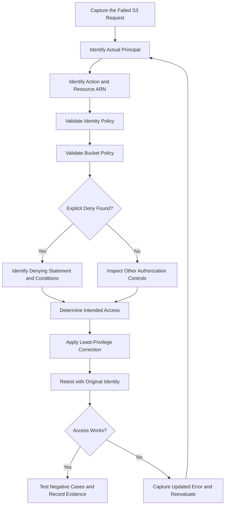

# 02- IAM and Bucket Policy Permission Failures

## Overview

Amazon S3 authorization failures frequently occur when an IAM identity policy and an S3 bucket policy do not collectively permit the requested operation. The failure can also result from explicit denies, incorrect resource ARNs, mismatched policy conditions, cross-account authorization requirements, or restrictions imposed by AWS Organizations and other policy controls.

A request may fail even when the caller has an apparently correct `Allow` statement. IAM authorization evaluates the applicable policies and request context; access is determined by the effective authorization decision, not by the presence of a single permission.

This document focuses on diagnosing and correcting IAM and bucket-policy permission failures. It covers:

- Identity-based and resource-based policy failures.
- Policy evaluation and explicit-deny behavior.
- Incorrect principals, actions, resource ARNs, and conditions.
- Same-account and cross-account authorization.
- IAM role assumption versus S3 permission failures.
- Policy simulation, CloudTrail investigation, and AWS CLI diagnostics.
- Least-privilege corrections and regression testing.

## Understand the Authorization Model

### Identity-based policies

Identity-based policies are attached to IAM users, groups, or roles. They define which actions the identity is permitted to perform on specified resources.

For example, an application role might have permission to retrieve documents from a private S3 bucket:

```json
{
  "Version": "2012-10-17",
  "Statement": [
    {
      "Sid": "ReadApplicationDocuments",
      "Effect": "Allow",
      "Action": "s3:GetObject",
      "Resource": "arn:aws:s3:::company-prod-documents-123456789012/documents/*"
    }
  ]
}
```

This policy allows the specified role to read objects under `documents/`, subject to other applicable authorization controls.

It does not automatically grant permission to list the bucket, upload objects, delete objects, or access objects outside the specified prefix.

**Common failure:** The policy contains the correct action but targets the wrong resource ARN or is attached to a different role than the application actually uses.

### Resource-based policies

An S3 bucket policy is a resource-based policy attached to a bucket. It specifies which principals can perform which actions on the bucket or its objects.

For example:

```json
{
  "Version": "2012-10-17",
  "Statement": [
    {
      "Sid": "AllowDocumentServiceRead",
      "Effect": "Allow",
      "Principal": {
        "AWS": "arn:aws:iam::123456789012:role/document-api-role"
      },
      "Action": "s3:GetObject",
      "Resource": "arn:aws:s3:::company-prod-documents-123456789012/documents/*"
    }
  ]
}
```

A bucket policy can grant access to a principal in the bucket-owning account or another account, subject to the applicable authorization model and restrictions.

A bucket policy can also explicitly deny a request, regardless of an `Allow` in another applicable policy.

### Identity policy versus bucket policy

| Characteristic | Identity-based policy | Bucket policy |
|---|---|---|
| Attached to | IAM user, group, or role | S3 bucket |
| Primary purpose | Define permissions for an identity | Define access to a bucket and its objects |
| Typical use | Application roles, workload roles, administrative identities | Cross-account access, resource restrictions, network conditions |
| Resource specification | Identifies the target S3 resource | Identifies the bucket or object resource |
| Principal specification | Normally unnecessary; the attached identity determines the principal | Specifies the principal for applicable statements |
| Can explicitly deny access | Yes | Yes |
| Can be the only relevant authorization policy | Sometimes, depending on the resource, principal, and account relationship | Sometimes, depending on the authorization model and applicable restrictions |

For same-account access, an identity-based `Allow` is often sufficient when no additional resource-based permission is required and no applicable control denies the request. A bucket policy may add restrictions or grant access through a specific access pattern.

For cross-account access, the caller and resource owner generally need complementary authorization: the caller must be permitted to make the request, and the resource policy must authorize the external principal. KMS authorization, if applicable, must also be satisfied.

There are important IAM evaluation nuances when resource-based policies grant permissions directly to IAM role sessions rather than to role ARNs. Do not simplify every policy interaction to a universal rule that all grants must appear in both the identity policy and the bucket policy. Inspect the actual principal type, account relationship, policy statements, and applicable limiting controls.

Reference: [IAM policy evaluation logic](https://docs.aws.amazon.com/IAM/latest/UserGuide/reference_policies_evaluation-logic.html).

## Standard Diagnostic Workflow

Use the same sequence for production incidents so that policy changes are based on evidence rather than guesswork.



### Capture the original failure

Collect the following before modifying IAM:

- Full AWS error code and message.
- Failing API operation, such as `GetObject`, `ListObjectsV2`, or `PutObject`.
- Actual caller ARN and AWS account ID.
- Bucket name, object key, version ID, and Region.
- Timestamp and request ID when available.
- Relevant request parameters, headers, and network path.
- Recent IAM, bucket-policy, infrastructure, or deployment changes.

Never include access keys, session tokens, complete presigned URLs, or other credentials in investigation notes.

### Identify the actual principal

Run the command inside the same execution environment as the failing application whenever possible.

```bash
aws sts get-caller-identity
```

Example output:

```json
{
  "UserId": "AROAXXXXXXXXXXXXX:document-api",
  "Account": "123456789012",
  "Arn": "arn:aws:sts::123456789012:assumed-role/document-api-role/document-api"
}
```

This output identifies an assumed-role session, not a standalone IAM user.

A local AWS CLI profile, a Docker container, an EC2 instance, an ECS task, a Lambda function, a Kubernetes workload, and a CI/CD runner may use different credentials.

If the caller ARN is unexpected, troubleshoot the credential provider chain and role assumption before editing the bucket policy.

### Identify the failing action

Map the API operation to the permission it requires. Avoid granting additional permissions simply because an application reports that a request failed.

| Operation | Typical S3 permission | Resource ARN |
|---|---|---|
| List objects | `s3:ListBucket` | Bucket ARN |
| Download object | `s3:GetObject` | Object ARN |
| Upload object | `s3:PutObject` | Object ARN |
| Delete object | `s3:DeleteObject` | Object ARN |
| Read bucket policy | `s3:GetBucketPolicy` | Bucket ARN |
| Configure bucket policy | `s3:PutBucketPolicy` | Bucket ARN |
| Inspect versioning | `s3:GetBucketVersioning` | Bucket ARN |
| Read object version | `s3:GetObjectVersion` | Object ARN |
| Read object tags | `s3:GetObjectTagging` | Object ARN |
| Delete a specific version | `s3:DeleteObjectVersion` | Object ARN |

Some workflows require additional permissions. Multipart uploads, object tagging, ACL management, encryption, retention, and replication should be diagnosed against their specific API operations.

Reference: [Required permissions for Amazon S3 API operations](https://docs.aws.amazon.com/AmazonS3/latest/userguide/using-with-s3-policy-actions.html).

## Diagnose Incorrect Action and Resource ARNs

One of the most common policy failures is using the wrong resource ARN for the requested operation.

### Bucket resources versus object resources

The bucket ARN is:

```text
arn:aws:s3:::company-prod-documents-123456789012
```

An object ARN is:

```text
arn:aws:s3:::company-prod-documents-123456789012/documents/report.pdf
```

A bucket-level action such as `s3:ListBucket` normally uses the bucket ARN. An object-level action such as `s3:GetObject` uses an object ARN.

The following policy is incorrect for normal object reads because the resource identifies only the bucket:

```json
{
  "Version": "2012-10-17",
  "Statement": [
    {
      "Effect": "Allow",
      "Action": "s3:GetObject",
      "Resource": "arn:aws:s3:::company-prod-documents-123456789012"
    }
  ]
}
```

Correct the resource scope:

```json
{
  "Version": "2012-10-17",
  "Statement": [
    {
      "Effect": "Allow",
      "Action": "s3:GetObject",
      "Resource": "arn:aws:s3:::company-prod-documents-123456789012/documents/*"
    }
  ]
}
```

### Diagnose listing failures

A listing request uses `s3:ListBucket`, which applies to the bucket rather than individual object ARNs.

```json
{
  "Version": "2012-10-17",
  "Statement": [
    {
      "Sid": "ListDocumentsPrefix",
      "Effect": "Allow",
      "Action": "s3:ListBucket",
      "Resource": "arn:aws:s3:::company-prod-documents-123456789012",
      "Condition": {
        "StringLike": {
          "s3:prefix": [
            "documents",
            "documents/",
            "documents/*"
          ]
        }
      }
    }
  ]
}
```

The condition restricts which prefixes the caller can list. It does not allow the caller to read the listed objects.

The actual request prefix must match the condition. For example, a request listing the bucket root may fail while listing `documents/` succeeds.

### Check action names and API behavior

An API operation may require a different permission from the one suggested by its name.

For example:

- A normal object read uses `s3:GetObject`.
- Reading a particular version requires `s3:GetObjectVersion`.
- Deleting an object without a version ID generally uses `s3:DeleteObject`.
- Permanently deleting a specific version requires `s3:DeleteObjectVersion`.

Check the relevant S3 API permission documentation rather than assuming related operations share the same authorization requirements.

## Diagnose Explicit Deny

An applicable explicit `Deny` overrides an applicable `Allow`.

Explicit denies frequently appear in bucket policies, identity policies, permissions boundaries, session policies, service control policies, resource control policies, and VPC endpoint policies.

### Example: Denying requests without TLS

```json
{
  "Version": "2012-10-17",
  "Statement": [
    {
      "Sid": "DenyInsecureTransport",
      "Effect": "Deny",
      "Principal": "*",
      "Action": "s3:*",
      "Resource": [
        "arn:aws:s3:::company-prod-documents-123456789012",
        "arn:aws:s3:::company-prod-documents-123456789012/*"
      ],
      "Condition": {
        "Bool": {
          "aws:SecureTransport": "false"
        }
      }
    }
  ]
}
```

This statement denies requests that do not use secure transport. A caller does not bypass it by receiving an additional identity-based `Allow`.

When diagnosing a denial, determine whether the explicit deny is intentional. If the workload is using an unsupported or unexpected transport path, correct the request or architecture rather than removing the security condition.

### Search for matching deny statements

Review every statement with:

```json
"Effect": "Deny"
```

Then evaluate:

- The action or action pattern.
- The bucket or object resource ARN.
- The principal.
- The condition operators and expected values.
- Whether the policy applies to the actual request path.
- Whether a higher-level organization policy or endpoint policy also restricts access.

An explicit deny can be indirect. For example, a `Deny` might match requests outside an approved VPC endpoint, requests missing a required encryption header, or requests from a principal other than the designated workload role.

### Do not remove security conditions blindly

If production access depends on a particular VPC endpoint, source network, or encryption requirement, preserve the intended control.

A safe change should narrow the condition or update the approved request path only after the owner of the control confirms the intended behavior.

## Diagnose Incorrect Bucket Policy Principals

The `Principal` element identifies who a bucket-policy statement applies to. An incorrect principal can prevent the intended role or account from receiving the permission.

### Common principal mistakes

| Mistake | Why it fails |
|---|---|
| Using the wrong account ID | The policy identifies a different AWS account |
| Referencing a user when the workload uses a role | The request principal does not match the configured identity |
| Granting to a different role | The application assumes a role not named by the policy |
| Confusing a role ARN with an assumed-role session ARN | The principal representation and policy evaluation semantics differ |
| Using an outdated role ARN | The role may have been renamed, replaced, or recreated |
| Assuming the bucket policy alone controls every authorization layer | Other applicable restrictions can still deny access |

### Allow a specific workload role

A resource-policy statement can authorize a known role:

```json
{
  "Version": "2012-10-17",
  "Statement": [
    {
      "Sid": "AllowDocumentApiRead",
      "Effect": "Allow",
      "Principal": {
        "AWS": "arn:aws:iam::123456789012:role/document-api-role"
      },
      "Action": "s3:GetObject",
      "Resource": "arn:aws:s3:::company-prod-documents-123456789012/documents/*"
    }
  ]
}
```

Verify the exact role ARN through IAM and correlate it with the caller identity observed in the failed request.

A role's trust policy determines who can assume the role. Its identity policies determine what the role can do, subject to applicable authorization controls. A bucket policy determines which principals the resource policy permits. These responsibilities are related but not interchangeable.

## Diagnose IAM Role Assumption Failures

A role-assumption failure and an S3 permission failure are different problems.

### Role assumption failure

Errors such as `AccessDenied` from `sts:AssumeRole` occur before the application has obtained the expected role session.

Investigate:

- The caller's permission to invoke `sts:AssumeRole`.
- The target role's trust policy.
- Required external IDs or principal conditions.
- Organization restrictions and other applicable controls.
- Session tags or source-identity conditions, where used.

Example:

```bash
aws sts assume-role \
  --role-arn arn:aws:iam::123456789012:role/document-api-role \
  --role-session-name document-api-debug \
  --region ap-south-1
```

Use this only with an identity authorized to assume that role. Do not print returned credentials into logs or issue trackers.

### S3 permission failure after role assumption

If role assumption succeeds, verify the resulting identity:

```bash
aws sts get-caller-identity
```

Then test the original S3 action using the assumed role.

A correct trust policy does not grant `s3:GetObject`, `s3:PutObject`, or any other S3 permission by itself.

Conversely, adding S3 actions to the role does not fix a trust-policy failure that prevents the workload from assuming that role.

## Diagnose Policy Conditions

A permission statement can contain the correct principal, action, and resource but still fail because its condition does not match the request.

### Common condition keys

| Condition key | Typical purpose | Diagnostic question |
|---|---|---|
| `aws:PrincipalArn` | Restrict access to selected principals | Does the request use the expected principal ARN? |
| `aws:SourceVpce` | Restrict requests to a VPC endpoint | Is the request using the approved endpoint? |
| `aws:SourceVpc` | Restrict requests to a VPC | Does the actual network path provide the expected context? |
| `aws:SourceIp` | Restrict access by source IP | Does the observed source address match the allowed range? |
| `aws:SecureTransport` | Require secure transport | Is the request using TLS? |
| `s3:prefix` | Restrict list operations to key prefixes | Does the request specify an allowed prefix? |
| `s3:delimiter` | Constrain list operation behavior | Does the delimiter satisfy the configured condition? |
| `s3:RequestObjectTag/...` | Constrain requested object tags for supported operations | Does the request supply the required tag values? |
| `s3:x-amz-server-side-encryption` | Constrain specified encryption request headers | Does the upload use the required encryption configuration? |

Condition-key availability depends on the action and request context. Confirm that the key is supported for the policy statement being evaluated.

### Encryption condition mismatch

Suppose a bucket policy requires SSE-KMS for uploads, but the client sends a different encryption header or omits a header required by the policy. The request can be denied even when `s3:PutObject` is allowed.

Inspect the upload request and bucket policy together. Also verify KMS permissions independently; satisfying the bucket-policy condition does not itself authorize use of the KMS key.

### Network condition mismatch

A local command can fail against a bucket policy requiring a designated VPC endpoint while the same command succeeds from an approved workload environment.

Inspect the real network path, endpoint selection, DNS behavior, and source-address context. Do not remove the condition unless the access design explicitly permits requests from the alternative path.

## Diagnose Cross-Account Authorization

Cross-account access introduces additional requirements because the caller and the bucket owner belong to different accounts.

For a common cross-account read architecture, validate:

1. The caller assumes the intended IAM role.
2. The role's permissions permit the S3 operation.
3. The destination bucket policy authorizes the external principal where required.
4. Applicable SCPs, RCPs, boundaries, session policies, explicit denies, and endpoint policies permit the request.
5. The object ownership and access configuration support the intended access pattern.
6. For SSE-KMS, the key policy and required KMS permissions permit decryption.

### Example bucket policy

Suppose account `111122223333` owns the bucket, and account `444455556666` operates the reporting service.

The bucket owner could use a statement such as:

```json
{
  "Version": "2012-10-17",
  "Statement": [
    {
      "Sid": "AllowReportingServiceRead",
      "Effect": "Allow",
      "Principal": {
        "AWS": "arn:aws:iam::444455556666:role/reporting-service-role"
      },
      "Action": "s3:GetObject",
      "Resource": "arn:aws:s3:::company-prod-documents-123456789012/reports/*"
    }
  ]
}
```

This statement permits the named role to read objects under `reports/`, subject to other applicable controls. It does not grant bucket listing or KMS permissions.

If listing is required, add a separate `s3:ListBucket` statement using the bucket ARN and an appropriate prefix condition.

### Troubleshoot the owner and caller separately

Ask the owner of the source account to validate the caller-side role and organization restrictions. Ask the bucket owner to validate the resource policy, bucket configuration, and any encryption restrictions.

Do not assume that the absence of a detailed access-denied message means the bucket policy is the only problem. Cross-account denials may provide limited diagnostic detail.

## Inspect IAM and Bucket Policies with AWS CLI

The CLI commands below require sufficient administrative or diagnostic permissions. The failing application identity may not be authorized to inspect its own policies or the bucket policy.

### Inspect the role

```bash
aws iam get-role \
  --role-name document-api-role
```

Inspect attached policies:

```bash
aws iam list-attached-role-policies \
  --role-name document-api-role
```

List inline policies:

```bash
aws iam list-role-policies \
  --role-name document-api-role
```

Retrieve an inline policy:

```bash
aws iam get-role-policy \
  --role-name document-api-role \
  --policy-name DocumentStoragePolicy
```

To inspect an attached managed policy, retrieve its policy metadata and default version, then inspect the document:

```bash
aws iam get-policy \
  --policy-arn arn:aws:iam::123456789012:policy/DocumentStoragePolicy
```

```bash
aws iam get-policy-version \
  --policy-arn arn:aws:iam::123456789012:policy/DocumentStoragePolicy \
  --version-id v1
```

Use the actual default version returned by `get-policy`; do not assume that `v1` is the version currently active.

### Retrieve the bucket policy

```bash
aws s3api get-bucket-policy \
  --bucket company-prod-documents-123456789012 \
  --region ap-south-1
```

Review the returned JSON for incorrect principals, actions, resources, and conditions, as well as explicit-deny statements.

An error from this command can indicate that no bucket policy is configured or that the caller lacks permission to retrieve it. Use an appropriately authorized diagnostic identity to distinguish those cases.

### Inspect the role's permissions boundary

```bash
aws iam get-role \
  --role-name document-api-role \
  --query 'Role.PermissionsBoundary'
```

If a boundary exists, inspect its policy document and confirm whether the requested action falls within its permitted scope.

### Inspect the bucket's public-access controls

```bash
aws s3api get-public-access-block \
  --bucket company-prod-documents-123456789012 \
  --region ap-south-1
```

The bucket-level result is not a complete view of all public-access controls. Consider account-level and access-point settings where relevant.

### Inspect the bucket ownership configuration

```bash
aws s3api get-bucket-ownership-controls \
  --bucket company-prod-documents-123456789012 \
  --region ap-south-1
```

If the bucket uses `BucketOwnerEnforced`, ACLs are disabled. A client that relies on object ACLs or sends unsupported ACL settings may need to be corrected rather than granted broader IAM permissions.

## Use the IAM Policy Simulator

The IAM policy simulator helps determine whether selected identity policies permit a given action and resource under the simulation context.

Example:

```bash
aws iam simulate-principal-policy \
  --policy-source-arn arn:aws:iam::123456789012:role/document-api-role \
  --action-names s3:GetObject \
  --resource-arns arn:aws:s3:::company-prod-documents-123456789012/documents/report.pdf
```

Inspect:

- `EvalDecision`
- `MatchedStatements`
- `MissingContextValues`
- `OrganizationsDecisionDetail`, when returned
- Permissions-boundary decision details, when returned

A missing context value can make a simulation inconclusive for a condition-based policy.

### Understand simulator limitations

The simulator is a diagnostic aid, not a complete reproduction of every live S3 authorization decision. Its results depend on the inputs and policy context supplied. It does not necessarily reproduce every applicable resource policy, organization restriction, endpoint control, principal-session nuance, or service-specific behavior.

A simulator result of `allowed` does not prove that the actual request will succeed. Always verify using the real workload identity and request path.

Reference: [Simulate IAM policies](https://docs.aws.amazon.com/IAM/latest/UserGuide/access_policies_testing-policies.html).

## Investigate Access Failures with CloudTrail

CloudTrail can help establish which principal invoked an API, which operation was attempted, and whether AWS recorded an access-denied result.

For relevant management events:

```bash
aws cloudtrail lookup-events \
  --lookup-attributes AttributeKey=EventSource,AttributeValue=s3.amazonaws.com \
  --max-results 20 \
  --region ap-south-1
```

This command is not a complete search of every S3 object operation. Object-level requests require suitable S3 data-event logging configuration.

### Diagnostic procedure

1. Locate the event matching the failure's timestamp and operation.
2. Verify the principal ARN, account, bucket, key, and request parameters when recorded.
3. Inspect the error code and any available denial context.
4. Compare the request with the policies active at the time of the event.
5. Correlate the AWS request ID with application logs where available.
6. Record the policy change or request-context correction that resolves the issue.

Not every failed request appears in every configured logging destination. An absent event does not prove the request was never made.

Reference: [CloudTrail logging for Amazon S3](https://docs.aws.amazon.com/AmazonS3/latest/userguide/cloudtrail-logging-s3-info.html).

## Apply a Least-Privilege Correction

Correct the confirmed defect, preserve intended security controls, and avoid expanding the principal's permissions beyond the application requirement.

For a service that needs to read and list documents under a controlled prefix, the following identity policy is a useful starting point:

```json
{
  "Version": "2012-10-17",
  "Statement": [
    {
      "Sid": "ReadDocumentObjects",
      "Effect": "Allow",
      "Action": "s3:GetObject",
      "Resource": "arn:aws:s3:::company-prod-documents-123456789012/documents/*"
    },
    {
      "Sid": "ListDocumentPrefix",
      "Effect": "Allow",
      "Action": "s3:ListBucket",
      "Resource": "arn:aws:s3:::company-prod-documents-123456789012",
      "Condition": {
        "StringLike": {
          "s3:prefix": [
            "documents",
            "documents/",
            "documents/*"
          ]
        }
      }
    }
  ]
}
```

The policy permits listing the intended prefix and reading its objects. It does not permit uploads, deletions, bucket-policy changes, unrestricted bucket listing, or KMS key usage.

Apply this policy only after confirming that it addresses the actual failure. A correct identity policy cannot override an applicable explicit deny.

### Avoid unsafe remediation

Do not resolve a narrow permission failure by automatically:

- Attaching `AmazonS3FullAccess`.
- Granting `s3:*` to the application role.
- Allowing all principals in the bucket policy.
- Removing organization or VPC endpoint restrictions.
- Disabling Block Public Access.
- Replacing a restricted prefix with a bucket-wide object ARN.
- Removing an explicit deny without confirming its intended security purpose.

These changes can produce excessive permissions while leaving the original failure unresolved.

## Prevention and Regression Testing

Treat IAM and bucket-policy configuration as application infrastructure. Store policy definitions in version control, validate changes in non-production environments where possible, and review their impact before deploying them.

For Terraform-managed policies, inspect the planned change before applying it:

```bash
terraform fmt -check
terraform validate
terraform plan
```

These commands validate formatting, configuration, and the planned infrastructure change; they do not prove that a live S3 request will be authorized.

### Test allowed and denied behavior

| Test case | Expected behavior |
|---|---|
| Application reads an object under `documents/` | Allowed |
| Application lists `documents/` | Allowed when listing is part of the requirement |
| Application reads an object outside the approved prefix | Denied |
| Application attempts to delete an object when deletion is not granted | Denied |
| Application uses an unapproved network path | Denied if the intended policy requires a specific endpoint |
| An unauthorized role accesses the bucket | Denied |
| Required KMS operation is attempted by the application | Allowed only when the key policy and applicable permissions authorize it |

Use a controlled test environment or non-sensitive test objects. Verify that negative authorization tests remain denied after policy changes.

For production changes, retain the original policy, a reviewed change plan, the intended rollback procedure, and evidence from a test using the actual workload identity.

## Production Troubleshooting Checklist

- [ ] Capture the complete error, failed operation, timestamp, and request ID.
- [ ] Confirm the real AWS principal and account.
- [ ] Verify the exact API action, resource ARN, bucket, key, and version.
- [ ] Check that bucket-level and object-level actions use the correct resource types.
- [ ] Inspect attached identity policies and their active managed-policy versions.
- [ ] Inspect the bucket policy's principal, actions, resources, conditions, and explicit denies.
- [ ] Check role trust separately from S3 permissions.
- [ ] Review permissions boundaries, session policies, SCPs, RCPs, and VPC endpoint policies as applicable.
- [ ] Investigate cross-account authorization and KMS permissions independently.
- [ ] Use policy simulation and CloudTrail as diagnostic evidence, not as substitutes for a live test.
- [ ] Apply the smallest correction that resolves the verified defect.
- [ ] Test permitted and prohibited operations using the original workload identity.
- [ ] Update infrastructure as code and preserve an auditable change history.

## Official References

- [IAM policy evaluation logic](https://docs.aws.amazon.com/IAM/latest/UserGuide/reference_policies_evaluation-logic.html)
- [IAM policy evaluation: explicit and implicit denies](https://docs.aws.amazon.com/IAM/latest/UserGuide/reference_policies_evaluation-logic_policy-eval-denyallow.html)
- [Troubleshoot IAM access denied errors](https://docs.aws.amazon.com/IAM/latest/UserGuide/troubleshoot_access-denied.html)
- [Amazon S3 policy actions and permissions](https://docs.aws.amazon.com/AmazonS3/latest/userguide/using-with-s3-policy-actions.html)
- [Troubleshoot S3 403 Forbidden errors](https://docs.aws.amazon.com/AmazonS3/latest/userguide/troubleshoot-403-errors.html)
- [Test IAM policies with the policy simulator](https://docs.aws.amazon.com/IAM/latest/UserGuide/access_policies_testing-policies.html)
- [S3 bucket policies](https://docs.aws.amazon.com/AmazonS3/latest/userguide/bucket-policies.html)
- [Cross-account access to Amazon S3](https://docs.aws.amazon.com/AmazonS3/latest/userguide/access-control-overview.html)
- [CloudTrail logging for Amazon S3](https://docs.aws.amazon.com/AmazonS3/latest/userguide/cloudtrail-logging-s3-info.html)

## Key Takeaways

- Determine the actual principal, action, and resource ARN before modifying IAM or bucket policies.
- An explicit deny or mismatched condition can override an otherwise valid permission grant.
- Separate role assumption, identity-based authorization, resource-based authorization, organization restrictions, and KMS access during diagnosis.
- Use the IAM policy simulator and CloudTrail to narrow the cause, then verify the correction with the original workload identity.
- Preserve least privilege by testing both allowed and denied operations and keeping production policy changes in version control.