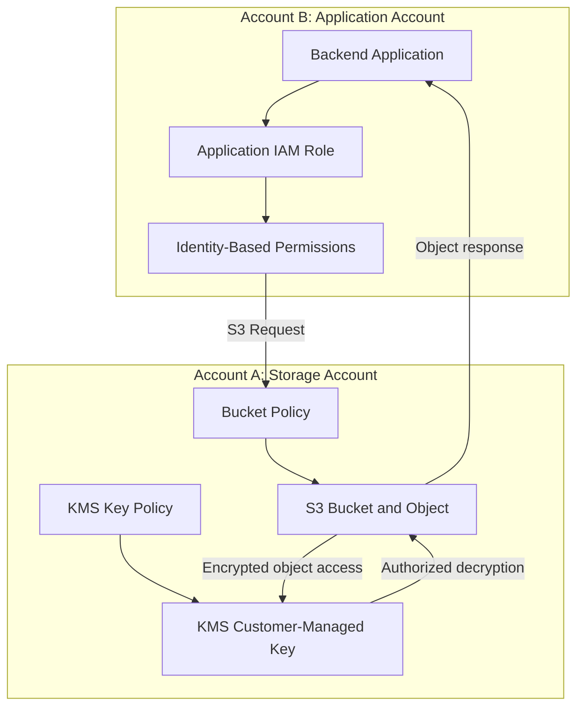
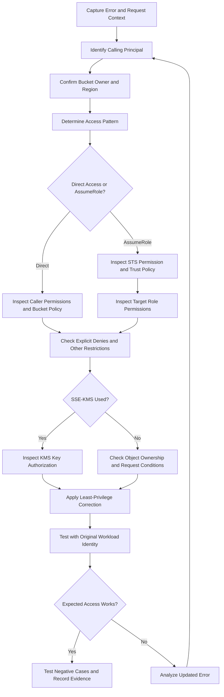

# 03- Cross-Account Access Failures

## Overview

Amazon S3 cross-account access failures occur when an application, user, or AWS workload cannot access a bucket or object owned by another AWS account. These failures commonly affect centralized storage architectures, shared data platforms, cross-account backups, analytics pipelines, and microservices deployed in separate AWS accounts.

The most important diagnostic principle is that cross-account access is not controlled by a single policy. The result depends on the access pattern, the calling identity, the resource owner's authorization configuration, and any applicable organization-level, network, or encryption restrictions.

For example, a reporting service in Account B may have an identity policy allowing `s3:GetObject`, but requests can still fail because Account A does not authorize that role through the bucket policy. If the object uses SSE-KMS, the request can also fail because the caller cannot use the KMS key.

This document provides a production-oriented workflow for identifying the failing authorization layer, validating cross-account configurations, correcting permissions safely, and preventing regression.

## Understand the Cross-Account Access Models

Two common approaches are direct access to another account's bucket and assuming a role in the resource-owning account.

### Direct access through a bucket policy

The application retains its identity in Account B and requests access to a bucket in Account A.

For conventional cross-account IAM access, the calling identity needs an appropriate permission grant, and the resource-owning account must authorize the external principal through the applicable resource-based policy or supported access-management mechanism. Other restrictions must also permit the request.

Advantages include a straightforward request flow and centralized control over the destination bucket.

Limitations include coordination between account owners and the need to manage resource policies as external consumers change.

### Access through an assumed role

Account A creates an IAM role whose permissions authorize the required S3 operations. The role's trust policy identifies which principals in Account B may assume it.

The application in Account B assumes the role and uses its temporary credentials to access S3.

This pattern separates the application's original identity from the identity used for storage operations. It is often useful when the resource-owning account centrally manages access for many external workloads.

Role assumption introduces additional requirements: the caller must be allowed to invoke `sts:AssumeRole`, the target role must trust the caller, and the assumed role must have the required permissions.

### Compare the approaches

| Concern | Direct cross-account access | Assumed role in resource account |
|---|---|---|
| Request identity | Role or principal from Account B | Temporary session for a role in Account A |
| Primary configuration | Caller permissions and bucket policy | Caller permission, trust policy, and target-role permissions |
| Credential handling | Uses the caller's normal credentials | Requires assumed-role credentials or a compatible SDK credential provider |
| Resource-owner control | Managed through bucket and related resource policies | Managed primarily through the target role's permissions and applicable resource controls |
| Common failure | Bucket policy does not authorize the external principal | STS assumption or target-role authorization fails |
| Typical use | A small number of shared resources and consumers | Centralized storage access across multiple applications or accounts |

Choose one pattern deliberately. Do not add unnecessary role-assumption layers to an already functioning direct-access design without a clear security or operational reason.

## Cross-Account Request Flow

The following architecture illustrates direct access to a private S3 bucket encrypted with SSE-KMS.



For a direct cross-account read, investigate these stages:

1. The application obtains the intended AWS credentials.
2. The calling principal is permitted to perform the relevant S3 operation.
3. The resource-owning account's authorization configuration permits the request.
4. Applicable explicit denies, organization policies, and network restrictions do not block it.
5. If the object uses SSE-KMS, the relevant key authorization permits decryption.
6. S3 returns the requested object if all required checks succeed.

A failure at any applicable authorization layer can prevent the complete request from succeeding.

## Standard Diagnostic Workflow

Use a consistent sequence rather than adding permissions immediately after seeing `AccessDenied`.



### Capture the failure details

Record the complete error message and the context surrounding the failed operation:

- AWS account ID and ARN of the calling principal.
- S3 API operation, such as `GetObject`, `ListObjectsV2`, or `PutObject`.
- Bucket name, object key, and version ID where applicable.
- Bucket-owning account ID and Region.
- Request timestamp and request ID when available.
- Network path, VPC endpoint, and relevant request headers.
- Recent policy, role, encryption, or infrastructure changes.

Do not store access keys, session tokens, SSE-C key material, or complete presigned URLs in incident tickets.

### Verify the active identity

Run this command inside the same environment as the failing application:

```bash
aws sts get-caller-identity
```

Example output:

```json
{
  "UserId": "AROAXXXXXXXXXXXXX:document-api",
  "Account": "444455556666",
  "Arn": "arn:aws:sts::444455556666:assumed-role/document-api-role/document-api"
}
```

The result identifies an assumed-role session in Account B. It does not prove that the session has permission to access the target bucket.

A local terminal, Docker container, ECS task, Lambda function, EC2 instance, Kubernetes workload, and CI/CD runner can resolve different credentials. If the reported identity is unexpected, correct the credential configuration before modifying storage policies.

### Confirm the destination resource

Verify the expected bucket owner where the API supports it:

```bash
aws s3api head-bucket \
  --bucket company-prod-documents-111122223333 \
  --expected-bucket-owner 111122223333 \
  --region ap-south-1
```

This check helps detect a bucket-owner mismatch; it does not grant permissions.

A failed request should not immediately be interpreted as evidence that the bucket does not exist. Authorization failures and resource-identification failures can produce overlapping symptoms.

## Diagnose Direct Cross-Account Access

Consider the following example:

- Account A, `111122223333`, owns the bucket.
- Account B, `444455556666`, operates `document-api-role`.
- The application must read objects under `reports/`.

### Validate the caller's identity policy

Account B should authorize the required operation for the calling role.

An example identity-based policy is:

```json
{
  "Version": "2012-10-17",
  "Statement": [
    {
      "Sid": "ReadReports",
      "Effect": "Allow",
      "Action": "s3:GetObject",
      "Resource": "arn:aws:s3:::company-prod-documents-111122223333/reports/*"
    },
    {
      "Sid": "ListReports",
      "Effect": "Allow",
      "Action": "s3:ListBucket",
      "Resource": "arn:aws:s3:::company-prod-documents-111122223333",
      "Condition": {
        "StringLike": {
          "s3:prefix": [
            "reports",
            "reports/",
            "reports/*"
          ]
        }
      }
    }
  ]
}
```

This example grants object reads under `reports/` and listing for the permitted prefix. It does not grant upload, deletion, or bucket administration.

Inspect the role's attached policies:

```bash
aws iam list-attached-role-policies \
  --role-name document-api-role
```

Inspect inline policies:

```bash
aws iam list-role-policies \
  --role-name document-api-role
```

If the policy is a managed policy, inspect its active default version rather than assuming its displayed name reflects the current permissions.

### Validate the bucket policy

For a conventional direct-access configuration, Account A must authorize the external role to access the bucket resources.

An example bucket-policy statement is:

```json
{
  "Version": "2012-10-17",
  "Statement": [
    {
      "Sid": "AllowDocumentApiReadReports",
      "Effect": "Allow",
      "Principal": {
        "AWS": "arn:aws:iam::444455556666:role/document-api-role"
      },
      "Action": "s3:GetObject",
      "Resource": "arn:aws:s3:::company-prod-documents-111122223333/reports/*"
    }
  ]
}
```

Retrieve the policy using an identity authorized to inspect the bucket:

```bash
aws s3api get-bucket-policy \
  --bucket company-prod-documents-111122223333 \
  --expected-bucket-owner 111122223333 \
  --region ap-south-1
```

Verify the following:

- The role ARN is correct and belongs to Account B.
- The action matches the API operation that failed.
- The resource ARN matches the actual object key.
- The policy does not contain a matching explicit deny.
- Conditions match the request's principal, network path, and headers.
- The bucket owner and Region are correct.

If the application needs to list objects, configure a separate `s3:ListBucket` statement using the bucket ARN and a suitable prefix condition. Permission to read objects does not automatically permit listing them.

### Check resource ARN scope

S3 bucket-level and object-level actions use different resource ARNs.

| Resource | ARN pattern |
|---|---|
| Bucket | `arn:aws:s3:::company-prod-documents-111122223333` |
| Objects under a prefix | `arn:aws:s3:::company-prod-documents-111122223333/reports/*` |

Using the bucket ARN for `s3:GetObject` is a common configuration defect. Using object ARNs for a bucket-level action such as `s3:ListBucket` is also incorrect.

Consult the action-to-resource mapping before expanding the policy.

## Diagnose Cross-Account Role Assumption

When Account A creates a role for Account B to assume, three separate configuration elements are involved:

1. The caller's permission to invoke `sts:AssumeRole`.
2. The target role's trust policy.
3. The target role's permissions for S3 and any additional required services.

### Verify the caller's STS permission

In Account B, the application role may need a policy such as:

```json
{
  "Version": "2012-10-17",
  "Statement": [
    {
      "Sid": "AssumeStorageRole",
      "Effect": "Allow",
      "Action": "sts:AssumeRole",
      "Resource": "arn:aws:iam::111122223333:role/central-storage-read-role"
    }
  ]
}
```

This statement permits the role to request a session for the named target role, subject to other authorization restrictions.

### Verify the target role's trust policy

The role in Account A must trust the intended principal from Account B.

```json
{
  "Version": "2012-10-17",
  "Statement": [
    {
      "Sid": "TrustDocumentApi",
      "Effect": "Allow",
      "Principal": {
        "AWS": "arn:aws:iam::444455556666:role/document-api-role"
      },
      "Action": "sts:AssumeRole"
    }
  ]
}
```

If the trust policy requires an external ID, MFA, principal tag, or other condition, the assumption request must satisfy that requirement.

### Verify the target role's S3 permissions

The role in Account A must have the permissions needed to perform the intended S3 operation. For example, it can receive `s3:GetObject` access to a designated prefix.

A valid trust policy does not grant S3 permissions. Likewise, adding S3 permissions to a role does not make it assumable by an untrusted principal.

Test the assumption using the intended caller identity:

```bash
aws sts assume-role \
  --role-arn arn:aws:iam::111122223333:role/central-storage-read-role \
  --role-session-name document-api-debug \
  --region ap-south-1
```

If this operation fails, investigate STS permissions and trust configuration before troubleshooting the target role's S3 access.

If it succeeds, verify the resulting identity and test the original S3 operation with the assumed-role credentials. Avoid exposing the returned credentials in logs or diagnostic output.

## Diagnose Explicit Denies and Organization Restrictions

A valid identity policy and bucket policy do not guarantee that a request succeeds. Other applicable controls can further restrict permissions.

| Control | Example cross-account failure |
|---|---|
| Service control policy (SCP) | The caller's account is prohibited from using the required action |
| Resource control policy (RCP) | An organization-level resource restriction prevents access |
| Permissions boundary | The caller or target role's maximum permitted access excludes the action |
| Session policy | The current role session has narrower permissions than expected |
| VPC endpoint policy | The request path does not permit access to the destination bucket |
| Bucket-policy condition | The caller fails an approved network or encryption requirement |
| Explicit deny | A matching denial in an applicable policy overrides an allowed request |

### Investigate explicit deny statements

Search the applicable policies for:

```json
"Effect": "Deny"
```

Evaluate the effect in context:

- Does the statement match the S3 operation?
- Does its resource pattern include the bucket or object?
- Does its principal match the caller?
- Is the request missing a required condition?
- Is the condition based on a VPC endpoint, source IP, TLS, or encryption header?

Adding another `Allow` does not override an applicable explicit deny.

### Investigate VPC endpoint restrictions

If access succeeds from a developer workstation but fails from a production workload, inspect the network path.

A bucket policy may require a particular endpoint through `aws:SourceVpce`. The endpoint policy can also restrict which resources are reachable through the endpoint.

Verify the endpoint used by the application and any related DNS, route, and policy configuration. Do not remove the network restriction simply to make a test succeed; determine the intended access path first.

### Account for cross-account diagnostic limitations

Cross-account denial messages may provide less detail than same-account messages. A generic `AccessDenied` response does not establish which policy is responsible.

Use the caller account's identity-policy evidence, the destination account's resource-policy evidence, organization-level restrictions, and relevant audit records to determine the actual failure.

## Diagnose SSE-KMS Cross-Account Failures

SSE-KMS introduces a separate authorization layer. Permission to retrieve an S3 object is not equivalent to permission to use the KMS key protecting it.

For direct cross-account use of a customer-managed KMS key, the key-owning account must authorize the external account or principal, and the external principal must have the applicable IAM permissions. The exact policy design depends on how the role is configured and how the object is accessed.

### Typical permissions

| Operation | Typical S3 permission | Typical KMS permission |
|---|---|---|
| Read an SSE-KMS object | `s3:GetObject` | `kms:Decrypt` |
| Upload an SSE-KMS object | `s3:PutObject` | `kms:GenerateDataKey` |
| Copy an encrypted object | Permissions for source read and destination write | Source-key decrypt and destination-key permissions appropriate to the operation |
| Multipart upload | Permissions for relevant multipart operations | KMS permissions required by that upload workflow, potentially including `kms:GenerateDataKey` and `kms:Decrypt` |

Determine the actual API workflow before changing permissions. Not every operation needs every permission in the table.

### Inspect the KMS key

Using an identity authorized to inspect the key in Account A:

```bash
aws kms describe-key \
  --key-id arn:aws:kms:ap-south-1:111122223333:key/EXAMPLE-KEY-ID \
  --region ap-south-1
```

Retrieve the key policy:

```bash
aws kms get-key-policy \
  --key-id arn:aws:kms:ap-south-1:111122223333:key/EXAMPLE-KEY-ID \
  --policy-name default \
  --region ap-south-1
```

Check that:

- The object references the expected key.
- The key is in the correct Region and is enabled.
- The key policy supports the intended cross-account access pattern.
- The principal has the required KMS permissions.
- Applicable explicit denies and organization restrictions do not block key usage.

### Separate S3 and KMS failures

An object-read request can pass S3 authorization but fail when KMS denies decryption. In that case, modifying the bucket policy alone will not resolve the issue.

Conversely, granting KMS access does not grant `s3:GetObject`. Each authorization layer must permit the operation.

When the application assumes a role in Account A, evaluate KMS permissions using that role's actual identity and key configuration instead of automatically applying the direct cross-account KMS pattern.

Reference: [Allowing users in other accounts to use a KMS key](https://docs.aws.amazon.com/kms/latest/developerguide/key-policy-modifying-external-accounts.html).

## Diagnose Object Ownership and ACL Problems

Legacy S3 configurations can introduce ownership differences between a bucket and its objects. In an ACL-enabled bucket, an object uploaded by another account may remain owned by that account.

This can cause access failures that appear to be policy problems, particularly in older cross-account upload workflows.

Inspect the bucket's Object Ownership configuration:

```bash
aws s3api get-bucket-ownership-controls \
  --bucket company-prod-documents-111122223333 \
  --expected-bucket-owner 111122223333 \
  --region ap-south-1
```

With `BucketOwnerEnforced`, ACLs are disabled, and the bucket owner owns the objects. Access is managed through policies.

To investigate an affected object:

1. Determine the bucket's Object Ownership mode.
2. Establish how the object was uploaded.
3. Determine whether legacy ACLs are enabled and relevant to the object.
4. Review the object and bucket access configuration.
5. Prefer a consistent ownership model rather than granting broad permissions as a workaround.

For new shared-storage architectures, `BucketOwnerEnforced` is generally simpler when compatible with the application's upload clients and integrations. Validate client behavior before changing ownership settings because some clients still attempt to set ACLs.

Reference: [Controlling object ownership](https://docs.aws.amazon.com/AmazonS3/latest/userguide/about-object-ownership.html).

## Diagnose Access Points and Requester Pays

### S3 access points

If the application accesses an S3 access point rather than the bucket directly, inspect the access-point policy and any associated bucket and network restrictions.

Verify that:

- The request uses the intended access point.
- The access-point policy authorizes the relevant principal and action.
- The bucket's authorization configuration supports the access path.
- VPC restrictions match the application's network location.

Do not assume that the bucket's policy is the only resource policy relevant to an access-point request.

Reference: [Managing access to shared datasets with access points](https://docs.aws.amazon.com/AmazonS3/latest/userguide/access-points.html).

### Requester Pays

A Requester Pays bucket can require the caller to identify itself as the requester for supported operations.

Inspect the configuration:

```bash
aws s3api get-bucket-request-payment \
  --bucket company-prod-documents-111122223333 \
  --region ap-south-1
```

A compatible object-read request can specify the requester-pays context:

```bash
aws s3api get-object \
  --bucket company-prod-documents-111122223333 \
  --key reports/report.pdf \
  ./report.pdf \
  --request-payer requester \
  --region ap-south-1
```

Use this option only when the request is expected to incur requester charges and the principal is otherwise authorized. It does not replace missing S3 or KMS permissions.

## Investigate with CloudTrail and Policy Simulation

### CloudTrail

CloudTrail can provide evidence about the principal, API operation, request context, and service error associated with a failed request.

For relevant management events:

```bash
aws cloudtrail lookup-events \
  --lookup-attributes AttributeKey=EventSource,AttributeValue=s3.amazonaws.com \
  --max-results 20 \
  --region ap-south-1
```

This command does not provide a complete history of every S3 object operation. Object-level investigation requires appropriate S3 data-event logging configuration.

For a production incident:

1. Locate the event corresponding to the failure timestamp.
2. Verify the principal, operation, and resource information when recorded.
3. Inspect the error code and available request context.
4. Correlate the event with application logs and AWS request IDs.
5. Compare the request against the applicable policies and recent changes.

Absence of an event is not definitive proof that the request did not occur.

Reference: [CloudTrail logging for Amazon S3](https://docs.aws.amazon.com/AmazonS3/latest/userguide/cloudtrail-logging-s3-info.html).

### IAM policy simulator

Use the IAM policy simulator to investigate the caller's identity-based permissions:

```bash
aws iam simulate-principal-policy \
  --policy-source-arn arn:aws:iam::444455556666:role/document-api-role \
  --action-names s3:GetObject \
  --resource-arns arn:aws:s3:::company-prod-documents-111122223333/reports/report.pdf
```

Inspect the evaluation decision, matched statements, missing context values, and any relevant boundary or organization decision information returned by the API.

The simulator is a diagnostic tool, not a complete reproduction of every live S3 authorization decision. A successful simulation does not prove that the request will succeed with all resource policies, conditions, organization controls, endpoint policies, and KMS requirements applied.

Always follow policy simulation with a live test using the intended workload identity.

Reference: [Testing IAM policies with the policy simulator](https://docs.aws.amazon.com/IAM/latest/UserGuide/access_policies_testing-policies.html).

## Correct the Failure Safely

After identifying the responsible authorization layer, correct the narrowest policy or configuration that prevents the intended operation.

A safe remediation should:

- Grant only the required S3 actions.
- Restrict access to the necessary bucket or object prefix.
- Preserve intentional explicit-deny and network-security controls.
- Keep S3 permissions separate from KMS permissions.
- Avoid granting unrestricted access to the bucket or account.
- Update infrastructure as code rather than relying on an untracked console change.
- Include a rollback procedure for production changes.

Do not automatically attach `AmazonS3FullAccess`, grant `s3:*`, remove bucket restrictions, or grant `kms:*`. These changes can increase the security exposure while leaving the underlying fault unresolved.

### Verify with the original identity

After applying the correction, rerun the failed operation from the same environment and credential path.

```bash
aws sts get-caller-identity
```

Then test the intended object read:

```bash
aws s3api get-object \
  --bucket company-prod-documents-111122223333 \
  --key reports/report.pdf \
  ./report.pdf \
  --expected-bucket-owner 111122223333 \
  --region ap-south-1
```

For a version-specific request, provide the intended version ID and confirm that the caller has the corresponding version-read permission.

If the object uses SSE-KMS, verify that the downloaded content can be consumed successfully. A successful metadata call does not necessarily demonstrate that the application can decrypt the object.

### Test negative cases

| Test | Expected behavior |
|---|---|
| Read an approved object | Allowed |
| Read an object outside the authorized prefix | Denied |
| List an unapproved prefix | Denied |
| Upload or delete when only read access is granted | Denied |
| Access from an unauthorized account | Denied |
| Use an unapproved VPC endpoint | Denied when required by the security design |
| Read an SSE-KMS object without KMS authorization | Denied |
| Assume a role without appropriate permission or trust | Denied |

Negative tests are essential because a change that fixes one access failure can accidentally broaden access elsewhere.

## Prevention and Regression Testing

Manage cross-account permissions as part of the infrastructure lifecycle.

Maintain a clear record of:

- Bucket-owning account and Region.
- Approved external principals and their access patterns.
- Permitted actions and object prefixes.
- Role trust relationships.
- KMS key owners and authorized consumers.
- Required VPC endpoints and network conditions.
- Policy owners, deployment dependencies, and rollback procedures.

Store IAM policies, bucket policies, trust policies, and KMS policies in version control where practical.

For Terraform-managed infrastructure, validate proposed changes before deployment:

```bash
terraform fmt -check
terraform validate
terraform plan
```

These commands validate configuration and show planned infrastructure changes; they do not prove that cross-account access works in the live environment.

After deployment, execute integration tests using the intended workload identity. Test both authorized and unauthorized requests, and reconcile any emergency changes with the source-controlled configuration.

## Production Troubleshooting Checklist

- [ ] Capture the complete error, failed operation, timestamp, and request ID.
- [ ] Verify the caller's actual ARN and AWS account.
- [ ] Confirm the bucket-owning account, Region, and object key.
- [ ] Determine whether access is direct or uses `AssumeRole`.
- [ ] For direct access, inspect the caller's permissions and destination resource policy.
- [ ] For `AssumeRole`, validate caller-side STS permission, target-role trust, and target-role permissions.
- [ ] Verify the S3 action and bucket/object ARN scope.
- [ ] Investigate explicit denies, SCPs, RCPs, boundaries, session policies, and endpoint restrictions where applicable.
- [ ] Check SSE-KMS authorization separately from S3 authorization.
- [ ] Check Object Ownership and legacy ACL behavior if the failure affects specific objects.
- [ ] Review access-point restrictions and Requester Pays configuration where relevant.
- [ ] Correlate available CloudTrail evidence with application logs.
- [ ] Apply the smallest approved correction and update infrastructure as code.
- [ ] Test permitted and prohibited operations using the original application identity.

## Official References

- [Access control in Amazon S3](https://docs.aws.amazon.com/AmazonS3/latest/userguide/access-management.html)
- [Troubleshoot S3 403 Forbidden errors](https://docs.aws.amazon.com/AmazonS3/latest/userguide/troubleshoot-403-errors.html)
- [IAM policy evaluation logic](https://docs.aws.amazon.com/IAM/latest/UserGuide/reference_policies_evaluation-logic.html)
- [Required permissions for Amazon S3 API operations](https://docs.aws.amazon.com/AmazonS3/latest/userguide/using-with-s3-policy-actions.html)
- [AssumeRole API reference](https://docs.aws.amazon.com/STS/latest/APIReference/API_AssumeRole.html)
- [Allowing users in other accounts to use a KMS key](https://docs.aws.amazon.com/kms/latest/developerguide/key-policy-modifying-external-accounts.html)
- [Controlling S3 object ownership](https://docs.aws.amazon.com/AmazonS3/latest/userguide/about-object-ownership.html)
- [Amazon S3 access points](https://docs.aws.amazon.com/AmazonS3/latest/userguide/access-points.html)
- [CloudTrail logging for Amazon S3](https://docs.aws.amazon.com/AmazonS3/latest/userguide/cloudtrail-logging-s3-info.html)

## Key Takeaways

- Cross-account access failures must be diagnosed by identifying the actual caller, resource owner, access pattern, and required S3 action.
- Direct access requires the appropriate caller permissions and resource-side authorization, subject to other applicable restrictions.
- Role-assumption failures must be separated from failures involving the assumed role's S3 permissions.
- SSE-KMS authorization, organization policies, network restrictions, and object ownership can independently prevent an otherwise valid S3 request.
- Correct only the verified authorization defect, preserve least privilege, and test both allowed and denied operations using the production access pattern.