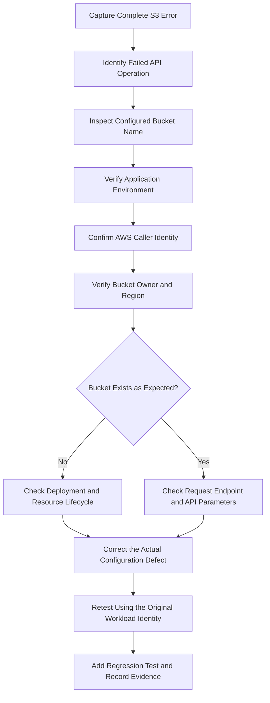

# 01- NoSuchBucket Error

## Overview

The Amazon S3 `NoSuchBucket` error indicates that an API request references a bucket that S3 cannot resolve as the specified resource. It commonly occurs when an application uses an incorrect bucket name, targets an unintended AWS account or environment, references a deleted bucket, or relies on incorrect deployment configuration.

The error typically appears as an HTTP `404 Not Found` response with the S3 error code `NoSuchBucket`. However, bucket-related failures can also appear as redirects, authorization errors, or other request errors depending on the operation, endpoint, permissions, and request context.

For backend engineers, the important distinction is between a genuinely missing bucket and a request that targets the wrong resource or endpoint. Do not create a replacement bucket or modify production infrastructure until the intended bucket, account, and Region have been verified.

This document covers:

- Common causes of `NoSuchBucket`.
- A structured diagnostic workflow.
- Bucket name, account, and Region verification.
- AWS CLI and Boto3 troubleshooting.
- Application configuration and deployment failures.
- Recovery, regression testing, and prevention.

## Understand the Error

### What `NoSuchBucket` means

S3 buckets are named resources within an AWS partition. An object request must identify the correct bucket before S3 can access the requested object.

For example:

```bash
aws s3api get-object \
  --bucket company-prod-documents-123456789012 \
  --key reports/report.pdf \
  ./report.pdf \
  --region ap-south-1
```

If the supplied bucket name does not identify an available bucket for the request, the operation may fail with an error similar to:

```text
An error occurred (NoSuchBucket) when calling the GetObject operation:
The specified bucket does not exist
```

Possible explanations include:

- The bucket name contains a typo.
- The application uses a bucket name from the wrong environment.
- A required environment variable is empty, missing, or incorrect.
- The bucket was deleted or has not yet been provisioned.
- The request targets an unexpected AWS account or resource.
- The application or client is configured with an incorrect endpoint or Region.
- An infrastructure deployment created a differently named bucket than the application expects.

The exact error response depends on the request and authorization context. Treat the error as a signal to verify the resource and request, not as immediate proof that the bucket should be recreated.

## Standard Diagnostic Workflow

Use the following workflow to establish which resource the application is actually targeting.



### Capture the failure

Record the following information before making any changes:

- The complete AWS error code and message.
- The failing API operation, such as `GetObject`, `PutObject`, or `ListObjectsV2`.
- The bucket name used by the application.
- The object key, if an object operation failed.
- The AWS account ID and principal ARN.
- The configured Region and endpoint.
- The execution environment and deployment version.
- The timestamp and request ID, if available.
- Recent changes to environment variables or infrastructure.

Avoid including credentials, session tokens, or complete presigned URLs in logs and incident reports.

### Identify the exact failing request

Different operations provide different diagnostic information.

| Operation | Purpose | Diagnostic focus |
|---|---|---|
| `HeadBucket` | Checks access to a bucket and provides bucket-related response information | Bucket name, account ownership, permissions, and endpoint |
| `ListObjectsV2` | Lists objects in a bucket | Bucket name, listing permissions, prefix, and Region |
| `GetObject` | Retrieves object content | Bucket name, object key, resource access, and endpoint |
| `PutObject` | Uploads object content | Bucket name, write permissions, and destination configuration |
| `GetBucketLocation` | Retrieves the bucket's Region configuration | Correct account, permissions, and Region selection |

Do not assume every bucket-related failure is a `NoSuchBucket` problem. An object-level `NoSuchKey`, an authorization denial, and a Region redirect require different diagnostic paths.

## Verify the Bucket Name

Bucket-name configuration is one of the most frequent causes of `NoSuchBucket`.

Common mistakes include:

- Typographical errors in environment variables.
- Using a development bucket name in production.
- Adding an unintended suffix or prefix.
- Referencing an old bucket name after infrastructure changes.
- Passing an object key or complete S3 URL as the bucket name.
- Assuming that a bucket name is derived from a local directory or application name.

For example, these names refer to different buckets:

```text
company-documents-prod
company-document-prod
company-documents-production
company-documents-prod-123456789012
```

S3 does not infer that similarly named buckets represent the same resource.

### Inspect environment configuration

For a Linux container or shell:

```bash
printf 'S3_BUCKET_NAME=%s\n' "${S3_BUCKET_NAME:-<unset>}"
printf 'AWS_REGION=%s\n' "${AWS_REGION:-<unset>}"
```

Review the output carefully, especially when configuration is loaded from Docker Compose, Kubernetes manifests, AWS Lambda environment variables, ECS task definitions, or a CI/CD deployment workflow.

Do not print secrets or unrelated environment variables into production logs.

### Validate configuration in Python

A backend application should validate required storage configuration at startup rather than waiting for the first file operation.

```python
import os


def load_s3_config() -> tuple[str, str]:
    bucket_name = os.getenv("S3_BUCKET_NAME", "").strip()
    region = os.getenv("AWS_REGION", "").strip()

    if not bucket_name:
        raise RuntimeError("S3_BUCKET_NAME must be configured")

    if not region:
        raise RuntimeError("AWS_REGION must be configured")

    return bucket_name, region
```

This validation catches missing configuration, but it does not prove that the bucket exists or that the caller has access. Resource verification remains a separate step.

## Verify the AWS Identity and Account

A bucket may exist while the application is connected to an unexpected AWS account or using credentials from the wrong environment.

Run:

```bash
aws sts get-caller-identity
```

Example output:

```json
{
  "UserId": "AROAXXXXXXXXXXXXX:document-api",
  "Account": "123456789012",
  "Arn": "arn:aws:sts::123456789012:assumed-role/document-api-role/document-api"
}
```

Compare the account ID and principal with the expected deployment configuration.

A developer's local AWS profile may differ from the credentials used by a Docker container, Lambda function, EC2 instance, ECS task, Kubernetes workload, or CI/CD runner.

For a named CLI profile:

```bash
aws sts get-caller-identity \
  --profile production
```

Use this check before changing bucket infrastructure. A successful command confirms the active identity, not access to the intended bucket.

### Common account-related scenarios

| Scenario | Likely issue | Corrective action |
|---|---|---|
| Local development works but production fails | Different bucket configuration or credentials | Compare deployed variables and caller identity |
| Application works in staging but fails in production | Production bucket was not provisioned or the wrong name was deployed | Inspect production infrastructure and deployment output |
| Cross-account application cannot access the bucket | Incorrect target resource or incomplete authorization | Verify bucket owner and cross-account access configuration |
| CI/CD deployment succeeds but runtime fails | Infrastructure identity differs from application identity | Validate both deployment configuration and runtime resource access |

## Verify the Bucket Exists and the Caller Can Reach It

Use `HeadBucket` to investigate the configured bucket.

```bash
aws s3api head-bucket \
  --bucket company-prod-documents-123456789012 \
  --region ap-south-1
```

A successful response normally has no response body.

Where appropriate, specify the expected owner:

```bash
aws s3api head-bucket \
  --bucket company-prod-documents-123456789012 \
  --expected-bucket-owner 123456789012 \
  --region ap-south-1
```

The expected-owner option helps detect a resource-owner mismatch. It does not grant permissions or prove that the bucket exists when the request fails.

### Interpret the result carefully

| Result | What it can indicate | Next diagnostic step |
|---|---|---|
| Successful request | The bucket is reachable for this operation and identity | Test the original application operation |
| `NoSuchBucket` | The name does not resolve to the expected bucket for the request | Verify the exact name, resource lifecycle, and endpoint |
| `403 Forbidden` | Access may be denied or resource information may be unavailable to the caller | Check permissions and use an authorized diagnostic identity |
| `301 PermanentRedirect` | The request may target the wrong Region or endpoint | Identify the bucket's actual Region and configure the client |
| `400 Bad Request` | The request, endpoint, or parameters may be invalid | Inspect the response and correct the request |

S3 can intentionally provide limited resource-existence information when a caller lacks permission. A `403` response must not be treated as proof that the bucket exists or is missing.

If `HeadBucket` fails, correlate the result with the account identity, bucket-owner information, and the actual API response before determining the root cause.

## Verify the Bucket's Region

S3 bucket names are globally unique within an AWS partition, but each bucket has a specific Region. A request sent to the wrong endpoint can be redirected or rejected.

Retrieve the bucket's Region:

```bash
aws s3api get-bucket-location \
  --bucket company-prod-documents-123456789012
```

The caller needs sufficient permission to retrieve the bucket's location. When the returned `LocationConstraint` is `null`, the bucket is in `us-east-1`.

For subsequent requests, use the appropriate Region.

```bash
aws s3api head-bucket \
  --bucket company-prod-documents-123456789012 \
  --region ap-south-1
```

Replace the example Region with the bucket's actual Region.

### Distinguish Region errors from missing buckets

A wrong Region does not always produce `NoSuchBucket`. S3 can return a redirect or another endpoint-related error.

Investigate the response rather than changing the bucket name solely because a request was sent to the wrong Region.

For Boto3, explicitly configuring the expected Region is useful when the deployment environment does not consistently supply one:

```python
import boto3


def create_s3_client(region_name: str):
    return boto3.client("s3", region_name=region_name)
```

Use the standard AWS credential provider chain instead of embedding access keys in the application.

## Diagnose Endpoint and Resource Addressing Problems

S3 supports multiple endpoint and addressing patterns. A custom endpoint, hardcoded URL, incorrectly configured Region, or incompatible S3-compatible storage configuration can send a request to an unintended destination.

Review:

- The bucket name passed to the SDK.
- The configured Region.
- Any custom S3 endpoint or endpoint override.
- Whether the code uses the intended AWS partition.
- The actual hostname and URL being used by the client.
- Whether the application is targeting AWS S3 or a separate S3-compatible service.
- Whether a proxy or custom networking layer changes the request destination.

### Avoid deriving the bucket name from a URL

A bucket name should be stored and configured separately from the endpoint and object key.

For example:

```python
bucket_name = "company-prod-documents-123456789012"
object_key = "reports/report.pdf"
region_name = "ap-south-1"
```

Do not pass a complete URL such as `s3://company-prod-documents-123456789012/reports/report.pdf` as the bucket name to an API that expects only the bucket identifier.

Keep endpoint configuration, bucket name, and object key as separate values so that each can be validated independently.

## Diagnose Infrastructure Deployment Failures

A missing bucket can result from an incomplete or incorrect deployment rather than an application defect.

Common causes include:

- A Terraform apply failed before the bucket was created.
- A CloudFormation stack is in a failed or rollback state.
- The application is deployed before storage infrastructure is ready.
- A bucket name differs between Terraform outputs and application configuration.
- A deployment targets the wrong account or Region.
- A bucket was intentionally deleted during teardown.
- An environment-specific configuration file references stale infrastructure.
- A bucket-creation operation failed because the requested name was already in use.

### Verify Terraform-managed resources

Inspect Terraform state and outputs in the correct workspace or backend:

```bash
terraform state list
```

If the bucket resource is known:

```bash
terraform state show aws_s3_bucket.documents
```

Inspect the intended configuration and execution plan:

```bash
terraform validate
terraform plan
```

These commands help identify configuration and state problems; they do not prove that the live bucket is accessible to the application.

Terraform state may be out of date or may describe a different environment. Verify the resource in the intended AWS account using an authorized identity.

### Verify CloudFormation deployments

For a known stack:

```bash
aws cloudformation describe-stacks \
  --stack-name document-storage-prod \
  --region ap-south-1
```

Inspect stack events to identify failed resource creation, replacement, or rollback:

```bash
aws cloudformation describe-stack-events \
  --stack-name document-storage-prod \
  --region ap-south-1
```

Look for the actual physical bucket name and the final stack status. Do not assume that the logical resource name matches the physical bucket name.

### Correct deployment dependencies

Ensure that the deployment process creates and verifies the bucket before application code depends on it.

For example, a CI/CD pipeline can follow this sequence:

1. Validate infrastructure configuration.
2. Deploy the storage resources.
3. Retrieve the resulting bucket name and Region.
4. Inject those values into the application environment.
5. Deploy or restart the application.
6. Run a smoke test using the intended workload role.
7. Fail the deployment if the required storage check does not pass.

A startup health check should distinguish a missing or misconfigured resource from a temporary operational failure and should avoid unnecessarily exposing sensitive resource details to external clients.

## Troubleshoot Boto3 and Backend Applications

When the CLI succeeds but the Python application fails, compare the exact parameters and credential resolution used by both clients.

### Minimal diagnostic example

```python
import logging

import boto3
from botocore.exceptions import ClientError, NoCredentialsError

logger = logging.getLogger(__name__)


def verify_bucket(bucket_name: str, region_name: str) -> None:
    session = boto3.Session(region_name=region_name)
    s3 = session.client("s3")

    try:
        s3.head_bucket(Bucket=bucket_name)
    except NoCredentialsError:
        logger.exception("AWS credentials are unavailable")
        raise
    except ClientError as exc:
        error = exc.response.get("Error", {})
        metadata = exc.response.get("ResponseMetadata", {})

        logger.error(
            "S3 bucket verification failed",
            extra={
                "aws_error_code": error.get("Code"),
                "http_status": metadata.get("HTTPStatusCode"),
                "request_id": metadata.get("RequestId"),
                "bucket": bucket_name,
                "region": region_name,
            },
        )
        raise
```

This function validates bucket reachability using the current session's credentials. It does not prove that the application can read or write the required objects.

The example logs a specific error code and request ID without logging credentials or request signing material. Adapt the logging fields to the application's observability conventions.

### Compare CLI and SDK configuration

| Configuration | CLI | Boto3 |
|---|---|---|
| Bucket name | `--bucket` argument | `Bucket` parameter |
| Region | `--region` or profile/configuration | `region_name` or session configuration |
| Credentials | Profile, environment, or workload identity | AWS SDK credential provider chain |
| Endpoint | CLI and AWS configuration | Client endpoint configuration |
| Caller identity | `aws sts get-caller-identity` | STS `GetCallerIdentity` using the application's session |
| Runtime variables | Shell, container, or CI/CD environment | Process environment and application configuration |

If the CLI and SDK use the same intended identity, bucket, Region, and request path, compare their actual requests and error responses rather than assuming Boto3 itself is responsible.

### Django, FastAPI, and Celery considerations

For framework-based systems, avoid scattering bucket names across views, serializers, task functions, and configuration files.

Use a centralized settings layer that provides the bucket name and Region to a reusable S3 service component.

Examples of failure-prone patterns include:

- A Django view using `S3_BUCKET_NAME` while a Celery worker uses an outdated hardcoded name.
- A FastAPI process running with a different environment from its deployment job.
- A container image containing a stale bucket name baked into the source or build configuration.
- A Celery task executing in a different account or Region from the API process.
- A worker continuing to process messages after its target bucket has been removed.

Validate required configuration during startup and add smoke tests for background workers. For long-running queues, coordinate bucket lifecycle changes with the consumers that still need the resource.

## Test Recovery Without Introducing More Risk

Once the root cause is known, correct the resource configuration or infrastructure rather than recreating resources indiscriminately.

### Recommended correction by root cause

| Root cause | Corrective action |
|---|---|
| Typographical error | Correct the configured bucket name |
| Wrong environment | Update the environment-specific configuration |
| Missing bucket | Verify whether provisioning is incomplete or deletion was intentional |
| Incorrect Region | Configure the client for the bucket's actual Region |
| Unexpected AWS account | Correct the credential or role-assumption configuration |
| Incorrect endpoint | Use the appropriate endpoint and addressing configuration |
| Deployment naming mismatch | Reconcile Terraform or CloudFormation outputs with application settings |
| Bucket intentionally deleted | Recreate or migrate the resource only through an approved recovery process |

### Verify the original operation

After fixing the configuration, repeat the failed operation using the original workload identity.

For an object read:

```bash
aws s3api get-object \
  --bucket company-prod-documents-123456789012 \
  --key reports/report.pdf \
  ./report.pdf \
  --region ap-south-1
```

Confirm that:

- The request targets the intended bucket and Region.
- The correct object is returned.
- The application can consume the downloaded data.
- Upload and listing operations work if they are part of the required workflow.
- Access outside the permitted scope remains denied.

Do not treat a successful `HeadBucket` request as complete application-level verification when the application needs to read or write objects.

### Handle confirmed bucket deletion carefully

If the bucket was intentionally or accidentally deleted, determine whether it should be restored through the organization's recovery process or provisioned as a new resource.

Do not immediately recreate a production bucket with the same name. The name might no longer be available, another party may have acquired it, or the application could begin sending data to a resource different from the one expected.

Recreating a bucket does not recover its previous contents, configuration, policies, lifecycle rules, or encryption setup automatically. Follow the applicable backup and disaster-recovery procedures.

## Prevention and Production Best Practices

### Centralize resource configuration

Use environment-specific configuration for bucket names and Regions. Avoid hardcoding production identifiers throughout the codebase.

A typical configuration model might distinguish:

| Environment | Bucket configuration |
|---|---|
| Development | Development bucket name and Region |
| Staging | Staging bucket name and Region |
| Production | Production bucket name and Region |

Use actual values supplied by the deployment environment. Do not rely on naming assumptions when infrastructure can generate or change physical resource names.

### Verify infrastructure contracts

Treat the bucket name, account, and Region as an explicit contract between infrastructure and the application.

Use Terraform outputs, CloudFormation outputs, or another controlled configuration-distribution mechanism to provide the actual deployed resource identifiers.

Validate those values before deploying or restarting services that depend on them.

### Add deployment smoke tests

After provisioning a bucket, verify that the intended workload can perform the operations it needs.

Depending on the application, tests may include:

- Bucket reachability using the expected Region.
- Uploading a uniquely named test object.
- Reading the test object back.
- Checking expected metadata or encryption settings.
- Deleting the test object when permitted and appropriate.

Run tests with the application role rather than relying only on the privileged deployment identity.

### Monitor configuration and resource lifecycle changes

Record bucket creation and deletion changes, infrastructure deployment failures, and application errors. Use CloudTrail for relevant management events and configure the appropriate logging for any additional investigation requirements.

Alert on repeated bucket-related failures that affect production workflows. A missing bucket may reveal a deployment defect, an accidental teardown, or a stale configuration that also affects multiple services.

### Keep recovery procedures explicit

For production storage, document:

- The owning AWS account and Region.
- The authoritative bucket name.
- The application services and workers that depend on it.
- The infrastructure-as-code resource responsible for provisioning.
- The approved recovery and recreation process.
- The verification steps required before restoring traffic.

This prevents a seemingly simple `NoSuchBucket` incident from turning into unintended resource recreation or data loss.

## Production Troubleshooting Checklist

- [ ] Capture the complete error code, message, operation, and request ID.
- [ ] Verify the exact bucket name supplied by the application.
- [ ] Confirm the application environment and relevant configuration variables.
- [ ] Identify the active AWS account and principal.
- [ ] Verify the intended bucket owner and Region.
- [ ] Use `HeadBucket` with an appropriate diagnostic identity and expected-owner check where supported.
- [ ] Distinguish missing-resource errors from authorization failures and Region redirects.
- [ ] Inspect custom endpoints and SDK configuration.
- [ ] Review Terraform or CloudFormation state and deployment events when infrastructure provisioning is involved.
- [ ] Check consistency between API servers, workers, containers, and CI/CD configuration.
- [ ] Correct the verified defect without recreating production resources prematurely.
- [ ] Retest the original operation using the intended workload identity.
- [ ] Update configuration, smoke tests, and operational documentation.

## Official References

- [Troubleshoot 404 Not Found errors in Amazon S3](https://docs.aws.amazon.com/AmazonS3/latest/userguide/troubleshoot-404-errors.html)
- [HeadBucket API reference](https://docs.aws.amazon.com/AmazonS3/latest/API/API_HeadBucket.html)
- [GetBucketLocation API reference](https://docs.aws.amazon.com/AmazonS3/latest/API/API_GetBucketLocation.html)
- [GetObject API reference](https://docs.aws.amazon.com/AmazonS3/latest/API/API_GetObject.html)
- [Amazon S3 bucket naming rules](https://docs.aws.amazon.com/AmazonS3/latest/userguide/bucketnamingrules.html)
- [AWS SDK for Python (Boto3) documentation](https://boto3.amazonaws.com/v1/documentation/api/latest/index.html)
- [Terraform AWS provider documentation](https://registry.terraform.io/providers/hashicorp/aws/latest/docs/resources/s3_bucket)
- [AWS CloudFormation documentation](https://docs.aws.amazon.com/AWSCloudFormation/latest/UserGuide/Welcome.html)

## Key Takeaways

- `NoSuchBucket` should trigger verification of the exact bucket name, account, Region, endpoint, and resource lifecycle.
- A failed `HeadBucket` request is not sufficient by itself to determine whether a bucket is missing because authorization and endpoint errors can produce similar symptoms.
- Keep bucket configuration centralized and validate it consistently across API servers, background workers, containers, and deployment pipelines.
- Recreate a bucket only after confirming the intended recovery path, because a replacement does not automatically restore the previous data or configuration.
- Verify the original application operation using the intended workload identity and maintain deployment smoke tests to prevent recurrence.