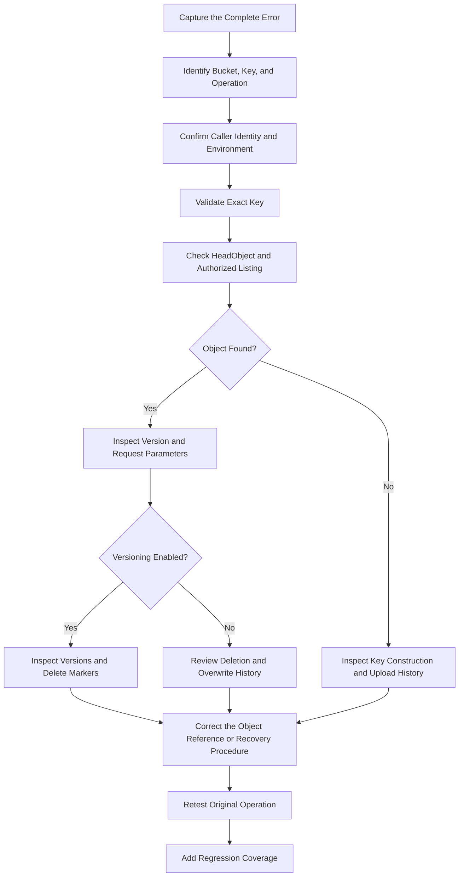

# 02- NoSuchKey Error

## Overview

The Amazon S3 `NoSuchKey` error occurs when a request references an object key that does not identify an available object in the specified bucket. It commonly appears during object downloads, metadata lookups, copy operations, application file retrieval, and presigned URL requests.

A typical error looks like this:

```text
An error occurred (NoSuchKey) when calling the GetObject operation:
The specified key does not exist.
```

The error generally corresponds to HTTP `404 Not Found`. However, object-not-found scenarios can produce different responses depending on the API operation, permissions, object version, and request context.

S3 object keys are exact identifiers, not filesystem paths. A request for `reports/annual.pdf` does not match `Reports/annual.pdf`, `reports/Annual.pdf`, or `reports/annual.pdf/`. A leading slash, an unexpected prefix, URL encoding, or a stale key stored in a database can also cause a mismatch.

This document provides a production-oriented workflow for diagnosing `NoSuchKey`, validating object identifiers, inspecting versions and delete markers, troubleshooting Boto3 applications, and preventing recurrence.

## Understand the Error

### What `NoSuchKey` means

Every S3 object is identified by its bucket and key. An object request must reference the exact key, and a version-specific request must also identify the intended version.

For example, an object stored under this key:

```text
documents/customers/123/invoice.pdf
```

must be requested using the same key:

```bash
aws s3api get-object \
  --bucket company-prod-documents-123456789012 \
  --key 'documents/customers/123/invoice.pdf' \
  ./invoice.pdf \
  --region ap-south-1
```

A request using any of the following identifiers targets a different key:

```text
/documents/customers/123/invoice.pdf
documents/Customers/123/invoice.pdf
documents/customers/123/Invoice.pdf
documents/customers/123/invoice.pdf/
```

S3 does not automatically normalize these identifiers as a filesystem might.

### Common symptoms

| Symptom | Possible cause |
|---|---|
| `GetObject` returns `NoSuchKey` | Incorrect key, missing object, or an object identifier from an outdated application record |
| `HeadObject` returns a not-found response | The requested key or version is missing, subject to the operation's authorization behavior |
| Download works in one environment but fails in another | Different bucket, Region, prefix, or application configuration |
| Console displays an object but the API cannot retrieve it | The console and application may reference different keys, versions, buckets, or identities |
| Copy operation returns `NoSuchKey` | The source object identifier or source version is incorrect |
| A recently uploaded file cannot be retrieved | The application may be using the wrong key, or the upload may have failed before the key was persisted |
| A previously accessible object appears missing | A delete marker, deletion, overwrite, or stale reference may be involved |
| A presigned download URL returns an error | The signed request may reference the wrong key or version, or another request condition may be invalid |

## Standard Diagnostic Workflow

Use a consistent process to distinguish a genuinely missing object from an incorrect identifier, a versioning issue, or an application configuration defect.



### Capture the failure details

Record the following information before attempting recovery:

- Full AWS error code and message.
- Failed S3 API operation.
- Bucket name and expected owner account.
- Exact object key, preserving case and special characters.
- Version ID, if the request is version-specific.
- AWS account, principal ARN, and Region.
- Application environment and deployment version.
- Request timestamp and AWS request ID when available.
- Relevant upload, copy, deletion, or metadata-update history.

Avoid logging full presigned URLs, credentials, or sensitive object contents.

### Establish the exact request

For object-related failures, confirm the actual values passed to the S3 SDK or CLI.

Do not infer the key solely from the file's displayed name. A file shown as `invoice.pdf` in a frontend may be stored under an internal key such as:

```text
tenant-123/documents/2026/9f5d2c8a/invoice.pdf
```

The application's database should retain the authoritative object key or object identifier generated during upload.

## Verify the Bucket and Object Identifier

### Confirm the bucket and Region

Use the intended AWS identity to verify the destination:

```bash
aws sts get-caller-identity
```

Then inspect the object:

```bash
aws s3api head-object \
  --bucket company-prod-documents-123456789012 \
  --key 'documents/customers/123/invoice.pdf' \
  --region ap-south-1
```

A successful `HeadObject` returns object metadata, including fields such as content length, last-modified time, ETag, and version information when available.

A failed `HeadObject` does not always establish that the object is absent. Depending on permissions and resource state, S3 can return `403 Forbidden` instead of a not-found response. Investigate authorization separately when the response is ambiguous.

If needed, verify that the bucket name, expected owner, and Region match the application's configuration.

### Inspect an exact key with listing

If the caller is authorized to list the relevant prefix:

```bash
aws s3api list-objects-v2 \
  --bucket company-prod-documents-123456789012 \
  --prefix 'documents/customers/123/' \
  --region ap-south-1
```

The `Prefix` parameter filters keys that begin with the supplied string. It does not perform case-insensitive matching or match arbitrary substrings.

To inspect a particular object name, use a narrow prefix and compare the returned `Key` values with the requested key.

For a large prefix, account for pagination. `ListObjectsV2` returns a limited page of results, and an object may not appear in the first response. Use the AWS CLI paginator or the SDK's paginator instead of assuming that the first response contains every matching object.

### Distinguish object absence from access denial

| Observation | Interpretation | Recommended action |
|---|---|---|
| `HeadObject` succeeds | The requested current object or version is accessible | Compare the successful request with the failing request |
| `GetObject` returns `NoSuchKey` | The requested current key is unavailable to that request | Check key construction, object existence, and deletion history |
| `HeadObject` returns `404` | The requested key or version may be absent | Verify using an appropriately authorized diagnostic identity |
| `HeadObject` returns `403` | Access may be denied, or S3 may be withholding existence information | Inspect permissions and use authorized diagnostics |
| Listing returns a similar but different key | The application may be constructing the identifier incorrectly | Correct the key-generation or persistence logic |
| Listing returns no matching results | The object may be missing, outside the prefix, or invisible to the caller | Verify the requested prefix, pagination, identity, and object history |

Do not grant broad bucket permissions simply to determine whether an object exists. Use a diagnostic identity with the minimum additional permissions necessary.

## Diagnose Key Construction Errors

Key-construction bugs are particularly common in applications that combine user input, database fields, upload filenames, and S3 prefixes.

### Leading and trailing slashes

These keys are different:

```text
reports/invoice.pdf
/reports/invoice.pdf
reports/invoice.pdf/
```

A typical bug occurs when a configured prefix already ends with `/` and the application joins it with a path beginning with `/`.

For example:

```python
prefix = "reports/"
filename = "/invoice.pdf"

key = f"{prefix}{filename}"
print(key)
```

Output:

```text
reports//invoice.pdf
```

S3 treats the repeated slash as part of the key. It does not automatically collapse it.

### Case sensitivity

S3 keys are case-sensitive.

```text
Reports/Invoice.pdf
reports/invoice.pdf
```

These are separate identifiers.

Avoid lowercasing or changing case during download if the original object key was stored with its original casing.

### URL encoding and special characters

Keys may contain spaces, Unicode characters, `+`, `%`, `#`, and other characters that must be handled correctly when constructing HTTP requests or URLs.

For example, a key containing a space might be:

```text
reports/annual report.pdf
```

When using the AWS CLI or Boto3, pass the logical S3 key rather than pre-encoding it as a URL.

Correct Boto3 usage:

```python
s3.get_object(
    Bucket="company-prod-documents-123456789012",
    Key="reports/annual report.pdf",
)
```

Avoid applying URL encoding to the key before passing it to the SDK:

```python
from urllib.parse import quote

key = quote("reports/annual report.pdf")
```

Using the result as the Boto3 `Key` changes the identifier. It may target a key containing encoded characters instead of the intended original key.

When constructing a manual HTTP request, encode the URL path correctly according to the S3 API and request-signing requirements. Do not confuse a URL representation with the logical object key.

### Object keys are not filesystem paths

S3 uses a flat object-key namespace. Prefixes such as `reports/2026/` provide naming conventions and console grouping, but they are not actual filesystem directories.

As a result:

- S3 does not resolve `..` as a parent-directory traversal operation.
- Repeated slashes can be meaningful key characters.
- Prefixes should not be normalized with filesystem-specific functions unless the storage key format explicitly requires that behavior.
- `os.path.join()` can introduce platform-dependent path separators and should not be used blindly to construct S3 keys.

Use a deliberate key-generation function with a documented storage convention.

### Safer key construction

```python
from pathlib import PurePosixPath


def build_object_key(
    tenant_id: str,
    object_id: str,
    filename: str,
) -> str:
    if not tenant_id or not object_id or not filename:
        raise ValueError("Tenant ID, object ID, and filename are required")

    if "/" in filename or "\\" in filename:
        raise ValueError("Filename must not contain path separators")

    if filename in {".", ".."}:
        raise ValueError("Invalid filename")

    return str(
        PurePosixPath("tenants") / tenant_id / "objects" / object_id / filename
    )
```

This example constrains filenames to individual path components and uses POSIX-style separators for a predictable S3 key format. Production systems should also validate tenant and object identifiers, enforce authorization, and decide how Unicode and reserved characters are handled.

Persist the resulting key when the object is created. Do not independently reconstruct it from mutable user-facing metadata at download time.

## Diagnose Upload and Persistence Race Conditions

A `NoSuchKey` error can occur when the application attempts to retrieve an object that was never successfully uploaded or whose generated key was not saved consistently.

Consider a file-upload workflow:

1. The backend generates an object key.
2. The application uploads the object to S3.
3. The application stores the key in PostgreSQL.
4. A later request uses the stored key to download the file.

Failures can occur when the database is updated before the upload succeeds, when upload and database operations use different keys, or when a retry generates a new key but retains the original database reference.

### Example failure modes

| Failure mode | Consequence | Corrective action |
|---|---|---|
| Database record created before upload, but upload fails | The record references a nonexistent object | Track upload status and mark the object ready only after the upload succeeds |
| Retry generates a different key | Database and S3 refer to different objects | Reuse a stable operation ID or persist the generated key before retrying |
| Upload completes but database transaction fails | Object exists without a corresponding record | Use a recovery or reconciliation process for orphaned objects |
| Background worker constructs a different prefix | Worker cannot retrieve the uploaded object | Share a common key-generation function and configuration |
| Application overwrites an object under a different key | Old reference no longer points to the intended content | Store the canonical key and manage object updates explicitly |
| Client sends a different filename during retrieval | Download targets a key that was never created | Retrieve the stored object identifier from the authoritative database record |

### Recommended lifecycle

Use explicit application-level states such as `PENDING`, `UPLOADED`, `READY`, and `FAILED` where the workflow requires them.

Do not return a download URL for a file that has not reached the appropriate ready state. For direct-to-S3 uploads, validate the completed object before marking the record ready.

A database transaction cannot make an S3 upload atomic with a relational database update. Design the workflow so that incomplete operations can be retried or reconciled safely.

## Diagnose Object Versioning and Delete Markers

A bucket with versioning enabled can retain previous versions even after the current object is deleted.

This can make an object appear missing even though historical data remains in S3.

### Understand delete markers

In a versioned bucket, a normal delete request typically inserts a delete marker as the current version. An unversioned `GetObject` request then behaves as though the object is deleted.

Older object versions may still exist.

This is different from permanently deleting a specific object version.

### Inspect bucket versioning

```bash
aws s3api get-bucket-versioning \
  --bucket company-prod-documents-123456789012 \
  --region ap-south-1
```

### Inspect object versions and delete markers

```bash
aws s3api list-object-versions \
  --bucket company-prod-documents-123456789012 \
  --prefix 'documents/customers/123/invoice.pdf' \
  --region ap-south-1
```

Review both `Versions` and `DeleteMarkers` in the response.

A prefix filter can return other keys that share the same beginning. Compare each returned `Key` with the exact object identifier.

### Retrieve a specific version

If the intended historical version exists and the caller is authorized:

```bash
aws s3api get-object \
  --bucket company-prod-documents-123456789012 \
  --key 'documents/customers/123/invoice.pdf' \
  --version-id 'EXAMPLE_VERSION_ID' \
  ./invoice-recovered.pdf \
  --region ap-south-1
```

Do not use a placeholder version ID in production. Obtain the actual value from the version listing or another authoritative record.

A version-specific read commonly requires `s3:GetObjectVersion`, in addition to any other permissions required by the operation. SSE-KMS objects may also require KMS decryption permission.

### Recovery considerations

Before removing a delete marker or changing version state:

- Confirm the intended object and version.
- Verify the version belongs to the exact key.
- Check whether lifecycle rules or retention controls apply.
- Follow the organization's recovery process.
- Test the resulting object access and application behavior.

Deleting a specific version can permanently remove that historical version. Use destructive version-management commands only after reviewing their impact.

## Diagnose Copy and Rename Failures

S3 does not provide an atomic filesystem-style rename operation. A move is generally implemented as a copy followed by deletion of the source.

A copy operation can fail with `NoSuchKey` when the source key or source version is wrong.

### Verify the source object

```bash
aws s3api head-object \
  --bucket company-prod-documents-123456789012 \
  --key 'staging/report.pdf' \
  --region ap-south-1
```

If the object uses versioning, verify that the intended version exists.

### Verify source and destination identifiers

A copy request has separate source and destination identifiers. Confirm:

- The source bucket and key are correct.
- The source version, if specified, exists.
- The destination bucket and key are correct.
- The caller has source-read and destination-write permissions.
- Encryption requirements are satisfied for both sides.
- The operation does not unintentionally change the metadata, tags, or encryption configuration.

### Copy and validate before deleting

Example:

```bash
aws s3api copy-object \
  --bucket company-prod-documents-123456789012 \
  --key 'archive/report.pdf' \
  --copy-source 'company-prod-documents-123456789012/staging/report.pdf' \
  --region ap-south-1
```

After the copy completes, verify the destination object before deleting the source. For large objects or advanced copy requirements, use the appropriate multipart copy workflow or AWS CLI high-level transfer command.

Do not treat a copy response alone as proof that the application's entire migration workflow is complete. Validate the destination and update database references consistently.

## Troubleshoot Boto3 Applications

When the CLI can access the object but the Python application receives `NoSuchKey`, compare the exact bucket, key, Region, credential provider, and request parameters.

### Example diagnostic function

```python
import logging

import boto3
from botocore.exceptions import ClientError, NoCredentialsError

logger = logging.getLogger(__name__)


def download_object(
    bucket_name: str,
    object_key: str,
    destination_path: str,
    region_name: str,
) -> None:
    session = boto3.Session(region_name=region_name)
    s3 = session.client("s3")

    try:
        s3.download_file(
            bucket_name,
            object_key,
            destination_path,
        )
    except NoCredentialsError:
        logger.exception("AWS credentials are unavailable")
        raise
    except ClientError as exc:
        error = exc.response.get("Error", {})
        response_metadata = exc.response.get("ResponseMetadata", {})

        logger.error(
            "S3 download failed",
            extra={
                "aws_error_code": error.get("Code"),
                "http_status": response_metadata.get("HTTPStatusCode"),
                "request_id": response_metadata.get("RequestId"),
                "bucket": bucket_name,
                "object_key": object_key,
            },
        )
        raise
```

This example preserves the original SDK exception while recording diagnostic fields. Adapt error handling to the application's API contract and logging policy.

Object keys and filenames can contain sensitive business information. Restrict access to diagnostic logs and consider redacting or hashing key values where appropriate.

### Compare CLI and SDK behavior

| Diagnostic field | CLI | Boto3 |
|---|---|---|
| Bucket | `--bucket` | `Bucket` or first argument of `download_file()` |
| Object key | `--key` | `Key` or second argument of `download_file()` |
| Region | `--region` or profile | Session or client `region_name` |
| Credentials | AWS profile, environment, or workload role | SDK credential provider chain |
| Version | `--version-id` where supported | `VersionId` in applicable API calls |
| Endpoint | AWS CLI configuration | Client endpoint configuration |

If the CLI succeeds but Boto3 fails, compare the actual logical keys and request parameters first. Do not assume that the SDK incorrectly interprets the key.

### Django, FastAPI, and Celery considerations

Use a shared storage service layer to manage bucket names, key generation, uploads, downloads, and error handling.

In Django or Django REST Framework, persist the canonical key associated with the uploaded file instead of reconstructing it from the current filename.

In FastAPI, validate the file identifier and authorization before retrieving the stored key and calling S3.

For Celery, ensure the API process and worker use the same key-generation contract and environment-specific bucket configuration. Workers can process delayed messages after configuration changes, so old tasks may reference obsolete keys.

## Validate the Corrective Action

After resolving the confirmed root cause, repeat the original operation using the intended application identity and resource configuration.

### Verification commands

Inspect object metadata:

```bash
aws s3api head-object \
  --bucket company-prod-documents-123456789012 \
  --key 'documents/customers/123/invoice.pdf' \
  --region ap-south-1
```

Download the object:

```bash
aws s3api get-object \
  --bucket company-prod-documents-123456789012 \
  --key 'documents/customers/123/invoice.pdf' \
  ./invoice.pdf \
  --region ap-south-1
```

When relevant, verify the specific version, metadata, encryption, and destination file integrity.

### Test negative cases

| Test | Expected result |
|---|---|
| Download an existing object with the correct key | Succeeds when authorized |
| Download a nonexistent key | Returns the appropriate not-found or authorization response |
| Download using an incorrect case or prefix | Does not retrieve a different object's content |
| Download a specific existing version | Succeeds when authorized |
| Download a deleted current object | Behaves according to its current version and delete-marker state |
| Request another tenant's object | Denied by the application and applicable AWS authorization controls |
| Run a delayed Celery task with an obsolete object identifier | Fails safely and produces actionable diagnostics |

The application should distinguish between internal storage failures and public API behavior. Avoid exposing unrestricted object-existence information to callers who are not authorized to view the resource.

## Prevention and Production Best Practices

### Persist authoritative object identifiers

Store the exact generated S3 key in the database when creating the object. Treat the object key as storage metadata, not as a value that must be reconstructed from a user-visible filename.

A storage record can contain fields such as:

| Field | Purpose |
|---|---|
| `id` | Stable application-level identifier |
| `bucket_name` | Identifies the configured storage bucket when the architecture requires it |
| `object_key` | Exact S3 key |
| `version_id` | Optional reference to a specific object version |
| `status` | Application-level upload or processing state |
| `content_type` | Expected media type |
| `size_bytes` | Recorded object size |
| `checksum` | Optional integrity value where used |

The application should authorize access to the database record before allowing a download or issuing a presigned URL. Never trust a user-supplied bucket and key as sufficient authorization.

### Use deterministic and documented key conventions

Adopt a key format that is stable and easy to validate, such as:

```text
tenants/{tenant_id}/documents/{object_id}/{filename}
```

Use generated identifiers where appropriate, keep user-provided filenames separate from authorization decisions, and avoid inconsistent separators or ad hoc prefix rules.

Do not change the key-generation algorithm without considering existing objects, persisted database references, queues, and scheduled jobs.

### Design retries and persistence carefully

Use a stable operation identifier so that retries do not accidentally generate unrelated keys.

Where upload and database persistence cannot be performed atomically, define explicit intermediate states and a recovery mechanism. A reconciliation job can identify records that reference missing objects and objects that lack corresponding application records.

Ensure reconciliation is scoped, observable, and safe to rerun.

### Monitor recurring failures

Capture S3 request IDs, error codes, operation names, and enough context to diagnose the failing object reference without exposing credentials or sensitive file content.

Monitor repeated `NoSuchKey` errors by service and workflow. A rise in failures may indicate a broken deployment, inconsistent key construction, failed uploads, unexpected deletion, or outdated database references.

### Maintain version-aware recovery

When versioning is enabled, include version IDs in workflows that must preserve an immutable reference to a particular object version.

Document the recovery procedure for delete markers, historical versions, and accidental deletions. Versioning helps retain recoverable history but does not replace an appropriate backup and disaster-recovery plan.

## Production Troubleshooting Checklist

- [ ] Capture the complete error code, message, request ID, and failing API operation.
- [ ] Confirm the intended bucket, Region, AWS account, and caller identity.
- [ ] Compare the requested key with the exact persisted or listed key.
- [ ] Check case sensitivity, leading slashes, repeated separators, whitespace, and URL encoding.
- [ ] Verify object existence using `HeadObject` and an authorized, appropriately scoped listing.
- [ ] Account for pagination when listing large prefixes.
- [ ] Inspect object versions and delete markers if versioning is enabled.
- [ ] Check upload history, database persistence, retries, and worker configuration.
- [ ] Compare the source key, destination key, and version for copy or migration operations.
- [ ] Verify Boto3 client configuration and the SDK credential provider chain.
- [ ] Correct the actual key, resource reference, or lifecycle defect.
- [ ] Retest the original operation and add regression coverage.
- [ ] Review whether the incident requires object recovery or reconciliation.

## Official References

- [Troubleshoot 404 Not Found errors in Amazon S3](https://docs.aws.amazon.com/AmazonS3/latest/userguide/troubleshoot-404-errors.html)
- [GetObject API reference](https://docs.aws.amazon.com/AmazonS3/latest/API/API_GetObject.html)
- [HeadObject API reference](https://docs.aws.amazon.com/AmazonS3/latest/API/API_HeadObject.html)
- [ListObjectsV2 API reference](https://docs.aws.amazon.com/AmazonS3/latest/API/API_ListObjectsV2.html)
- [ListObjectVersions API reference](https://docs.aws.amazon.com/AmazonS3/latest/API/API_ListObjectVersions.html)
- [S3 object key naming guidelines](https://docs.aws.amazon.com/AmazonS3/latest/userguide/object-keys.html)
- [Using versioning in S3 buckets](https://docs.aws.amazon.com/AmazonS3/latest/userguide/Versioning.html)
- [AWS SDK for Python (Boto3) documentation](https://boto3.amazonaws.com/v1/documentation/api/latest/index.html)

## Key Takeaways

- `NoSuchKey` usually indicates that the requested bucket-and-key combination does not identify an available object for the operation; verify the exact identifier before attempting recovery.
- S3 keys are case-sensitive identifiers, and leading slashes, repeated separators, prefixes, and URL encoding can cause mismatches.
- Inspect object versions and delete markers before concluding that historical data has been permanently lost.
- Persist canonical object keys and coordinate uploads, database updates, retries, and background workers to prevent inconsistent references.
- Verify the corrected operation using the intended workload identity, then add regression tests and monitoring for recurring object-reference failures.