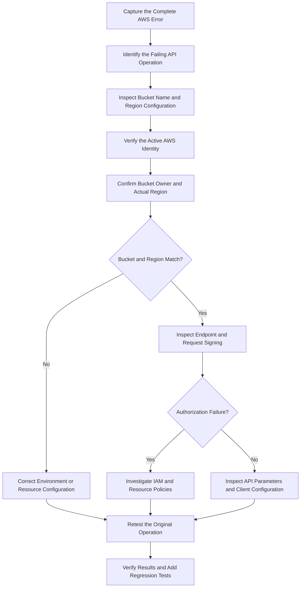

# 03- Incorrect Bucket Name and Region

## Overview

Amazon S3 bucket-name and Region configuration errors occur when an application sends a request to the wrong bucket, AWS account, Region, or endpoint. These failures frequently appear during uploads, downloads, object listings, deployments, and cross-account data transfers.

A bucket can exist and be accessible while the application still fails because it uses the wrong Region or an outdated bucket name. Conversely, an incorrectly configured endpoint can produce a redirect or another request error that is mistakenly treated as a missing-resource problem.

The most common symptoms include:

- `NoSuchBucket`: The request does not identify the expected bucket.
- `301 PermanentRedirect`: The request may be using an endpoint associated with the wrong Region.
- `AuthorizationHeaderMalformed`: The request may be signed for an incorrect Region.
- `PermanentRedirect` or endpoint-related errors: The client may be using an unsuitable endpoint or addressing configuration.
- `403 Forbidden`: Access is denied, or the service is not providing resource-existence information to the caller.
- `SignatureDoesNotMatch`: The signed request does not match what S3 receives; Region configuration may be one factor, but other signing inputs can also be responsible.

This document provides a repeatable diagnostic process for verifying bucket names, Regions, accounts, endpoint configuration, application settings, and infrastructure deployment. The objective is to correct the actual configuration defect without unnecessarily recreating production resources or weakening access controls.

## Understand Bucket Names, Regions, and Endpoints

### Bucket names identify resources

An S3 bucket name is a resource identifier. S3 does not infer that similarly named buckets refer to the same environment or application.

For example, these names identify different buckets:

```text
company-documents-dev
company-documents-staging
company-documents-prod
company-document-prod
```

A typo, missing environment suffix, outdated configuration value, or unexpected generated suffix can direct an application to the wrong resource.

Bucket names must follow S3 naming rules and be available within the applicable AWS partition. Many general-purpose bucket names are globally unique within that partition, so applications should not assume that a particular name will always be available for recreation after deletion.

### Region identifies the bucket's location

An S3 bucket is created in a specific AWS Region. Requests should use the appropriate regional endpoint and signing Region for the bucket and operation.

For example, a bucket in `ap-south-1` should generally be accessed through a client configured for that Region:

```python
import boto3

s3 = boto3.client(
    "s3",
    region_name="ap-south-1",
)
```

Configuring a client with `us-east-1` does not move a bucket or change its Region. Depending on the request, endpoint, and API operation, a mismatch may result in a redirect, signing error, or another service response.

### Account and Region are separate dimensions

A bucket name and Region alone may not be enough to identify the intended environment operationally. The caller may also be authenticated to the wrong AWS account.

| Configuration dimension | What it controls | Common failure |
|---|---|---|
| Bucket name | Identifies the S3 bucket | Typo, stale name, wrong environment |
| AWS account | Identifies the account associated with the workload or resource | Runtime uses credentials from an unexpected account |
| Region | Determines the bucket's regional location and request endpoint | Redirect, signing error, failed resource verification |
| Endpoint | Determines where the SDK sends the request | Custom endpoint or URL targets an unintended service |
| Object key | Identifies an object inside the bucket | Correct bucket, incorrect object identifier |
| Credentials | Determine the active AWS principal | Local CLI works, deployed application fails |
| Request-signing Region | Used to calculate the AWS Signature Version 4 signature | Authorization or signing error |

Diagnose these dimensions separately instead of changing several configuration values simultaneously.

## Standard Diagnostic Workflow

Use this workflow to identify the configuration responsible for the failure.



### Capture the original failure

Record the following information:

- Complete AWS error code and message.
- Failed API operation, such as `HeadBucket`, `GetObject`, or `PutObject`.
- Configured bucket name and object key.
- Configured Region and any custom endpoint.
- Expected bucket-owning account.
- Actual caller account and principal ARN.
- Application environment and deployment version.
- Timestamp and request ID, when available.
- Recent infrastructure, environment-variable, or credential changes.

Do not log AWS access keys, session tokens, signing material, or complete presigned URLs.

### Identify the failing operation

Different APIs provide different diagnostic information.

| Operation | Purpose | What to investigate |
|---|---|---|
| `HeadBucket` | Checks bucket reachability | Bucket name, expected owner, access, and endpoint |
| `GetBucketLocation` | Retrieves the bucket's Region configuration | Bucket name, permissions, and account context |
| `ListObjectsV2` | Lists objects | Bucket, Region, prefix, and listing permissions |
| `HeadObject` | Retrieves object metadata | Bucket, object key, version, and authorization |
| `GetObject` | Downloads an object | Bucket, key, Region, access, and encryption |
| `PutObject` | Uploads an object | Destination bucket, Region, write permissions, and request configuration |

Do not use a successful bucket-level check as proof that every object-level operation will succeed. A bucket can be reachable while a particular object request remains unauthorized or incorrectly configured.

## Verify the Active AWS Identity

A common production issue occurs when the CLI, application server, background worker, and deployment pipeline use different AWS credentials.

Start with:

```bash
aws sts get-caller-identity
```

Example output:

```json
{
  "UserId": "AROAXXXXXXXXXXXXX:document-api",
  "Account": "123456789012",
  "Arn": "arn:aws:sts::123456789012:assumed-role/document-api-role/document-api"
}
```

Compare the account ID and ARN with the workload's expected identity.

For a named profile:

```bash
aws sts get-caller-identity \
  --profile production
```

If the command returns an unexpected identity, investigate the credential provider chain before modifying the S3 configuration.

### Common credential differences

| Environment | Potential source of configuration mismatch |
|---|---|
| Local development | Different AWS profile or cached credentials |
| Docker container | Missing environment variables or different mounted configuration |
| ECS task | Task role differs from the deployment role |
| EC2 instance | Instance profile differs from the expected application role |
| Lambda function | Execution role or environment variables differ |
| Kubernetes workload | Workload identity or role association is incorrect |
| Celery worker | Worker configuration differs from the API process |
| CI/CD pipeline | Deployment identity differs from the runtime identity |

The active account is not necessarily the bucket-owning account. Cross-account access can be intentional, but the application must use the correct resource identifier and authorization design.

## Validate the Bucket Name

### Inspect application configuration

For a Linux shell or container:

```bash
printf 'S3_BUCKET_NAME=%s\n' "${S3_BUCKET_NAME:-<unset>}"
printf 'AWS_REGION=%s\n' "${AWS_REGION:-<unset>}"
```

Check the configured values against the authoritative infrastructure output.

Common mistakes include:

- Using the staging bucket name in production.
- Removing or adding an environment suffix.
- Using an old bucket name after a migration.
- Passing a complete S3 URI as the bucket argument.
- Using a URL hostname instead of the bucket name expected by the SDK.
- Reading configuration from an unintended `.env` file.
- Building the name from user input without validation.
- Using a manually maintained value that no longer matches infrastructure.

For example, the following is an S3 URI:

```text
s3://company-documents-prod/reports/report.pdf
```

Its components are:

```text
Bucket: company-documents-prod
Key:    reports/report.pdf
```

Do not pass the entire URI as the bucket name to an API that expects only the bucket identifier.

### Validate application settings at startup

A backend application should reject missing configuration early instead of waiting for the first storage operation to fail.

```python
import os


def load_s3_settings() -> tuple[str, str]:
    bucket_name = os.getenv("S3_BUCKET_NAME", "").strip()
    region = os.getenv("AWS_REGION", "").strip()

    if not bucket_name:
        raise RuntimeError("S3_BUCKET_NAME must be configured")

    if not region:
        raise RuntimeError("AWS_REGION must be configured")

    return bucket_name, region
```

This verifies that the configuration values exist. It does not prove that the bucket is deployed, belongs to the expected account, or is accessible to the current principal.

Validate resource existence and runtime permissions separately.

### Avoid silently rewriting bucket names

Do not automatically append suffixes, remove characters, or derive production bucket names from local assumptions.

For example, a naming function may generate `company-documents-prod-123456789012` while the actual resource is `company-documents-prod`.

The safer pattern is to use the exact bucket name supplied by infrastructure outputs or an approved configuration source.

## Verify the Bucket's Actual Region

### Query the bucket location

Using an identity authorized to make the request:

```bash
aws s3api get-bucket-location \
  --bucket company-documents-prod-123456789012
```

When the bucket's `LocationConstraint` is `null`, its Region is `us-east-1`.

For production automation, configure the SDK explicitly with the expected Region rather than relying on legacy location-response assumptions.

### Verify bucket reachability

```bash
aws s3api head-bucket \
  --bucket company-documents-prod-123456789012 \
  --region ap-south-1
```

If you know the expected owner, include it:

```bash
aws s3api head-bucket \
  --bucket company-documents-prod-123456789012 \
  --expected-bucket-owner 123456789012 \
  --region ap-south-1
```

Replace the example bucket name, account ID, and Region with the verified resource values.

The expected-owner option helps detect an unexpected bucket owner; it does not grant access.

### Interpret the response

| Response | Potential interpretation | Recommended investigation |
|---|---|---|
| Success | Bucket is reachable for this request | Test the original object operation |
| `NoSuchBucket` | Bucket name or resource context is incorrect, or the bucket is unavailable as referenced | Verify name, account, provisioning, and endpoint |
| `301 PermanentRedirect` | Request may use the wrong regional endpoint | Determine the actual bucket Region |
| `AuthorizationHeaderMalformed` | Request signing or related request configuration may be incorrect | Inspect signing Region and the complete error message |
| `403 Forbidden` | Request is denied or resource information is withheld | Inspect permissions and verify with an authorized identity |
| `400 Bad Request` | Request parameters, endpoint, or addressing may be invalid | Inspect the complete response and request configuration |
| `SignatureDoesNotMatch` | The signed request differs from the request S3 receives | Inspect signing Region, headers, URL encoding, and credentials |

These interpretations are diagnostic clues, not universal mappings. The exact response depends on the operation, endpoint, permissions, and request context.

### Distinguish bucket Region from application deployment Region

An application may run in `ap-south-1` and access a bucket in `us-east-1`. That is valid unless the architecture or policy imposes a specific Region requirement.

Do not assume the application's compute Region must equal the bucket Region. Determine the intended storage design and configure the client accordingly.

## Diagnose Endpoint and Signing Errors

### Regional endpoint configuration

A client configured with a Region that does not match the bucket may send requests to an endpoint that causes an error or redirect.

Inspect the complete error response, identify the intended bucket's Region, and configure the S3 client consistently.

For Boto3:

```python
import boto3


def create_s3_client(region_name: str):
    return boto3.client(
        "s3",
        region_name=region_name,
    )
```

Use the SDK's normal credential provider chain. Avoid embedding access keys in application code.

### Custom endpoint configuration

Review any explicitly configured endpoint:

- `endpoint_url` in Boto3.
- Proxy or gateway configuration.
- S3-compatible storage endpoints.
- Local development endpoints.
- Custom DNS or URL construction.
- AWS partition and service endpoint configuration.

A custom endpoint can cause a request to reach a different service or resource namespace than expected.

Do not remove an endpoint override simply because it differs from the default AWS endpoint. Local development and S3-compatible systems may require it. Confirm the intended destination first.

### Signature Version 4

AWS Signature Version 4 incorporates request details and a signing scope that includes the date, Region, and service. A Region mismatch can contribute to signing or authorization errors.

When `AuthorizationHeaderMalformed` or `SignatureDoesNotMatch` occurs, inspect:

- The configured client Region.
- The actual endpoint.
- Credential validity.
- System time and date.
- Request headers and canonical request inputs.
- URL encoding and query parameters.
- Any intermediary that changes the request.

Do not treat every signing error as a Region problem. Correct the specific configuration discrepancy indicated by the evidence.

Reference: [AWS Signature Version 4 signing process](https://docs.aws.amazon.com/IAM/latest/UserGuide/reference_sigv.html).

## Configure Boto3 Correctly

A service-layer client should use a consistent bucket and Region configuration rather than independently reconstructing them inside API routes or background tasks.

```python
import os

import boto3


def create_s3_client():
    region = os.getenv("AWS_REGION", "").strip()

    if not region:
        raise RuntimeError("AWS_REGION must be configured")

    return boto3.client(
        "s3",
        region_name=region,
    )


def get_storage_bucket() -> str:
    bucket = os.getenv("S3_BUCKET_NAME", "").strip()

    if not bucket:
        raise RuntimeError("S3_BUCKET_NAME must be configured")

    return bucket
```

The AWS SDK resolves credentials through its supported credential provider chain. In production, prefer workload roles and temporary credentials over hardcoded secrets.

### Verify an object using the configured client

```python
from botocore.exceptions import ClientError


def verify_object(s3, bucket_name: str, object_key: str) -> dict:
    try:
        return s3.head_object(
            Bucket=bucket_name,
            Key=object_key,
        )
    except ClientError:
        raise
```

This function deliberately preserves the original AWS exception so the caller can handle error classification consistently.

For operational diagnostics, record the AWS error code, HTTP status, request ID, bucket identifier, and a suitably protected representation of the key. Do not log secrets or expose internal storage details unnecessarily through public API responses.

## Troubleshoot Django, FastAPI, and Celery Configuration

Applications frequently use different configuration paths for web requests, scheduled jobs, and background workers.

Examples include:

- Django settings reference a bucket name that differs from the Celery worker's environment.
- FastAPI is deployed with a stale container image containing an outdated configuration.
- A Celery worker continues processing messages after the storage bucket has been migrated.
- A deployment workflow updates the infrastructure but fails to update the runtime configuration.
- A local `.env` file overrides the expected environment variables.
- A staging application accidentally uses production storage credentials or the reverse.

Centralize storage settings and use a reusable service layer. Avoid hardcoding bucket identifiers separately in views, serializers, task functions, and utility modules.

### Recommended deployment sequence

1. Validate infrastructure configuration.
2. Provision or update storage resources.
3. Retrieve the actual bucket name, owner account, and Region from the deployment outputs.
4. Inject the values into the appropriate runtime configuration.
5. Deploy or restart dependent services and workers.
6. Run a storage smoke test using the application identity.
7. Verify the original upload, download, or listing operation.
8. Fail the release if required storage dependencies are unavailable.

If the bucket name changes during migration, update producers, consumers, queued workflows, scheduled jobs, and persisted references according to an explicit migration plan.

## Diagnose Terraform and CloudFormation Mismatches

Infrastructure-as-code deployments may create a bucket whose physical name differs from what the application expects.

### Terraform

Inspect the active workspace and resource state:

```bash
terraform workspace show
terraform state list
```

If the S3 bucket resource is known:

```bash
terraform state show aws_s3_bucket.documents
```

Validate the configuration and inspect the proposed change:

```bash
terraform fmt -check
terraform validate
terraform plan
```

Check the resource's bucket name, provider Region, workspace, state backend, and outputs.

These commands provide configuration and state evidence. They do not prove that the live resource is accessible to the application's runtime principal.

### CloudFormation

Inspect the stack:

```bash
aws cloudformation describe-stacks \
  --stack-name document-storage-prod \
  --region ap-south-1
```

Review resource events:

```bash
aws cloudformation describe-stack-events \
  --stack-name document-storage-prod \
  --region ap-south-1
```

Check:

- The stack's account and Region.
- The physical bucket name.
- Whether stack creation or update failed.
- Whether a rollback occurred.
- Whether the application configuration uses the current physical resource identifier.

A logical CloudFormation resource name does not necessarily equal the physical S3 bucket name.

### Do not recreate resources blindly

Before recreating a bucket, verify that it is actually missing and that recreation is the intended recovery action.

Bucket names can become unavailable after deletion, and the previous bucket's objects, policies, lifecycle rules, encryption configuration, and ownership settings do not automatically return when a bucket is recreated.

Follow the organization's recovery procedure for production resources.

## Correct the Root Cause

Use the evidence collected during diagnosis to select the smallest appropriate correction.

| Root cause | Corrective action |
|---|---|
| Incorrect bucket name | Update the authoritative configuration value |
| Wrong environment | Correct environment-specific settings and runtime deployment |
| Wrong account | Correct credential or role-assumption configuration |
| Incorrect Region | Configure the client for the bucket's actual Region |
| Wrong endpoint | Correct the endpoint and addressing configuration |
| Incorrect request signing | Correct the signing Region, credentials, or request-signing inputs |
| Infrastructure naming mismatch | Reconcile application configuration with actual Terraform or CloudFormation outputs |
| Bucket provisioning incomplete | Repair the deployment dependency and provision the intended resource |
| Bucket intentionally deleted | Follow the approved resource recovery or migration process |
| Object key is incorrect | Investigate the object-reference issue separately; a correct bucket does not guarantee that a key exists |

Do not change the bucket's Region or create a new bucket simply to work around an application configuration defect.

## Verify the Fix

Retest using the intended workload identity and the same bucket, object key, operation, and Region that originally failed.

### Verify the active identity

```bash
aws sts get-caller-identity
```

### Verify the bucket

```bash
aws s3api head-bucket \
  --bucket company-documents-prod-123456789012 \
  --expected-bucket-owner 123456789012 \
  --region ap-south-1
```

### Verify an object read

```bash
aws s3api get-object \
  --bucket company-documents-prod-123456789012 \
  --key reports/report.pdf \
  ./report.pdf \
  --expected-bucket-owner 123456789012 \
  --region ap-south-1
```

Replace the example values with those verified for the target environment. The caller must have the required permissions for the operation.

A successful bucket-level check does not prove that the application can access every object. Verify the original workflow and any required encryption or metadata behavior.

### Regression tests

| Test | Expected result |
|---|---|
| Application starts with valid storage configuration | Startup validation succeeds |
| Application starts without the required bucket name | Configuration validation fails clearly |
| Application uses the correct bucket and Region | The intended operation succeeds when authorized |
| Application uses an incorrect bucket name | The failure is detected and reported without unsafe resource creation |
| Application uses an incorrect Region | The diagnostic process identifies endpoint or signing configuration problems |
| Runtime uses an unexpected AWS account | Deployment or smoke-test validation detects the mismatch |
| Staging and production use their respective configuration | No cross-environment resource mismatch occurs |
| Unintended bucket access is attempted | Applicable authorization controls continue to deny it |

## Prevention and Production Best Practices

### Treat storage identifiers as configuration contracts

Maintain explicit configuration for:

- Bucket name.
- Expected bucket-owning account ID.
- Region.
- Endpoint, when an override is required.
- Credential provider or workload role.
- Required access permissions.

Where possible, derive the resource identifiers from infrastructure outputs and pass them through a controlled configuration mechanism.

### Validate environment consistency

Ensure that API servers, Celery workers, scheduled jobs, containers, and CI/CD workflows use the intended storage configuration.

Do not rely on developers remembering to update hardcoded names after a resource migration.

### Monitor configuration-related failures

Capture structured error information, including the AWS error code, operation, request ID, deployment environment, and relevant resource identifier.

Avoid exposing sensitive resource details to unauthorized users. Use CloudTrail for relevant management events and configure additional logging where needed to investigate object-level requests.

Alert on recurring bucket and endpoint errors because they may indicate a broken release, stale configuration, or an unintended infrastructure change.

### Maintain a controlled migration process

When a bucket name, account, or Region must change:

1. Provision and configure the target resource.
2. Validate access, encryption, and required data availability.
3. Update application configuration and infrastructure outputs.
4. Migrate dependent producers, consumers, and queued workloads.
5. Run end-to-end smoke tests.
6. Retire the previous resource only after dependencies and recovery requirements have been verified.

Do not assume that changing the client Region migrates stored data or that recreating a bucket restores the previous contents.

## Production Troubleshooting Checklist

- [ ] Capture the complete AWS error, failed operation, and request ID.
- [ ] Verify the configured bucket name and check for stale environment variables.
- [ ] Confirm the actual AWS identity and caller account.
- [ ] Verify the expected bucket owner and Region.
- [ ] Check the endpoint and request-signing configuration.
- [ ] Distinguish `NoSuchBucket`, redirects, authorization failures, and signing errors.
- [ ] Compare CLI and SDK configuration when their behavior differs.
- [ ] Inspect Terraform state, CloudFormation outputs, and deployment events where relevant.
- [ ] Verify that API processes and background workers use consistent resource configuration.
- [ ] Correct the actual configuration defect without recreating production resources prematurely.
- [ ] Retest the original workflow using the intended workload identity.
- [ ] Add smoke tests and regression coverage for the confirmed failure mode.

## Official References

- [Amazon S3 bucket naming rules](https://docs.aws.amazon.com/AmazonS3/latest/userguide/bucketnamingrules.html)
- [HeadBucket API reference](https://docs.aws.amazon.com/AmazonS3/latest/API/API_HeadBucket.html)
- [GetBucketLocation API reference](https://docs.aws.amazon.com/AmazonS3/latest/API/API_GetBucketLocation.html)
- [Troubleshoot S3 404 Not Found errors](https://docs.aws.amazon.com/AmazonS3/latest/userguide/troubleshoot-404-errors.html)
- [Troubleshoot S3 403 Forbidden errors](https://docs.aws.amazon.com/AmazonS3/latest/userguide/troubleshoot-403-errors.html)
- [AWS Signature Version 4 signing process](https://docs.aws.amazon.com/IAM/latest/UserGuide/reference_sigv.html)
- [AWS SDK for Python (Boto3) documentation](https://boto3.amazonaws.com/v1/documentation/api/latest/index.html)
- [Terraform AWS provider documentation](https://registry.terraform.io/providers/hashicorp/aws/latest/docs/resources/s3_bucket)
- [AWS CloudFormation documentation](https://docs.aws.amazon.com/AWSCloudFormation/latest/UserGuide/Welcome.html)

## Key Takeaways

- Verify the exact bucket name, expected owner account, Region, and endpoint before modifying production infrastructure.
- A Region mismatch can cause redirects or signing errors, while a wrong bucket name can produce a missing-resource error; distinguish these cases from authorization failures.
- Use consistent, centrally managed storage configuration across API servers, background workers, containers, and deployment pipelines.
- Treat bucket recreation and Region migrations as controlled infrastructure operations because they do not automatically preserve the previous data or configuration.
- Retest the original workflow using the intended workload identity and maintain deployment smoke tests to detect resource-configuration regressions.