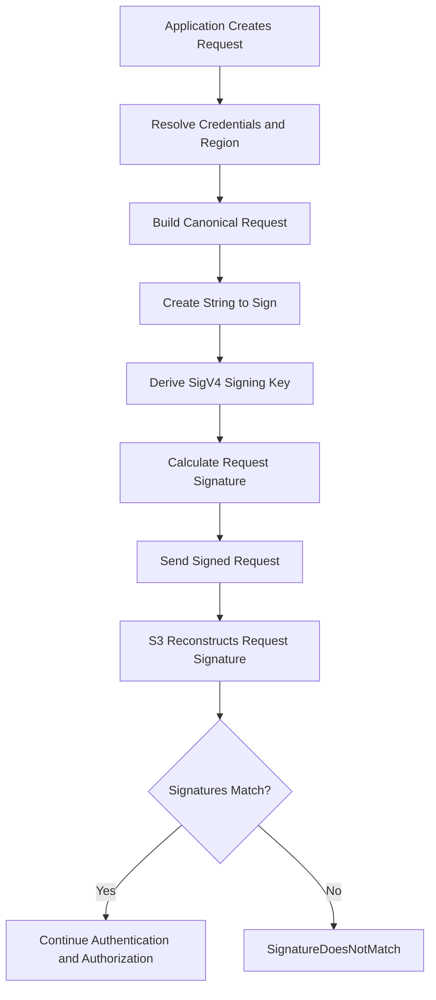
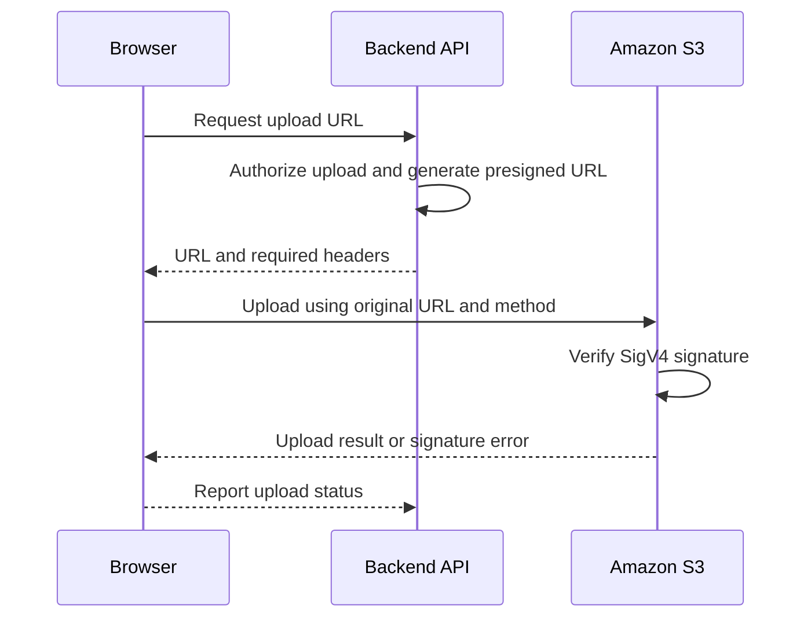

# 01- SignatureDoesNotMatch Error

## Overview

The `SignatureDoesNotMatch` error occurs when Amazon S3 calculates a request signature that differs from the signature supplied by the client. It commonly appears as an HTTP `403 Forbidden` response.

Amazon S3 uses AWS Signature Version 4 (SigV4) to authenticate most signed API requests. The signature is derived from the request details and signing credentials. If the request received by S3 differs from the request used to calculate the signature, verification fails.

The underlying issue is usually a mismatch involving the bucket Region, HTTP method, request path, query parameters, signed headers, payload representation, credentials, or request timestamp.

This error is different from a conventional authorization failure. A request can have a valid signature but still be denied by IAM policies, bucket policies, or AWS KMS permissions.

### Common symptoms

- AWS CLI or Boto3 requests fail with `SignatureDoesNotMatch`.
- A presigned URL works in one environment but fails in another.
- Browser uploads fail even though the backend generated a URL successfully.
- Requests fail after passing through a reverse proxy, API gateway, or URL-processing layer.
- An upload fails when the client sends a different `Content-Type` from the one used during signing.
- Requests work with one Region or endpoint but fail with another.

## How SigV4 Request Signing Works

SigV4 provides request authentication and integrity protection by signing canonical representations of the request.

The client constructs a canonical request, creates a string to sign, derives a signing key from the secret access key, and calculates a signature. S3 independently performs the corresponding verification.



### Components of the canonical request

A SigV4 canonical request contains these components in a defined order:

```text
HTTPMethod
CanonicalURI
CanonicalQueryString
CanonicalHeaders

SignedHeaders
HashedPayload
```

Each component must follow the service's signing rules.

| Component | What must match | Common failure |
|---|---|---|
| HTTP method | The method used when signing and sending the request | Generating a `PUT` URL but issuing `GET` |
| Canonical URI | The exact canonical representation of the request path | Re-encoding or changing the object key |
| Canonical query string | The signed query parameters and their canonical encoding and ordering | Removing, modifying, or incorrectly encoding URL parameters |
| Canonical headers | The relevant headers and their canonical values | Changing a signed `Content-Type` or `Host` header |
| Signed headers | The header names included in the signature | Omitting a required signed header |
| Payload hash | The payload representation used by the selected signing process | Incorrect payload hashing or incompatible signing behavior |

For S3, do not normalize URI paths as though they were filesystem paths. Object keys can contain characters and prefixes whose encoding must be preserved correctly.

### Authorization header versus presigned URL

| Characteristic | Authorization-header signing | Presigned URL |
|---|---|---|
| Signature location | HTTP `Authorization` header | Query-string parameters |
| Typical caller | AWS CLI, Boto3, backend service | Browser or external client |
| Credential handling | Signing credentials are used by the SDK or CLI | Signature and relevant signing information are embedded in the URL |
| Request headers | Must match the signing requirements | Signed headers must match the requirements established when the URL was generated |
| Main diagnostic focus | Credential provider, Region, endpoint, method, and request construction | All of the above, plus URL preservation, client method, and signed upload headers |

Presigned URLs do not bypass S3 authorization. The principal that generates the URL must be permitted to perform the underlying operation, and applicable policies remain in effect.

## Likely Causes

| Cause | Observable evidence | Verification approach |
|---|---|---|
| Incorrect Region | Requests fail for a particular endpoint or a presigned URL was generated with the wrong Region | Compare the bucket's actual Region with the SDK signing Region |
| Modified presigned URL | URL was decoded, reconstructed, shortened, or passed through a query-string parser | Generate a new URL and use it without modification |
| HTTP method mismatch | URL was generated for `PUT` but used with `POST` or `GET` | Compare the generation operation with the actual HTTP request |
| Signed-header mismatch | Upload fails when the client supplies different header values | Inspect the signed headers and actual request headers |
| Wrong credentials | A custom signer uses an incorrect secret access key or an inconsistent credential set | Compare the configured credential source and SDK behavior |
| Missing session token | Temporary credentials were used but the corresponding token was omitted from a manually constructed request | Verify that the SDK handles the complete temporary credential set |
| Incorrect canonical URI | The key contains special characters, spaces, or percent-encoded characters | Compare the intended key and actual request target |
| Proxy or gateway mutation | The request succeeds directly but fails when routed through an intermediary | Compare direct and proxied requests without exposing sensitive signing information |
| Clock drift | Failures correlate with a machine whose clock is inaccurate | Inspect system time synchronization and the error response |
| Custom endpoint or hostname | Requests use a different hostname, endpoint style, or proxy address from the one used during signing | Compare the signed host with the actual request destination |
| Incorrect payload-signing behavior | A custom signer or HTTP client alters the payload or signing representation | Inspect the SDK configuration and the selected S3 signing mode |

Clock skew can also produce timestamp-related errors such as `RequestTimeTooSkewed`. Credential problems can produce `InvalidAccessKeyId`, `ExpiredToken`, or other errors instead of `SignatureDoesNotMatch`. Diagnose the error actually returned rather than treating every authentication failure as a signature mismatch.

## Diagnostic Workflow

### Capture the original error

Record the following information from the failing operation:

- AWS error code and message.
- HTTP status code.
- S3 request ID and extended request ID, when supplied.
- Operation and HTTP method.
- Target bucket, object key, and configured Region.
- Execution environment, such as a developer workstation, container, CI/CD runner, or browser.

Do not record AWS secret access keys, authorization headers, session tokens, or complete presigned URLs in normal application logs. A presigned URL is a bearer credential and may provide access to the specified operation until it expires or becomes otherwise unusable.

### Verify the effective AWS identity

Run the following commands in the same environment as the failing CLI operation:

```bash
aws sts get-caller-identity
aws configure list
```

For an explicitly selected profile:

```bash
aws sts get-caller-identity --profile s3-debug
aws configure list --profile s3-debug
```

Confirm the effective account, principal, credential source, and Region configuration.

Remember that environment variables, assumed roles, container credentials, and instance or workload roles can result in a different identity from the profile expected by the operator.

Identity verification does not prove that a signature was constructed correctly, but it helps rule out incorrect credential-source assumptions.

### Confirm the bucket Region

Inspect the bucket Region using the intended profile:

```bash
aws s3api get-bucket-location \
  --bucket example-private-bucket \
  --profile s3-debug
```

The legacy `LocationConstraint` response may be `null` for the `us-east-1` Region. Interpret that result accordingly.

Compare the discovered Region with the Region configured in the application or signer. Do not assume that the Region containing the application is also the bucket's Region.

For a direct SDK request, explicitly configuring the known bucket Region can make diagnosis easier.

### Test a signed request using the AWS CLI

Use a small, non-destructive request against a known object:

```bash
aws s3api head-object \
  --bucket example-private-bucket \
  --key "diagnostics/sample.txt" \
  --region ap-south-1 \
  --profile s3-debug
```

Replace the example values with the actual bucket, key, and verified Region.

If the CLI succeeds but the application fails, prioritize differences in the application's credential provider, SDK configuration, endpoint, request construction, and proxy path.

If the CLI also fails, investigate its effective credentials, Region, endpoint configuration, and the precise error returned. A CLI failure alone does not prove that the underlying credentials are invalid.

### Inspect SDK configuration

For Boto3, review the client configuration used by the failing service rather than relying exclusively on the developer's AWS CLI settings.

```python
import boto3
from botocore.config import Config

session = boto3.Session()

s3_client = session.client(
    "s3",
    region_name="ap-south-1",
    config=Config(
        signature_version="s3v4",
        retries={
            "mode": "standard",
            "max_attempts": 3,
        },
    ),
)
```

This example uses the configured Boto3 credential provider chain and explicitly selects the S3 Region and SigV4 signing.

Use the correct Region for the actual bucket. Do not hardcode credentials in the client constructor or source code.

Retries can help with transient network failures, but they do not correct a deterministic signature mismatch.

## Troubleshooting Presigned URL Failures

Presigned URL failures are especially common because signing happens in the backend while the request is executed by a browser, mobile application, or another client.

### Verify the HTTP method and URL

A URL generated for a `PUT` operation must be used as a `PUT` request. A URL generated for a `GET` operation is intended for retrieval.

Use the URL exactly as returned by the SDK. Do not:

- Decode and re-encode the complete URL.
- Rebuild its query string using a generic URL parser and serializer.
- Remove query parameters that appear unnecessary.
- Change the hostname without ensuring that the signature is valid for that hostname.
- Replace characters in the object path.
- Pass the URL through a link-shortening service.
- Log the complete URL in application logs or error trackers.

Characters such as `%2F`, `%20`, `%2B`, and `&` have distinct meanings in URLs. Incorrect handling can change the request that reaches S3.

### Match signed request headers

If the signer includes `Content-Type: image/jpeg` in the signed request, the client must send the corresponding header value.

For example, a backend can generate a URL as follows:

```python
import boto3

s3_client = boto3.client(
    "s3",
    region_name="ap-south-1",
)

upload_url = s3_client.generate_presigned_url(
    ClientMethod="put_object",
    Params={
        "Bucket": "example-private-bucket",
        "Key": "uploads/asset-001.jpg",
        "ContentType": "image/jpeg",
    },
    ExpiresIn=300,
)
```

The client must use the generated URL with the expected method and signed header:

```bash
curl --fail-with-body \
  --request PUT \
  --upload-file "./asset-001.jpg" \
  --header "Content-Type: image/jpeg" \
  "$PRESIGNED_URL"
```

Set `PRESIGNED_URL` through a secure mechanism rather than embedding a real URL in a shell script or source repository. Avoid enabling shell tracing when handling it.

`Content-Type` must match because the example explicitly included it in the signing parameters. Do not assume that every request header is necessarily signed. Inspect the generated URL's `X-Amz-SignedHeaders` parameter and the intended request configuration.

Also verify any additional headers required by your upload design, such as explicitly signed encryption headers. A browser upload may differ from a command-line upload if the browser adds or changes headers.

### Check the signature expiration

Presigned URLs include an expiration interval. Even when the configured interval has not elapsed, a URL signed with temporary credentials cannot remain usable beyond the validity of those credentials.

A URL can therefore become unusable after its signing role session or other temporary credentials expire.

Generate a fresh URL and repeat the request when expiration or credential lifetime is suspected. Distinguish `ExpiredToken` and expiration-related failures from a genuine `SignatureDoesNotMatch` response.

### Check URL handling in browser and application code

A backend-to-browser upload normally follows this flow:



The backend does not proxy the uploaded file in this architecture. The browser communicates directly with S3.

The backend should return the URL together with the required HTTP method and headers. The frontend should preserve the URL as an opaque string and use the documented request method.

Changing the S3 hostname to a CloudFront custom domain will generally invalidate an S3 presigned URL because the signed host is part of the canonical request. Use an appropriately designed CloudFront signed URL or cookie when CloudFront-based authorization is required.

## Troubleshooting Region and Endpoint Mismatches

The Region is included in the SigV4 credential scope. The endpoint, host, and signing Region must be consistent with the requested operation.

An incorrect Region may produce `SignatureDoesNotMatch`, `AuthorizationHeaderMalformed`, a redirect-related response, or another error depending on the endpoint and request.

Verify:

- The actual bucket Region.
- The Region passed to the SDK client or presigner.
- Any endpoint override in application configuration.
- Whether a proxy or custom hostname changes the request host.
- Whether the request is using the intended virtual-hosted or path-style addressing configuration.

For production systems, prefer the SDK's normal S3 endpoint resolution and specify the bucket's correct Region. Avoid manually constructing S3 endpoints unless the architecture requires custom endpoint configuration.

Do not blindly follow a redirect using a request whose signature was generated for a different Region or hostname. Generate a new signed request using the correct endpoint configuration.

## Troubleshooting Temporary Credentials

Temporary AWS credentials consist of an access key ID, a secret access key, and a session token. The SDK must use a consistent credential set when signing the request.

Potential causes include:

- The access key ID and secret access key belong to different credential sets.
- A manually implemented signer omits the session token.
- Credentials have expired before the request is executed.
- A process refreshes one credential component without refreshing the complete set.
- An application uses a different credential provider from the one tested in the CLI.

Prefer Boto3 or another supported AWS SDK to retrieve and refresh credentials and sign requests. Avoid implementing SigV4 directly unless there is a documented requirement and the implementation is thoroughly tested.

If the response reports `ExpiredToken`, refresh the credentials or establish a new role session before generating the URL. A newly generated URL cannot compensate for invalid credentials.

## Troubleshooting Proxies and Request Mutation

A reverse proxy, corporate proxy, gateway, or URL-processing library can alter the request after signing.

Common mutations include:

- Rewriting the hostname.
- Changing the request path.
- Decoding or re-encoding query parameters.
- Changing a signed header.
- Dropping a required header or query parameter.

Compare the failing request with a direct request that bypasses the suspected intermediary, using the same credential source and Region where practical.

Do not disable TLS verification or weaken transport security as a troubleshooting workaround. If an intermediary is responsible, correct its URL or header handling and preserve HTTPS.

For manually signed HTTP requests, compare the canonical request and string-to-sign values with those reported in S3's error response, when available. Treat those values as diagnostic material and redact sensitive identifiers before sharing logs.

## Python and Backend Integration Considerations

### Prefer SDK-managed request signing

Boto3 automatically performs SigV4 signing for supported S3 operations. Most applications should use SDK operations rather than constructing the `Authorization` header or cryptographic signing key manually.

A service-layer implementation can centralize client configuration:

```python
import boto3
from botocore.config import Config
from botocore.exceptions import BotoCoreError, ClientError


class S3StorageService:
    def __init__(self, bucket_name: str, region_name: str) -> None:
        self.bucket_name = bucket_name
        self.client = boto3.client(
            "s3",
            region_name=region_name,
            config=Config(
                signature_version="s3v4",
                retries={"mode": "standard", "max_attempts": 3},
            ),
        )

    def get_metadata(self, key: str) -> dict:
        try:
            return self.client.head_object(
                Bucket=self.bucket_name,
                Key=key,
            )
        except ClientError:
            raise
        except BotoCoreError:
            raise
```

This service uses the standard credential provider chain and lets Botocore sign the request. The exception handling preserves the original error for the caller to classify or log.

In Django, Django REST Framework, FastAPI, or Celery, keep S3 operations inside a reusable service layer rather than manually signing requests in API handlers or background tasks.

At the application boundary, convert AWS exceptions into appropriate API responses. Do not return raw AWS error details, internal request metadata, or signing diagnostics to untrusted clients.

### Add tests for request consistency

Test the following cases when the application generates presigned URLs or signs S3 operations:

- The expected bucket and Region are used.
- The generated method matches the intended operation.
- Required signed headers are returned to the client.
- The client uses the exact URL and expected headers.
- Special characters in object keys are preserved.
- Temporary credentials and session tokens are handled by the SDK.
- Region and endpoint configuration are tested independently.
- Error handling distinguishes signature failures from authorization failures and expired credentials.

Use mocked S3 clients for unit tests and an isolated AWS test environment for integration tests. Do not depend on successful production requests as the only verification of signing behavior.

## Safe Diagnostic Commands

| Command or check | Purpose | Important consideration |
|---|---|---|
| `aws sts get-caller-identity` | Identifies the effective AWS caller | Run it from the same environment as the failing request |
| `aws configure list` | Inspects effective CLI configuration and credential source | Do not publish sensitive local configuration |
| `aws s3api get-bucket-location --bucket BUCKET` | Retrieves bucket Region information | Requires appropriate access and correct resource identification |
| `aws s3api head-object --bucket BUCKET --key KEY --region REGION` | Tests a signed request against a specific object | Requires permission to retrieve its metadata |
| Boto3 client with explicit Region and `s3v4` | Isolates SDK signing configuration | Continue to use the intended credential provider |
| Direct request without the suspected proxy | Tests for intermediary mutation | Keep TLS verification enabled and avoid exposing URLs |

AWS CLI `--debug` can provide additional request and signing diagnostics, but debug output may contain authorization details, request parameters, session tokens, and presigned URLs. Collect it only when necessary, store it securely, and sanitize it before sharing it with others.

## Root Cause and Corrective Action

Once the cause is identified, apply the smallest appropriate correction.

| Confirmed root cause | Corrective action | Prevention |
|---|---|---|
| Incorrect signing Region | Configure the SDK or presigner for the bucket's actual Region | Centralize Region configuration and validate it during deployment |
| Modified URL | Generate a new presigned URL and use it unchanged | Treat URLs as opaque credentials in the frontend |
| Method or header mismatch | Align the method and required signed headers with the URL-generation parameters | Return required method and headers in the API response |
| Incorrect credentials | Correct the credential source and refresh the credential set | Use supported role-based credential providers |
| Endpoint or proxy mutation | Correct endpoint configuration or intermediary request handling | Add an integration test through the actual request path |
| Incorrect object-key encoding | Preserve the exact key and avoid unsafe URL normalization | Keep object keys canonical in application metadata |
| Clock skew | Synchronize the affected system clock and investigate time configuration | Maintain reliable time synchronization on signing hosts |
| Manual SigV4 implementation defect | Replace it with an AWS SDK or correct and thoroughly test the signer | Avoid custom signing code unless necessary |

After correcting the configuration or request construction, repeat the originally failing operation and verify that it succeeds using the intended identity and endpoint. Record the confirmed root cause and add a regression test where feasible.

## Prevention and Production Best Practices

- Use AWS SDKs and the AWS CLI for SigV4 signing rather than hand-written cryptographic implementations.
- Configure the correct bucket Region explicitly when initializing application clients and generating presigned URLs.
- Return required HTTP methods and signed headers alongside presigned URLs.
- Preserve URLs exactly as generated and avoid URL reconstruction through frontend or intermediary libraries.
- Use short-lived credentials, supported credential providers, and automatic credential refresh where appropriate.
- Keep application, container, and host clocks synchronized.
- Avoid changing signed request fields after the signature is generated.
- Log the error code, operation, request IDs, environment, and non-sensitive resource identifiers without logging complete presigned URLs or secret signing material.
- Separate signature errors from authorization errors, expired tokens, missing resources, and encryption-permission failures.
- Include signing and upload verification in CI/CD and integration testing.

## Related AWS Documentation

- [Troubleshoot Signature Version 4 signing](https://docs.aws.amazon.com/IAM/latest/UserGuide/reference_sigv-troubleshooting.html)
- [Authenticating S3 requests using Signature Version 4](https://docs.aws.amazon.com/AmazonS3/latest/developerguide/sig-v4-authenticating-requests.html)
- [Signature calculations for S3 authorization-header requests](https://docs.aws.amazon.com/AmazonS3/latest/developerguide/sig-v4-header-based-auth.html)
- [Using S3 presigned URLs](https://docs.aws.amazon.com/AmazonS3/latest/userguide/using-presigned-url.html)

## Key Takeaways

- `SignatureDoesNotMatch` means the signature supplied with the request does not match the signature S3 calculates from the received request.
- Verify the Region, endpoint, effective credentials, HTTP method, request path, query parameters, and signed headers before changing IAM policies.
- Treat presigned URLs as opaque bearer credentials and preserve their method, URL, and required signed headers exactly.
- Prefer SDK-managed SigV4 signing and temporary credentials over custom signing implementations or hardcoded keys.
- Verify the original workflow after making the correction and add regression tests for the confirmed failure mode.