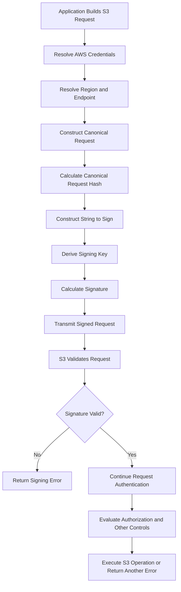

# 02- AWS Signature Version 4 Validation

## Overview

AWS Signature Version 4 (SigV4) is the request-signing protocol used by Amazon S3 and other AWS services to authenticate API requests and protect signed request components against modification.

When a client sends a signed request, S3 reconstructs the canonical request, validates the credential scope and request timestamp, derives the appropriate signing key, and calculates the expected signature. If the calculated signature differs from the supplied signature, S3 rejects the request.

SigV4 validation failures commonly appear as HTTP `403 Forbidden` responses with errors such as:

- `SignatureDoesNotMatch`
- `AuthorizationHeaderMalformed`
- `IncompleteSignature`
- `RequestTimeTooSkewed`
- `ExpiredToken`

These errors have different causes and should not be treated as interchangeable.

This document provides a systematic method for validating SigV4 configuration, identifying discrepancies between the signed and transmitted request, and isolating failures in applications, SDKs, presigned URLs, containers, and network intermediaries.

## SigV4 Request Validation Lifecycle

A typical S3 request signed with SigV4 follows this lifecycle.



Successful signature validation does not guarantee that the request succeeds. S3 can still reject a correctly signed request because of missing permissions, an incorrect resource identifier, encryption authorization failures, or other service-level constraints.

## Components Required for Validation

### Credentials

SigV4 requires a consistent credential set.

| Credential component | Purpose | Validation concern |
|---|---|---|
| Access key ID | Identifies the signing credentials | Must correspond to the secret access key used for signing |
| Secret access key | Used to derive the signing key | Must be correct and must not be exposed |
| Session token | Required when using temporary session credentials | Must be included where required for the temporary credentials |
| Credential expiration | Defines the validity of temporary credentials | Credentials must remain valid when the request is used |

Prefer IAM roles and temporary credentials for applications running on Amazon EC2, ECS, EKS, Lambda, and supported CI/CD platforms. Let the AWS SDK resolve and refresh credentials through its supported provider chain.

Do not manually combine an access key ID from one credential source with a secret access key or session token from another.

### Credential scope

For ordinary SigV4 requests to S3, the credential scope follows this format:

```text
YYYYMMDD/region/s3/aws4_request
```

For example:

```text
20261015/ap-south-1/s3/aws4_request
```

The scope identifies the signing date, AWS Region, service, and signing protocol terminator.

| Scope component | Required value or rule |
|---|---|
| Date | UTC date in `YYYYMMDD` format |
| Region | Region appropriate for the request |
| Service | `s3` |
| Terminator | `aws4_request` |

A Region mismatch can cause signature validation to fail even when the access key and secret access key are correct.

The signing Region must be consistent with the target S3 endpoint and the operation being signed. Do not substitute the application's deployment Region for the bucket's Region without verifying that they match.

Multi-Region Access Point requests may use SigV4a through supported AWS SDKs. SigV4a has a different signing model and credential scope. Do not apply ordinary SigV4 assumptions to a request that is explicitly using SigV4a.

## Canonical Request Validation

### Canonical request structure

The canonical request is the normalized representation of selected request components used to calculate the signature.

For SigV4 requests to S3, its structure is:

```text
HTTPMethod
CanonicalURI
CanonicalQueryString
CanonicalHeaders

SignedHeaders
HashedPayload
```

The components are separated by newline characters. The blank line between canonical headers and signed headers is significant.

For a typical S3 request, verify the following:

| Component | Validation requirement |
|---|---|
| HTTP method | Must match the method used to send the request |
| Canonical URI | Must represent the actual request path according to S3 signing rules |
| Canonical query string | Must include the relevant parameters with correct encoding and canonical ordering |
| Canonical headers | Header names must be lowercase and canonicalized correctly |
| Signed headers | Must identify the headers included in the signature |
| Hashed payload | Must match the payload-signing method used by the request |

The canonical request must be constructed using exact byte-level and formatting rules. An extra newline, a different path encoding, or an incorrect payload hash can change the calculated signature.

### HTTP method validation

Confirm that the method used during signing matches the method sent to S3.

Examples of mismatches include:

- Signing a `PUT` operation but sending `POST`.
- Generating a presigned `GET` URL and using it for an upload.
- Generating a presigned `PUT` URL and attempting to upload with a different method.
- Allowing a proxy or framework to change the original method.

For presigned URLs, verify the method specified by the SDK operation used during URL generation.

### Canonical URI validation

S3 object keys can contain spaces, Unicode characters, percent signs, plus signs, and repeated slash characters. These characters make URI handling especially important.

For S3, do not normalize URI paths as though they were filesystem paths. In particular, do not collapse repeated slashes or resolve path segments in the signed request unless the signing specification for the operation requires it.

Common mistakes include:

- Decoding the path after calculating the signature.
- Encoding an already encoded path a second time.
- Treating `+` and `%20` as interchangeable in every URL context.
- Removing or inserting a slash.
- Replacing a special character in the object key.
- Reconstructing a URL with a library that changes path encoding.

Preserve the original object key in application data and allow the AWS SDK to construct and sign the request.

### Canonical query string validation

For query-string-signed requests, the query parameters contribute to the signature.

Verify that:

- The required signing parameters are present.
- Parameter names and values are encoded according to the signing rules.
- Parameters are ordered canonically during signature calculation.
- The transmitted URL has not been decoded and reconstructed.
- No intermediary has removed or modified signed query parameters.

Query-string canonicalization during signing does not mean that an application should manually sort or rebuild an already generated presigned URL. Use the exact URL returned by the SDK.

### Canonical header validation

SigV4 canonicalizes the headers included in the request signature. Header names are lowercase, and header values must be normalized according to the signing rules.

Common failure scenarios include:

| Failure | Why validation fails |
|---|---|
| Different `Content-Type` | The transmitted value differs from the value included in the signature |
| Modified `Host` header | The request is sent to a different host or endpoint from the one signed |
| Changed `x-amz-*` header | A signed S3-specific header no longer matches |
| Missing required signed header | The actual request does not contain a header required by the signing configuration |
| Incorrect whitespace handling | The signer and request transport produce different canonical header values |

Inspect the `SignedHeaders` value to identify which headers participated in the signature.

For example:

```text
SignedHeaders=content-type;host;x-amz-date
```

This indicates that the signature covers the canonicalized `content-type`, `host`, and `x-amz-date` headers. Those values must be handled consistently between signing and transmission.

Not every HTTP header is necessarily part of the signature. Avoid assuming that an unsigned header mismatch causes a SigV4 failure. Check the actual signed-header list and the S3 signing rules for the operation.

### Payload hash validation

The payload component of a canonical request depends on the signing mode.

For ordinary signed requests, the client may use a SHA-256 digest of the request payload. S3 also supports specific signing modes for streaming and unsigned payload scenarios.

Validate the payload-signing behavior when:

- An upload fails after a custom HTTP client or proxy modifies the body.
- A manually implemented signer calculates an incorrect payload digest.
- A streaming upload uses an incompatible signing configuration.
- The request contains an `x-amz-content-sha256` header that differs from the expected signing behavior.

Do not force every S3 request into a single payload-hashing strategy. Use a supported AWS SDK and its appropriate S3 signing behavior for the operation.

## String-to-Sign Validation

After building the canonical request, the signer calculates its SHA-256 hash and incorporates it into a string to sign.

The SigV4 string-to-sign format is:

```text
AWS4-HMAC-SHA256
RequestDateTime
CredentialScope
HashedCanonicalRequest
```

Each value is separated by a newline character.

For example, the structure may resemble:

```text
AWS4-HMAC-SHA256
20261015T120000Z
20261015/ap-south-1/s3/aws4_request
<hashed-canonical-request>
```

The example timestamp is illustrative. A real request must use its actual signing timestamp and matching credential scope.

Validate the following:

- The algorithm identifier is correct.
- The timestamp is formatted correctly in UTC.
- The date in the credential scope matches the signing date.
- The Region and service in the scope are correct.
- The canonical request hash is calculated from the exact canonical request.
- There are no additional or missing newline characters.

A canonical request can look correct when visually inspected but still generate a different hash if its byte representation differs.

## Signing Key and Signature Validation

SigV4 derives a signing key from the secret access key. The key derivation process is specific to the request date, Region, and service.

The standard HMAC-based derivation is represented as follows:

```text
kDate    = HMAC-SHA256("AWS4" + SecretAccessKey, Date)
kRegion  = HMAC-SHA256(kDate, Region)
kService = HMAC-SHA256(kRegion, "s3")
kSigning = HMAC-SHA256(kService, "aws4_request")

Signature = HMAC-SHA256(kSigning, StringToSign)
```

The intermediate values and final signature are byte sequences. The final signature in a standard SigV4 authorization header is represented as lowercase hexadecimal.

The signing key must be derived correctly from the credential's secret access key and the request's date, Region, and service.

Common implementation defects include:

- Using the wrong secret access key.
- Using the wrong date, Region, or service identifier.
- Incorrect HMAC input encoding.
- Using a plain hash instead of HMAC-SHA256.
- Converting intermediate byte sequences to text incorrectly.
- Serializing the string to sign with the wrong newline convention.

For production applications, these steps should be delegated to the AWS SDK. A custom implementation should be considered only when a specific integration requires it and should be validated against official AWS signing examples and test vectors.

## Diagnostic Workflow

Use the following workflow to isolate a SigV4 validation failure.

### Capture the error evidence

Collect the non-sensitive details associated with the failed request:

- AWS error code and message.
- HTTP status code.
- S3 request ID and extended request ID, when available.
- S3 operation and HTTP method.
- Bucket, object key, and target Region.
- Credential provider type, without recording credential values.
- Application environment and SDK version.
- Whether the request was signed with an authorization header or a presigned URL.

Never log secret access keys or session tokens. Presigned URLs are bearer credentials; do not place complete URLs in application logs, exception trackers, tickets, or shared debugging output.

### Verify the effective credentials

Use the same execution environment as the failing request:

```bash
aws sts get-caller-identity
aws configure list
```

When using an explicitly selected CLI profile:

```bash
aws sts get-caller-identity --profile s3-debug
aws configure list --profile s3-debug
```

Check that the effective account and principal match the intended execution identity.

Be aware that Boto3 or the AWS CLI may use environment variables, role credentials, container credentials, or instance metadata rather than the profile you expect. The credentials resolved in one process may differ from those resolved in another.

Successful identity verification establishes which principal was used for the STS request; it does not prove that a custom S3 signer constructed the correct signature.

### Verify the bucket Region

Inspect the bucket's Region:

```bash
aws s3api get-bucket-location \
  --bucket example-private-bucket \
  --profile s3-debug
```

A `null` `LocationConstraint` response represents `us-east-1` for this API's legacy response format.

Compare the result with the configured Region used by the application or presigner. Also inspect any endpoint override, custom domain, proxy, or gateway that might change the request destination.

If a Region mismatch is confirmed, configure the S3 client for the bucket's correct Region and regenerate any affected presigned URLs.

### Test a signed S3 request

Use a non-destructive operation against an object known to exist:

```bash
aws s3api head-object \
  --bucket example-private-bucket \
  --key "diagnostics/sample.txt" \
  --region ap-south-1 \
  --profile s3-debug
```

Replace the sample values with the intended bucket, key, and verified Region.

Interpret the result carefully:

| Result | Diagnostic implication |
|---|---|
| Request succeeds | The tested CLI credential, Region, and signing path work for this request |
| `SignatureDoesNotMatch` | Continue investigating signing configuration, credentials, request construction, or endpoint mutation |
| `AuthorizationHeaderMalformed` | Inspect credential scope, Region, and endpoint consistency |
| `ExpiredToken` | Refresh or replace expired temporary credentials |
| `AccessDenied` | Investigate authorization and applicable access controls separately |
| `NoSuchBucket` or `NoSuchKey` | Verify the resource identifiers and distinguish resource errors from signing errors |

The CLI test uses its own request and signing implementation. If the CLI succeeds but the application fails, compare the application's credential provider, client configuration, request method, URL construction, signed headers, payload handling, and network path.

A `HEAD` request may require permissions different from those of other operations. Choose a diagnostic operation that the effective principal is expected to perform.

### Inspect SDK configuration

For Boto3, configure the intended Region and SigV4 explicitly when doing so improves diagnostic clarity.

```python
import boto3
from botocore.config import Config

session = boto3.Session()

s3_client = session.client(
    "s3",
    region_name="ap-south-1",
    config=Config(
        signature_version="s3v4",
        retries={
            "mode": "standard",
            "max_attempts": 3,
        },
    ),
)
```

This configuration uses Boto3's credential provider chain. It does not embed or hardcode AWS credentials.

Use the actual bucket Region rather than copying the example blindly. Retries can help with transient failures, but they do not fix a deterministic signature mismatch.

### Use SDK debug logging carefully

When the preceding checks do not identify the issue, capture SDK or CLI diagnostic output in a controlled environment.

For the AWS CLI:

```bash
aws s3api head-object \
  --bucket example-private-bucket \
  --key "diagnostics/sample.txt" \
  --region ap-south-1 \
  --profile s3-debug \
  --debug
```

Debug output can include sensitive request information, authorization headers, session tokens, and presigned URL parameters. Store it securely and sanitize it before sharing.

Look for the effective endpoint, credential scope, signing timestamp, request method, canonical request details, and the exact AWS error response. Do not copy complete signing diagnostics into general-purpose application logs.

## Validating Presigned URLs

Presigned URLs use SigV4 query parameters to carry the signature and relevant signing information. They are common in browser uploads, mobile applications, and backend systems that transfer files directly between clients and S3.

The most important validation checks are:

| Check | Expected behavior |
|---|---|
| HTTP method | Matches the operation used to generate the URL |
| URL | Used exactly as returned by the SDK |
| Host | Remains consistent with the host included in signing |
| Signed headers | Actual request contains the required values |
| Credential scope | Uses the intended date, Region, service, and terminator |
| Expiration | URL and underlying credentials remain valid |
| Session credentials | Required session-token information is retained |
| Payload | Follows the signing and upload behavior expected by the operation |

### Inspect presigned URL parameters

A typical SigV4 presigned URL contains query parameters such as:

```text
X-Amz-Algorithm
X-Amz-Credential
X-Amz-Date
X-Amz-Expires
X-Amz-SignedHeaders
X-Amz-Signature
```

Requests made with temporary credentials may also include `X-Amz-Security-Token`.

Inspect these fields without disclosing the complete URL. The access key identifier and credential scope can help identify a Region or date mismatch, while the signed-header list helps determine which request headers must remain consistent.

Do not manually edit the URL to repair an incorrect parameter. Correct the signing configuration and generate a new URL.

### Validate the upload request

A backend might generate a presigned `PUT` URL as follows:

```python
import boto3

s3_client = boto3.client(
    "s3",
    region_name="ap-south-1",
)

upload_url = s3_client.generate_presigned_url(
    ClientMethod="put_object",
    Params={
        "Bucket": "example-private-bucket",
        "Key": "uploads/asset-001.jpg",
        "ContentType": "image/jpeg",
    },
    ExpiresIn=300,
)
```

The consuming client must send a `PUT` request and use the `Content-Type` expected by the signed request.

```bash
curl --fail-with-body \
  --request PUT \
  --upload-file "./asset-001.jpg" \
  --header "Content-Type: image/jpeg" \
  "$PRESIGNED_URL"
```

Supply `PRESIGNED_URL` securely at runtime. Do not hardcode real presigned URLs in source code, scripts committed to a repository, or shared logs.

Because the example includes `ContentType` in the URL-generation parameters, the upload must preserve the expected signed header. Other required headers depend on the signing parameters and operation.

When debugging a failed upload, compare the actual HTTP method, host, encoded path, query parameters, signed headers, and payload behavior with the configuration used to generate the URL.

## Validating Request Timestamps

SigV4 requests use UTC timestamps, commonly represented in the `x-amz-date` header or a supported date header.

A timestamp mismatch can result from:

- An incorrect system clock.
- Incorrect UTC conversion.
- A date boundary crossing during custom signing.
- Reusing an old manually signed request.
- Incorrect agreement between request date and credential scope date.

Verify system time on the machine performing the signing. For Linux systems:

```bash
date -u
timedatectl status
```

The second command is available on systems that use `systemd`.

For containers, verify the host time and the environment in which the signing process runs. Containers generally use the host kernel's system clock.

Do not work around clock drift by disabling signature validation or permanently widening security time tolerances. Restore reliable time synchronization and generate a fresh request.

Distinguish timestamp validation errors from credential expiration. A valid timestamp does not make an expired session credential usable, and refreshing credentials does not fix a broken canonical request.

## Validating Proxy and Endpoint Behavior

A proxy, gateway, custom endpoint, or URL-rewriting component can alter a request after the signature has been calculated.

Inspect the following when the same request succeeds directly but fails through an intermediary:

- `Host` and endpoint hostname.
- Request method.
- Encoded request path.
- Query parameters.
- Signed headers.
- Payload bytes or payload-signing behavior.

A request signed for an S3 hostname generally cannot be redirected to a different hostname and expected to retain the same signature. A CloudFront custom domain, for example, should use an appropriate CloudFront authorization mechanism rather than assuming an S3 presigned URL remains valid after changing its host.

Keep TLS certificate verification enabled during these tests. Correct the intermediary's request handling rather than weakening transport security.

## Validation in Backend Applications

In Django, Django REST Framework, FastAPI, Flask, and Celery applications, initialize AWS clients through a reusable service layer. Avoid independently implementing signing logic in individual views, routes, and background tasks.

A service layer can centralize the S3 client configuration and make it easier to test the signing-related behavior.

```python
import boto3
from botocore.config import Config
from botocore.exceptions import BotoCoreError, ClientError


class S3StorageService:
    def __init__(
        self,
        bucket_name: str,
        region_name: str,
    ) -> None:
        self.bucket_name = bucket_name
        self.client = boto3.client(
            "s3",
            region_name=region_name,
            config=Config(
                signature_version="s3v4",
                retries={
                    "mode": "standard",
                    "max_attempts": 3,
                },
            ),
        )

    def get_metadata(self, key: str) -> dict:
        try:
            return self.client.head_object(
                Bucket=self.bucket_name,
                Key=key,
            )
        except (ClientError, BotoCoreError):
            raise
```

This example delegates credential resolution and request signing to Boto3. The exception handler preserves the original AWS exception; production callers should classify and log it at an appropriate application boundary.

Avoid returning raw signing diagnostics, internal AWS request metadata, credential information, or complete presigned URLs to untrusted API clients.

### Testing recommendations

Include tests for the following cases:

- Correct Region and endpoint configuration.
- Expected HTTP method and signed headers for presigned URLs.
- Special characters in object keys.
- Temporary credential handling.
- Expired credentials and presigned URLs.
- Proxy or gateway request mutation.
- Error classification for signature, authorization, expiration, and resource failures.
- Correct handling of S3 request IDs and sanitized error logs.

Use mocks for unit tests and an isolated AWS test environment for integration tests. Do not claim that signing behavior is verified merely because a mocked S3 client accepted a call.

## Root Cause Mapping

Use the confirmed evidence to select the corrective action rather than applying unrelated permission or networking changes.

| Confirmed issue | Corrective action | Prevention |
|---|---|---|
| Incorrect credential scope | Correct the date, Region, service, or terminator used in signing | Prefer SDK-managed signing and explicit Region configuration |
| Incorrect canonical request | Correct method, path encoding, query canonicalization, header handling, or payload-signing behavior | Test the actual request construction and transport path |
| Incorrect signing key | Correct the credential set or key-derivation implementation | Avoid hand-written SigV4 when a supported SDK is available |
| Temporary credentials omitted or expired | Use a complete, valid credential set and regenerate the request | Use supported provider chains and refresh temporary credentials |
| Timestamp or clock drift | Correct UTC conversion or synchronize the system clock | Maintain reliable time synchronization |
| Presigned URL modified | Generate a new URL and use it unchanged | Treat presigned URLs as opaque bearer credentials |
| Proxy mutation | Correct request rewriting and header handling | Test requests through the real network path |
| Correct signature but access denied | Investigate IAM, bucket policies, KMS permissions, and other applicable controls | Maintain separate signature and authorization diagnostics |

After applying the correction, repeat the original failing operation with the intended identity, bucket, Region, and client configuration. Record the error code and request IDs, confirm the expected result, and add a regression test for the confirmed failure.

## Production Best Practices

- Prefer AWS SDKs or the AWS CLI for SigV4 signing and validation.
- Use least-privilege IAM roles and supported temporary credential providers.
- Centralize S3 Region, endpoint, and SDK configuration.
- Preserve the request method, URL encoding, signed headers, and payload behavior established during signing.
- Do not manually reconstruct presigned URLs or modify their query parameters.
- Keep signing-host clocks synchronized and validate timestamps in UTC.
- Use controlled debug logging and sanitize signing diagnostics before sharing them.
- Distinguish signature validation from IAM authorization, KMS authorization, resource lookup, and token expiration.
- Avoid automatic retries for deterministic signing errors; correct the underlying request or configuration first.
- Include presigned URL and request-signing behavior in automated integration tests.

## Related AWS Documentation

- [Troubleshoot Signature Version 4 signing for AWS API requests](https://docs.aws.amazon.com/IAM/latest/UserGuide/reference_sigv-troubleshooting.html)
- [Authenticating S3 requests using Signature Version 4](https://docs.aws.amazon.com/AmazonS3/latest/developerguide/sig-v4-authenticating-requests.html)
- [Authenticating S3 requests using the Authorization header](https://docs.aws.amazon.com/AmazonS3/latest/developerguide/sigv4-auth-using-authorization-header.html)
- [Signature calculations for S3 Authorization-header requests](https://docs.aws.amazon.com/AmazonS3/latest/developerguide/sig-v4-header-based-auth.html)
- [Authenticating S3 requests using query-string parameters](https://docs.aws.amazon.com/AmazonS3/latest/developerguide/sigv4-query-string-auth.html)

## Key Takeaways

- SigV4 validation depends on the exact canonical request, credential scope, timestamp, signing key, and signature.
- Check the Region, service identifier, HTTP method, URI encoding, signed headers, and payload-signing behavior before changing permissions.
- Prefer SDK-managed signing and credential refresh over custom signature implementations.
- Presigned URLs must retain their expected method, host, query parameters, and required signed headers throughout the request lifecycle.
- Diagnose signature errors separately from authorization failures, expired credentials, clock skew, and missing S3 resources.