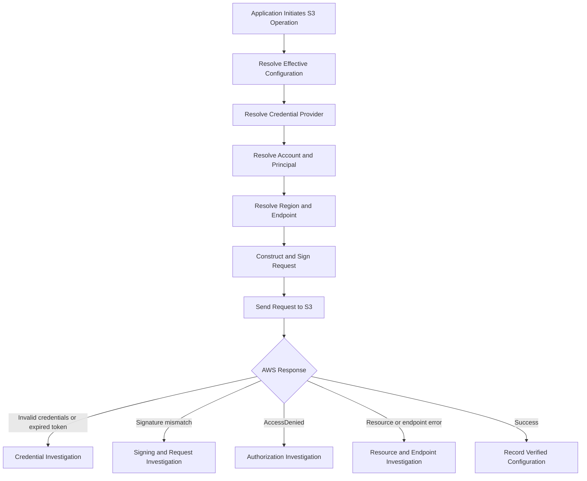

# 03- Credential and Request Configuration Issues

## Overview

Amazon S3 authentication failures are frequently caused by incorrect AWS credentials, unexpected credential-provider selection, expired temporary credentials, incorrect Region configuration, or request settings that differ between the signing client and the actual request.

These failures can be difficult to diagnose because a backend application, AWS CLI, Docker container, CI/CD runner, and browser may use different credentials or request configurations even when they access the same S3 bucket.

The primary diagnostic objective is to identify the **effective credentials, AWS account, endpoint, Region, and request configuration actually used by the failing process** rather than relying on assumptions about local configuration.

Typical symptoms include:

- `InvalidAccessKeyId`
- `SignatureDoesNotMatch`
- `AuthorizationHeaderMalformed`
- `ExpiredToken`
- `InvalidToken`
- `AccessDenied`
- `PermanentRedirect` or other endpoint-related errors
- Successful AWS CLI requests but failed Boto3 operations
- Applications using an unexpected AWS account or IAM role
- Requests succeeding locally but failing in Docker, Kubernetes, or CI/CD

These error codes are not interchangeable. A credential-resolution problem, a signature-validation failure, and an authorization failure require different corrective actions.

## Understand Credential and Request Resolution

AWS SDKs and tools obtain configuration from several sources. A value explicitly configured in application code, an environment variable, an AWS profile, or a workload role can determine which identity and endpoint are used for a request.

A typical diagnostic flow is:



### Credential providers

Common credential sources include:

| Credential source | Typical use case | Troubleshooting concern |
|---|---|---|
| Environment variables | Local development, containers, automation | Stale or unintended credentials may override a profile |
| Shared AWS credentials file | Developer workstation or controlled CLI profile | Wrong profile or outdated credentials |
| IAM Identity Center | Federated developer access | Session may need to be refreshed |
| Assume-role provider | Cross-account access or role-based development | Incorrect source profile, target role, or trust configuration |
| Web identity credentials | EKS workloads and supported federated environments | Incorrect token, audience, subject, or role configuration |
| ECS container credentials | ECS tasks | Missing task role or unintended credential configuration |
| EC2 instance profile | Applications running on EC2 | Missing instance role or blocked metadata access |
| Lambda execution role | Lambda functions | Incorrect execution-role permissions or code using another credential source |

AWS SDKs generally search a credential provider chain and stop when a usable provider supplies credentials. The exact chain and precedence can vary between tools and SDKs.

Do not assume that Boto3 uses the same identity as the AWS CLI merely because both run on the same machine.

## Diagnose the Effective AWS Identity

### Verify the AWS CLI identity

Run:

```bash
aws sts get-caller-identity
```

For a named profile:

```bash
aws sts get-caller-identity --profile s3-debug
```

The response contains the effective AWS account, ARN, and user ID. Use these values to confirm that the request is associated with the intended account and principal.

Inspect the CLI's effective configuration:

```bash
aws configure list
aws configure list --profile s3-debug
```

These commands help identify the credential source and configured Region without requiring secret values to be displayed.

A successful `get-caller-identity` request does not prove that the principal has permission to access a particular S3 bucket. It verifies the identity used for that STS request.

### Check environment variables

Environment variables frequently explain why a named profile appears to be ignored.

Common variables include:

| Variable | Purpose |
|---|---|
| `AWS_ACCESS_KEY_ID` | Access key identifier |
| `AWS_SECRET_ACCESS_KEY` | Secret access key |
| `AWS_SESSION_TOKEN` | Session token for temporary credentials |
| `AWS_PROFILE` | Selects a named shared configuration profile when supported by the tool |
| `AWS_DEFAULT_PROFILE` | Default profile selection used by supported AWS CLI configurations |
| `AWS_REGION` | AWS Region configuration for supported tools |
| `AWS_DEFAULT_REGION` | Default Region configuration, particularly for the AWS CLI |

Credential environment variables can take precedence over credentials stored in a profile. Explicit command-line parameters can override relevant configuration values for the AWS CLI.

Inspect whether these variables are set without printing their secret values.

PowerShell:

```powershell
Get-ChildItem Env:AWS_PROFILE, Env:AWS_DEFAULT_PROFILE, Env:AWS_REGION, Env:AWS_DEFAULT_REGION, Env:AWS_ACCESS_KEY_ID
```

For shell environments on Linux or macOS:

```bash
printf 'AWS_PROFILE=%s\n' "${AWS_PROFILE:-<unset>}"
printf 'AWS_DEFAULT_PROFILE=%s\n' "${AWS_DEFAULT_PROFILE:-<unset>}"
printf 'AWS_REGION=%s\n' "${AWS_REGION:-<unset>}"
printf 'AWS_DEFAULT_REGION=%s\n' "${AWS_DEFAULT_REGION:-<unset>}"

if [ -n "${AWS_ACCESS_KEY_ID:-}" ]; then
    echo "AWS_ACCESS_KEY_ID is set"
else
    echo "AWS_ACCESS_KEY_ID is not set"
fi
```

Do not print `AWS_SECRET_ACCESS_KEY` or `AWS_SESSION_TOKEN` when diagnosing credential precedence.

If the wrong identity is being used, remove or correct the unintended credential source in the relevant shell, IDE, container, or deployment configuration. Do not delete all AWS configuration files as a first troubleshooting step.

### Verify Boto3's effective identity

Use Boto3 in the same Python environment and execution context as the failing application.

```python
import boto3

session = boto3.Session()
sts_client = session.client("sts")

identity = sts_client.get_caller_identity()

print(f"Account: {identity['Account']}")
print(f"ARN: {identity['Arn']}")
print(f"User ID: {identity['UserId']}")
```

If the application explicitly selects a profile, reproduce that behavior:

```python
import boto3

session = boto3.Session(profile_name="s3-debug")

identity = session.client("sts").get_caller_identity()

print(identity["Account"])
print(identity["Arn"])
```

Avoid embedding credentials in the session constructor for routine troubleshooting. The purpose is to identify the credentials supplied by the intended provider, not to bypass the problem by introducing another credential source.

If the CLI and Boto3 report different identities, compare their execution contexts and credential providers before investigating the bucket policy.

## Resolve Common Credential Failures

### InvalidAccessKeyId

This error indicates that AWS could not identify the access key ID provided with the request.

Potential causes include:

- An incorrect or obsolete access key ID.
- A stale environment variable overriding a valid profile.
- A different credential set being used inside Docker or CI/CD.
- A credential configuration that points to the wrong account or identity.
- An application using explicitly configured credentials instead of the expected role.

Use `aws sts get-caller-identity` and `aws configure list` to inspect the identity source. If necessary, inspect the application's credential-provider configuration without logging secret values.

Correct the source of the credentials and retest. Do not repeatedly rotate valid keys or edit IAM policies before confirming which access key the application is actually using.

### ExpiredToken

This error typically indicates that the request uses expired temporary credentials.

Temporary credentials may originate from:

- An assumed IAM role.
- IAM Identity Center.
- Web identity federation.
- ECS or EC2 workload roles.
- Other supported federated or session-based authentication mechanisms.

For a locally authenticated session, refresh the relevant authentication flow. For role-based applications, use a supported SDK credential provider that can refresh credentials automatically when applicable.

Do not manually copy temporary credentials into application configuration unless the integration specifically requires them. Doing so introduces an additional expiration and refresh problem.

### InvalidToken

An invalid session token can result from an incorrect token, a missing or inconsistent credential component, or use of temporary credentials that are no longer valid.

When troubleshooting temporary credentials, validate the complete credential set:

- Access key ID
- Secret access key
- Session token
- Credential validity period

These values must belong to the same credential issuance. Do not combine an access key from one session with a session token from another.

### AccessDenied

`AccessDenied` usually requires an authorization investigation rather than a credential-signing investigation.

After establishing the caller identity, verify the relevant access controls:

- Identity-based IAM policies.
- Bucket policies.
- Explicit-deny statements.
- Service control policies and permission boundaries, where applicable.
- Cross-account trust and resource permissions.
- S3 object ownership and related access configuration.
- AWS KMS key policies and grants for SSE-KMS operations.

A correctly authenticated identity may still lack permission for the requested operation. Do not treat `AccessDenied` as proof that the access key or signature is incorrect.

## Diagnose Profile and Configuration Precedence

AWS CLI and SDK settings can be supplied through several locations, and their precedence determines the effective value.

Common sources include:

| Configuration source | Examples |
|---|---|
| Command-line arguments | `--profile`, `--region`, `--endpoint-url` |
| Application client settings | Boto3 `profile_name`, `region_name`, `endpoint_url` |
| Environment variables | `AWS_PROFILE`, `AWS_ACCESS_KEY_ID`, `AWS_REGION` |
| Shared credentials file | `~/.aws/credentials` |
| Shared configuration file | `~/.aws/config` |
| Workload-specific providers | EC2, ECS, EKS, Lambda, web identity, or assumed roles |

The order is setting-specific and tool-specific. For example, command-line options and environment variables can override shared-profile settings in the AWS CLI, while an explicit Boto3 client parameter can override a corresponding SDK configuration value.

### Inspect profile configuration

List available AWS CLI profiles:

```bash
aws configure list-profiles
```

Inspect the relevant non-secret settings:

```bash
aws configure get region --profile s3-debug
aws configure get output --profile s3-debug
```

A profile that assumes a role may contain configuration similar to:

```ini
[profile s3-debug]
role_arn = arn:aws:iam::123456789012:role/S3DiagnosticsRole
source_profile = developer
region = ap-south-1
```

The source profile must be configured with a supported credential provider. The target role must trust the caller and allow the necessary role assumption.

Do not place secret access keys in the shared configuration file when a supported role-based or federated configuration is available.

### Isolate a profile mismatch

Run the same non-destructive operation through the intended profile and Region:

```bash
aws sts get-caller-identity \
  --profile s3-debug

aws s3api get-bucket-location \
  --bucket example-private-bucket \
  --profile s3-debug
```

If an explicit Region is needed for the S3 request, provide the verified Region using `--region`.

The first command confirms the profile's resolved identity for STS. The second checks access to the bucket's location information. If the second command fails with `AccessDenied`, investigate whether the principal is allowed to perform that operation rather than assuming the profile is invalid.

## Diagnose Region and Endpoint Configuration

Credentials alone do not determine whether an S3 request is properly formed. The signing Region and the request endpoint must be consistent with the operation.

### Verify the bucket Region

Use:

```bash
aws s3api get-bucket-location \
  --bucket example-private-bucket
```

A `null` `LocationConstraint` in this API's legacy response format represents `us-east-1`.

Compare the result with the Region configured in the application. Do not assume that an application deployed in one Region should always create its S3 client in that same Region.

Configure Boto3 using the actual bucket Region:

```python
import boto3
from botocore.config import Config

s3_client = boto3.client(
    "s3",
    region_name="ap-south-1",
    config=Config(
        signature_version="s3v4",
    ),
)
```

Replace the example Region with the verified bucket Region.

### Check endpoint overrides

An explicit endpoint override may cause the client to send requests to a different host than expected.

Endpoint overrides are sometimes intentional for local S3-compatible test services, private endpoints, or specialized networking configurations. However, an unintended override can cause authentication, signing, or connectivity errors.

Inspect the following:

- `endpoint_url` in application code.
- `--endpoint-url` in CLI commands.
- Service-specific endpoint environment variables.
- Global endpoint environment variables.
- Endpoint settings in the selected AWS profile.
- Proxies, custom hostnames, and DNS configuration.

For ordinary AWS S3 requests, prefer the SDK's standard endpoint resolution unless a specific endpoint configuration is required.

If the application uses a custom endpoint for local testing, keep that configuration separate from production settings and ensure the correct signing and addressing behavior for that service.

### Validate the request host

For SigV4, the host is part of the signed request when it is included in the canonical headers. Changing the host after signing may invalidate the signature.

A request signed for an S3 endpoint should not be redirected to a different custom hostname while assuming the original signature remains valid.

If the request passes through a proxy or gateway, compare a request sent directly to the intended endpoint with one sent through the intermediary. Investigate host rewriting, URI changes, and query-parameter handling.

## Diagnose Docker and CI/CD Credential Mismatches

A common production failure is that local commands succeed while the same application fails inside a container, Kubernetes workload, or CI/CD runner.

### Docker

A container does not automatically use the credentials available in the host's AWS CLI configuration unless they are explicitly made available or a supported workload credential provider is configured.

For a local development container, a mounted AWS configuration directory may be appropriate:

```yaml
services:
  backend:
    build: .
    environment:
      AWS_PROFILE: s3-debug
      AWS_REGION: ap-south-1
    volumes:
      - ${USERPROFILE}/.aws:/root/.aws:ro
```

This example assumes a local development environment on a compatible host and that the container runs as `root`. Adjust the mount path and container user for the actual environment.

Mounting a credentials directory grants the container access to those credentials. Use only a trusted development environment, restrict the mount to what is necessary, and do not use this pattern as a substitute for workload identity in production.

For production workloads, prefer the appropriate IAM role or federated credential mechanism rather than copying long-lived access keys into the image or deployment configuration.

### GitHub Actions and other CI/CD systems

A CI/CD job can use credentials different from those on the developer's machine.

Verify:

- The identity that the job assumes.
- The requested AWS account and Region.
- Whether the workflow uses OpenID Connect (OIDC) or another credential provider.
- The role trust policy and allowed repository or workflow identity.
- Whether old credentials are injected through environment variables.
- Whether a CLI profile is being selected while another credential source takes precedence.

Do not store long-lived AWS access keys directly in repository files or workflow YAML. Prefer short-lived credentials through an appropriate federation mechanism such as IAM OIDC where supported.

### Kubernetes and workload identity

For EKS and other supported environments, verify that the workload is configured to use the intended service account and role association or web identity provider.

Check whether environment variables or mounted credential files accidentally override the intended workload identity.

The fact that a pod runs in an AWS account does not guarantee that it has the correct role or permissions. Test the actual identity from the running workload and verify that it matches the expected principal.

## Diagnose Request Configuration Issues

### HTTP method and signed headers

Presigned URLs and manually signed requests depend on the request configuration used during signing.

Verify that:

- The HTTP method matches the intended S3 operation.
- The URL has not been decoded and reconstructed.
- The host remains consistent with the signed request.
- Required signed headers are present with the expected values.
- Query parameters have not been removed or modified.
- The payload follows the selected signing mode.

For a presigned upload, a backend might generate a `PUT` URL with a particular `Content-Type`. The client must use the correct method and supply that expected header if it was included in the signature.

Generate a new presigned URL after correcting the configuration. Do not manually edit the signature or remove query parameters to try to make a URL work.

### Timestamp and temporary credential validity

If a request fails intermittently, inspect whether the signing host has an incorrect system clock or whether temporary credentials expire before the request is executed.

A request timestamp is part of the SigV4 signing process. Ensure that the host clock is synchronized and that custom signing code uses the correct UTC timestamp format.

For a presigned URL, remember that its effective lifetime is limited by both its configured expiration and the validity of the credentials used to sign it.

Do not confuse an expired token with an incorrect system clock. Diagnose the AWS error code and the credential provider's behavior before deciding which correction is required.

## Systematic Troubleshooting Procedure

Follow these steps in order to avoid changing multiple variables without identifying the root cause.

### Capture the failure

Record the AWS error code, HTTP status, operation, target bucket and key, effective Region, SDK version, and request IDs when available.

Do not log access keys, secret keys, session tokens, authorization headers, or complete presigned URLs.

### Establish the effective identity

Use `aws sts get-caller-identity` and `aws configure list` in the relevant CLI environment. Use a small Boto3 diagnostic script in the actual application environment if the failure originates in Python.

Record the account and principal, not the credential values.

### Establish the request configuration

Verify the bucket Region, client Region, endpoint override, profile selection, and any applicable proxy configuration. For presigned URLs, verify the expected method and signed headers without exposing the URL.

### Run a narrow S3 request

Test a known, non-destructive operation using the intended identity, bucket, and Region.

Use a request that the principal is expected to be authorized to perform. Do not interpret an `AccessDenied` response as proof of a signing defect.

### Compare the working and failing environments

If the CLI succeeds but the application fails, compare the effective identity, endpoint, Region, signing configuration, request method, and signed headers. If the request succeeds directly but fails through a proxy, investigate request mutation.

Avoid changing IAM policies until the effective identity and the actual AWS error are understood.

### Apply the smallest correction

Correct only the confirmed problem: credential source, session renewal, role configuration, Region, endpoint, method, or request construction.

Repeat the original operation after the change. Add a regression test or deployment validation check where practical.

## Error Classification Reference

| Error or symptom | Primary diagnostic focus | Appropriate next step |
|---|---|---|
| `InvalidAccessKeyId` | Access key ID or credential-source mismatch | Verify effective credential provider and identity |
| `ExpiredToken` | Expired temporary credentials | Refresh the relevant session or workload credentials |
| `InvalidToken` | Missing, inconsistent, or invalid session token | Validate the complete temporary credential set |
| `SignatureDoesNotMatch` | Request signing or request mutation | Validate Region, endpoint, method, URI, query, and signed headers |
| `AuthorizationHeaderMalformed` | Credential scope and Region consistency | Inspect the signing Region and endpoint |
| `AccessDenied` | IAM and resource authorization | Inspect applicable policies and permissions |
| `NoSuchBucket` | Bucket identifier and account/Region assumptions | Confirm the intended bucket and endpoint |
| CLI succeeds but Boto3 fails | Different execution contexts or configuration | Compare identities, SDK settings, and request construction |
| Local success but container failure | Credential and environment isolation | Inspect container configuration and workload identity |
| Direct request succeeds but proxied request fails | Host, path, header, or query mutation | Compare direct and proxied request handling |

## Production Prevention

- Use IAM roles and temporary credentials instead of embedding long-lived access keys in application code.
- Centralize AWS client initialization and Region configuration in a reusable service layer.
- Make the expected account, role, and Region explicit in deployment configuration.
- Avoid stale credential environment variables that override named profiles.
- Prefer supported SDK credential providers that refresh temporary credentials automatically where applicable.
- Keep local, test, staging, and production credentials separate.
- Configure container and CI/CD workload identities deliberately rather than relying on accidental access to local AWS files.
- Keep endpoint overrides isolated to the environments that require them.
- Treat presigned URLs as bearer credentials and never expose them in routine logs or monitoring events.
- Distinguish credential errors, signature errors, authorization failures, and resource errors in application exception handling.
- Test identity and request configuration during deployment and integration testing.
- Use restricted, sanitized diagnostic logging when investigating authentication and request-signing failures.

## Related AWS Documentation

- [AWS CLI authentication and access credentials](https://docs.aws.amazon.com/cli/latest/userguide/cli-chap-authentication.html)
- [AWS CLI configuration and settings](https://docs.aws.amazon.com/cli/latest/userguide/cli-chap-configure.html)
- [AWS SDKs and Tools settings reference](https://docs.aws.amazon.com/sdkref/latest/guide/settings-reference.html)
- [AWS SDK credentials provider reference](https://docs.aws.amazon.com/sdkref/latest/guide/standardized-credentials.html)
- [Boto3 credentials configuration](https://docs.aws.amazon.com/boto3/latest/guide/credentials.html)
- [Troubleshoot Signature Version 4 signing](https://docs.aws.amazon.com/IAM/latest/UserGuide/reference_sigv-troubleshooting.html)

## Key Takeaways

- Diagnose the credentials and configuration actually used by the failing process rather than assuming that the local AWS profile is active.
- Use identity verification, credential-provider inspection, and a narrow S3 request to isolate credential and request-configuration failures.
- Validate the bucket Region, endpoint, method, signed headers, and temporary credential validity before changing unrelated settings.
- Keep local development, containers, CI/CD, and production workload identities separate and use role-based temporary credentials wherever practical.
- Treat signature validation, authentication, authorization, and resource lookup as distinct diagnostic stages.