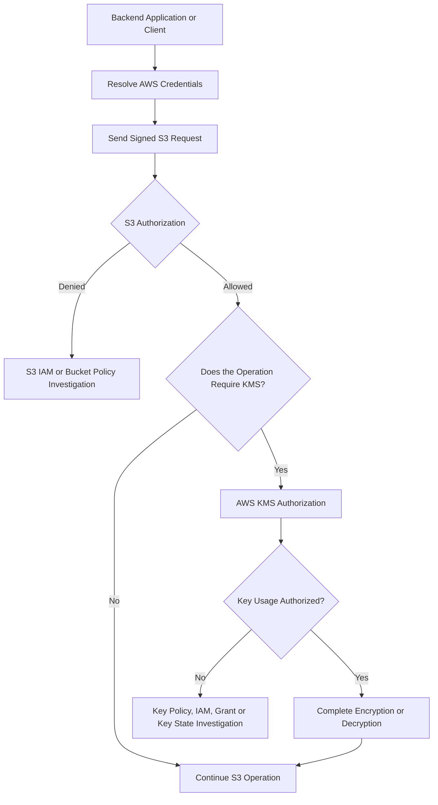
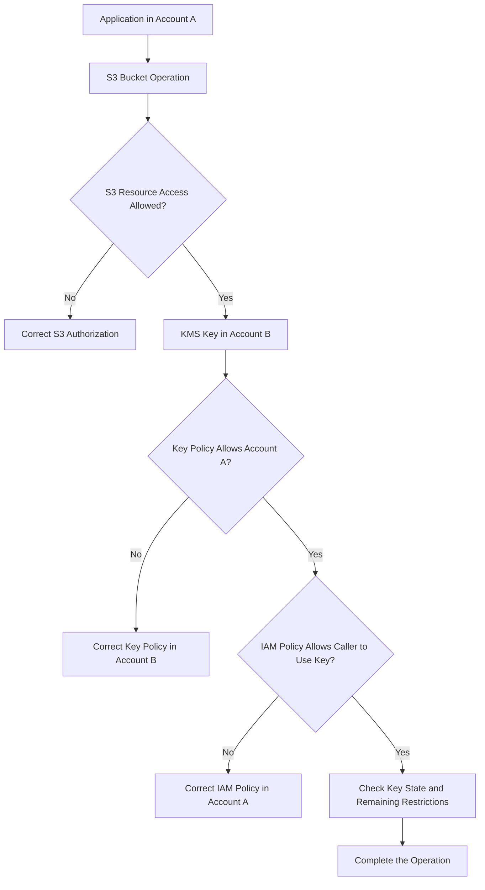

# 01- KMS Access and Encryption Errors

## Overview

Amazon S3 supports server-side encryption using Amazon S3 managed keys (SSE-S3), AWS Key Management Service (SSE-KMS and DSSE-KMS), and customer-provided encryption keys (SSE-C). Each encryption mechanism has different configuration and authorization requirements.

S3 encryption failures frequently occur when an application can access a bucket but cannot use the KMS key protecting an object. An upload may fail because the caller lacks `kms:GenerateDataKey`, a download may fail because the caller lacks `kms:Decrypt`, or a multipart upload may fail because the role does not have the full set of required KMS permissions.

Other common causes include an incorrect KMS key ARN, a disabled key, an invalid key state, a restrictive key policy, cross-account authorization gaps, and bucket encryption requirements that conflict with the request.

Amazon S3 encrypts new object uploads with SSE-S3 by default unless another encryption configuration is selected. SSE-KMS is different: it allows organizations to control key access, manage key policies, and audit cryptographic operations through AWS KMS.

This document focuses on diagnosing encryption and KMS-related failures systematically, distinguishing S3 authorization problems from KMS authorization problems, and applying targeted corrections without weakening encryption or access controls.

## Common Symptoms

| Symptom or error | Likely area to investigate |
|---|---|
| `AccessDenied` during `PutObject` | S3 write permission, KMS key usage, or bucket-policy conditions |
| `AccessDenied` during `GetObject` | S3 read permission, KMS decryption permission, or key-policy restrictions |
| Multipart upload fails during initiation, part upload, or completion | Multipart-specific KMS permissions and upload state |
| `KMS.AccessDeniedException` or equivalent KMS authorization details | IAM policies, key policy, grants, and other applicable restrictions |
| KMS key not found | Incorrect key ARN, account, or Region |
| KMS key disabled or invalid state | Key state or lifecycle configuration |
| Upload fails when explicitly specifying SSE-KMS headers | Invalid key configuration or incompatible bucket-policy requirements |
| Objects are accessible to the uploader but not another application | Different IAM identities, KMS permissions, or cross-account key access |
| Object copy fails between buckets | Source decryption and destination encryption permissions |
| `400 Bad Request` on a `GET` or `HEAD` request for an SSE-KMS object | Unnecessary encryption request headers or malformed request configuration |

An `AccessDenied` response alone does not prove that KMS permissions are missing. S3 may return a generic denial when an underlying authorization check fails. Use the actual operation, request context, available error details, and CloudTrail evidence to identify the responsible layer.

## Understand the S3 and KMS Authorization Layers

S3 object access and KMS key usage are separate authorization concerns.

For an SSE-KMS object, a request can require permission to access the S3 resource and permission to use the KMS key protecting the data.



The effective result depends on the permissions and restrictions applicable to the operation. Relevant controls can include:

- Identity-based IAM policies.
- S3 bucket policies and applicable resource controls.
- KMS key policies.
- KMS grants.
- AWS Organizations service control policies.
- Permissions boundaries and session policies.
- VPC endpoint policies when requests use the corresponding endpoint.

An explicit deny or an unmet policy condition can prevent an operation even when another policy appears to allow it.

### Distinguish the encryption mechanisms

| Encryption mode | Key management | Typical troubleshooting focus |
|---|---|---|
| SSE-S3 | S3 manages the encryption keys | S3 permissions and bucket encryption requirements |
| SSE-KMS | AWS KMS key and policies control cryptographic key usage | S3 permissions, KMS permissions, key state, and key policy |
| DSSE-KMS | S3 applies dual-layer server-side encryption with AWS KMS integration | S3 authorization, KMS permissions, and DSSE-KMS configuration |
| SSE-C | The client supplies encryption key material with requests | Correct customer-provided key material and required request headers |

Do not investigate KMS permissions for every S3 encryption failure. First identify the encryption mode of the affected object and the encryption configuration used by the operation.

## Required Permissions for SSE-KMS

The following table describes the principal KMS permissions commonly required for standard S3 SSE-KMS operations. Additional permissions may be required for administration, configuration inspection, multipart workflows, copying, or other operation-specific behavior.

| Operation | Typical S3 permission | KMS permission |
|---|---|---|
| Upload an object with SSE-KMS | `s3:PutObject` | `kms:GenerateDataKey` |
| Download an SSE-KMS object | `s3:GetObject` | `kms:Decrypt` |
| Complete a standard multipart upload using SSE-KMS | `s3:PutObject` and applicable multipart permissions | `kms:GenerateDataKey` and `kms:Decrypt` |
| Copy an SSE-KMS object to another destination | Source read and destination write permissions | Decryption permission for the source key and data-key generation permission for the destination key, as applicable |
| Inspect KMS key metadata | Not necessarily an S3 permission | `kms:DescribeKey` |
| Manage KMS key policies | Not an S3 object permission | Appropriate KMS key-administration permissions |

A multipart upload has additional requirements because S3 may need to decrypt and read encrypted parts while completing the upload. Granting only `kms:GenerateDataKey` can therefore be insufficient.

Consult the operation-specific AWS permissions documentation when a workflow uses multipart copy, replication, checksums, DSSE-KMS, or another specialized operation.

## Diagnostic Workflow

### Capture the failure evidence

Before changing policies, capture the details needed to identify the failed operation:

- AWS error code and message.
- HTTP status code.
- S3 operation, bucket, and object key.
- Effective AWS account and principal.
- S3 bucket Region and KMS key ARN.
- Object encryption mode.
- Whether the failure affects upload, download, copy, or multipart processing.
- S3 request ID and extended request ID when available.
- Relevant KMS and S3 CloudTrail events, if enabled.

Do not log secret access keys, session tokens, authorization headers, or complete presigned URLs during the investigation.

### Verify the effective identity

Run these commands in the same environment that performs the failing operation:

```bash
aws sts get-caller-identity
aws configure list
```

If the application uses a named profile, test that profile explicitly:

```bash
aws sts get-caller-identity --profile s3-debug
aws configure list --profile s3-debug
```

For Python applications, verify the identity through Boto3 in the actual application environment.

The identity used by the AWS CLI may differ from the identity used by Boto3, Docker, Kubernetes, or a CI/CD runner. Confirm that the failing process uses the intended role before examining the key policy.

### Verify bucket encryption configuration

Inspect the bucket's default encryption settings:

```bash
aws s3api get-bucket-encryption \
  --bucket example-private-bucket \
  --region ap-south-1
```

Review the configured encryption algorithm and any associated KMS key identifier.

This command describes the bucket's default encryption configuration. It does not independently establish how every existing object is encrypted.

If the failure concerns a specific object, inspect its metadata.

```bash
aws s3api head-object \
  --bucket example-private-bucket \
  --key "documents/report.pdf" \
  --region ap-south-1
```

Review fields such as:

- `ServerSideEncryption`
- `SSEKMSKeyId`
- `BucketKeyEnabled`, when returned

The response helps establish whether the object uses SSE-KMS and which key is associated with it. A `HeadObject` request can itself fail because of S3 authorization requirements; investigate that permission separately if necessary.

For an SSE-KMS object, do not send SSE-KMS encryption request headers on `GET` or `HEAD` requests. Doing so can produce `400 Bad Request`.

### Verify the KMS key

Use the actual key ARN or key ID associated with the object or bucket configuration:

```bash
aws kms describe-key \
  --key-id arn:aws:kms:ap-south-1:123456789012:key/EXAMPLE-KEY-ID \
  --region ap-south-1
```

Inspect the result for:

- Key ARN and owning account.
- Key Region.
- Key state.
- Key specification.
- Whether the key is enabled and usable.

The example ARN is illustrative. Replace it with the actual key identifier and Region.

If the key is in a different account or Region than expected, correct the configuration or explicitly investigate the cross-account design. For S3 SSE-KMS, the KMS key must be in the same Region as the S3 bucket.

A key can exist but still be unusable because it is disabled, pending deletion, or in another invalid state. Do not schedule or cancel key deletion as a diagnostic experiment. Follow the organization's key-management procedure after establishing the actual key state.

## Diagnose KMS Authorization Failures

### Inspect the IAM policy attached to the caller

For a role that uploads and downloads standard SSE-KMS objects, a narrowly scoped identity policy may need to grant the relevant KMS operations on the intended key.

Illustrative IAM policy:

```json
{
  "Version": "2012-10-17",
  "Statement": [
    {
      "Sid": "AllowS3ObjectKeyUsage",
      "Effect": "Allow",
      "Action": [
        "kms:GenerateDataKey",
        "kms:Decrypt"
      ],
      "Resource": "arn:aws:kms:ap-south-1:123456789012:key/EXAMPLE-KEY-ID"
    }
  ]
}
```

This policy is only an illustrative component of the authorization configuration. It does not grant access to the S3 bucket, modify the KMS key policy, or override explicit denies.

Restrict the actions and key ARN to the operations and resources required by the application. Do not use unrestricted KMS permissions as a routine troubleshooting workaround.

### Inspect the KMS key policy

Every KMS key has a key policy. The key policy is a primary control for deciding which principals can use or administer the key.

For a customer managed key, inspect the key policy using the console or:

```bash
aws kms get-key-policy \
  --key-id arn:aws:kms:ap-south-1:123456789012:key/EXAMPLE-KEY-ID \
  --policy-name default \
  --region ap-south-1
```

Check whether the effective principal is authorized for the required operation.

In the same account, a key policy can explicitly allow a principal or enable IAM policies to delegate access. An IAM allow statement alone is not sufficient when the key policy does not establish the necessary authorization path.

Check for:

- Missing permissions for the intended role.
- Incorrect principal ARN.
- Conditions that do not match the request context.
- Explicit denies.
- Policy changes made during a deployment.
- Grants that were removed or no longer apply.

Avoid replacing the entire key policy with a permissive example. Make a reviewed, narrowly scoped change and preserve administrative access to the key.

### Inspect KMS grants and organizational restrictions

KMS grants provide another mechanism for authorizing key usage. Where grants are part of the architecture, verify that they apply to the intended principal and operations.

If the key policy and IAM policy appear correct, investigate additional restrictions:

- Service control policies.
- Permissions boundaries.
- Session policies for assumed roles.
- KMS key policy conditions.
- VPC endpoint policies.
- Explicit deny statements in applicable policies.

Use the actual request context and policy evaluation evidence to identify which control is preventing access. Adding another allow statement will not override an applicable explicit deny.

## Troubleshoot Cross-Account SSE-KMS Access

Cross-account access to SSE-KMS objects requires coordinated authorization in the account owning the key and the account containing the requesting identity.

For a customer managed KMS key, the key policy must allow the external account or intended external principal to use the key. The caller's account must also authorize the identity through an applicable IAM policy.

Both sides must be configured correctly.



For cross-account investigations, verify:

1. The account owning the bucket and the account owning the KMS key.
2. The effective role or principal executing the operation.
3. The permissions granted by the S3 bucket policy and caller identity policies.
4. The key policy in the account that owns the KMS key.
5. The KMS permissions granted to the caller in the external account.
6. Whether any organizational or explicit-deny restriction applies.

The AWS-managed `aws/s3` KMS key cannot be shared for cross-account object access in the same way as a customer managed key. Use a suitable customer managed KMS key when the architecture requires cross-account SSE-KMS access.

When specifying a customer managed key for cross-account encryption, prefer its fully qualified key ARN rather than an ambiguous alias. An alias may resolve in the requester's account rather than the account that owns the intended key.

## Troubleshoot Multipart Upload Failures

Multipart uploads use multiple API operations and can fail at different stages.

| Stage | Diagnostic focus |
|---|---|
| `CreateMultipartUpload` | `s3:PutObject`, KMS key selection, `kms:GenerateDataKey`, and bucket-policy requirements |
| `UploadPart` | Upload permissions, required request configuration, and relevant KMS permissions |
| `CompleteMultipartUpload` | Multipart permissions, `kms:Decrypt`, `kms:GenerateDataKey`, and completion or checksum requirements |
| Multipart copy | Source object read/decryption access and destination object write/encryption access |

For SSE-KMS multipart uploads, verify both `kms:GenerateDataKey` and `kms:Decrypt` where required by the operation.

Inspect the application or SDK logs to determine exactly which multipart API operation failed. An error at completion may indicate a different missing permission than an error during initiation.

If an upload is abandoned or repeatedly fails, inspect incomplete multipart uploads according to the operational procedures for the bucket. Do not assume that retrying completion fixes an authorization problem.

Use an SDK transfer manager where appropriate, but verify its permissions and encryption configuration rather than treating multipart behavior as identical to a single `PutObject` request.

## Troubleshoot Encryption Configuration Conflicts

### Bucket default encryption

A bucket can be configured to use SSE-KMS by default. If the application specifies a different encryption mode or key, the operation may fail because the request conflicts with bucket policy conditions or other enforced settings.

Inspect the bucket's default encryption and compare it with the request.

For example, a bucket policy may require a particular KMS key ARN. Sending a request that relies on another key, or omitting a required encryption header when the policy requires one explicitly, may lead to a denial.

Default encryption and a policy that requires specific request headers are not the same control. Determine whether the failure comes from default encryption, an explicit request setting, or a policy condition.

### Wrong key ARN or Region

Check that the KMS key ARN identifies the intended key, account, and Region. Ensure that the key is valid for SSE-KMS and that the bucket and key are in the same Region.

Do not blindly change the bucket Region or key ARN in production. Confirm the existing object encryption configuration and the intended key-management design first.

### SSE-C versus SSE-KMS

SSE-C uses customer-provided key material rather than an AWS KMS key. A KMS policy change will not repair an incorrect SSE-C encryption key.

If the object uses SSE-C, verify that the required encryption headers and customer-provided key material are correct for the request. Handle such material as highly sensitive data and do not record it in logs.

## Troubleshoot Object Copy and Migration Operations

Copying an object encrypted with SSE-KMS can require authorization for both the source and destination.

The source operation may require permission to read the object and decrypt it with its existing KMS key. The destination operation may require permission to write the object and generate a data key using the destination KMS key.

For example, a migration role might have access to the source S3 bucket but lack permission to use the source KMS key. The copy can then fail even though ordinary unencrypted object operations succeed.

Before retrying a migration, establish:

- Source and destination bucket Regions.
- Source object encryption mode and key.
- Destination bucket's default encryption and any required key.
- Source object read and KMS decryption permissions.
- Destination write and KMS data-key generation permissions.
- Cross-account authorization on each relevant resource.
- Whether the copy operation specifies destination encryption headers appropriately.

Do not assume that the destination automatically uses the same encryption configuration as the source. Configure and verify the target encryption behavior explicitly when the migration requirements demand it.

## Use CloudTrail to Identify the Failing Authorization Layer

CloudTrail can help determine whether an operation failed at S3 or AWS KMS.

For SSE-KMS investigations, inspect relevant KMS management and cryptographic API events, such as:

- `GenerateDataKey`
- `Decrypt`
- `DescribeKey`
- Key-policy modification events

Search the relevant time window and correlate the event with the application request and S3 request IDs where available.

A KMS event can provide evidence about the principal, key, action, and authorization error. The absence of an event is not definitive proof that KMS was not involved; logging configuration, event availability, and the specific request path matter.

S3 object-level CloudTrail data events may need to be enabled explicitly. Their availability and cost depend on the configured trail or event data store settings.

Avoid enabling broad, expensive data-event logging solely as an unbounded debugging measure. Configure the narrowest useful coverage and time window consistent with security and operational requirements.

## Root Cause and Corrective Action

Use the collected evidence to apply the smallest appropriate correction.

| Confirmed root cause | Corrective action | Prevention |
|---|---|---|
| Missing `kms:GenerateDataKey` | Grant the operation to the intended principal on the correct key | Test SSE-KMS uploads using the application's actual role |
| Missing `kms:Decrypt` | Grant decryption permission when required for the operation | Test reads, copies, and multipart workflows separately |
| Incorrect KMS key ARN | Correct the key reference in application or bucket configuration | Prefer fully qualified ARNs for customer managed keys where appropriate |
| Disabled or invalid key state | Follow the approved key recovery procedure | Monitor key state and protect key lifecycle changes |
| Incorrect key policy | Make a reviewed, least-privilege change to the key policy | Manage key policies through controlled infrastructure changes |
| Cross-account key authorization incomplete | Configure both the key policy and the caller's IAM policy | Include cross-account encryption tests in deployment verification |
| Bucket policy requires different encryption settings | Align the request with the approved encryption configuration or revise the condition through change control | Validate bucket policies and application upload parameters together |
| Wrong encryption mode | Use the appropriate SSE-S3, SSE-KMS, DSSE-KMS, or SSE-C request configuration | Make encryption requirements explicit in the storage service layer |
| Multipart-only failure | Add only the missing operation-specific permissions, including `kms:Decrypt` when required | Test multipart initiation, part upload, and completion |
| Presigned URL KMS failure | Verify the signing principal, credential lifetime, S3 access, and KMS authorization | Test the complete client-to-S3 workflow |
| Copy or migration failure | Validate source decryption and destination encryption permissions | Use an explicit source-to-destination authorization checklist |

After making a correction, repeat the original operation with the same identity and target object. Verify the expected encryption mode and key for new or copied objects, and confirm that reads work with the intended consumer identity.

## Production Best Practices

- Separate S3 object permissions from KMS key-usage permissions in diagnosis and policy design.
- Grant only the KMS actions required by each workload.
- Use customer managed KMS keys when explicit key-policy control or supported cross-account access is required.
- Keep KMS keys in the same Region as the S3 buckets using them for SSE-KMS.
- Protect key policies, grants, and key lifecycle operations with change control.
- Use the application's actual role for upload, download, and copy integration tests.
- Validate multipart workflows separately from single-request uploads.
- Avoid sending SSE-KMS encryption request headers with `GET` or `HEAD` operations.
- Inspect CloudTrail evidence when the S3 error does not explain the underlying authorization failure.
- Monitor key availability and avoid irreversible key deletion decisions during incident response.
- Evaluate S3 Bucket Keys when reducing SSE-KMS request volume and cost is beneficial, and account for their effect on the encryption context and relevant policy conditions.
- Keep KMS key usage, data access, and diagnostic logs within the organization's security and retention requirements.

## Related AWS Documentation

- [Using server-side encryption with AWS KMS keys (SSE-KMS)](https://docs.aws.amazon.com/AmazonS3/latest/userguide/UsingKMSEncryption.html)
- [Specifying server-side encryption with AWS KMS](https://docs.aws.amazon.com/AmazonS3/latest/userguide/specifying-kms-encryption.html)
- [AWS KMS key policies](https://docs.aws.amazon.com/kms/latest/developerguide/key-policies.html)
- [Troubleshooting AWS KMS permissions](https://docs.aws.amazon.com/kms/latest/developerguide/policy-evaluation.html)
- [Allowing users in other accounts to use a KMS key](https://docs.aws.amazon.com/kms/latest/developerguide/key-policy-modifying-external-accounts.html)
- [Required permissions for Amazon S3 API operations](https://docs.aws.amazon.com/AmazonS3/latest/userguide/using-with-s3-policy-actions.html)
- [Multipart upload API and permissions](https://docs.aws.amazon.com/AmazonS3/latest/userguide/mpuoverview.html)

## Key Takeaways

- SSE-KMS operations can require both S3 resource permissions and KMS key-usage permissions; a successful S3 authorization check does not guarantee successful decryption or encryption.
- `kms:GenerateDataKey` is generally required for SSE-KMS uploads, `kms:Decrypt` for downloads, and multipart workflows commonly require both.
- Diagnose key policy, IAM policy, grants, key state, Region, and cross-account configuration before broadening permissions.
- Use the actual encryption metadata and CloudTrail evidence to distinguish S3 authorization failures from KMS failures.
- Apply targeted, least-privilege corrections and verify the original workflow, including multipart or copy behavior when relevant.