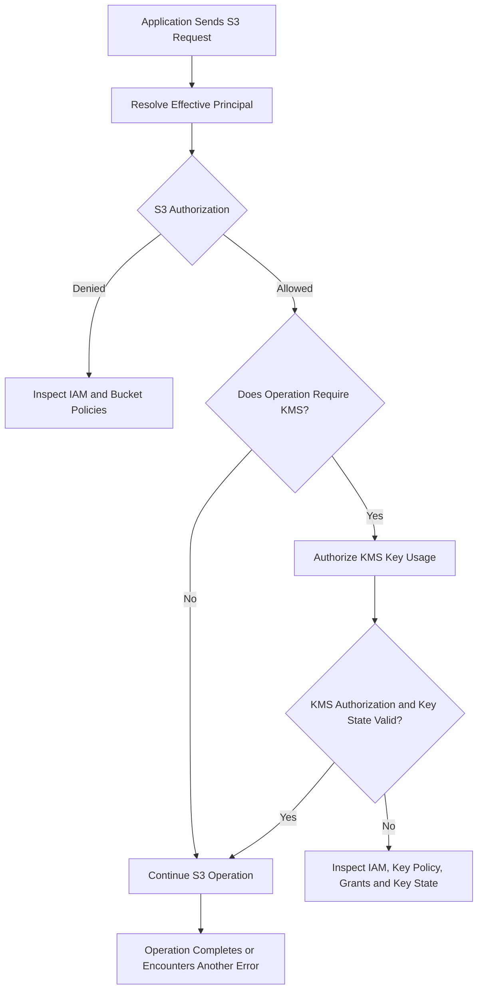
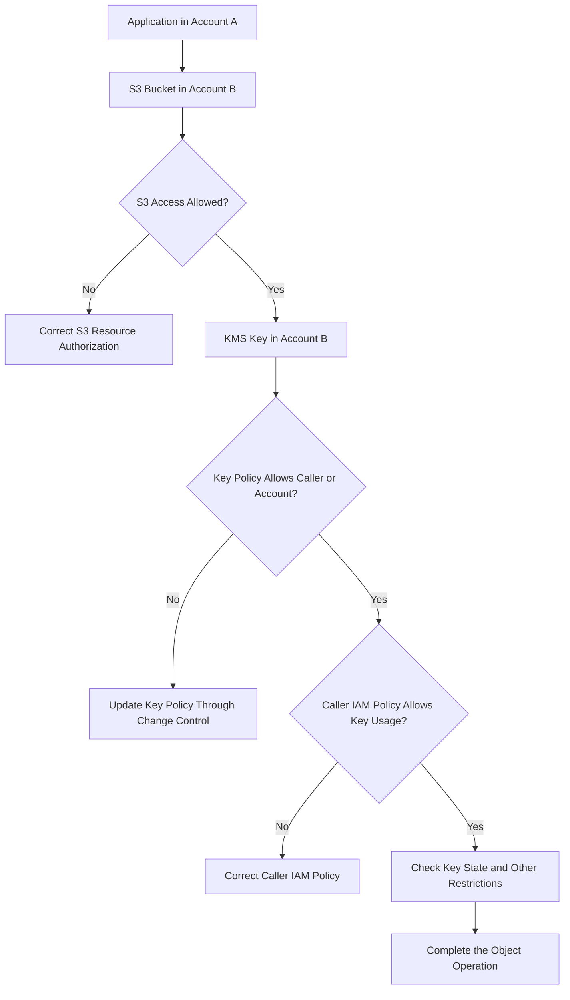

# 02- Access Denied During SSE-KMS Operations

## Overview

Amazon S3 operations involving server-side encryption with AWS Key Management Service (SSE-KMS) require authorization at more than one layer. An application may have permission to access an S3 object but still receive `AccessDenied` because its IAM principal is not authorized to use the KMS key protecting that object.

The reverse is also possible: a principal may be allowed to use a KMS key but lack the required S3 permissions.

Common symptoms include:

- `AccessDenied` during `PutObject`, `GetObject`, or `CopyObject`.
- Uploads succeeding for small files but failing during multipart transfers.
- An application reading ordinary objects but failing to read SSE-KMS objects.
- Cross-account access failing even though the bucket policy allows the external principal.
- An S3 operation failing after a KMS key policy, IAM policy, or encryption configuration changes.
- A workload using the wrong KMS key, account, or Region.
- An object becoming inaccessible after a key is disabled or its policy is changed.

The objective of this guide is to distinguish S3 authorization failures from KMS authorization failures, identify the missing permission or configuration, and restore access without weakening encryption or access controls.

## Understand the Two Authorization Layers

For an SSE-KMS object, S3 permissions and KMS key-usage permissions serve different purposes.

- **S3 authorization** controls whether a principal can perform the requested operation on a bucket or object.
- **KMS authorization** controls whether the principal or an authorized AWS service can perform the necessary cryptographic operation using the encryption key.

For example, downloading an SSE-KMS object generally requires `s3:GetObject` and `kms:Decrypt`. Allowing only one of these actions is insufficient.



A successful KMS authorization does not bypass S3 authorization. Similarly, an S3 permission does not automatically grant access to a customer managed KMS key.

Applicable restrictions can also include explicit denies, AWS Organizations service control policies, permissions boundaries, session policies, and VPC endpoint policies.

## Identify the Encryption Mode

Before investigating KMS permissions, establish how the affected object is encrypted.

| Encryption mode | KMS-specific investigation required? | Primary diagnostic focus |
|---|---|---|
| SSE-S3 | No customer KMS authorization required for the object's encryption | S3 permissions and bucket-policy requirements |
| SSE-KMS | Yes | S3 permissions, KMS permissions, key policy, and key state |
| DSSE-KMS | Yes | S3 authorization, KMS permissions, and dual-layer encryption configuration |
| SSE-C | No AWS KMS key is used for the customer-provided encryption key | Correct customer-provided key material and request headers |

S3 now applies SSE-S3 by default to new object uploads unless another supported encryption configuration is selected. A bucket can also have default SSE-KMS encryption or a policy requiring a particular encryption configuration.

Do not assume that every `AccessDenied` involving an encrypted object is a KMS failure. Confirm the actual encryption mode and inspect the AWS error evidence.

## Common Causes

| Cause | Observable evidence | Verification |
|---|---|---|
| Missing S3 permission | The request fails before the required object operation can proceed | Inspect the principal's identity policies, bucket policy, and applicable denies |
| Missing `kms:GenerateDataKey` | SSE-KMS upload fails | Inspect the IAM and key policies for the actual key |
| Missing `kms:Decrypt` | Download, copy, or multipart operation fails | Check the operation-specific KMS requirements |
| KMS key policy excludes the principal | IAM appears to allow KMS usage, but access remains denied | Inspect the key policy and applicable grants |
| Wrong KMS key ARN | Request uses an unexpected or unavailable key | Compare the bucket configuration, object metadata, and request parameters |
| Key disabled or pending deletion | Encryption or decryption cannot use the expected key | Inspect the KMS key state |
| Cross-account policy incomplete | Access fails for a principal in another account | Validate authorization in both the key-owning and caller accounts |
| Bucket policy enforces a different encryption configuration | Upload is denied despite otherwise valid S3 permissions | Inspect policy conditions and request headers |
| Multipart-specific permissions are missing | Single-part upload succeeds, multipart upload fails | Inspect the failed multipart API operation |
| Encryption context condition does not match | KMS permission appears present but is ineffective | Inspect KMS encryption-context conditions and S3 Bucket Key configuration |
| Temporary credentials or role selection differ | Requests fail only from a particular workload | Verify the effective AWS identity and credential provider |

## Diagnostic Workflow

### Capture the original failure

Collect the following information before modifying policies:

- AWS error code, error message, and HTTP status code.
- S3 operation, bucket, and object key.
- Effective AWS account and principal ARN.
- Bucket Region and KMS key ARN.
- Object encryption mode, when available.
- Whether the failed operation is an upload, download, copy, or multipart transfer.
- S3 request ID and extended request ID, when supplied.
- Relevant KMS and S3 CloudTrail evidence.

Never record secret access keys, session tokens, authorization headers, or complete presigned URLs in general application logs.

### Verify the effective identity

Run these commands from the environment where the failing operation occurs:

```bash
aws sts get-caller-identity
aws configure list
```

For an explicitly selected profile:

```bash
aws sts get-caller-identity --profile s3-debug
aws configure list --profile s3-debug
```

Verify that the account and principal match the intended workload identity.

A developer workstation, Boto3 application, Docker container, Kubernetes workload, and CI/CD runner may use different credential providers. A successful CLI request does not prove that the application uses the same principal.

For Boto3 applications, verify the identity through the SDK in the same runtime environment:

```python
import boto3

session = boto3.Session()
sts_client = session.client("sts")

identity = sts_client.get_caller_identity()

print(f"Account: {identity['Account']}")
print(f"Principal: {identity['Arn']}")
```

This confirms the caller identity used for the STS request. It does not prove that the principal has the necessary permissions on the S3 object or KMS key.

### Inspect the bucket encryption configuration

Retrieve the bucket's default encryption configuration:

```bash
aws s3api get-bucket-encryption \
  --bucket example-private-bucket \
  --region ap-south-1
```

Inspect a specific object when you know its key:

```bash
aws s3api head-object \
  --bucket example-private-bucket \
  --key "documents/report.pdf" \
  --region ap-south-1
```

Review returned fields such as:

- `ServerSideEncryption`
- `SSEKMSKeyId`
- `BucketKeyEnabled`, when present

The bucket configuration describes its default encryption behavior. Object metadata helps establish the encryption associated with an existing object.

A `HeadObject` request can itself fail because of S3 authorization. If it returns `AccessDenied`, investigate permission to access the object before assuming the encryption metadata is unavailable due to KMS.

Do not send SSE-KMS encryption request headers with `GetObject` or `HeadObject`. These are not required to read an object encrypted with SSE-KMS and can lead to a `400 Bad Request` response.

### Identify the KMS key and its state

Use the actual KMS key ARN or identifier:

```bash
aws kms describe-key \
  --key-id arn:aws:kms:ap-south-1:123456789012:key/EXAMPLE-KEY-ID \
  --region ap-south-1
```

Check:

- Key ARN and owning account.
- Key Region.
- Key state.
- Key specification.
- Whether the key is enabled and usable.

For SSE-KMS, the KMS key must be in the same Region as the S3 bucket. A key ARN pointing to the wrong account or Region can lead to encryption failures even when the caller's identity policies appear correct.

A disabled key or a key pending deletion may be unavailable for cryptographic operations. Follow the approved key-management and recovery procedures to address key-state problems; do not change key lifecycle settings casually during an incident.

## Verify Required Permissions

The precise permission set depends on the API operation and how encryption is configured.

### Standard SSE-KMS operation requirements

| Operation | Typical S3 permission | Typical KMS permission |
|---|---|---|
| Upload an object | `s3:PutObject` | `kms:GenerateDataKey` |
| Download an object | `s3:GetObject` | `kms:Decrypt` |
| Retrieve object metadata | Appropriate S3 object-access permission | Depends on the operation and request path; verify the actual error rather than assuming a separate KMS permission is always required |
| Copy an SSE-KMS source object | Source read permissions and destination write permissions | `kms:Decrypt` on the source key and `kms:GenerateDataKey` on the destination key, as applicable |
| Multipart upload | Multipart-related S3 permissions, including `s3:PutObject` where required | `kms:GenerateDataKey` and `kms:Decrypt` for the documented SSE-KMS multipart workflow |
| Inspect key metadata | Not necessarily an S3 permission | `kms:DescribeKey` when the workflow needs that operation |

This table describes typical requirements, not a complete policy for every workflow. Some operations require additional permissions based on their API behavior, encryption settings, or resource configuration.

### Example identity policy for a backend service

The following illustrative policy allows a workload to perform common S3 upload and download operations and use a particular customer managed KMS key.

```json
{
  "Version": "2012-10-17",
  "Statement": [
    {
      "Sid": "AllowRequiredObjectOperations",
      "Effect": "Allow",
      "Action": [
        "s3:GetObject",
        "s3:PutObject"
      ],
      "Resource": "arn:aws:s3:::example-private-bucket/uploads/*"
    },
    {
      "Sid": "AllowRequiredKMSUsage",
      "Effect": "Allow",
      "Action": [
        "kms:GenerateDataKey",
        "kms:Decrypt"
      ],
      "Resource": "arn:aws:kms:ap-south-1:123456789012:key/EXAMPLE-KEY-ID"
    }
  ]
}
```

This is an illustrative policy component, not a complete production authorization design. It does not grant bucket-listing, deletion, multipart listing, key administration, or other unrelated actions. Add only the operations that the workload actually requires.

The identity policy also does not replace the KMS key policy. The key policy must establish an authorization path for the principal to use the key.

## Diagnose KMS Key Policy Problems

### Inspect the key policy

Retrieve the default key policy:

```bash
aws kms get-key-policy \
  --key-id arn:aws:kms:ap-south-1:123456789012:key/EXAMPLE-KEY-ID \
  --policy-name default \
  --region ap-south-1
```

Verify that the policy permits the intended principal or enables the appropriate IAM delegation model.

Look for:

- An incorrect role or account ARN.
- Missing `kms:GenerateDataKey` or `kms:Decrypt` permissions.
- An applicable explicit deny.
- Conditions that do not match the request context.
- Changes introduced by an infrastructure deployment.
- Missing or restrictive KMS grants where grants are part of the design.

An IAM allow statement is not always sufficient. KMS key policies participate directly in authorization, and cross-account access generally requires permission in both the key-owning account and the caller's account.

### Avoid replacing the entire key policy

Do not replace a production key policy with a permissive sample merely to restore access. Such a change can weaken encryption controls, expose sensitive data, or remove administrative access to the key.

Prefer a reviewed, narrowly scoped policy change that preserves existing administration and service integrations.

Before making a policy change, determine whether the denial comes from the identity policy, key policy, grant, or another restriction. Adding more allow statements will not override an applicable explicit deny.

## Troubleshoot Cross-Account Access

Cross-account access to SSE-KMS objects requires a coordinated authorization configuration.

For example, an application in Account A reads an object in an S3 bucket in Account B. The object is encrypted with a customer managed KMS key in Account B.

The request generally requires:

- S3 permission for the object in Account B.
- Bucket-policy authorization for the external principal, when required by the access design.
- KMS key-policy authorization that allows the external account or intended principal to use the key.
- An appropriate IAM policy in Account A granting the caller the necessary KMS operation.
- No applicable explicit deny or organizational restriction.



Inspect the bucket, key, and caller account IDs rather than assuming that all resources belong to the same account.

The AWS managed key `aws/s3` is not suitable for granting cross-account key usage in the same way as a customer managed KMS key. Use a customer managed key when the architecture requires cross-account SSE-KMS access.

For cross-account encryption requests, prefer a fully qualified key ARN when identifying the intended customer managed key. This reduces ambiguity and makes the owning account and Region explicit.

## Troubleshoot Multipart Upload Failures

Multipart uploads can fail at different stages because each stage performs different S3 and KMS operations.

| Multipart stage | Investigation |
|---|---|
| `CreateMultipartUpload` | Verify `s3:PutObject`, the intended encryption configuration, and `kms:GenerateDataKey` |
| `UploadPart` | Inspect the actual error, upload state, and required permissions for the upload operation |
| `CompleteMultipartUpload` | Verify the multipart workflow's KMS requirements, including `kms:Decrypt` and `kms:GenerateDataKey` where required |
| `UploadPartCopy` | Check source-object access, source-key decryption permissions, and destination encryption permissions |

A single-part upload can succeed while a multipart upload fails because the latter requires additional cryptographic permissions. In particular, S3 needs appropriate permission to decrypt and read encrypted parts when completing an SSE-KMS multipart upload.

To diagnose the failure:

1. Identify the exact multipart API operation that failed.
2. Verify the effective role and encryption key.
3. Inspect the relevant S3 permissions.
4. Check the KMS permissions required by that operation.
5. Review CloudTrail evidence for the time of the failure.
6. Apply the smallest necessary policy correction and retry through the supported SDK workflow.

Do not assume that repeatedly retrying `CompleteMultipartUpload` fixes a deterministic permission error. Investigate incomplete multipart uploads according to the bucket's operational procedures.

## Troubleshoot Object Copy and Migration

Copying an object encrypted with SSE-KMS can require permissions for both the source and destination.

For a copy from one encrypted object to another:

- The caller requires permission to read the source object.
- The caller needs KMS decryption permission on the source key when required by the source encryption.
- The caller requires permission to write the destination object.
- The caller needs permission to generate a data key using the destination key when required by the destination encryption configuration.

Before retrying a failed copy, inspect the source object's encryption metadata, destination bucket's default encryption, any explicit destination key, and the caller's permissions on both keys.

Do not assume that the destination automatically inherits the source object's encryption configuration. Configure and verify the target encryption behavior according to the migration requirements.

For cross-account migration, assess S3 authorization and KMS authorization independently on both sides. A principal that can read the source object is not necessarily authorized to decrypt it or encrypt the destination object.

## Investigate KMS Encryption Context and S3 Bucket Keys

KMS encryption-context conditions can create authorization failures even when the expected KMS actions appear to be allowed.

S3 Bucket Keys can change the encryption context used for SSE-KMS operations. With Bucket Keys enabled, the context can use a bucket-level ARN instead of an individual object ARN.

A policy or key-policy condition that expects only object-level encryption-context values may therefore reject requests that use Bucket Keys.

Check:

- Whether S3 Bucket Keys are enabled for the bucket or object.
- Whether policy conditions constrain `kms:EncryptionContext` values.
- Whether an existing encryption-context condition matches the request's actual context.
- Whether changes to bucket defaults or object-copy behavior altered the encryption configuration.

Do not remove encryption-context conditions indiscriminately. Determine the intended security boundary and update the policy only to permit the appropriate context values.

## Use CloudTrail to Identify the Failing Layer

CloudTrail provides useful evidence when an S3 response does not clearly reveal why an encrypted operation was denied.

Inspect relevant events for the failed time window, including:

- KMS `GenerateDataKey` events.
- KMS `Decrypt` events.
- KMS `DescribeKey` events, where applicable.
- KMS key-policy or grant changes.
- Related S3 object-level data events, if configured.

Use the principal, key ARN, operation, error code, and timestamp to correlate the event with the failed application request. CloudTrail availability depends on which management events and data events have been configured and on the specific request path.

The absence of a KMS event does not prove that KMS authorization was not involved. Validate the logging coverage and inspect the actual service error before drawing conclusions.

S3 object-level CloudTrail data events may incur additional charges. Use an appropriately scoped investigation window and logging configuration rather than enabling broad data-event collection indefinitely for a single incident.

## Root Cause and Corrective Action

| Confirmed root cause | Corrective action | Prevention |
|---|---|---|
| Missing `s3:PutObject` or `s3:GetObject` | Grant the required S3 operation on the intended resource | Test with the application's actual role |
| Missing `kms:GenerateDataKey` | Grant the required key usage on the intended KMS key | Validate encrypted uploads during integration testing |
| Missing `kms:Decrypt` | Grant decryption permission when required by the operation | Test downloads, multipart uploads, and copy workflows separately |
| Incorrect key policy | Apply a reviewed, least-privilege key-policy correction | Manage key policies through controlled infrastructure changes |
| Incorrect KMS key ARN | Correct the application or bucket encryption configuration | Use explicit key ARNs and validate account and Region |
| Disabled or unusable key | Follow the approved key recovery procedure | Monitor key state and protect key lifecycle operations |
| Incomplete cross-account authorization | Correct both the key-owner policy and caller IAM configuration | Test cross-account reads and writes during deployment validation |
| Bucket policy requires incompatible encryption settings | Align the request with the approved encryption configuration | Validate bucket policies and backend upload parameters together |
| Multipart-only permission failure | Add only the missing operation-specific permissions | Test multipart initiation, part upload, and completion independently |
| Encryption-context mismatch | Correct the policy condition to match the intended context | Test policies with S3 Bucket Keys enabled and disabled where applicable |

After applying a correction, repeat the original operation with the same effective identity, bucket, Region, and encryption configuration. Verify that the operation succeeds and that newly written or copied objects use the intended encryption mode and KMS key.

## Production Best Practices

- Separate S3 object permissions from KMS key-usage permissions during diagnosis and policy design.
- Use least-privilege IAM roles and narrowly scoped KMS key policies.
- Keep KMS keys in the same Region as the S3 buckets that use them for SSE-KMS.
- Use customer managed KMS keys when explicit key-policy control or supported cross-account key usage is required.
- Test uploads, downloads, multipart transfers, and object copies independently.
- Protect KMS key policies, grants, and lifecycle settings with change control.
- Validate encryption-context conditions when enabling or changing S3 Bucket Keys.
- Use CloudTrail evidence to distinguish S3 authorization failures from KMS authorization failures.
- Avoid disabling encryption or granting broad KMS access as a troubleshooting shortcut.
- Monitor key state and ensure that recovery procedures account for disabled, pending-deletion, or otherwise unusable keys.
- Evaluate S3 Bucket Keys when they can reduce KMS request volume and cost, while validating any associated policy-condition changes.
- Include encryption configuration and KMS access checks in integration tests and deployment verification.

## Related AWS Documentation

- [Using server-side encryption with AWS KMS keys (SSE-KMS)](https://docs.aws.amazon.com/AmazonS3/latest/userguide/UsingKMSEncryption.html)
- [Specifying server-side encryption with AWS KMS](https://docs.aws.amazon.com/AmazonS3/latest/userguide/specifying-kms-encryption.html)
- [Amazon S3 multipart upload permissions](https://docs.aws.amazon.com/AmazonS3/latest/userguide/mpuoverview.html)
- [AWS KMS key policies](https://docs.aws.amazon.com/kms/latest/developerguide/key-policies.html)
- [Troubleshooting AWS KMS permissions](https://docs.aws.amazon.com/kms/latest/developerguide/policy-evaluation.html)
- [Allowing users in other accounts to use a KMS key](https://docs.aws.amazon.com/kms/latest/developerguide/key-policy-modifying-external-accounts.html)
- [Troubleshoot 403 Access Denied errors from Amazon S3](https://repost.aws/knowledge-center/s3-troubleshoot-403)

## Key Takeaways

- SSE-KMS operations can require both S3 resource permissions and KMS key-usage permissions; neither permission layer replaces the other.
- `kms:GenerateDataKey` is typically required for SSE-KMS uploads, while `kms:Decrypt` is required for downloads and certain multipart or copy operations.
- Cross-account access requires a coordinated authorization path involving the key policy and the caller's IAM permissions.
- Use object encryption metadata, key state, policy conditions, and CloudTrail evidence to identify the actual failure rather than broadly expanding permissions.
- Apply targeted corrections and verify the original workflow, including multipart and cross-account behavior when applicable.